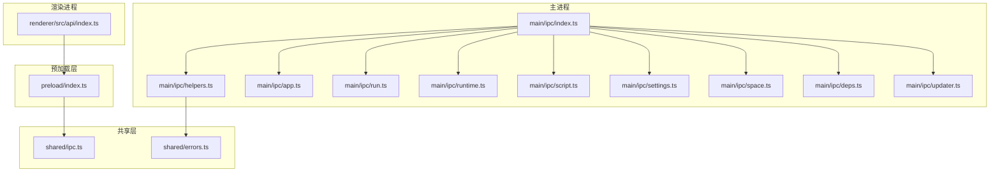
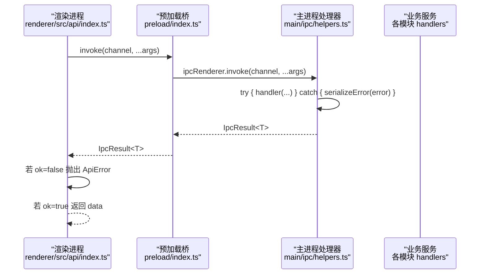
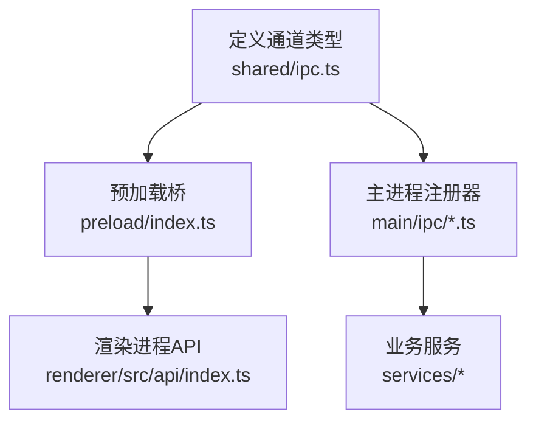
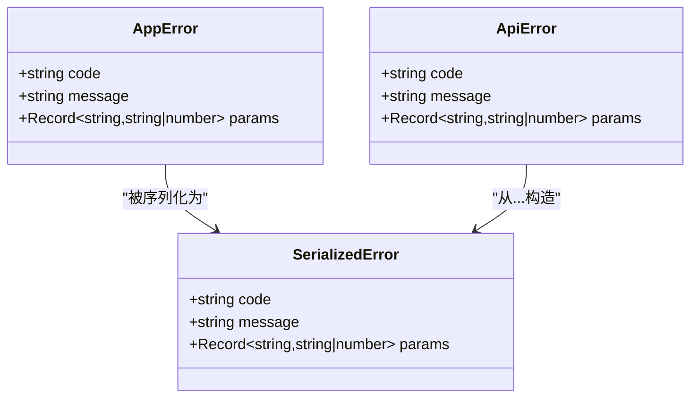
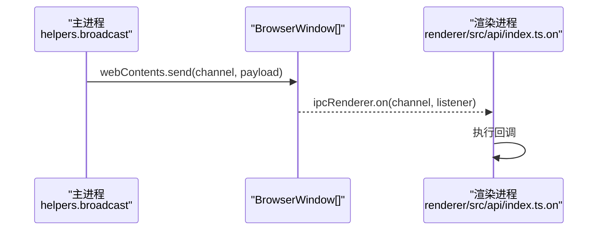
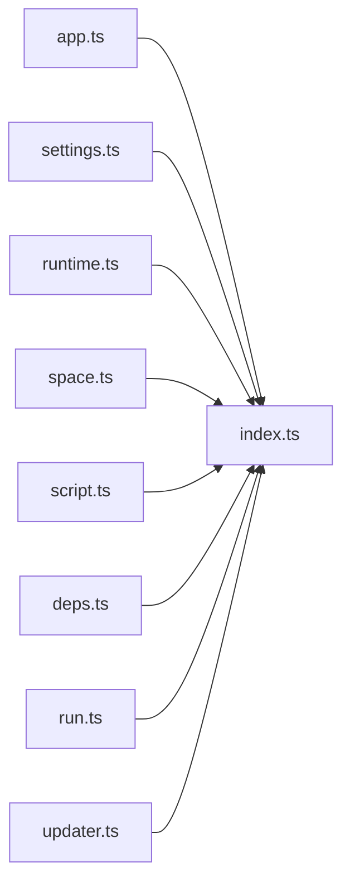
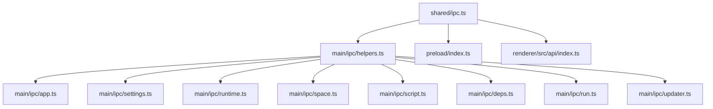

# IPC 通信层

<cite>
**本文引用的文件**   
- [src/main/ipc/index.ts](file://src/main/ipc/index.ts)
- [src/main/ipc/helpers.ts](file://src/main/ipc/helpers.ts)
- [src/main/ipc/app.ts](file://src/main/ipc/app.ts)
- [src/main/ipc/run.ts](file://src/main/ipc/run.ts)
- [src/main/ipc/runtime.ts](file://src/main/ipc/runtime.ts)
- [src/main/ipc/script.ts](file://src/main/ipc/script.ts)
- [src/main/ipc/settings.ts](file://src/main/ipc/settings.ts)
- [src/main/ipc/space.ts](file://src/main/ipc/space.ts)
- [src/main/ipc/deps.ts](file://src/main/ipc/deps.ts)
- [src/main/ipc/updater.ts](file://src/main/ipc/updater.ts)
- [src/preload/index.ts](file://src/preload/index.ts)
- [src/shared/ipc.ts](file://src/shared/ipc.ts)
- [src/renderer/src/api/index.ts](file://src/renderer/src/api/index.ts)
- [src/shared/errors.ts](file://src/shared/errors.ts)
- [src/renderer/src/api/errors.ts](file://src/renderer/src/api/errors.ts)
</cite>

## 目录
1. [简介](#简介)
2. [项目结构](#项目结构)
3. [核心组件](#核心组件)
4. [架构总览](#架构总览)
5. [详细组件分析](#详细组件分析)
6. [依赖关系分析](#依赖关系分析)
7. [性能与并发特性](#性能与并发特性)
8. [安全机制与权限控制](#安全机制与权限控制)
9. [客户端调用示例与服务端实现模式](#客户端调用示例与服务端实现模式)
10. [调试技巧与常见问题](#调试技巧与常见问题)
11. [结论](#结论)

## 简介
本文件为 Electron 主进程与渲染进程之间的 IPC 通信层技术文档。内容涵盖通道设计原则、类型安全的 API 定义、消息传递协议、错误处理模型、安全机制（contextBridge 暴露与权限控制）、客户端调用模式与服务端实现模式，以及调试与排错指南。目标是帮助开发者快速理解并正确使用该 IPC 层，同时保证跨进程调用的类型安全与可维护性。

## 项目结构
IPC 通信层由三部分构成：
- 共享类型定义：位于 shared 层，统一声明所有 IPC 通道的参数、返回值与事件类型。
- 预加载桥接：在 preload 中通过 contextBridge 暴露最小化、类型安全的 bridge API。
- 主进程处理器：在主进程中按功能域注册 handle/listen/broadcast，封装统一的错误序列化与广播机制。

**图表来源**
- [src/renderer/src/api/index.ts:1-38](file://src/renderer/src/api/index.ts#L1-L38)
- [src/preload/index.ts:1-19](file://src/preload/index.ts#L1-L19)
- [src/shared/ipc.ts:1-117](file://src/shared/ipc.ts#L1-L117)
- [src/shared/errors.ts:1-41](file://src/shared/errors.ts#L1-L41)
- [src/main/ipc/index.ts:1-20](file://src/main/ipc/index.ts#L1-L20)
- [src/main/ipc/helpers.ts:1-47](file://src/main/ipc/helpers.ts#L1-L47)
- [src/main/ipc/app.ts:1-36](file://src/main/ipc/app.ts#L1-L36)
- [src/main/ipc/run.ts:1-19](file://src/main/ipc/run.ts#L1-L19)
- [src/main/ipc/runtime.ts:1-14](file://src/main/ipc/runtime.ts#L1-L14)
- [src/main/ipc/script.ts:1-14](file://src/main/ipc/script.ts#L1-L14)
- [src/main/ipc/settings.ts:1-15](file://src/main/ipc/settings.ts#L1-L15)
- [src/main/ipc/space.ts:1-26](file://src/main/ipc/space.ts#L1-L26)
- [src/main/ipc/deps.ts:1-18](file://src/main/ipc/deps.ts#L1-L18)
- [src/main/ipc/updater.ts:1-12](file://src/main/ipc/updater.ts#L1-L12)

**章节来源**
- [src/main/ipc/index.ts:1-20](file://src/main/ipc/index.ts#L1-L20)
- [src/preload/index.ts:1-19](file://src/preload/index.ts#L1-L19)
- [src/shared/ipc.ts:1-117](file://src/shared/ipc.ts#L1-L117)

## 核心组件
- 共享类型契约：IpcInvokeMap/IpcSendMap/IpcEventMap 定义了所有请求/响应、单向发送和推送事件的通道名、参数与返回类型；IpcResult<T> 统一了成功/失败的结构化返回。
- 预加载桥：ScriptBoxBridge 暴露 invoke/send/on/getPathForFile，屏蔽底层 ipcRenderer/webUtils 细节，并通过 contextBridge.exposeInMainWorld 暴露给渲染进程。
- 主进程辅助：handle 将异步处理器包装为 IpcResult，统一捕获异常并序列化为 SerializedError；listen 用于无返回的单向消息；broadcast 向所有窗口广播事件。
- 渲染进程 API：invoke/send/on 对 bridge 进行二次封装，将 IpcResult 转换为抛错或返回值，提供类型安全的调用体验。

**章节来源**
- [src/shared/ipc.ts:25-117](file://src/shared/ipc.ts#L25-L117)
- [src/preload/index.ts:1-19](file://src/preload/index.ts#L1-L19)
- [src/main/ipc/helpers.ts:13-46](file://src/main/ipc/helpers.ts#L13-L46)
- [src/renderer/src/api/index.ts:1-38](file://src/renderer/src/api/index.ts#L1-L38)

## 架构总览
下图展示一次典型的“请求-响应”流程，包括类型校验、错误序列化与结果回传。

**图表来源**
- [src/renderer/src/api/index.ts:19-27](file://src/renderer/src/api/index.ts#L19-L27)
- [src/preload/index.ts:5-16](file://src/preload/index.ts#L5-L16)
- [src/main/ipc/helpers.ts:17-28](file://src/main/ipc/helpers.ts#L17-L28)

## 详细组件分析

### 通道设计与类型安全
- 三类通道：
  - 请求/响应：IpcInvokeMap，使用 ipcRenderer.invoke，返回 Promise<IpcResult<T>>。
  - 单向发送：IpcSendMap，使用 ipcRenderer.send，无返回值。
  - 服务端推送：IpcEventMap，使用 webContents.send，渲染侧通过 on 订阅。
- 类型约束：
  - 所有通道名、参数、返回值均受 TypeScript 类型系统约束，避免运行时拼写错误。
  - IpcResult<T> 将错误以结构化对象返回，便于前端统一处理与国际化。

**图表来源**
- [src/shared/ipc.ts:25-117](file://src/shared/ipc.ts#L25-L117)
- [src/preload/index.ts:1-19](file://src/preload/index.ts#L1-L19)
- [src/renderer/src/api/index.ts:1-38](file://src/renderer/src/api/index.ts#L1-L38)
- [src/main/ipc/index.ts:1-20](file://src/main/ipc/index.ts#L1-L20)

**章节来源**
- [src/shared/ipc.ts:25-117](file://src/shared/ipc.ts#L25-L117)

### 错误处理模型
- 主进程统一捕获异常，将任意 error 序列化为 SerializedError，包含 code/message/params。
- 渲染进程收到 IpcResult.ok=false 时抛出 ApiError，携带 code 与 params，便于 UI 层做国际化提示。
- AppError 是主进程业务错误的标准类型，serializeError 会保留其结构化信息。

**图表来源**
- [src/shared/errors.ts:19-41](file://src/shared/errors.ts#L19-L41)
- [src/renderer/src/api/index.ts:5-15](file://src/renderer/src/api/index.ts#L5-L15)

**章节来源**
- [src/main/ipc/helpers.ts:17-28](file://src/main/ipc/helpers.ts#L17-L28)
- [src/shared/errors.ts:19-41](file://src/shared/errors.ts#L19-L41)
- [src/renderer/src/api/index.ts:5-15](file://src/renderer/src/api/index.ts#L5-L15)

### 事件广播机制
- 主进程通过 broadcast 向所有未销毁的 BrowserWindow 推送事件，适用于进度、输出、状态变更等场景。
- 渲染进程通过 on 订阅事件，返回取消监听函数，便于组件生命周期管理。

**图表来源**
- [src/main/ipc/helpers.ts:41-46](file://src/main/ipc/helpers.ts#L41-L46)
- [src/preload/index.ts:8-14](file://src/preload/index.ts#L8-L14)
- [src/renderer/src/api/index.ts:33-35](file://src/renderer/src/api/index.ts#L33-L35)

**章节来源**
- [src/main/ipc/helpers.ts:41-46](file://src/main/ipc/helpers.ts#L41-L46)
- [src/preload/index.ts:8-14](file://src/preload/index.ts#L8-L14)

### 功能域处理器概览
- app：应用信息与系统交互（打开路径/外部链接/选择脚本）。
- settings：设置读取/更新、连接测试、代理应用与设置变更广播。
- runtime：远程版本列表、已安装列表、安装/取消/移除、进度广播。
- space：空间 CRUD、目录打开、忙锁保护（运行中或依赖任务进行中不可删除）。
- script：脚本文件 CRUD、导入、重命名、保存运行配置。
- deps：依赖列表、安装/卸载/更新、批量安装、取消、活跃任务、缺失扫描、类型库。
- run：启动/停止运行、活跃运行查询、写入终端输入、调整终端尺寸、历史日志。
- updater：更新状态、检查/下载/安装、状态广播。

**图表来源**
- [src/main/ipc/index.ts:1-20](file://src/main/ipc/index.ts#L1-L20)
- [src/main/ipc/app.ts:1-36](file://src/main/ipc/app.ts#L1-L36)
- [src/main/ipc/settings.ts:1-15](file://src/main/ipc/settings.ts#L1-L15)
- [src/main/ipc/runtime.ts:1-14](file://src/main/ipc/runtime.ts#L1-L14)
- [src/main/ipc/space.ts:1-26](file://src/main/ipc/space.ts#L1-L26)
- [src/main/ipc/script.ts:1-14](file://src/main/ipc/script.ts#L1-L14)
- [src/main/ipc/deps.ts:1-18](file://src/main/ipc/deps.ts#L1-L18)
- [src/main/ipc/run.ts:1-19](file://src/main/ipc/run.ts#L1-L19)
- [src/main/ipc/updater.ts:1-12](file://src/main/ipc/updater.ts#L1-L12)

**章节来源**
- [src/main/ipc/app.ts:1-36](file://src/main/ipc/app.ts#L1-L36)
- [src/main/ipc/settings.ts:1-15](file://src/main/ipc/settings.ts#L1-L15)
- [src/main/ipc/runtime.ts:1-14](file://src/main/ipc/runtime.ts#L1-L14)
- [src/main/ipc/space.ts:1-26](file://src/main/ipc/space.ts#L1-L26)
- [src/main/ipc/script.ts:1-14](file://src/main/ipc/script.ts#L1-L14)
- [src/main/ipc/deps.ts:1-18](file://src/main/ipc/deps.ts#L1-L18)
- [src/main/ipc/run.ts:1-19](file://src/main/ipc/run.ts#L1-L19)
- [src/main/ipc/updater.ts:1-12](file://src/main/ipc/updater.ts#L1-L12)

## 依赖关系分析
- 低耦合高内聚：每个功能域一个处理器文件，仅依赖 helpers 提供的 handle/listen/broadcast 与共享类型。
- 集中注册：index.ts 统一注册所有处理器，新增通道只需在 index.ts 引入对应模块。
- 类型解耦：shared/ipc.ts 作为唯一契约，前后端共享同一份类型定义，减少不一致风险。

**图表来源**
- [src/shared/ipc.ts:1-117](file://src/shared/ipc.ts#L1-L117)
- [src/main/ipc/helpers.ts:1-47](file://src/main/ipc/helpers.ts#L1-L47)
- [src/preload/index.ts:1-19](file://src/preload/index.ts#L1-L19)
- [src/renderer/src/api/index.ts:1-38](file://src/renderer/src/api/index.ts#L1-L38)
- [src/main/ipc/index.ts:1-20](file://src/main/ipc/index.ts#L1-L20)

**章节来源**
- [src/main/ipc/index.ts:1-20](file://src/main/ipc/index.ts#L1-L20)
- [src/shared/ipc.ts:1-117](file://src/shared/ipc.ts#L1-L117)

## 性能与并发特性
- 非阻塞 I/O：所有 handle 处理器均为异步，不会阻塞主线程。
- 广播开销：broadcast 遍历所有窗口并发送事件，建议在高频事件（如终端输出）中进行节流或合并策略（在服务层实现）。
- 资源占用：大量并行安装/运行任务时，注意服务层的并发控制与背压处理（例如限制同时运行的实例数）。

[本节为通用指导，不直接分析具体文件]

## 安全机制与权限控制
- contextBridge 最小暴露：仅暴露 invoke/send/on/getPathForFile，避免直接访问 ipcRenderer/webUtils 等敏感 API。
- URL 白名单校验：app:open-external 仅允许 https/http 协议，防止恶意链接。
- 文件系统访问：通过 electron.shell.openPath 与 dialog.showOpenDialog 等系统级能力，避免在渲染进程直接操作文件系统。
- 错误隔离：主进程异常被序列化为纯数据对象，避免跨进程泄露内部堆栈。

**章节来源**
- [src/preload/index.ts:5-16](file://src/preload/index.ts#L5-L16)
- [src/main/ipc/app.ts:20-24](file://src/main/ipc/app.ts#L20-L24)
- [src/main/ipc/helpers.ts:17-28](file://src/main/ipc/helpers.ts#L17-L28)

## 客户端调用示例与服务端实现模式

### 客户端调用示例
- 请求/响应：
  - 调用方式：invoke('channel', ...args)
  - 返回：Promise<T>，若主进程抛出 AppError，则渲染侧抛出 ApiError(code, message, params)。
- 单向发送：
  - 调用方式：send('channel', ...args)，无返回值。
- 事件订阅：
  - 调用方式：on('channel', listener) => () => void，返回取消监听函数。

参考路径：
- [src/renderer/src/api/index.ts:19-35](file://src/renderer/src/api/index.ts#L19-L35)

### 服务端实现模式
- 注册处理器：
  - 使用 handle(channel, handler) 注册请求/响应处理器，自动包装为 IpcResult。
  - 使用 listen(channel, listener) 注册单向消息处理器。
  - 使用 broadcast(channel, payload) 推送事件到所有窗口。
- 业务错误：
  - 抛出 AppError(code, message, params)，会被序列化为 SerializedError。
- 典型流程：
  - 接收参数 -> 校验/业务逻辑 -> 返回数据或抛出 AppError -> 通过 broadcast 推送事件。

参考路径：
- [src/main/ipc/helpers.ts:17-46](file://src/main/ipc/helpers.ts#L17-L46)
- [src/shared/errors.ts:25-41](file://src/shared/errors.ts#L25-L41)

### 关键通道清单（节选）
- 应用类：
  - app:info / app:open-path / app:open-external / app:select-scripts
- 设置类：
  - settings:get / settings:update / settings:test-connection
- 运行时类：
  - runtime:list-remote / runtime:list-installed / runtime:installing / runtime:install / runtime:cancel / runtime:remove
- 空间类：
  - space:list / space:get / space:create / space:update / space:remove / space:open-dir
- 脚本类：
  - script:list / script:read / script:write / script:create / script:import / script:rename / script:remove / script:save-run-config
- 依赖类：
  - deps:list / deps:install / deps:uninstall / deps:update / deps:install-all / deps:cancel / deps:active / deps:scan-missing / deps:types / deps:node-types
- 运行类：
  - run:start / run:stop / run:active / run:write / run:resize
- 历史类：
  - history:list / history:log / history:remove / history:clear
- 更新类：
  - updater:status / updater:check / updater:download / updater:install

参考路径：
- [src/shared/ipc.ts:25-99](file://src/shared/ipc.ts#L25-L99)

**章节来源**
- [src/renderer/src/api/index.ts:19-35](file://src/renderer/src/api/index.ts#L19-L35)
- [src/main/ipc/helpers.ts:17-46](file://src/main/ipc/helpers.ts#L17-L46)
- [src/shared/ipc.ts:25-99](file://src/shared/ipc.ts#L25-L99)

## 调试技巧与常见问题
- 查看主进程错误日志：
  - 所有 handle 捕获的错误都会打印带 channel 前缀的日志，便于定位问题通道。
- 确认类型一致性：
  - 若出现参数类型不匹配，优先检查 shared/ipc.ts 中的通道定义是否与调用方一致。
- 事件未触发：
  - 检查是否在渲染侧正确调用 on 并在合适时机取消监听。
- 外部链接无法打开：
  - app:open-external 仅支持 http/https，其他协议将被拒绝。
- 空间删除失败：
  - 当空间存在活跃运行或依赖任务时，会返回 SPACE_BUSY 错误。

参考路径：
- [src/main/ipc/helpers.ts:23-26](file://src/main/ipc/helpers.ts#L23-L26)
- [src/main/ipc/app.ts:20-24](file://src/main/ipc/app.ts#L20-L24)
- [src/main/ipc/space.ts:15-19](file://src/main/ipc/space.ts#L15-L19)

**章节来源**
- [src/main/ipc/helpers.ts:23-26](file://src/main/ipc/helpers.ts#L23-L26)
- [src/main/ipc/app.ts:20-24](file://src/main/ipc/app.ts#L20-L24)
- [src/main/ipc/space.ts:15-19](file://src/main/ipc/space.ts#L15-L19)

## 结论
本 IPC 通信层通过共享类型契约、预加载桥与主进程统一封装，实现了类型安全、错误可控、可扩展的跨进程通信方案。借助 contextBridge 的最小暴露面与严格的 URL 白名单校验，系统在安全性上具备良好基础。建议在新功能开发中遵循现有模式：在 shared 层定义类型、在 main/ipc 下按功能域注册处理器、在 renderer/src/api 中提供类型安全的调用方法，并通过 broadcast 推送必要的事件。