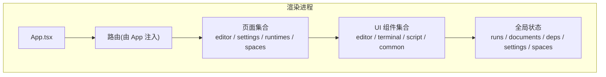
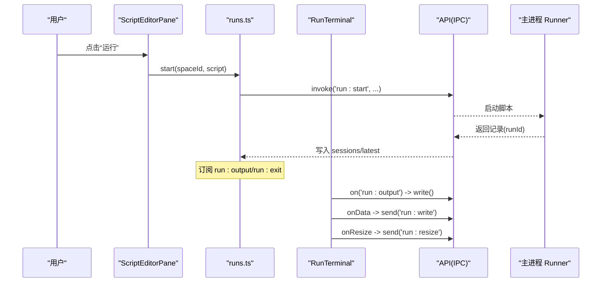
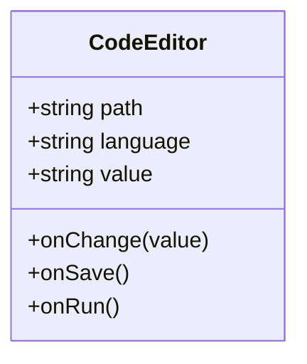
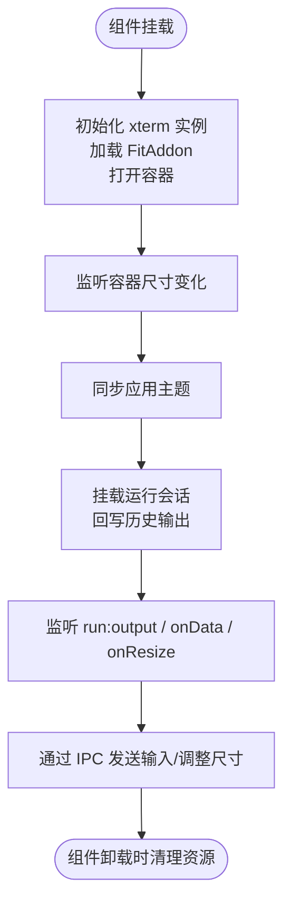
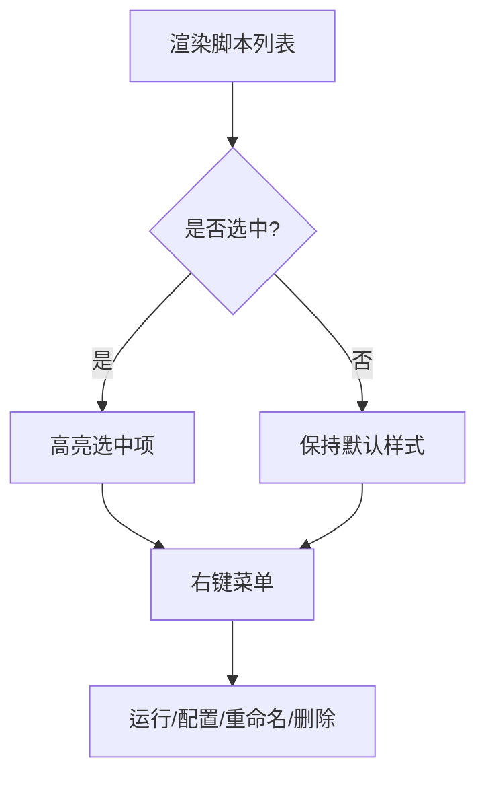
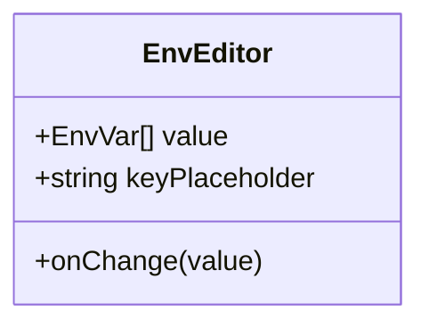
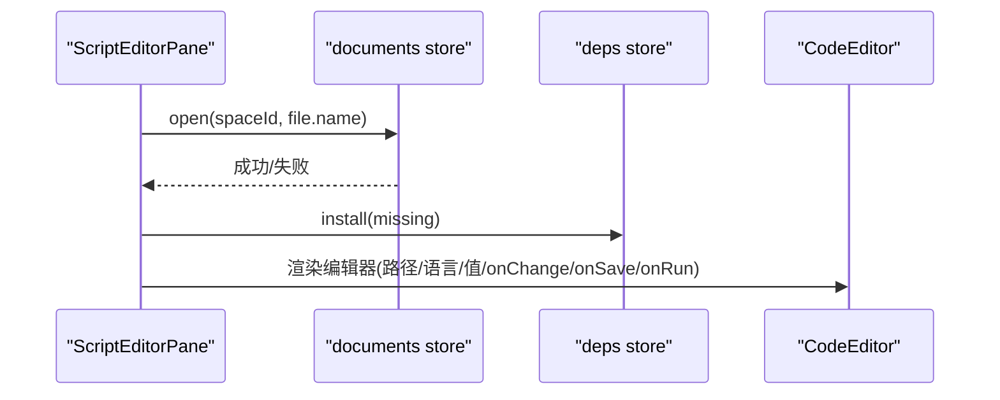
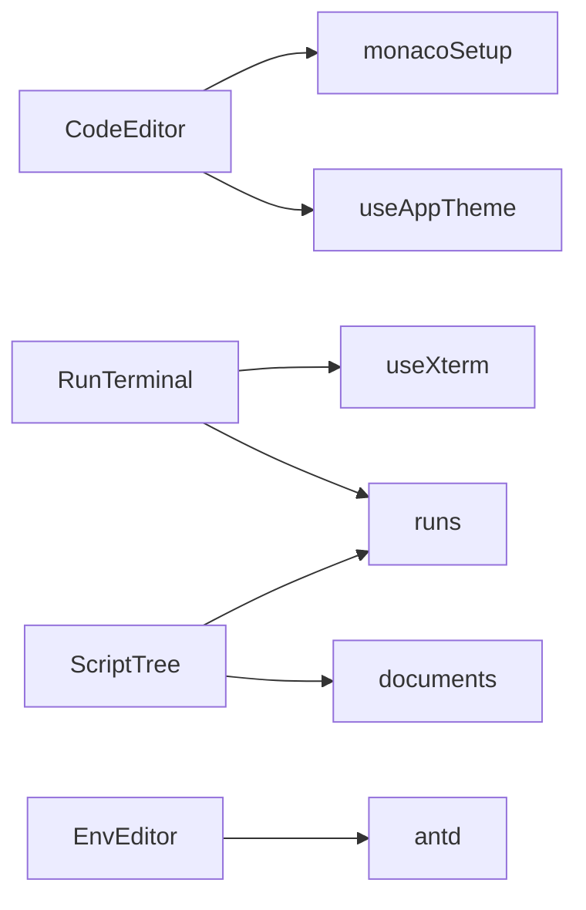

# UI 组件库

<cite>
**本文引用的文件**   
- [README.md](file://README.md)
- [App.tsx](file://src/renderer/src/app/App.tsx)
- [CodeEditor.tsx](file://src/renderer/src/components/editor/CodeEditor.tsx)
- [monacoSetup.ts](file://src/renderer/src/components/editor/monacoSetup.ts)
- [RunTerminal.tsx](file://src/renderer/src/components/terminal/RunTerminal.tsx)
- [useXterm.ts](file://src/renderer/src/components/terminal/useXterm.ts)
- [theme.ts](file://src/renderer/src/components/terminal/theme.ts)
- [ScriptTree.tsx](file://src/renderer/src/components/script/ScriptTree.tsx)
- [EnvEditor.tsx](file://src/renderer/src/components/common/EnvEditor.tsx)
- [useAppTheme.ts](file://src/renderer/src/hooks/useAppTheme.ts)
- [runs.ts](file://src/renderer/src/stores/runs.ts)
- [ScriptEditorPane.tsx](file://src/renderer/src/pages/editor/ScriptEditorPane.tsx)
- [SettingsPage.tsx](file://src/renderer/src/pages/settings/SettingsPage.tsx)
</cite>

## 目录
1. [简介](#简介)
2. [项目结构](#项目结构)
3. [核心组件](#核心组件)
4. [架构总览](#架构总览)
5. [详细组件分析](#详细组件分析)
6. [依赖关系分析](#依赖关系分析)
7. [性能与可定制性](#性能与可定制性)
8. [故障排查指南](#故障排查指南)
9. [结论](#结论)
10. [附录：样式与主题配置](#附录样式与主题配置)

## 简介
本仓库是一个基于 Electron + React + Ant Design 的脚本运行器应用，渲染层使用 Ant Design 构建界面，并在此基础上封装了若干可复用的 UI 组件。代码编辑器基于 Monaco Editor（本地加载、内置 Node.js 类型），终端基于 xterm.js（node-pty 驱动），并提供脚本树、环境变量编辑器等常用表单型组件。整体遵循“轻量封装 + 状态集中管理”的设计思路，便于在应用内复用和扩展。

## 项目结构
渲染端采用 React 19 + Ant Design，组件按功能域组织：
- components/editor：代码编辑器封装
- components/terminal：交互式终端封装
- components/script：脚本列表与操作入口
- components/common：通用表单类组件
- hooks：主题与运行时钩子
- stores：全局状态（Zustand）
- pages：页面级组合视图

图表来源
- [App.tsx:13-33](file://src/renderer/src/app/App.tsx#L13-L33)
- [ScriptEditorPane.tsx:24-78](file://src/renderer/src/pages/editor/ScriptEditorPane.tsx#L24-L78)
- [SettingsPage.tsx:10-24](file://src/renderer/src/pages/settings/SettingsPage.tsx#L10-L24)

章节来源
- [README.md:78-86](file://README.md#L78-L86)
- [App.tsx:13-33](file://src/renderer/src/app/App.tsx#L13-L33)

## 核心组件
- 代码编辑器 CodeEditor：基于 @monaco-editor/react 封装，提供路径、语言、值、变更回调、保存与运行事件；支持快捷键 Ctrl/Cmd+S 保存、F5 运行；自动适配亮/暗主题。
- 终端 RunTerminal：绑定单次运行会话，实时输出、键盘输入、自适应尺寸，并与主进程通过 IPC 通信。
- 脚本树 ScriptTree：展示脚本列表、新建/导入、右键菜单（运行/配置/重命名/删除）、未保存与运行中状态标记。
- 环境变量编辑器 EnvEditor：以键值对形式编辑环境变量，可作为 Ant Design Form 控件使用。

章节来源
- [CodeEditor.tsx:9-52](file://src/renderer/src/components/editor/CodeEditor.tsx#L9-L52)
- [RunTerminal.tsx:8-44](file://src/renderer/src/components/terminal/RunTerminal.tsx#L8-L44)
- [ScriptTree.tsx:12-93](file://src/renderer/src/components/script/ScriptTree.tsx#L12-L93)
- [EnvEditor.tsx:7-48](file://src/renderer/src/components/common/EnvEditor.tsx#L7-L48)

## 架构总览
渲染端通过 Zustand 维护运行会话、文档、依赖等状态；Monaco 与 xterm 分别负责编辑与交互；IPC 通道连接主进程的服务（runner、runtime、settings 等）。

图表来源
- [ScriptEditorPane.tsx:39-72](file://src/renderer/src/pages/editor/ScriptEditorPane.tsx#L39-L72)
- [runs.ts:26-79](file://src/renderer/src/stores/runs.ts#L26-L79)
- [RunTerminal.tsx:12-41](file://src/renderer/src/components/terminal/RunTerminal.tsx#L12-L41)

## 详细组件分析

### 代码编辑器 CodeEditor
- 功能
  - 基于 Monaco Editor，支持 JS/TS 语法高亮与智能提示。
  - 快捷键：Ctrl/Cmd+S 触发 onSave，F5 触发 onRun。
  - 主题跟随应用设置（light/dark）。
  - 基础编辑器选项：字号、关闭小地图、禁止滚动到最后一行之外、自动布局、Tab 大小等。
- 属性
  - path：模型 URI，用于区分不同文件的编辑器实例。
  - language：'javascript' | 'typescript'。
  - value：编辑器当前内容。
  - onChange：内容变更回调。
  - onSave：保存回调。
  - onRun：运行回调。
- 用法要点
  - 父组件负责将文档内容与保存逻辑透传至编辑器。
  - 编辑器不直接处理持久化，仅暴露 onSave 给上层统一调用。

图表来源
- [CodeEditor.tsx:9-52](file://src/renderer/src/components/editor/CodeEditor.tsx#L9-L52)

章节来源
- [CodeEditor.tsx:9-52](file://src/renderer/src/components/editor/CodeEditor.tsx#L9-L52)
- [monacoSetup.ts:1-43](file://src/renderer/src/components/editor/monacoSetup.ts#L1-L43)
- [useAppTheme.ts:1-9](file://src/renderer/src/hooks/useAppTheme.ts#L1-L9)

### 终端 RunTerminal
- 功能
  - 绑定单个运行会话，显示实时输出，支持键盘输入与窗口尺寸变化同步。
  - 挂载时回写历史输出片段，避免闪烁。
  - 监听 run:output 事件，增量写入终端。
  - 通过 IPC 发送 stdin 数据与 resize 信息。
- 生命周期
  - 初始化：创建 xterm 实例、加载 FitAddon、打开容器、观察尺寸变化。
  - 主题切换：根据 useAppTheme 动态切换终端主题。
  - 卸载：清理事件监听、释放终端实例。
- 与状态协作
  - 从 runs store 读取当前会话的 chunks 与状态。
  - 当会话处于 running 状态时才转发输入与 resize。

图表来源
- [useXterm.ts:16-59](file://src/renderer/src/components/terminal/useXterm.ts#L16-L59)
- [RunTerminal.tsx:8-44](file://src/renderer/src/components/terminal/RunTerminal.tsx#L8-L44)
- [runs.ts:63-79](file://src/renderer/src/stores/runs.ts#L63-L79)

章节来源
- [RunTerminal.tsx:8-44](file://src/renderer/src/components/terminal/RunTerminal.tsx#L8-L44)
- [useXterm.ts:16-59](file://src/renderer/src/components/terminal/useXterm.ts#L16-L59)
- [theme.ts](file://src/renderer/src/components/terminal/theme.ts)

### 脚本树 ScriptTree
- 功能
  - 展示脚本列表，支持新建、导入、右键菜单（运行、配置、重命名、删除）。
  - 显示未保存标记与运行中标记。
  - 集成拖拽导入区域。
- 交互流程
  - 选择脚本：触发 onSelect。
  - 右键菜单：触发对应回调（运行/配置/重命名/删除）。
  - 新建/导入：触发 onCreate / onImported。

图表来源
- [ScriptTree.tsx:34-93](file://src/renderer/src/components/script/ScriptTree.tsx#L34-L93)

章节来源
- [ScriptTree.tsx:12-93](file://src/renderer/src/components/script/ScriptTree.tsx#L12-L93)

### 环境变量编辑器 EnvEditor
- 功能
  - 以键值对数组形式编辑环境变量，支持增删改。
  - 可作为 Ant Design Form 的受控组件使用。
- 属性
  - value：EnvVar[]，每项包含 key/value。
  - onChange：值变更回调。
  - keyPlaceholder：键输入框占位符。

图表来源
- [EnvEditor.tsx:7-48](file://src/renderer/src/components/common/EnvEditor.tsx#L7-L48)

章节来源
- [EnvEditor.tsx:7-48](file://src/renderer/src/components/common/EnvEditor.tsx#L7-L48)

### 编辑器页面 ScriptEditorPane
- 职责
  - 组装工具栏、缺失依赖提示、代码编辑器。
  - 打开/保存文档、安装缺失依赖、触发运行/停止。
- 关键流程
  - 首次进入：打开文档，失败则显示错误结果。
  - 保存：调用文档存储保存，失败则提示错误。
  - 安装依赖：批量安装缺失依赖，失败则提示错误。
  - 渲染编辑器：传入模型路径、语言、内容与变更回调。

图表来源
- [ScriptEditorPane.tsx:24-78](file://src/renderer/src/pages/editor/ScriptEditorPane.tsx#L24-L78)

章节来源
- [ScriptEditorPane.tsx:24-78](file://src/renderer/src/pages/editor/ScriptEditorPane.tsx#L24-L78)

## 依赖关系分析
- 组件耦合
  - CodeEditor 依赖 monacoSetup 提供的 Monaco 实例与主题钩子。
  - RunTerminal 依赖 useXterm 与 runs store，并通过 API 与主进程通信。
  - ScriptTree 依赖文档与运行状态 store，用于显示未保存与运行中状态。
  - EnvEditor 为纯展示/输入组件，无外部状态依赖。
- 外部依赖
  - Ant Design：按钮、下拉、空状态、通知等。
  - Monaco Editor：编辑器内核与 TS/JS Worker。
  - xterm.js：终端渲染与插件生态。
  - zustand：全局状态管理。
  - i18next：国际化文案。

图表来源
- [CodeEditor.tsx:1-52](file://src/renderer/src/components/editor/CodeEditor.tsx#L1-L52)
- [monacoSetup.ts:1-43](file://src/renderer/src/components/editor/monacoSetup.ts#L1-L43)
- [RunTerminal.tsx:1-44](file://src/renderer/src/components/terminal/RunTerminal.tsx#L1-L44)
- [useXterm.ts:1-60](file://src/renderer/src/components/terminal/useXterm.ts#L1-L60)
- [ScriptTree.tsx:1-93](file://src/renderer/src/components/script/ScriptTree.tsx#L1-L93)
- [EnvEditor.tsx:1-48](file://src/renderer/src/components/common/EnvEditor.tsx#L1-L48)

章节来源
- [runs.ts:1-79](file://src/renderer/src/stores/runs.ts#L1-L79)
- [useAppTheme.ts:1-9](file://src/renderer/src/hooks/useAppTheme.ts#L1-L9)

## 性能与可定制性
- 性能优化
  - 终端输出分片限制：每个运行会话最多保留固定数量的输出片段，避免内存无限增长。
  - 终端自适应：使用 ResizeObserver 与 FitAddon 保证终端尺寸与容器一致，减少重绘。
  - 编辑器选项：关闭小地图、禁用滚动到最后一行之外、启用自动布局，提升大文件编辑体验。
  - 按需加载：Monaco Worker 本地加载，避免 CDN 延迟与网络抖动。
- 可定制性
  - 主题：应用级 light/dark 模式，同时影响 Ant Design、Monaco 与 xterm。
  - 编辑器行为：可通过 props 控制语言、初始值、保存与运行回调；编辑器内部选项可进一步扩展。
  - 终端外观：通过 useXterm 的 options 参数与 theme.ts 中的主题对象进行定制。
  - 表单组件：EnvEditor 可作为受控组件嵌入任意表单场景。
- 无障碍访问
  - 使用 Ant Design 原生组件，具备基础无障碍语义。
  - 编辑器与终端作为富交互控件，建议结合屏幕阅读器与键盘导航策略进行增强。

章节来源
- [runs.ts:5-79](file://src/renderer/src/stores/runs.ts#L5-L79)
- [useXterm.ts:16-59](file://src/renderer/src/components/terminal/useXterm.ts#L16-L59)
- [CodeEditor.tsx:42-49](file://src/renderer/src/components/editor/CodeEditor.tsx#L42-L49)
- [monacoSetup.ts:1-43](file://src/renderer/src/components/editor/monacoSetup.ts#L1-L43)

## 故障排查指南
- 编辑器无法加载或报错
  - 检查 monacoSetup 是否正确配置 Worker 与编译器选项。
  - 确认语言与路径参数正确传递。
- 终端无输出或输入无效
  - 确认运行会话存在且状态为 running。
  - 检查 IPC 事件 run:output 是否正常触发。
  - 查看终端尺寸是否被隐藏导致 fit 失效。
- 依赖安装失败
  - 检查网络代理与镜像配置。
  - 查看缺失依赖列表是否正确解析。
- 主题不生效
  - 确认 useAppTheme 返回值与应用设置一致。
  - 检查终端主题是否在主题切换时更新。

章节来源
- [ScriptEditorPane.tsx:33-48](file://src/renderer/src/pages/editor/ScriptEditorPane.tsx#L33-L48)
- [RunTerminal.tsx:12-41](file://src/renderer/src/components/terminal/RunTerminal.tsx#L12-L41)
- [useXterm.ts:36-56](file://src/renderer/src/components/terminal/useXterm.ts#L36-L56)

## 结论
该 UI 组件体系围绕“编辑器 + 终端 + 脚本管理 + 表单”展开，基于 Ant Design 提供一致的视觉与交互体验，并通过 Monaco 与 xterm 实现强大的代码编辑与交互能力。组件之间通过 Zustand 状态解耦，具备良好的可扩展性与可定制性。建议在后续迭代中继续完善无障碍支持与性能监控，并在复杂场景中引入更细粒度的组件拆分与测试覆盖。

## 附录：样式与主题配置
- 应用主题
  - useAppTheme 提供 light/dark 模式，供 Ant Design、Monaco 与 xterm 共享。
- 终端主题
  - useXterm 根据应用主题切换 dark/light 终端主题。
- 编辑器主题
  - CodeEditor 根据 useAppTheme 选择 vs 或 vs-dark 主题。
- 设置页
  - SettingsPage 聚合外观、网络、运行、更新与关于等设置区块。

章节来源
- [useAppTheme.ts:1-9](file://src/renderer/src/hooks/useAppTheme.ts#L1-L9)
- [useXterm.ts:53-56](file://src/renderer/src/components/terminal/useXterm.ts#L53-L56)
- [CodeEditor.tsx:33-40](file://src/renderer/src/components/editor/CodeEditor.tsx#L33-L40)
- [SettingsPage.tsx:10-24](file://src/renderer/src/pages/settings/SettingsPage.tsx#L10-L24)