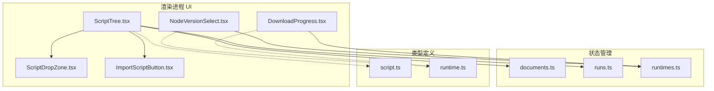
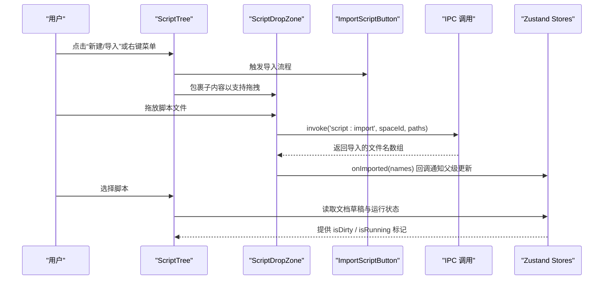
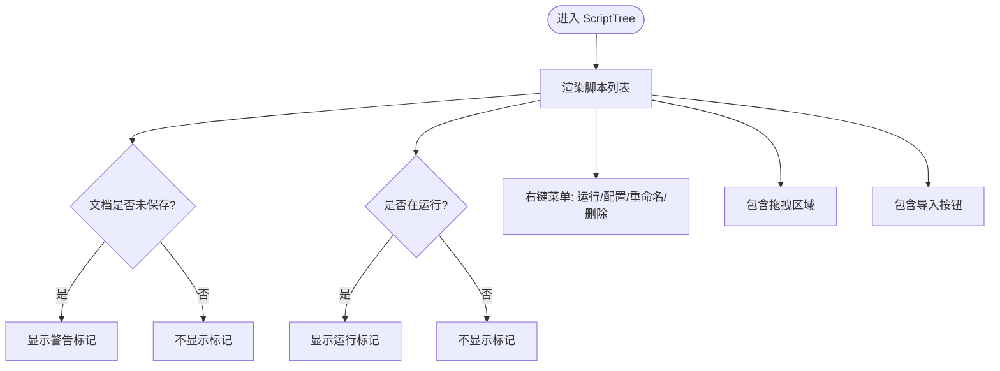
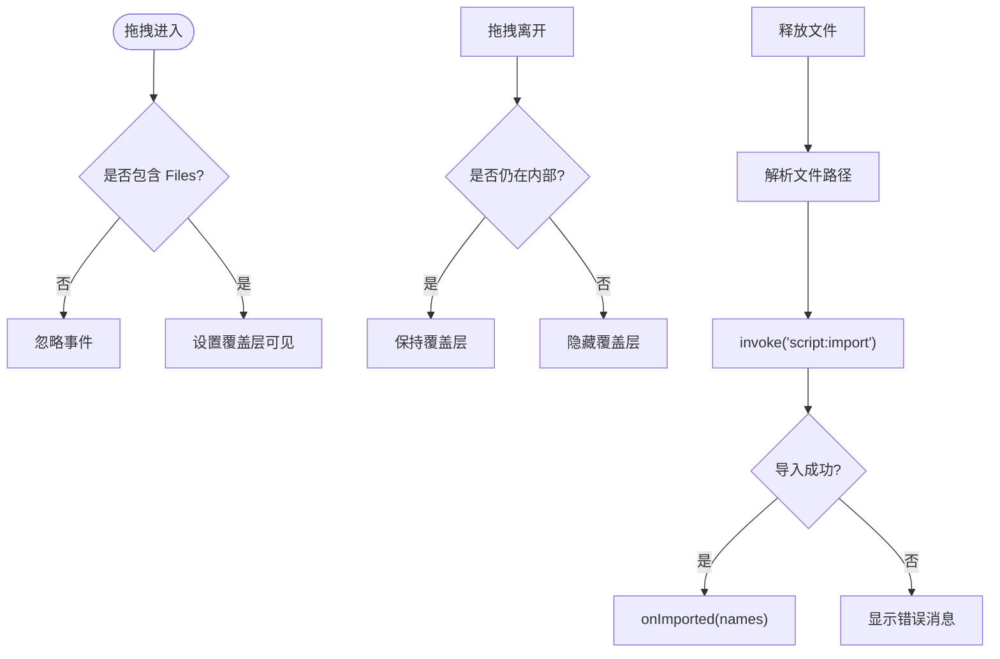
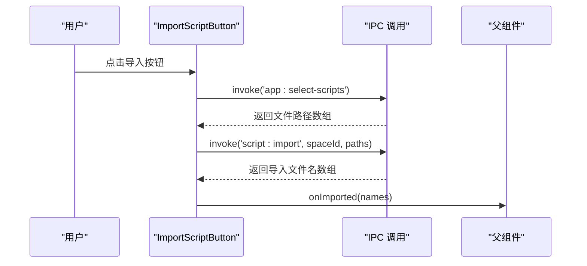
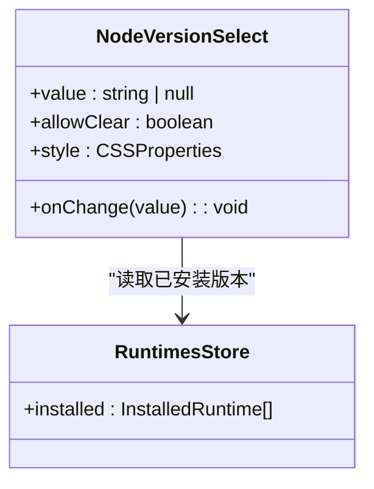
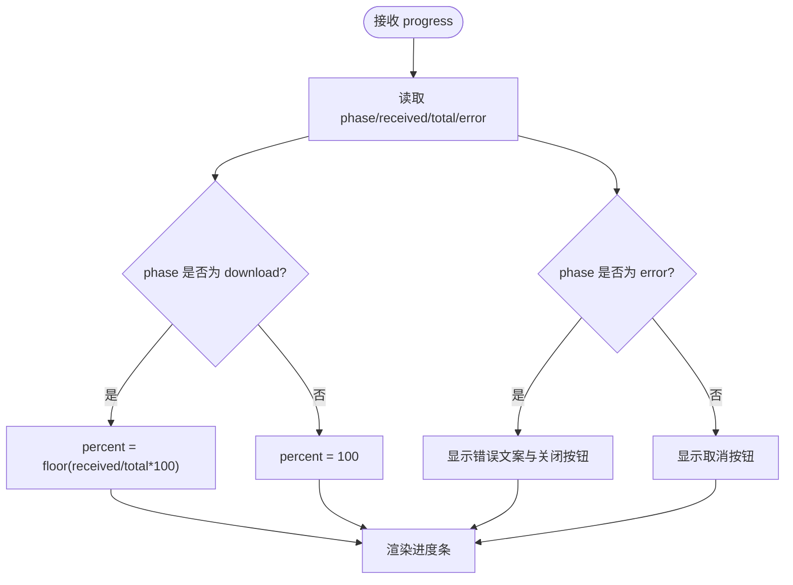
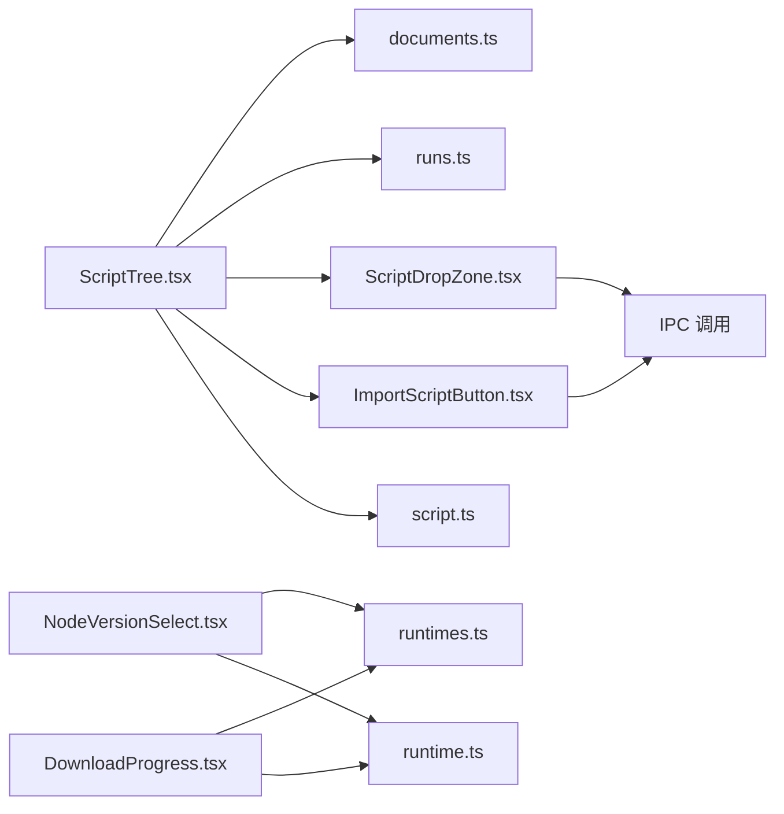

# 业务组件

<cite>
**本文引用的文件**   
- [ScriptTree.tsx](file://src/renderer/src/components/script/ScriptTree.tsx)
- [ScriptDropZone.tsx](file://src/renderer/src/components/script/ScriptDropZone.tsx)
- [ImportScriptButton.tsx](file://src/renderer/src/components/script/ImportScriptButton.tsx)
- [NodeVersionSelect.tsx](file://src/renderer/src/components/runtime/NodeVersionSelect.tsx)
- [DownloadProgress.tsx](file://src/renderer/src/components/runtime/DownloadProgress.tsx)
- [documents.ts](file://src/renderer/src/stores/documents.ts)
- [runs.ts](file://src/renderer/src/stores/runs.ts)
- [runtimes.ts](file://src/renderer/src/stores/runtimes.ts)
- [script.ts](file://src/shared/types/script.ts)
- [runtime.ts](file://src/shared/types/runtime.ts)
</cite>

## 目录
1. [简介](#简介)
2. [项目结构](#项目结构)
3. [核心组件总览](#核心组件总览)
4. [架构总览](#架构总览)
5. [组件详细分析](#组件详细分析)
6. [依赖关系分析](#依赖关系分析)
7. [性能与可维护性](#性能与可维护性)
8. [故障排查指南](#故障排查指南)
9. [结论](#结论)

## 简介
本章节面向业务 UI 层，聚焦以下与脚本管理、运行时选择与安装进度展示紧密相关的组件：
- 脚本树 ScriptTree
- 脚本拖拽区域 ScriptDropZone
- 导入按钮 ImportScriptButton
- 节点版本选择器 NodeVersionSelect
- 下载进度条 DownloadProgress

这些组件共同支撑“脚本导入与组织”“运行状态可视化”“运行时版本选择与安装反馈”等关键业务流程。文档将说明每个组件的业务职责、状态来源、事件处理、与其他组件的协作方式，以及 UI 层的实现模式与最佳实践。

## 项目结构
围绕上述组件，相关代码分布在渲染进程（renderer）的 components、stores 与 shared types 中：
- components/script：脚本列表与导入能力
- components/runtime：运行时版本选择与安装进度展示
- stores：基于 Zustand 的状态管理（文档草稿、运行会话、运行时元数据与安装进度）
- shared/types：跨进程共享的类型定义

图表来源
- [ScriptTree.tsx:1-94](file://src/renderer/src/components/script/ScriptTree.tsx#L1-L94)
- [ScriptDropZone.tsx:1-59](file://src/renderer/src/components/script/ScriptDropZone.tsx#L1-L59)
- [ImportScriptButton.tsx:1-38](file://src/renderer/src/components/script/ImportScriptButton.tsx#L1-L38)
- [NodeVersionSelect.tsx:1-36](file://src/renderer/src/components/runtime/NodeVersionSelect.tsx#L1-L36)
- [DownloadProgress.tsx:1-42](file://src/renderer/src/components/runtime/DownloadProgress.tsx#L1-L42)
- [documents.ts:1-67](file://src/renderer/src/stores/documents.ts#L1-L67)
- [runs.ts:1-79](file://src/renderer/src/stores/runs.ts#L1-L79)
- [runtimes.ts:1-62](file://src/renderer/src/stores/runtimes.ts#L1-L62)
- [script.ts:1-13](file://src/shared/types/script.ts#L1-L13)
- [runtime.ts:1-23](file://src/shared/types/runtime.ts#L1-L23)

章节来源
- [ScriptTree.tsx:1-94](file://src/renderer/src/components/script/ScriptTree.tsx#L1-L94)
- [ScriptDropZone.tsx:1-59](file://src/renderer/src/components/script/ScriptDropZone.tsx#L1-L59)
- [ImportScriptButton.tsx:1-38](file://src/renderer/src/components/script/ImportScriptButton.tsx#L1-L38)
- [NodeVersionSelect.tsx:1-36](file://src/renderer/src/components/runtime/NodeVersionSelect.tsx#L1-L36)
- [DownloadProgress.tsx:1-42](file://src/renderer/src/components/runtime/DownloadProgress.tsx#L1-L42)
- [documents.ts:1-67](file://src/renderer/src/stores/documents.ts#L1-L67)
- [runs.ts:1-79](file://src/renderer/src/stores/runs.ts#L1-L79)
- [runtimes.ts:1-62](file://src/renderer/src/stores/runtimes.ts#L1-L62)
- [script.ts:1-13](file://src/shared/types/script.ts#L1-L13)
- [runtime.ts:1-23](file://src/shared/types/runtime.ts#L1-L23)

## 核心组件总览
- ScriptTree：脚本列表容器，负责显示脚本项、上下文菜单、新建与导入入口，并集成拖拽导入区域。
- ScriptDropZone：封装拖拽导入逻辑，接收系统文件管理器拖入的脚本文件，调用 IPC 导入到指定空间。
- ImportScriptButton：通过系统文件对话框选择脚本文件，调用 IPC 导入到指定空间。
- NodeVersionSelect：从已安装的 Node.js 版本中选择当前使用的版本，并在未安装时给出提示。
- DownloadProgress：展示运行时安装/下载的实时进度、阶段信息与错误状态，支持取消与关闭。

章节来源
- [ScriptTree.tsx:1-94](file://src/renderer/src/components/script/ScriptTree.tsx#L1-L94)
- [ScriptDropZone.tsx:1-59](file://src/renderer/src/components/script/ScriptDropZone.tsx#L1-L59)
- [ImportScriptButton.tsx:1-38](file://src/renderer/src/components/script/ImportScriptButton.tsx#L1-L38)
- [NodeVersionSelect.tsx:1-36](file://src/renderer/src/components/runtime/NodeVersionSelect.tsx#L1-L36)
- [DownloadProgress.tsx:1-42](file://src/renderer/src/components/runtime/DownloadProgress.tsx#L1-L42)

## 架构总览
UI 层通过 React 组件组合业务交互，状态由 Zustand store 集中管理，并通过 IPC 与主进程服务通信。

图表来源
- [ScriptTree.tsx:34-93](file://src/renderer/src/components/script/ScriptTree.tsx#L34-L93)
- [ScriptDropZone.tsx:17-58](file://src/renderer/src/components/script/ScriptDropZone.tsx#L17-L58)
- [ImportScriptButton.tsx:14-37](file://src/renderer/src/components/script/ImportScriptButton.tsx#L14-L37)
- [documents.ts:22-66](file://src/renderer/src/stores/documents.ts#L22-L66)
- [runs.ts:26-79](file://src/renderer/src/stores/runs.ts#L26-L79)

## 组件详细分析

### 脚本树 ScriptTree
职责与功能
- 展示脚本列表，区分 TypeScript/JavaScript 语言标识。
- 为每个脚本项提供上下文菜单：运行、配置、重命名、删除。
- 集成新建脚本与导入脚本入口。
- 使用拖拽区域 ScriptDropZone 作为容器，支持从系统文件管理器拖入脚本。
- 根据文档草稿与运行会话状态，显示“未保存”和“正在运行”标记。

状态管理
- 文档草稿与脏标记来自 documents store：isDirty(docs[docKey(spaceId, name)])。
- 运行状态来自 runs store：sessions + latest 映射，判断某脚本是否处于 running。

事件处理
- onSelect：选中脚本。
- onCreate：新建脚本。
- onImported：导入完成后刷新列表。
- onRun/onConfigure/onRename/onRemove：委托给上层页面处理。

与其他组件的交互
- 内嵌 ScriptDropZone 作为拖拽容器。
- 内嵌 ImportScriptButton 作为导入入口。
- 通过 props 与父级页面解耦，仅暴露必要回调。

图表来源
- [ScriptTree.tsx:25-93](file://src/renderer/src/components/script/ScriptTree.tsx#L25-L93)
- [documents.ts:19-66](file://src/renderer/src/stores/documents.ts#L19-L66)
- [runs.ts:24-40](file://src/renderer/src/stores/runs.ts#L24-L40)

章节来源
- [ScriptTree.tsx:1-94](file://src/renderer/src/components/script/ScriptTree.tsx#L1-L94)
- [documents.ts:1-67](file://src/renderer/src/stores/documents.ts#L1-L67)
- [runs.ts:1-79](file://src/renderer/src/stores/runs.ts#L1-L79)

### 脚本拖拽区域 ScriptDropZone
职责与功能
- 监听拖拽事件，识别系统文件管理器拖入的脚本文件。
- 调用 IPC 接口 script:import 将文件复制到目标空间。
- 成功导入后通过 onImported 回调通知父组件刷新。
- 失败时通过消息提示格式化错误信息。

状态管理
- 本地 over 状态控制拖拽覆盖层显示。

事件处理
- onDragOver：当存在 Files 类型时阻止默认行为并显示覆盖层。
- onDragLeave：离开自身范围时隐藏覆盖层。
- onDrop：解析文件路径，调用导入，处理成功/失败。

图表来源
- [ScriptDropZone.tsx:14-58](file://src/renderer/src/components/script/ScriptDropZone.tsx#L14-L58)

章节来源
- [ScriptDropZone.tsx:1-59](file://src/renderer/src/components/script/ScriptDropZone.tsx#L1-L59)

### 导入按钮 ImportScriptButton
职责与功能
- 打开系统文件对话框选择脚本文件。
- 调用 IPC 接口 app:select-scripts 获取路径，再调用 script:import 导入到指定空间。
- 成功导入后通过 onImported 回调通知父组件刷新。
- 失败时通过消息提示格式化错误信息。

状态管理
- 无本地状态，纯受控按钮。

事件处理
- onClick：触发文件选择与导入流程。

图表来源
- [ImportScriptButton.tsx:14-37](file://src/renderer/src/components/script/ImportScriptButton.tsx#L14-L37)

章节来源
- [ImportScriptButton.tsx:1-38](file://src/renderer/src/components/script/ImportScriptButton.tsx#L1-L38)

### 节点版本选择器 NodeVersionSelect
职责与功能
- 从已安装的 Node.js 版本中选择当前使用的版本。
- 若当前值不在已安装列表中，显示警告状态。
- 未找到内容时提供跳转链接至运行时安装页面。

状态管理
- 已安装版本来自 runtimes store 的 installed 列表。
- 通过 value 与 onChange 进行受控选择。

交互模式
- 下拉选项显示版本号与 npm 版本（如有）。
- 允许清空选择（可选 allowClear）。

图表来源
- [NodeVersionSelect.tsx:15-35](file://src/renderer/src/components/runtime/NodeVersionSelect.tsx#L15-L35)
- [runtimes.ts:19-49](file://src/renderer/src/stores/runtimes.ts#L19-L49)

章节来源
- [NodeVersionSelect.tsx:1-36](file://src/renderer/src/components/runtime/NodeVersionSelect.tsx#L1-L36)
- [runtimes.ts:1-62](file://src/renderer/src/stores/runtimes.ts#L1-L62)

### 下载进度条 DownloadProgress
职责与功能
- 展示运行时安装/下载的实时进度、阶段信息与错误状态。
- 在下载阶段显示已接收与总大小（字节格式化）。
- 失败时显示错误文本并提供关闭操作；正常阶段提供取消操作。

状态管理
- 接收 RuntimeInstallProgress 对象，包含 phase、received、total、error 等字段。

交互模式
- 根据 phase 计算百分比：download 阶段按 received/total 计算，其他阶段显示完成。
- 根据 phase === 'error' 切换异常状态与文案。

图表来源
- [DownloadProgress.tsx:14-41](file://src/renderer/src/components/runtime/DownloadProgress.tsx#L14-L41)
- [runtime.ts:14-22](file://src/shared/types/runtime.ts#L14-L22)

章节来源
- [DownloadProgress.tsx:1-42](file://src/renderer/src/components/runtime/DownloadProgress.tsx#L1-L42)
- [runtime.ts:1-23](file://src/shared/types/runtime.ts#L1-L23)

## 依赖关系分析
组件与 Store、类型的依赖如下：

图表来源
- [ScriptTree.tsx:1-94](file://src/renderer/src/components/script/ScriptTree.tsx#L1-L94)
- [ScriptDropZone.tsx:1-59](file://src/renderer/src/components/script/ScriptDropZone.tsx#L1-L59)
- [ImportScriptButton.tsx:1-38](file://src/renderer/src/components/script/ImportScriptButton.tsx#L1-L38)
- [NodeVersionSelect.tsx:1-36](file://src/renderer/src/components/runtime/NodeVersionSelect.tsx#L1-L36)
- [DownloadProgress.tsx:1-42](file://src/renderer/src/components/runtime/DownloadProgress.tsx#L1-L42)
- [documents.ts:1-67](file://src/renderer/src/stores/documents.ts#L1-L67)
- [runs.ts:1-79](file://src/renderer/src/stores/runs.ts#L1-L79)
- [runtimes.ts:1-62](file://src/renderer/src/stores/runtimes.ts#L1-L62)
- [script.ts:1-13](file://src/shared/types/script.ts#L1-L13)
- [runtime.ts:1-23](file://src/shared/types/runtime.ts#L1-L23)

章节来源
- [ScriptTree.tsx:1-94](file://src/renderer/src/components/script/ScriptTree.tsx#L1-L94)
- [ScriptDropZone.tsx:1-59](file://src/renderer/src/components/script/ScriptDropZone.tsx#L1-L59)
- [ImportScriptButton.tsx:1-38](file://src/renderer/src/components/script/ImportScriptButton.tsx#L1-L38)
- [NodeVersionSelect.tsx:1-36](file://src/renderer/src/components/runtime/NodeVersionSelect.tsx#L1-L36)
- [DownloadProgress.tsx:1-42](file://src/renderer/src/components/runtime/DownloadProgress.tsx#L1-L42)
- [documents.ts:1-67](file://src/renderer/src/stores/documents.ts#L1-L67)
- [runs.ts:1-79](file://src/renderer/src/stores/runs.ts#L1-L79)
- [runtimes.ts:1-62](file://src/renderer/src/stores/runtimes.ts#L1-L62)
- [script.ts:1-13](file://src/shared/types/script.ts#L1-L13)
- [runtime.ts:1-23](file://src/shared/types/runtime.ts#L1-L23)

## 性能与可维护性
- 状态最小化与就近更新
  - ScriptTree 仅订阅必要的文档与运行状态片段，避免全量重渲染。
  - runs store 限制输出块数量上限，防止内存无限增长。
- 受控组件与单向数据流
  - NodeVersionSelect 通过 value/onChange 受控，保证状态单一来源。
  - ScriptDropZone 与 ImportScriptButton 通过回调向父组件传递结果，降低耦合。
- 错误处理与用户体验
  - 导入与运行时操作均捕获错误并以消息形式提示，提升容错性与可观测性。
- 可扩展性
  - 组件职责清晰，便于扩展更多脚本操作（如复制、移动）或运行时管理（如升级、回滚）。

[本节为通用指导，无需具体文件引用]

## 故障排查指南
- 导入失败
  - 检查 IPC 调用是否正确传递 spaceId 与文件路径数组。
  - 查看消息提示中的格式化错误信息，定位后端错误原因。
- 拖拽无响应
  - 确认拖拽源包含 Files 类型，且未被其他元素拦截。
  - 检查 onDragOver 是否阻止默认行为，确保 drop 事件能触发。
- 运行状态不更新
  - 确认 runs store 的 sessions 与 latest 映射是否正确更新。
  - 检查 run:output 与 run:exit 事件是否被正确监听与处理。
- 运行时版本选择异常
  - 确认 installed 列表是否加载完成。
  - 若当前值不在 installed 中，组件会显示警告状态，需重新选择或安装对应版本。
- 进度条不显示或状态异常
  - 确认传入的 RuntimeInstallProgress 包含正确的 phase、received、total。
  - 检查 runtime:progress 事件是否持续推送，以及 dismiss 逻辑是否提前清除了进度。

章节来源
- [ScriptDropZone.tsx:22-36](file://src/renderer/src/components/script/ScriptDropZone.tsx#L22-L36)
- [ImportScriptButton.tsx:18-30](file://src/renderer/src/components/script/ImportScriptButton.tsx#L18-L30)
- [runs.ts:63-79](file://src/renderer/src/stores/runs.ts#L63-L79)
- [NodeVersionSelect.tsx:15-35](file://src/renderer/src/components/runtime/NodeVersionSelect.tsx#L15-L35)
- [DownloadProgress.tsx:14-41](file://src/renderer/src/components/runtime/DownloadProgress.tsx#L14-L41)
- [runtimes.ts:52-61](file://src/renderer/src/stores/runtimes.ts#L52-L61)

## 结论
上述业务组件通过清晰的职责划分与受控状态管理，实现了脚本导入与组织、运行状态可视化、运行时版本选择与安装进度反馈等核心功能。组件之间通过 props 回调与全局 store 解耦，结合 IPC 与事件机制，保证了良好的可维护性与扩展性。在实际使用中，建议遵循单向数据流、就近更新状态、统一错误提示等最佳实践，以提升用户体验与系统稳定性。

[本节为总结性内容，无需具体文件引用]