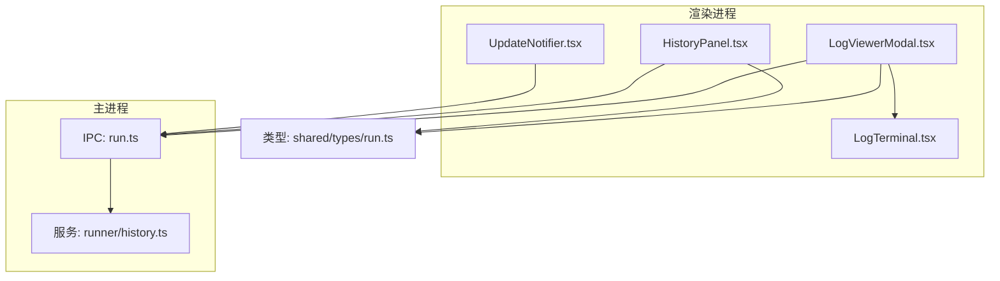
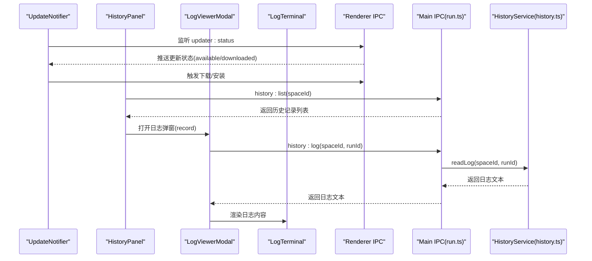
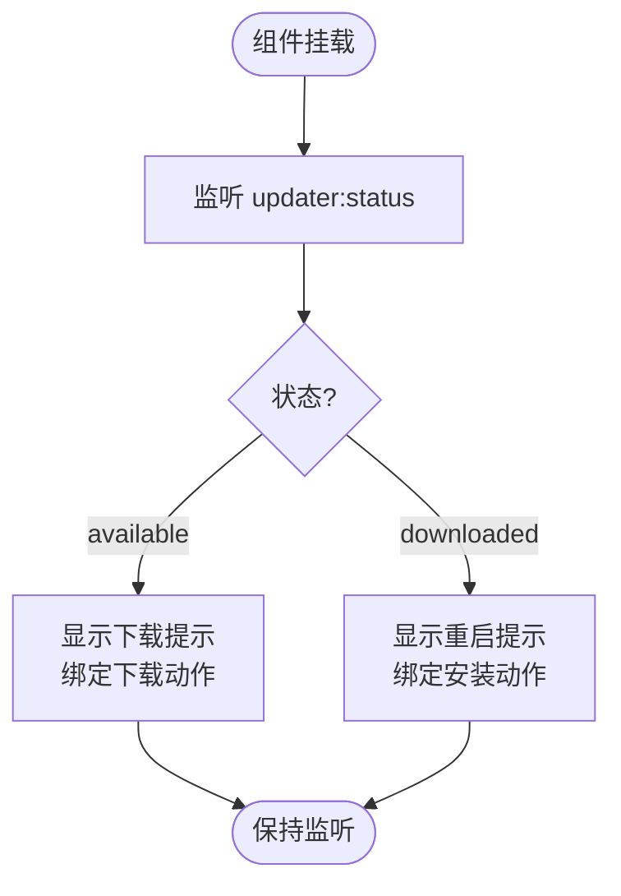
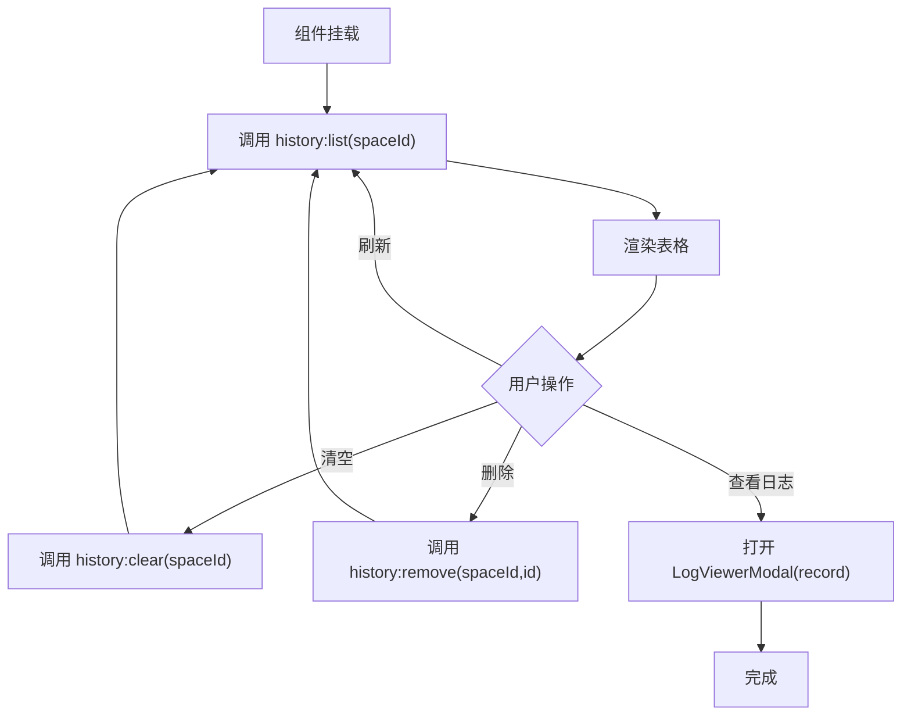
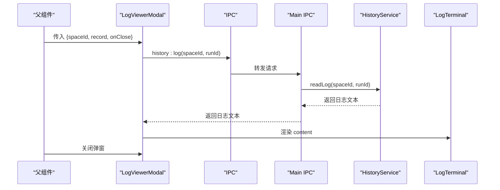
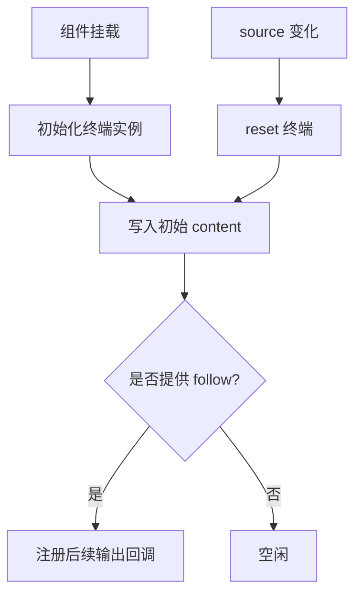
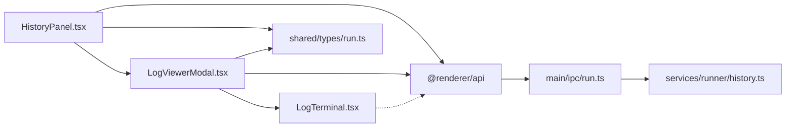

# 工具组件

<cite>
**本文引用的文件**   
- [UpdateNotifier.tsx](file://src/renderer/src/components/common/UpdateNotifier.tsx)
- [HistoryPanel.tsx](file://src/renderer/src/components/history/HistoryPanel.tsx)
- [LogViewerModal.tsx](file://src/renderer/src/components/history/LogViewerModal.tsx)
- [LogTerminal.tsx](file://src/renderer/src/components/terminal/LogTerminal.tsx)
- [run.ts](file://src/main/ipc/run.ts)
- [history.ts](file://src/main/services/runner/history.ts)
- [run.ts（类型）](file://src/shared/types/run.ts)
</cite>

## 目录
1. [简介](#简介)
2. [项目结构](#项目结构)
3. [核心组件](#核心组件)
4. [架构总览](#架构总览)
5. [详细组件分析](#详细组件分析)
6. [依赖关系分析](#依赖关系分析)
7. [性能与可扩展性](#性能与可扩展性)
8. [故障排查指南](#故障排查指南)
9. [结论](#结论)

## 简介
本章节面向“工具组件”的文档，聚焦以下辅助型 UI 组件：
- 更新通知器 UpdateNotifier：监听应用更新状态，提供下载与重启入口。
- 历史记录面板 HistoryPanel：展示脚本运行历史、支持查看日志、清理记录。
- 日志查看器 LogViewerModal：以弹窗形式查看某次运行的完整日志。
- 终端渲染 LogTerminal：只读终端，用于显示 npm 输出与历史日志。

这些组件通过 IPC 与主进程交互，封装了常见的数据获取、错误处理、国际化与 UI 交互模式，便于在编辑器页面、设置页等位置复用。

## 项目结构
工具组件位于渲染进程，主要分布在 common 与 history 两个目录，并依赖 terminal 子组件进行日志渲染；与主进程的 IPC 通道集中在 run.ts，数据模型定义在 shared/types/run.ts。

图表来源
- [UpdateNotifier.tsx:1-44](file://src/renderer/src/components/common/UpdateNotifier.tsx#L1-L44)
- [HistoryPanel.tsx:1-126](file://src/renderer/src/components/history/HistoryPanel.tsx#L1-L126)
- [LogViewerModal.tsx:1-51](file://src/renderer/src/components/history/LogViewerModal.tsx#L1-L51)
- [LogTerminal.tsx:1-33](file://src/renderer/src/components/terminal/LogTerminal.tsx#L1-L33)
- [run.ts:1-18](file://src/main/ipc/run.ts#L1-L18)
- [history.ts:1-93](file://src/main/services/runner/history.ts#L1-L93)
- [run.ts（类型）:1-28](file://src/shared/types/run.ts#L1-L28)

章节来源
- [UpdateNotifier.tsx:1-44](file://src/renderer/src/components/common/UpdateNotifier.tsx#L1-L44)
- [HistoryPanel.tsx:1-126](file://src/renderer/src/components/history/HistoryPanel.tsx#L1-L126)
- [LogViewerModal.tsx:1-51](file://src/renderer/src/components/history/LogViewerModal.tsx#L1-L51)
- [LogTerminal.tsx:1-33](file://src/renderer/src/components/terminal/LogTerminal.tsx#L1-L33)
- [run.ts:1-18](file://src/main/ipc/run.ts#L1-L18)
- [history.ts:1-93](file://src/main/services/runner/history.ts#L1-L93)
- [run.ts（类型）:1-28](file://src/shared/types/run.ts#L1-L28)

## 核心组件
本节概述各工具组件的职责、使用场景与配置要点。

- UpdateNotifier
  - 功能：监听应用更新事件，弹出可操作的提示条，引导用户下载或重启安装新版本。
  - 使用场景：应用启动后常驻，自动感知更新状态变化。
  - 配置项：无显式 props；内部使用全局通知 API 与 i18n。
  - 集成方式：在应用根组件挂载一次即可。

- HistoryPanel
  - 功能：按空间列出运行历史，支持刷新、清空、删除单条记录，打开日志弹窗。
  - 使用场景：编辑器工作区底部或独立页面，展示最近运行结果。
  - 配置项：spaceId（必填），用于限定历史范围。
  - 集成方式：传入 spaceId，并在需要时触发刷新。

- LogViewerModal
  - 功能：以 Modal 形式展示指定运行的日志内容，支持加载态与错误回退。
  - 使用场景：从 HistoryPanel 点击“查看日志”时打开。
  - 配置项：spaceId、record、onClose。
  - 集成方式：由父组件控制 open/close 状态。

- LogTerminal
  - 功能：只读终端容器，支持一次性写入初始内容与可选的实时订阅。
  - 使用场景：npm 输出、历史日志回放。
  - 配置项：content（初始内容）、source（变更时重置终端）、follow（可选的实时订阅）。
  - 集成方式：作为 LogViewerModal 的子组件渲染日志。

章节来源
- [UpdateNotifier.tsx:10-42](file://src/renderer/src/components/common/UpdateNotifier.tsx#L10-L42)
- [HistoryPanel.tsx:20-123](file://src/renderer/src/components/history/HistoryPanel.tsx#L20-L123)
- [LogViewerModal.tsx:11-49](file://src/renderer/src/components/history/LogViewerModal.tsx#L11-L49)
- [LogTerminal.tsx:5-31](file://src/renderer/src/components/terminal/LogTerminal.tsx#L5-L31)

## 架构总览
工具组件采用“渲染进程 UI + IPC + 主进程服务”的分层架构。UI 组件负责状态与交互，IPC 负责跨进程调用，主进程负责持久化与系统级操作。

图表来源
- [UpdateNotifier.tsx:15-40](file://src/renderer/src/components/common/UpdateNotifier.tsx#L15-L40)
- [HistoryPanel.tsx:27-47](file://src/renderer/src/components/history/HistoryPanel.tsx#L27-L47)
- [LogViewerModal.tsx:22-32](file://src/renderer/src/components/history/LogViewerModal.tsx#L22-L32)
- [LogTerminal.tsx:24-29](file://src/renderer/src/components/terminal/LogTerminal.tsx#L24-L29)
- [run.ts:11-17](file://src/main/ipc/run.ts#L11-L17)
- [history.ts:43-60](file://src/main/services/runner/history.ts#L43-L60)

## 详细组件分析

### UpdateNotifier（更新通知器）
- 职责
  - 监听主进程更新的广播事件，根据状态展示不同提示。
  - 提供“下载更新”和“重启安装”的操作按钮。
- 关键流程
  - 监听 updater:status，当 available 时提示下载；当 downloaded 时提示重启安装。
  - 使用全局通知 API 与 i18n 文案。
- 扩展点
  - 可通过替换通知行为或增加自定义动作扩展交互。
  - 可接入更多更新阶段（如进度、失败）以增强体验。

图表来源
- [UpdateNotifier.tsx:15-40](file://src/renderer/src/components/common/UpdateNotifier.tsx#L15-L40)

章节来源
- [UpdateNotifier.tsx:10-42](file://src/renderer/src/components/common/UpdateNotifier.tsx#L10-L42)

### HistoryPanel（历史记录面板）
- 职责
  - 拉取并展示指定空间的运行历史。
  - 提供刷新、清空、删除单条记录等操作。
  - 打开 LogViewerModal 查看日志。
- 数据流
  - 初始化时调用 history:list 获取列表。
  - 监听 run:exit 事件，当属于当前空间时自动刷新。
  - 列字段包括状态、脚本名、参数、Node 版本、开始时间、耗时、退出码与操作。
- 交互细节
  - 删除与清空前会进行确认。
  - 正在运行的记录禁止删除。
  - 空状态与加载态均有友好提示。

图表来源
- [HistoryPanel.tsx:27-47](file://src/renderer/src/components/history/HistoryPanel.tsx#L27-L47)
- [HistoryPanel.tsx:59-99](file://src/renderer/src/components/history/HistoryPanel.tsx#L59-L99)
- [HistoryPanel.tsx:101-123](file://src/renderer/src/components/history/HistoryPanel.tsx#L101-L123)

章节来源
- [HistoryPanel.tsx:1-126](file://src/renderer/src/components/history/HistoryPanel.tsx#L1-L126)

### LogViewerModal（日志查看器弹窗）
- 职责
  - 根据 record 打开 Modal，拉取对应日志并交由 LogTerminal 渲染。
  - 处理加载中与错误情况，保证用户体验。
- 数据流
  - 当 record.id 变化时，调用 history:log 获取日志文本。
  - 成功则显示日志，失败则显示格式化后的错误信息。
  - 关闭时销毁 Modal 内容，避免重复渲染。

图表来源
- [LogViewerModal.tsx:22-32](file://src/renderer/src/components/history/LogViewerModal.tsx#L22-L32)
- [LogViewerModal.tsx:36-49](file://src/renderer/src/components/history/LogViewerModal.tsx#L36-L49)
- [run.ts:12-12](file://src/main/ipc/run.ts#L12-L12)
- [history.ts:43-60](file://src/main/services/runner/history.ts#L43-L60)

章节来源
- [LogViewerModal.tsx:11-49](file://src/renderer/src/components/history/LogViewerModal.tsx#L11-L49)

### LogTerminal（日志终端）
- 职责
  - 基于 xterm 的只读终端，支持一次性写入初始内容，以及可选的实时订阅。
  - 当 source 变化时重置终端并重新写入内容。
- 关键特性
  - disableStdin：禁止输入，仅输出。
  - convertEol：统一换行符。
  - follow：可选回调，用于订阅后续输出（例如实时日志）。

图表来源
- [LogTerminal.tsx:15-29](file://src/renderer/src/components/terminal/LogTerminal.tsx#L15-L29)

章节来源
- [LogTerminal.tsx:1-33](file://src/renderer/src/components/terminal/LogTerminal.tsx#L1-L33)

## 依赖关系分析
- 组件间依赖
  - HistoryPanel 依赖 LogViewerModal 以查看日志。
  - LogViewerModal 依赖 LogTerminal 进行日志渲染。
  - 所有组件均通过 @renderer/api 提供的 invoke/on 与主进程通信。
- 主进程依赖
  - run.ts 将 history:* IPC 路由到 historyStore。
  - historyStore 负责元数据与日志文件的读写、清理与恢复。
- 类型依赖
  - RunRecord、RunStatus 等类型定义在 shared/types/run.ts，被渲染端与主进程共享。

图表来源
- [HistoryPanel.tsx:1-126](file://src/renderer/src/components/history/HistoryPanel.tsx#L1-L126)
- [LogViewerModal.tsx:1-51](file://src/renderer/src/components/history/LogViewerModal.tsx#L1-L51)
- [LogTerminal.tsx:1-33](file://src/renderer/src/components/terminal/LogTerminal.tsx#L1-L33)
- [run.ts:1-18](file://src/main/ipc/run.ts#L1-L18)
- [history.ts:1-93](file://src/main/services/runner/history.ts#L1-L93)
- [run.ts（类型）:1-28](file://src/shared/types/run.ts#L1-L28)

章节来源
- [HistoryPanel.tsx:1-126](file://src/renderer/src/components/history/HistoryPanel.tsx#L1-L126)
- [LogViewerModal.tsx:1-51](file://src/renderer/src/components/history/LogViewerModal.tsx#L1-L51)
- [LogTerminal.tsx:1-33](file://src/renderer/src/components/terminal/LogTerminal.tsx#L1-L33)
- [run.ts:1-18](file://src/main/ipc/run.ts#L1-L18)
- [history.ts:1-93](file://src/main/services/runner/history.ts#L1-L93)
- [run.ts（类型）:1-28](file://src/shared/types/run.ts#L1-L28)

## 性能与可扩展性
- 性能要点
  - 历史日志读取限制大小，避免大文件导致内存压力。
  - 列表查询按创建时间倒序排序，优先展示最新记录。
  - 清理策略依据配置的历史保留数量，自动修剪旧记录。
- 可扩展建议
  - UpdateNotifier：新增更新阶段（如进度、失败）分支，丰富提示与操作。
  - HistoryPanel：增加分页、筛选与搜索能力，提升大数据量下的可用性。
  - LogViewerModal：支持分段加载与增量滚动，优化超大日志体验。
  - LogTerminal：暴露主题与字体配置，适配不同阅读偏好。

[本节为通用指导，不直接分析具体文件]

## 故障排查指南
- 常见问题
  - 历史列表为空：检查 spaceId 是否正确，确认主进程已生成历史记录。
  - 日志无法加载：确认 runId 有效且日志文件存在；若过大可能仅返回尾部片段。
  - 删除失败：确保记录非 running 状态；否则会被禁用或删除拦截。
  - 更新通知未出现：确认应用已启动更新监听，且主进程广播了 updater:status。
- 定位思路
  - 观察 HistoryPanel 的 loading 与 message 提示，定位 IPC 调用异常。
  - 检查 LogViewerModal 的错误回退内容，结合主进程日志定位原因。
  - 核对 shared/types/run.ts 的类型约束，确保前后端数据结构一致。

章节来源
- [HistoryPanel.tsx:27-57](file://src/renderer/src/components/history/HistoryPanel.tsx#L27-L57)
- [LogViewerModal.tsx:22-32](file://src/renderer/src/components/history/LogViewerModal.tsx#L22-L32)
- [history.ts:43-60](file://src/main/services/runner/history.ts#L43-L60)

## 结论
工具组件围绕“更新通知、历史记录、日志查看、终端渲染”四个维度，提供了稳定、可复用的辅助能力。它们通过统一的 IPC 通道与主进程协作，遵循清晰的职责边界与数据流向。在此基础上，可按需扩展交互、性能与可配置性，以满足更复杂的业务场景。