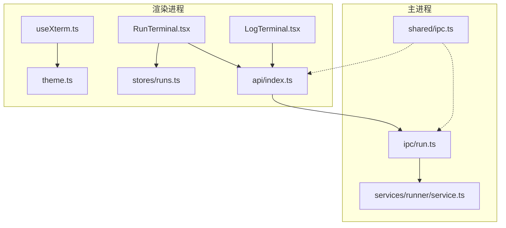
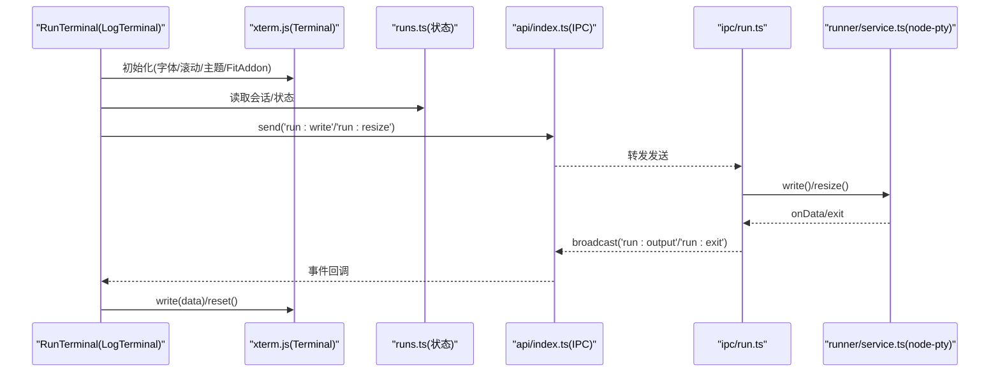
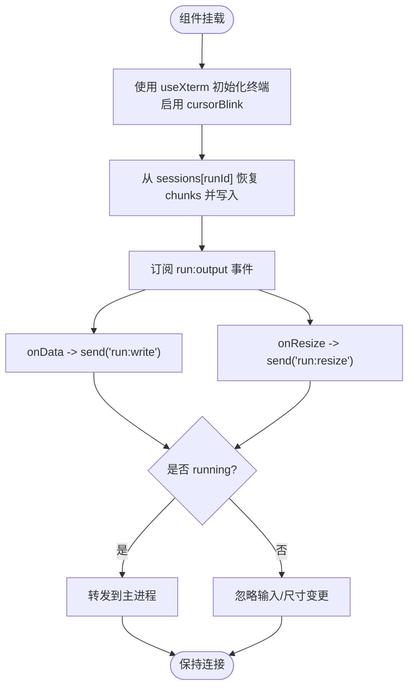
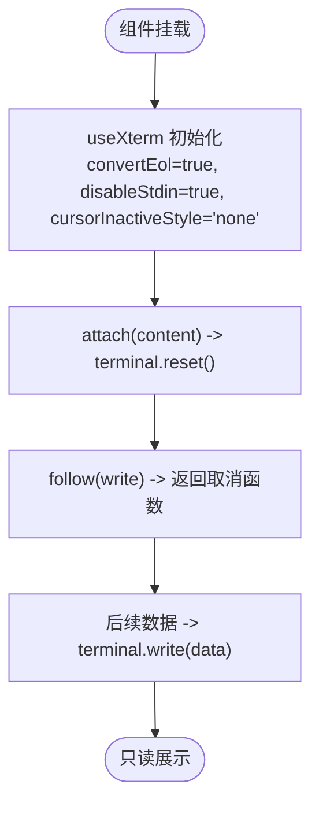
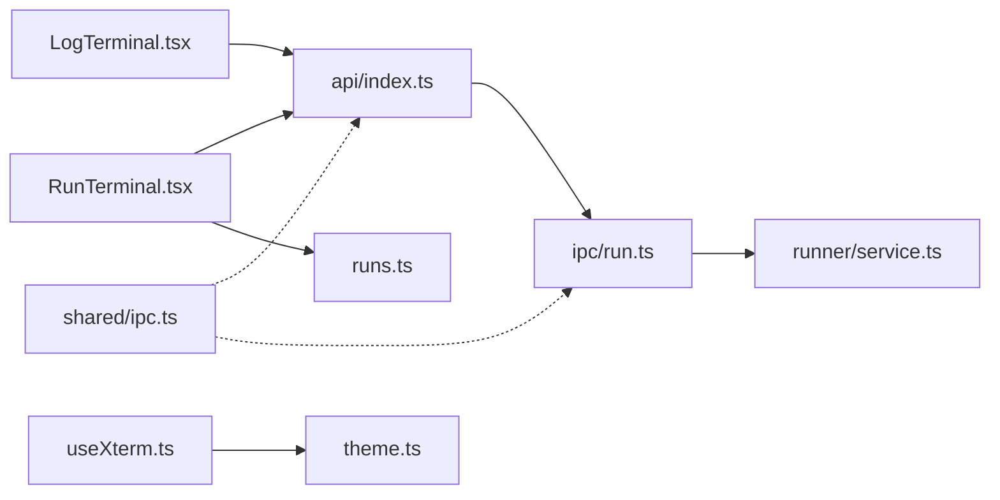

# 终端组件

<cite>
**本文引用的文件**   
- [RunTerminal.tsx](file://src/renderer/src/components/terminal/RunTerminal.tsx)
- [LogTerminal.tsx](file://src/renderer/src/components/terminal/LogTerminal.tsx)
- [useXterm.ts](file://src/renderer/src/components/terminal/useXterm.ts)
- [theme.ts](file://src/renderer/src/components/terminal/theme.ts)
- [runs.ts](file://src/renderer/src/stores/runs.ts)
- [api/index.ts](file://src/renderer/src/api/index.ts)
- [ipc/run.ts](file://src/main/ipc/run.ts)
- [runner/service.ts](file://src/main/services/runner/service.ts)
- [shared/ipc.ts](file://src/shared/ipc.ts)
</cite>

## 目录
1. [简介](#简介)
2. [项目结构](#项目结构)
3. [核心组件](#核心组件)
4. [架构总览](#架构总览)
5. [详细组件分析](#详细组件分析)
6. [依赖关系分析](#依赖关系分析)
7. [性能与行为特性](#性能与行为特性)
8. [故障排查指南](#故障排查指南)
9. [结论](#结论)
10. [附录：集成示例与样式定制](#附录集成示例与样式定制)

## 简介
本章节介绍基于 xterm.js 构建的交互式终端组件，包括两个核心组件：
- RunTerminal：与运行中的脚本进程绑定的交互式终端，负责显示输出、转发键盘输入、响应窗口尺寸变化。
- LogTerminal：只读日志终端，用于展示 npm 输出或历史日志，支持初始内容写入与后续流式追加。

文档将覆盖以下主题：
- 终端初始化配置（字体、字号、滚动缓冲、主题）
- 输入输出处理（键盘事件、输出事件、增量写入）
- 进程通信（渲染器与主进程 IPC，node-pty 伪终端）
- 主题定制（深色/浅色主题切换）
- 关键技术点（伪终端原理、字符编码、滚动行为控制）
- 集成示例与自定义样式指南

## 项目结构
终端相关代码位于渲染进程与主进程两侧：
- 渲染进程
  - components/terminal：终端 UI 组件与 Hook
  - stores/runs：运行会话状态管理
  - api/index.ts：IPC 封装
- 主进程
  - ipc/run.ts：注册 run 相关 IPC 通道
  - services/runner/service.ts：伪终端生命周期与 I/O 桥接
  - shared/ipc.ts：IPC 类型定义

图表来源
- [RunTerminal.tsx:1-44](file://src/renderer/src/components/terminal/RunTerminal.tsx#L1-L44)
- [LogTerminal.tsx:1-32](file://src/renderer/src/components/terminal/LogTerminal.tsx#L1-L32)
- [useXterm.ts:1-59](file://src/renderer/src/components/terminal/useXterm.ts#L1-L59)
- [theme.ts:1-22](file://src/renderer/src/components/terminal/theme.ts#L1-L22)
- [runs.ts:1-79](file://src/renderer/src/stores/runs.ts#L1-L79)
- [api/index.ts:1-38](file://src/renderer/src/api/index.ts#L1-L38)
- [ipc/run.ts:1-18](file://src/main/ipc/run.ts#L1-L18)
- [runner/service.ts:1-147](file://src/main/services/runner/service.ts#L1-L147)
- [shared/ipc.ts:79-116](file://src/shared/ipc.ts#L79-L116)

章节来源
- [RunTerminal.tsx:1-44](file://src/renderer/src/components/terminal/RunTerminal.tsx#L1-L44)
- [LogTerminal.tsx:1-32](file://src/renderer/src/components/terminal/LogTerminal.tsx#L1-L32)
- [useXterm.ts:1-59](file://src/renderer/src/components/terminal/useXterm.ts#L1-L59)
- [theme.ts:1-22](file://src/renderer/src/components/terminal/theme.ts#L1-L22)
- [runs.ts:1-79](file://src/renderer/src/stores/runs.ts#L1-L79)
- [api/index.ts:1-38](file://src/renderer/src/api/index.ts#L1-L38)
- [ipc/run.ts:1-18](file://src/main/ipc/run.ts#L1-L18)
- [runner/service.ts:1-147](file://src/main/services/runner/service.ts#L1-L147)
- [shared/ipc.ts:79-116](file://src/shared/ipc.ts#L79-L116)

## 核心组件
- RunTerminal
  - 绑定单个运行会话，显示实时输出，转发键盘输入到伪终端，并同步终端尺寸。
  - 通过全局事件订阅 run:output，按 runId 过滤后写入终端。
- LogTerminal
  - 只读终端，适合展示 npm 输出或历史日志。
  - 支持初始 content 一次性写入，以及 follow 回调提供的持续数据流。
- useXterm
  - React Hook，负责创建 Terminal 实例、加载 FitAddon、监听容器尺寸变化、应用主题。
  - 默认字体族、字号、滚动缓冲大小等基础配置集中在此处。
- theme
  - 提供深色与浅色两套终端主题，随应用主题自动切换。

章节来源
- [RunTerminal.tsx:1-44](file://src/renderer/src/components/terminal/RunTerminal.tsx#L1-L44)
- [LogTerminal.tsx:1-32](file://src/renderer/src/components/terminal/LogTerminal.tsx#L1-L32)
- [useXterm.ts:1-59](file://src/renderer/src/components/terminal/useXterm.ts#L1-L59)
- [theme.ts:1-22](file://src/renderer/src/components/terminal/theme.ts#L1-L22)

## 架构总览
终端在渲染进程中由 xterm.js 渲染，并通过 IPC 与主进程的 node-pty 伪终端交互。整体流程如下：

图表来源
- [RunTerminal.tsx:12-41](file://src/renderer/src/components/terminal/RunTerminal.tsx#L12-L41)
- [LogTerminal.tsx:15-29](file://src/renderer/src/components/terminal/LogTerminal.tsx#L15-L29)
- [useXterm.ts:21-56](file://src/renderer/src/components/terminal/useXterm.ts#L21-L56)
- [runs.ts:29-71](file://src/renderer/src/stores/runs.ts#L29-L71)
- [api/index.ts:19-35](file://src/renderer/src/api/index.ts#L19-L35)
- [ipc/run.ts:4-17](file://src/main/ipc/run.ts#L4-L17)
- [runner/service.ts:44-125](file://src/main/services/runner/service.ts#L44-L125)

## 详细组件分析

### RunTerminal：交互式运行终端
职责
- 挂载 xterm.js 终端，启用光标闪烁。
- 从 runs store 中恢复已累积的输出片段，避免重连丢失。
- 订阅 run:output 事件，按 runId 过滤后写入终端。
- 捕获 onData 与 onResize，仅在进程处于 running 状态时转发给主进程。
- 清理阶段释放事件监听、dispose 输入与 resize 监听、重置终端。

关键流程

图表来源
- [RunTerminal.tsx:12-41](file://src/renderer/src/components/terminal/RunTerminal.tsx#L12-L41)
- [runs.ts:63-71](file://src/renderer/src/stores/runs.ts#L63-L71)

章节来源
- [RunTerminal.tsx:1-44](file://src/renderer/src/components/terminal/RunTerminal.tsx#L1-L44)
- [runs.ts:1-79](file://src/renderer/src/stores/runs.ts#L1-L79)

### LogTerminal：只读日志终端
职责
- 以只读模式渲染日志，禁用标准输入，关闭非活动光标样式。
- 每次 source 变化时清空终端并重写初始 content。
- 通过 follow 回调获取后续数据流，统一写入终端。

关键流程

图表来源
- [LogTerminal.tsx:15-29](file://src/renderer/src/components/terminal/LogTerminal.tsx#L15-L29)

章节来源
- [LogTerminal.tsx:1-32](file://src/renderer/src/components/terminal/LogTerminal.tsx#L1-L32)

### useXterm：终端 Hook
职责
- 创建 Terminal 实例，设置字体族、字号、滚动缓冲、允许实验性 API。
- 加载 FitAddon，监听容器尺寸变化，确保终端自适应。
- 根据应用主题动态切换终端主题。

关键点
- 隐藏标签页下避免 fit，防止终端尺寸塌陷。
- 通过 ResizeObserver 实现响应式布局。
- 主题切换时直接更新 terminal.options.theme。

章节来源
- [useXterm.ts:1-59](file://src/renderer/src/components/terminal/useXterm.ts#L1-L59)
- [theme.ts:1-22](file://src/renderer/src/components/terminal/theme.ts#L1-L22)

### 主题系统
- 深色主题：背景、前景、光标、选择背景色。
- 浅色主题：包含更多颜色项，适配亮色环境。
- 随应用主题模式自动切换。

章节来源
- [theme.ts:1-22](file://src/renderer/src/components/terminal/theme.ts#L1-L22)
- [useXterm.ts:53-56](file://src/renderer/src/components/terminal/useXterm.ts#L53-L56)

## 依赖关系分析
- 渲染进程
  - RunTerminal 依赖 @renderer/api 进行 IPC 调用，依赖 runs store 维护会话状态。
  - LogTerminal 仅依赖 useXterm 与 React Hooks。
  - useXterm 依赖 xterm.js、FitAddon、应用主题 Hook。
- 主进程
  - ipc/run.ts 注册 run:* 通道，桥接 runnerService 的事件与 IPC。
  - runner/service.ts 使用 node-pty 启动伪终端，管理生命周期、I/O 与历史记录。
- 共享类型
  - shared/ipc.ts 定义了 SendChannel、EventChannel、InvokeChannel 等类型，保证两端类型一致。

图表来源
- [RunTerminal.tsx:1-44](file://src/renderer/src/components/terminal/RunTerminal.tsx#L1-L44)
- [LogTerminal.tsx:1-32](file://src/renderer/src/components/terminal/LogTerminal.tsx#L1-L32)
- [api/index.ts:1-38](file://src/renderer/src/api/index.ts#L1-L38)
- [ipc/run.ts:1-18](file://src/main/ipc/run.ts#L1-L18)
- [runner/service.ts:1-147](file://src/main/services/runner/service.ts#L1-L147)
- [runs.ts:1-79](file://src/renderer/src/stores/runs.ts#L1-L79)
- [useXterm.ts:1-59](file://src/renderer/src/components/terminal/useXterm.ts#L1-L59)
- [theme.ts:1-22](file://src/renderer/src/components/terminal/theme.ts#L1-L22)
- [shared/ipc.ts:79-116](file://src/shared/ipc.ts#L79-L116)

章节来源
- [api/index.ts:1-38](file://src/renderer/src/api/index.ts#L1-L38)
- [ipc/run.ts:1-18](file://src/main/ipc/run.ts#L1-L18)
- [runner/service.ts:1-147](file://src/main/services/runner/service.ts#L1-L147)
- [shared/ipc.ts:79-116](file://src/shared/ipc.ts#L79-L116)

## 性能与行为特性
- 滚动缓冲
  - 默认 scrollback 为 10000，避免频繁丢弃历史行。
- 内存限制
  - runs store 对每个会话最多保留 5000 个输出片段，超出则裁剪旧数据，降低内存占用。
- 自适应布局
  - 使用 FitAddon 与 ResizeObserver 确保终端尺寸与容器一致，避免隐藏标签页导致的尺寸塌陷。
- 主题切换
  - 主题变化时直接更新 terminal.options.theme，无需重建终端实例。
- 输入节流
  - RunTerminal 仅在进程处于 running 状态时转发输入与尺寸变更，减少无效 IPC。

章节来源
- [useXterm.ts:25-43](file://src/renderer/src/components/terminal/useXterm.ts#L25-L43)
- [runs.ts:5-6](file://src/renderer/src/stores/runs.ts#L5-L6)
- [runs.ts:63-71](file://src/renderer/src/stores/runs.ts#L63-L71)
- [RunTerminal.tsx:23-33](file://src/renderer/src/components/terminal/RunTerminal.tsx#L23-L33)

## 故障排查指南
常见问题与定位建议
- 终端不显示输出
  - 检查 run:output 事件是否到达渲染进程，确认 runId 匹配。
  - 确认 RunTerminal 是否正确订阅事件并在 isRunning 条件下转发输入。
- 输入无响应
  - 确认进程状态为 running；否则 onData 不会触发 IPC。
  - 检查 run:write 通道是否被正确注册与转发。
- 终端尺寸异常
  - 确认容器可见且尺寸大于 0，FitAddon 才会执行 fit。
  - 检查 onResize 是否在 running 状态下触发 IPC。
- 主题未生效
  - 确认 useAppTheme 返回值与 theme.ts 中主题对象一致。
  - 检查终端实例是否已创建后再设置 theme。
- 内存增长
  - 关注 runs store 的 MAX_CHUNKS 策略，必要时调整上限或优化消费逻辑。

章节来源
- [RunTerminal.tsx:19-33](file://src/renderer/src/components/terminal/RunTerminal.tsx#L19-L33)
- [ipc/run.ts:8-9](file://src/main/ipc/run.ts#L8-L9)
- [useXterm.ts:36-43](file://src/renderer/src/components/terminal/useXterm.ts#L36-L43)
- [useXterm.ts:53-56](file://src/renderer/src/components/terminal/useXterm.ts#L53-L56)
- [runs.ts:5-6](file://src/renderer/src/stores/runs.ts#L5-L6)

## 结论
该终端子系统以 xterm.js 为核心渲染引擎，结合 node-pty 在主进程侧提供伪终端能力。渲染进程通过 IPC 与主进程协作，完成输出显示、输入转发与尺寸同步。组件设计清晰，职责分离明确：RunTerminal 负责交互式运行，LogTerminal 专注只读日志，useXterm 抽象通用初始化与主题适配。配合 runs store 的状态管理与 IPC 类型约束，整体具备较好的可维护性与扩展性。

## 附录：集成示例与样式定制

### 集成示例
- 交互式运行终端
  - 在页面中引入 RunTerminal，传入 runId，即可显示对应运行的输出并接收输入。
  - 运行会话由 runs store 管理，start 方法会调用主进程启动伪终端并返回记录。
- 只读日志终端
  - 在需要展示历史日志的地方引入 LogTerminal，传入 content 与可选 follow 回调。
  - 当 source 变化时，终端会清空并重新写入初始内容。

章节来源
- [RunTerminal.tsx:8-10](file://src/renderer/src/components/terminal/RunTerminal.tsx#L8-L10)
- [LogTerminal.tsx:5-12](file://src/renderer/src/components/terminal/LogTerminal.tsx#L5-L12)
- [runs.ts:29-38](file://src/renderer/src/stores/runs.ts#L29-L38)

### 自定义样式指南
- 字体与字号
  - 在 useXterm 中修改 FONT_FAMILY 与 fontSize，以适配不同平台与用户偏好。
- 滚动缓冲
  - 调整 scrollback 值，平衡历史保留与内存占用。
- 主题定制
  - 在 theme.ts 中扩展 dark/light 主题的颜色字段，如 bright colors、ansi 颜色映射等。
  - 通过 useAppTheme 切换模式，终端会自动应用对应主题。
- 行为选项
  - 在 LogTerminal 中可通过 options 控制 convertEol、disableStdin、cursorInactiveStyle 等。
  - 在 RunTerminal 中可通过 options 控制 cursorBlink 等行为。

章节来源
- [useXterm.ts:25-31](file://src/renderer/src/components/terminal/useXterm.ts#L25-L31)
- [theme.ts:3-21](file://src/renderer/src/components/terminal/theme.ts#L3-L21)
- [LogTerminal.tsx:17](file://src/renderer/src/components/terminal/LogTerminal.tsx#L17)
- [RunTerminal.tsx:10](file://src/renderer/src/components/terminal/RunTerminal.tsx#L10)