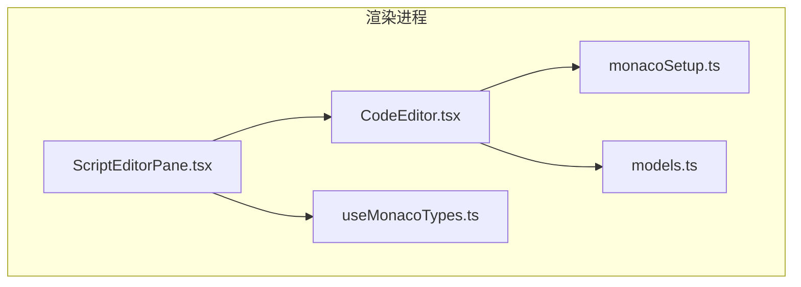
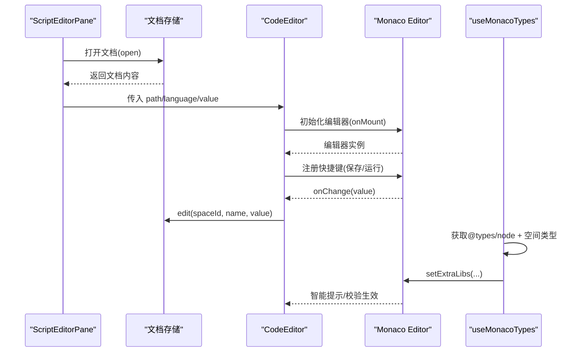
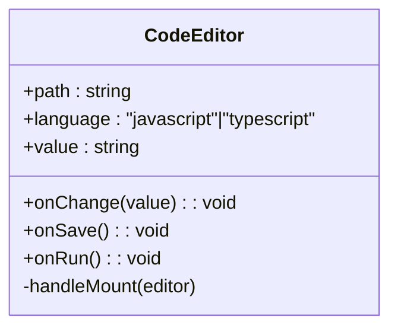
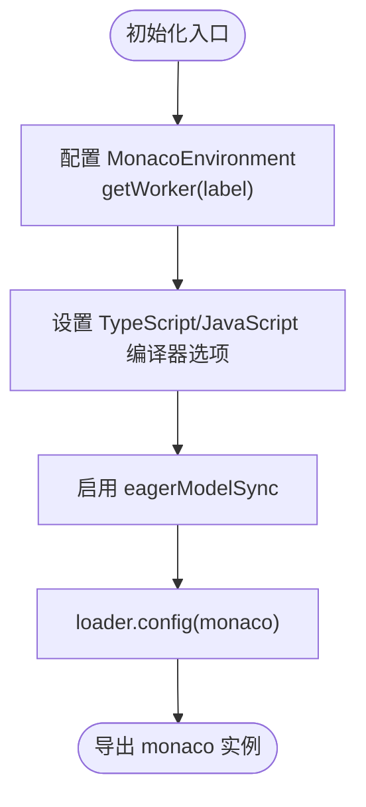
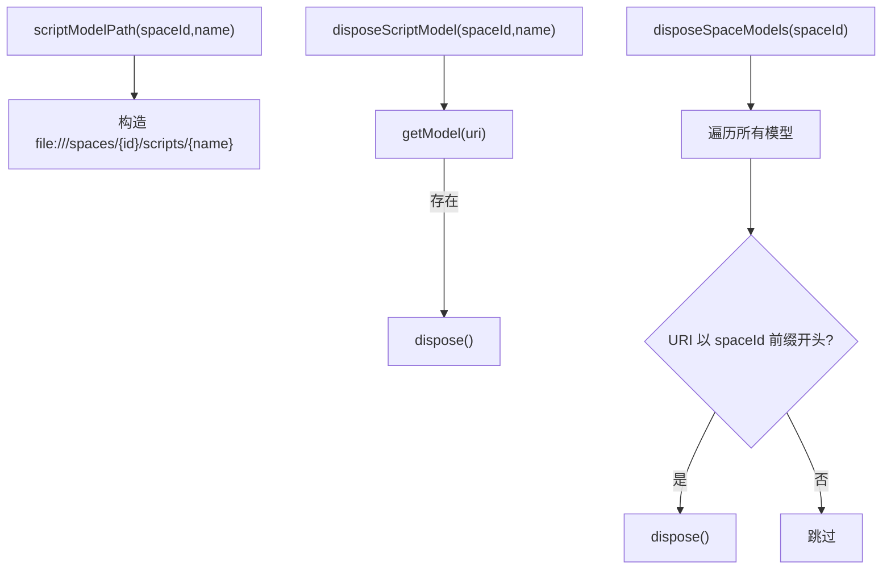
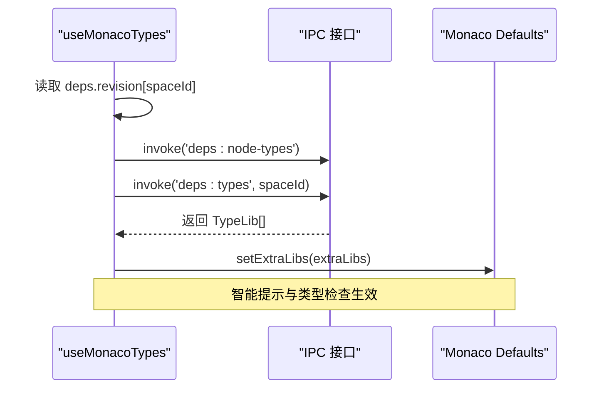
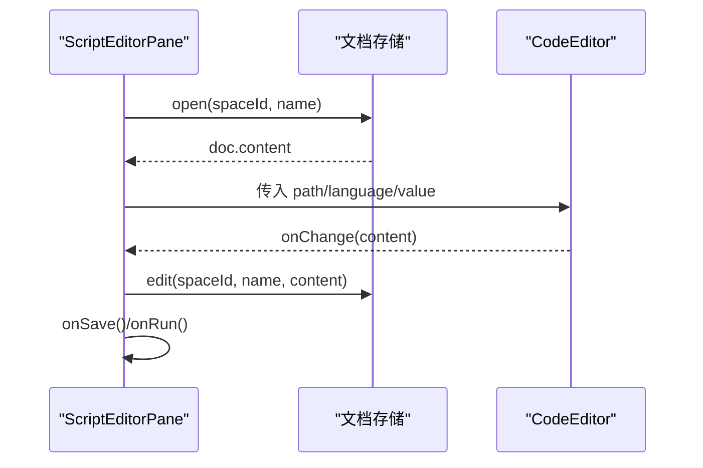
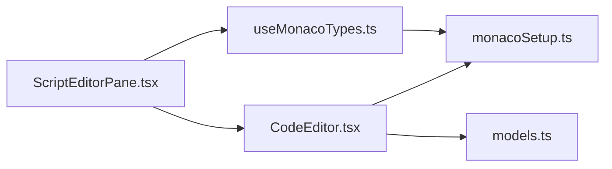

# 编辑器组件

<cite>
**本文引用的文件**   
- [CodeEditor.tsx](file://src/renderer/src/components/editor/CodeEditor.tsx)
- [models.ts](file://src/renderer/src/components/editor/models.ts)
- [monacoSetup.ts](file://src/renderer/src/components/editor/monacoSetup.ts)
- [useMonacoTypes.ts](file://src/renderer/src/components/editor/useMonacoTypes.ts)
- [ScriptEditorPane.tsx](file://src/renderer/src/pages/editor/ScriptEditorPane.tsx)
</cite>

## 目录
1. [简介](#简介)
2. [项目结构](#项目结构)
3. [核心组件](#核心组件)
4. [架构总览](#架构总览)
5. [详细组件分析](#详细组件分析)
6. [依赖关系分析](#依赖关系分析)
7. [性能与优化](#性能与优化)
8. [故障排查](#故障排查)
9. [结论](#结论)

## 简介
本文件为基于 Monaco Editor 构建的 CodeEditor 组件的详细技术文档。内容涵盖语法高亮、智能提示、代码格式化等能力，以及组件的属性配置、事件处理、主题定制和扩展机制。同时说明 Monaco Editor 的初始化配置、语言支持、类型定义注入等核心功能，并提供使用示例与最佳实践、性能优化技巧与常见问题解决方案。

## 项目结构
编辑器相关代码位于渲染进程的前端模块中，主要包含以下文件：
- 编辑器封装组件：CodeEditor.tsx
- Monaco 初始化与语言设置：monacoSetup.ts
- 模型路径与生命周期管理：models.ts
- 类型声明注入 Hook：useMonacoTypes.ts
- 页面集成示例：ScriptEditorPane.tsx

图表来源
- [ScriptEditorPane.tsx:1-79](file://src/renderer/src/pages/editor/ScriptEditorPane.tsx#L1-L79)
- [CodeEditor.tsx:1-53](file://src/renderer/src/components/editor/CodeEditor.tsx#L1-L53)
- [monacoSetup.ts:1-43](file://src/renderer/src/components/editor/monacoSetup.ts#L1-L43)
- [models.ts:1-17](file://src/renderer/src/components/editor/models.ts#L1-L17)
- [useMonacoTypes.ts:1-44](file://src/renderer/src/components/editor/useMonacoTypes.ts#L1-L44)

章节来源
- [ScriptEditorPane.tsx:1-79](file://src/renderer/src/pages/editor/ScriptEditorPane.tsx#L1-L79)
- [CodeEditor.tsx:1-53](file://src/renderer/src/components/editor/CodeEditor.tsx#L1-L53)
- [monacoSetup.ts:1-43](file://src/renderer/src/components/editor/monacoSetup.ts#L1-L43)
- [models.ts:1-17](file://src/renderer/src/components/editor/models.ts#L1-L17)
- [useMonacoTypes.ts:1-44](file://src/renderer/src/components/editor/useMonacoTypes.ts#L1-L44)

## 核心组件
- CodeEditor：对 @monaco-editor/react 的轻量封装，负责绑定值、主题、快捷键、基础编辑选项，并透传 onChange/onMount 等回调。
- monacoSetup：全局初始化 Monaco，配置 TypeScript/JavaScript 编译器选项、Worker 加载策略与 loader。
- models：提供脚本模型的 URI 生成与销毁方法，便于多文件场景下的模型隔离与清理。
- useMonacoTypes：在运行时动态注入 Node.js 与空间内 node_modules 的类型声明，驱动智能提示与类型检查。
- ScriptEditorPane：页面级容器，负责打开文档、保存、运行、安装依赖，并将数据与行为传递给 CodeEditor。

章节来源
- [CodeEditor.tsx:1-53](file://src/renderer/src/components/editor/CodeEditor.tsx#L1-L53)
- [monacoSetup.ts:1-43](file://src/renderer/src/components/editor/monacoSetup.ts#L1-L43)
- [models.ts:1-17](file://src/renderer/src/components/editor/models.ts#L1-L17)
- [useMonacoTypes.ts:1-44](file://src/renderer/src/components/editor/useMonacoTypes.ts#L1-L44)
- [ScriptEditorPane.tsx:1-79](file://src/renderer/src/pages/editor/ScriptEditorPane.tsx#L1-L79)

## 架构总览
下图展示了从页面到编辑器的调用链与数据流：页面打开文档后，将 path、language、value 等传入 CodeEditor；编辑器通过 onMount 注册快捷键，并通过 onChange 回写文档状态；类型系统由 useMonacoTypes 异步注入，驱动智能提示与校验。

图表来源
- [ScriptEditorPane.tsx:33-72](file://src/renderer/src/pages/editor/ScriptEditorPane.tsx#L33-L72)
- [CodeEditor.tsx:27-49](file://src/renderer/src/components/editor/CodeEditor.tsx#L27-L49)
- [useMonacoTypes.ts:17-43](file://src/renderer/src/components/editor/useMonacoTypes.ts#L17-L43)

## 详细组件分析

### CodeEditor 组件
职责
- 接收 path、language、value 等属性，渲染 Monaco 编辑器。
- 根据应用主题切换 vs/vs-dark。
- 在 onMount 时注册快捷键（保存、运行），并聚焦编辑器。
- 通过 options 配置字体大小、最小地图、滚动行为、自动布局、缩进等。

关键实现要点
- 使用 useRef 缓存 onSave/onRun，避免闭包陈旧问题。
- 使用 useLayoutEffect 同步更新 handlersRef，确保命令回调始终指向最新函数。
- 通过 @monaco-editor/react 的 OnMount 类型约束编辑器实例。

属性与方法
- path：模型 URI，如 file:///spaces/<id>/scripts/main.ts
- language：'javascript' | 'typescript'
- value：当前编辑内容
- onChange：内容变更回调
- onSave：保存回调
- onRun：运行回调

编辑器选项
- fontSize: 14
- minimap.enabled: false
- scrollBeyondLastLine: false
- automaticLayout: true
- tabSize: 2
- fixedOverflowWidgets: true

主题
- 根据 useAppTheme() 返回值选择 'vs-dark' 或 'vs'。

快捷键
- Ctrl/Cmd + S：触发 onSave
- F5：触发 onRun

图表来源
- [CodeEditor.tsx:9-49](file://src/renderer/src/components/editor/CodeEditor.tsx#L9-L49)

章节来源
- [CodeEditor.tsx:1-53](file://src/renderer/src/components/editor/CodeEditor.tsx#L1-L53)

### Monaco 初始化与语言支持（monacoSetup）
职责
- 配置 Monaco Worker 加载策略，使用内置 worker 而非 CDN。
- 配置 TypeScript/JavaScript 编译器选项，启用 ESNext、Node 模块解析、JS 支持与严格模式开关等。
- 设置 eagerModelSync 提升模型同步性能。
- 通过 loader.config 注入 monaco 实例。

关键实现要点
- globalThis.MonacoEnvironment.getWorker 根据 label 返回 TsWorker 或 EditorWorker。
- typescriptDefaults 与 javascriptDefaults 共享同一份 compilerOptions。
- moduleDetection 设置为 3，使每个脚本作为独立模块，避免命名冲突。

图表来源
- [monacoSetup.ts:1-43](file://src/renderer/src/components/editor/monacoSetup.ts#L1-L43)

章节来源
- [monacoSetup.ts:1-43](file://src/renderer/src/components/editor/monacoSetup.ts#L1-L43)

### 模型路径与生命周期（models）
职责
- 生成脚本模型的 URI，遵循 file:///spaces/<spaceId>/scripts/<name> 约定。
- 提供 disposeScriptModel 与 disposeSpaceModels 用于释放模型，避免内存泄漏。

关键点
- 使用 monaco.Uri.parse 与 monaco.editor.getModel 进行模型查找与销毁。
- 批量遍历 getModels() 并按前缀匹配释放空间内所有模型。

图表来源
- [models.ts:1-17](file://src/renderer/src/components/editor/models.ts#L1-L17)

章节来源
- [models.ts:1-17](file://src/renderer/src/components/editor/models.ts#L1-L17)

### 类型定义注入（useMonacoTypes）
职责
- 在运行时获取 @types/node 与空间内 node_modules 的类型声明，并注入到 Monaco 的 extraLibs，从而获得智能提示与类型检查。
- 监听依赖任务 revision 变化，自动刷新类型。

关键流程
- loadNodeTypes：调用 IPC 接口获取 @types/node 类型。
- applyLibs：将 TypeLib[] 转换为 extraLibs 并分别设置到 typescriptDefaults 与 javascriptDefaults。
- useEffect：并行请求 Node 类型与空间类型，合并后注入；组件卸载时取消未完成的副作用。

图表来源
- [useMonacoTypes.ts:1-44](file://src/renderer/src/components/editor/useMonacoTypes.ts#L1-L44)

章节来源
- [useMonacoTypes.ts:1-44](file://src/renderer/src/components/editor/useMonacoTypes.ts#L1-L44)

### 页面集成（ScriptEditorPane）
职责
- 打开文档、显示错误、触发保存与运行、提示缺失依赖并安装。
- 将 path、language、value 与回调传递给 CodeEditor。

交互流程
- 首次进入：open(spaceId, name)，失败则展示 Result 错误页。
- 用户编辑：onChange -> edit(spaceId, name, content)。
- 工具栏操作：onSave -> save；onRun -> onRun。
- 依赖缺失：MissingDepsAlert 提示并触发 installDeps。

图表来源
- [ScriptEditorPane.tsx:33-72](file://src/renderer/src/pages/editor/ScriptEditorPane.tsx#L33-L72)
- [CodeEditor.tsx:27-49](file://src/renderer/src/components/editor/CodeEditor.tsx#L27-L49)

章节来源
- [ScriptEditorPane.tsx:1-79](file://src/renderer/src/pages/editor/ScriptEditorPane.tsx#L1-L79)

## 依赖关系分析
- CodeEditor 依赖：
  - @monaco-editor/react：编辑器 React 封装
  - monacoSetup：提供 monaco 实例
  - useAppTheme：主题模式
  - antd Spin：加载态
- ScriptEditorPane 依赖：
  - CodeEditor：编辑器组件
  - models：模型路径
  - stores/documents：文档状态
  - stores/deps：依赖任务状态
  - MissingDepsAlert：缺失依赖提示
- useMonacoTypes 依赖：
  - IPC：invoke('deps:node-types'), invoke('deps:types')
  - stores/deps：revision 监听
  - monacoSetup：monaco 实例

图表来源
- [ScriptEditorPane.tsx:1-79](file://src/renderer/src/pages/editor/ScriptEditorPane.tsx#L1-L79)
- [CodeEditor.tsx:1-53](file://src/renderer/src/components/editor/CodeEditor.tsx#L1-L53)
- [monacoSetup.ts:1-43](file://src/renderer/src/components/editor/monacoSetup.ts#L1-L43)
- [models.ts:1-17](file://src/renderer/src/components/editor/models.ts#L1-L17)
- [useMonacoTypes.ts:1-44](file://src/renderer/src/components/editor/useMonacoTypes.ts#L1-L44)

章节来源
- [ScriptEditorPane.tsx:1-79](file://src/renderer/src/pages/editor/ScriptEditorPane.tsx#L1-L79)
- [CodeEditor.tsx:1-53](file://src/renderer/src/components/editor/CodeEditor.tsx#L1-L53)
- [monacoSetup.ts:1-43](file://src/renderer/src/components/editor/monacoSetup.ts#L1-L43)
- [models.ts:1-17](file://src/renderer/src/components/editor/models.ts#L1-L17)
- [useMonacoTypes.ts:1-44](file://src/renderer/src/components/editor/useMonacoTypes.ts#L1-L44)

## 性能与优化
- Worker 本地化：通过 MonacoEnvironment.getWorker 指定 TsWorker/EditorWorker，避免 CDN 下载，减少首屏延迟与网络抖动影响。
- 编译器选项优化：
  - target/module 设为 ESNext，moduleResolution 使用 NodeJs，适配现代前端工程。
  - allowJs/checkJs 开启 JS 支持，allowNonTsExtensions 允许非 .ts 扩展名。
  - skipLibCheck/noEmit 关闭类型库检查与输出，提升编辑器响应速度。
  - moduleDetection=3 将每个脚本视为独立模块，避免跨文件命名冲突导致的额外解析开销。
- eagerModelSync：启用后模型同步更及时，减少闪烁与卡顿。
- 编辑器选项：
  - automaticLayout=true 自适应容器尺寸，避免重排。
  - minimap.enabled=false 关闭小地图降低渲染压力。
  - scrollBeyondLastLine=false 避免多余滚动区域。
  - fixedOverflowWidgets=true 固定溢出控件定位，减少重绘。
- 类型注入：
  - 使用 Promise 缓存 node 类型加载结果，避免重复请求。
  - 监听依赖 revision 变化，增量刷新类型，避免全量重建。
- 模型管理：
  - 在空间切换或文件关闭时调用 disposeSpaceModels/disposeScriptModel，及时释放模型，防止内存增长。

章节来源
- [monacoSetup.ts:1-43](file://src/renderer/src/components/editor/monacoSetup.ts#L1-L43)
- [CodeEditor.tsx:42-49](file://src/renderer/src/components/editor/CodeEditor.tsx#L42-L49)
- [useMonacoTypes.ts:7-43](file://src/renderer/src/components/editor/useMonacoTypes.ts#L7-L43)
- [models.ts:6-16](file://src/renderer/src/components/editor/models.ts#L6-L16)

## 故障排查
- 智能提示不生效
  - 确认 useMonacoTypes 已执行且成功注入 extraLibs。
  - 检查 IPC 接口 deps:node-types 与 deps:types 是否返回有效 TypeLib[]。
  - 查看 monaco.typescript.typescriptDefaults/javascriptDefaults 是否被正确设置。
- 快捷键无效
  - 确认 onMount 已注册命令，handlersRef 已更新最新回调。
  - 检查浏览器键位冲突（如 F5 默认刷新），必要时调整键位组合。
- 主题不一致
  - 确认 useAppTheme 返回值与 theme 映射逻辑一致。
- 内存占用过高
  - 在空间切换或文件关闭时调用 disposeSpaceModels/disposeScriptModel。
  - 避免长时间持有大量未释放的模型引用。
- 编辑器卡顿
  - 检查 compilerOptions 是否过于严格（如 strict=true），可适度放宽。
  - 确认 eagerModelSync 与 automaticLayout 已启用。
  - 评估 extraLibs 体积，按需裁剪类型声明。

章节来源
- [useMonacoTypes.ts:17-43](file://src/renderer/src/components/editor/useMonacoTypes.ts#L17-L43)
- [CodeEditor.tsx:23-31](file://src/renderer/src/components/editor/CodeEditor.tsx#L23-L31)
- [models.ts:6-16](file://src/renderer/src/components/editor/models.ts#L6-L16)
- [monacoSetup.ts:17-38](file://src/renderer/src/components/editor/monacoSetup.ts#L17-L38)

## 结论
CodeEditor 组件在项目中提供了稳定、可扩展的 Monaco 编辑器封装，结合 monacoSetup 的全局初始化与 useMonacoTypes 的动态类型注入，实现了良好的语法高亮、智能提示与类型检查体验。通过合理的编辑器选项与 Worker 本地化策略，兼顾了性能与可用性。建议在大型工程中继续优化类型声明体积、按需加载语言特性，并结合业务需求扩展快捷键与命令体系。