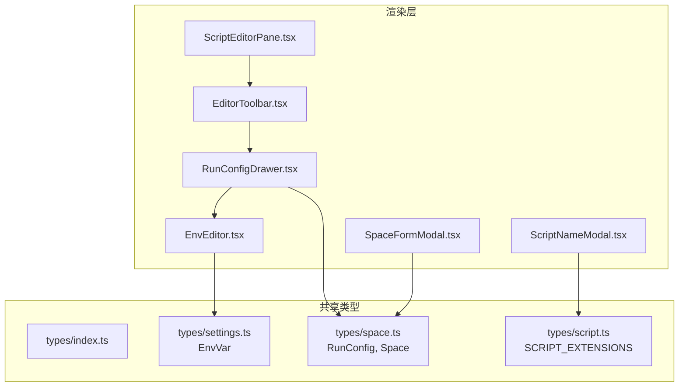
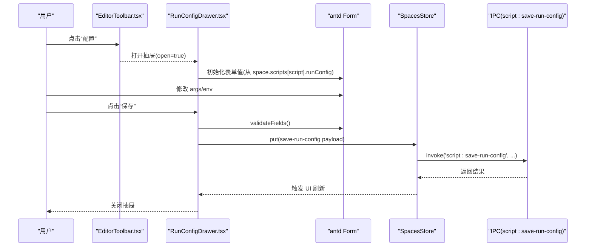
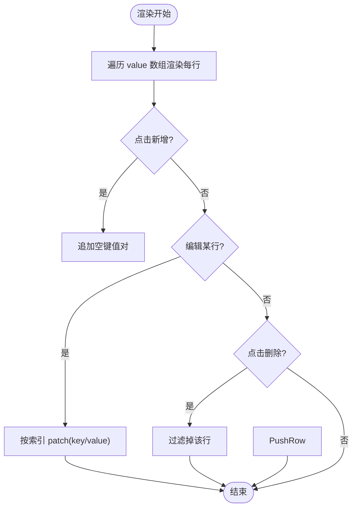
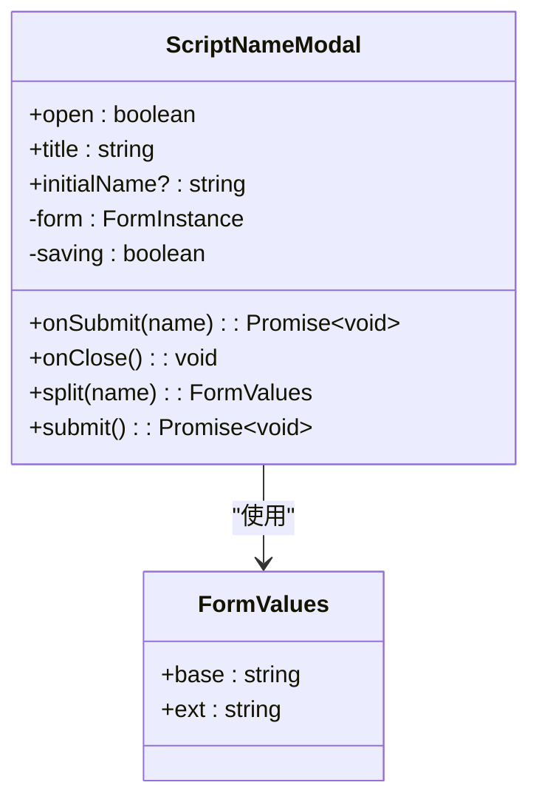
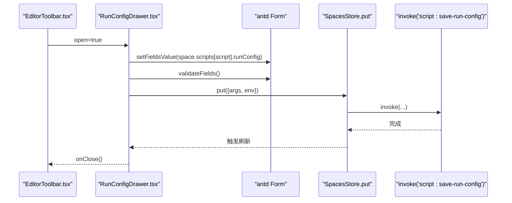
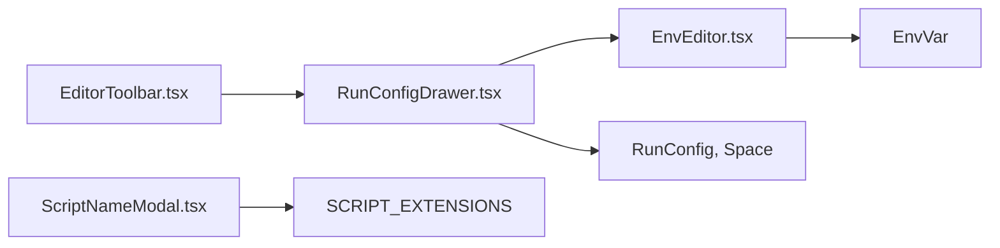

# 表单组件

<cite>
**本文引用的文件**   
- [EnvEditor.tsx](file://src/renderer/src/components/common/EnvEditor.tsx)
- [ScriptNameModal.tsx](file://src/renderer/src/components/script/ScriptNameModal.tsx)
- [RunConfigDrawer.tsx](file://src/renderer/src/components/script/RunConfigDrawer.tsx)
- [index.ts（共享类型入口）](file://src/shared/types/index.ts)
- [settings.ts（EnvVar 定义）](file://src/shared/types/settings.ts)
- [space.ts（RunConfig、Space 定义）](file://src/shared/types/space.ts)
- [script.ts（SCRIPT_EXTENSIONS 常量）](file://src/shared/types/script.ts)
- [EditorToolbar.tsx](file://src/renderer/src/pages/editor/EditorToolbar.tsx)
- [ScriptEditorPane.tsx](file://src/renderer/src/pages/editor/ScriptEditorPane.tsx)
- [SpaceFormModal.tsx](file://src/renderer/src/pages/spaces/SpaceFormModal.tsx)
</cite>

## 目录
1. [简介](#简介)
2. [项目结构](#项目结构)
3. [核心组件](#核心组件)
4. [架构总览](#架构总览)
5. [详细组件分析](#详细组件分析)
6. [依赖关系分析](#依赖关系分析)
7. [性能与可用性考虑](#性能与可用性考虑)
8. [故障排查指南](#故障排查指南)
9. [结论](#结论)
10. [附录：使用示例与扩展方法](#附录使用示例与扩展方法)

## 简介
本文件聚焦于项目中常用的表单相关 UI 组件，包括环境变量编辑器 EnvEditor、脚本名称模态框 ScriptNameModal、运行配置抽屉 RunConfigDrawer。文档将详细说明每个组件的表单字段、验证规则、数据绑定与交互逻辑，并总结复杂表单处理模式、动态表单生成与状态管理实践，最后给出使用示例与自定义扩展建议。

## 项目结构
这些表单组件位于渲染进程的前端代码中，主要分布在以下路径：
- 通用表单控件：src/renderer/src/components/common
- 脚本相关表单：src/renderer/src/components/script
- 页面级集成点：src/renderer/src/pages/editor、src/renderer/src/pages/spaces
- 共享类型定义：src/shared/types

图表来源
- [EnvEditor.tsx:1-49](file://src/renderer/src/components/common/EnvEditor.tsx#L1-L49)
- [ScriptNameModal.tsx:1-86](file://src/renderer/src/components/script/ScriptNameModal.tsx#L1-L86)
- [RunConfigDrawer.tsx:1-66](file://src/renderer/src/components/script/RunConfigDrawer.tsx#L1-L66)
- [EditorToolbar.tsx:1-47](file://src/renderer/src/pages/editor/EditorToolbar.tsx#L1-L47)
- [ScriptEditorPane.tsx:33-80](file://src/renderer/src/pages/editor/ScriptEditorPane.tsx#L33-L80)
- [SpaceFormModal.tsx:1-35](file://src/renderer/src/pages/spaces/SpaceFormModal.tsx#L1-L35)
- [index.ts（共享类型入口）:1-8](file://src/shared/types/index.ts#L1-L8)
- [settings.ts（EnvVar 定义）:4-7](file://src/shared/types/settings.ts#L4-L7)
- [space.ts（RunConfig、Space 定义）:3-21](file://src/shared/types/space.ts#L3-L21)
- [script.ts（SCRIPT_EXTENSIONS 常量）:1-3](file://src/shared/types/script.ts#L1-L3)

章节来源
- [EnvEditor.tsx:1-49](file://src/renderer/src/components/common/EnvEditor.tsx#L1-L49)
- [ScriptNameModal.tsx:1-86](file://src/renderer/src/components/script/ScriptNameModal.tsx#L1-L86)
- [RunConfigDrawer.tsx:1-66](file://src/renderer/src/components/script/RunConfigDrawer.tsx#L1-L66)

## 核心组件
- EnvEditor：可编辑的环境变量键值对列表，支持增删改，可作为 antd Form 子控件使用。
- ScriptNameModal：脚本名称输入模态框，包含基础名与扩展名选择，内置命名校验与错误提示。
- RunConfigDrawer：脚本运行配置抽屉，封装命令行参数与环境变量，保存后更新空间存储。

章节来源
- [EnvEditor.tsx:7-48](file://src/renderer/src/components/common/EnvEditor.tsx#L7-L48)
- [ScriptNameModal.tsx:8-85](file://src/renderer/src/components/script/ScriptNameModal.tsx#L8-L85)
- [RunConfigDrawer.tsx:11-65](file://src/renderer/src/components/script/RunConfigDrawer.tsx#L11-L65)

## 架构总览
表单组件通过统一的 antd Form 模式进行数据绑定与校验，结合 i18n 提供多语言文案，并通过 Electron IPC 与主进程通信持久化配置。

图表来源
- [EditorToolbar.tsx:16-47](file://src/renderer/src/pages/editor/EditorToolbar.tsx#L16-L47)
- [RunConfigDrawer.tsx:18-65](file://src/renderer/src/components/script/RunConfigDrawer.tsx#L18-L65)

## 详细组件分析

### EnvEditor（环境变量编辑器）
- 表单字段
  - key：环境变量键
  - value：环境变量值
- 数据绑定
  - 受控组件：value 由外部传入，onChange 回调通知父组件更新数组
  - 行内 patch：根据索引合并更新单行 key/value
- 交互逻辑
  - 新增行：追加空对象 {key:'', value:''}
  - 删除行：过滤掉指定索引项
  - 占位符：支持自定义 keyPlaceholder，默认使用国际化文案
- 复杂度
  - 渲染 O(n)，变更操作为浅拷贝与映射，整体 O(n)
- 适用场景
  - 作为 antd Form.Item 的子控件，配合 name="env" 直接绑定到 RunConfig.env

图表来源
- [EnvEditor.tsx:14-48](file://src/renderer/src/components/common/EnvEditor.tsx#L14-L48)

章节来源
- [EnvEditor.tsx:7-48](file://src/renderer/src/components/common/EnvEditor.tsx#L7-L48)
- [settings.ts（EnvVar 定义）:4-7](file://src/shared/types/settings.ts#L4-L7)

### ScriptNameModal（脚本名称模态框）
- 表单字段
  - base：脚本基础名
  - ext：脚本扩展名（从 SCRIPT_EXTENSIONS 中选择）
- 验证规则
  - 必填且非空白
  - 正则排除非法字符
  - 自定义校验器拒绝系统保留字符、以 . 开头或包含 ..
- 数据绑定
  - 打开时根据 initialName 拆分 base/ext 并回填
  - 提交时拼接 base.trim()+ext 调用 onSubmit
- 交互逻辑
  - 保存按钮 loading 状态控制
  - 失败时统一格式化错误消息并提示
- 复杂度
  - 字符串分割与匹配 O(k)（k 为扩展名集合大小），通常很小

图表来源
- [ScriptNameModal.tsx:8-85](file://src/renderer/src/components/script/ScriptNameModal.tsx#L8-L85)
- [script.ts（SCRIPT_EXTENSIONS 常量）:1-3](file://src/shared/types/script.ts#L1-L3)

章节来源
- [ScriptNameModal.tsx:8-85](file://src/renderer/src/components/script/ScriptNameModal.tsx#L8-L85)
- [script.ts（SCRIPT_EXTENSIONS 常量）:1-3](file://src/shared/types/script.ts#L1-L3)

### RunConfigDrawer（运行配置抽屉）
- 表单字段
  - args：命令行参数字符串
  - env：环境变量数组（复用 EnvEditor）
- 数据绑定
  - 打开时从 space.scripts[script].runConfig 回填，缺省值为 {args:'', env:[]}
  - 保存时将 env 过滤掉 key 为空项，再调用 IPC 持久化
- 交互逻辑
  - 保存按钮 loading 状态
  - 成功后关闭抽屉
  - 失败时统一错误提示
- 与页面集成
  - EditorToolbar 提供“配置”入口，触发 onConfigure 打开抽屉

图表来源
- [EditorToolbar.tsx:16-47](file://src/renderer/src/pages/editor/EditorToolbar.tsx#L16-L47)
- [RunConfigDrawer.tsx:18-65](file://src/renderer/src/components/script/RunConfigDrawer.tsx#L18-L65)

章节来源
- [RunConfigDrawer.tsx:11-65](file://src/renderer/src/components/script/RunConfigDrawer.tsx#L11-L65)
- [space.ts（RunConfig、Space 定义）:3-21](file://src/shared/types/space.ts#L3-L21)

### 页面级集成与上下文
- EditorToolbar：提供“配置”按钮，用于打开运行配置抽屉；同时展示脚本名称、未保存标记、运行/停止状态。
- ScriptEditorPane：承载编辑器工具栏与代码编辑器，并将运行/保存等动作传递给上层。
- SpaceFormModal：演示了另一个表单场景（空间创建/编辑），展示了如何从 store 与 settings 读取默认值并回填表单。

章节来源
- [EditorToolbar.tsx:16-47](file://src/renderer/src/pages/editor/EditorToolbar.tsx#L16-L47)
- [ScriptEditorPane.tsx:33-80](file://src/renderer/src/pages/editor/ScriptEditorPane.tsx#L33-L80)
- [SpaceFormModal.tsx:1-35](file://src/renderer/src/pages/spaces/SpaceFormModal.tsx#L1-L35)

## 依赖关系分析
- 类型依赖
  - EnvEditor 依赖 EnvVar 类型
  - RunConfigDrawer 依赖 RunConfig、Space 类型
  - ScriptNameModal 依赖 SCRIPT_EXTENSIONS 常量
- 组件耦合
  - RunConfigDrawer 组合 EnvEditor，形成“表单嵌套表单”的模式
  - EditorToolbar 与 RunConfigDrawer 通过 props 解耦，仅传递 open/close 回调
- 外部依赖
  - antd：Form、Input、Select、Modal、Drawer、Button 等
  - react-i18next：i18n 文案
  - Electron IPC：通过 invoke 调用主进程能力

图表来源
- [EnvEditor.tsx:1-49](file://src/renderer/src/components/common/EnvEditor.tsx#L1-L49)
- [RunConfigDrawer.tsx:1-66](file://src/renderer/src/components/script/RunConfigDrawer.tsx#L1-L66)
- [ScriptNameModal.tsx:1-86](file://src/renderer/src/components/script/ScriptNameModal.tsx#L1-L86)
- [EditorToolbar.tsx:1-47](file://src/renderer/src/pages/editor/EditorToolbar.tsx#L1-L47)
- [settings.ts（EnvVar 定义）:4-7](file://src/shared/types/settings.ts#L4-L7)
- [space.ts（RunConfig、Space 定义）:3-21](file://src/shared/types/space.ts#L3-L21)
- [script.ts（SCRIPT_EXTENSIONS 常量）:1-3](file://src/shared/types/script.ts#L1-L3)

章节来源
- [index.ts（共享类型入口）:1-8](file://src/shared/types/index.ts#L1-L8)

## 性能与可用性考虑
- 表单渲染
  - EnvEditor 使用数组索引作为 key，在频繁输入场景下可能影响 React 列表稳定性；当前注释已说明该取舍，适合轻量编辑场景。
- 校验策略
  - ScriptNameModal 采用多层校验（必填、正则、自定义），避免无效文件名进入后端。
- 状态管理
  - RunConfigDrawer 通过 store.put 与 IPC 异步持久化，UI 仅在成功时关闭，减少重复请求。
- 用户体验
  - 所有异步操作均设置 loading 状态，并提供统一错误提示，提升可感知性。

## 故障排查指南
- 表单无法提交
  - 检查是否触发了 validateFields 且无校验失败
  - 确认 onChange 是否正确回写 value（EnvEditor）
- 环境变量未生效
  - 确认 env 数组中的 key 非空（保存前会过滤空 key）
- 脚本名称被拒绝
  - 检查是否包含非法字符或违反命名规则（ScriptNameModal 自定义校验）
- 抽屉不关闭
  - 检查保存流程是否成功执行 onClose，以及是否有未捕获异常

章节来源
- [ScriptNameModal.tsx:42-55](file://src/renderer/src/components/script/ScriptNameModal.tsx#L42-L55)
- [RunConfigDrawer.tsx:30-44](file://src/renderer/src/components/script/RunConfigDrawer.tsx#L30-L44)

## 结论
本项目围绕 antd Form 构建了稳定、可扩展的表单体系：EnvEditor 提供通用的键值对编辑能力，ScriptNameModal 提供安全的脚本命名输入，RunConfigDrawer 将二者组合并对接持久化。通过类型约束、统一错误处理与 i18n，保证了良好的可维护性与跨语言体验。

## 附录：使用示例与扩展方法

- 在运行配置中使用环境变量编辑器
  - 在 RunConfigDrawer 中通过 Form.Item name="env" 包裹 EnvEditor，即可双向绑定到 RunConfig.env
  - 参考路径：[RunConfigDrawer.tsx:55-61](file://src/renderer/src/components/script/RunConfigDrawer.tsx#L55-L61)

- 自定义环境变量键占位符
  - 向 EnvEditor 传入 keyPlaceholder 覆盖默认文案
  - 参考路径：[EnvEditor.tsx:7-11](file://src/renderer/src/components/common/EnvEditor.tsx#L7-L11)

- 扩展脚本扩展名选择
  - 修改 SCRIPT_EXTENSIONS 常量以支持更多扩展名
  - 参考路径：[script.ts（SCRIPT_EXTENSIONS 常量）:1-3](file://src/shared/types/script.ts#L1-L3)

- 扩展表单校验规则
  - 在 ScriptNameModal 的 Form.Item rules 中添加新的校验器
  - 参考路径：[ScriptNameModal.tsx:60-66](file://src/renderer/src/components/script/ScriptNameModal.tsx#L60-L66)

- 在页面中打开运行配置抽屉
  - 在 EditorToolbar 的 onConfigure 回调中设置 open=true
  - 参考路径：[EditorToolbar.tsx:28-30](file://src/renderer/src/pages/editor/EditorToolbar.tsx#L28-L30)