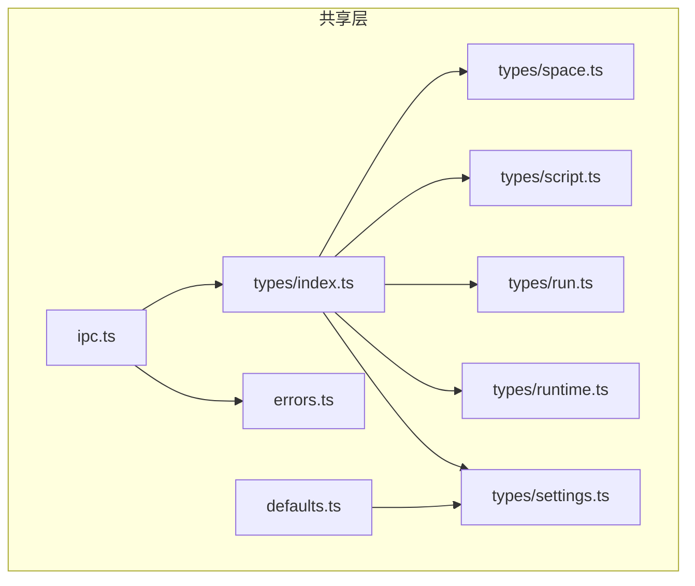
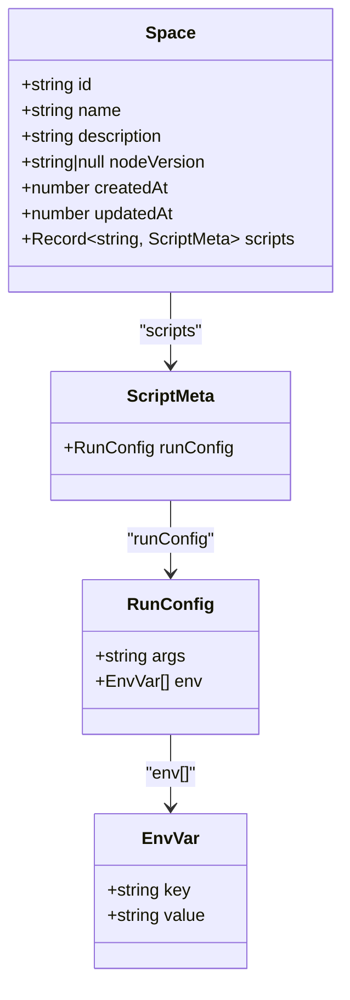
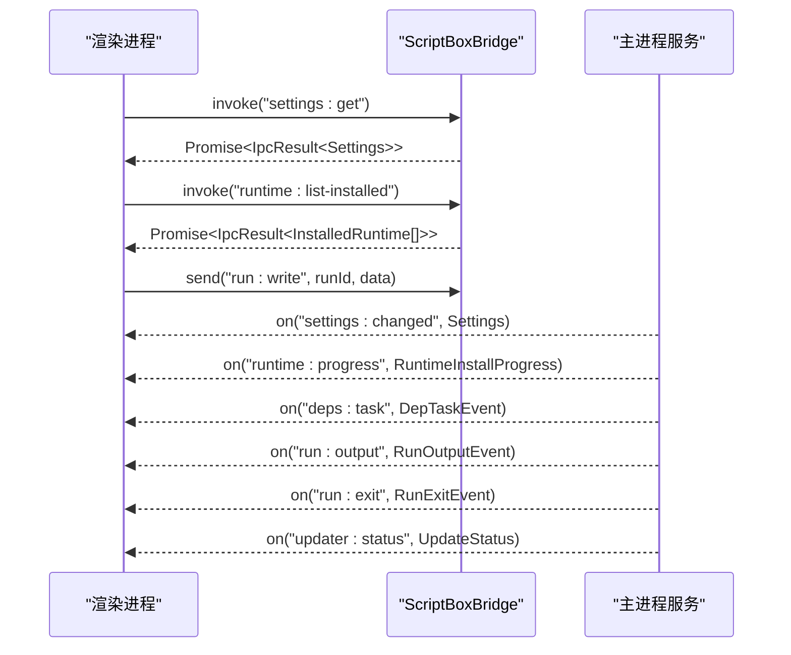
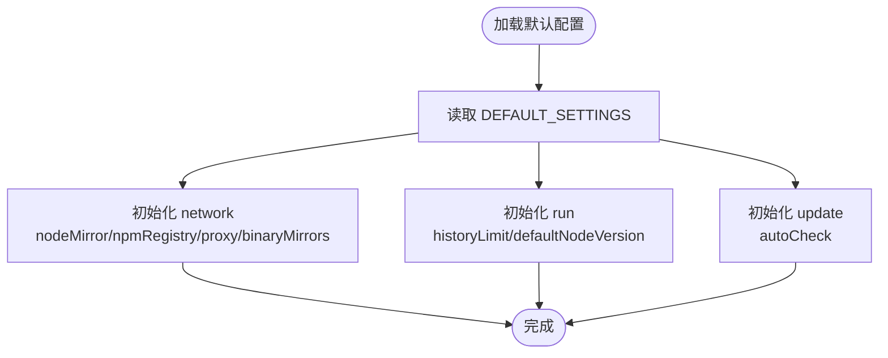
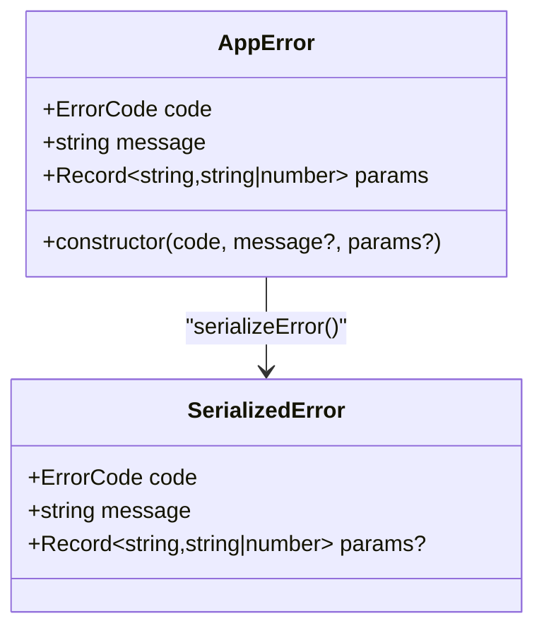
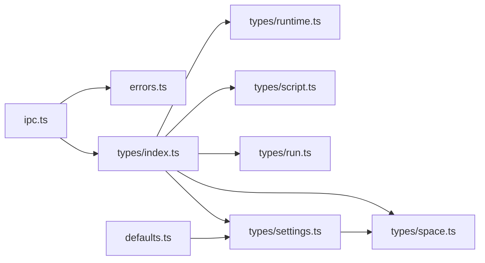

# 共享类型与配置

<cite>
**本文引用的文件**   
- [src/shared/types/index.ts](file://src/shared/types/index.ts)
- [src/shared/types/space.ts](file://src/shared/types/space.ts)
- [src/shared/types/script.ts](file://src/shared/types/script.ts)
- [src/shared/types/run.ts](file://src/shared/types/run.ts)
- [src/shared/types/runtime.ts](file://src/shared/types/runtime.ts)
- [src/shared/types/settings.ts](file://src/shared/types/settings.ts)
- [src/shared/defaults.ts](file://src/shared/defaults.ts)
- [src/shared/errors.ts](file://src/shared/errors.ts)
- [src/shared/ipc.ts](file://src/shared/ipc.ts)
</cite>

## 目录
1. [简介](#简介)
2. [项目结构](#项目结构)
3. [核心数据模型](#核心数据模型)
4. [IPC 通道类型定义](#ipc-通道类型定义)
5. [默认配置项](#默认配置项)
6. [错误类型体系与处理约定](#错误类型体系与处理约定)
7. [依赖关系分析](#依赖关系分析)
8. [性能与一致性考量](#性能与一致性考量)
9. [使用示例与扩展指南](#使用示例与扩展指南)
10. [故障排查](#故障排查)
11. [结论](#结论)

## 简介
本文档聚焦于前后端共享的 TypeScript 类型定义与配置，覆盖以下关键主题：
- 核心数据模型：Space、ScriptFile、RunRecord、InstalledRuntime、Settings 等
- IPC 通道类型定义：请求/响应、事件推送、发送通道
- 默认配置项：网络镜像、代理、运行行为、更新策略
- 错误类型体系：错误码、序列化错误、统一异常类
- 类型使用示例与扩展指南：如何在渲染进程与主进程中安全地消费这些类型

本说明旨在帮助开发者在 Electron 主进程与渲染进程之间保持一致的数据契约，确保类型安全、可维护性与可扩展性。

## 项目结构
共享类型与配置集中在 src/shared 目录下，按职责拆分为 types、defaults、errors、ipc 四个模块：
- types：所有跨进程共享的类型定义
- defaults：应用默认配置与常用常量
- errors：错误类型与序列化逻辑
- ipc：IPC 通道类型与桥接接口

**图表来源**
- [src/shared/types/index.ts:1-8](file://src/shared/types/index.ts#L1-L8)
- [src/shared/ipc.ts:1-23](file://src/shared/ipc.ts#L1-L23)
- [src/shared/defaults.ts:1-44](file://src/shared/defaults.ts#L1-L44)

**章节来源**
- [src/shared/types/index.ts:1-8](file://src/shared/types/index.ts#L1-L8)
- [src/shared/ipc.ts:1-23](file://src/shared/ipc.ts#L1-L23)
- [src/shared/defaults.ts:1-44](file://src/shared/defaults.ts#L1-L44)

## 核心数据模型
本节梳理共享层中的核心数据模型及其字段含义、约束与用途。

### Space（工作区）
- id：唯一标识
- name：显示名称
- description：描述信息
- nodeVersion：该工作区使用的 Node 版本或 null
- createdAt / updatedAt：创建与更新时间戳
- scripts：脚本元数据映射，键为脚本名，值为 ScriptMeta（包含 runConfig）

**图表来源**
- [src/shared/types/space.ts:3-21](file://src/shared/types/space.ts#L3-L21)
- [src/shared/types/settings.ts:4-7](file://src/shared/types/settings.ts#L4-L7)

**章节来源**
- [src/shared/types/space.ts:3-21](file://src/shared/types/space.ts#L3-L21)

### ScriptFile（脚本文件）
- name：文件名
- language：语言（javascript | typescript）
- size：文件大小（字节）
- mtime：修改时间戳

此外，脚本扩展名集合 SCRIPT_EXTENSIONS 限定支持的文件后缀，并派生 ScriptExtension 类型；ScriptLanguage 限定语言枚举。

**章节来源**
- [src/shared/types/script.ts:1-12](file://src/shared/types/script.ts#L1-L12)

### RunRecord（运行记录）
- id：运行实例 ID
- spaceId：所属工作区 ID
- script：脚本名
- args：命令行参数数组
- nodeVersion：运行时 Node 版本
- startedAt / endedAt：开始与结束时间戳（endedAt 可为空）
- exitCode：退出码（可为空）
- status：运行状态（running | success | failed | stopped）

另有 RunStartOptions（启动选项，如终端行列数）、RunOutputEvent（输出事件）、RunExitEvent（退出事件）。

**章节来源**
- [src/shared/types/run.ts:1-28](file://src/shared/types/run.ts#L1-L28)

### InstalledRuntime（已安装运行时）
- version：Node 版本
- dir：安装目录
- npmVersion：对应 npm 版本或 null

同时定义了 RemoteNodeVersion（远端版本列表项）、RuntimeInstallProgress（安装进度）、RuntimeInstallPhase（安装阶段）。

**章节来源**
- [src/shared/types/runtime.ts:1-23](file://src/shared/types/runtime.ts#L1-L23)

### Settings（设置）
Settings 是全局配置对象，包含：
- locale：语言（system | zh-CN | en-US）
- theme：主题模式（system | light | dark）
- network：网络相关设置
  - nodeMirror：Node 镜像地址
  - npmRegistry：npm 仓库地址
  - proxy：代理设置（enabled、http、https、noProxy）
  - binaryMirrors：二进制镜像环境变量列表（EnvVar[]）
- run：运行相关设置
  - historyLimit：历史记录保留数量
  - defaultNodeVersion：默认 Node 版本或 null
- update：更新相关设置
  - autoCheck：是否自动检查更新

此外提供 DeepPartial<T> 用于部分更新 Settings，以及 ConnectionTestResult 用于连接测试返回结果。

**章节来源**
- [src/shared/types/settings.ts:1-58](file://src/shared/types/settings.ts#L1-L58)

## IPC 通道类型定义
IPC 通道类型将渲染进程与主进程的通信契约进行强类型化，分为三类：
- IpcInvokeMap：请求/响应通道（renderer -> main，通过 invoke）
- IpcSendMap：单向发送通道（renderer -> main，通过 send）
- IpcEventMap：事件推送通道（main -> renderer，通过 on）

**图表来源**
- [src/shared/ipc.ts:25-116](file://src/shared/ipc.ts#L25-L116)

关键要点：
- invoke 返回值类型为 IpcResult<T>，统一封装成功/失败结果，避免 contextBridge 丢失自定义错误字段的问题
- send 用于无需响应的命令式操作
- on 订阅主进程推送的事件流

**章节来源**
- [src/shared/ipc.ts:25-116](file://src/shared/ipc.ts#L25-L116)

## 默认配置项
默认配置集中在 defaults.ts，提供：
- NODE_MIRROR_OFFICIAL / NODE_MIRROR_CN：Node 官方与中文镜像
- NPM_REGISTRY_OFFICIAL / NPM_REGISTRY_CN：npm 官方与中文仓库
- CN_BINARY_MIRRORS：一组常用的二进制下载镜像环境变量（EnvVar[]）
- DEFAULT_SETTINGS：Settings 的默认值，包括 locale、theme、network、run、update 的初始值

**图表来源**
- [src/shared/defaults.ts:1-44](file://src/shared/defaults.ts#L1-L44)

**章节来源**
- [src/shared/defaults.ts:1-44](file://src/shared/defaults.ts#L1-L44)

## 错误类型体系与处理约定
错误类型体系由 errors.ts 定义，包含：
- ErrorCode：统一的错误码枚举，涵盖空间、脚本、运行时、依赖、构建、运行等场景
- SerializedError：跨进程序列化的错误对象，包含 code、message、params
- AppError：统一异常类，携带 code、message、params，name 固定为 'AppError'
- serializeError：将任意错误转换为 SerializedError，未知错误降级为 UNKNOWN

**图表来源**
- [src/shared/errors.ts:1-41](file://src/shared/errors.ts#L1-L41)

处理约定：
- 主进程抛出 AppError，渲染进程通过 IpcResult.error 获取 SerializedError
- 前端根据 ErrorCode 进行用户提示与流程控制
- 未知错误统一归一化为 UNKNOWN，便于前端兜底处理

**章节来源**
- [src/shared/errors.ts:1-41](file://src/shared/errors.ts#L1-L41)

## 依赖关系分析
共享类型之间的依赖关系如下：
- types/index.ts 聚合导出所有子模块类型
- settings.ts 被 space.ts 引用（EnvVar）
- ipc.ts 依赖 types 与 errors
- defaults.ts 依赖 types（EnvVar、Settings）

**图表来源**
- [src/shared/types/index.ts:1-8](file://src/shared/types/index.ts#L1-L8)
- [src/shared/types/settings.ts:1-58](file://src/shared/types/settings.ts#L1-L58)
- [src/shared/types/space.ts:1-28](file://src/shared/types/space.ts#L1-L28)
- [src/shared/ipc.ts:1-23](file://src/shared/ipc.ts#L1-L23)
- [src/shared/defaults.ts:1-44](file://src/shared/defaults.ts#L1-L44)

**章节来源**
- [src/shared/types/index.ts:1-8](file://src/shared/types/index.ts#L1-L8)
- [src/shared/types/settings.ts:1-58](file://src/shared/types/settings.ts#L1-L58)
- [src/shared/types/space.ts:1-28](file://src/shared/types/space.ts#L1-L28)
- [src/shared/ipc.ts:1-23](file://src/shared/ipc.ts#L1-L23)
- [src/shared/defaults.ts:1-44](file://src/shared/defaults.ts#L1-L44)

## 性能与一致性考量
- 类型复用：通过 types/index.ts 集中导出，避免重复定义，提升一致性
- 部分更新：DeepPartial<Settings> 允许增量更新，减少全量传输开销
- 事件驱动：run:output、run:exit、runtime:progress 等事件推送降低轮询成本
- 错误序列化：SerializedError 保证跨进程错误信息一致，便于前端统一展示

[本节为通用指导，不直接分析具体文件]

## 使用示例与扩展指南
### 基本使用示例
- 获取设置
  - 调用 invoke('settings:get')，得到 IpcResult<Settings>
  - 若 ok 为 true，data 即为 Settings 对象
- 列出已安装运行时
  - 调用 invoke('runtime:list-installed')，得到 IpcResult<InstalledRuntime[]>
- 写入运行输入
  - 调用 send('run:write', runId, data)，无需等待响应

注意：所有 invoke 返回 IpcResult<T>，需先判断 ok 再访问 data，否则从 error 中读取 SerializedError。

### 扩展指南
- 新增共享类型
  - 在对应 types/*.ts 中定义新类型
  - 在 types/index.ts 中导出
  - 如需跨进程使用，在 ipc.ts 中添加相应通道签名
- 新增默认配置
  - 在 defaults.ts 中扩展 DEFAULT_SETTINGS 或新增常量
  - 在 Settings 类型中声明新字段，保持默认值与类型一致
- 新增错误码
  - 在 errors.ts 的 ErrorCode 中添加新码
  - 在主进程抛出 AppError 时使用新码
  - 在前端根据新码实现提示或流程分支

**章节来源**
- [src/shared/types/index.ts:1-8](file://src/shared/types/index.ts#L1-L8)
- [src/shared/ipc.ts:25-116](file://src/shared/ipc.ts#L25-L116)
- [src/shared/defaults.ts:1-44](file://src/shared/defaults.ts#L1-L44)
- [src/shared/errors.ts:1-41](file://src/shared/errors.ts#L1-L41)

## 故障排查
常见问题与定位建议：
- 类型不一致
  - 检查 types/index.ts 是否正确导出新增类型
  - 确认 ipc.ts 中通道参数与返回类型与实际业务一致
- 错误未正确传递
  - 确认主进程抛出的是 AppError
  - 渲染进程通过 IpcResult.error.code 与 error.message 进行诊断
- 默认配置未生效
  - 检查 DEFAULT_SETTINGS 是否包含所需字段
  - 确认 Settings 类型与 defaults.ts 中默认值结构一致

**章节来源**
- [src/shared/types/index.ts:1-8](file://src/shared/types/index.ts#L1-L8)
- [src/shared/ipc.ts:25-116](file://src/shared/ipc.ts#L25-L116)
- [src/shared/errors.ts:1-41](file://src/shared/errors.ts#L1-L41)
- [src/shared/defaults.ts:1-44](file://src/shared/defaults.ts#L1-L44)

## 结论
本文档系统梳理了共享类型与配置的完整体系，涵盖核心数据模型、IPC 通道类型、默认配置与错误处理约定。遵循本文规范，可在前后端之间建立稳定、可扩展且类型安全的契约，提升开发效率与代码质量。