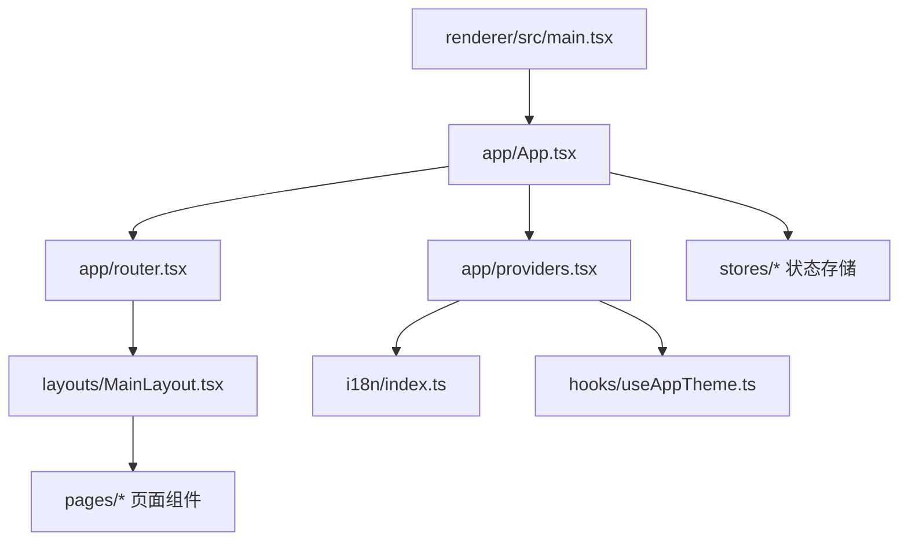
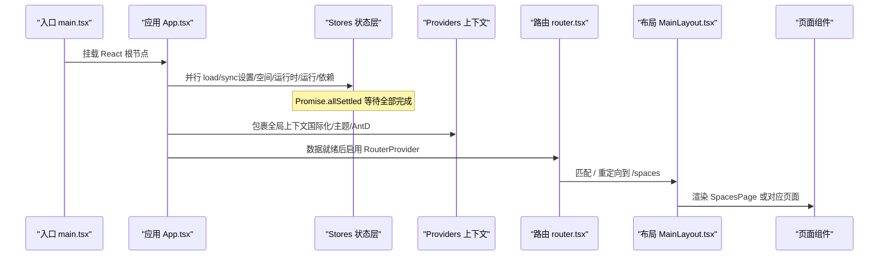
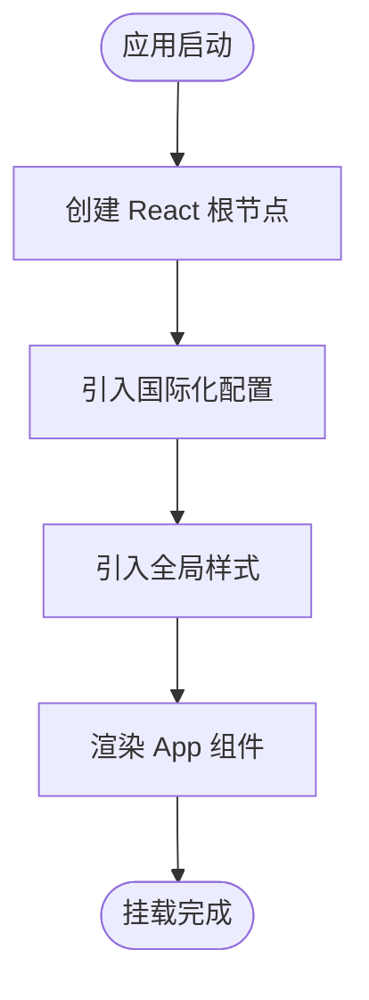
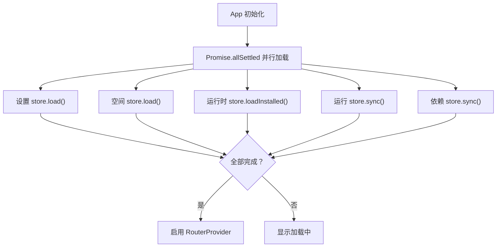
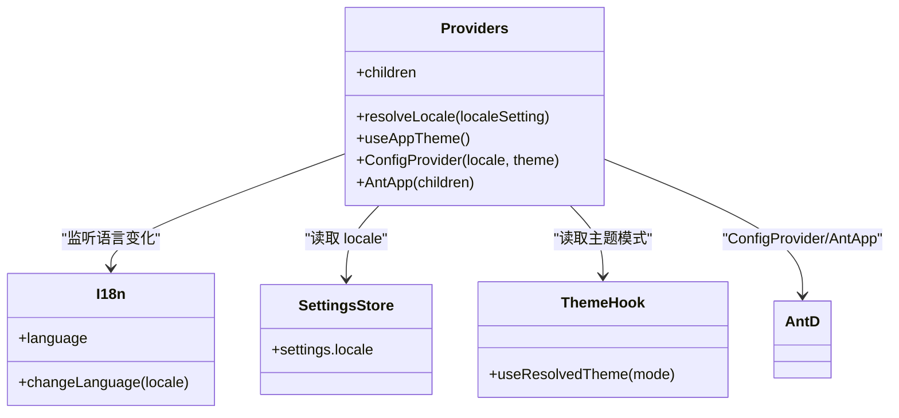
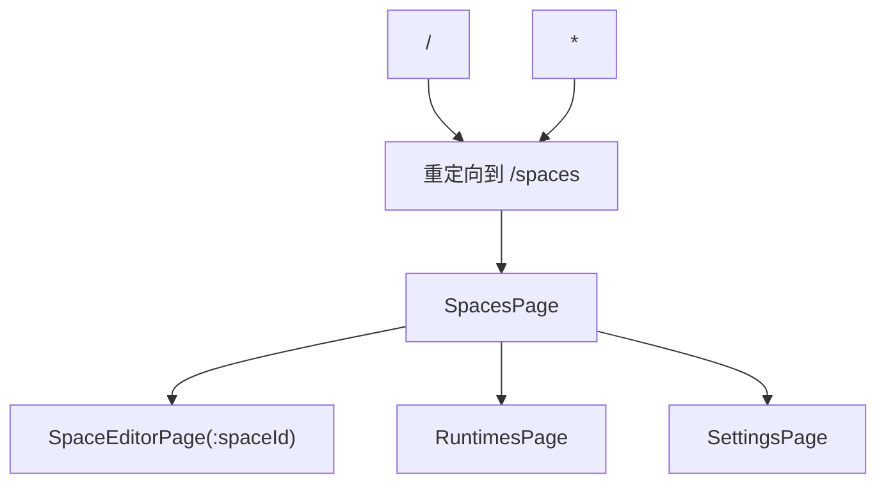
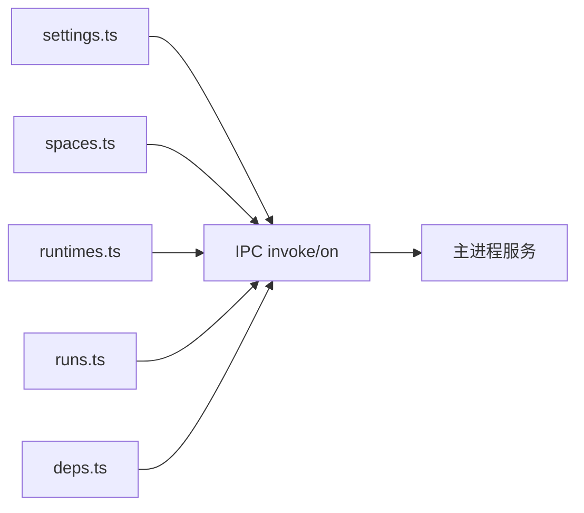
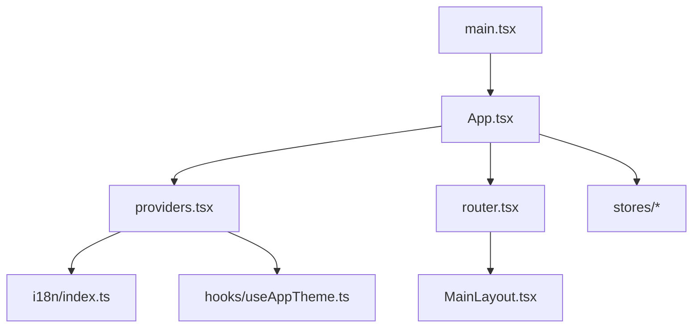

# React应用结构

<cite>
**本文引用的文件**   
- [main.tsx](file://src/renderer/src/main.tsx)
- [App.tsx](file://src/renderer/src/app/App.tsx)
- [providers.tsx](file://src/renderer/src/app/providers.tsx)
- [router.tsx](file://src/renderer/src/app/router.tsx)
- [MainLayout.tsx](file://src/renderer/src/layouts/MainLayout.tsx)
- [index.ts（国际化）](file://src/renderer/src/i18n/index.ts)
- [useAppTheme.ts](file://src/renderer/src/hooks/useAppTheme.ts)
- [settings.ts（渲染进程设置存储）](file://src/renderer/src/stores/settings.ts)
- [spaces.ts（运行空间存储）](file://src/renderer/src/stores/spaces.ts)
- [runtimes.ts（运行时存储）](file://src/renderer/src/stores/runtimes.ts)
- [runs.ts（运行记录存储）](file://src/renderer/src/stores/runs.ts)
- [deps.ts（依赖任务存储）](file://src/renderer/src/stores/deps.ts)
- [README.md](file://README.md)
</cite>

## 目录
1. [简介](#简介)
2. [项目结构](#项目结构)
3. [核心组件](#核心组件)
4. [架构总览](#架构总览)
5. [详细组件分析](#详细组件分析)
6. [依赖关系分析](#依赖关系分析)
7. [性能与可维护性](#性能与可维护性)
8. [故障排查指南](#故障排查指南)
9. [结论](#结论)

## 简介
本文件面向 React 渲染端，系统化梳理 Script Box 应用的初始化流程、全局上下文配置、路由设计与数据加载机制。重点说明：
- main.tsx 入口如何挂载 React 应用并引入国际化与样式
- App 组件的生命周期与启动时并行数据加载策略
- Providers 上下文对国际化、主题与 Ant Design 的全局配置
- 基于 react-router 的页面路由与导航逻辑
- 各 Zustand Store 在启动阶段的数据同步与事件驱动更新

该文档同时提供时序图与数据流图，帮助读者从“应用启动到页面渲染”的完整链路理解代码组织与职责边界。

## 项目结构
渲染端采用按功能域划分的目录组织方式：
- app：应用根组件、全局上下文提供者、路由定义
- layouts：布局容器（侧边栏、内容区、全局通知等）
- pages：页面级组件（空间列表、编辑器、运行时管理、设置等）
- stores：Zustand 状态管理，封装 IPC 调用与本地状态
- hooks：主题与语言解析等通用 Hook
- i18n：国际化资源与初始化
- components：业务组件与 UI 组件

**图表来源**
- [main.tsx:1-12](file://src/renderer/src/main.tsx#L1-L12)
- [App.tsx:1-34](file://src/renderer/src/app/App.tsx#L1-L34)
- [providers.tsx:1-39](file://src/renderer/src/app/providers.tsx#L1-L39)
- [router.tsx:1-22](file://src/renderer/src/app/router.tsx#L1-L22)
- [MainLayout.tsx:1-53](file://src/renderer/src/layouts/MainLayout.tsx#L1-L53)
- [index.ts（国际化）:1-26](file://src/renderer/src/i18n/index.ts#L1-L26)
- [useAppTheme.ts:1-9](file://src/renderer/src/hooks/useAppTheme.ts#L1-L9)

**章节来源**
- [README.md:78-86](file://README.md#L78-L86)

## 核心组件
- main.tsx：React 应用入口，创建根节点并挂载 App，同时引入国际化与全局样式。
- App.tsx：应用根组件，负责启动时并行加载设置、空间、运行时、运行历史与依赖任务，完成后启用路由。
- providers.tsx：全局上下文提供者，统一配置国际化、Ant Design 主题与语言环境。
- router.tsx：基于 createHashRouter 的路由表，定义主布局与子页面路由。
- MainLayout.tsx：主布局，包含侧边栏菜单、内容区 Outlet 以及全局提示组件。

**章节来源**
- [main.tsx:1-12](file://src/renderer/src/main.tsx#L1-L12)
- [App.tsx:1-34](file://src/renderer/src/app/App.tsx#L1-L34)
- [providers.tsx:1-39](file://src/renderer/src/app/providers.tsx#L1-L39)
- [router.tsx:1-22](file://src/renderer/src/app/router.tsx#L1-L22)
- [MainLayout.tsx:1-53](file://src/renderer/src/layouts/MainLayout.tsx#L1-L53)

## 架构总览
下图展示从入口到页面渲染的关键交互路径：入口挂载 → 应用初始化 → 并行数据加载 → 上下文配置 → 路由就绪 → 页面渲染。

**图表来源**
- [main.tsx:7-11](file://src/renderer/src/main.tsx#L7-L11)
- [App.tsx:16-30](file://src/renderer/src/app/App.tsx#L16-L30)
- [providers.tsx:27-36](file://src/renderer/src/app/providers.tsx#L27-L36)
- [router.tsx:8-21](file://src/renderer/src/app/router.tsx#L8-L21)
- [MainLayout.tsx:26-50](file://src/renderer/src/layouts/MainLayout.tsx#L26-L50)

## 详细组件分析

### 入口文件 main.tsx 初始化过程
- 使用 react-dom/client 的 createRoot 挂载根节点。
- 以 StrictMode 包裹 App，便于开发期检测潜在问题。
- 引入国际化模块与全局样式，确保应用启动即具备多语言与基础样式能力。

**图表来源**
- [main.tsx:1-12](file://src/renderer/src/main.tsx#L1-L12)

**章节来源**
- [main.tsx:1-12](file://src/renderer/src/main.tsx#L1-L12)

### App 组件生命周期与数据加载机制
- 使用 useState 控制 ready 状态，初始为 false。
- useEffect 中并行发起以下异步操作：
  - 设置 store.load()
  - 空间 store.load()
  - 运行时 store.loadInstalled()
  - 运行记录 store.sync()
  - 依赖任务 store.sync()
- 所有操作完成后将 ready 置为 true，从而启用 RouterProvider；否则显示加载指示器。

**图表来源**
- [App.tsx:13-30](file://src/renderer/src/app/App.tsx#L13-L30)

**章节来源**
- [App.tsx:13-30](file://src/renderer/src/app/App.tsx#L13-L30)

### Providers 上下文配置（国际化、主题、Ant Design）
- 国际化：
  - 通过 react-i18next 的 useTranslation 获取 i18n 实例。
  - 根据 settings.store 中的 locale 设置，调用 resolveLocale 解析最终语言。
  - 当语言变化时，动态切换 i18n 语言并更新 document.documentElement.lang。
- 主题：
  - useAppTheme 读取设置中的 theme，结合系统偏好得到 light/dark。
  - 将主题写入 document.documentElement.dataset.theme，供 CSS 或第三方库使用。
- Ant Design：
  - ConfigProvider 注入 antd 的语言包（zh-CN/en-US）。
  - 根据 mode 选择 darkAlgorithm/defaultAlgorithm，并设置品牌色与圆角。
  - 外层包裹 Ant App，作为全局 UI 容器。

**图表来源**
- [providers.tsx:11-36](file://src/renderer/src/app/providers.tsx#L11-L36)
- [index.ts（国际化）:9-23](file://src/renderer/src/i18n/index.ts#L9-L23)
- [useAppTheme.ts:5-7](file://src/renderer/src/hooks/useAppTheme.ts#L5-L7)
- [settings.ts（渲染进程设置存储）:11-25](file://src/renderer/src/stores/settings.ts#L11-L25)

**章节来源**
- [providers.tsx:11-36](file://src/renderer/src/app/providers.tsx#L11-L36)
- [index.ts（国际化）:9-23](file://src/renderer/src/i18n/index.ts#L9-L23)
- [useAppTheme.ts:5-7](file://src/renderer/src/hooks/useAppTheme.ts#L5-L7)
- [settings.ts（渲染进程设置存储）:11-25](file://src/renderer/src/stores/settings.ts#L11-L25)

### 路由系统与导航逻辑
- 使用 createHashRouter 定义路由表，根路径为 /，默认重定向至 /spaces。
- 子路由包括：
  - spaces：空间列表页
  - spaces/:spaceId：空间编辑器页
  - runtimes：运行时管理页
  - settings：设置页
  - *：未知路由重定向到 /spaces
- 主布局 MainLayout 提供侧边栏菜单，点击项通过 useNavigate 进行导航，并根据当前 location 高亮选中项。

**图表来源**
- [router.tsx:8-21](file://src/renderer/src/app/router.tsx#L8-L21)
- [MainLayout.tsx:13-43](file://src/renderer/src/layouts/MainLayout.tsx#L13-L43)

**章节来源**
- [router.tsx:8-21](file://src/renderer/src/app/router.tsx#L8-L21)
- [MainLayout.tsx:13-43](file://src/renderer/src/layouts/MainLayout.tsx#L13-L43)

### 数据流与状态管理（Stores）
- 设置 store：
  - 通过 invoke('settings:get') 拉取设置，on('settings:changed') 接收主进程变更推送。
- 空间 store：
  - load 拉取空间列表；create/update/remove 通过 IPC 操作并更新本地状态。
- 运行时 store：
  - loadInstalled 并发拉取已安装版本与安装进度；loadRemote 拉取远程版本；install/cancel/remove/dismiss 管理安装生命周期；on('runtime:progress') 实时更新进度。
- 运行记录 store：
  - start/stop/close 管理运行会话；sync 同步活跃运行；on('run:output'/'run:exit') 实时追加输出与结束状态。
- 依赖任务 store：
  - install/uninstall/update/installAll/cancel 管理依赖任务；sync 同步活跃任务；on('deps:task') 处理任务开始、数据流与结束，触发 revision 刷新。

**图表来源**
- [settings.ts（渲染进程设置存储）:11-25](file://src/renderer/src/stores/settings.ts#L11-L25)
- [spaces.ts:16-44](file://src/renderer/src/stores/spaces.ts#L16-L44)
- [runtimes.ts:19-61](file://src/renderer/src/stores/runtimes.ts#L19-L61)
- [runs.ts:26-78](file://src/renderer/src/stores/runs.ts#L26-L78)
- [deps.ts:27-64](file://src/renderer/src/stores/deps.ts#L27-L64)

**章节来源**
- [settings.ts（渲染进程设置存储）:11-25](file://src/renderer/src/stores/settings.ts#L11-L25)
- [spaces.ts:16-44](file://src/renderer/src/stores/spaces.ts#L16-L44)
- [runtimes.ts:19-61](file://src/renderer/src/stores/runtimes.ts#L19-L61)
- [runs.ts:26-78](file://src/renderer/src/stores/runs.ts#L26-L78)
- [deps.ts:27-64](file://src/renderer/src/stores/deps.ts#L27-L64)

## 依赖关系分析
- 入口依赖：
  - main.tsx 依赖 App、i18n 与样式。
- App 依赖：
  - 多个 stores（settings/spaces/runtimes/runs/deps），用于启动时数据准备。
  - Providers 与 router，分别提供全局上下文与路由能力。
- Providers 依赖：
  - i18n 与 useAppTheme，结合 settings.store 决定语言与主题。
  - Ant Design 的 ConfigProvider 与 App。
- 路由依赖：
  - MainLayout 与若干页面组件。
- 布局依赖：
  - 导航菜单与 Outlet，承载页面内容。

**图表来源**
- [main.tsx:1-12](file://src/renderer/src/main.tsx#L1-L12)
- [App.tsx:1-34](file://src/renderer/src/app/App.tsx#L1-L34)
- [providers.tsx:1-39](file://src/renderer/src/app/providers.tsx#L1-L39)
- [router.tsx:1-22](file://src/renderer/src/app/router.tsx#L1-L22)
- [MainLayout.tsx:1-53](file://src/renderer/src/layouts/MainLayout.tsx#L1-L53)
- [index.ts（国际化）:1-26](file://src/renderer/src/i18n/index.ts#L1-L26)
- [useAppTheme.ts:1-9](file://src/renderer/src/hooks/useAppTheme.ts#L1-L9)

**章节来源**
- [main.tsx:1-12](file://src/renderer/src/main.tsx#L1-L12)
- [App.tsx:1-34](file://src/renderer/src/app/App.tsx#L1-L34)
- [providers.tsx:1-39](file://src/renderer/src/app/providers.tsx#L1-L39)
- [router.tsx:1-22](file://src/renderer/src/app/router.tsx#L1-L22)
- [MainLayout.tsx:1-53](file://src/renderer/src/layouts/MainLayout.tsx#L1-L53)

## 性能与可维护性
- 启动阶段并行加载：
  - 使用 Promise.allSettled 并行拉取设置、空间、运行时、运行与依赖数据，缩短首屏等待时间。
- 增量更新与事件驱动：
  - 通过 on(...) 监听主进程事件（如运行输出、依赖任务、运行时进度），避免轮询，降低开销。
- 内存控制：
  - 运行输出 chunks 限制最大数量，防止长时间运行导致内存增长。
- 主题与语言切换：
  - 通过 document 属性与 dataset 同步，减少不必要的重渲染。
- 建议优化点：
  - 对大体积资源（如 Monaco 类型）按需加载。
  - 对长列表（空间、运行历史）考虑虚拟滚动。
  - 对频繁更新的终端输出使用更细粒度的状态切片，减少无关组件重渲染。

[本节为通用指导，不直接分析具体文件]

## 故障排查指南
- 国际化未生效：
  - 检查 i18n 初始化是否成功，确认 resolveLocale 返回的语言与 settings.store 一致。
  - 验证 document.documentElement.lang 是否正确设置。
- 主题未切换：
  - 检查 useAppTheme 返回值是否与设置一致。
  - 确认 document.documentElement.dataset.theme 随主题变化而更新。
- 路由跳转无效：
  - 确认 RouterProvider 已在数据就绪后启用。
  - 检查 MainLayout 的 Menu onClick 是否调用 navigate 且 key 正确。
- 数据不同步：
  - 检查对应 store 的 on(...) 事件监听是否注册。
  - 确认主进程是否正确发送事件（如 settings:changed、runtime:progress、run:output、deps:task）。

**章节来源**
- [providers.tsx:17-25](file://src/renderer/src/app/providers.tsx#L17-L25)
- [router.tsx:8-21](file://src/renderer/src/app/router.tsx#L8-L21)
- [MainLayout.tsx:37-43](file://src/renderer/src/layouts/MainLayout.tsx#L37-L43)
- [runtimes.ts:52-61](file://src/renderer/src/stores/runtimes.ts#L52-L61)
- [runs.ts:63-78](file://src/renderer/src/stores/runs.ts#L63-L78)
- [deps.ts:47-64](file://src/renderer/src/stores/deps.ts#L47-L64)

## 结论
Script Box 的 React 渲染端采用清晰的层次化结构：入口负责挂载，App 负责启动与数据准备，Providers 提供全局上下文，router 定义页面路由，MainLayout 承载布局与导航，stores 通过 Zustand 与 IPC 协同主进程。整体设计强调并行数据加载、事件驱动的增量更新与稳定的全局上下文，使应用具备良好的可维护性与扩展性。

[本节为总结性内容，不直接分析具体文件]