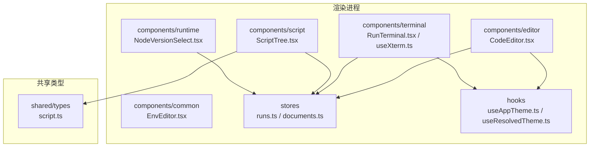
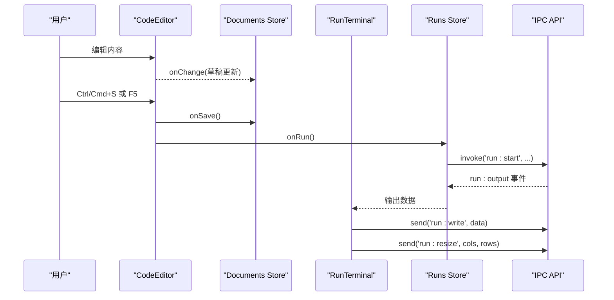
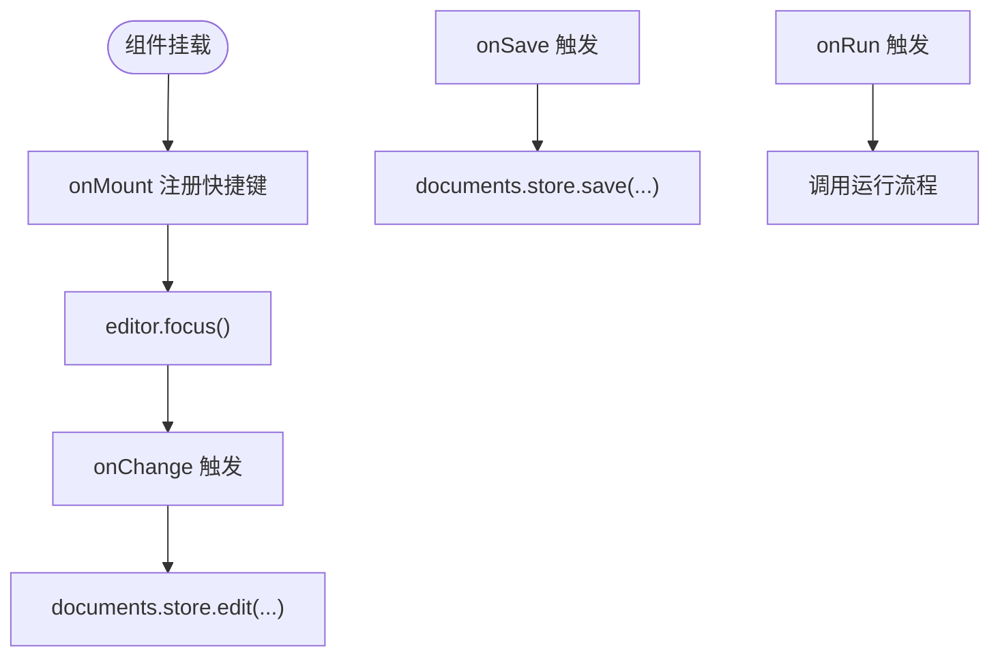
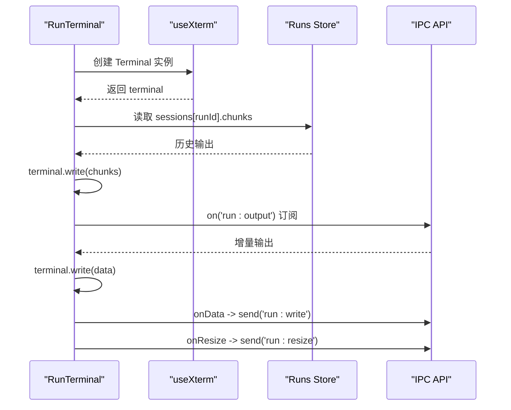
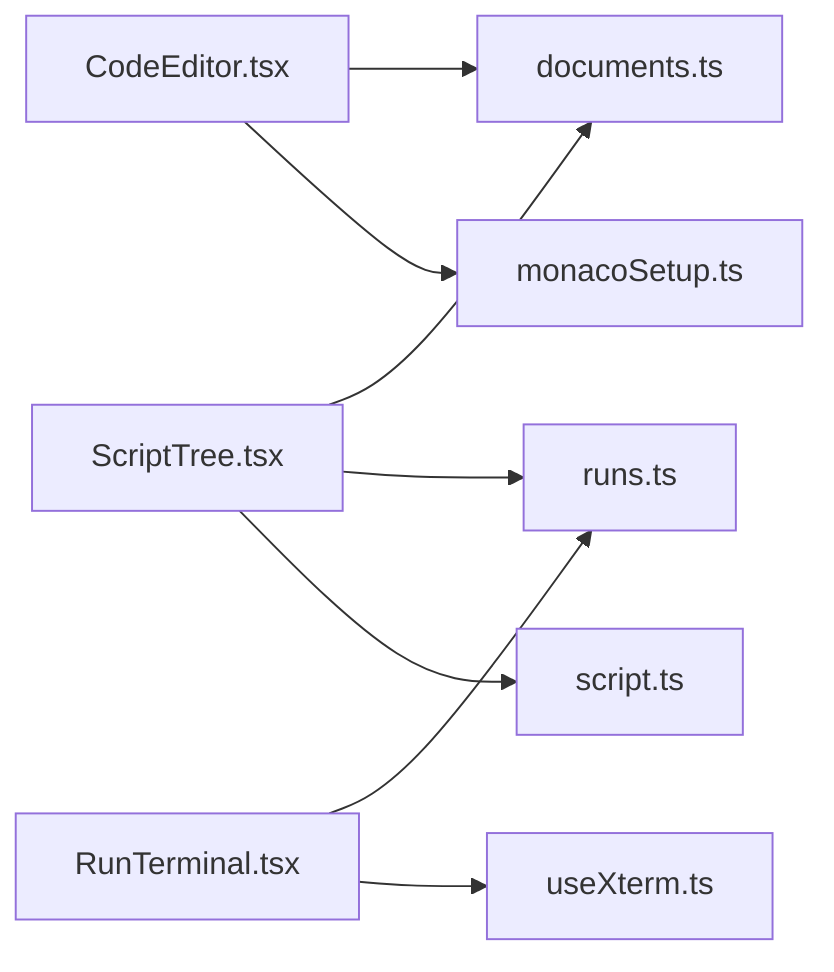

# UI组件库

<cite>
**本文引用的文件**   
- [README.md](file://README.md)
- [CodeEditor.tsx](file://src/renderer/src/components/editor/CodeEditor.tsx)
- [monacoSetup.ts](file://src/renderer/src/components/editor/monacoSetup.ts)
- [RunTerminal.tsx](file://src/renderer/src/components/terminal/RunTerminal.tsx)
- [useXterm.ts](file://src/renderer/src/components/terminal/useXterm.ts)
- [theme.ts](file://src/renderer/src/components/terminal/theme.ts)
- [EnvEditor.tsx](file://src/renderer/src/components/common/EnvEditor.tsx)
- [ScriptTree.tsx](file://src/renderer/src/components/script/ScriptTree.tsx)
- [NodeVersionSelect.tsx](file://src/renderer/src/components/runtime/NodeVersionSelect.tsx)
- [runs.ts](file://src/renderer/src/stores/runs.ts)
- [documents.ts](file://src/renderer/src/stores/documents.ts)
- [script.ts](file://src/shared/types/script.ts)
</cite>

## 目录
1. [简介](#简介)
2. [项目结构](#项目结构)
3. [核心组件](#核心组件)
4. [架构总览](#架构总览)
5. [详细组件分析](#详细组件分析)
6. [依赖关系分析](#依赖关系分析)
7. [性能与优化](#性能与优化)
8. [测试与调试](#测试与调试)
9. [结论](#结论)
10. [附录：API 参考与设计规范](#附录api-参考与设计规范)

## 简介
本仓库是一个基于 Electron + React 的脚本运行器应用，提供内置编辑器、交互式终端、运行时管理、运行空间与依赖管理等能力。UI 层采用 React 19 与 Ant Design，结合 Zustand 进行状态管理；编辑器基于 Monaco（本地加载），终端基于 xterm.js。本文聚焦 UI 组件库的设计模式与实现细节，覆盖代码编辑器、终端组件、环境编辑器等核心组件，说明其 props 接口、事件处理、状态管理、可定制性与扩展点，并提供使用示例、API 参考、设计规范、性能优化策略以及测试与调试方法。

## 项目结构
渲染进程 UI 位于 `src/renderer/src`，组件按功能域组织在 `components` 下，状态集中在 `stores`，共享类型定义在 `shared/types`。关键目录与职责如下：
- components/editor：代码编辑器封装与 Monaco 配置
- components/terminal：xterm.js 终端封装与主题适配
- components/common：通用表单控件与环境变量编辑器
- components/script：脚本树、导入、拖拽、运行配置等脚本相关 UI
- components/runtime：运行时版本选择与下载进度等
- stores：Zustand 状态模块（文档草稿、运行会话、运行时、设置等）
- shared/types：跨主/渲染进程的类型契约

图表来源
- [CodeEditor.tsx:1-53](file://src/renderer/src/components/editor/CodeEditor.tsx#L1-L53)
- [RunTerminal.tsx:1-45](file://src/renderer/src/components/terminal/RunTerminal.tsx#L1-L45)
- [useXterm.ts:1-60](file://src/renderer/src/components/terminal/useXterm.ts#L1-L60)
- [EnvEditor.tsx:1-49](file://src/renderer/src/components/common/EnvEditor.tsx#L1-L49)
- [ScriptTree.tsx:1-94](file://src/renderer/src/components/script/ScriptTree.tsx#L1-L94)
- [NodeVersionSelect.tsx:1-36](file://src/renderer/src/components/runtime/NodeVersionSelect.tsx#L1-L36)
- [runs.ts:1-79](file://src/renderer/src/stores/runs.ts#L1-L79)
- [documents.ts:1-67](file://src/renderer/src/stores/documents.ts#L1-L67)
- [script.ts:1-13](file://src/shared/types/script.ts#L1-L13)

章节来源
- [README.md:78-86](file://README.md#L78-L86)

## 核心组件
本节概述各核心 UI 组件的职责、设计模式与交互边界。

- 代码编辑器 CodeEditor
  - 基于 @monaco-editor/react 封装，负责编辑器挂载、快捷键绑定、主题切换与基础选项配置。
  - 通过 props 暴露 path、language、value、onChange、onSave、onRun，将编辑行为与业务逻辑解耦。
  - 使用 useLayoutEffect 同步最新回调引用，避免闭包过期问题。

- 终端 RunTerminal
  - 基于 xterm.js 封装，负责终端实例生命周期、输出写入、输入转发、尺寸自适应与主题同步。
  - 通过 runId 绑定一次运行会话，订阅全局事件流，向 runs store 写入输出并回写用户输入。

- 环境变量编辑器 EnvEditor
  - 提供键值对列表的可编辑视图，支持新增、删除与就地修改，可作为 Ant Design Form 的受控组件使用。

- 脚本树 ScriptTree
  - 展示脚本列表、语言标识、未保存标记与运行中状态，提供上下文菜单（运行、配置、重命名、删除）。
  - 集成拖拽导入与新建入口，联动文档与运行状态。

- Node 版本选择 NodeVersionSelect
  - 从运行时存储读取已安装版本，支持清空、警告缺失版本、跳转到安装页。

章节来源
- [CodeEditor.tsx:9-52](file://src/renderer/src/components/editor/CodeEditor.tsx#L9-L52)
- [RunTerminal.tsx:7-44](file://src/renderer/src/components/terminal/RunTerminal.tsx#L7-L44)
- [EnvEditor.tsx:7-48](file://src/renderer/src/components/common/EnvEditor.tsx#L7-L48)
- [ScriptTree.tsx:12-93](file://src/renderer/src/components/script/ScriptTree.tsx#L12-L93)
- [NodeVersionSelect.tsx:7-35](file://src/renderer/src/components/runtime/NodeVersionSelect.tsx#L7-L35)

## 架构总览
UI 组件通过 Zustand store 与 IPC 通道协同工作：
- 编辑器与文档草稿：CodeEditor 触发 onChange/onSave，由 documents store 维护草稿与持久化。
- 终端与运行会话：RunTerminal 订阅 run:output 事件，写入 runs store；用户输入通过 IPC 回写至 pty。
- 主题与国际化：useAppTheme/useResolvedTheme 提供主题解析；i18n 用于文案。

图表来源
- [CodeEditor.tsx:19-52](file://src/renderer/src/components/editor/CodeEditor.tsx#L19-L52)
- [documents.ts:22-66](file://src/renderer/src/stores/documents.ts#L22-L66)
- [runs.ts:26-79](file://src/renderer/src/stores/runs.ts#L26-L79)
- [RunTerminal.tsx:12-41](file://src/renderer/src/components/terminal/RunTerminal.tsx#L12-L41)

## 详细组件分析

### 代码编辑器 CodeEditor
- 设计要点
  - 通过 props 暴露最小必要接口，内部仅负责编辑器初始化与快捷键注册。
  - 使用 useRef 缓存回调，避免每次渲染重新绑定命令导致性能损耗。
  - 根据应用主题动态切换 Monaco 主题。
- 关键流程
  - onMount 时注册保存与运行快捷键，自动聚焦。
  - onChange 将编辑器值透传给父级，配合 documents store 实现草稿。
- 可扩展点
  - 自定义 options 扩展语法高亮、提示、格式化等。
  - 注入额外命令或监听编辑器事件以扩展行为。

图表来源
- [CodeEditor.tsx:27-50](file://src/renderer/src/components/editor/CodeEditor.tsx#L27-L50)
- [documents.ts:34-49](file://src/renderer/src/stores/documents.ts#L34-L49)

章节来源
- [CodeEditor.tsx:1-53](file://src/renderer/src/components/editor/CodeEditor.tsx#L1-L53)
- [monacoSetup.ts:1-43](file://src/renderer/src/components/editor/monacoSetup.ts#L1-L43)
- [documents.ts:1-67](file://src/renderer/src/stores/documents.ts#L1-L67)

### 终端组件 RunTerminal 与 useXterm
- 设计要点
  - RunTerminal 负责单条运行会话的生命周期：初始输出回填、事件订阅、输入与尺寸变更转发。
  - useXterm 封装 xterm.js 实例创建、FitAddon 自适应、ResizeObserver 监听、主题切换与销毁。
- 关键流程
  - 挂载时读取 runs store 中的历史 chunks 一次性写入，随后订阅 run:output 增量输出。
  - onData 捕获键盘输入并通过 IPC 写入 pty；onResize 同步终端行列数。
- 可扩展点
  - 通过 ITerminalOptions 扩展终端行为（如光标样式、滚动行为）。
  - 替换 theme 以适配不同视觉风格。

图表来源
- [RunTerminal.tsx:12-41](file://src/renderer/src/components/terminal/RunTerminal.tsx#L12-L41)
- [useXterm.ts:21-56](file://src/renderer/src/components/terminal/useXterm.ts#L21-L56)
- [runs.ts:63-71](file://src/renderer/src/stores/runs.ts#L63-L71)

章节来源
- [RunTerminal.tsx:1-45](file://src/renderer/src/components/terminal/RunTerminal.tsx#L1-L45)
- [useXterm.ts:1-60](file://src/renderer/src/components/terminal/useXterm.ts#L1-L60)
- [theme.ts](file://src/renderer/src/components/terminal/theme.ts)
- [runs.ts:1-79](file://src/renderer/src/stores/runs.ts#L1-L79)

### 环境变量编辑器 EnvEditor
- 设计要点
  - 受控组件，value 为 EnvVar[]，通过 onChange 通知父级。
  - 提供增删行与就地编辑 key/value 的能力，兼容 Ant Design Form。
- 使用建议
  - 作为表单字段使用时，建议配合 Form.Item 与校验规则。
  - 可通过 keyPlaceholder 定制键占位符文案。

章节来源
- [EnvEditor.tsx:1-49](file://src/renderer/src/components/common/EnvEditor.tsx#L1-L49)

### 脚本树 ScriptTree
- 设计要点
  - 展示脚本列表，显示语言标识（JS/TS）、未保存标记与运行中状态。
  - 提供右键菜单：运行、打开运行配置、重命名、删除。
  - 集成拖拽导入与新建按钮，联动文档与运行状态。
- 状态联动
  - 使用 documents store 判断未保存状态。
  - 使用 runs store 判断是否正在运行。

章节来源
- [ScriptTree.tsx:1-94](file://src/renderer/src/components/script/ScriptTree.tsx#L1-L94)
- [documents.ts:64-66](file://src/renderer/src/stores/documents.ts#L64-L66)
- [runs.ts:24-24](file://src/renderer/src/stores/runs.ts#L24-L24)
- [script.ts:1-13](file://src/shared/types/script.ts#L1-L13)

### Node 版本选择 NodeVersionSelect
- 设计要点
  - 从运行时存储读取已安装版本，支持 allowClear。
  - 当选中版本未安装时显示 warning 状态，并提供跳转安装链接。
- 使用建议
  - 作为受控组件使用，value 可为 null 表示未选择。

章节来源
- [NodeVersionSelect.tsx:1-36](file://src/renderer/src/components/runtime/NodeVersionSelect.tsx#L1-L36)

## 依赖关系分析
- 组件与 Store
  - CodeEditor 依赖 documents store 进行草稿与保存。
  - RunTerminal 依赖 runs store 获取会话与输出事件。
  - ScriptTree 同时依赖 documents 与 runs store 展示状态。
- 外部依赖
  - Monaco Editor：本地 worker 与 TS/JS 类型默认配置。
  - xterm.js：终端渲染与 FitAddon 自适应。
  - Ant Design：表单、按钮、下拉、消息等基础 UI。
  - Zustand：轻量状态管理。

图表来源
- [CodeEditor.tsx:1-53](file://src/renderer/src/components/editor/CodeEditor.tsx#L1-L53)
- [RunTerminal.tsx:1-45](file://src/renderer/src/components/terminal/RunTerminal.tsx#L1-L45)
- [ScriptTree.tsx:1-94](file://src/renderer/src/components/script/ScriptTree.tsx#L1-L94)
- [monacoSetup.ts:1-43](file://src/renderer/src/components/editor/monacoSetup.ts#L1-L43)
- [useXterm.ts:1-60](file://src/renderer/src/components/terminal/useXterm.ts#L1-L60)
- [documents.ts:1-67](file://src/renderer/src/stores/documents.ts#L1-L67)
- [runs.ts:1-79](file://src/renderer/src/stores/runs.ts#L1-L79)
- [script.ts:1-13](file://src/shared/types/script.ts#L1-L13)

章节来源
- [CodeEditor.tsx:1-53](file://src/renderer/src/components/editor/CodeEditor.tsx#L1-L53)
- [RunTerminal.tsx:1-45](file://src/renderer/src/components/terminal/RunTerminal.tsx#L1-L45)
- [ScriptTree.tsx:1-94](file://src/renderer/src/components/script/ScriptTree.tsx#L1-L94)
- [monacoSetup.ts:1-43](file://src/renderer/src/components/editor/monacoSetup.ts#L1-L43)
- [useXterm.ts:1-60](file://src/renderer/src/components/terminal/useXterm.ts#L1-L60)
- [documents.ts:1-67](file://src/renderer/src/stores/documents.ts#L1-L67)
- [runs.ts:1-79](file://src/renderer/src/stores/runs.ts#L1-L79)
- [script.ts:1-13](file://src/shared/types/script.ts#L1-L13)

## 性能与优化
- 编辑器
  - 使用 useLayoutEffect 同步回调引用，减少不必要的命令重绑定。
  - 关闭 minimap、禁用超出最后一行的滚动，降低渲染压力。
  - 本地加载 Monaco worker，避免网络抖动与 CDN 阻塞。
- 终端
  - 限制每个运行会话的输出块数量（MAX_CHUNKS），防止内存无限增长。
  - 使用 ResizeObserver 仅在可见区域执行 fit，避免隐藏标签页导致的尺寸塌陷。
  - 主题切换时仅更新 terminal.options.theme，避免重建实例。
- 状态管理
  - 使用 Zustand 的 selector 精确订阅，减少无关重渲染。
  - 对频繁更新的输出采用原地 push 与切片裁剪，平衡实时性与内存占用。

章节来源
- [CodeEditor.tsx:23-50](file://src/renderer/src/components/editor/CodeEditor.tsx#L23-L50)
- [monacoSetup.ts:7-40](file://src/renderer/src/components/editor/monacoSetup.ts#L7-L40)
- [useXterm.ts:36-56](file://src/renderer/src/components/terminal/useXterm.ts#L36-L56)
- [runs.ts:5-6](file://src/renderer/src/stores/runs.ts#L5-L6)
- [runs.ts:63-71](file://src/renderer/src/stores/runs.ts#L63-L71)

## 测试与调试
- 单元测试
  - 使用 Vitest 对纯函数与 Hook 进行测试（例如 isDirty、docKey 等工具函数）。
  - 对组件可使用 Testing Library 模拟 props 与 store 状态，验证渲染结果与交互行为。
- 调试技巧
  - 在开发模式下启用 Electron DevTools，检查渲染进程控制台与网络请求。
  - 针对终端输出问题，可在 RunTerminal 中临时打印事件数据，确认 run:output 与 run:exit 是否正常触发。
  - 针对编辑器快捷键失效，检查 onMount 是否正确注册命令，并确保 handlersRef 同步最新回调。
- 常见问题排查
  - 终端空白：确认容器 ref 非空且尺寸大于 0，FitAddon 已正确加载。
  - 主题不生效：确认 useAppTheme 返回值与 terminal.options.theme 同步。
  - 编辑器无智能提示：检查 monacoSetup 中 TS/JS 默认编译器选项与 worker 配置。

章节来源
- [RunTerminal.tsx:12-41](file://src/renderer/src/components/terminal/RunTerminal.tsx#L12-L41)
- [useXterm.ts:21-56](file://src/renderer/src/components/terminal/useXterm.ts#L21-L56)
- [CodeEditor.tsx:27-50](file://src/renderer/src/components/editor/CodeEditor.tsx#L27-L50)
- [monacoSetup.ts:7-40](file://src/renderer/src/components/editor/monacoSetup.ts#L7-L40)

## 结论
本 UI 组件库围绕“编辑器—终端—状态”的核心链路构建，采用清晰的 props 接口与事件驱动模型，结合 Zustand 实现低耦合的状态管理。Monaco 与 xterm.js 的封装提供了稳定的编辑与交互体验，并通过本地资源加载与内存控制保障性能。组件具备良好的可定制性与扩展点，便于在现有基础上扩展新的功能与主题。

## 附录：API 参考与设计规范

### 组件 Props 参考
- CodeEditor
  - path: string（编辑器模型路径）
  - language: 'javascript' | 'typescript'
  - value: string（编辑器当前值）
  - onChange: (value: string) => void
  - onSave: () => void
  - onRun: () => void
- RunTerminal
  - runId: string（绑定运行会话 ID）
- EnvEditor
  - value?: EnvVar[]
  - onChange?: (value: EnvVar[]) => void
  - keyPlaceholder?: string
- ScriptTree
  - spaceId: string
  - scripts: ScriptFile[]
  - selected: string | null
  - onSelect: (name: string) => void
  - onCreate: () => void
  - onImported: (names: string[]) => void
  - onRun: (name: string) => void
  - onConfigure: (name: string) => void
  - onRename: (name: string) => void
  - onRemove: (name: string) => void
- NodeVersionSelect
  - value?: string | null
  - onChange?: (value: string | null) => void
  - allowClear?: boolean
  - style?: React.CSSProperties

章节来源
- [CodeEditor.tsx:9-17](file://src/renderer/src/components/editor/CodeEditor.tsx#L9-L17)
- [RunTerminal.tsx:8-8](file://src/renderer/src/components/terminal/RunTerminal.tsx#L8-L8)
- [EnvEditor.tsx:7-11](file://src/renderer/src/components/common/EnvEditor.tsx#L7-L11)
- [ScriptTree.tsx:12-23](file://src/renderer/src/components/script/ScriptTree.tsx#L12-L23)
- [NodeVersionSelect.tsx:7-12](file://src/renderer/src/components/runtime/NodeVersionSelect.tsx#L7-L12)

### 事件与状态约定
- 运行事件
  - run:output：包含 runId 与 data，终端组件订阅后写入 xterm。
  - run:exit：包含 record，更新 runs store 中的会话记录状态。
- 文档状态
  - documents store 维护 saved 与 content，isDirty 判断是否未保存。
- 运行状态
  - runs store 维护 sessions 与 latest，start/stop/close/sync 管理会话生命周期。

章节来源
- [runs.ts:63-79](file://src/renderer/src/stores/runs.ts#L63-L79)
- [documents.ts:4-16](file://src/renderer/src/stores/documents.ts#L4-L16)
- [documents.ts:64-66](file://src/renderer/src/stores/documents.ts#L64-L66)

### 设计规范
- 组件应遵循受控模式，props 与 onChange 成对出现。
- 复杂交互通过事件回调交由上层业务处理，组件保持职责单一。
- 主题与国际化通过 hooks 与 i18n 注入，避免硬编码。
- 对外暴露最小必要接口，内部实现可替换（如编辑器、终端底层库）。

章节来源
- [CodeEditor.tsx:19-52](file://src/renderer/src/components/editor/CodeEditor.tsx#L19-L52)
- [RunTerminal.tsx:12-41](file://src/renderer/src/components/terminal/RunTerminal.tsx#L12-L41)
- [EnvEditor.tsx:14-48](file://src/renderer/src/components/common/EnvEditor.tsx#L14-L48)