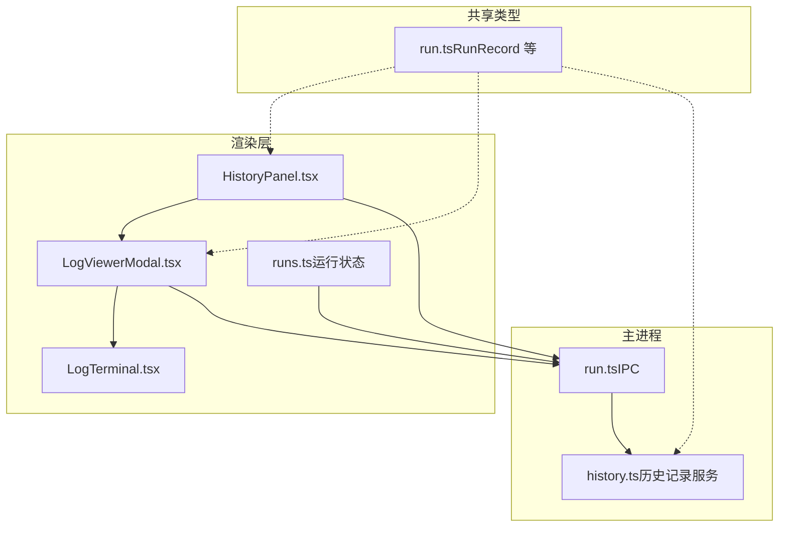
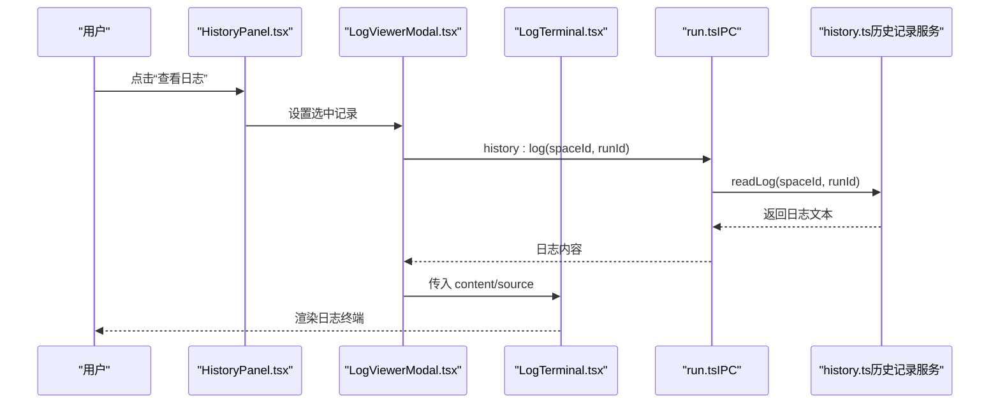
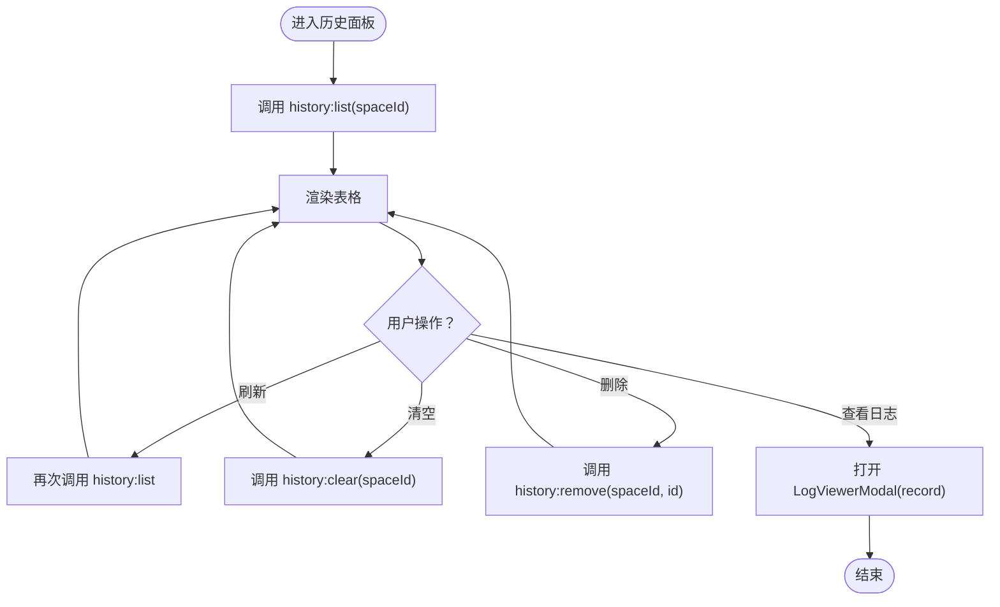
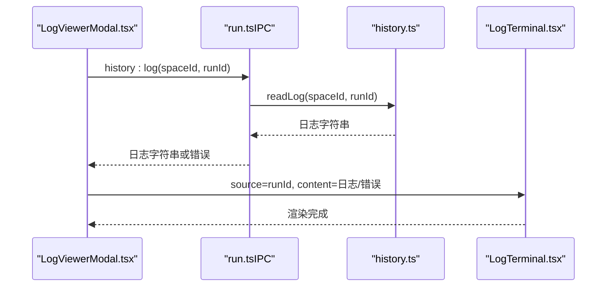
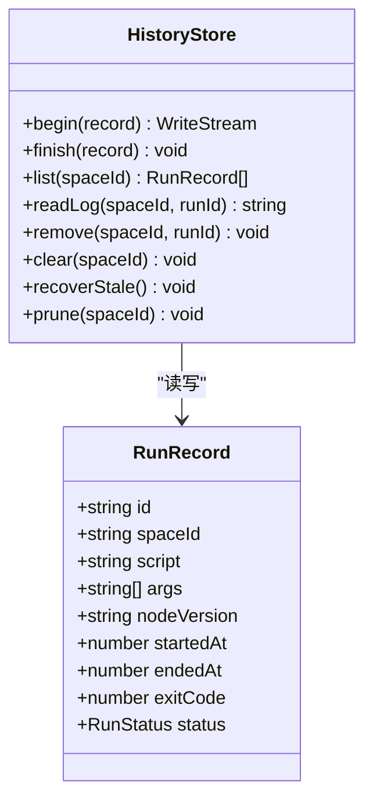
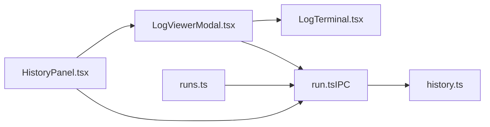

# 历史记录组件

<cite>
**本文引用的文件**   
- [HistoryPanel.tsx](file://src/renderer/src/components/history/HistoryPanel.tsx)
- [LogViewerModal.tsx](file://src/renderer/src/components/history/LogViewerModal.tsx)
- [LogTerminal.tsx](file://src/renderer/src/components/terminal/LogTerminal.tsx)
- [history.ts](file://src/main/services/runner/history.ts)
- [run.ts](file://src/main/ipc/run.ts)
- [run.ts（类型）](file://src/shared/types/run.ts)
- [runs.ts（运行状态存储）](file://src/renderer/src/stores/runs.ts)
</cite>

## 目录
1. [简介](#简介)
2. [项目结构](#项目结构)
3. [核心组件](#核心组件)
4. [架构总览](#架构总览)
5. [详细组件分析](#详细组件分析)
6. [依赖关系分析](#依赖关系分析)
7. [性能与优化](#性能与优化)
8. [故障排查指南](#故障排查指南)
9. [结论](#结论)
10. [附录：使用示例与扩展方法](#附录使用示例与扩展方法)

## 简介
本章节面向“历史记录”相关的前后端能力，聚焦以下目标：
- 历史面板的运行记录展示、筛选搜索与详情查看
- 日志查看器模态框的日志读取、终端渲染与导出能力
- 历史记录的数据存储、清理策略与恢复机制
- 组件的事件处理、状态同步与用户体验设计
- 常见使用场景与自定义扩展方式

## 项目结构
与历史记录相关的代码主要分布在以下位置：
- 渲染层（前端）
  - 历史面板：src/renderer/src/components/history/HistoryPanel.tsx
  - 日志查看模态框：src/renderer/src/components/history/LogViewerModal.tsx
  - 只读终端组件：src/renderer/src/components/terminal/LogTerminal.tsx
  - 运行会话状态管理：src/renderer/src/stores/runs.ts
- 主进程（后端）
  - IPC 路由：src/main/ipc/run.ts
  - 历史记录服务：src/main/services/runner/history.ts
- 共享类型
  - 运行记录类型定义：src/shared/types/run.ts

图表来源
- [HistoryPanel.tsx:1-126](file://src/renderer/src/components/history/HistoryPanel.tsx#L1-L126)
- [LogViewerModal.tsx:1-51](file://src/renderer/src/components/history/LogViewerModal.tsx#L1-L51)
- [LogTerminal.tsx:1-33](file://src/renderer/src/components/terminal/LogTerminal.tsx#L1-L33)
- [run.ts（IPC）:1-19](file://src/main/ipc/run.ts#L1-L19)
- [history.ts:1-94](file://src/main/services/runner/history.ts#L1-L94)
- [run.ts（类型）:1-28](file://src/shared/types/run.ts#L1-L28)

章节来源
- [HistoryPanel.tsx:1-126](file://src/renderer/src/components/history/HistoryPanel.tsx#L1-L126)
- [LogViewerModal.tsx:1-51](file://src/renderer/src/components/history/LogViewerModal.tsx#L1-L51)
- [LogTerminal.tsx:1-33](file://src/renderer/src/components/terminal/LogTerminal.tsx#L1-L33)
- [run.ts（IPC）:1-19](file://src/main/ipc/run.ts#L1-L19)
- [history.ts:1-94](file://src/main/services/runner/history.ts#L1-L94)
- [run.ts（类型）:1-28](file://src/shared/types/run.ts#L1-L28)

## 核心组件
- 历史面板 HistoryPanel
  - 负责加载并展示运行记录列表，提供刷新、清空、删除单条记录、打开日志查看器的交互。
- 日志查看器 LogViewerModal
  - 以模态框形式展示某条记录的日志内容，通过只读终端组件进行渲染。
- 只读终端 LogTerminal
  - 基于 xterm 的只读终端封装，支持一次性写入初始内容与后续流式追加。
- 历史记录服务 historyStore
  - 提供记录的创建、读取、删除、清空、恢复与裁剪等能力，数据落盘到文件系统。
- IPC 桥接 run.ts
  - 将前端的 history:* 调用映射到后端的 historyStore 方法，并广播运行事件。

章节来源
- [HistoryPanel.tsx:1-126](file://src/renderer/src/components/history/HistoryPanel.tsx#L1-L126)
- [LogViewerModal.tsx:1-51](file://src/renderer/src/components/history/LogViewerModal.tsx#L1-L51)
- [LogTerminal.tsx:1-33](file://src/renderer/src/components/terminal/LogTerminal.tsx#L1-L33)
- [history.ts:1-94](file://src/main/services/runner/history.ts#L1-L94)
- [run.ts（IPC）:1-19](file://src/main/ipc/run.ts#L1-L19)

## 架构总览
下图展示了从用户操作到日志展示的端到端流程，包括 IPC 通信、历史记录服务与前端状态更新。

图表来源
- [HistoryPanel.tsx:84-98](file://src/renderer/src/components/history/HistoryPanel.tsx#L84-L98)
- [LogViewerModal.tsx:22-32](file://src/renderer/src/components/history/LogViewerModal.tsx#L22-L32)
- [LogTerminal.tsx:15-31](file://src/renderer/src/components/terminal/LogTerminal.tsx#L15-L31)
- [run.ts（IPC）:11-14](file://src/main/ipc/run.ts#L11-L14)
- [history.ts:44-60](file://src/main/services/runner/history.ts#L44-L60)

## 详细组件分析

### 历史面板 HistoryPanel
职责与行为
- 列表展示：按时间倒序展示运行记录，包含状态、脚本名、参数、Node 版本、开始时间、持续时间、退出码等字段。
- 交互操作：
  - 刷新：重新拉取当前空间的历史记录。
  - 清空：仅允许清空非 running 状态的记录。
  - 删除：逐条删除指定记录。
  - 查看日志：打开 LogViewerModal 并传入对应记录。
- 事件监听：监听 run:exit 事件，当退出的记录属于当前空间时自动刷新列表。

关键实现要点
- 状态与 UI：使用本地 state 维护 records、loading、viewing；通过 Ant Design Table 渲染。
- 错误处理：统一格式化错误并通过 message 提示。
- 列渲染：状态以 Tag 颜色区分；持续时间为 endedAt - startedAt；空值显示为“-”。

图表来源
- [HistoryPanel.tsx:27-47](file://src/renderer/src/components/history/HistoryPanel.tsx#L27-L47)
- [HistoryPanel.tsx:59-99](file://src/renderer/src/components/history/HistoryPanel.tsx#L59-L99)
- [HistoryPanel.tsx:101-123](file://src/renderer/src/components/history/HistoryPanel.tsx#L101-L123)

章节来源
- [HistoryPanel.tsx:1-126](file://src/renderer/src/components/history/HistoryPanel.tsx#L1-L126)

### 日志查看器 LogViewerModal
职责与行为
- 根据选中的记录 ID 调用 history:log 获取日志内容。
- 将日志内容交给 LogTerminal 进行渲染。
- 在打开/关闭时管理生命周期，避免内存泄漏。

关键实现要点
- 异步加载：首次打开即发起请求，失败时显示格式化后的错误信息。
- 标题信息：显示脚本名与开始时间。
- 尺寸与销毁：宽度较大，隐藏时销毁子节点以避免残留状态。

图表来源
- [LogViewerModal.tsx:22-32](file://src/renderer/src/components/history/LogViewerModal.tsx#L22-L32)
- [LogTerminal.tsx:15-31](file://src/renderer/src/components/terminal/LogTerminal.tsx#L15-L31)
- [run.ts（IPC）:12](file://src/main/ipc/run.ts#L12)
- [history.ts:44-60](file://src/main/services/runner/history.ts#L44-L60)

章节来源
- [LogViewerModal.tsx:1-51](file://src/renderer/src/components/history/LogViewerModal.tsx#L1-L51)

### 只读终端 LogTerminal
职责与行为
- 提供只读的终端容器，支持一次性写入初始内容，以及可选的 follow 回调用于后续追加。
- 每次 source 变化时重置终端并重新写入内容。

关键实现要点
- 初始化：禁用输入、不显示光标样式，启用换行转换。
- 事件绑定：在 effect 中注册 write 回调，确保随 source 变化刷新。

章节来源
- [LogTerminal.tsx:1-33](file://src/renderer/src/components/terminal/LogTerminal.tsx#L1-L33)

### 历史记录服务 historyStore
职责与行为
- begin/finish：开启与结束一次运行记录，同时持久化元数据。
- list：列出某个空间的所有记录，按开始时间倒序排序。
- readLog：读取日志尾部（大文件限制），避免一次性加载过大文件。
- remove/clear：删除单条或清空全部（跳过 running 状态）。
- recoverStale：启动时修复异常退出的 running 记录为 stopped。
- prune：根据配置保留最近 N 条已完成记录。

关键实现要点
- 路径与校验：使用 ID_PATTERN 校验 runId，防止非法访问。
- 大日志优化：最多读取 MAX_LOG_READ 字节，从末尾向前读取。
- 清理策略：prune 依据 settings.run.historyLimit 控制保留数量。

图表来源
- [history.ts:18-92](file://src/main/services/runner/history.ts#L18-L92)
- [run.ts（类型）:3-13](file://src/shared/types/run.ts#L3-L13)

章节来源
- [history.ts:1-94](file://src/main/services/runner/history.ts#L1-L94)
- [run.ts（类型）:1-28](file://src/shared/types/run.ts#L1-L28)

### IPC 桥接 run.ts
职责与行为
- 将前端的 history:list/log/remove/clear 映射到 historyStore 对应方法。
- 广播 runnerService 的输出与退出事件，供前端状态同步。

章节来源
- [run.ts（IPC）:1-19](file://src/main/ipc/run.ts#L1-L19)

## 依赖关系分析
- 组件耦合
  - HistoryPanel 依赖 LogViewerModal 与 IPC 接口。
  - LogViewerModal 依赖 LogTerminal 与 IPC 接口。
  - LogTerminal 是纯展示组件，无外部业务依赖。
- 数据流向
  - 前端通过 IPC 调用后端 historyStore，读取元数据与日志。
  - 运行事件（run:output/run:exit）由 runnerService 广播，runs.ts 订阅并维护活跃会话。
- 外部依赖
  - Ant Design 提供 UI 组件。
  - xterm 提供终端渲染能力（通过 useXterm 钩子）。

图表来源
- [HistoryPanel.tsx:1-126](file://src/renderer/src/components/history/HistoryPanel.tsx#L1-L126)
- [LogViewerModal.tsx:1-51](file://src/renderer/src/components/history/LogViewerModal.tsx#L1-L51)
- [LogTerminal.tsx:1-33](file://src/renderer/src/components/terminal/LogTerminal.tsx#L1-L33)
- [run.ts（IPC）:1-19](file://src/main/ipc/run.ts#L1-L19)
- [history.ts:1-94](file://src/main/services/runner/history.ts#L1-L94)
- [runs.ts:1-79](file://src/renderer/src/stores/runs.ts#L1-L79)

章节来源
- [HistoryPanel.tsx:1-126](file://src/renderer/src/components/history/HistoryPanel.tsx#L1-L126)
- [LogViewerModal.tsx:1-51](file://src/renderer/src/components/history/LogViewerModal.tsx#L1-L51)
- [LogTerminal.tsx:1-33](file://src/renderer/src/components/terminal/LogTerminal.tsx#L1-L33)
- [run.ts（IPC）:1-19](file://src/main/ipc/run.ts#L1-L19)
- [history.ts:1-94](file://src/main/services/runner/history.ts#L1-L94)
- [runs.ts:1-79](file://src/renderer/src/stores/runs.ts#L1-L79)

## 性能与优化
- 日志读取优化
  - 后端对超大日志采用尾部读取，限制最大读取长度，避免阻塞与内存峰值。
- 前端渲染优化
  - 日志查看器仅在 modal 打开时发起请求，关闭时销毁子组件，减少无用渲染。
  - 终端组件在 source 变化时重置并写入，避免累积脏数据。
- 运行输出缓冲
  - runs.ts 对每个运行会话的 chunks 做上限控制，避免无限增长导致内存压力。
- 历史记录裁剪
  - 后端根据配置保留最近 N 条已完成记录，降低磁盘占用与 IO 开销。

章节来源
- [history.ts:44-60](file://src/main/services/runner/history.ts#L44-L60)
- [history.ts:88-92](file://src/main/services/runner/history.ts#L88-L92)
- [runs.ts:5-11](file://src/renderer/src/stores/runs.ts#L5-L11)
- [runs.ts:63-71](file://src/renderer/src/stores/runs.ts#L63-L71)

## 故障排查指南
常见问题与定位思路
- 无法加载历史记录
  - 检查 IPC 是否正确注册 history:list 路由。
  - 确认空间目录是否存在且可读。
- 日志为空或截断
  - 确认日志文件是否存在；若存在但为空，可能是运行未产生输出。
  - 大日志会被截断至固定大小，属预期行为。
- 删除/清空失败
  - 检查是否尝试删除 running 状态的记录（前端已禁用该按钮）。
  - 权限问题可能导致 rm 失败。
- 运行结束后列表未刷新
  - 确认 run:exit 事件是否被正确广播并被 HistoryPanel 监听。
  - 检查 record.spaceId 是否与当前面板一致。

章节来源
- [run.ts（IPC）:11-14](file://src/main/ipc/run.ts#L11-L14)
- [history.ts:62-71](file://src/main/services/runner/history.ts#L62-L71)
- [HistoryPanel.tsx:44-47](file://src/renderer/src/components/history/HistoryPanel.tsx#L44-L47)

## 结论
历史记录组件通过清晰的前后端分层与 IPC 桥接，实现了运行记录的展示、日志查看与基础的管理能力。后端在服务层提供了健壮的数据持久化、清理与恢复逻辑；前端则以可组合的组件形态提供直观的用户体验。整体方案具备良好的可扩展性与性能保障，适合进一步扩展筛选、搜索、导出等高级功能。

## 附录：使用示例与扩展方法

### 基本用法
- 在编辑器页面引入 HistoryPanel，并传入当前 spaceId。
- 运行脚本后，HistoryPanel 会自动监听 run:exit 并刷新列表。
- 点击“查看日志”即可打开 LogViewerModal 查看对应日志。

章节来源
- [HistoryPanel.tsx:20-47](file://src/renderer/src/components/history/HistoryPanel.tsx#L20-L47)
- [HistoryPanel.tsx:84-98](file://src/renderer/src/components/history/HistoryPanel.tsx#L84-L98)

### 筛选与搜索（扩展建议）
- 在 HistoryPanel 中添加本地过滤逻辑，基于 script、status、args、nodeVersion 等字段进行筛选。
- 可使用 Ant Design Table 的 filter 与 sorter 属性增强交互。
- 建议在用户输入时防抖触发过滤，避免频繁重渲染。

章节来源
- [HistoryPanel.tsx:59-99](file://src/renderer/src/components/history/HistoryPanel.tsx#L59-L99)

### 日志高亮与导出（扩展建议）
- 高亮显示
  - 在 LogTerminal 基础上增加语法高亮插件，或在前端对日志内容进行正则匹配着色。
  - 注意保持只读模式与性能，避免对超大日志进行全量解析。
- 导出功能
  - 在 LogViewerModal 添加“导出”按钮，调用浏览器下载 API 将 content 保存为 .txt 文件。
  - 如需结构化导出，可将 RunRecord 与日志合并为 JSON 或 CSV。

章节来源
- [LogTerminal.tsx:15-31](file://src/renderer/src/components/terminal/LogTerminal.tsx#L15-L31)
- [LogViewerModal.tsx:36-49](file://src/renderer/src/components/history/LogViewerModal.tsx#L36-L49)

### 数据存储与清理策略（扩展建议）
- 存储格式
  - 每条记录包含元数据 JSON 与日志文件，便于独立管理与备份。
- 清理策略
  - 结合 settings.run.historyLimit 动态调整保留数量。
  - 可在设置页暴露“历史保留天数/数量”开关，让用户自定义策略。

章节来源
- [history.ts:88-92](file://src/main/services/runner/history.ts#L88-L92)

### 事件处理与状态同步（扩展建议）
- 实时输出
  - 复用 runs.ts 的 on('run:output') 机制，在运行期间将增量日志推送到终端。
- 状态一致性
  - 在 HistoryPanel 中监听 run:exit 并刷新列表，保证 UI 与后端状态一致。

章节来源
- [runs.ts:63-78](file://src/renderer/src/stores/runs.ts#L63-L78)
- [HistoryPanel.tsx:44-47](file://src/renderer/src/components/history/HistoryPanel.tsx#L44-L47)