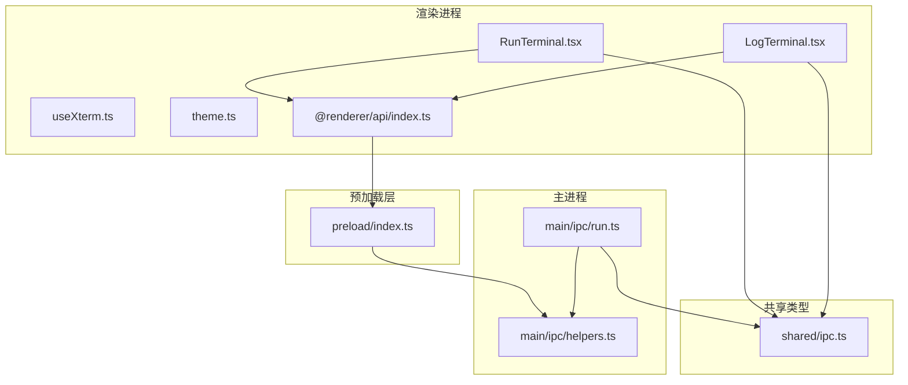
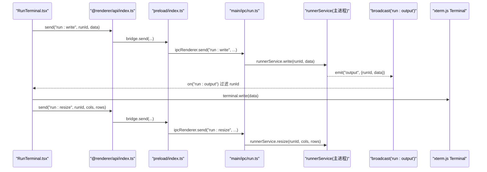
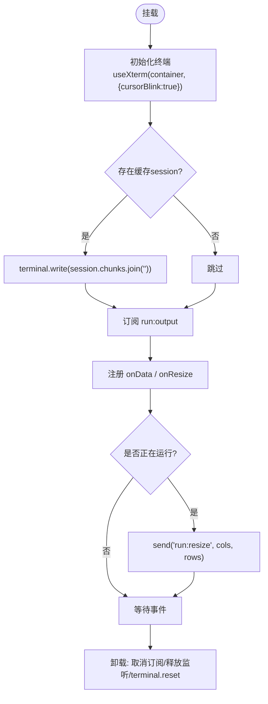
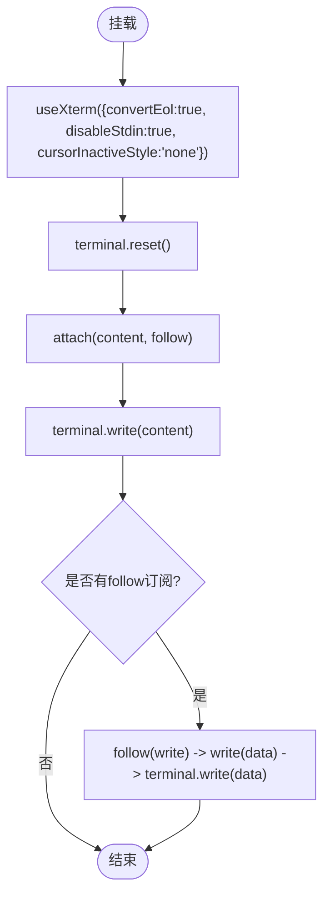
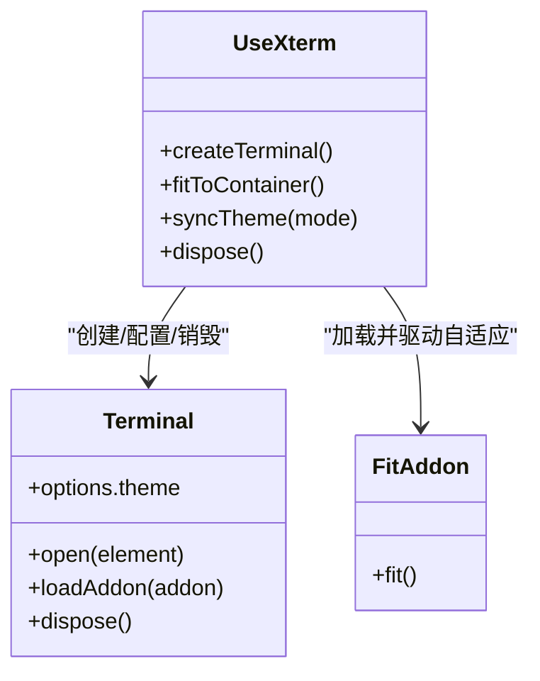
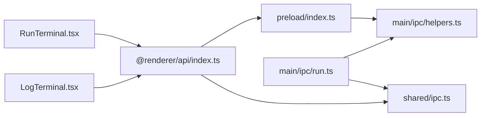
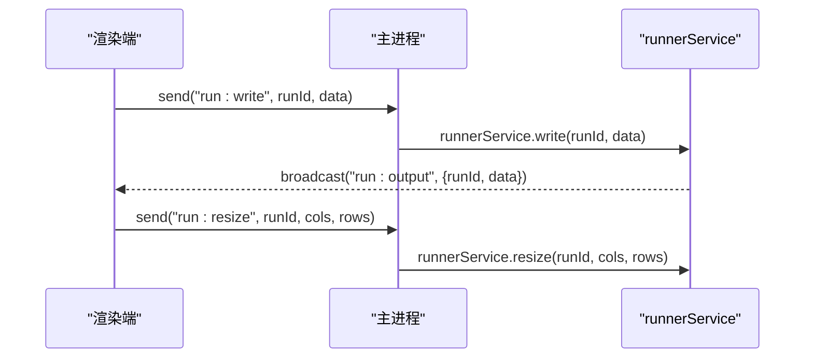

# 终端组件

<cite>
**本文引用的文件**   
- [RunTerminal.tsx](file://src/renderer/src/components/terminal/RunTerminal.tsx)
- [LogTerminal.tsx](file://src/renderer/src/components/terminal/LogTerminal.tsx)
- [useXterm.ts](file://src/renderer/src/components/terminal/useXterm.ts)
- [theme.ts](file://src/renderer/src/components/terminal/theme.ts)
- [index.ts（渲染端 API）](file://src/renderer/src/api/index.ts)
- [run.ts（主进程 IPC 注册）](file://src/main/ipc/run.ts)
- [helpers.ts（IPC 工具）](file://src/main/ipc/helpers.ts)
- [ipc.ts（IPC 类型定义）](file://src/shared/ipc.ts)
- [preload/index.ts（预加载桥接）](file://src/preload/index.ts)
</cite>

## 目录
1. [简介](#简介)
2. [项目结构](#项目结构)
3. [核心组件](#核心组件)
4. [架构总览](#架构总览)
5. [详细组件分析](#详细组件分析)
6. [依赖关系分析](#依赖关系分析)
7. [性能与滚动行为](#性能与滚动行为)
8. [主题定制与快捷键](#主题定制与快捷键)
9. [IPC 通信、错误处理与调试](#ipc-通信错误处理与调试)
10. [扩展方法与优化建议](#扩展方法与优化建议)
11. [故障排查指南](#故障排查指南)
12. [结论](#结论)

## 简介
本文件为基于 xterm.js 的终端组件文档，覆盖交互式运行终端与只读日志查看终端的实现差异、生命周期管理、输入输出流处理、进程通信机制、主题定制、快捷键绑定、滚动行为控制、错误处理与调试技巧，以及扩展方法与性能优化建议。

## 项目结构
终端相关代码位于渲染进程，使用 React 封装 xterm.js；主进程通过 Electron IPC 暴露运行与历史日志能力；共享类型定义在 shared 层统一约束通道与事件。

图表来源
- [RunTerminal.tsx:1-44](file://src/renderer/src/components/terminal/RunTerminal.tsx#L1-L44)
- [LogTerminal.tsx:1-32](file://src/renderer/src/components/terminal/LogTerminal.tsx#L1-L32)
- [useXterm.ts:1-59](file://src/renderer/src/components/terminal/useXterm.ts#L1-L59)
- [theme.ts:1-21](file://src/renderer/src/components/terminal/theme.ts#L1-L21)
- [index.ts（渲染端 API）:1-37](file://src/renderer/src/api/index.ts#L1-L37)
- [run.ts（主进程 IPC 注册）:1-18](file://src/main/ipc/run.ts#L1-L18)
- [helpers.ts（IPC 工具）:1-46](file://src/main/ipc/helpers.ts#L1-L46)
- [ipc.ts（IPC 类型定义）:1-117](file://src/shared/ipc.ts#L1-L117)
- [preload/index.ts:1-18](file://src/preload/index.ts#L1-L18)

章节来源
- [RunTerminal.tsx:1-44](file://src/renderer/src/components/terminal/RunTerminal.tsx#L1-L44)
- [LogTerminal.tsx:1-32](file://src/renderer/src/components/terminal/LogTerminal.tsx#L1-L32)
- [useXterm.ts:1-59](file://src/renderer/src/components/terminal/useXterm.ts#L1-L59)
- [theme.ts:1-21](file://src/renderer/src/components/terminal/theme.ts#L1-L21)
- [index.ts（渲染端 API）:1-37](file://src/renderer/src/api/index.ts#L1-L37)
- [run.ts（主进程 IPC 注册）:1-18](file://src/main/ipc/run.ts#L1-L18)
- [helpers.ts（IPC 工具）:1-46](file://src/main/ipc/helpers.ts#L1-L46)
- [ipc.ts（IPC 类型定义）:1-117](file://src/shared/ipc.ts#L1-L117)
- [preload/index.ts:1-18](file://src/preload/index.ts#L1-L18)

## 核心组件
- RunTerminal：交互式终端，绑定单个运行会话，负责显示子进程输出并将键盘输入与终端尺寸变化转发给主进程。
- LogTerminal：只读日志终端，用于 npm 输出与历史日志回放，支持初始内容一次性写入与后续追加订阅。
- useXterm：React Hook，封装 xterm.js 实例创建、自适应尺寸、主题同步与资源清理。
- theme：深色与浅色终端主题配置。
- @renderer/api/index.ts：对 window.bridge 的封装，提供 invoke/send/on 三类 IPC 调用。
- main/ipc/run.ts：注册运行相关的 IPC 通道，将渲染端请求路由到 runnerService，并广播输出与退出事件。
- main/ipc/helpers.ts：统一的 handle/listen/broadcast 工具，集中错误序列化与日志。
- shared/ipc.ts：IPC 通道与事件类型的权威定义。
- preload/index.ts：contextBridge 暴露 bridge 对象，屏蔽 Electron 内部细节。

章节来源
- [RunTerminal.tsx:1-44](file://src/renderer/src/components/terminal/RunTerminal.tsx#L1-L44)
- [LogTerminal.tsx:1-32](file://src/renderer/src/components/terminal/LogTerminal.tsx#L1-L32)
- [useXterm.ts:1-59](file://src/renderer/src/components/terminal/useXterm.ts#L1-L59)
- [theme.ts:1-21](file://src/renderer/src/components/terminal/theme.ts#L1-L21)
- [index.ts（渲染端 API）:1-37](file://src/renderer/src/api/index.ts#L1-L37)
- [run.ts（主进程 IPC 注册）:1-18](file://src/main/ipc/run.ts#L1-L18)
- [helpers.ts（IPC 工具）:1-46](file://src/main/ipc/helpers.ts#L1-L46)
- [ipc.ts（IPC 类型定义）:1-117](file://src/shared/ipc.ts#L1-L117)
- [preload/index.ts:1-18](file://src/preload/index.ts#L1-L18)

## 架构总览
终端组件通过渲染端 API 与主进程进行双向通信：渲染端发送键盘输入与尺寸变更，主进程转发至运行服务；运行服务将输出事件广播回所有窗口，渲染端根据 runId 过滤后写入对应终端。

图表来源
- [RunTerminal.tsx:12-41](file://src/renderer/src/components/terminal/RunTerminal.tsx#L12-L41)
- [index.ts（渲染端 API）:19-35](file://src/renderer/src/api/index.ts#L19-L35)
- [preload/index.ts:5-15](file://src/preload/index.ts#L5-L15)
- [run.ts（主进程 IPC 注册）:4-17](file://src/main/ipc/run.ts#L4-L17)

## 详细组件分析

### 交互式运行终端 RunTerminal
- 功能职责
  - 初始化 xterm.js 终端，启用光标闪烁。
  - 从运行状态存储中回填已累积的输出片段。
  - 订阅主进程输出的 run:output 事件，按 runId 过滤后写入终端。
  - 监听终端 onData 与 onResize，仅在会话处于 running 状态时转发输入与尺寸变更。
  - 组件卸载时取消订阅、释放事件监听器并重置终端。
- 生命周期要点
  - 挂载阶段：读取已有 session.chunks 并一次性写入；建立输出订阅；注册输入与尺寸事件；若当前仍在运行，立即发送一次 resize。
  - 更新阶段：当 runId 或 terminal 引用变化时重新建立连接。
  - 卸载阶段：清理 offOutput、input.dispose、resize.dispose，并调用 terminal.reset。
- 关键交互
  - 输入：onData -> send('run:write') -> 主进程 runnerService.write。
  - 尺寸：onResize -> send('run:resize') -> 主进程 runnerService.resize。
  - 输出：run:output -> terminal.write。

图表来源
- [RunTerminal.tsx:8-44](file://src/renderer/src/components/terminal/RunTerminal.tsx#L8-L44)

章节来源
- [RunTerminal.tsx:1-44](file://src/renderer/src/components/terminal/RunTerminal.tsx#L1-L44)

### 只读日志终端 LogTerminal
- 功能职责
  - 以只读模式展示日志，禁用标准输入，关闭非活动光标样式。
  - 每次 source 变化时清空终端并重新写入初始 content。
  - 可选 follow 回调，允许外部持续推送新日志行。
- 生命周期要点
  - 挂载阶段：reset 终端，attach 初始内容与 follow 订阅，返回清理函数。
  - 更新阶段：source 变化触发 reset 与重新 attach。
  - 卸载阶段：由 attach 返回的清理函数负责解除订阅。
- 关键交互
  - 初始内容：content -> terminal.write。
  - 增量内容：follow(write) -> write(data) -> terminal.write。

图表来源
- [LogTerminal.tsx:15-31](file://src/renderer/src/components/terminal/LogTerminal.tsx#L15-L31)

章节来源
- [LogTerminal.tsx:1-32](file://src/renderer/src/components/terminal/LogTerminal.tsx#L1-L32)

### xterm.js 封装 Hook useXterm
- 功能职责
  - 创建 Terminal 实例，设置字体、字号、scrollback、允许实验性 API。
  - 加载 FitAddon 并通过 ResizeObserver 保持终端尺寸与容器一致。
  - 根据应用主题切换 dark/light 终端主题。
  - 组件卸载时断开观察者、销毁 Terminal 实例。
- 关键点
  - 隐藏元素（如不可见标签页）不进行 fit，避免终端尺寸塌陷。
  - 主题变化时直接替换 terminal.options.theme。

图表来源
- [useXterm.ts:16-59](file://src/renderer/src/components/terminal/useXterm.ts#L16-L59)

章节来源
- [useXterm.ts:1-59](file://src/renderer/src/components/terminal/useXterm.ts#L1-L59)

### 主题配置 theme
- 提供 darkTerminalTheme 与 lightTerminalTheme 两套 ITheme 配置，包含背景、前景、光标、选择区及常用颜色。
- useXterm 根据应用主题模式自动切换。

章节来源
- [theme.ts:1-21](file://src/renderer/src/components/terminal/theme.ts#L1-L21)
- [useXterm.ts:53-56](file://src/renderer/src/components/terminal/useXterm.ts#L53-L56)

## 依赖关系分析
- 渲染端
  - RunTerminal 与 LogTerminal 均依赖 useXterm 完成 xterm.js 实例化与生命周期管理。
  - RunTerminal 依赖 @renderer/api 提供的 send/on 与运行状态 store。
- 预加载层
  - 暴露 bridge.invoke/send/on，屏蔽 Electron 内部实现。
- 主进程
  - run.ts 注册 run:* 系列 IPC 通道，委托 runnerService 执行具体逻辑，并通过 broadcast 将 output/exit 事件推送到所有窗口。
  - helpers.ts 提供 handle/listen/broadcast 的统一封装与错误序列化。
- 共享类型
  - ipc.ts 统一定义 IpcInvokeMap/IpcSendMap/IpcEventMap，确保通道参数与返回值类型安全。

图表来源
- [RunTerminal.tsx:1-44](file://src/renderer/src/components/terminal/RunTerminal.tsx#L1-L44)
- [LogTerminal.tsx:1-32](file://src/renderer/src/components/terminal/LogTerminal.tsx#L1-L32)
- [index.ts（渲染端 API）:1-37](file://src/renderer/src/api/index.ts#L1-L37)
- [preload/index.ts:1-18](file://src/preload/index.ts#L1-L18)
- [run.ts（主进程 IPC 注册）:1-18](file://src/main/ipc/run.ts#L1-L18)
- [helpers.ts（IPC 工具）:1-46](file://src/main/ipc/helpers.ts#L1-L46)
- [ipc.ts（IPC 类型定义）:1-117](file://src/shared/ipc.ts#L1-L117)

章节来源
- [RunTerminal.tsx:1-44](file://src/renderer/src/components/terminal/RunTerminal.tsx#L1-L44)
- [LogTerminal.tsx:1-32](file://src/renderer/src/components/terminal/LogTerminal.tsx#L1-L32)
- [index.ts（渲染端 API）:1-37](file://src/renderer/src/api/index.ts#L1-L37)
- [preload/index.ts:1-18](file://src/preload/index.ts#L1-L18)
- [run.ts（主进程 IPC 注册）:1-18](file://src/main/ipc/run.ts#L1-L18)
- [helpers.ts（IPC 工具）:1-46](file://src/main/ipc/helpers.ts#L1-L46)
- [ipc.ts（IPC 类型定义）:1-117](file://src/shared/ipc.ts#L1-L117)

## 性能与滚动行为
- 滚动缓冲
  - 默认 scrollback 设置为 10000，适合长时间运行与历史日志查看。
- 自适应布局
  - 使用 FitAddon 与 ResizeObserver 保证终端行列数与容器尺寸一致；对隐藏元素跳过 fit，避免尺寸塌陷。
- 输入输出
  - 交互式终端仅在运行中转发输入与尺寸变更，减少无效 IPC 开销。
  - 只读终端禁用 stdin，避免不必要的输入处理。
- 批量写入
  - 首次回填使用 chunks.join('') 一次性写入，降低多次 write 的开销。
- 主题切换
  - 仅替换 terminal.options.theme，避免重建终端实例。

章节来源
- [useXterm.ts:25-43](file://src/renderer/src/components/terminal/useXterm.ts#L25-L43)
- [RunTerminal.tsx:15-17](file://src/renderer/src/components/terminal/RunTerminal.tsx#L15-L17)
- [LogTerminal.tsx:17](file://src/renderer/src/components/terminal/LogTerminal.tsx#L17)

## 主题定制与快捷键
- 主题定制
  - 通过 theme.ts 中的 darkTerminalTheme 与 lightTerminalTheme 自定义颜色。
  - useXterm 根据应用主题模式自动切换终端主题。
- 快捷键绑定
  - 当前未实现全局快捷键绑定；如需扩展，可在 useXterm 中引入 xterm.js 的 WebLinksAddon 或其他插件，并在 Hook 内注册 KeyboardShortcut 或监听全局快捷键。
  - 建议在 Hook 中暴露一个可配置的 optionsRef，以便上层按需注入额外插件与快捷键逻辑。

章节来源
- [theme.ts:1-21](file://src/renderer/src/components/terminal/theme.ts#L1-L21)
- [useXterm.ts:53-56](file://src/renderer/src/components/terminal/useXterm.ts#L53-L56)

## IPC 通信、错误处理与调试
- 通道与事件
  - 渲染端发送：run:write、run:resize。
  - 主进程广播：run:output、run:exit。
  - 其他运行相关：run:start、run:stop、run:active。
  - 历史日志：history:list、history:log、history:remove、history:clear。
- 错误处理
  - 主进程 helpers.ts 对 handle 与 listen 进行 try/catch，统一序列化错误并记录日志。
  - 渲染端 index.ts 将 invoke 结果包装为 ApiError，便于上层捕获与提示。
- 调试技巧
  - 在 RunTerminal 中临时打印 onData 与 onResize 的数据，确认输入与尺寸是否正确转发。
  - 在 run.ts 中打印 runnerService 的事件输出，确认 output/exit 是否正常广播。
  - 检查 shared/ipc.ts 的类型定义与实际调用是否一致，避免参数错位。

图表来源
- [run.ts（主进程 IPC 注册）:4-17](file://src/main/ipc/run.ts#L4-L17)
- [index.ts（渲染端 API）:19-35](file://src/renderer/src/api/index.ts#L19-L35)

章节来源
- [run.ts（主进程 IPC 注册）:1-18](file://src/main/ipc/run.ts#L1-L18)
- [helpers.ts（IPC 工具）:17-46](file://src/main/ipc/helpers.ts#L17-L46)
- [index.ts（渲染端 API）:1-37](file://src/renderer/src/api/index.ts#L1-L37)
- [ipc.ts（IPC 类型定义）:70-99](file://src/shared/ipc.ts#L70-L99)

## 扩展方法与优化建议
- 扩展方法
  - 在 useXterm 中增加更多 xterm.js 插件（例如 WebLinksAddon、SearchAddon），并通过 optionsRef 透传。
  - 在 RunTerminal 中增加命令历史、自动补全或快捷键映射。
  - 在 LogTerminal 中增加搜索、高亮关键字与时间戳格式化。
- 性能优化
  - 对高频输出进行节流或合并写入，减少频繁 terminal.write 调用。
  - 针对超大日志场景，考虑分页加载或使用虚拟滚动方案。
  - 合理调整 scrollback 大小，平衡内存占用与回溯需求。
  - 避免在隐藏标签页中进行 fit，已在 useXterm 中实现。

[本节为通用建议，不直接分析具体文件]

## 故障排查指南
- 终端无输出
  - 检查 run:output 事件是否被正确广播，RunTerminal 是否正确按 runId 过滤。
  - 确认 RunTerminal 是否在运行中才转发输入与尺寸变更。
- 输入无效
  - 确认 onData 已注册且 isRunning 判断正确。
  - 检查 run:write 通道是否被主进程正确接收并转发至 runnerService。
- 尺寸异常
  - 检查容器是否可见（offsetWidth/Height > 0）。
  - 确认 onResize 是否触发并发送了正确的 cols/rows。
- 主题不生效
  - 检查 useAppTheme 返回值是否为 'dark'/'light'。
  - 确认 theme.ts 中的主题对象是否完整。
- IPC 报错
  - 查看主进程 helpers.ts 的错误日志。
  - 在渲染端捕获 ApiError，检查 error.code 与 params。

章节来源
- [RunTerminal.tsx:12-41](file://src/renderer/src/components/terminal/RunTerminal.tsx#L12-L41)
- [useXterm.ts:36-43](file://src/renderer/src/components/terminal/useXterm.ts#L36-L43)
- [helpers.ts（IPC 工具）:17-46](file://src/main/ipc/helpers.ts#L17-L46)
- [index.ts（渲染端 API）:5-15](file://src/renderer/src/api/index.ts#L5-L15)

## 结论
本项目通过 RunTerminal 与 LogTerminal 分别实现了交互式运行终端与只读日志终端，借助 useXterm 统一管理 xterm.js 实例的生命周期与主题适配。渲染端通过 @renderer/api 与主进程进行 IPC 通信，主进程将运行输出与退出事件广播回渲染端，形成稳定的端到端数据流。在此基础上，可通过扩展 useXterm 与组件逻辑，进一步增强快捷键、搜索、性能与用户体验。