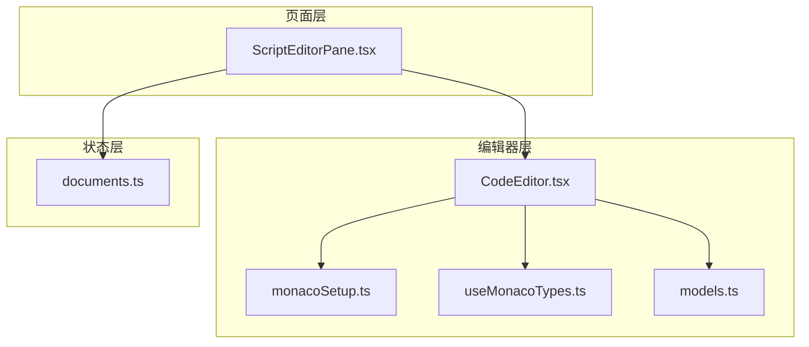
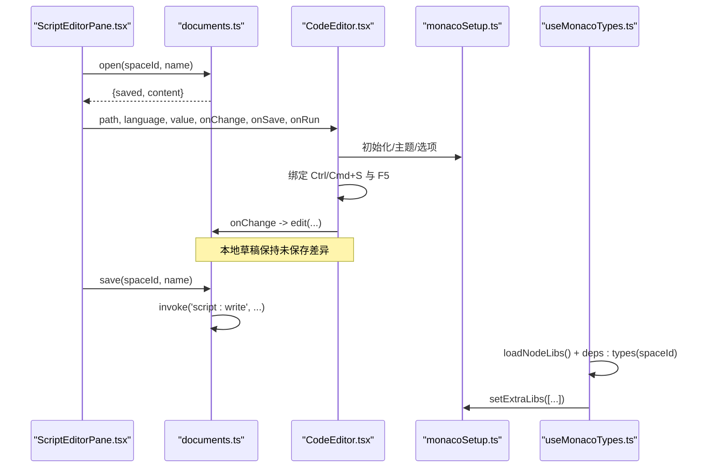
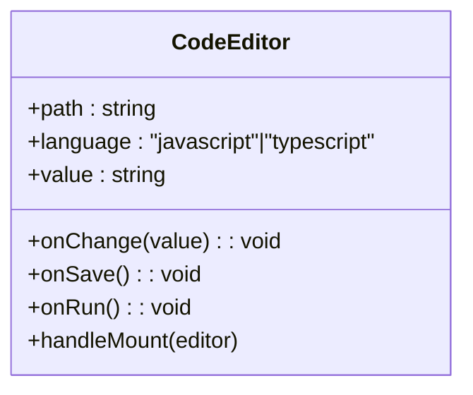
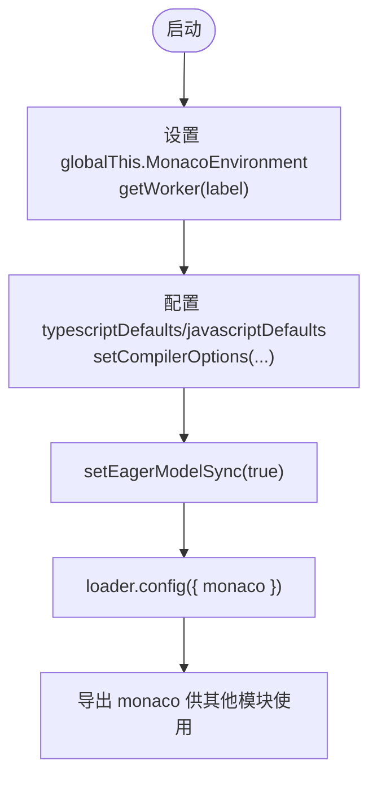
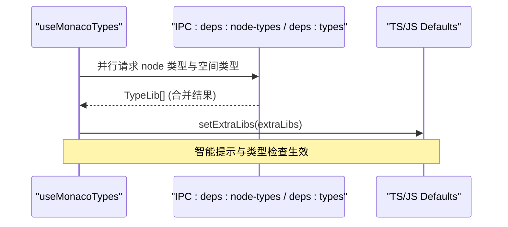
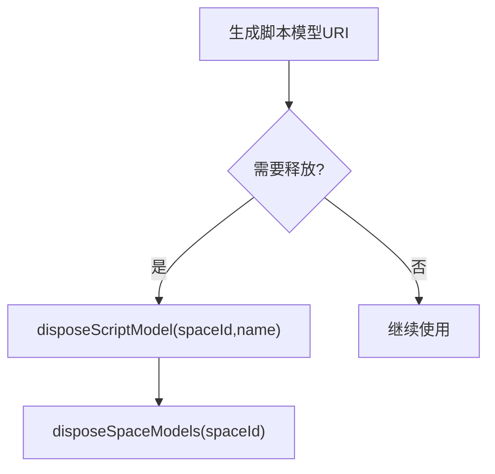
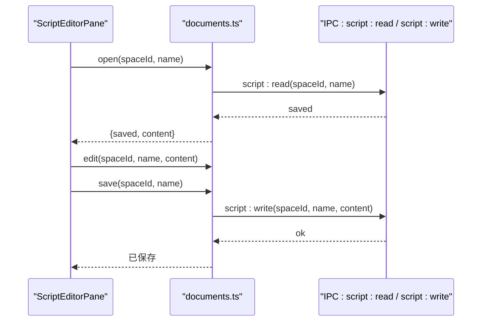
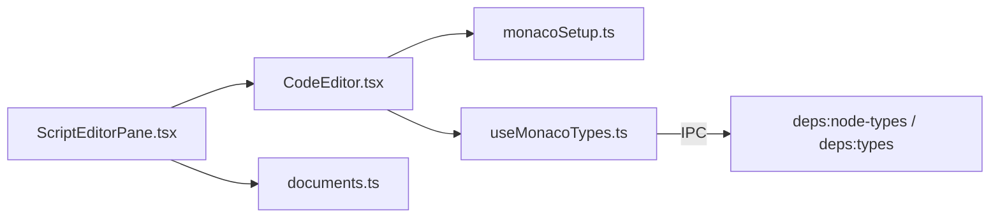

# 编辑器组件

<cite>
**本文引用的文件**   
- [CodeEditor.tsx](file://src/renderer/src/components/editor/CodeEditor.tsx)
- [monacoSetup.ts](file://src/renderer/src/components/editor/monacoSetup.ts)
- [useMonacoTypes.ts](file://src/renderer/src/components/editor/useMonacoTypes.ts)
- [models.ts](file://src/renderer/src/components/editor/models.ts)
- [ScriptEditorPane.tsx](file://src/renderer/src/pages/editor/ScriptEditorPane.tsx)
- [documents.ts](file://src/renderer/src/stores/documents.ts)
</cite>

## 目录
1. [简介](#简介)
2. [项目结构](#项目结构)
3. [核心组件](#核心组件)
4. [架构总览](#架构总览)
5. [详细组件分析](#详细组件分析)
6. [依赖关系分析](#依赖关系分析)
7. [性能与优化](#性能与优化)
8. [故障排查](#故障排查)
9. [结论](#结论)

## 简介
本文件为基于 Monaco Editor 的自定义代码编辑器组件的详细技术文档。该实现围绕以下目标展开：
- 提供语法高亮、智能提示、类型检查等编辑能力
- 通过 React 组件封装，暴露简洁的 props 接口与事件回调
- 集成 TypeScript/JavaScript 语言服务，动态注入类型声明以增强智能提示
- 管理编辑器模型生命周期，避免内存泄漏
- 适配应用主题（明/暗），并支持快捷键保存与运行

## 项目结构
编辑器相关代码集中在渲染进程的前端模块中，关键文件如下：
- 编辑器组件与配置：
  - CodeEditor.tsx：React 组件封装
  - monacoSetup.ts：Monaco 初始化与语言服务配置
  - useMonacoTypes.ts：动态注入类型库（@types/node 与空间内 node_modules）
  - models.ts：脚本模型 URI 与模型销毁工具
- 页面集成：
  - ScriptEditorPane.tsx：将编辑器嵌入脚本编辑页，绑定文档状态与操作
- 状态管理：
  - documents.ts：Zustand 文档状态，负责打开、编辑、保存与脏标记

**图表来源**
- [CodeEditor.tsx:1-52](file://src/renderer/src/components/editor/CodeEditor.tsx#L1-L52)
- [monacoSetup.ts:1-42](file://src/renderer/src/components/editor/monacoSetup.ts#L1-L42)
- [useMonacoTypes.ts:1-43](file://src/renderer/src/components/editor/useMonacoTypes.ts#L1-L43)
- [models.ts:1-16](file://src/renderer/src/components/editor/models.ts#L1-L16)
- [ScriptEditorPane.tsx:1-79](file://src/renderer/src/pages/editor/ScriptEditorPane.tsx#L1-L79)
- [documents.ts:1-67](file://src/renderer/src/stores/documents.ts#L1-L67)

**章节来源**
- [CodeEditor.tsx:1-52](file://src/renderer/src/components/editor/CodeEditor.tsx#L1-L52)
- [monacoSetup.ts:1-42](file://src/renderer/src/components/editor/monacoSetup.ts#L1-L42)
- [useMonacoTypes.ts:1-43](file://src/renderer/src/components/editor/useMonacoTypes.ts#L1-L43)
- [models.ts:1-16](file://src/renderer/src/components/editor/models.ts#L1-L16)
- [ScriptEditorPane.tsx:1-79](file://src/renderer/src/pages/editor/ScriptEditorPane.tsx#L1-L79)
- [documents.ts:1-67](file://src/renderer/src/stores/documents.ts#L1-L67)

## 核心组件
- CodeEditor：基于 @monaco-editor/react 的轻量封装，负责：
  - 主题切换（vs / vs-dark）
  - 编辑器选项（字体大小、最小地图、自动布局、缩进等）
  - 命令绑定（Ctrl/Cmd+S 保存，F5 运行）
  - 值变更回调与焦点管理
- monacoSetup：全局初始化 Monaco 环境：
  - 使用打包后的 worker（TypeScript/JS 与通用编辑器）
  - 设置 TS/JS 编译器选项（ESNext、Node 解析、JSON 模块等）
  - 启用 eager model sync，提升响应速度
- useMonacoTypes：动态注入类型声明：
  - 从主进程获取 @types/node 与空间内的类型声明
  - 更新 TS/JS defaults 的 extraLibs，驱动智能提示与类型检查
- models：模型生命周期管理：
  - 生成脚本模型 URI（file:///spaces/<id>/scripts/<name>）
  - 按空间或单个脚本释放模型，防止内存泄漏

**章节来源**
- [CodeEditor.tsx:9-50](file://src/renderer/src/components/editor/CodeEditor.tsx#L9-L50)
- [monacoSetup.ts:6-40](file://src/renderer/src/components/editor/monacoSetup.ts#L6-L40)
- [useMonacoTypes.ts:17-43](file://src/renderer/src/components/editor/useMonacoTypes.ts#L17-L43)
- [models.ts:3-16](file://src/renderer/src/components/editor/models.ts#L3-L16)

## 架构总览
下图展示编辑器在页面中的调用链与数据流：页面组件读取文档状态，将内容传递给 CodeEditor；编辑器变更触发 Zustand store 的 edit；保存时通过 IPC 写入磁盘；类型声明由 useMonacoTypes 异步加载并注入到 Monaco 的语言服务中。

**图表来源**
- [ScriptEditorPane.tsx:33-74](file://src/renderer/src/pages/editor/ScriptEditorPane.tsx#L33-L74)
- [documents.ts:24-50](file://src/renderer/src/stores/documents.ts#L24-L50)
- [CodeEditor.tsx:27-49](file://src/renderer/src/components/editor/CodeEditor.tsx#L27-L49)
- [monacoSetup.ts:6-40](file://src/renderer/src/components/editor/monacoSetup.ts#L6-L40)
- [useMonacoTypes.ts:27-43](file://src/renderer/src/components/editor/useMonacoTypes.ts#L27-L43)

## 详细组件分析

### CodeEditor 组件
职责与特性：
- Props 接口
  - path：模型 URI，用于区分不同脚本文件
  - language：'javascript' | 'typescript'
  - value：当前编辑内容（受控）
  - onChange：内容变更回调
  - onSave：保存回调
  - onRun：运行回调
- 行为
  - 根据应用主题选择 'vs' 或 'vs-dark'
  - 在编辑器挂载后注册快捷键：Ctrl/Cmd+S 保存，F5 运行
  - 禁用最小地图、禁止滚动超过最后一行、开启自动布局与固定溢出控件
  - 通过 ref 缓存最新回调，避免闭包过期问题

**图表来源**
- [CodeEditor.tsx:9-31](file://src/renderer/src/components/editor/CodeEditor.tsx#L9-L31)

**章节来源**
- [CodeEditor.tsx:9-50](file://src/renderer/src/components/editor/CodeEditor.tsx#L9-L50)

### Monaco 初始化与语言服务（monacoSetup）
关键点：
- 使用打包后的 editor.worker 与 ts.worker，避免 CDN 下载
- 配置 TS/JS 编译器选项：
  - target/module 为 ESNext
  - moduleResolution 为 NodeJs
  - lib 包含 esnext
  - allowJs/checkJs/allowNonTsExtensions 允许 JS 与类型推断
  - resolveJsonModule 支持 JSON 模块
  - skipLibCheck/noEmit/strict=false 提高开发体验
  - moduleDetection=3 使每个脚本独立模块，避免顶层命名冲突
- 启用 eagerModelSync，减少模型同步延迟
- 通过 loader.config 注入 monaco 实例

**图表来源**
- [monacoSetup.ts:6-40](file://src/renderer/src/components/editor/monacoSetup.ts#L6-L40)

**章节来源**
- [monacoSetup.ts:1-42](file://src/renderer/src/components/editor/monacoSetup.ts#L1-L42)

### 类型声明注入（useMonacoTypes）
功能说明：
- 从主进程拉取两类类型声明：
  - @types/node（全局可用）
  - 空间内 node_modules 的类型声明（deps:types）
- 将声明转换为 extraLibs 并注入 TS/JS defaults，从而驱动智能提示与类型检查
- 监听依赖任务 revision，自动刷新类型声明

**图表来源**
- [useMonacoTypes.ts:9-21](file://src/renderer/src/components/editor/useMonacoTypes.ts#L9-L21)
- [useMonacoTypes.ts:27-43](file://src/renderer/src/components/editor/useMonacoTypes.ts#L27-L43)

**章节来源**
- [useMonacoTypes.ts:1-43](file://src/renderer/src/components/editor/useMonacoTypes.ts#L1-L43)

### 模型生命周期（models）
作用：
- 生成脚本模型的统一 URI 前缀 file:///spaces/<spaceId>/scripts/<name>
- 提供 disposeScriptModel 与 disposeSpaceModels 方法，确保卸载或切换空间时释放模型，避免内存泄漏

**图表来源**
- [models.ts:3-16](file://src/renderer/src/components/editor/models.ts#L3-L16)

**章节来源**
- [models.ts:1-16](file://src/renderer/src/components/editor/models.ts#L1-L16)

### 页面集成与状态管理（ScriptEditorPane 与 documents）
- ScriptEditorPane：
  - 打开文档：调用 documents.open，失败时显示错误结果
  - 保存：调用 documents.save，错误时提示
  - 安装依赖：当存在缺失依赖时，调用 installDeps
  - 渲染 CodeEditor，传入 path、language、value 与回调
- documents（Zustand）：
  - open：首次打开从 IPC 读取 saved 内容，创建草稿 {saved, content}
  - edit：更新 content，标记脏状态
  - save：对比 saved 与 content，仅在有差异时写入磁盘并更新 saved
  - forget/rename：清理或重命名草稿

**图表来源**
- [ScriptEditorPane.tsx:33-74](file://src/renderer/src/pages/editor/ScriptEditorPane.tsx#L33-L74)
- [documents.ts:24-50](file://src/renderer/src/stores/documents.ts#L24-L50)

**章节来源**
- [ScriptEditorPane.tsx:1-79](file://src/renderer/src/pages/editor/ScriptEditorPane.tsx#L1-L79)
- [documents.ts:1-67](file://src/renderer/src/stores/documents.ts#L1-L67)

## 依赖关系分析
- 组件耦合
  - CodeEditor 依赖 monacoSetup 提供的 monaco 实例与主题上下文
  - useMonacoTypes 依赖 IPC 与 Zustand 的依赖状态，影响 Monaco 的智能提示
  - ScriptEditorPane 组合 CodeEditor 与文档状态，承担业务编排
- 外部依赖
  - @monaco-editor/react：React 封装
  - monaco-editor：编辑器内核与语言服务
  - antd：Spin、Result、Flex 等 UI 组件
  - zustand：状态管理

**图表来源**
- [CodeEditor.tsx:1-52](file://src/renderer/src/components/editor/CodeEditor.tsx#L1-L52)
- [monacoSetup.ts:1-42](file://src/renderer/src/components/editor/monacoSetup.ts#L1-L42)
- [useMonacoTypes.ts:1-43](file://src/renderer/src/components/editor/useMonacoTypes.ts#L1-L43)
- [ScriptEditorPane.tsx:1-79](file://src/renderer/src/pages/editor/ScriptEditorPane.tsx#L1-L79)
- [documents.ts:1-67](file://src/renderer/src/stores/documents.ts#L1-L67)

**章节来源**
- [CodeEditor.tsx:1-52](file://src/renderer/src/components/editor/CodeEditor.tsx#L1-L52)
- [monacoSetup.ts:1-42](file://src/renderer/src/components/editor/monacoSetup.ts#L1-L42)
- [useMonacoTypes.ts:1-43](file://src/renderer/src/components/editor/useMonacoTypes.ts#L1-L43)
- [ScriptEditorPane.tsx:1-79](file://src/renderer/src/pages/editor/ScriptEditorPane.tsx#L1-L79)
- [documents.ts:1-67](file://src/renderer/src/stores/documents.ts#L1-L67)

## 性能与优化
- Worker 隔离
  - 使用打包后的 editor.worker 与 ts.worker，避免网络请求与阻塞主线程
- 编译器选项优化
  - noEmit/skipLibCheck/strict=false 降低类型检查开销
  - moduleDetection=3 避免跨文件顶层命名冲突，减少不必要的解析
- 模型同步
  - setEagerModelSync(true) 提前同步模型，缩短输入反馈延迟
- 编辑器选项
  - automaticLayout 自适应容器尺寸变化
  - fixedOverflowWidgets 避免溢出控件抖动
  - minimap 关闭以减少渲染压力
- 类型声明增量更新
  - useMonacoTypes 监听依赖 revision，仅在必要时重新注入 extraLibs
- 模型生命周期
  - disposeScriptModel/disposeSpaceModels 及时释放模型，避免内存增长

[本节为通用指导，不直接分析具体文件]

## 故障排查
- 智能提示无效或类型缺失
  - 检查 useMonacoTypes 是否正确加载 @types/node 与空间类型
  - 确认 IPC deps:node-types 与 deps:types 返回有效 TypeLib[]
  - 验证 monacoSetup 中 TS/JS defaults 是否已设置 extraLibs
- 保存无响应
  - 检查 CodeEditor 的 Ctrl/Cmd+S 命令是否绑定成功
  - 确认 ScriptEditorPane 的 onSave 调用 documents.save
  - 查看 IPC script:write 是否成功返回
- 运行快捷键无效
  - 确认 F5 命令已绑定到 onRun
  - 检查上层运行逻辑是否被正确触发
- 内存泄漏
  - 切换空间或关闭脚本时，调用 disposeSpaceModels 或 disposeScriptModel
  - 避免长时间持有已释放的模型引用

**章节来源**
- [useMonacoTypes.ts:27-43](file://src/renderer/src/components/editor/useMonacoTypes.ts#L27-L43)
- [monacoSetup.ts:35-40](file://src/renderer/src/components/editor/monacoSetup.ts#L35-L40)
- [CodeEditor.tsx:27-31](file://src/renderer/src/components/editor/CodeEditor.tsx#L27-L31)
- [ScriptEditorPane.tsx:39-45](file://src/renderer/src/pages/editor/ScriptEditorPane.tsx#L39-L45)
- [models.ts:6-16](file://src/renderer/src/components/editor/models.ts#L6-L16)

## 结论
该编辑器组件以 Monaco Editor 为核心，结合 React 与 Zustand 提供了完整的脚本编辑体验。通过统一的模型 URI、严格的类型注入与完善的生命周期管理，既保证了编辑器的性能与稳定性，也扩展了智能提示与类型检查的能力。建议在后续迭代中继续优化类型声明的增量更新策略，并根据实际场景调整编译器选项以获得更佳的开发体验。