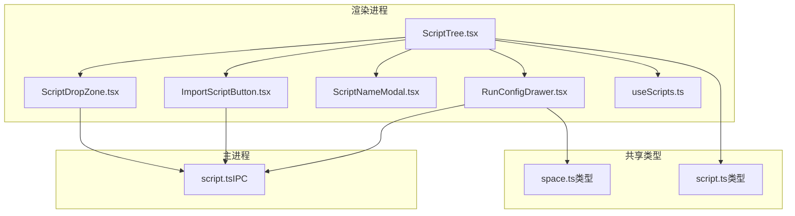
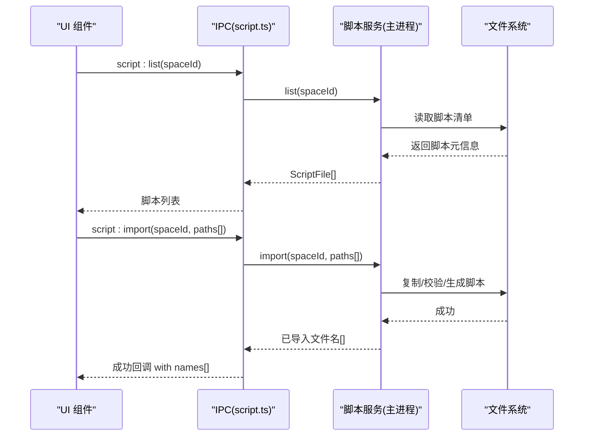
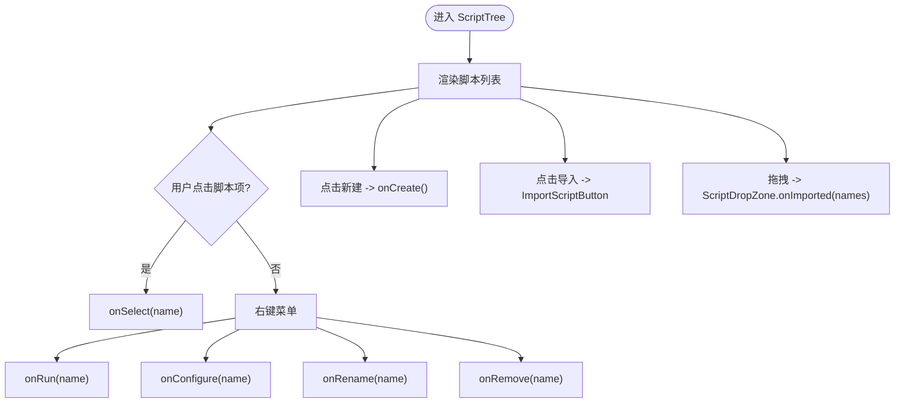
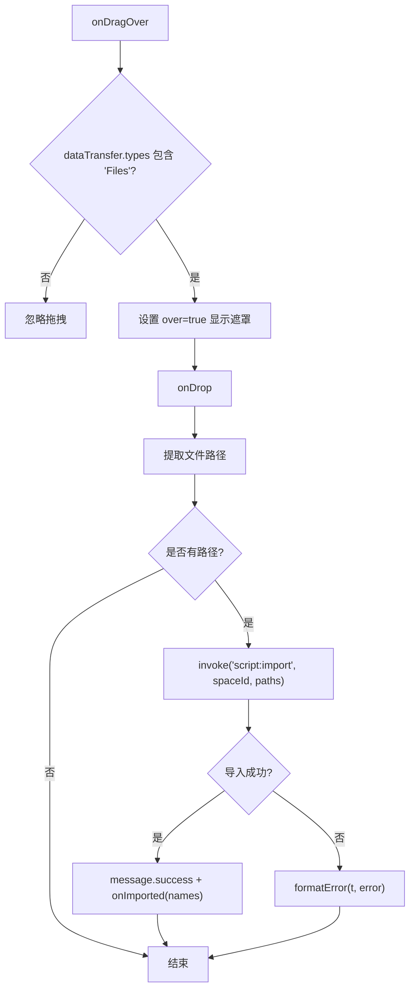
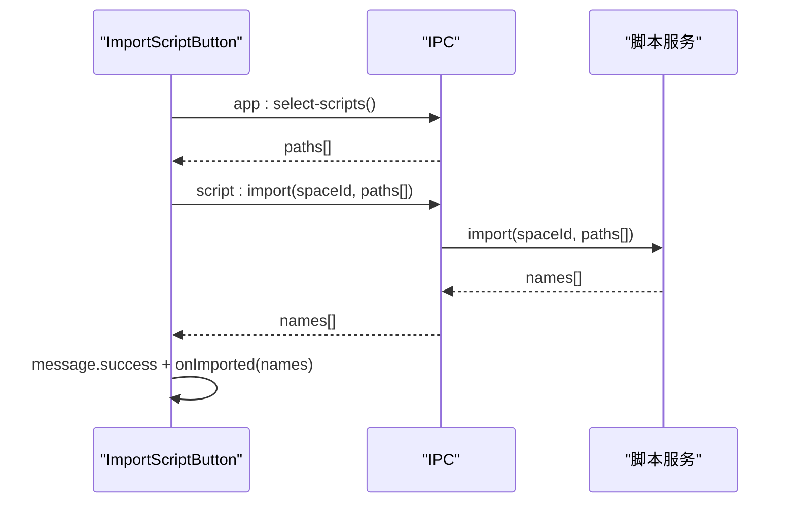
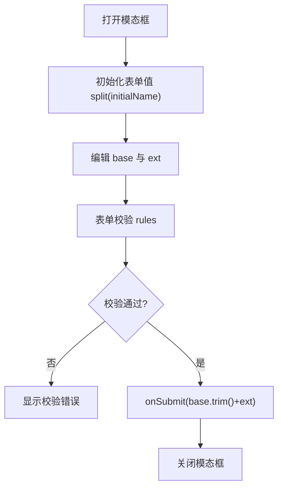
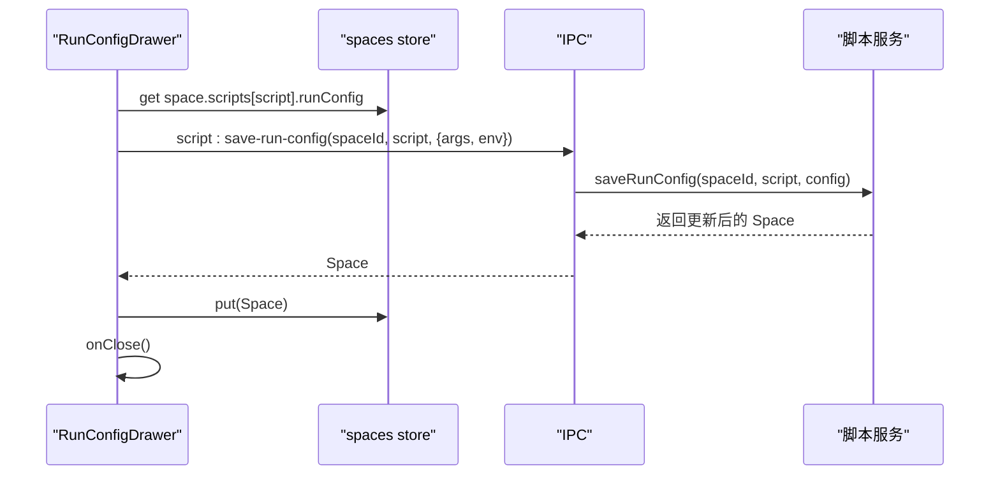
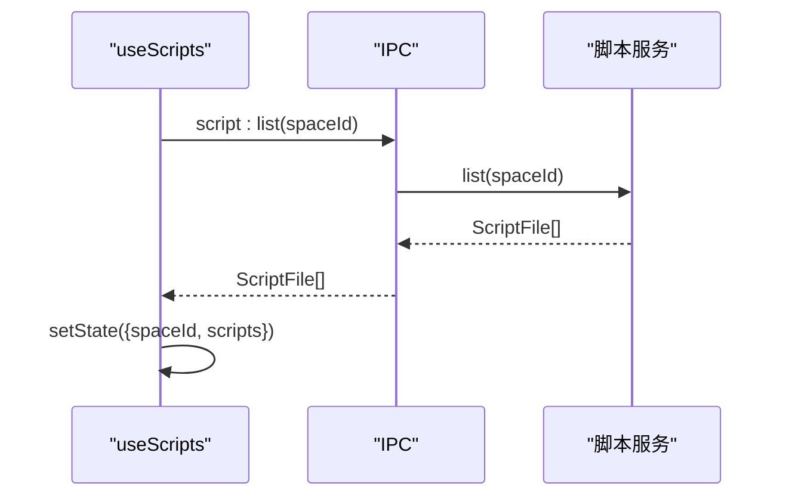
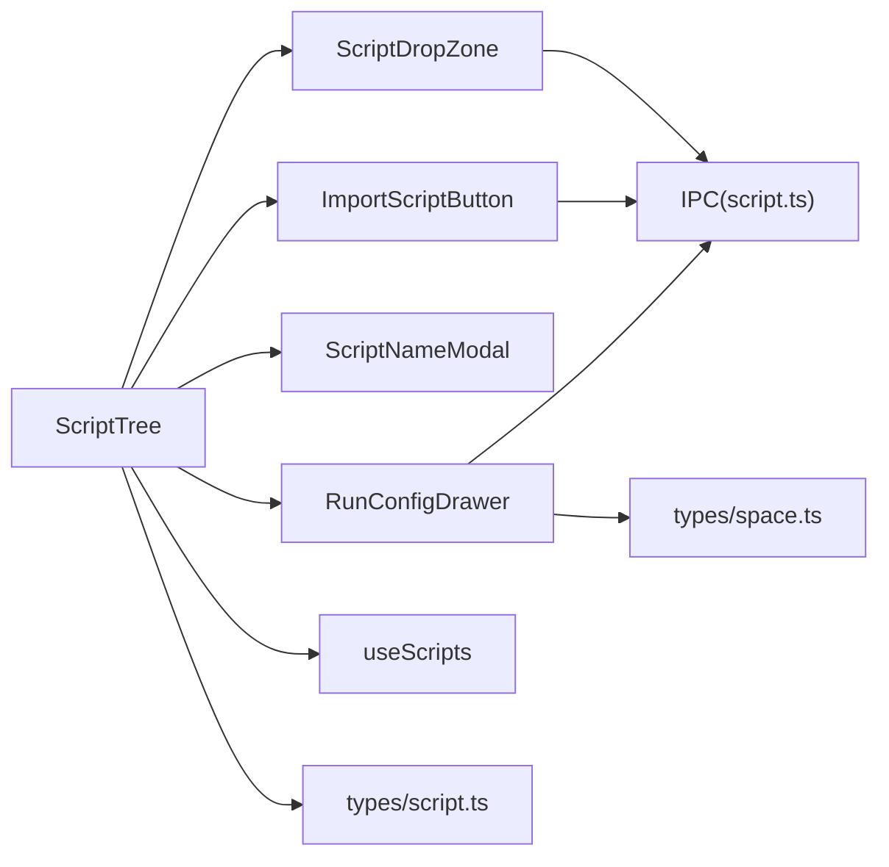

# 脚本管理组件

<cite>
**本文引用的文件**   
- [ScriptTree.tsx](file://src/renderer/src/components/script/ScriptTree.tsx)
- [ScriptDropZone.tsx](file://src/renderer/src/components/script/ScriptDropZone.tsx)
- [ImportScriptButton.tsx](file://src/renderer/src/components/script/ImportScriptButton.tsx)
- [ScriptNameModal.tsx](file://src/renderer/src/components/script/ScriptNameModal.tsx)
- [RunConfigDrawer.tsx](file://src/renderer/src/components/script/RunConfigDrawer.tsx)
- [useScripts.ts](file://src/renderer/src/pages/editor/useScripts.ts)
- [script.ts（IPC）](file://src/main/ipc/script.ts)
- [script.ts（类型）](file://src/shared/types/script.ts)
- [space.ts（类型）](file://src/shared/types/space.ts)
- [spaces.ts（状态存储）](file://src/renderer/src/stores/spaces.ts)
</cite>

## 目录
1. [简介](#简介)
2. [项目结构](#项目结构)
3. [核心组件](#核心组件)
4. [架构总览](#架构总览)
5. [详细组件分析](#详细组件分析)
6. [依赖关系分析](#依赖关系分析)
7. [性能与体验优化建议](#性能与体验优化建议)
8. [故障排查指南](#故障排查指南)
9. [结论](#结论)

## 简介
本文件聚焦于“脚本管理”相关的前端组件与数据流，覆盖以下能力：
- 脚本树形结构的数据结构与渲染逻辑
- 拖拽区域的文件识别、格式验证与批量导入
- 脚本名称模态框的表单校验与命名规则检查
- 运行配置抽屉的参数管理与持久化
- 组件间协作关系与数据流设计

该文档以代码为依据，提供可视化图示与可操作的排错指引，帮助读者快速理解并扩展脚本管理功能。

## 项目结构
脚本管理相关代码主要分布在渲染进程的前端组件与共享类型定义中，并通过 IPC 与主进程服务交互。关键路径如下：
- 渲染层组件：ScriptTree、ScriptDropZone、ImportScriptButton、ScriptNameModal、RunConfigDrawer
- 编辑器页面 Hook：useScripts
- 共享类型：ScriptFile、ScriptExtension、RunConfig、Space
- 主进程 IPC 注册：script.ts

图表来源
- [ScriptTree.tsx:1-94](file://src/renderer/src/components/script/ScriptTree.tsx#L1-L94)
- [ScriptDropZone.tsx:1-59](file://src/renderer/src/components/script/ScriptDropZone.tsx#L1-L59)
- [ImportScriptButton.tsx:1-38](file://src/renderer/src/components/script/ImportScriptButton.tsx#L1-L38)
- [ScriptNameModal.tsx:1-86](file://src/renderer/src/components/script/ScriptNameModal.tsx#L1-L86)
- [RunConfigDrawer.tsx:1-66](file://src/renderer/src/components/script/RunConfigDrawer.tsx#L1-L66)
- [useScripts.ts:1-39](file://src/renderer/src/pages/editor/useScripts.ts#L1-L39)
- [script.ts（IPC）:1-14](file://src/main/ipc/script.ts#L1-L14)
- [script.ts（类型）:1-13](file://src/shared/types/script.ts#L1-L13)
- [space.ts（类型）:1-28](file://src/shared/types/space.ts#L1-L28)

章节来源
- [ScriptTree.tsx:1-94](file://src/renderer/src/components/script/ScriptTree.tsx#L1-L94)
- [ScriptDropZone.tsx:1-59](file://src/renderer/src/components/script/ScriptDropZone.tsx#L1-L59)
- [ImportScriptButton.tsx:1-38](file://src/renderer/src/components/script/ImportScriptButton.tsx#L1-L38)
- [ScriptNameModal.tsx:1-86](file://src/renderer/src/components/script/ScriptNameModal.tsx#L1-L86)
- [RunConfigDrawer.tsx:1-66](file://src/renderer/src/components/script/RunConfigDrawer.tsx#L1-L66)
- [useScripts.ts:1-39](file://src/renderer/src/pages/editor/useScripts.ts#L1-L39)
- [script.ts（IPC）:1-14](file://src/main/ipc/script.ts#L1-L14)
- [script.ts（类型）:1-13](file://src/shared/types/script.ts#L1-L13)
- [space.ts（类型）:1-28](file://src/shared/types/space.ts#L1-L28)

## 核心组件
- ScriptTree：脚本列表容器，负责渲染脚本项、上下文菜单、新建与导入入口，并与拖拽区域组合。
- ScriptDropZone：处理从操作系统拖入文件的识别与调用导入接口。
- ImportScriptButton：打开系统文件选择器，触发脚本批量导入。
- ScriptNameModal：创建或重命名脚本时的名称输入与校验。
- RunConfigDrawer：编辑脚本的运行参数与环境变量，并持久化到空间元数据。
- useScripts：按空间加载脚本清单，封装错误提示与刷新逻辑。

章节来源
- [ScriptTree.tsx:1-94](file://src/renderer/src/components/script/ScriptTree.tsx#L1-L94)
- [ScriptDropZone.tsx:1-59](file://src/renderer/src/components/script/ScriptDropZone.tsx#L1-L59)
- [ImportScriptButton.tsx:1-38](file://src/renderer/src/components/script/ImportScriptButton.tsx#L1-L38)
- [ScriptNameModal.tsx:1-86](file://src/renderer/src/components/script/ScriptNameModal.tsx#L1-L86)
- [RunConfigDrawer.tsx:1-66](file://src/renderer/src/components/script/RunConfigDrawer.tsx#L1-L66)
- [useScripts.ts:1-39](file://src/renderer/src/pages/editor/useScripts.ts#L1-L39)

## 架构总览
脚本管理的整体流程由渲染层组件发起，通过 IPC 调用主进程脚本服务，最终落盘或更新状态。

图表来源
- [useScripts.ts:20-30](file://src/renderer/src/pages/editor/useScripts.ts#L20-L30)
- [script.ts（IPC）:5-12](file://src/main/ipc/script.ts#L5-L12)

章节来源
- [useScripts.ts:1-39](file://src/renderer/src/pages/editor/useScripts.ts#L1-L39)
- [script.ts（IPC）:1-14](file://src/main/ipc/script.ts#L1-L14)

## 详细组件分析

### 脚本树形结构组件（ScriptTree）
职责与行为
- 接收 scripts 数组并渲染为列表项，支持选中高亮、未保存标记、运行中标记。
- 提供上下文菜单：运行、打开运行配置、重命名、删除。
- 组合 ScriptDropZone 作为拖拽导入容器，并提供“新建”和“导入”按钮。
- 语言标识根据 ScriptFile.language 显示 TS/JS 徽标。

数据结构
- 使用 ScriptFile 类型描述每个脚本项，包含 name、language、size、mtime。

交互流程
- 点击脚本项：触发 onSelect。
- 右键菜单：触发 onRun/onConfigure/onRename/onRemove。
- 新建：触发 onCreate。
- 导入：通过 ImportScriptButton 或拖拽完成，回调 onImported。

图表来源
- [ScriptTree.tsx:34-93](file://src/renderer/src/components/script/ScriptTree.tsx#L34-L93)
- [script.ts（类型）:7-12](file://src/shared/types/script.ts#L7-L12)

章节来源
- [ScriptTree.tsx:1-94](file://src/renderer/src/components/script/ScriptTree.tsx#L1-L94)
- [script.ts（类型）:1-13](file://src/shared/types/script.ts#L1-L13)

### 拖拽导入区域（ScriptDropZone）
职责与行为
- 监听拖拽事件，仅当 dataTransfer.types 包含 'Files' 时视为有效拖拽。
- 将拖拽文件转换为绝对路径后调用 script:import 进行批量导入。
- 导入成功后通知父组件 onImported(names)，并展示成功消息；失败则格式化错误提示。

文件识别与格式验证
- 文件识别：基于 dataTransfer.types 判断是否包含 Files。
- 格式验证：由主进程脚本服务在 script:import 中执行（前端仅传递路径）。

图表来源
- [ScriptDropZone.tsx:14-36](file://src/renderer/src/components/script/ScriptDropZone.tsx#L14-L36)

章节来源
- [ScriptDropZone.tsx:1-59](file://src/renderer/src/components/script/ScriptDropZone.tsx#L1-L59)

### 脚本导入按钮（ImportScriptButton）
职责与行为
- 调用 app:select-scripts 打开系统文件选择器，获取多个脚本路径。
- 调用 script:import 批量导入，成功后回调 onImported(names)。

图表来源
- [ImportScriptButton.tsx:18-30](file://src/renderer/src/components/script/ImportScriptButton.tsx#L18-L30)
- [script.ts（IPC）:9](file://src/main/ipc/script.ts#L9)

章节来源
- [ImportScriptButton.tsx:1-38](file://src/renderer/src/components/script/ImportScriptButton.tsx#L1-L38)
- [script.ts（IPC）:1-14](file://src/main/ipc/script.ts#L1-L14)

### 脚本名称模态框（ScriptNameModal）
职责与行为
- 用于创建或重命名脚本，支持基础名与扩展名分离编辑。
- 提交时拼接 base.trim() + ext 作为最终脚本名。
- 表单校验规则：
  - 必填且不能为空字符串
  - 禁止非法字符集
  - 禁止以点开头、禁止相对路径片段 ..
- 扩展名来自 SCRIPT_EXTENSIONS 常量。

命名规则检查
- 非法字符正则：包含 Windows/Linux/Mac 常见非法字符及控制字符。
- 特殊规则：不允许以 . 开头，不允许出现 .. 片段。

图表来源
- [ScriptNameModal.tsx:22-28](file://src/renderer/src/components/script/ScriptNameModal.tsx#L22-L28)
- [ScriptNameModal.tsx:60-79](file://src/renderer/src/components/script/ScriptNameModal.tsx#L60-L79)
- [script.ts（类型）:1-3](file://src/shared/types/script.ts#L1-L3)

章节来源
- [ScriptNameModal.tsx:1-86](file://src/renderer/src/components/script/ScriptNameModal.tsx#L1-L86)
- [script.ts（类型）:1-13](file://src/shared/types/script.ts#L1-L13)

### 运行配置抽屉（RunConfigDrawer）
职责与行为
- 编辑单个脚本的运行参数 args 与环境变量 env。
- 打开时从当前 Space.scripts[script].runConfig 填充表单。
- 保存时过滤空键的环境变量，调用 script:save-run-config 持久化，并通过 put 更新本地空间状态。

配置持久化
- 通过 IPC 调用 script:save-run-config，将 {args, env} 写入脚本元数据。
- 使用 spaces store 的 put 方法替换当前空间的最新副本，确保 UI 同步。

图表来源
- [RunConfigDrawer.tsx:25-44](file://src/renderer/src/components/script/RunConfigDrawer.tsx#L25-L44)
- [spaces.ts:36-43](file://src/renderer/src/stores/spaces.ts#L36-L43)
- [script.ts（IPC）:12](file://src/main/ipc/script.ts#L12)
- [space.ts（类型）:3-11](file://src/shared/types/space.ts#L3-L11)

章节来源
- [RunConfigDrawer.tsx:1-66](file://src/renderer/src/components/script/RunConfigDrawer.tsx#L1-L66)
- [spaces.ts:1-45](file://src/renderer/src/stores/spaces.ts#L1-L45)
- [script.ts（IPC）:1-14](file://src/main/ipc/script.ts#L1-L14)
- [space.ts（类型）:1-28](file://src/shared/types/space.ts#L1-L28)

### 脚本清单加载（useScripts）
职责与行为
- 根据 spaceId 调用 script:list 获取脚本清单。
- 统一错误提示，返回 loaded 标志与 reload 刷新函数。

图表来源
- [useScripts.ts:20-30](file://src/renderer/src/pages/editor/useScripts.ts#L20-L30)
- [script.ts（IPC）:5](file://src/main/ipc/script.ts#L5)

章节来源
- [useScripts.ts:1-39](file://src/renderer/src/pages/editor/useScripts.ts#L1-L39)
- [script.ts（IPC）:1-14](file://src/main/ipc/script.ts#L1-L14)

## 依赖关系分析
- 组件耦合
  - ScriptTree 聚合 ScriptDropZone 与 ImportScriptButton，并通过 props 暴露操作回调，保持松耦合。
  - ScriptNameModal 与 RunConfigDrawer 分别依赖 shared types 与 IPC，不直接访问文件系统。
- 外部依赖
  - IPC 层集中注册脚本相关接口，便于扩展与维护。
  - 共享类型保证前后端契约一致。

图表来源
- [ScriptTree.tsx:1-94](file://src/renderer/src/components/script/ScriptTree.tsx#L1-L94)
- [ScriptDropZone.tsx:1-59](file://src/renderer/src/components/script/ScriptDropZone.tsx#L1-L59)
- [ImportScriptButton.tsx:1-38](file://src/renderer/src/components/script/ImportScriptButton.tsx#L1-L38)
- [ScriptNameModal.tsx:1-86](file://src/renderer/src/components/script/ScriptNameModal.tsx#L1-L86)
- [RunConfigDrawer.tsx:1-66](file://src/renderer/src/components/script/RunConfigDrawer.tsx#L1-L66)
- [useScripts.ts:1-39](file://src/renderer/src/pages/editor/useScripts.ts#L1-L39)
- [script.ts（IPC）:1-14](file://src/main/ipc/script.ts#L1-L14)
- [script.ts（类型）:1-13](file://src/shared/types/script.ts#L1-L13)
- [space.ts（类型）:1-28](file://src/shared/types/space.ts#L1-L28)

章节来源
- [ScriptTree.tsx:1-94](file://src/renderer/src/components/script/ScriptTree.tsx#L1-L94)
- [ScriptDropZone.tsx:1-59](file://src/renderer/src/components/script/ScriptDropZone.tsx#L1-L59)
- [ImportScriptButton.tsx:1-38](file://src/renderer/src/components/script/ImportScriptButton.tsx#L1-L38)
- [ScriptNameModal.tsx:1-86](file://src/renderer/src/components/script/ScriptNameModal.tsx#L1-L86)
- [RunConfigDrawer.tsx:1-66](file://src/renderer/src/components/script/RunConfigDrawer.tsx#L1-L66)
- [useScripts.ts:1-39](file://src/renderer/src/pages/editor/useScripts.ts#L1-L39)
- [script.ts（IPC）:1-14](file://src/main/ipc/script.ts#L1-L14)
- [script.ts（类型）:1-13](file://src/shared/types/script.ts#L1-L13)
- [space.ts（类型）:1-28](file://src/shared/types/space.ts#L1-L28)

## 性能与体验优化建议
- 列表渲染
  - 对大量脚本场景，考虑虚拟滚动以减少 DOM 节点数量。
  - 使用稳定 key（如 name）避免不必要的重渲染。
- 拖拽体验
  - 在 onDragOver 中尽快判定并阻止默认行为，减少抖动。
  - 对超大文件或过多文件进行前端预限制（数量/大小），提升响应速度。
- 表单交互
  - 对 ScriptNameModal 的校验采用防抖，避免频繁正则计算。
  - 对 RunConfigDrawer 的环境变量行进行懒加载与增量校验。
- IPC 调用
  - 合并批量操作（如批量导入）以减少 IPC 往返次数。
  - 对长耗时操作增加进度反馈与取消能力。

[本节为通用建议，不涉及具体文件分析]

## 故障排查指南
常见问题与定位要点
- 拖拽无效
  - 检查 dataTransfer.types 是否包含 'Files'。
  - 确认 onDrop 未被其他元素拦截。
  - 参考实现位置：[ScriptDropZone.tsx:14-36](file://src/renderer/src/components/script/ScriptDropZone.tsx#L14-L36)
- 导入失败
  - 查看 message.error 的错误信息，确认主进程脚本服务是否正确处理路径与权限。
  - 参考调用链：[ImportScriptButton.tsx:18-30](file://src/renderer/src/components/script/ImportScriptButton.tsx#L18-L30)、[script.ts（IPC）:9](file://src/main/ipc/script.ts#L9)
- 名称校验报错
  - 检查是否包含非法字符或以点开头、包含 ..。
  - 参考规则定义与校验位置：[ScriptNameModal.tsx:22-28](file://src/renderer/src/components/script/ScriptNameModal.tsx#L22-L28)、[ScriptNameModal.tsx:60-79](file://src/renderer/src/components/script/ScriptNameModal.tsx#L60-L79)
- 运行配置未保存
  - 确认表单字段 args/env 非空键过滤逻辑。
  - 检查 spaces store 的 put 是否被调用并更新 UI。
  - 参考实现位置：[RunConfigDrawer.tsx:30-44](file://src/renderer/src/components/script/RunConfigDrawer.tsx#L30-L44)、[spaces.ts:36-43](file://src/renderer/src/stores/spaces.ts#L36-L43)

章节来源
- [ScriptDropZone.tsx:14-36](file://src/renderer/src/components/script/ScriptDropZone.tsx#L14-L36)
- [ImportScriptButton.tsx:18-30](file://src/renderer/src/components/script/ImportScriptButton.tsx#L18-L30)
- [script.ts（IPC）:9](file://src/main/ipc/script.ts#L9)
- [ScriptNameModal.tsx:22-28](file://src/renderer/src/components/script/ScriptNameModal.tsx#L22-L28)
- [ScriptNameModal.tsx:60-79](file://src/renderer/src/components/script/ScriptNameModal.tsx#L60-L79)
- [RunConfigDrawer.tsx:30-44](file://src/renderer/src/components/script/RunConfigDrawer.tsx#L30-L44)
- [spaces.ts:36-43](file://src/renderer/src/stores/spaces.ts#L36-L43)

## 结论
脚本管理组件围绕 ScriptTree 展开，通过拖拽与按钮两种导入方式、名称模态框的严格校验、以及运行配置抽屉的参数持久化，形成完整的脚本生命周期管理能力。组件之间通过 props 与 IPC 解耦，共享类型保障前后端一致性。建议在大数据量与复杂交互场景下进一步优化渲染与校验性能，并完善错误提示与用户引导。

[本节为总结性内容，不涉及具体文件分析]