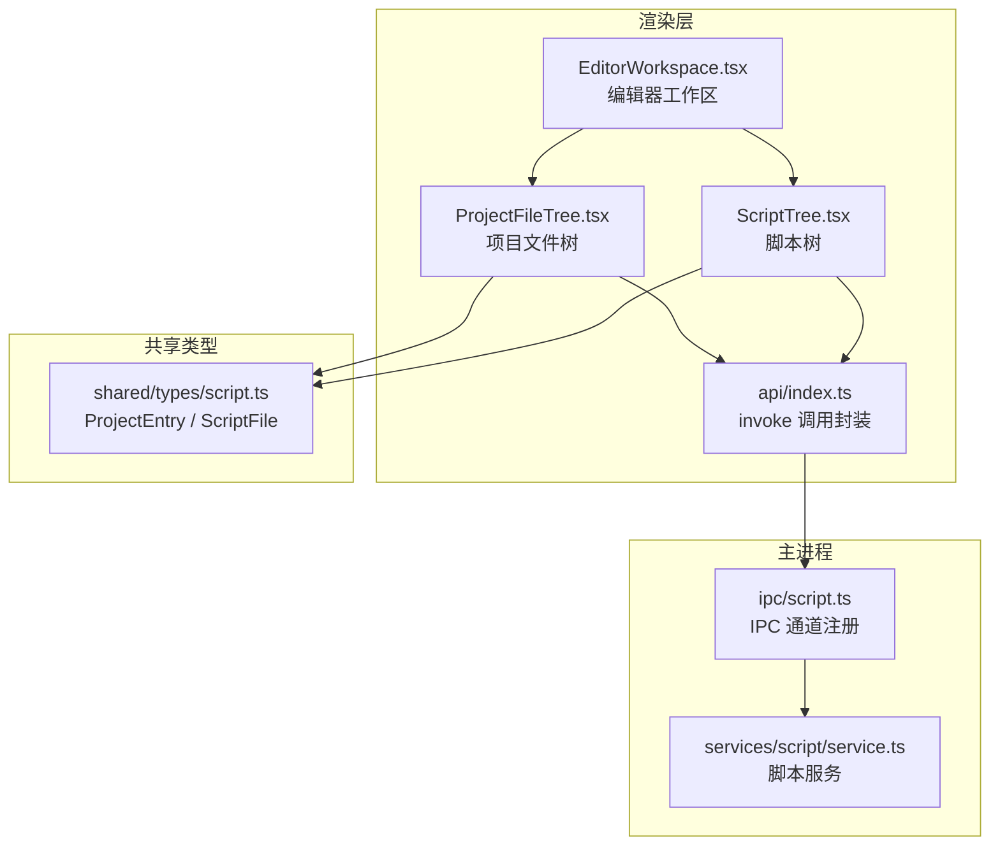
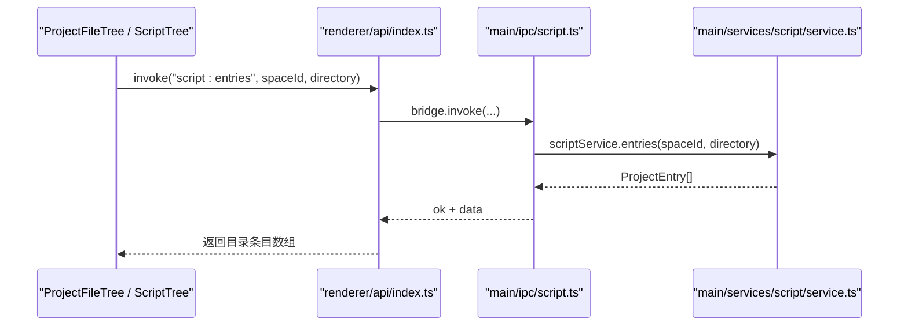
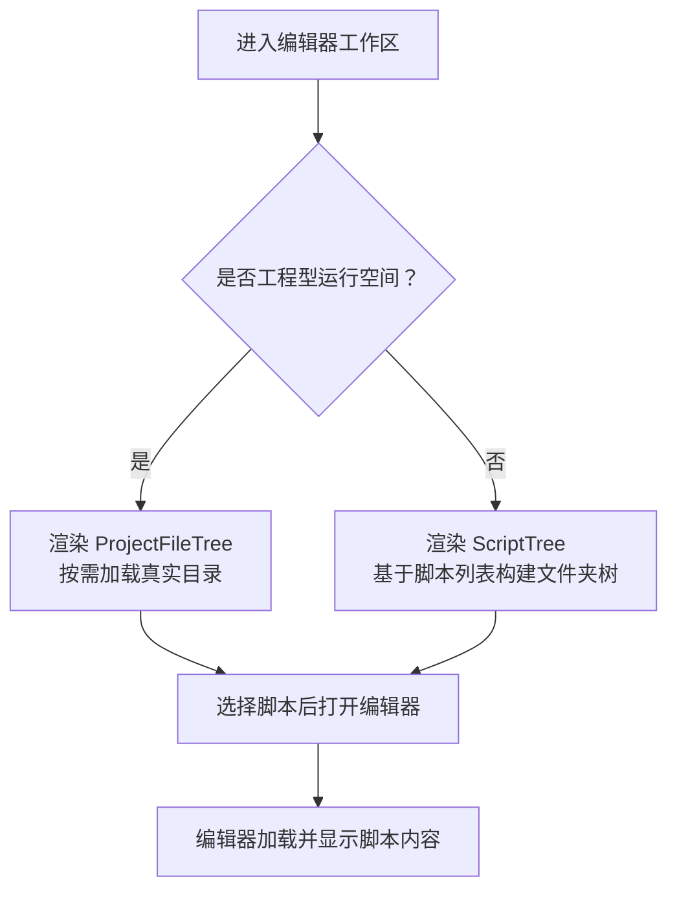
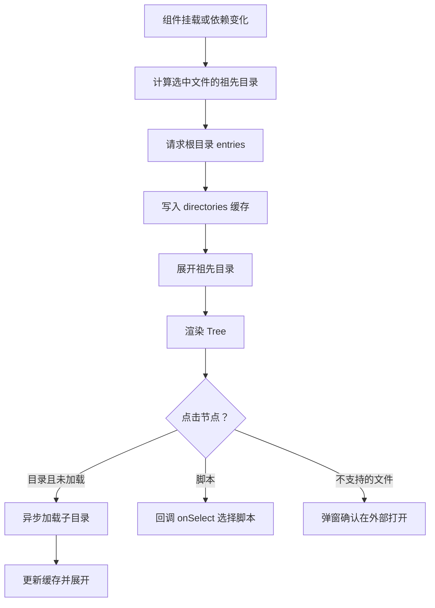
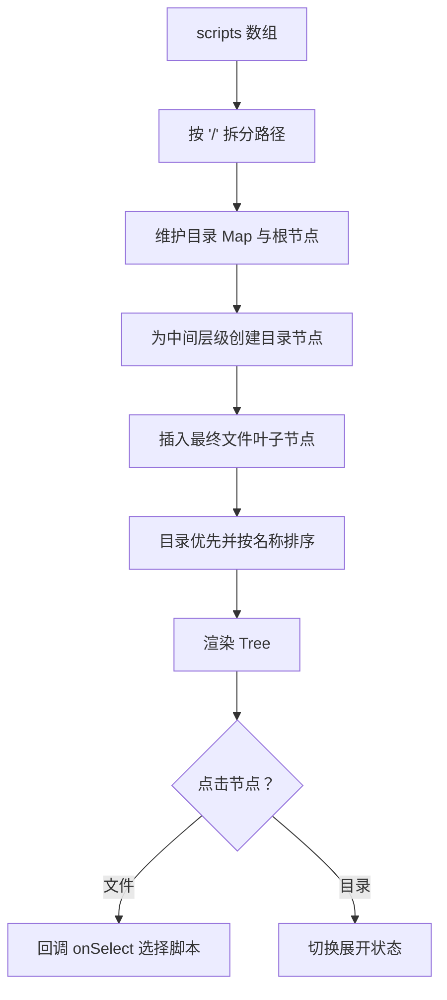
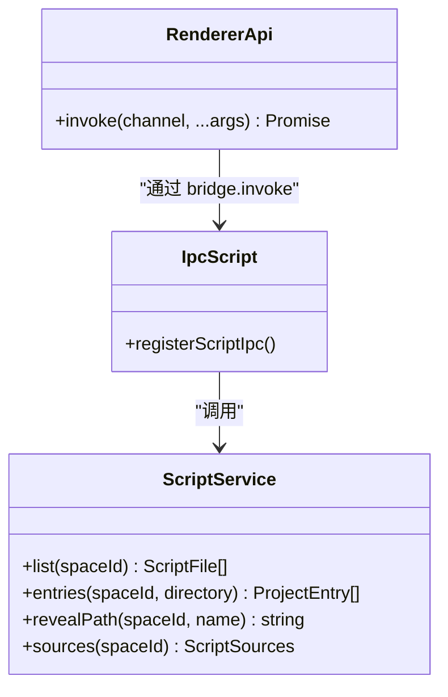
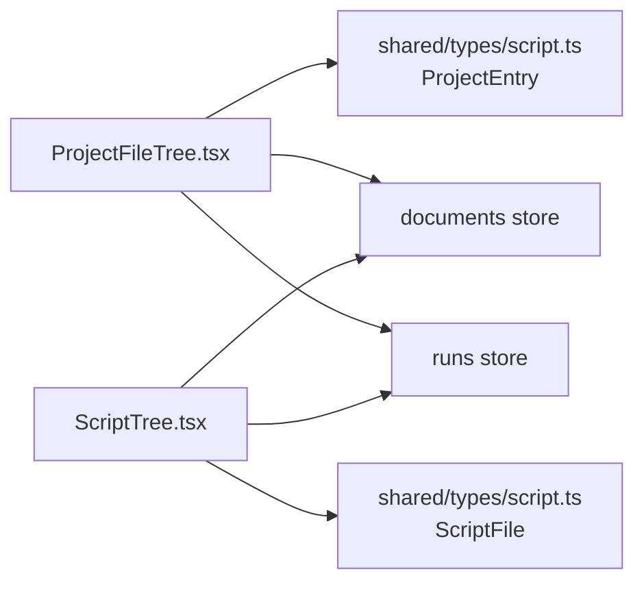

# 项目文件树组件

<cite>
**本文引用的文件**   
- [ProjectFileTree.tsx](file://src/renderer/src/components/script/ProjectFileTree.tsx)
- [ScriptTree.tsx](file://src/renderer/src/components/script/ScriptTree.tsx)
- [EditorWorkspace.tsx](file://src/renderer/src/pages/editor/EditorWorkspace.tsx)
- [script.ts（IPC 注册）](file://src/main/ipc/script.ts)
- [service.ts（脚本服务）](file://src/main/services/script/service.ts)
- [script.ts（共享类型）](file://src/shared/types/script.ts)
- [index.ts（渲染端 IPC 调用封装）](file://src/renderer/src/api/index.ts)
</cite>

## 目录
1. [引言](#引言)
2. [项目结构定位](#项目结构定位)
3. [核心组件总览](#核心组件总览)
4. [架构与数据流](#架构与数据流)
5. [详细组件分析](#详细组件分析)
6. [依赖关系分析](#依赖关系分析)
7. [性能与交互特性](#性能与交互特性)
8. [常见问题与排错](#常见问题与排错)
9. [结论](#结论)

## 引言
本文聚焦 Script Box 中的“项目文件树”能力，重点说明两种树形展示方式：
- **项目文件树**：面向“工程型运行空间”，按需加载真实文件系统目录，支持隐藏文件、符号链接、空目录。
- **脚本树**：面向普通运行空间或已导入的脚本列表，将扁平脚本路径转换为文件夹树结构。

这两个组件共同承担“选择脚本、打开编辑器、运行脚本、查看运行状态、上下文菜单操作”等职责，并通过 Electron 主进程的服务访问文件系统。

## 项目结构定位
文件树相关代码主要分布在渲染层和主进程服务层：

**图表来源**
- [ProjectFileTree.tsx:44-208](file://src/renderer/src/components/script/ProjectFileTree.tsx#L44-L208)
- [ScriptTree.tsx:101-208](file://src/renderer/src/components/script/ScriptTree.tsx#L101-L208)
- [EditorWorkspace.tsx:104-140](file://src/renderer/src/pages/editor/EditorWorkspace.tsx#L104-L140)
- [script.ts（IPC 注册）:5-18](file://src/main/ipc/script.ts#L5-L18)
- [service.ts:43-65](file://src/main/services/script/service.ts#L43-L65)
- [script.ts（共享类型）:7-21](file://src/shared/types/script.ts#L7-L21)

**章节来源**
- [ProjectFileTree.tsx:1-43](file://src/renderer/src/components/script/ProjectFileTree.tsx#L1-L43)
- [ScriptTree.tsx:1-40](file://src/renderer/src/components/script/ScriptTree.tsx#L1-L40)
- [EditorWorkspace.tsx:24-42](file://src/renderer/src/pages/editor/EditorWorkspace.tsx#L24-L42)

## 核心组件总览

### ProjectFileTree：项目文件树
- 面向“工程型运行空间”，直接读取项目根目录下的真实文件结构。
- 使用懒加载策略：首次只加载根目录，展开子目录时再请求对应目录内容。
- 支持三类条目：目录、普通文件、符号链接；对可编辑脚本显示语言标识。
- 提供上下文菜单：打开所在目录、新建脚本、运行、配置、重命名、删除。
- 通过 `refreshToken` 和 `selected` 变化触发目录缓存重建与祖先目录展开。

**章节来源**
- [ProjectFileTree.tsx:44-208](file://src/renderer/src/components/script/ProjectFileTree.tsx#L44-L208)

### ScriptTree：脚本树
- 面向普通脚本列表或导入后的脚本集合，把 `a/b/c.ts` 这类路径转为文件夹树。
- 内置排序逻辑：目录优先、名称按本地化比较排序。
- 支持运行、配置、重命名、删除等操作，并在标题上显示未保存标记和运行中状态。
- 非工程模式下包裹拖拽导入区域，支持从外部拖入脚本。

**章节来源**
- [ScriptTree.tsx:68-93](file://src/renderer/src/components/script/ScriptTree.tsx#L68-L93)
- [ScriptTree.tsx:101-208](file://src/renderer/src/components/script/ScriptTree.tsx#L101-L208)

## 架构与数据流

### 渲染层到主进程的调用链

**图表来源**
- [ProjectFileTree.tsx:63-70](file://src/renderer/src/components/script/ProjectFileTree.tsx#L63-L70)
- [index.ts（渲染端 IPC 调用封装）:19-27](file://src/renderer/src/api/index.ts#L19-L27)
- [script.ts（IPC 注册）:5-8](file://src/main/ipc/script.ts#L5-L8)
- [service.ts:60-65](file://src/main/services/script/service.ts#L60-L65)

### 编辑器工作区如何切换两种树

**图表来源**
- [EditorWorkspace.tsx:104-140](file://src/renderer/src/pages/editor/EditorWorkspace.tsx#L104-L140)

## 详细组件分析

### ProjectFileTree 实现要点
- **目录缓存与祖先展开**：根据当前选中脚本的路径计算所有祖先目录，批量请求并缓存，同时自动展开这些目录，保证用户能直观看到选中文件所在位置。
- **懒加载子目录**：点击目录节点时，若该目录尚未加载，则调用 `script:entries` 获取子项，更新缓存并控制展开状态。
- **错误处理**：根目录加载失败时显示错误信息；子目录加载失败时弹出消息提示并抛出错误，避免中断其他目录加载。
- **图标语义**：目录、符号链接、普通文件、TS/JS 脚本分别使用不同图标或文字标识。
- **上下文菜单**：根据条目类型动态生成菜单项，例如目录支持“新建”，脚本支持“运行、配置、重命名、删除”。

**图表来源**
- [ProjectFileTree.tsx:57-86](file://src/renderer/src/components/script/ProjectFileTree.tsx#L57-L86)
- [ProjectFileTree.tsx:100-115](file://src/renderer/src/components/script/ProjectFileTree.tsx#L100-L115)
- [ProjectFileTree.tsx:166-182](file://src/renderer/src/components/script/ProjectFileTree.tsx#L166-L182)

**章节来源**
- [ProjectFileTree.tsx:44-208](file://src/renderer/src/components/script/ProjectFileTree.tsx#L44-L208)

### ScriptTree 实现要点
- **路径转树**：将脚本名按 `/` 拆分，逐层创建目录节点，最后插入叶子文件节点。
- **排序规则**：目录排在前面，同级节点按名称进行本地化排序；递归排序子节点。
- **选中可见性**：当选中某个脚本时，自动展开其所有父目录，确保选中项可见。
- **状态标记**：结合文档存储判断是否未保存，结合运行状态判断是否正在运行，并在标题旁显示徽章。
- **导入模式差异**：非工程模式下包裹拖拽导入区域；工程模式下不显示导入按钮，因为导入的项目是原地引用。

**图表来源**
- [ScriptTree.tsx:68-93](file://src/renderer/src/components/script/ScriptTree.tsx#L68-L93)
- [ScriptTree.tsx:101-155](file://src/renderer/src/components/script/ScriptTree.tsx#L101-L155)

**章节来源**
- [ScriptTree.tsx:68-93](file://src/renderer/src/components/script/ScriptTree.tsx#L68-L93)
- [ScriptTree.tsx:101-208](file://src/renderer/src/components/script/ScriptTree.tsx#L101-L208)

### 主进程脚本服务与 IPC
- IPC 通道 `script:entries` 将渲染层的目录查询转发到 `scriptService.entries`。
- `scriptService.entries` 要求运行空间必须是工程型空间，否则抛出无效工程错误。
- 实际目录扫描由 `listProjectEntries` 完成，返回包含 `name`、`kind`、可选 `script` 的 `ProjectEntry` 列表。
- `script:reveal` 用于在系统资源管理器中打开文件或目录。

**图表来源**
- [script.ts（IPC 注册）:5-18](file://src/main/ipc/script.ts#L5-L18)
- [service.ts:43-75](file://src/main/services/script/service.ts#L43-L75)
- [index.ts（渲染端 IPC 调用封装）:19-27](file://src/renderer/src/api/index.ts#L19-L27)

**章节来源**
- [script.ts（IPC 注册）:5-18](file://src/main/ipc/script.ts#L5-L18)
- [service.ts:43-75](file://src/main/services/script/service.ts#L43-L75)

## 依赖关系分析

### 组件与数据模型
- `ProjectFileTree` 依赖 `ProjectEntry` 类型，表示真实文件系统条目。
- `ScriptTree` 依赖 `ScriptFile` 类型，表示脚本元数据。
- 两者都依赖 Ant Design 的 `Tree`、`Dropdown`、`Badge`、`Tooltip` 等 UI 组件。
- 两者都依赖全局状态：文档未保存状态、运行会话状态、最新运行记录。

**图表来源**
- [ProjectFileTree.tsx:1-11](file://src/renderer/src/components/script/ProjectFileTree.tsx#L1-L11)
- [ScriptTree.tsx:1-11](file://src/renderer/src/components/script/ScriptTree.tsx#L1-L11)
- [script.ts（共享类型）:7-21](file://src/shared/types/script.ts#L7-L21)

**章节来源**
- [ProjectFileTree.tsx:1-43](file://src/renderer/src/components/script/ProjectFileTree.tsx#L1-L43)
- [ScriptTree.tsx:1-40](file://src/renderer/src/components/script/ScriptTree.tsx#L1-L40)
- [script.ts（共享类型）:7-21](file://src/shared/types/script.ts#L7-L21)

## 性能与交互特性

### 懒加载与缓存
- `ProjectFileTree` 使用 `directories` 对象缓存已加载目录，避免重复请求。
- 使用 `loadedDirectoriesRef` 记录已加载目录集合，配合 `generationRef` 防止过期响应覆盖新状态。
- 根目录加载失败时降级为空目录并显示错误，不影响后续子目录重试。

### 大项目与源码预算
- 主进程侧对工程源码扫描设置了字节数和文件数预算，避免超大项目导致编辑器卡顿。
- 虽然文件树本身按需加载，但编辑器侧的源码注入仍受预算限制，可能截断部分文件。

### 交互体验
- 选中脚本时自动展开祖先目录，提升定位效率。
- 上下文菜单统一提供“运行、配置、重命名、删除”等高频操作。
- 未保存脚本和运行中脚本通过徽章提示，增强状态感知。

[本节为通用性能与交互说明，不直接分析具体代码片段]

## 常见问题与排错

### 根目录加载失败
- 现象：文件树显示为空目录，并出现错误描述。
- 原因：`script:entries` 调用失败，通常是因为运行空间不是工程型空间或项目路径无效。
- 排查：检查运行空间是否关联了有效项目目录，以及主进程是否正确校验项目路径。

**章节来源**
- [ProjectFileTree.tsx:77-81](file://src/renderer/src/components/script/ProjectFileTree.tsx#L77-L81)
- [service.ts:60-65](file://src/main/services/script/service.ts#L60-L65)

### 子目录加载失败
- 现象：展开目录时报错，并弹出错误消息。
- 原因：目标目录不存在、权限不足或路径非法。
- 排查：确认目录路径是否在工程根目录下，是否存在符号链接指向无效路径。

**章节来源**
- [ProjectFileTree.tsx:111-114](file://src/renderer/src/components/script/ProjectFileTree.tsx#L111-L114)

### 无法打开不支持的文件
- 现象：点击非脚本文件时弹出确认框，询问是否在外部打开。
- 原因：该文件不是可编辑脚本，组件不提供内联预览。
- 处理：确认后调用 `script:reveal` 在系统资源管理器中打开。

**章节来源**
- [ProjectFileTree.tsx:173-181](file://src/renderer/src/components/script/ProjectFileTree.tsx#L173-L181)
- [script.ts（IPC 注册）:8-8](file://src/main/ipc/script.ts#L8-L8)

## 结论
项目文件树组件通过“真实目录懒加载”和“脚本路径转树”两种方式，覆盖了 Script Box 的工程型运行空间与普通脚本场景。渲染层负责交互与状态展示，主进程服务负责文件系统访问与路径校验，共享类型保证两端数据结构一致。整体设计强调按需加载、状态可视化和统一的操作入口，适合在大型项目和简单脚本场景中保持一致的用户体验。