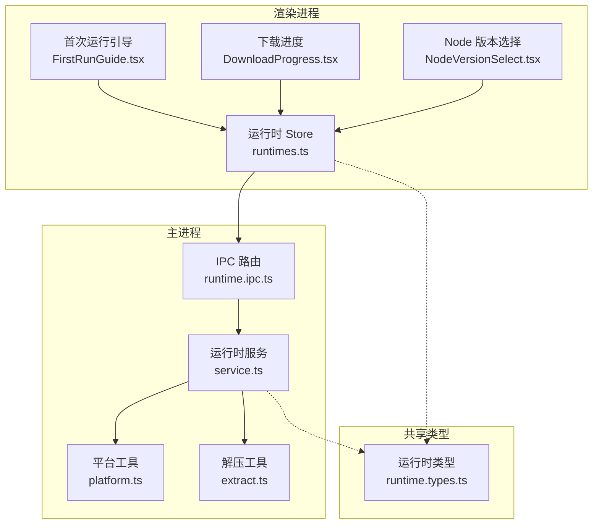
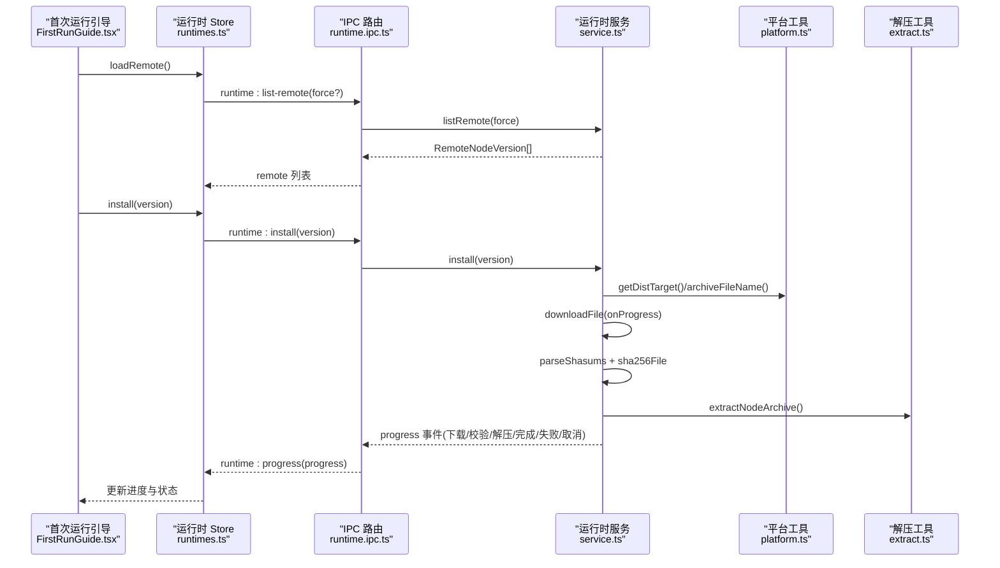
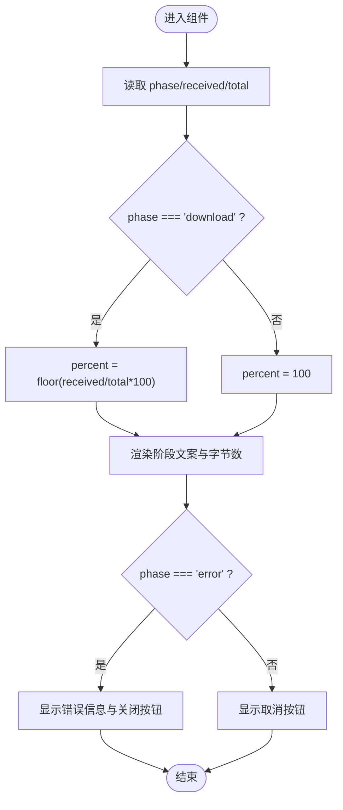
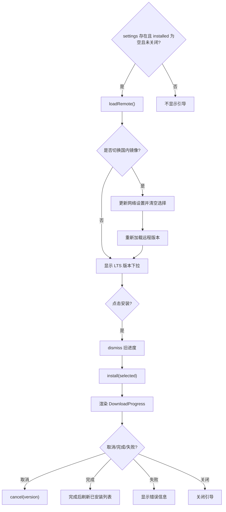
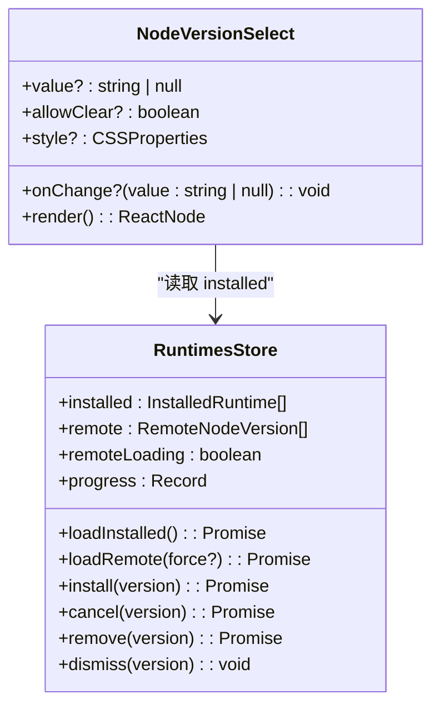
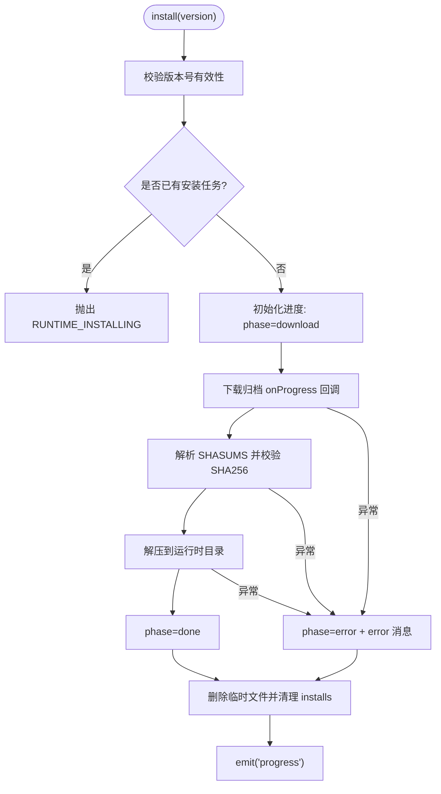
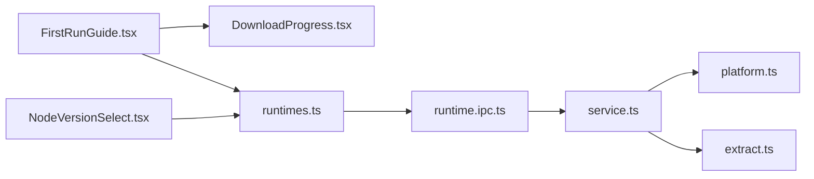

# 运行时管理组件

<cite>
**本文引用的文件**   
- [DownloadProgress.tsx](file://src/renderer/src/components/runtime/DownloadProgress.tsx)
- [FirstRunGuide.tsx](file://src/renderer/src/components/runtime/FirstRunGuide.tsx)
- [NodeVersionSelect.tsx](file://src/renderer/src/components/runtime/NodeVersionSelect.tsx)
- [runtimes.ts](file://src/renderer/src/stores/runtimes.ts)
- [runtime.service.ts](file://src/main/services/runtime/service.ts)
- [runtime.ipc.ts](file://src/main/ipc/runtime.ts)
- [platform.ts](file://src/main/services/runtime/platform.ts)
- [extract.ts](file://src/main/services/runtime/extract.ts)
- [runtime.types.ts](file://src/shared/types/runtime.ts)
- [zh-CN.json](file://src/renderer/src/i18n/locales/zh-CN.json)
- [en-US.json](file://src/renderer/src/i18n/locales/en-US.json)
</cite>

## 目录
1. [简介](#简介)
2. [项目结构](#项目结构)
3. [核心组件](#核心组件)
4. [架构总览](#架构总览)
5. [详细组件分析](#详细组件分析)
6. [依赖关系分析](#依赖关系分析)
7. [性能与可靠性](#性能与可靠性)
8. [故障排查](#故障排查)
9. [结论](#结论)
10. [附录：扩展与自定义](#附录扩展与自定义)

## 简介
本文件面向“运行时管理”相关的前端组件与主进程服务，重点说明以下能力：
- 下载进度组件的进度跟踪、断点续传策略与用户反馈机制。
- 首次运行引导组件的流程控制、版本选择与安装触发逻辑。
- Node.js 版本选择组件的版本列表获取、切换逻辑与兼容性检查。
- 组件状态管理、错误处理与国际化支持。
- 如何对组件进行自定义配置与扩展。

## 项目结构
运行时管理功能横跨渲染进程与主进程：
- 渲染进程
  - 组件层：下载进度、首次运行引导、Node 版本选择。
  - 状态层：基于 Zustand 的运行时 Store，负责远程版本、已安装版本、安装进度与 IPC 事件订阅。
- 主进程
  - 服务层：RuntimeService 提供远程版本列表、本地安装列表、安装/取消/删除等能力，并通过事件上报进度。
  - IPC 层：将服务方法暴露给渲染进程，并转发进度事件。
  - 平台与解压：根据平台/架构计算分发目标、构建归档文件名、校验 SHA256、解压归档。
- 共享类型
  - 定义远程版本、已安装运行时、安装阶段与进度对象。

图表来源
- [FirstRunGuide.tsx:1-93](file://src/renderer/src/components/runtime/FirstRunGuide.tsx#L1-L93)
- [DownloadProgress.tsx:1-42](file://src/renderer/src/components/runtime/DownloadProgress.tsx#L1-L42)
- [NodeVersionSelect.tsx:1-36](file://src/renderer/src/components/runtime/NodeVersionSelect.tsx#L1-L36)
- [runtimes.ts:1-62](file://src/renderer/src/stores/runtimes.ts#L1-L62)
- [runtime.ipc.ts:1-14](file://src/main/ipc/runtime.ts#L1-L14)
- [runtime.service.ts:1-155](file://src/main/services/runtime/service.ts#L1-L155)
- [platform.ts:1-83](file://src/main/services/runtime/platform.ts#L1-L83)
- [extract.ts:1-37](file://src/main/services/runtime/extract.ts#L1-L37)
- [runtime.types.ts:1-23](file://src/shared/types/runtime.ts#L1-L23)

章节来源
- [FirstRunGuide.tsx:1-93](file://src/renderer/src/components/runtime/FirstRunGuide.tsx#L1-L93)
- [DownloadProgress.tsx:1-42](file://src/renderer/src/components/runtime/DownloadProgress.tsx#L1-L42)
- [NodeVersionSelect.tsx:1-36](file://src/renderer/src/components/runtime/NodeVersionSelect.tsx#L1-L36)
- [runtimes.ts:1-62](file://src/renderer/src/stores/runtimes.ts#L1-L62)
- [runtime.service.ts:1-155](file://src/main/services/runtime/service.ts#L1-L155)
- [runtime.ipc.ts:1-14](file://src/main/ipc/runtime.ts#L1-L14)
- [platform.ts:1-83](file://src/main/services/runtime/platform.ts#L1-L83)
- [extract.ts:1-37](file://src/main/services/runtime/extract.ts#L1-L37)
- [runtime.types.ts:1-23](file://src/shared/types/runtime.ts#L1-L23)

## 核心组件
- 下载进度组件（DownloadProgress）
  - 展示当前阶段的文本提示、字节数与百分比进度条。
  - 失败时显示错误信息并提供关闭按钮；正常进行中显示取消按钮。
  - 通过国际化键值渲染阶段文案。
- 首次运行引导组件（FirstRunGuide）
  - 当无已安装 Node 且未手动关闭时弹出模态框。
  - 提供国内镜像开关、LTS 版本下拉选择、开始安装与稍后关闭。
  - 集成下载进度组件，实时反馈安装状态。
- Node 版本选择组件（NodeVersionSelect）
  - 从已安装列表中渲染可选版本，若当前选中项缺失则标记警告。
  - 未找到内容时提供跳转至安装页面的链接。

章节来源
- [DownloadProgress.tsx:1-42](file://src/renderer/src/components/runtime/DownloadProgress.tsx#L1-L42)
- [FirstRunGuide.tsx:1-93](file://src/renderer/src/components/runtime/FirstRunGuide.tsx#L1-L93)
- [NodeVersionSelect.tsx:1-36](file://src/renderer/src/components/runtime/NodeVersionSelect.tsx#L1-L36)

## 架构总览
运行时管理的端到端流程如下：
- 渲染进程通过 Store 调用 IPC 接口，主进程 RuntimeService 执行具体任务。
- 安装过程包含下载、校验、解压三个阶段，每个阶段都会通过事件推送进度。
- 前端 Store 监听进度事件，更新 UI 状态；完成或取消后清理进度条目并刷新已安装列表。

图表来源
- [FirstRunGuide.tsx:27-50](file://src/renderer/src/components/runtime/FirstRunGuide.tsx#L27-L50)
- [runtimes.ts:31-44](file://src/renderer/src/stores/runtimes.ts#L31-L44)
- [runtime.ipc.ts:4-12](file://src/main/ipc/runtime.ts#L4-L12)
- [runtime.service.ts:45-151](file://src/main/services/runtime/service.ts#L45-L151)
- [platform.ts:20-42](file://src/main/services/runtime/platform.ts#L20-L42)
- [extract.ts:13-36](file://src/main/services/runtime/extract.ts#L13-L36)

## 详细组件分析

### 下载进度组件（DownloadProgress）
- 进度跟踪
  - 当 phase 为 download 时，percent = Math.floor((received / total) * 100)，否则为 100。
  - 接收 received/total 字节数，使用 formatBytes 格式化显示。
- 用户反馈
  - 成功/进行中：显示阶段文案与取消按钮。
  - 失败：显示错误信息，并提供关闭按钮以移除该进度卡片。
- 国际化
  - 阶段文案通过 i18n 键 runtimes.phase.* 渲染。
- 可组合性
  - 通过 onCancel/onDismiss 回调交由父组件处理取消与清除进度。

图表来源
- [DownloadProgress.tsx:14-40](file://src/renderer/src/components/runtime/DownloadProgress.tsx#L14-L40)

章节来源
- [DownloadProgress.tsx:1-42](file://src/renderer/src/components/runtime/DownloadProgress.tsx#L1-L42)
- [zh-CN.json:69-76](file://src/renderer/src/i18n/locales/zh-CN.json#L69-L76)
- [en-US.json:69-76](file://src/renderer/src/i18n/locales/en-US.json#L69-L76)

### 首次运行引导组件（FirstRunGuide）
- 流程控制
  - 打开条件：settings 存在、installed 为空、未被手动关闭。
  - 首次打开自动加载远程版本列表，失败时通过 message.error 展示错误。
- 版本选择与镜像切换
  - 仅展示 LTS 版本前 20 个作为选项。
  - 切换国内镜像会更新设置并重新拉取远程版本。
- 安装与进度
  - 点击“下载并安装”先 dismiss 旧进度，再调用 install。
  - 安装过程中实时渲染 DownloadProgress，支持取消与失败后关闭。
- 错误处理
  - 远程列表加载失败、安装异常均通过 formatError 统一格式化并提示。

图表来源
- [FirstRunGuide.tsx:21-50](file://src/renderer/src/components/runtime/FirstRunGuide.tsx#L21-L50)
- [FirstRunGuide.tsx:53-90](file://src/renderer/src/components/runtime/FirstRunGuide.tsx#L53-L90)
- [runtimes.ts:52-61](file://src/renderer/src/stores/runtimes.ts#L52-L61)

章节来源
- [FirstRunGuide.tsx:1-93](file://src/renderer/src/components/runtime/FirstRunGuide.tsx#L1-L93)
- [runtimes.ts:1-62](file://src/renderer/src/stores/runtimes.ts#L1-L62)
- [zh-CN.json:78-85](file://src/renderer/src/i18n/locales/zh-CN.json#L78-L85)
- [en-US.json:78-85](file://src/renderer/src/i18n/locales/en-US.json#L78-L85)

### Node 版本选择组件（NodeVersionSelect）
- 版本列表获取
  - 数据来源于 useRuntimesStore.installed，由后端 list-installed 返回。
- 切换逻辑
  - onChange 将选中值回传给父组件；允许清空。
- 兼容性检查
  - 若 value 不在 installed 中，Select 显示 warning 状态，提示用户去安装页面安装。
  - notFoundContent 提供跳转到运行时安装页的链接。

图表来源
- [NodeVersionSelect.tsx:1-36](file://src/renderer/src/components/runtime/NodeVersionSelect.tsx#L1-L36)
- [runtimes.ts:1-62](file://src/renderer/src/stores/runtimes.ts#L1-L62)

章节来源
- [NodeVersionSelect.tsx:1-36](file://src/renderer/src/components/runtime/NodeVersionSelect.tsx#L1-L36)
- [runtimes.ts:1-62](file://src/renderer/src/stores/runtimes.ts#L1-L62)

### 主进程运行时服务（RuntimeService）
- 远程版本列表
  - 按平台/架构过滤 index.json，缓存 10 分钟，避免频繁请求。
- 已安装列表
  - 扫描运行时目录，跳过正在安装或二进制缺失的版本，读取 npm 包版本。
- 安装流程
  - 生成临时归档路径，下载 -> 校验 SHA256 -> 解压到目标目录 -> 清理临时文件。
  - 每步更新 phase 并广播进度事件。
  - 支持取消：通过 AbortController 中断下载，最终将 phase 置为 canceled。
- 错误处理
  - 抛出 AppError 携带错误码与详情，如 VERSION_NOT_FOUND、RUNTIME_INSTALLING、CHECKSUM_MISMATCH 等。

图表来源
- [runtime.service.ts:87-151](file://src/main/services/runtime/service.ts#L87-L151)
- [runtime.types.ts:14-22](file://src/shared/types/runtime.ts#L14-L22)

章节来源
- [runtime.service.ts:1-155](file://src/main/services/runtime/service.ts#L1-L155)
- [runtime.types.ts:1-23](file://src/shared/types/runtime.ts#L1-L23)

### IPC 桥接（runtime.ipc.ts）
- 暴露方法：list-remote、list-installed、installing、install、cancel、remove。
- 将 RuntimeService 的 progress 事件广播到渲染进程。

章节来源
- [runtime.ipc.ts:1-14](file://src/main/ipc/runtime.ts#L1-L14)

### 平台与解压工具
- platform.ts
  - 根据 process.platform/arch 映射到 Node 官方分发目标（os/arch/ext/indexKey）。
  - 提供 nodeBinary/npmCli/binDir/npmDir 等路径构造函数。
  - 版本格式校验与排序比较。
- extract.ts
  - 支持 zip/tar.gz 两种归档格式，解压到 staging 目录后重命名为目标目录，保证原子性。

章节来源
- [platform.ts:1-83](file://src/main/services/runtime/platform.ts#L1-L83)
- [extract.ts:1-37](file://src/main/services/runtime/extract.ts#L1-L37)

## 依赖关系分析
- 组件耦合
  - FirstRunGuide 依赖 DownloadProgress 与 runtimes Store。
  - NodeVersionSelect 依赖 runtimes Store 的 installed 列表。
- 前后端契约
  - 渲染进程通过 IPC 调用主进程服务，约定事件名 runtime:progress。
  - 共享类型确保两端数据结构一致。
- 外部依赖
  - 网络请求、JSON 解析、归档解压、文件系统操作均由主进程封装。

图表来源
- [FirstRunGuide.tsx:1-93](file://src/renderer/src/components/runtime/FirstRunGuide.tsx#L1-L93)
- [DownloadProgress.tsx:1-42](file://src/renderer/src/components/runtime/DownloadProgress.tsx#L1-L42)
- [NodeVersionSelect.tsx:1-36](file://src/renderer/src/components/runtime/NodeVersionSelect.tsx#L1-L36)
- [runtimes.ts:1-62](file://src/renderer/src/stores/runtimes.ts#L1-L62)
- [runtime.ipc.ts:1-14](file://src/main/ipc/runtime.ts#L1-L14)
- [runtime.service.ts:1-155](file://src/main/services/runtime/service.ts#L1-L155)
- [platform.ts:1-83](file://src/main/services/runtime/platform.ts#L1-L83)
- [extract.ts:1-37](file://src/main/services/runtime/extract.ts#L1-L37)

章节来源
- [runtimes.ts:1-62](file://src/renderer/src/stores/runtimes.ts#L1-L62)
- [runtime.ipc.ts:1-14](file://src/main/ipc/runtime.ts#L1-L14)
- [runtime.service.ts:1-155](file://src/main/services/runtime/service.ts#L1-L155)

## 性能与可靠性
- 远程列表缓存
  - 同一镜像下 10 分钟内复用缓存，减少网络开销。
- 并发安装保护
  - 通过 Map 记录进行中的安装任务，防止重复安装同一版本。
- 校验与原子性
  - 下载后强制校验 SHA256，解压采用 staging 目录+重命名，避免半安装状态。
- 进度事件节流
  - 每次下载回调即上报进度，前端按需渲染，避免阻塞。
- 断点续传
  - 当前实现未启用断点续传；如需支持，可在 downloadFile 中增加 Range 头与分片合并逻辑，并在进度中持久化已下载字节。

[本节为通用建议，不涉及具体文件分析]

## 故障排查
- 常见错误码与含义
  - NO_NODE_VERSION：未选择 Node 版本。
  - RUNTIME_NOT_INSTALLED：指定版本未安装。
  - RUNTIME_INSTALLING：版本已在安装中。
  - VERSION_NOT_FOUND：当前平台无对应安装包。
  - DOWNLOAD_FAILED：下载失败。
  - CHECKSUM_MISMATCH：校验和失败。
- 定位步骤
  - 确认 settings.network.nodeMirror 是否正确。
  - 检查 platform/arch 是否受支持。
  - 查看主进程日志中抛出的 AppError 详情。
  - 在渲染端通过 formatError 查看人类可读的错误信息。

章节来源
- [runtime.service.ts:74-108](file://src/main/services/runtime/service.ts#L74-L108)
- [runtime.service.ts:114-151](file://src/main/services/runtime/service.ts#L114-L151)
- [zh-CN.json:20-37](file://src/renderer/src/i18n/locales/zh-CN.json#L20-L37)
- [en-US.json:20-37](file://src/renderer/src/i18n/locales/en-US.json#L20-L37)

## 结论
运行时管理组件通过清晰的分层与事件驱动模型，实现了可靠的 Node.js 运行时安装体验。前端组件专注状态展示与交互，主进程服务负责网络、校验与解压等复杂逻辑。配合统一的错误处理与国际化方案，整体具备良好的可维护性与可扩展性。

[本节为总结性内容，不涉及具体文件分析]

## 附录：扩展与自定义
- 自定义下载进度样式
  - 在 DownloadProgress 中替换 Ant Design Progress 的样式或尺寸，或接入第三方进度组件。
- 扩展版本筛选
  - 在 FirstRunGuide 中扩展 ltsVersions 过滤逻辑，例如加入 nightly、alpha 分支。
- 新增运行时类型
  - 在 shared/types/runtime.ts 中扩展类型，并在 service.ts 中适配新的分发协议。
- 国际化扩展
  - 在 zh-CN.json 与 en-US.json 中添加新的 key，并在组件中使用 t('key') 引用。
- 断点续传增强
  - 在 downloadFile 中实现 Range 请求与分片合并，并在进度中持久化 received 以便恢复。
- 安装队列与优先级
  - 在 store 中引入队列，支持多版本并行/串行安装与优先级调度。

[本节为概念性指导，不涉及具体文件分析]