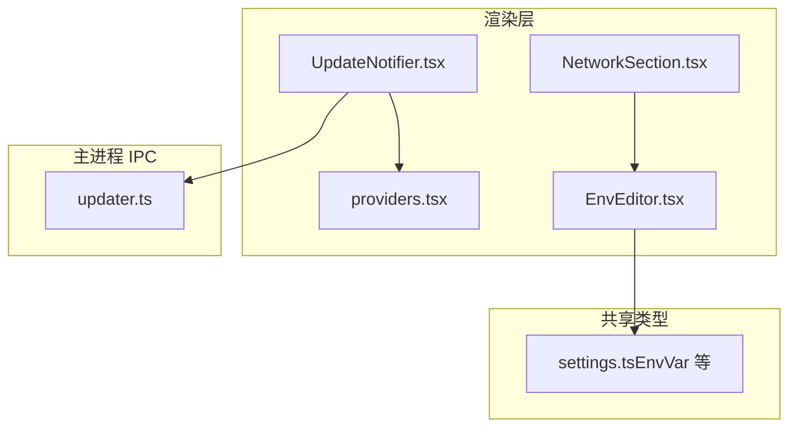
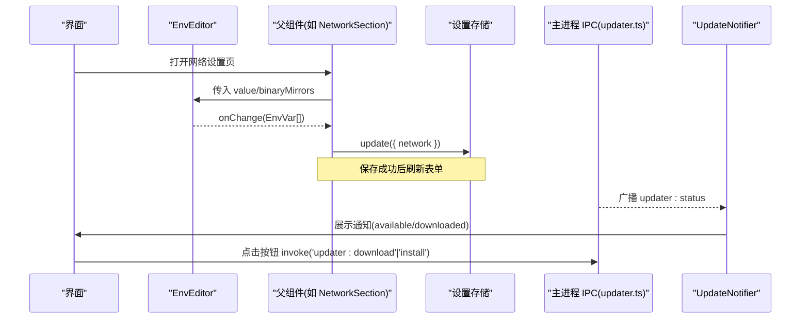
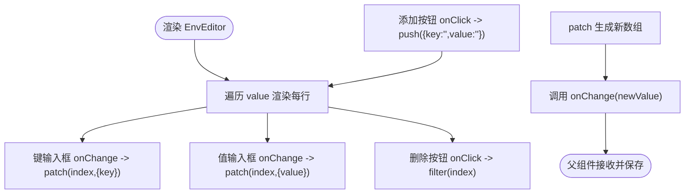
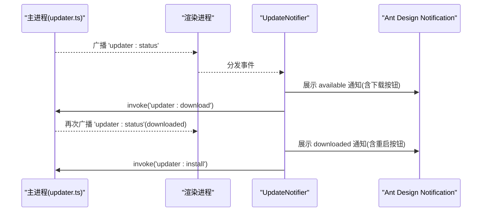
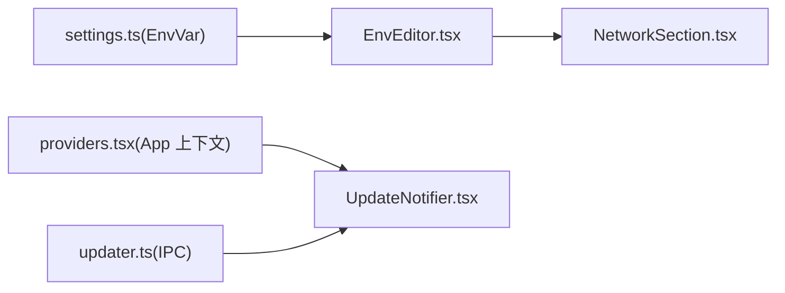

# 通用组件

<cite>
**本文引用的文件**   
- [EnvEditor.tsx](file://src/renderer/src/components/common/EnvEditor.tsx)
- [UpdateNotifier.tsx](file://src/renderer/src/components/common/UpdateNotifier.tsx)
- [settings.ts（类型定义）](file://src/shared/types/settings.ts)
- [NetworkSection.tsx](file://src/renderer/src/pages/settings/NetworkSection.tsx)
- [providers.tsx](file://src/renderer/src/app/providers.tsx)
- [updater.ts（IPC）](file://src/main/ipc/updater.ts)
</cite>

## 目录
1. [简介](#简介)
2. [项目结构](#项目结构)
3. [核心组件](#核心组件)
4. [架构总览](#架构总览)
5. [组件详细分析](#组件详细分析)
6. [依赖关系分析](#依赖关系分析)
7. [性能与可维护性](#性能与可维护性)
8. [测试与最佳实践](#测试与最佳实践)
9. [使用示例与集成指南](#使用示例与集成指南)
10. [故障排查](#故障排查)
11. [结论](#结论)

## 简介
本文件为“通用组件”专题文档，聚焦以下两个可复用组件：
- 环境编辑器 EnvEditor：用于编辑键值对列表，支持增删改、占位符定制，可与表单系统无缝集成。
- 更新通知 UpdateNotifier：监听应用更新状态，通过全局通知引导用户下载与重启安装。

文档将覆盖实现细节、数据流、验证规则、事件处理模式、样式定制、可复用性与集成方式，并提供测试建议与最佳实践。

## 项目结构
与这两个组件直接相关的代码分布如下：
- 渲染层组件
  - src/renderer/src/components/common/EnvEditor.tsx
  - src/renderer/src/components/common/UpdateNotifier.tsx
- 共享类型
  - src/shared/types/settings.ts（包含 EnvVar 等类型）
- 页面集成
  - src/renderer/src/pages/settings/NetworkSection.tsx（使用 EnvEditor）
- 应用上下文
  - src/renderer/src/app/providers.tsx（提供 Ant Design App 上下文，供 UpdateNotifier 使用）
- IPC 通道
  - src/main/ipc/updater.ts（广播更新状态）

图表来源
- [EnvEditor.tsx:1-48](file://src/renderer/src/components/common/EnvEditor.tsx#L1-L48)
- [UpdateNotifier.tsx:1-43](file://src/renderer/src/components/common/UpdateNotifier.tsx#L1-L43)
- [settings.ts:4-25](file://src/shared/types/settings.ts#L4-L25)
- [NetworkSection.tsx:1-95](file://src/renderer/src/pages/settings/NetworkSection.tsx#L1-L95)
- [providers.tsx:27-36](file://src/renderer/src/app/providers.tsx#L27-L36)
- [updater.ts:4-10](file://src/main/ipc/updater.ts#L4-L10)

章节来源
- [EnvEditor.tsx:1-48](file://src/renderer/src/components/common/EnvEditor.tsx#L1-L48)
- [UpdateNotifier.tsx:1-43](file://src/renderer/src/components/common/UpdateNotifier.tsx#L1-L43)
- [settings.ts:4-25](file://src/shared/types/settings.ts#L4-L25)
- [NetworkSection.tsx:1-95](file://src/renderer/src/pages/settings/NetworkSection.tsx#L1-L95)
- [providers.tsx:27-36](file://src/renderer/src/app/providers.tsx#L27-L36)
- [updater.ts:4-10](file://src/main/ipc/updater.ts#L4-L10)

## 核心组件
本节概述两个组件的职责与对外接口。

- EnvEditor
  - 职责：渲染并维护一组键值对（EnvVar[]），支持新增、删除、修改单行 key/value。
  - 输入属性：value（可选）、onChange（可选）、keyPlaceholder（可选）。
  - 输出：通过 onChange 回调向父组件同步完整数组；无内部状态。
  - 国际化：使用 i18n 的 t 函数显示默认占位文本。
  - 可组合性：可作为受控组件嵌入 antd Form。

- UpdateNotifier
  - 职责：订阅应用更新状态事件，展示全局通知，提供“下载”和“重启安装”操作。
  - 事件：监听 updater:status，根据状态分支显示不同通知。
  - 交互：点击按钮调用 IPC 触发下载或安装。
  - 依赖：需要 Ant Design App 上下文（由 providers.tsx 提供）。

章节来源
- [EnvEditor.tsx:7-18](file://src/renderer/src/components/common/EnvEditor.tsx#L7-L18)
- [UpdateNotifier.tsx:10-40](file://src/renderer/src/components/common/UpdateNotifier.tsx#L10-L40)

## 架构总览
EnvEditor 是纯展示型受控组件，数据所有权在父组件；UpdateNotifier 是全局通知订阅者，通过 IPC 与主进程通信。

图表来源
- [NetworkSection.tsx:30-36](file://src/renderer/src/pages/settings/NetworkSection.tsx#L30-L36)
- [EnvEditor.tsx:17-44](file://src/renderer/src/components/common/EnvEditor.tsx#L17-L44)
- [updater.ts:4-10](file://src/main/ipc/updater.ts#L4-L10)
- [UpdateNotifier.tsx:15-40](file://src/renderer/src/components/common/UpdateNotifier.tsx#L15-L40)

## 组件详细分析

### 环境编辑器 EnvEditor
- 数据结构
  - 使用 EnvVar[] 表示键值对列表，每个元素包含 key 与 value 字符串字段。
  - 组件不持有内部状态，所有变更通过 onChange 向上提交。
- 交互流程
  - 新增：追加一个空对象 { key: '', value: '' }。
  - 删除：过滤掉指定索引项。
  - 修改：按索引 patch 对应项的 key 或 value。
- 验证规则
  - 组件本身不做校验；父组件可在表单层进行校验（例如必填、格式）。
  - 典型用法中，父组件会在保存前过滤空 key 的行。
- 数据同步机制
  - 受控模式：value 来自外部，onChange 作为唯一写入入口。
  - 与表单集成：可直接作为 antd Form.Item 的控件，配合 Form.useForm 管理。
- 样式与可定制性
  - 通过 keyPlaceholder 定制键列占位符。
  - 布局基于 Flex，可通过外层容器调整间距与对齐。
  - 图标与按钮样式继承自 Ant Design。
- 事件处理模式
  - 单一回调 onChange(value: EnvVar[])，简化父组件逻辑。
  - 内部 patch 方法仅负责派生新数组，避免副作用。

图表来源
- [EnvEditor.tsx:17-44](file://src/renderer/src/components/common/EnvEditor.tsx#L17-L44)

章节来源
- [EnvEditor.tsx:1-48](file://src/renderer/src/components/common/EnvEditor.tsx#L1-L48)
- [settings.ts:4-7](file://src/shared/types/settings.ts#L4-L7)

### 更新通知 UpdateNotifier
- 设计目标
  - 以最小侵入的方式提供全局更新通知，无需业务组件感知。
- 消息队列与事件
  - 通过 on('updater:status', handler) 订阅主进程广播的状态事件。
  - 根据 status.state 分支：
    - available：提示有新版本，提供“下载”按钮。
    - downloaded：提示已下载完成，提供“重启安装”按钮。
- 用户交互
  - 使用 Ant Design App.useApp().notification 展示持久化通知（duration: 0）。
  - 按钮动作通过 invoke('updater:download'|'install') 触发主进程任务。
- 生命周期
  - useEffect 内注册监听器，组件卸载时自动清理。
- 依赖与上下文
  - 依赖 Ant Design App 上下文（由 providers.tsx 提供）。
  - 依赖 i18n 文案。

图表来源
- [UpdateNotifier.tsx:15-40](file://src/renderer/src/components/common/UpdateNotifier.tsx#L15-L40)
- [updater.ts:4-10](file://src/main/ipc/updater.ts#L4-L10)

章节来源
- [UpdateNotifier.tsx:1-43](file://src/renderer/src/components/common/UpdateNotifier.tsx#L1-L43)
- [updater.ts:4-10](file://src/main/ipc/updater.ts#L4-L10)

## 依赖关系分析
- EnvEditor
  - 依赖 @shared/types 中的 EnvVar 类型。
  - 被 NetworkSection 使用，作为 binaryMirrors 字段的表单控件。
- UpdateNotifier
  - 依赖 Ant Design App 上下文（由 providers.tsx 提供）。
  - 依赖 IPC 通道 updater:status 与 updater:download/install。

图表来源
- [settings.ts:4-7](file://src/shared/types/settings.ts#L4-L7)
- [EnvEditor.tsx:1-48](file://src/renderer/src/components/common/EnvEditor.tsx#L1-L48)
- [NetworkSection.tsx:1-95](file://src/renderer/src/pages/settings/NetworkSection.tsx#L1-L95)
- [providers.tsx:27-36](file://src/renderer/src/app/providers.tsx#L27-L36)
- [updater.ts:4-10](file://src/main/ipc/updater.ts#L4-L10)

章节来源
- [EnvEditor.tsx:1-48](file://src/renderer/src/components/common/EnvEditor.tsx#L1-L48)
- [NetworkSection.tsx:1-95](file://src/renderer/src/pages/settings/NetworkSection.tsx#L1-L95)
- [UpdateNotifier.tsx:1-43](file://src/renderer/src/components/common/UpdateNotifier.tsx#L1-L43)
- [providers.tsx:27-36](file://src/renderer/src/app/providers.tsx#L27-L36)
- [updater.ts:4-10](file://src/main/ipc/updater.ts#L4-L10)

## 性能与可维护性
- EnvEditor
  - 每次变更都会创建新数组，适合中小规模键值对；若行数较多，可考虑虚拟滚动或稳定 ID 优化。
  - 当前使用 index 作为 key，便于输入体验但存在 React 警告；如需严格合规，可为每项引入稳定 id。
- UpdateNotifier
  - 仅订阅一次事件，开销极低；通知使用 duration: 0 需用户手动关闭，注意避免过多通知堆积。
- 可维护性
  - 组件职责单一、接口简洁，易于替换与扩展。
  - 通过 props 与回调解耦，便于单元测试与 Mock。

[本节为通用指导，不直接分析具体文件]

## 测试与最佳实践
- EnvEditor
  - 用例建议
    - 初始渲染：验证占位符与空列表行为。
    - 新增行：点击添加后数组长度+1，且新增项为空对象。
    - 删除行：点击删除后移除对应索引项。
    - 修改 key/value：onChange 回调返回正确的新数组。
    - 自定义 keyPlaceholder：验证占位符生效。
  - 断言要点
    - 检查 onChange 是否被调用及参数是否为预期数组。
    - 检查 DOM 中 Input 的 value 与 placeholder。
- UpdateNotifier
  - 用例建议
    - 订阅事件：验证 on('updater:status') 被调用。
    - available 状态：应出现 info 通知，包含下载按钮。
    - downloaded 状态：应出现 success 通知，包含重启按钮。
    - 按钮点击：应调用 invoke('updater:download'|'install')。
  - 断言要点
    - 模拟 notification.info/success 调用。
    - 模拟 invoke 调用并验证参数。
- 最佳实践
  - EnvEditor
    - 始终作为受控组件使用，由父组件管理 value。
    - 在父组件保存前过滤空 key 的行，避免无效配置。
    - 结合 antd Form 的 rules 进行字段级校验。
  - UpdateNotifier
    - 确保 App 根节点包裹了 Ant Design 的 App 组件。
    - 避免重复挂载导致重复订阅，必要时去重或清理监听。

[本节为通用指导，不直接分析具体文件]

## 使用示例与集成指南

### 在表单中使用 EnvEditor
- 步骤
  - 在表单字段中绑定 name="binaryMirrors"。
  - 使用 EnvEditor 作为该字段的控件。
  - 保存前过滤空 key 的行，再提交到设置存储。
- 参考路径
  - [NetworkSection.tsx:80-83](file://src/renderer/src/pages/settings/NetworkSection.tsx#L80-L83)
  - [NetworkSection.tsx:30-36](file://src/renderer/src/pages/settings/NetworkSection.tsx#L30-L36)

### 启用 UpdateNotifier
- 步骤
  - 确保应用根节点由 Ant Design 的 App 包裹（providers.tsx 已提供）。
  - 在应用顶层渲染 UpdateNotifier 组件即可。
- 参考路径
  - [providers.tsx:27-36](file://src/renderer/src/app/providers.tsx#L27-L36)
  - [UpdateNotifier.tsx:11-40](file://src/renderer/src/components/common/UpdateNotifier.tsx#L11-L40)

### 与 IPC 的协作
- 主进程广播 updater:status，渲染进程 UpdateNotifier 订阅并展示通知。
- 用户点击通知按钮后，调用 invoke 触发下载或安装。
- 参考路径
  - [updater.ts:4-10](file://src/main/ipc/updater.ts#L4-L10)
  - [UpdateNotifier.tsx:15-40](file://src/renderer/src/components/common/UpdateNotifier.tsx#L15-L40)

章节来源
- [NetworkSection.tsx:30-36](file://src/renderer/src/pages/settings/NetworkSection.tsx#L30-L36)
- [NetworkSection.tsx:80-83](file://src/renderer/src/pages/settings/NetworkSection.tsx#L80-L83)
- [providers.tsx:27-36](file://src/renderer/src/app/providers.tsx#L27-L36)
- [UpdateNotifier.tsx:11-40](file://src/renderer/src/components/common/UpdateNotifier.tsx#L11-L40)
- [updater.ts:4-10](file://src/main/ipc/updater.ts#L4-L10)

## 故障排查
- EnvEditor
  - 现象：新增或删除后输入异常。
    - 原因：使用 index 作为 key 可能导致 React 复用错误。
    - 解决：为每项引入稳定 id，或在父组件保证稳定的顺序。
  - 现象：保存后出现空 key 配置。
    - 原因：未过滤空 key 行。
    - 解决：在保存前过滤 item.key.trim() 为空的项。
- UpdateNotifier
  - 现象：通知不显示。
    - 原因：缺少 Ant Design App 上下文。
    - 解决：确保 providers.tsx 已包裹 App 根节点。
  - 现象：点击按钮无响应。
    - 原因：IPC 通道未注册或未正确调用。
    - 解决：确认主进程已注册 updater:download/install，并检查 invoke 调用。

章节来源
- [EnvEditor.tsx:22-44](file://src/renderer/src/components/common/EnvEditor.tsx#L22-L44)
- [NetworkSection.tsx:30-36](file://src/renderer/src/pages/settings/NetworkSection.tsx#L30-L36)
- [providers.tsx:27-36](file://src/renderer/src/app/providers.tsx#L27-L36)
- [UpdateNotifier.tsx:15-40](file://src/renderer/src/components/common/UpdateNotifier.tsx#L15-L40)
- [updater.ts:4-10](file://src/main/ipc/updater.ts#L4-L10)

## 结论
EnvEditor 与 UpdateNotifier 分别解决了“键值对编辑”和“应用更新通知”两类常见场景。前者以受控组件形式提供高内聚、低耦合的数据编辑能力；后者以事件驱动的方式提供全局交互反馈。两者均具备良好的可复用性与可扩展性，适合在项目中广泛复用。通过合理的测试与最佳实践，可进一步提升稳定性与可维护性。