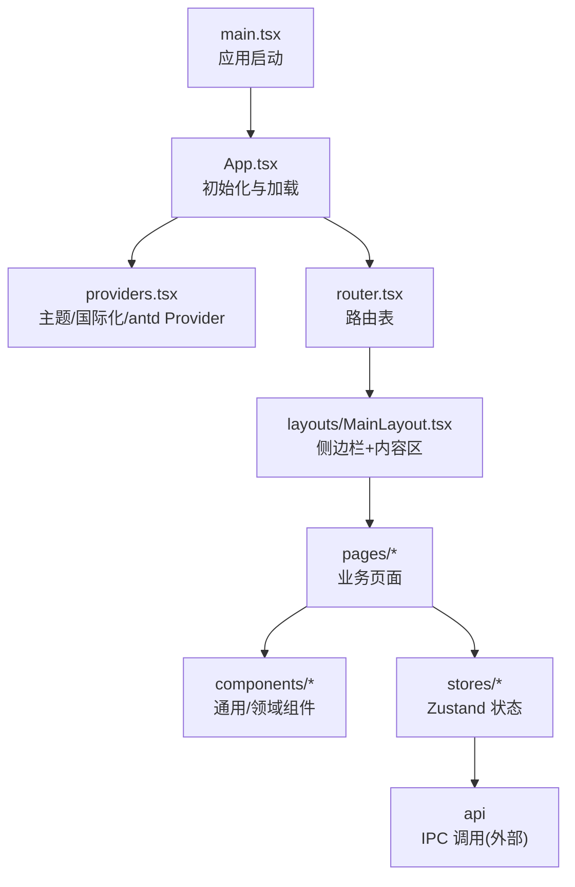
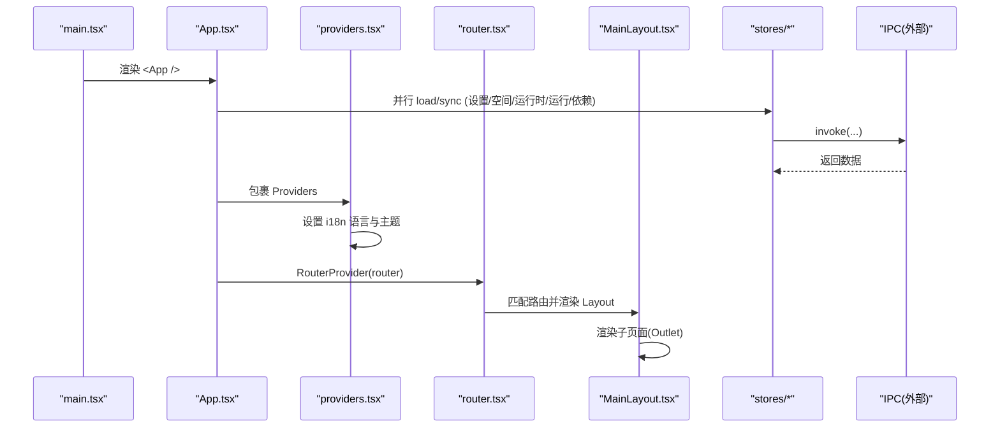
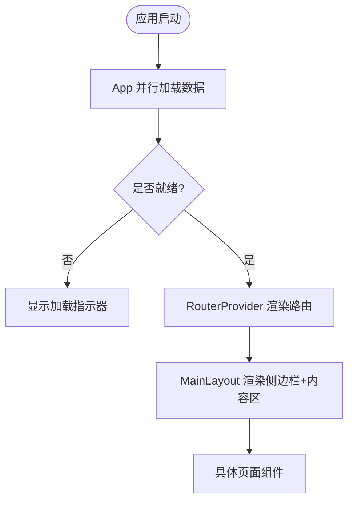
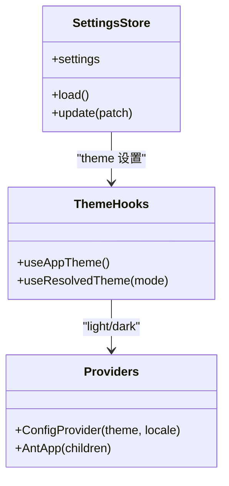
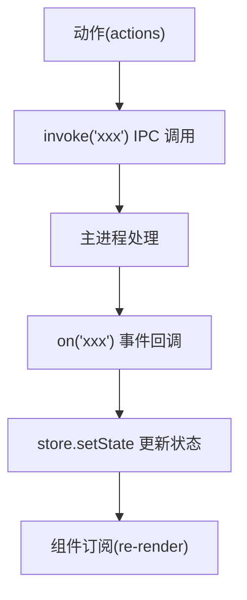
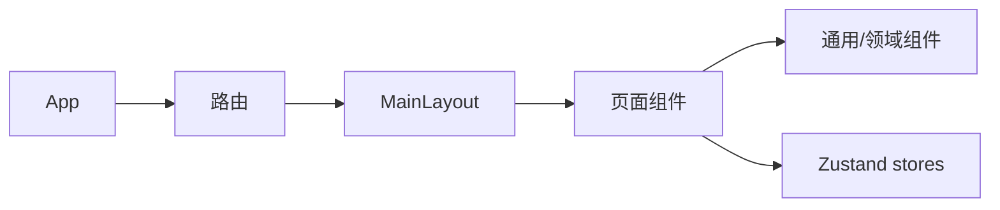
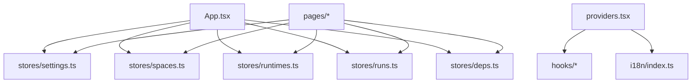

# 前端应用架构

<cite>
**本文引用的文件**   
- [main.tsx](file://src/renderer/src/main.tsx)
- [App.tsx](file://src/renderer/src/app/App.tsx)
- [router.tsx](file://src/renderer/src/app/router.tsx)
- [providers.tsx](file://src/renderer/src/app/providers.tsx)
- [MainLayout.tsx](file://src/renderer/src/layouts/MainLayout.tsx)
- [index.ts](file://src/renderer/src/i18n/index.ts)
- [useAppTheme.ts](file://src/renderer/src/hooks/useAppTheme.ts)
- [useResolvedTheme.ts](file://src/renderer/src/hooks/useResolvedTheme.ts)
- [settings.ts](file://src/renderer/src/stores/settings.ts)
- [spaces.ts](file://src/renderer/src/stores/spaces.ts)
- [runtimes.ts](file://src/renderer/src/stores/runtimes.ts)
- [runs.ts](file://src/renderer/src/stores/runs.ts)
- [deps.ts](file://src/renderer/src/stores/deps.ts)
- [documents.ts](file://src/renderer/src/stores/documents.ts)
- [SpaceEditorPage.tsx](file://src/renderer/src/pages/editor/SpaceEditorPage.tsx)
- [SpacesPage.tsx](file://src/renderer/src/pages/spaces/SpacesPage.tsx)
- [RuntimesPage.tsx](file://src/renderer/src/pages/runtimes/RuntimesPage.tsx)
- [SettingsPage.tsx](file://src/renderer/src/pages/settings/SettingsPage.tsx)
</cite>

## 目录
1. [简介](#简介)
2. [项目结构](#项目结构)
3. [核心组件](#核心组件)
4. [架构总览](#架构总览)
5. [详细组件分析](#详细组件分析)
6. [依赖关系分析](#依赖关系分析)
7. [性能考虑](#性能考虑)
8. [故障排查指南](#故障排查指南)
9. [结论](#结论)
10. [附录](#附录)

## 简介
本文件为基于 React 19 的前端应用架构文档，覆盖应用初始化、路由配置、布局设计、状态管理（Zustand）、UI 组件层次、国际化与主题系统、响应式设计、组件复用策略、性能优化技巧与开发规范。该前端运行于 Electron 渲染进程，通过 IPC 与主进程通信，使用 Ant Design 作为 UI 基础库，i18next 提供多语言支持，Zustand 管理全局状态。

## 项目结构
前端代码位于 src/renderer/src，采用“功能域 + 分层”的组织方式：
- app：应用入口、Provider 注入、路由定义
- layouts：页面级布局容器
- pages：按业务域划分的页面组件
- components：通用与领域组件（编辑器、终端、运行时等）
- stores：Zustand store（设置、空间、脚本、运行、依赖、文档等）
- hooks：主题解析、国际化等可复用逻辑
- i18n：多语言资源与初始化
- utils：工具函数与预设

图表来源
- [main.tsx:1-12](file://src/renderer/src/main.tsx#L1-L12)
- [App.tsx:1-34](file://src/renderer/src/app/App.tsx#L1-L34)
- [router.tsx:1-22](file://src/renderer/src/app/router.tsx#L1-L22)
- [MainLayout.tsx:1-53](file://src/renderer/src/layouts/MainLayout.tsx#L1-L53)

章节来源
- [main.tsx:1-12](file://src/renderer/src/main.tsx#L1-L12)
- [App.tsx:1-34](file://src/renderer/src/app/App.tsx#L1-L34)
- [router.tsx:1-22](file://src/renderer/src/app/router.tsx#L1-L22)

## 核心组件
- 应用启动与初始化
  - main.tsx 创建 React 根节点并挂载 App
  - App.tsx 并行加载设置、空间、运行时、运行记录与依赖任务，完成后启用路由
- 提供者与上下文
  - providers.tsx 集成 antd ConfigProvider、AntApp、国际化语言切换、主题模式注入
- 路由与布局
  - router.tsx 使用 createHashRouter 定义嵌套路由，默认重定向到 /spaces
  - MainLayout.tsx 提供侧边导航与内容区 Outlet，承载各页面

章节来源
- [main.tsx:1-12](file://src/renderer/src/main.tsx#L1-L12)
- [App.tsx:1-34](file://src/renderer/src/app/App.tsx#L1-L34)
- [providers.tsx:1-39](file://src/renderer/src/app/providers.tsx#L1-L39)
- [router.tsx:1-22](file://src/renderer/src/app/router.tsx#L1-L22)
- [MainLayout.tsx:1-53](file://src/renderer/src/layouts/MainLayout.tsx#L1-L53)

## 架构总览
下图展示从应用启动到页面渲染的完整流程，以及状态层与 IPC 的交互。

图表来源
- [main.tsx:1-12](file://src/renderer/src/main.tsx#L1-L12)
- [App.tsx:1-34](file://src/renderer/src/app/App.tsx#L1-L34)
- [providers.tsx:1-39](file://src/renderer/src/app/providers.tsx#L1-L39)
- [router.tsx:1-22](file://src/renderer/src/app/router.tsx#L1-L22)
- [MainLayout.tsx:1-53](file://src/renderer/src/layouts/MainLayout.tsx#L1-L53)

## 详细组件分析

### 应用初始化与路由
- 应用启动
  - main.tsx 使用 React 19 的 createRoot 挂载 App
- 应用装配
  - App.tsx 在首次渲染时并行加载全局数据，完成后显示路由；否则显示加载态
- 路由配置
  - router.tsx 以 Hash 模式注册路由，根路径下包含多个页面，未匹配时重定向至 /spaces
- 布局
  - MainLayout.tsx 提供侧边菜单与内容区，结合 Ant Design 的 Layout 与 Menu 实现导航

图表来源
- [main.tsx:1-12](file://src/renderer/src/main.tsx#L1-L12)
- [App.tsx:1-34](file://src/renderer/src/app/App.tsx#L1-L34)
- [router.tsx:1-22](file://src/renderer/src/app/router.tsx#L1-L22)
- [MainLayout.tsx:1-53](file://src/renderer/src/layouts/MainLayout.tsx#L1-L53)

章节来源
- [main.tsx:1-12](file://src/renderer/src/main.tsx#L1-L12)
- [App.tsx:1-34](file://src/renderer/src/app/App.tsx#L1-L34)
- [router.tsx:1-22](file://src/renderer/src/app/router.tsx#L1-L22)
- [MainLayout.tsx:1-53](file://src/renderer/src/layouts/MainLayout.tsx#L1-L53)

### 国际化与主题系统
- 国际化
  - i18n/index.ts 初始化 i18next，根据设置或系统语言选择 zh-CN/en-US
  - providers.tsx 监听设置变化并同步 i18n 语言，同时设置 document.documentElement.lang
- 主题
  - useAppTheme.ts 读取设置中的 theme，委托 useResolvedTheme.ts 将 system 解析为 light/dark
  - useResolvedTheme.ts 订阅系统颜色偏好变化，实时切换
  - providers.tsx 将主题模式注入 antd ConfigProvider，并设置 primary 色与圆角

图表来源
- [settings.ts:1-26](file://src/renderer/src/stores/settings.ts#L1-L26)
- [useAppTheme.ts:1-9](file://src/renderer/src/hooks/useAppTheme.ts#L1-L9)
- [useResolvedTheme.ts:1-18](file://src/renderer/src/hooks/useResolvedTheme.ts#L1-L18)
- [providers.tsx:1-39](file://src/renderer/src/app/providers.tsx#L1-L39)
- [index.ts:1-26](file://src/renderer/src/i18n/index.ts#L1-L26)

章节来源
- [index.ts:1-26](file://src/renderer/src/i18n/index.ts#L1-L26)
- [useAppTheme.ts:1-9](file://src/renderer/src/hooks/useAppTheme.ts#L1-L9)
- [useResolvedTheme.ts:1-18](file://src/renderer/src/hooks/useResolvedTheme.ts#L1-L18)
- [providers.tsx:1-39](file://src/renderer/src/app/providers.tsx#L1-L39)

### Zustand Store 设计与数据同步
- 设计模式
  - 每个业务域一个 store，暴露 actions 与 selector 派生状态
  - 通过 invoke/on 与主进程进行 RPC 与事件订阅
- 关键 Store
  - settings：加载与更新设置，接收 settings:changed 事件
  - spaces：CRUD 操作，维护 loaded 标志，支持 put 替换远端最新副本
  - runtimes：已安装/远程版本列表，安装进度跟踪，事件驱动刷新
  - runs：运行会话与输出流，限制内存中 chunk 数量，保持 latest 映射
  - deps：依赖任务生命周期，revision 触发列表刷新
  - documents：脚本草稿与持久化，支持重命名迁移
- 数据同步机制
  - 初始化阶段并行 load/sync
  - 事件 on(...) 实时更新 store，避免轮询
  - 对长连接/流式数据采用分片缓存与上限控制

图表来源
- [settings.ts:1-26](file://src/renderer/src/stores/settings.ts#L1-L26)
- [spaces.ts:1-45](file://src/renderer/src/stores/spaces.ts#L1-L45)
- [runtimes.ts:1-62](file://src/renderer/src/stores/runtimes.ts#L1-L62)
- [runs.ts:1-79](file://src/renderer/src/stores/runs.ts#L1-L79)
- [deps.ts:1-65](file://src/renderer/src/stores/deps.ts#L1-L65)
- [documents.ts:1-67](file://src/renderer/src/stores/documents.ts#L1-L67)

章节来源
- [settings.ts:1-26](file://src/renderer/src/stores/settings.ts#L1-L26)
- [spaces.ts:1-45](file://src/renderer/src/stores/spaces.ts#L1-L45)
- [runtimes.ts:1-62](file://src/renderer/src/stores/runtimes.ts#L1-L62)
- [runs.ts:1-79](file://src/renderer/src/stores/runs.ts#L1-L79)
- [deps.ts:1-65](file://src/renderer/src/stores/deps.ts#L1-L65)
- [documents.ts:1-67](file://src/renderer/src/stores/documents.ts#L1-L67)

### UI 组件层次与页面组织
- 页面组件
  - SpacesPage：空间列表、创建/编辑弹窗、删除确认
  - SpaceEditorPage：空间编辑器入口，负责模型释放与 404/加载中处理
  - RuntimesPage：运行时管理页，聚合已安装与远程版本
  - SettingsPage：设置页，聚合外观、网络、运行、更新、关于等区块
- 布局与通用组件
  - MainLayout：侧边导航、Logo、通知与引导浮层
  - 其他通用组件位于 components/*（编辑器、终端、运行时相关等）

图表来源
- [router.tsx:1-22](file://src/renderer/src/app/router.tsx#L1-L22)
- [MainLayout.tsx:1-53](file://src/renderer/src/layouts/MainLayout.tsx#L1-L53)
- [SpacesPage.tsx:1-82](file://src/renderer/src/pages/spaces/SpacesPage.tsx#L1-L82)
- [SpaceEditorPage.tsx:1-40](file://src/renderer/src/pages/editor/SpaceEditorPage.tsx#L1-L40)
- [RuntimesPage.tsx:1-19](file://src/renderer/src/pages/runtimes/RuntimesPage.tsx#L1-L19)
- [SettingsPage.tsx:1-25](file://src/renderer/src/pages/settings/SettingsPage.tsx#L1-L25)

章节来源
- [SpacesPage.tsx:1-82](file://src/renderer/src/pages/spaces/SpacesPage.tsx#L1-L82)
- [SpaceEditorPage.tsx:1-40](file://src/renderer/src/pages/editor/SpaceEditorPage.tsx#L1-L40)
- [RuntimesPage.tsx:1-19](file://src/renderer/src/pages/runtimes/RuntimesPage.tsx#L1-L19)
- [SettingsPage.tsx:1-25](file://src/renderer/src/pages/settings/SettingsPage.tsx#L1-L25)

### 响应式设计与主题适配
- 响应式
  - 使用 Ant Design 栅格与 Flex 布局，页面内卡片在不同断点自适应列数
- 主题
  - 支持 light/dark/system 三种模式，system 跟随系统偏好动态切换
  - 主题变量通过 antd token 注入，统一主色与圆角

章节来源
- [useAppTheme.ts:1-9](file://src/renderer/src/hooks/useAppTheme.ts#L1-L9)
- [useResolvedTheme.ts:1-18](file://src/renderer/src/hooks/useResolvedTheme.ts#L1-L18)
- [providers.tsx:1-39](file://src/renderer/src/app/providers.tsx#L1-L39)
- [SpacesPage.tsx:1-82](file://src/renderer/src/pages/spaces/SpacesPage.tsx#L1-L82)

## 依赖关系分析
- 模块耦合
  - App 依赖所有 store 的初始化方法，形成一次性启动依赖
  - 页面组件依赖对应 store 与 i18n
  - 布局与路由解耦，便于扩展新页面
- 外部依赖
  - IPC 调用集中在 api 层（外部），stores 仅通过 invoke/on 与其交互
- 潜在循环
  - 当前结构无直接循环依赖；store 之间相互独立

图表来源
- [App.tsx:1-34](file://src/renderer/src/app/App.tsx#L1-L34)
- [providers.tsx:1-39](file://src/renderer/src/app/providers.tsx#L1-L39)
- [index.ts:1-26](file://src/renderer/src/i18n/index.ts#L1-L26)
- [settings.ts:1-26](file://src/renderer/src/stores/settings.ts#L1-L26)
- [spaces.ts:1-45](file://src/renderer/src/stores/spaces.ts#L1-L45)
- [runtimes.ts:1-62](file://src/renderer/src/stores/runtimes.ts#L1-L62)
- [runs.ts:1-79](file://src/renderer/src/stores/runs.ts#L1-L79)
- [deps.ts:1-65](file://src/renderer/src/stores/deps.ts#L1-L65)

章节来源
- [App.tsx:1-34](file://src/renderer/src/app/App.tsx#L1-L34)
- [providers.tsx:1-39](file://src/renderer/src/app/providers.tsx#L1-L39)
- [index.ts:1-26](file://src/renderer/src/i18n/index.ts#L1-L26)

## 性能考虑
- 启动并行化
  - App 使用 Promise.allSettled 并行加载设置、空间、运行时、运行与依赖，缩短首屏时间
- 流式数据限流
  - runs store 对输出分片做长度上限控制，避免内存无限增长
- 组件卸载清理
  - SpaceEditorPage 在离开时异步释放 Monaco 模型，减少内存占用
- 按需渲染
  - 仅在 ready 后渲染 RouterProvider，避免无效渲染
- 主题与语言变更
  - 使用 useSyncExternalStore 订阅系统主题变化，避免频繁 re-render

章节来源
- [App.tsx:1-34](file://src/renderer/src/app/App.tsx#L1-L34)
- [runs.ts:1-79](file://src/renderer/src/stores/runs.ts#L1-L79)
- [SpaceEditorPage.tsx:1-40](file://src/renderer/src/pages/editor/SpaceEditorPage.tsx#L1-L40)
- [useResolvedTheme.ts:1-18](file://src/renderer/src/hooks/useResolvedTheme.ts#L1-L18)

## 故障排查指南
- 国际化不生效
  - 检查 i18n 初始化与 resolveLocale 返回值
  - 确认 providers 中 i18n.changeLanguage 被调用且 lang 属性正确设置
- 主题不跟随系统
  - 检查 useResolvedTheme 是否正确订阅 prefers-color-scheme
  - 确认 providers 将 mode 写入 document.dataset.theme
- 运行输出丢失或卡顿
  - 检查 runs store 的 MAX_CHUNKS 限制与事件订阅是否正常
  - 确认终端组件是否在 mount 时消费 chunks 并跟随事件流
- 依赖任务不刷新
  - 检查 deps store 的 revision 递增逻辑与事件处理分支
- 空间删除后仍显示旧文档
  - 确认删除空间后调用 documents.forget(spaceId) 清理草稿

章节来源
- [index.ts:1-26](file://src/renderer/src/i18n/index.ts#L1-L26)
- [providers.tsx:1-39](file://src/renderer/src/app/providers.tsx#L1-L39)
- [useResolvedTheme.ts:1-18](file://src/renderer/src/hooks/useResolvedTheme.ts#L1-L18)
- [runs.ts:1-79](file://src/renderer/src/stores/runs.ts#L1-L79)
- [deps.ts:1-65](file://src/renderer/src/stores/deps.ts#L1-L65)
- [spaces.ts:1-45](file://src/renderer/src/stores/spaces.ts#L1-L45)
- [documents.ts:1-67](file://src/renderer/src/stores/documents.ts#L1-L67)

## 结论
本项目采用清晰的 React 19 + Ant Design + i18next + Zustand 技术栈，通过 Provider 注入主题与国际化，使用 Hash 路由与嵌套布局组织页面，借助 IPC 与主进程协作完成复杂任务。状态层以领域划分，配合事件驱动的数据同步机制，兼顾可读性与可扩展性。通过并行初始化、流式数据限流与组件卸载清理等手段，保障性能与稳定性。

## 附录
- 开发规范建议
  - 新增页面：在 router.tsx 注册路由，并在 pages 下新建页面组件
  - 新增状态：在 stores 下新增 store，并通过 invoke/on 与主进程交互
  - 新增语言：在 i18n/locales 添加键值，并确保 resolveLocale 与 providers 能正确映射
  - 新增主题项：在 providers 的 antd token 中扩展，必要时在 hooks 中接入系统偏好
- 最佳实践
  - 优先使用 selector 派生状态，避免不必要的 re-render
  - 对长列表与流式数据采用虚拟滚动或分片加载
  - 对外部副作用（IPC、定时器、DOM 监听）统一在 useEffect 中管理生命周期