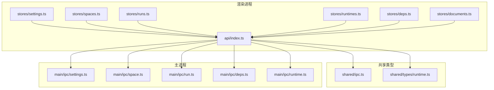
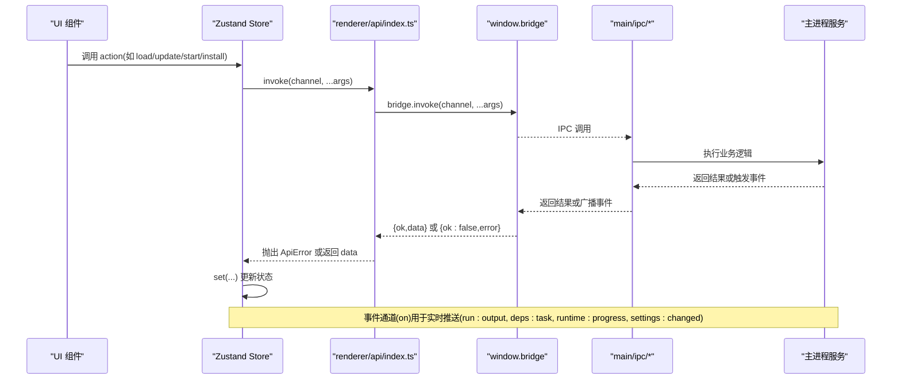
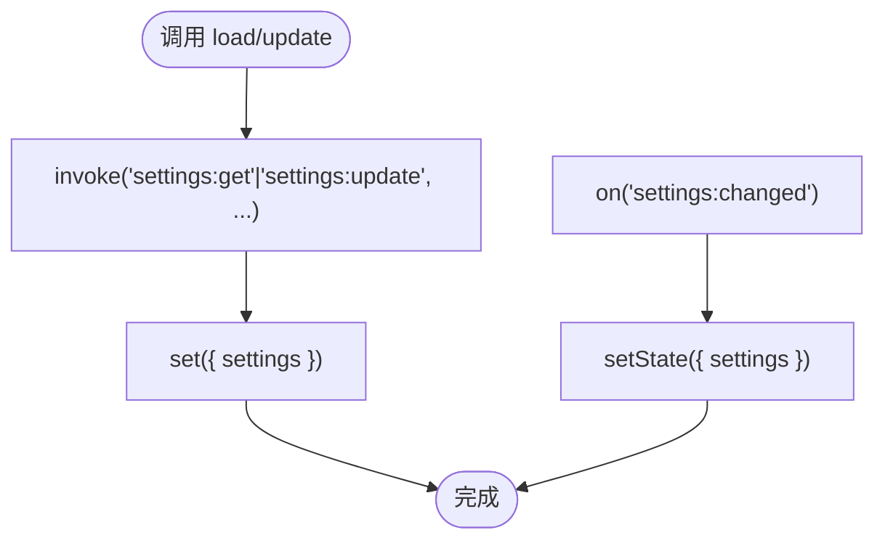
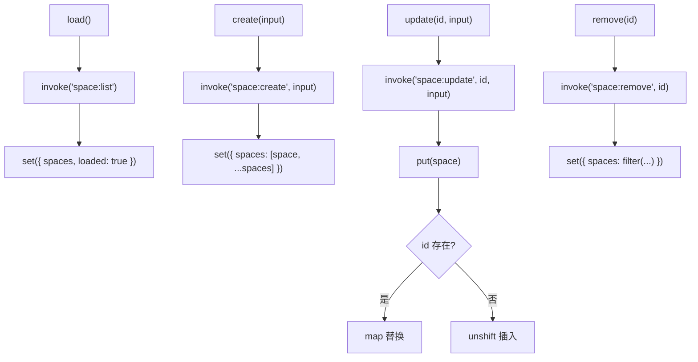
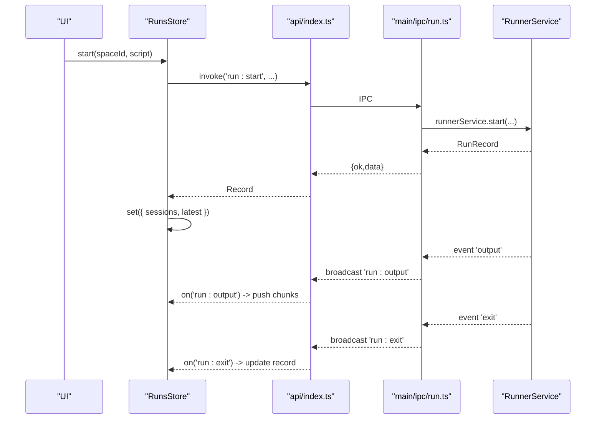
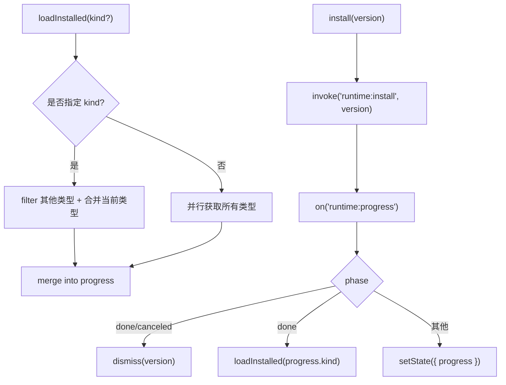
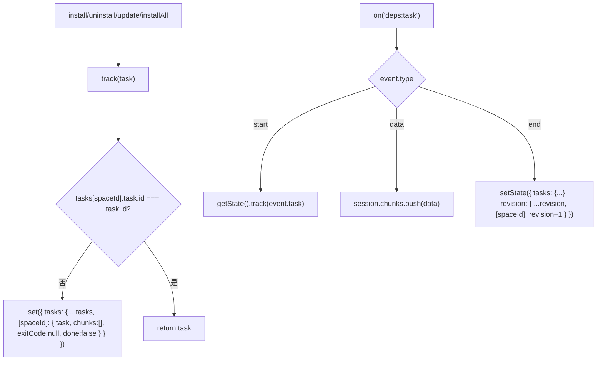
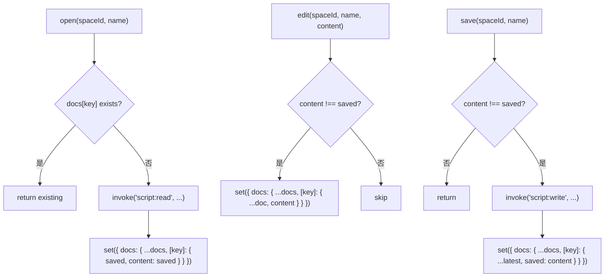
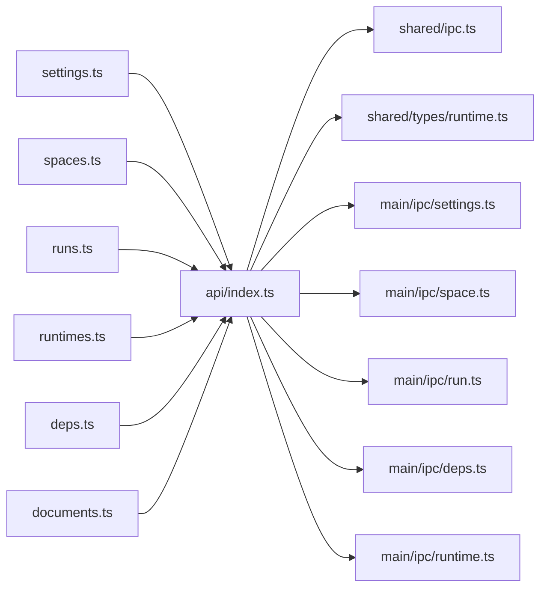
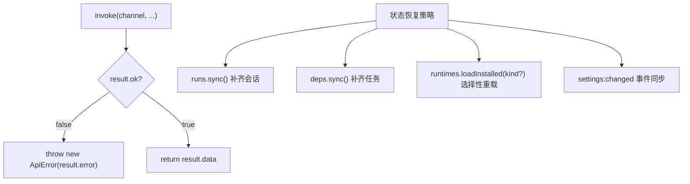

# 状态管理

<cite>
**本文引用的文件**   
- [src/renderer/src/stores/settings.ts](file://src/renderer/src/stores/settings.ts)
- [src/renderer/src/stores/spaces.ts](file://src/renderer/src/stores/spaces.ts)
- [src/renderer/src/stores/runs.ts](file://src/renderer/src/stores/runs.ts)
- [src/renderer/src/stores/runtimes.ts](file://src/renderer/src/stores/runtimes.ts)
- [src/renderer/src/stores/deps.ts](file://src/renderer/src/stores/deps.ts)
- [src/renderer/src/stores/documents.ts](file://src/renderer/src/stores/documents.ts)
- [src/renderer/src/api/index.ts](file://src/renderer/src/api/index.ts)
- [src/shared/ipc.ts](file://src/shared/ipc.ts)
- [src/main/ipc/settings.ts](file://src/main/ipc/settings.ts)
- [src/main/ipc/space.ts](file://src/main/ipc/space.ts)
- [src/main/ipc/run.ts](file://src/main/ipc/run.ts)
- [src/main/ipc/deps.ts](file://src/main/ipc/deps.ts)
- [src/main/ipc/runtime.ts](file://src/main/ipc/runtime.ts)
- [src/shared/types/runtime.ts](file://src/shared/types/runtime.ts)
- [src/renderer/src/pages/runtimes/InstalledRuntimes.tsx](file://src/renderer/src/pages/runtimes/InstalledRuntimes.tsx)
- [src/renderer/src/pages/runtimes/RemoteRuntimes.tsx](file://src/renderer/src/pages/runtimes/RemoteRuntimes.tsx)
- [src/renderer/src/pages/runtimes/RuntimesPage.tsx](file://src/renderer/src/pages/runtimes/RuntimesPage.tsx)
</cite>

## 更新摘要
**所做更改**
- 更新了 RuntimesStore 的 loadInstalled() 方法，支持按 kind 参数选择性重载
- 改进了智能过滤机制以防止重复条目
- 优化了进度处理逻辑，在安装完成时调用 loadInstalled(progress.kind) 而非完全重载
- 增强了运行时管理的性能和用户体验

## 目录
1. [简介](#简介)
2. [项目结构](#项目结构)
3. [核心组件](#核心组件)
4. [架构总览](#架构总览)
5. [详细组件分析](#详细组件分析)
6. [依赖关系分析](#依赖关系分析)
7. [性能与优化](#性能与优化)
8. [错误处理与恢复](#错误处理与恢复)
9. [开发规范与调试](#开发规范与调试)
10. [结论](#结论)

## 简介
本仓库采用基于 Zustand 的前端状态管理方案，配合 Electron 主进程 IPC 通道实现跨进程数据同步、任务执行与持久化。渲染进程通过统一的 API 封装调用主进程能力，主进程将业务逻辑、文件系统访问、运行环境管理与事件广播集中处理，再通过 IPC 事件回推至渲染进程，驱动 UI 更新。

该文档聚焦以下目标：
- 说明各 store 的职责边界与数据模型设计
- 解释状态同步机制：IPC 请求/响应、事件推送、主进程服务与存储
- 提供状态更新最佳实践与性能优化策略
- 梳理错误处理机制与状态恢复方案
- 给出状态流程图与数据流向图
- 制定开发规范与调试方法

## 项目结构
渲染进程的状态集中在 stores 目录下，每个模块对应一个领域：
- settings：应用设置
- spaces：工作区（Space）集合
- runs：脚本运行会话与输出流
- runtimes：运行时版本安装进度与列表
- deps：依赖安装/卸载/更新任务
- documents：编辑器草稿与保存状态

图表来源
- [src/renderer/src/stores/settings.ts:1-26](file://src/renderer/src/stores/settings.ts#L1-L26)
- [src/renderer/src/stores/spaces.ts:1-45](file://src/renderer/src/stores/spaces.ts#L1-L45)
- [src/renderer/src/stores/runs.ts:1-79](file://src/renderer/src/stores/runs.ts#L1-L79)
- [src/renderer/src/stores/runtimes.ts:1-72](file://src/renderer/src/stores/runtimes.ts#L1-L72)
- [src/renderer/src/stores/deps.ts:1-65](file://src/renderer/src/stores/deps.ts#L1-L65)
- [src/renderer/src/stores/documents.ts:1-67](file://src/renderer/src/stores/documents.ts#L1-L67)
- [src/renderer/src/api/index.ts:1-38](file://src/renderer/src/api/index.ts#L1-L38)
- [src/shared/ipc.ts:1-117](file://src/shared/ipc.ts#L1-L117)
- [src/shared/types/runtime.ts:1-38](file://src/shared/types/runtime.ts#L1-L38)
- [src/main/ipc/settings.ts:1-15](file://src/main/ipc/settings.ts#L1-L15)
- [src/main/ipc/space.ts:1-26](file://src/main/ipc/space.ts#L1-L26)
- [src/main/ipc/run.ts:1-19](file://src/main/ipc/run.ts#L1-L19)
- [src/main/ipc/deps.ts:1-18](file://src/main/ipc/deps.ts#L1-L18)
- [src/main/ipc/runtime.ts:1-50](file://src/main/ipc/runtime.ts#L1-L50)

章节来源
- [src/renderer/src/stores/settings.ts:1-26](file://src/renderer/src/stores/settings.ts#L1-L26)
- [src/renderer/src/stores/spaces.ts:1-45](file://src/renderer/src/stores/spaces.ts#L1-L45)
- [src/renderer/src/stores/runs.ts:1-79](file://src/renderer/src/stores/runs.ts#L1-L79)
- [src/renderer/src/stores/runtimes.ts:1-72](file://src/renderer/src/stores/runtimes.ts#L1-L72)
- [src/renderer/src/stores/deps.ts:1-65](file://src/renderer/src/stores/deps.ts#L1-L65)
- [src/renderer/src/stores/documents.ts:1-67](file://src/renderer/src/stores/documents.ts#L1-L67)
- [src/renderer/src/api/index.ts:1-38](file://src/renderer/src/api/index.ts#L1-L38)
- [src/shared/ipc.ts:1-117](file://src/shared/ipc.ts#L1-L117)
- [src/shared/types/runtime.ts:1-38](file://src/shared/types/runtime.ts#L1-L38)
- [src/main/ipc/settings.ts:1-15](file://src/main/ipc/settings.ts#L1-L15)
- [src/main/ipc/space.ts:1-26](file://src/main/ipc/space.ts#L1-L26)
- [src/main/ipc/run.ts:1-19](file://src/main/ipc/run.ts#L1-L19)
- [src/main/ipc/deps.ts:1-18](file://src/main/ipc/deps.ts#L1-L18)
- [src/main/ipc/runtime.ts:1-50](file://src/main/ipc/runtime.ts#L1-L50)

## 核心组件
- SettingsStore：负责加载和更新应用设置，监听主进程变更事件以同步本地状态。
- SpacesStore：维护 Space 列表，支持创建、更新、删除与替换操作，保证与主进程返回的最新副本一致。
- RunsStore：管理运行会话、最新运行记录映射、输出分片缓存与退出事件处理。
- RuntimesStore：管理已安装/远程 Node 版本列表、安装进度与取消/移除操作，支持按运行时类型选择性重载。
- DepsStore：管理依赖任务生命周期、输出分片、退出码与修订号刷新。
- DocumentsStore：维护编辑器草稿、保存状态与重命名迁移。

章节来源
- [src/renderer/src/stores/settings.ts:1-26](file://src/renderer/src/stores/settings.ts#L1-L26)
- [src/renderer/src/stores/spaces.ts:1-45](file://src/renderer/src/stores/spaces.ts#L1-L45)
- [src/renderer/src/stores/runs.ts:1-79](file://src/renderer/src/stores/runs.ts#L1-L79)
- [src/renderer/src/stores/runtimes.ts:1-72](file://src/renderer/src/stores/runtimes.ts#L1-L72)
- [src/renderer/src/stores/deps.ts:1-65](file://src/renderer/src/stores/deps.ts#L1-L65)
- [src/renderer/src/stores/documents.ts:1-67](file://src/renderer/src/stores/documents.ts#L1-L67)

## 架构总览
渲染进程通过 api/index.ts 提供的 invoke/on/send 桥接函数与主进程通信；主进程在各 ipc 文件中注册处理器，转发到具体服务并广播事件。

图表来源
- [src/renderer/src/api/index.ts:1-38](file://src/renderer/src/api/index.ts#L1-L38)
- [src/shared/ipc.ts:25-99](file://src/shared/ipc.ts#L25-L99)
- [src/main/ipc/settings.ts:5-14](file://src/main/ipc/settings.ts#L5-L14)
- [src/main/ipc/space.ts:9-24](file://src/main/ipc/space.ts#L9-L24)
- [src/main/ipc/run.ts:4-18](file://src/main/ipc/run.ts#L4-L18)
- [src/main/ipc/deps.ts:4-17](file://src/main/ipc/deps.ts#L4-L17)
- [src/main/ipc/runtime.ts:6-49](file://src/main/ipc/runtime.ts#L6-L49)

## 详细组件分析

### SettingsStore（应用设置）
职责：
- 从主进程获取并更新设置
- 监听 settings:changed 事件，保持本地状态与主进程一致

关键流程：
- load：调用 settings:get，成功后 set 本地状态
- update：调用 settings:update，成功后 set 本地状态
- on('settings:changed')：接收主进程广播，直接 setState 同步

图表来源
- [src/renderer/src/stores/settings.ts:11-25](file://src/renderer/src/stores/settings.ts#L11-L25)
- [src/main/ipc/settings.ts:5-14](file://src/main/ipc/settings.ts#L5-L14)

章节来源
- [src/renderer/src/stores/settings.ts:1-26](file://src/renderer/src/stores/settings.ts#L1-L26)
- [src/main/ipc/settings.ts:1-15](file://src/main/ipc/settings.ts#L1-L15)

### SpacesStore（工作区）
职责：
- 维护 Space 列表与加载状态
- 提供 create/update/remove/put 等方法
- put 用于在主进程返回新副本时替换本地条目

关键流程：
- load：调用 space:list，设置 loaded 标志
- create/update/remove：调用对应 IPC，并在本地数组中增删改
- put：根据 id 判断存在则替换，否则插入头部

图表来源
- [src/renderer/src/stores/spaces.ts:16-43](file://src/renderer/src/stores/spaces.ts#L16-L43)
- [src/main/ipc/space.ts:9-24](file://src/main/ipc/space.ts#L9-L24)

章节来源
- [src/renderer/src/stores/spaces.ts:1-45](file://src/renderer/src/stores/spaces.ts#L1-L45)
- [src/main/ipc/space.ts:1-26](file://src/main/ipc/space.ts#L1-L26)

### RunsStore（运行会话）
职责：
- 启动/停止运行，维护 sessions 与 latest 映射
- 限制输出分片数量，避免内存膨胀
- 监听 run:output 与 run:exit 事件，增量更新会话状态

关键流程：
- start：调用 run:start，清理旧会话，新建 session，更新 latest
- stop：调用 run:stop
- close：关闭标签页时清理 sessions 与 latest
- sync：拉取 active 运行，补齐缺失会话
- on('run:output')：追加分片，超过阈值裁剪
- on('run:exit')：更新 record 状态

图表来源
- [src/renderer/src/stores/runs.ts:26-78](file://src/renderer/src/stores/runs.ts#L26-L78)
- [src/main/ipc/run.ts:4-18](file://src/main/ipc/run.ts#L4-L18)

章节来源
- [src/renderer/src/stores/runs.ts:1-79](file://src/renderer/src/stores/runs.ts#L1-L79)
- [src/main/ipc/run.ts:1-19](file://src/main/ipc/run.ts#L1-L19)

### RuntimesStore（运行时版本）
职责：
- 加载已安装与远程版本列表
- 跟踪安装进度，支持取消与移除
- 监听 runtime:progress 事件，更新进度并在完成/取消后清理
- **新增**：支持按运行时类型（kind）选择性重载，提升性能并防止重复条目

**更新** loadInstalled() 方法现在接受可选的 kind 参数，当指定 kind 时只重载该类型的运行时，避免全量刷新。同时实现了智能过滤机制，确保不会在合并列表时产生重复条目。

关键流程：
- loadInstalled(kind?)：并行获取 installed 与 installing，使用智能过滤合并到 progress
- loadRemote：设置 remoteLoading，获取远程版本
- install/cancel/remove/dismiss：调用 IPC 或本地清理
- on('runtime:progress')：按 phase 分支处理，done/canceled 后 dismiss，done 后调用 loadInstalled(progress.kind) 进行选择性重载

图表来源
- [src/renderer/src/stores/runtimes.ts:28-38](file://src/renderer/src/stores/runtimes.ts#L28-L38)
- [src/renderer/src/stores/runtimes.ts:62-71](file://src/renderer/src/stores/runtimes.ts#L62-L71)

章节来源
- [src/renderer/src/stores/runtimes.ts:1-72](file://src/renderer/src/stores/runtimes.ts#L1-L72)

### DepsStore（依赖任务）
职责：
- 管理依赖安装/卸载/更新任务的生命周期
- 维护 tasks 与 revision，revision 用于触发列表与类型刷新
- 监听 deps:task 事件，处理 start/data/end 三种事件类型

关键流程：
- install/uninstall/update/installAll：调用 IPC 并通过 track 追踪任务
- cancel：调用 IPC 取消任务
- sync：拉取 active 任务并 track
- track：若当前空间未跟踪该任务，则初始化 session
- on('deps:task')：start 时 track；data 时追加分片；end 时标记 done 并递增 revision

图表来源
- [src/renderer/src/stores/deps.ts:27-64](file://src/renderer/src/stores/deps.ts#L27-L64)
- [src/main/ipc/deps.ts:4-17](file://src/main/ipc/deps.ts#L4-L17)

章节来源
- [src/renderer/src/stores/deps.ts:1-65](file://src/renderer/src/stores/deps.ts#L1-L65)
- [src/main/ipc/deps.ts:1-18](file://src/main/ipc/deps.ts#L1-L18)

### DocumentsStore（编辑器草稿）
职责：
- 打开脚本时读取磁盘内容并建立草稿
- 编辑时仅当 content 变化才更新
- 保存时将 content 写入磁盘并更新 saved
- forget/rename 支持清理与重命名迁移

关键流程：
- open：若已存在则返回，否则读取并初始化 doc
- edit：比较 content 与 saved，仅在变化时 set
- save：若未变化则跳过，否则写入并更新 saved
- forget/rename：按 key 前缀或精确键名清理/迁移

图表来源
- [src/renderer/src/stores/documents.ts:22-61](file://src/renderer/src/stores/documents.ts#L22-L61)

章节来源
- [src/renderer/src/stores/documents.ts:1-67](file://src/renderer/src/stores/documents.ts#L1-L67)

## 依赖关系分析
- 渲染进程 stores 均依赖 @renderer/api 的 invoke/on/send 进行 IPC 通信
- shared/ipc.ts 定义所有 IPC 通道类型，确保类型安全
- 主进程 ipc 文件负责注册 handle/listen，并将服务事件广播给渲染进程

图表来源
- [src/renderer/src/stores/settings.ts:1-26](file://src/renderer/src/stores/settings.ts#L1-L26)
- [src/renderer/src/stores/spaces.ts:1-45](file://src/renderer/src/stores/spaces.ts#L1-L45)
- [src/renderer/src/stores/runs.ts:1-79](file://src/renderer/src/stores/runs.ts#L1-L79)
- [src/renderer/src/stores/runtimes.ts:1-72](file://src/renderer/src/stores/runtimes.ts#L1-L72)
- [src/renderer/src/stores/deps.ts:1-65](file://src/renderer/src/stores/deps.ts#L1-L65)
- [src/renderer/src/stores/documents.ts:1-67](file://src/renderer/src/stores/documents.ts#L1-L67)
- [src/renderer/src/api/index.ts:1-38](file://src/renderer/src/api/index.ts#L1-L38)
- [src/shared/ipc.ts:1-117](file://src/shared/ipc.ts#L1-L117)
- [src/shared/types/runtime.ts:1-38](file://src/shared/types/runtime.ts#L1-L38)
- [src/main/ipc/settings.ts:1-15](file://src/main/ipc/settings.ts#L1-L15)
- [src/main/ipc/space.ts:1-26](file://src/main/ipc/space.ts#L1-L26)
- [src/main/ipc/run.ts:1-19](file://src/main/ipc/run.ts#L1-L19)
- [src/main/ipc/deps.ts:1-18](file://src/main/ipc/deps.ts#L1-L18)
- [src/main/ipc/runtime.ts:1-50](file://src/main/ipc/runtime.ts#L1-L50)

章节来源
- [src/renderer/src/api/index.ts:1-38](file://src/renderer/src/api/index.ts#L1-L38)
- [src/shared/ipc.ts:1-117](file://src/shared/ipc.ts#L1-L117)
- [src/shared/types/runtime.ts:1-38](file://src/shared/types/runtime.ts#L1-L38)

## 性能与优化
- 输出分片限制：RunsStore 对每个运行的输出分片数量设置上限，避免无限增长导致内存压力。
- 最小化 set 调用：DocumentsStore 在 edit 时比较 content 与 saved，仅在变化时更新；SpacesStore 使用 map/filter 生成新数组以避免不必要的深层比较。
- **并发加载与选择性重载**：RuntimesStore 在 loadInstalled 中并行获取已安装与安装中的任务，减少等待时间。**新增**：支持按 kind 参数的选择性重载，避免不必要的全量刷新。
- **智能过滤机制**：RuntimesStore 实现了智能过滤算法，在合并运行时列表时自动过滤重复条目，确保数据一致性。
- **优化的进度处理**：安装完成后调用 loadInstalled(progress.kind) 而非完全重载，显著提升性能。
- 事件驱动更新：通过 on 监听主进程事件，避免轮询，降低 CPU 占用。
- 局部状态更新：DepsStore 在任务结束时仅更新 revision 对应空间，便于列表与类型刷新而不影响其他空间。

章节来源
- [src/renderer/src/stores/runs.ts:5-71](file://src/renderer/src/stores/runs.ts#L5-L71)
- [src/renderer/src/stores/documents.ts:34-49](file://src/renderer/src/stores/documents.ts#L34-L49)
- [src/renderer/src/stores/runtimes.ts:28-38](file://src/renderer/src/stores/runtimes.ts#L28-L38)
- [src/renderer/src/stores/runtimes.ts:62-71](file://src/renderer/src/stores/runtimes.ts#L62-L71)
- [src/renderer/src/stores/deps.ts:47-64](file://src/renderer/src/stores/deps.ts#L47-L64)

## 错误处理与恢复
- API 层统一错误包装：ApiError 携带 code 与 params，便于上层捕获与翻译。
- 主进程错误传播：主进程抛出的 AppError 会被序列化并通过 IPC 返回，渲染进程通过 ApiError 暴露。
- 状态恢复：
  - RunsStore：sync 会拉取 active 运行，补齐缺失会话；close 会清理标签页对应的 latest 映射。
  - DepsStore：sync 会拉取 active 任务并 track；revision 递增可触发 UI 刷新。
  - RuntimesStore：loadInstalled 会合并 installing 进度，确保中断后仍可恢复进度显示。**新增**：选择性重载机制确保部分失败不会影响其他类型的运行时。
  - SettingsStore：settings:changed 事件保证设置变更后立即同步。

图表来源
- [src/renderer/src/api/index.ts:19-27](file://src/renderer/src/api/index.ts#L19-L27)
- [src/renderer/src/stores/runs.ts:51-60](file://src/renderer/src/stores/runs.ts#L51-L60)
- [src/renderer/src/stores/deps.ts:35-38](file://src/renderer/src/stores/deps.ts#L35-L38)
- [src/renderer/src/stores/runtimes.ts:28-38](file://src/renderer/src/stores/runtimes.ts#L28-L38)
- [src/renderer/src/stores/settings.ts:25-25](file://src/renderer/src/stores/settings.ts#L25-L25)

章节来源
- [src/renderer/src/api/index.ts:1-38](file://src/renderer/src/api/index.ts#L1-L38)
- [src/renderer/src/stores/runs.ts:51-60](file://src/renderer/src/stores/runs.ts#L51-L60)
- [src/renderer/src/stores/deps.ts:35-38](file://src/renderer/src/stores/deps.ts#L35-L38)
- [src/renderer/src/stores/runtimes.ts:28-38](file://src/renderer/src/stores/runtimes.ts#L28-L38)
- [src/renderer/src/stores/settings.ts:25-25](file://src/renderer/src/stores/settings.ts#L25-L25)

## 开发规范与调试
- 状态更新规范：
  - 优先使用不可变更新：通过 map/filter/展开运算符生成新对象或数组，避免直接修改原状态。
  - 批量更新：尽量在一次 set 中更新多个字段，减少重渲染次数。
  - 事件驱动：使用 on 监听主进程事件，避免轮询。
- IPC 通道规范：
  - 所有通道必须在 shared/ipc.ts 中声明类型，确保前后端类型一致。
  - 主进程使用 handle/listen 注册处理器，避免遗漏类型约束。
- 调试建议：
  - 在浏览器 DevTools 中查看 Zustand store 快照，确认状态变更是否符合预期。
  - 在 Electron DevTools 中检查 IPC 消息，确认主进程是否收到请求并返回正确结果。
  - 对于长任务（运行、依赖安装），观察事件流（run:output、deps:task、runtime:progress）是否正确推送。
- 最佳实践：
  - 对大对象（如输出分片）使用引用更新与长度限制，避免频繁深拷贝。
  - 对列表更新使用稳定键（如 id）进行替换，提升 React 列表渲染性能。
  - 在异步操作完成后统一更新状态，避免中间态闪烁。
  - **运行时管理优化**：使用带 kind 参数的 loadInstalled() 方法进行选择性重载，避免不必要的全量刷新。

章节来源
- [src/shared/ipc.ts:25-99](file://src/shared/ipc.ts#L25-L99)
- [src/renderer/src/stores/runs.ts:63-71](file://src/renderer/src/stores/runs.ts#L63-L71)
- [src/renderer/src/stores/deps.ts:47-64](file://src/renderer/src/stores/deps.ts#L47-L64)
- [src/renderer/src/stores/runtimes.ts:28-38](file://src/renderer/src/stores/runtimes.ts#L28-L38)
- [src/renderer/src/stores/runtimes.ts:62-71](file://src/renderer/src/stores/runtimes.ts#L62-L71)

## 结论
本项目通过 Zustand 实现了清晰的前端状态分层，结合 Electron IPC 完成了渲染进程与主进程的解耦协作。各 store 职责明确，数据流单向且可预测，事件驱动机制保证了实时性与一致性。通过合理的错误处理与状态恢复策略，系统在异常场景下仍能提供良好体验。

**特别关注**：RuntimesStore 的最新改进显著提升了运行时管理的性能与用户体验。通过支持按 kind 参数的选择性重载、智能过滤机制和优化进度处理，系统能够更高效地管理多种运行时类型（Node.js 和 Python），避免了不必要的全量刷新，确保了数据的准确性和一致性。遵循本文的开发规范与调试方法，可进一步提升代码质量与可维护性。