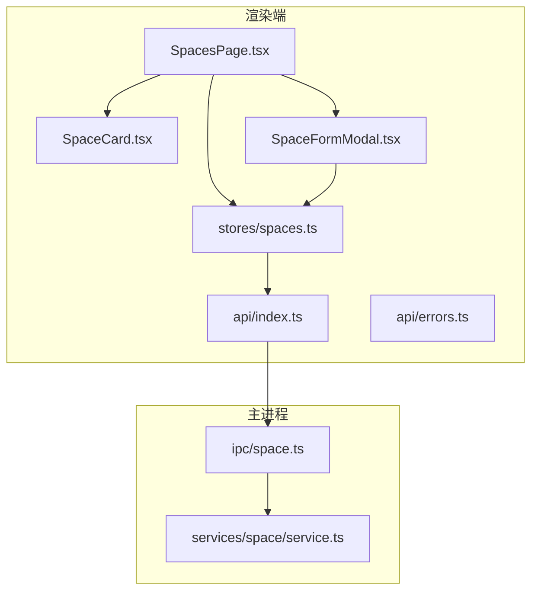
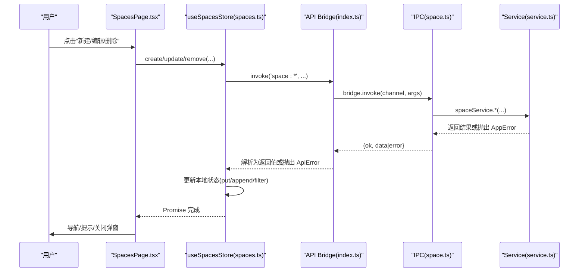
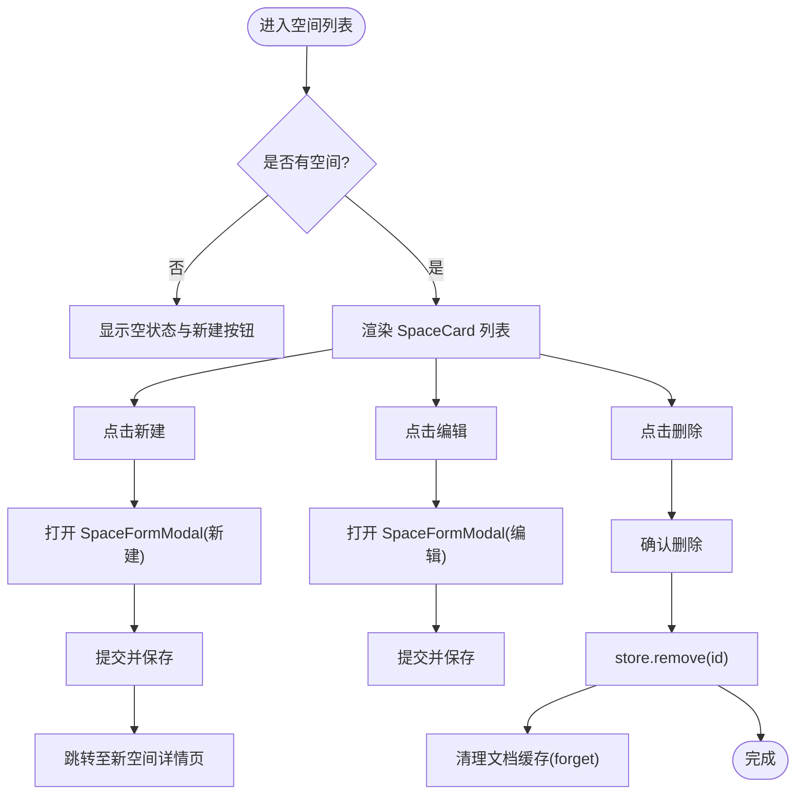
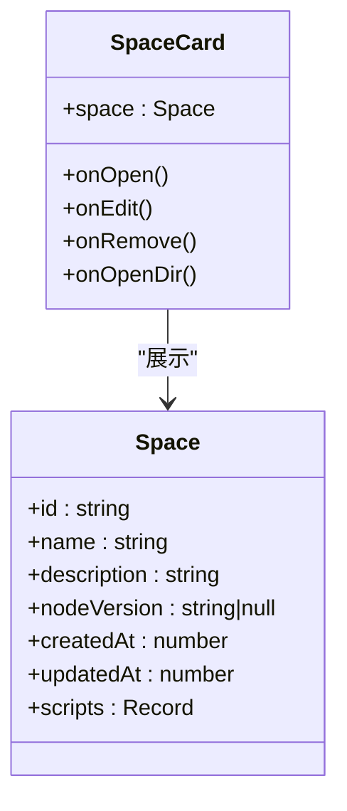
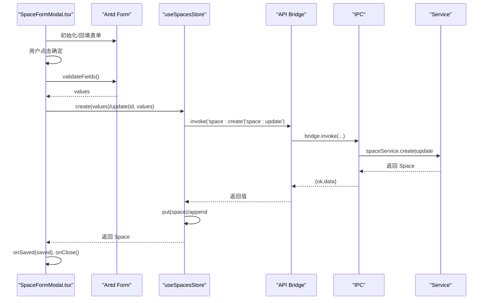
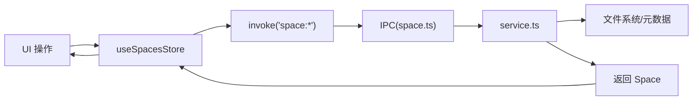
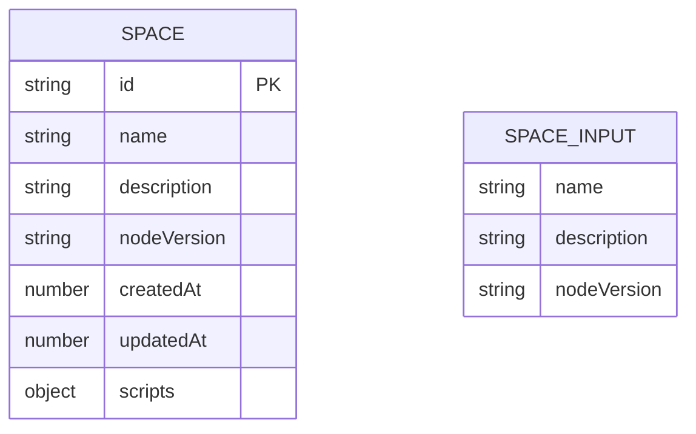
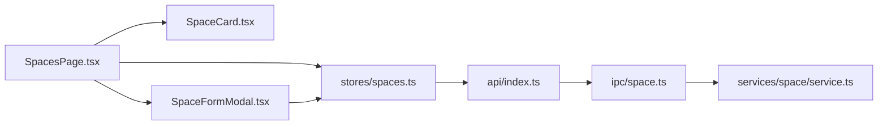

# 空间管理页面

<cite>
**本文引用的文件**   
- [SpacesPage.tsx](file://src/renderer/src/pages/spaces/SpacesPage.tsx)
- [SpaceCard.tsx](file://src/renderer/src/pages/spaces/SpaceCard.tsx)
- [SpaceFormModal.tsx](file://src/renderer/src/pages/spaces/SpaceFormModal.tsx)
- [spaces.ts](file://src/renderer/src/stores/spaces.ts)
- [space.ts](file://src/shared/types/space.ts)
- [space.ts](file://src/main/ipc/space.ts)
- [service.ts](file://src/main/services/space/service.ts)
- [index.ts](file://src/renderer/src/api/index.ts)
- [errors.ts](file://src/renderer/src/api/errors.ts)
</cite>

## 目录
1. [简介](#简介)
2. [项目结构](#项目结构)
3. [核心组件与职责](#核心组件与职责)
4. [架构总览](#架构总览)
5. [详细组件分析](#详细组件分析)
6. [依赖关系分析](#依赖关系分析)
7. [性能与可扩展性](#性能与可扩展性)
8. [故障排查指南](#故障排查指南)
9. [结论](#结论)

## 简介
本文件为“空间管理页面”的技术文档，聚焦以下目标：
- 说明 SpacesPage 组件的空间列表展示、CRUD 操作与状态管理。
- 解释 SpaceCard 的卡片设计与交互逻辑。
- 介绍 SpaceFormModal 模态框的表单验证与数据提交流程。
- 说明空间数据的本地存储与同步策略（主进程服务与渲染进程状态）。
- 提供用户操作流程与时序图，以及错误处理机制与最佳实践。

## 项目结构
空间管理相关代码分布在渲染端页面、状态管理、共享类型定义与主进程 IPC 与服务层：
- 渲染端页面：SpacesPage、SpaceCard、SpaceFormModal
- 渲染端状态：useSpacesStore（Zustand）
- 共享类型：Space、SpaceInput
- 主进程 IPC：space.ts
- 主进程服务：services/space/service.ts
- API 桥接：renderer/api/index.ts 与 errors.ts

图表来源
- [SpacesPage.tsx:1-82](file://src/renderer/src/pages/spaces/SpacesPage.tsx#L1-L82)
- [SpaceCard.tsx:1-53](file://src/renderer/src/pages/spaces/SpaceCard.tsx#L1-L53)
- [SpaceFormModal.tsx:1-76](file://src/renderer/src/pages/spaces/SpaceFormModal.tsx#L1-L76)
- [spaces.ts:1-45](file://src/renderer/src/stores/spaces.ts#L1-L45)
- [space.ts:1-26](file://src/main/ipc/space.ts#L1-L26)
- [service.ts:1-91](file://src/main/services/space/service.ts#L1-L91)
- [index.ts:1-38](file://src/renderer/src/api/index.ts#L1-L38)
- [errors.ts:1-15](file://src/renderer/src/api/errors.ts#L1-L15)

章节来源
- [SpacesPage.tsx:1-82](file://src/renderer/src/pages/spaces/SpacesPage.tsx#L1-L82)
- [SpaceCard.tsx:1-53](file://src/renderer/src/pages/spaces/SpaceCard.tsx#L1-L53)
- [SpaceFormModal.tsx:1-76](file://src/renderer/src/pages/spaces/SpaceFormModal.tsx#L1-L76)
- [spaces.ts:1-45](file://src/renderer/src/stores/spaces.ts#L1-L45)
- [space.ts:1-26](file://src/main/ipc/space.ts#L1-L26)
- [service.ts:1-91](file://src/main/services/space/service.ts#L1-L91)
- [index.ts:1-38](file://src/renderer/src/api/index.ts#L1-L38)
- [errors.ts:1-15](file://src/renderer/src/api/errors.ts#L1-L15)

## 核心组件与职责
- SpacesPage：空间列表页入口，负责展示空间卡片、触发创建/编辑/删除、打开空间详情路由、打开系统目录等。
- SpaceCard：单个空间的可视化卡片，展示名称、描述、Node 版本与更新时间，并提供编辑、打开目录、删除等操作。
- SpaceFormModal：空间的新建/编辑模态框，包含表单校验、默认值填充、提交到 store 并持久化。
- useSpacesStore：基于 Zustand 的状态管理，封装 create/update/remove/load/put 等方法，调用 IPC 与更新本地状态。
- 主进程 space.ts：注册 IPC 通道，转发至 service 层，并在删除前进行占用检查。
- services/space/service.ts：实现空间元数据的增删改查、序列化写入与并发保护。

章节来源
- [SpacesPage.tsx:15-80](file://src/renderer/src/pages/spaces/SpacesPage.tsx#L15-L80)
- [SpaceCard.tsx:17-52](file://src/renderer/src/pages/spaces/SpaceCard.tsx#L17-L52)
- [SpaceFormModal.tsx:20-74](file://src/renderer/src/pages/spaces/SpaceFormModal.tsx#L20-L74)
- [spaces.ts:16-44](file://src/renderer/src/stores/spaces.ts#L16-L44)
- [space.ts:9-25](file://src/main/ipc/space.ts#L9-L25)
- [service.ts:10-90](file://src/main/services/space/service.ts#L10-L90)

## 架构总览
渲染端通过 invoke 调用 IPC，IPC 将请求委派给 service 层，service 直接操作文件系统与元数据；渲染端使用 Zustand store 维护 UI 状态，保证即时反馈。

图表来源
- [SpacesPage.tsx:22-37](file://src/renderer/src/pages/spaces/SpacesPage.tsx#L22-L37)
- [spaces.ts:19-35](file://src/renderer/src/stores/spaces.ts#L19-L35)
- [index.ts:19-27](file://src/renderer/src/api/index.ts#L19-L27)
- [space.ts:9-25](file://src/main/ipc/space.ts#L9-L25)
- [service.ts:14-73](file://src/main/services/space/service.ts#L14-L73)

## 详细组件分析

### SpacesPage 组件
- 列表展示：当 spaces 为空时显示空状态与“新建”按钮；否则以栅格布局渲染 SpaceCard。
- 新建/编辑：通过 editing 状态控制 SpaceFormModal 的 open 与 space 参数；新建成功后自动跳转到新空间详情页。
- 删除流程：使用 Ant Design Modal.confirm 二次确认，调用 store.remove，成功后清理文档缓存（forget），失败则统一格式化错误消息。
- 打开目录：调用 invoke('space:open-dir', id) 打开系统目录。

图表来源
- [SpacesPage.tsx:22-37](file://src/renderer/src/pages/spaces/SpacesPage.tsx#L22-L37)
- [SpacesPage.tsx:39-78](file://src/renderer/src/pages/spaces/SpacesPage.tsx#L39-L78)

章节来源
- [SpacesPage.tsx:15-80](file://src/renderer/src/pages/spaces/SpacesPage.tsx#L15-L80)

### SpaceCard 组件
- 信息展示：名称、描述（无描述时显示占位文案）、Node 版本标签、更新时间。
- 运行环境就绪判断：根据 space.nodeVersion 与已安装运行时列表比对，决定绿色或警告标签。
- 交互行为：点击卡片进入空间详情；工具栏提供编辑、打开目录、删除三个操作，均阻止冒泡避免误触。

图表来源
- [SpaceCard.tsx:9-15](file://src/renderer/src/pages/spaces/SpaceCard.tsx#L9-L15)
- [space.ts:13-21](file://src/shared/types/space.ts#L13-L21)

章节来源
- [SpaceCard.tsx:17-52](file://src/renderer/src/pages/spaces/SpaceCard.tsx#L17-L52)
- [space.ts:13-21](file://src/shared/types/space.ts#L13-L21)

### SpaceFormModal 组件
- 表单字段：名称（必填、长度限制）、描述（可选、最大长度）、Node 版本（下拉选择）。
- 默认值填充：编辑模式回填；新建模式优先使用设置中的默认 Node 版本，其次取已安装版本第一个。
- 提交逻辑：validateFields 后调用 store.create 或 update，成功后回调 onSaved 并关闭弹窗；异常统一 formatError 提示。
- 生命周期：每次 open 变化时重置表单值，确保多开弹窗互不干扰。

图表来源
- [SpaceFormModal.tsx:29-51](file://src/renderer/src/pages/spaces/SpaceFormModal.tsx#L29-L51)
- [spaces.ts:22-30](file://src/renderer/src/stores/spaces.ts#L22-L30)
- [index.ts:19-27](file://src/renderer/src/api/index.ts#L19-L27)
- [space.ts:10-13](file://src/main/ipc/space.ts#L10-L13)
- [service.ts:33-67](file://src/main/services/space/service.ts#L33-L67)

章节来源
- [SpaceFormModal.tsx:20-74](file://src/renderer/src/pages/spaces/SpaceFormModal.tsx#L20-L74)
- [spaces.ts:22-30](file://src/renderer/src/stores/spaces.ts#L22-L30)

### 状态管理与数据流
- useSpacesStore：
  - load：从 IPC 拉取空间列表并标记 loaded。
  - create：调用 IPC 创建空间，并将新空间插入列表头部。
  - update：调用 IPC 更新空间，并通过 put 替换本地对应项。
  - remove：调用 IPC 删除空间，并从本地过滤移除。
  - put：按 id 存在与否执行替换或追加，用于服务端返回更新后的对象时保持 UI 一致。
- 与文档缓存联动：删除空间后调用 useDocumentsStore.getState().forget(space.id) 清理编辑器缓存，避免残留状态。

图表来源
- [spaces.ts:19-43](file://src/renderer/src/stores/spaces.ts#L19-L43)
- [space.ts:9-25](file://src/main/ipc/space.ts#L9-L25)
- [service.ts:14-90](file://src/main/services/space/service.ts#L14-L90)

章节来源
- [spaces.ts:16-44](file://src/renderer/src/stores/spaces.ts#L16-L44)
- [SpacesPage.tsx:27-34](file://src/renderer/src/pages/spaces/SpacesPage.tsx#L27-L34)

### 数据模型
- Space：包含 id、name、description、nodeVersion、时间戳与 scripts 映射。
- SpaceInput：用于新建/更新的输入模型，不包含 id 与时间戳。

图表来源
- [space.ts:13-27](file://src/shared/types/space.ts#L13-L27)

章节来源
- [space.ts:13-27](file://src/shared/types/space.ts#L13-L27)

## 依赖关系分析
- 渲染端依赖：
  - SpacesPage 依赖 SpaceCard、SpaceFormModal、useSpacesStore、useDocumentsStore、路由与国际化。
  - SpaceCard 依赖 useRuntimesStore 与格式化工具。
  - SpaceFormModal 依赖 useRuntimesStore、useSettingsStore、useSpacesStore 与 Antd Form。
- 跨进程依赖：
  - renderer/api/index.ts 封装 invoke/send/on，统一错误包装为 ApiError。
  - main/ipc/space.ts 注册 channel 并委托给 service。
  - main/services/space/service.ts 实现业务逻辑与文件 IO。

图表来源
- [SpacesPage.tsx:1-14](file://src/renderer/src/pages/spaces/SpacesPage.tsx#L1-L14)
- [SpaceCard.tsx:1-8](file://src/renderer/src/pages/spaces/SpaceCard.tsx#L1-L8)
- [SpaceFormModal.tsx:1-10](file://src/renderer/src/pages/spaces/SpaceFormModal.tsx#L1-L10)
- [spaces.ts:1-3](file://src/renderer/src/stores/spaces.ts#L1-L3)
- [index.ts:1-3](file://src/renderer/src/api/index.ts#L1-L3)
- [space.ts:1-7](file://src/main/ipc/space.ts#L1-L7)

章节来源
- [SpacesPage.tsx:1-14](file://src/renderer/src/pages/spaces/SpacesPage.tsx#L1-L14)
- [SpaceCard.tsx:1-8](file://src/renderer/src/pages/spaces/SpaceCard.tsx#L1-L8)
- [SpaceFormModal.tsx:1-10](file://src/renderer/src/pages/spaces/SpaceFormModal.tsx#L1-L10)
- [spaces.ts:1-3](file://src/renderer/src/stores/spaces.ts#L1-L3)
- [index.ts:1-3](file://src/renderer/src/api/index.ts#L1-L3)
- [space.ts:1-7](file://src/main/ipc/space.ts#L1-L7)

## 性能与可扩展性
- 列表渲染优化：SpaceCard 仅展示必要信息，避免重计算；节点版本就绪判断基于已安装运行时集合，复杂度 O(n)。
- 并发安全：service.mutate 使用 per-space 的 Promise 链串行化读写，避免并发覆盖。
- 状态一致性：store.put 支持服务端返回更新对象时的增量替换，减少全量刷新。
- 扩展建议：
  - 对长列表可引入虚拟滚动或分页加载。
  - 对 Node 版本检测可加入缓存与懒加载。
  - 对错误提示可增加重试与降级策略。

[本节为通用指导，不直接分析具体文件]

## 故障排查指南
- 删除空间失败：
  - 现象：删除时报错且无法删除。
  - 原因：主进程在删除前检查是否存在正在运行的脚本或依赖安装任务，若存在则抛出特定错误码。
  - 处理：先停止运行中的脚本或等待依赖任务结束，再重试删除。
  - 参考位置：
    - [space.ts:15-18](file://src/main/ipc/space.ts#L15-L18)
- 表单提交失败：
  - 现象：新建/编辑后弹出错误提示。
  - 原因：后端返回 ApiError，前端通过 formatError 转换为可读消息。
  - 处理：查看错误码与参数，定位具体原因（如名称重复、路径不可写等）。
  - 参考位置：
    - [errors.ts:5-14](file://src/renderer/src/api/errors.ts#L5-L14)
    - [index.ts:19-27](file://src/renderer/src/api/index.ts#L19-L27)
- 打开目录失败：
  - 现象：点击“打开目录”无响应或报错。
  - 原因：空间不存在或路径无效。
  - 处理：确认空间存在后再尝试打开。
  - 参考位置：
    - [space.ts:21-24](file://src/main/ipc/space.ts#L21-L24)

章节来源
- [space.ts:15-24](file://src/main/ipc/space.ts#L15-L24)
- [errors.ts:5-14](file://src/renderer/src/api/errors.ts#L5-L14)
- [index.ts:19-27](file://src/renderer/src/api/index.ts#L19-L27)

## 结论
空间管理页面通过清晰的组件分层与状态管理，实现了空间列表展示、CRUD 操作与本地状态同步。渲染端使用 Zustand 维护 UI 状态，主进程通过 IPC 与 service 层保障数据一致性与并发安全。建议在后续迭代中补充列表虚拟化、错误重试与更丰富的运行环境检测能力，以提升用户体验与系统健壮性。