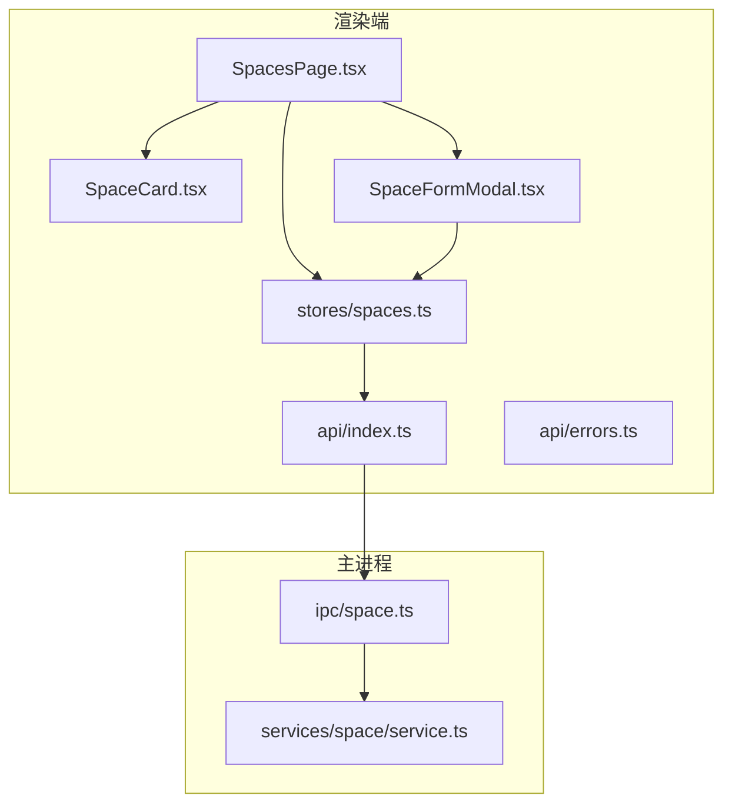
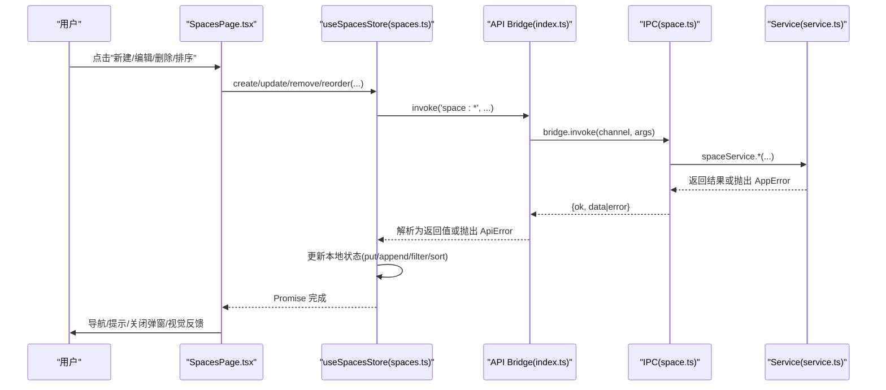
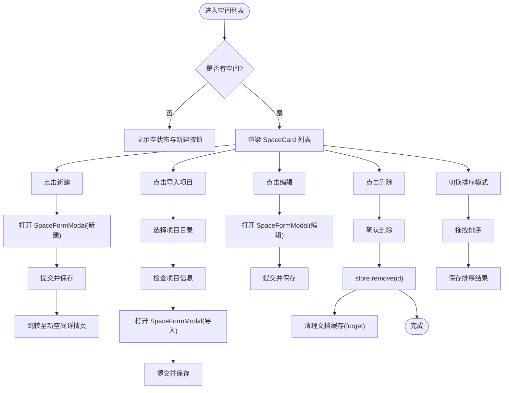
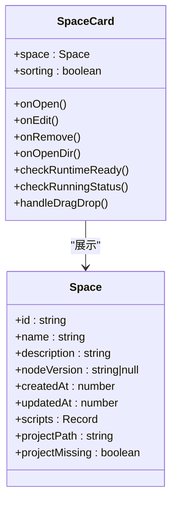
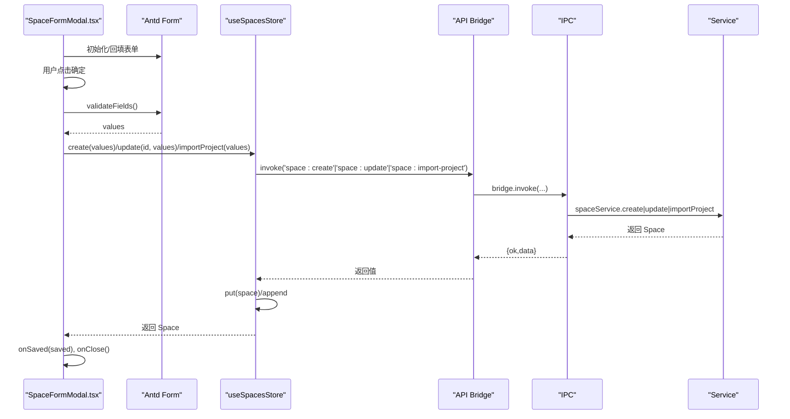
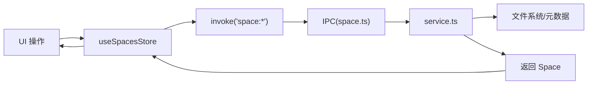
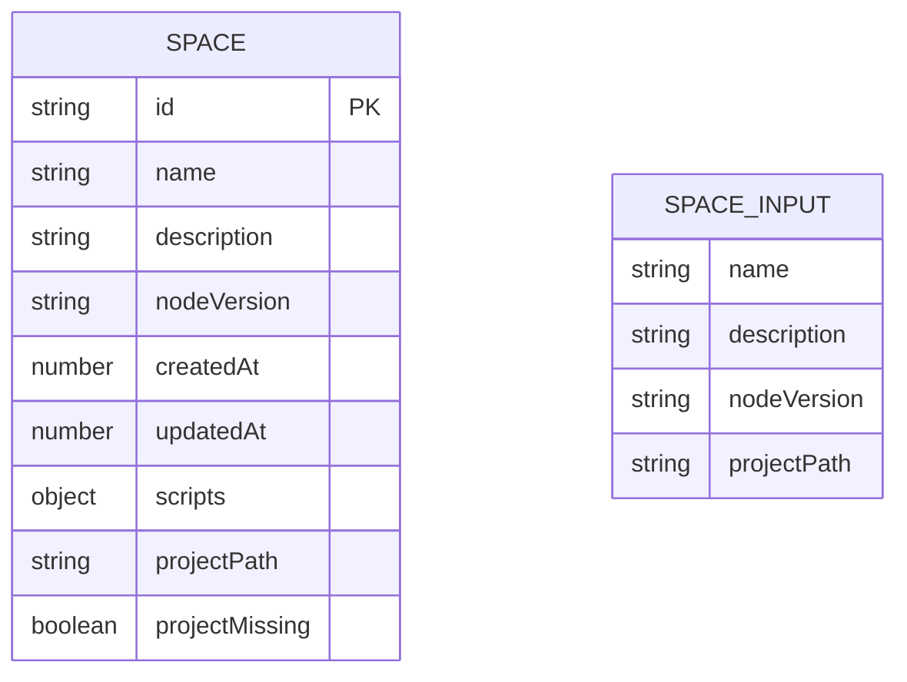
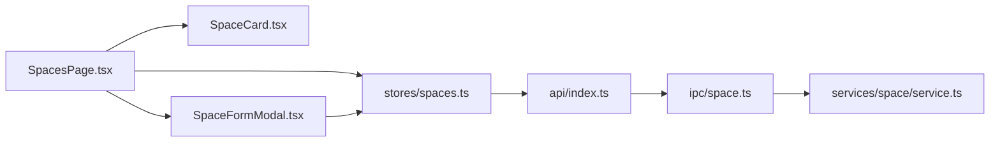

# 空间管理页面

<cite>
**本文引用的文件**   
- [SpacesPage.tsx](file://src/renderer/src/pages/spaces/SpacesPage.tsx)
- [SpaceCard.tsx](file://src/renderer/src/pages/spaces/SpaceCard.tsx)
- [SpaceFormModal.tsx](file://src/renderer/src/pages/spaces/SpaceFormModal.tsx)
- [spaces.ts](file://src/renderer/src/stores/spaces.ts)
- [space.ts](file://src/shared/types/space.ts)
- [space.ts](file://src/main/ipc/space.ts)
- [service.ts](file://src/main/services/space/service.ts)
- [index.ts](file://src/renderer/src/api/index.ts)
- [errors.ts](file://src/renderer/src/api/errors.ts)
</cite>

## 更新摘要
**所做更改**   
- 增强了拖拽排序功能和视觉反馈
- 改进了项目导入和重新链接体验
- 优化了表单验证和错误处理机制
- 添加了运行状态检测和项目缺失提示
- 完善了用户交互的视觉反馈系统

## 目录
1. [简介](#简介)
2. [项目结构](#项目结构)
3. [核心组件与职责](#核心组件与职责)
4. [架构总览](#架构总览)
5. [详细组件分析](#详细组件分析)
6. [依赖关系分析](#依赖关系分析)
7. [性能与可扩展性](#性能与可扩展性)
8. [故障排查指南](#故障排查指南)
9. [结论](#结论)

## 简介
本文件为"空间管理页面"的技术文档，聚焦以下目标：
- 说明 SpacesPage 组件的空间列表展示、CRUD 操作与状态管理。
- 解释 SpaceCard 的卡片设计与交互逻辑。
- 介绍 SpaceFormModal 模态框的表单验证与数据提交流程。
- 说明空间数据的本地存储与同步策略（主进程服务与渲染进程状态）。
- 提供用户操作流程与时序图，以及错误处理机制与最佳实践。

**更新** 新增了拖拽排序、项目导入、运行状态检测等增强功能，显著改善了用户体验。

## 项目结构
空间管理相关代码分布在渲染端页面、状态管理、共享类型定义与主进程 IPC 与服务层：
- 渲染端页面：SpacesPage、SpaceCard、SpaceFormModal
- 渲染端状态：useSpacesStore（Zustand）
- 共享类型：Space、SpaceInput
- 主进程 IPC：space.ts
- 主进程服务：services/space/service.ts
- API 桥接：renderer/api/index.ts 与 errors.ts

图表来源
- [SpacesPage.tsx:1-222](file://src/renderer/src/pages/spaces/SpacesPage.tsx#L1-L222)
- [SpaceCard.tsx:1-89](file://src/renderer/src/pages/spaces/SpaceCard.tsx#L1-L89)
- [SpaceFormModal.tsx:1-163](file://src/renderer/src/pages/spaces/SpaceFormModal.tsx#L1-L163)
- [spaces.ts:1-60](file://src/renderer/src/stores/spaces.ts#L1-L60)
- [space.ts:1-59](file://src/main/ipc/space.ts#L1-L59)
- [service.ts:1-181](file://src/main/services/space/service.ts#L1-L181)
- [index.ts:1-38](file://src/renderer/src/api/index.ts#L1-L38)
- [errors.ts:1-15](file://src/renderer/src/api/errors.ts#L1-L15)

章节来源
- [SpacesPage.tsx:1-222](file://src/renderer/src/pages/spaces/SpacesPage.tsx#L1-L222)
- [SpaceCard.tsx:1-89](file://src/renderer/src/pages/spaces/SpaceCard.tsx#L1-L89)
- [SpaceFormModal.tsx:1-163](file://src/renderer/src/pages/spaces/SpaceFormModal.tsx#L1-L163)
- [spaces.ts:1-60](file://src/renderer/src/stores/spaces.ts#L1-L60)
- [space.ts:1-59](file://src/main/ipc/space.ts#L1-L59)
- [service.ts:1-181](file://src/main/services/space/service.ts#L1-L181)
- [index.ts:1-38](file://src/renderer/src/api/index.ts#L1-L38)
- [errors.ts:1-15](file://src/renderer/src/api/errors.ts#L1-L15)

## 核心组件与职责
- SpacesPage：空间列表页入口，负责展示空间卡片、触发创建/编辑/删除、打开空间详情路由、打开系统目录等。**新增** 拖拽排序功能、项目导入流程、排序状态管理。
- SpaceCard：单个空间的可视化卡片，展示名称、描述、Node 版本与更新时间，并提供编辑、打开目录、删除等操作。**增强** 运行状态检测、项目缺失提示、拖拽排序支持。
- SpaceFormModal：空间的新建/编辑模态框，包含表单校验、默认值填充、提交到 store 并持久化。**改进** 项目路径重新链接、PnP 警告提示、更智能的版本匹配。
- useSpacesStore：基于 Zustand 的状态管理，封装 create/update/remove/load/put/reorder 等方法，调用 IPC 与更新本地状态。**新增** reorder 方法支持空间排序。
- 主进程 space.ts：注册 IPC 通道，转发至 service 层，并在删除前进行占用检查。**增强** 项目信息检查和导入功能。
- services/space/service.ts：实现空间元数据的增删改查、序列化写入与并发保护。**完善** 项目导入、路径验证、排序持久化。

章节来源
- [SpacesPage.tsx:16-221](file://src/renderer/src/pages/spaces/SpacesPage.tsx#L16-L221)
- [SpaceCard.tsx:23-88](file://src/renderer/src/pages/spaces/SpaceCard.tsx#L23-L88)
- [SpaceFormModal.tsx:51-162](file://src/renderer/src/pages/spaces/SpaceFormModal.tsx#L51-L162)
- [spaces.ts:19-59](file://src/renderer/src/stores/spaces.ts#L19-L59)
- [space.ts:16-58](file://src/main/ipc/space.ts#L16-L58)
- [service.ts:18-181](file://src/main/services/space/service.ts#L18-L181)

## 架构总览
渲染端通过 invoke 调用 IPC，IPC 将请求委派给 service 层，service 直接操作文件系统与元数据；渲染端使用 Zustand store 维护 UI 状态，保证即时反馈。

图表来源
- [SpacesPage.tsx:30-109](file://src/renderer/src/pages/spaces/SpacesPage.tsx#L30-L109)
- [spaces.ts:22-50](file://src/renderer/src/stores/spaces.ts#L22-L50)
- [index.ts:19-27](file://src/renderer/src/api/index.ts#L19-L27)
- [space.ts:16-58](file://src/main/ipc/space.ts#L16-L58)
- [service.ts:23-181](file://src/main/services/space/service.ts#L23-L181)

## 详细组件分析

### SpacesPage 组件
- 列表展示：当 spaces 为空时显示空状态与"新建"按钮；否则以栅格布局渲染 SpaceCard。
- **新增** 拖拽排序：支持拖拽调整空间顺序，提供排序模式切换、拖拽视觉反馈、自动保存排序结果。
- 新建/编辑：通过 editing 状态控制 SpaceFormModal 的 open 与 space 参数；新建成功后自动跳转到新空间详情页。
- **增强** 项目导入：支持从现有项目目录导入，自动检测项目信息并预填表单字段。
- 删除流程：使用 Ant Design Modal.confirm 二次确认，调用 store.remove，成功后清理文档缓存（forget），失败则统一格式化错误消息。
- 打开目录：调用 invoke('space:open-dir', id) 打开系统目录。

图表来源
- [SpacesPage.tsx:30-109](file://src/renderer/src/pages/spaces/SpacesPage.tsx#L30-L109)
- [SpacesPage.tsx:133-221](file://src/renderer/src/pages/spaces/SpacesPage.tsx#L133-L221)

章节来源
- [SpacesPage.tsx:16-221](file://src/renderer/src/pages/spaces/SpacesPage.tsx#L16-L221)

### SpaceCard 组件
- 信息展示：名称、描述（无描述时显示占位文案）、Node 版本标签、更新时间。
- **增强** 运行环境就绪判断：根据 space.nodeVersion 与已安装运行时列表比对，决定绿色或警告标签。
- **新增** 运行状态检测：实时检测空间中的脚本是否正在运行，显示处理中徽章。
- **增强** 项目缺失提示：当项目目录不存在时显示警告图标和修复链接。
- 交互行为：点击卡片进入空间详情；工具栏提供编辑、打开目录、删除三个操作，均阻止冒泡避免误触。
- **新增** 拖拽排序支持：在排序模式下显示拖拽手柄，支持拖拽调整位置。

图表来源
- [SpaceCard.tsx:23-88](file://src/renderer/src/pages/spaces/SpaceCard.tsx#L23-L88)
- [space.ts:13-25](file://src/shared/types/space.ts#L13-L25)

章节来源
- [SpaceCard.tsx:23-88](file://src/renderer/src/pages/spaces/SpaceCard.tsx#L23-L88)
- [space.ts:13-25](file://src/shared/types/space.ts#L13-L25)

### SpaceFormModal 组件
- 表单字段：名称（必填、长度限制）、描述（可选、最大长度）、Node 版本（下拉选择）。
- **增强** 默认值填充：编辑模式回填；新建模式优先使用设置中的默认 Node 版本，其次取已安装版本第一个。
- **新增** 项目导入支持：支持从现有项目目录导入，自动检测 Node 版本提示和项目信息。
- **改进** 项目路径重新链接：允许重新链接移动后的项目目录，保持项目引用有效。
- **新增** PnP 警告提示：当检测到 Yarn Plug'n'Play 项目时显示警告信息。
- 提交逻辑：validateFields 后调用 store.create 或 update，成功后回调 onSaved 并关闭弹窗；异常统一 formatError 提示。
- 生命周期：每次 open 变化时重置表单值，确保多开弹窗互不干扰。

图表来源
- [SpaceFormModal.tsx:95-113](file://src/renderer/src/pages/spaces/SpaceFormModal.tsx#L95-L113)
- [spaces.ts:25-34](file://src/renderer/src/stores/spaces.ts#L25-L34)
- [index.ts:19-27](file://src/renderer/src/api/index.ts#L19-L27)
- [space.ts:19-21](file://src/main/ipc/space.ts#L19-L21)
- [service.ts:56-101](file://src/main/services/space/service.ts#L56-L101)

章节来源
- [SpaceFormModal.tsx:51-162](file://src/renderer/src/pages/spaces/SpaceFormModal.tsx#L51-L162)
- [spaces.ts:25-34](file://src/renderer/src/stores/spaces.ts#L25-L34)

### 状态管理与数据流
- useSpacesStore：
  - load：从 IPC 拉取空间列表并标记 loaded。
  - create：调用 IPC 创建空间，并将新空间插入列表头部。
  - **新增** importProject：调用 IPC 导入项目，并将新项目插入列表头部。
  - update：调用 IPC 更新空间，并通过 put 替换本地对应项。
  - **新增** reorder：调用 IPC 重排序空间，并按新顺序更新本地状态。
  - remove：调用 IPC 删除空间，并从本地过滤移除。
  - put：按 id 存在与否执行替换或追加，用于服务端返回更新后的对象时保持 UI 一致。
- 与文档缓存联动：删除空间后调用 useDocumentsStore.getState().forget(space.id) 清理编辑器缓存，避免残留状态。

图表来源
- [spaces.ts:22-50](file://src/renderer/src/stores/spaces.ts#L22-L50)
- [space.ts:16-58](file://src/main/ipc/space.ts#L16-L58)
- [service.ts:23-181](file://src/main/services/space/service.ts#L23-L181)

章节来源
- [spaces.ts:19-59](file://src/renderer/src/stores/spaces.ts#L19-L59)
- [SpacesPage.tsx:30-109](file://src/renderer/src/pages/spaces/SpacesPage.tsx#L30-L109)

### 数据模型
- Space：包含 id、name、description、nodeVersion、时间戳与 scripts 映射。**新增** projectPath 和 projectMissing 字段用于项目空间支持。
- SpaceInput：用于新建/更新的输入模型，不包含 id 与时间戳。**增强** 支持 projectPath 字段用于项目导入。

图表来源
- [space.ts:13-33](file://src/shared/types/space.ts#L13-L33)

章节来源
- [space.ts:13-33](file://src/shared/types/space.ts#L13-L33)

## 依赖关系分析
- 渲染端依赖：
  - SpacesPage 依赖 SpaceCard、SpaceFormModal、useSpacesStore、useDocumentsStore、路由与国际化。**新增** 依赖拖拽排序相关的状态管理。
  - SpaceCard 依赖 useRuntimesStore、useRunsStore 与格式化工具。**增强** 运行状态检测依赖。
  - SpaceFormModal 依赖 useRuntimesStore、useSettingsStore、useSpacesStore 与 Antd Form。**改进** 项目导入相关依赖。
- 跨进程依赖：
  - renderer/api/index.ts 封装 invoke/send/on，统一错误包装为 ApiError。
  - main/ipc/space.ts 注册 channel 并委托给 service。**增强** 项目信息和导入功能。
  - main/services/space/service.ts 实现业务逻辑与文件 IO。**完善** 项目导入、路径验证、排序持久化。

图表来源
- [SpacesPage.tsx:1-14](file://src/renderer/src/pages/spaces/SpacesPage.tsx#L1-L14)
- [SpaceCard.tsx:1-8](file://src/renderer/src/pages/spaces/SpaceCard.tsx#L1-L8)
- [SpaceFormModal.tsx:1-12](file://src/renderer/src/pages/spaces/SpaceFormModal.tsx#L1-L12)
- [spaces.ts:1-3](file://src/renderer/src/stores/spaces.ts#L1-L3)
- [index.ts:1-3](file://src/renderer/src/api/index.ts#L1-L3)
- [space.ts:1-9](file://src/main/ipc/space.ts#L1-L9)

章节来源
- [SpacesPage.tsx:1-14](file://src/renderer/src/pages/spaces/SpacesPage.tsx#L1-L14)
- [SpaceCard.tsx:1-8](file://src/renderer/src/pages/spaces/SpaceCard.tsx#L1-L8)
- [SpaceFormModal.tsx:1-12](file://src/renderer/src/pages/spaces/SpaceFormModal.tsx#L1-L12)
- [spaces.ts:1-3](file://src/renderer/src/stores/spaces.ts#L1-L3)
- [index.ts:1-3](file://src/renderer/src/api/index.ts#L1-L3)
- [space.ts:1-9](file://src/main/ipc/space.ts#L1-L9)

## 性能与可扩展性
- 列表渲染优化：SpaceCard 仅展示必要信息，避免重计算；节点版本就绪判断基于已安装运行时集合，复杂度 O(n)。
- **新增** 拖拽排序性能：使用虚拟 DOM 和状态优化，避免不必要的重渲染；排序结果持久化减少重复计算。
- 并发安全：service.mutate 使用 per-space 的 Promise 链串行化读写，避免并发覆盖。
- 状态一致性：store.put 支持服务端返回更新对象时的增量替换，减少全量刷新。
- **新增** 项目导入优化：异步项目检查和版本匹配，避免阻塞 UI 线程。
- 扩展建议：
  - 对长列表可引入虚拟滚动或分页加载。
  - 对 Node 版本检测可加入缓存与懒加载。
  - 对错误提示可增加重试与降级策略。
  - 对拖拽排序可考虑添加动画过渡效果。

[本节为通用指导，不直接分析具体文件]

## 故障排查指南
- 删除空间失败：
  - 现象：删除时报错且无法删除。
  - 原因：主进程在删除前检查是否存在正在运行的脚本或依赖安装任务，若存在则抛出特定错误码。
  - 处理：先停止运行中的脚本或等待依赖任务结束，再重试删除。
  - 参考位置：
    - [space.ts:11-14](file://src/main/ipc/space.ts#L11-L14)
- 表单提交失败：
  - 现象：新建/编辑后弹出错误提示。
  - 原因：后端返回 ApiError，前端通过 formatError 转换为可读消息。
  - 处理：查看错误码与参数，定位具体原因（如名称重复、路径不可写等）。
  - 参考位置：
    - [errors.ts:5-14](file://src/renderer/src/api/errors.ts#L5-L14)
    - [index.ts:19-27](file://src/renderer/src/api/index.ts#L19-L27)
- 打开目录失败：
  - 现象：点击"打开目录"无响应或报错。
  - 原因：空间不存在或路径无效。
  - 处理：确认空间存在后再尝试打开。
  - 参考位置：
    - [space.ts:50-57](file://src/main/ipc/space.ts#L50-L57)
- **新增** 拖拽排序问题：
  - 现象：拖拽后排序未保存或顺序混乱。
  - 原因：网络请求失败或权限不足导致排序持久化失败。
  - 处理：检查网络连接和文件系统权限，必要时手动恢复排序。
  - 参考位置：
    - [SpacesPage.tsx:97-109](file://src/renderer/src/pages/spaces/SpacesPage.tsx#L97-L109)
    - [spaces.ts:40-45](file://src/renderer/src/stores/spaces.ts#L40-L45)
- **新增** 项目导入失败：
  - 现象：导入项目时报错或项目路径无效。
  - 原因：项目路径不在允许范围内或被其他空间占用。
  - 处理：检查项目路径合法性，确保不被其他空间引用。
  - 参考位置：
    - [service.ts:165-177](file://src/main/services/space/service.ts#L165-L177)

章节来源
- [space.ts:11-14](file://src/main/ipc/space.ts#L11-L14)
- [errors.ts:5-14](file://src/renderer/src/api/errors.ts#L5-L14)
- [index.ts:19-27](file://src/renderer/src/api/index.ts#L19-L27)
- [space.ts:50-57](file://src/main/ipc/space.ts#L50-L57)
- [SpacesPage.tsx:97-109](file://src/renderer/src/pages/spaces/SpacesPage.tsx#L97-L109)
- [spaces.ts:40-45](file://src/renderer/src/stores/spaces.ts#L40-L45)
- [service.ts:165-177](file://src/main/services/space/service.ts#L165-L177)

## 结论
空间管理页面通过清晰的组件分层与状态管理，实现了空间列表展示、CRUD 操作与本地状态同步。**重大更新** 包括拖拽排序、项目导入、运行状态检测等增强功能，显著提升了用户体验。渲染端使用 Zustand 维护 UI 状态，主进程通过 IPC 与 service 层保障数据一致性与并发安全。建议在后续迭代中继续优化拖拽动画效果、增加更多项目检测功能、完善错误恢复机制，以进一步提升用户体验与系统健壮性。