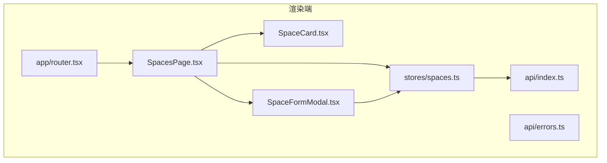
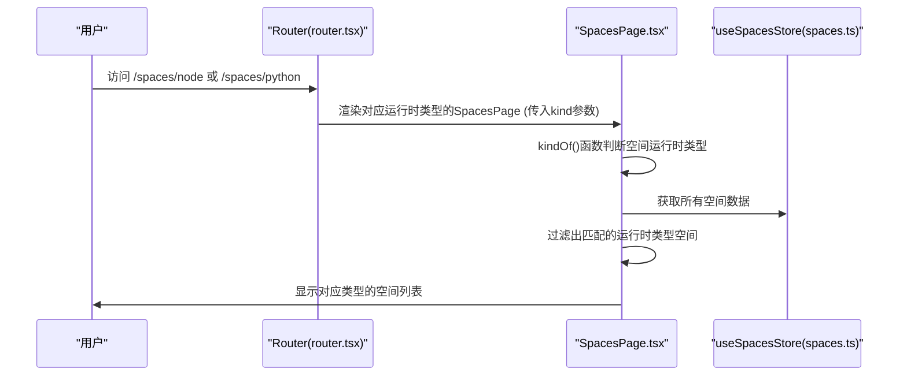
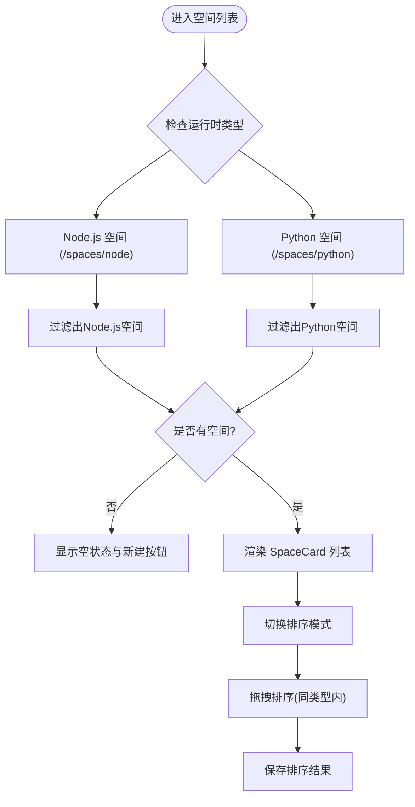
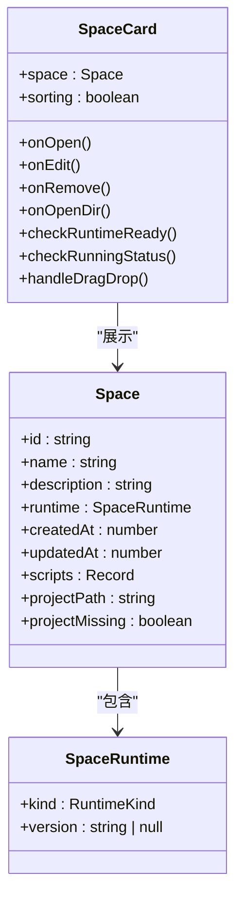
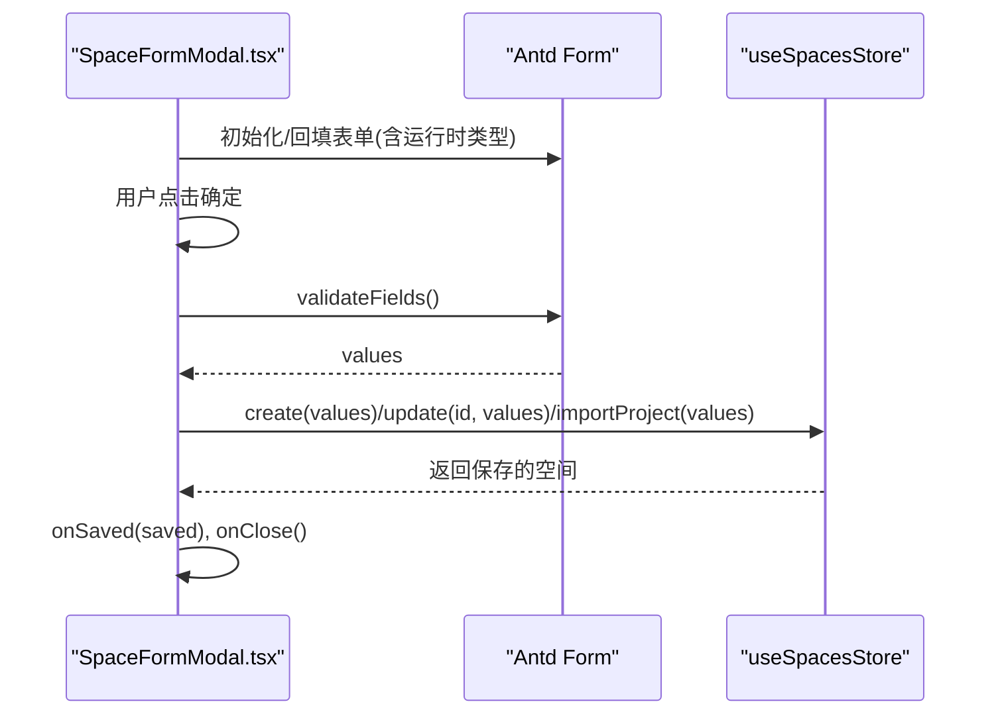
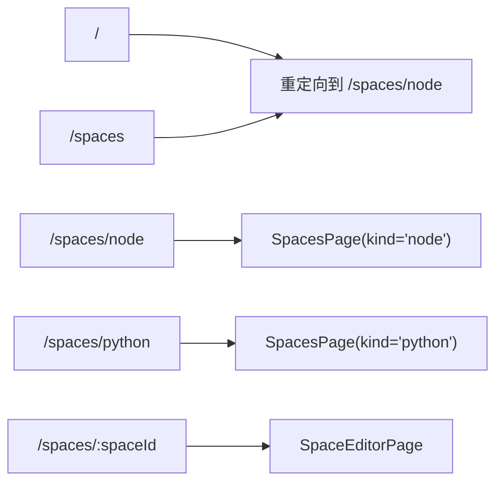
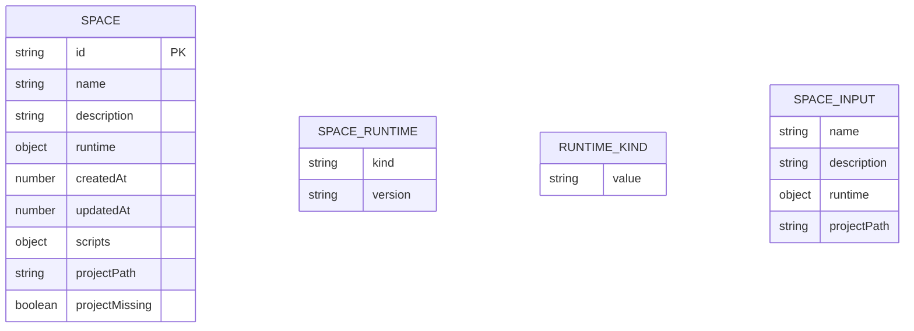
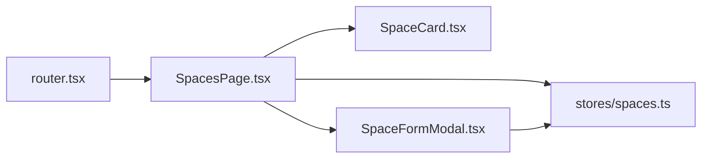

基于我对代码的分析，我现在了解了主要的变更内容。让我更新文档以反映这些重大重构：

# 空间管理页面

<cite>
**本文引用的文件**   
- [SpacesPage.tsx](file://src/renderer/src/pages/spaces/SpacesPage.tsx)
- [SpaceCard.tsx](file://src/renderer/src/pages/spaces/SpaceCard.tsx)
- [SpaceFormModal.tsx](file://src/renderer/src/pages/spaces/SpaceFormModal.tsx)
- [router.tsx](file://src/renderer/src/app/router.tsx)
- [space.ts](file://src/shared/types/space.ts)
- [runtime.ts](file://src/shared/types/runtime.ts)
- [spaces.ts](file://src/renderer/src/stores/spaces.ts)
</cite>

## 更新摘要
**所做更改**   
- **重大重构**：从统一的空间列表重构为运行时特定的独立路由（/spaces/node 和 /spaces/python）
- **简化组件架构**：SpacesPage 组件现在通过 kind 参数接收运行时类型，实现运行时隔离
- **新增 kindOf() 函数**：提供向后兼容的运行时类型判断逻辑
- **改进路由系统**：为 Node.js 和 Python 分别创建独立的路由路径
- **优化状态管理**：支持跨运行时类型的排序限制和数据隔离

## 目录
1. [简介](#简介)
2. [项目结构](#项目结构)
3. [核心组件与职责](#核心组件与职责)
4. [架构总览](#架构总览)
5. [详细组件分析](#详细组件分析)
6. [依赖关系分析](#依赖关系分析)
7. [性能与可扩展性](#性能与可扩展性)
8. [故障排查指南](#故障排查指南)
9. [结论](#结论)

## 简介
本文件为"空间管理页面"的技术文档，聚焦以下目标：
- 说明 SpacesPage 组件的空间列表展示、CRUD 操作与状态管理。
- 解释 SpaceCard 的卡片设计与交互逻辑。
- 介绍 SpaceFormModal 模态框的表单验证与数据提交流程。
- 说明空间数据的本地存储与同步策略（主进程服务与渲染进程状态）。
- 提供用户操作流程与时序图，以及错误处理机制与最佳实践。

**重大更新** 完成了从统一空间列表到运行时特定路由的重大重构，将 Node.js 和 Python 空间分别管理在独立的路由路径下，显著提升了用户体验和组织效率。

## 项目结构
空间管理相关代码分布在渲染端页面、状态管理、共享类型定义与路由配置：
- 渲染端页面：SpacesPage、SpaceCard、SpaceFormModal
- 路由配置：router.tsx（支持 /spaces/node 和 /spaces/python 路径）
- 渲染端状态：useSpacesStore（Zustand）
- 共享类型：Space、RuntimeKind、SpaceInput
- API桥接：renderer/api/index.ts 与 errors.ts

图表来源
- [SpacesPage.tsx:1-230](file://src/renderer/src/pages/spaces/SpacesPage.tsx#L1-L230)
- [SpaceCard.tsx:1-92](file://src/renderer/src/pages/spaces/SpaceCard.tsx#L1-L92)
- [SpaceFormModal.tsx:1-191](file://src/renderer/src/pages/spaces/SpaceFormModal.tsx#L1-L191)
- [router.tsx:1-25](file://src/renderer/src/app/router.tsx#L1-L25)
- [spaces.ts:1-60](file://src/renderer/src/stores/spaces.ts#L1-L60)

章节来源
- [SpacesPage.tsx:1-230](file://src/renderer/src/pages/spaces/SpacesPage.tsx#L1-L230)
- [SpaceCard.tsx:1-92](file://src/renderer/src/pages/spaces/SpaceCard.tsx#L1-L92)
- [SpaceFormModal.tsx:1-191](file://src/renderer/src/pages/spaces/SpaceFormModal.tsx#L1-L191)
- [router.tsx:1-25](file://src/renderer/src/app/router.tsx#L1-L25)
- [spaces.ts:1-60](file://src/renderer/src/stores/spaces.ts#L1-L60)

## 核心组件与职责
- **SpacesPage**：空间列表页入口，负责展示特定运行时类型的空间卡片、触发创建/编辑/删除、打开空间详情路由。**重大更新** 支持通过 kind 参数接收运行时类型（'node' | 'python'），实现了运行时隔离和独立路由。
- **SpaceCard**：单个空间的可视化卡片，展示名称、描述、运行时版本与更新时间，并提供编辑、打开目录、删除等操作。
- **SpaceFormModal**：空间的新建/编辑模态框，包含表单校验、默认值填充、提交到 store 并持久化。
- **useSpacesStore**：基于 Zustand 的状态管理，封装 create/update/remove/load/put/reorder 等方法，调用 IPC 与更新本地状态。
- **路由系统**：**重大更新** 为Node.js和Python分别创建独立的路由路径（/spaces/node和/spaces/python），实现运行时类型的物理隔离。

章节来源
- [SpacesPage.tsx:16-230](file://src/renderer/src/pages/spaces/SpacesPage.tsx#L16-L230)
- [SpaceCard.tsx:23-91](file://src/renderer/src/pages/spaces/SpaceCard.tsx#L23-L91)
- [SpaceFormModal.tsx:53-191](file://src/renderer/src/pages/spaces/SpaceFormModal.tsx#L53-L191)
- [router.tsx:8-24](file://src/renderer/src/app/router.tsx#L8-L24)

## 架构总览
**重大更新** 路由系统将Node.js和Python空间分别映射到不同的URL路径，每个SpacesPage实例只处理对应运行时类型的空间，通过kind参数进行过滤和显示。

图表来源
- [router.tsx:13-17](file://src/renderer/src/app/router.tsx#L13-L17)
- [SpacesPage.tsx:16-17](file://src/renderer/src/pages/spaces/SpacesPage.tsx#L16-L17)
- [SpacesPage.tsx:136-139](file://src/renderer/src/pages/spaces/SpacesPage.tsx#L136-L139)

## 详细组件分析

### SpacesPage 组件
**重大更新** 组件现在通过 kind 参数接收运行时类型，实现了运行时隔离：
- **运行时类型分组**：通过`kind`参数接收运行时类型（'node' | 'python'），使用`kindOf()`函数判断空间的运行时类型。
- **路由集成**：在`/spaces/node`和`/spaces/python`路径下分别渲染对应的空间列表。
- **动态标题**：根据运行时类型显示"Node.js 空间"或"Python 空间"标题。
- **空状态优化**：当某个运行时类型没有空间时，显示相应的空状态信息和操作按钮。
- **拖拽排序**：支持在同一运行时类型内拖拽调整空间顺序，防止跨运行时类型排序。
- **项目导入**：支持从现有项目目录导入，自动检测项目信息并预填表单字段。

图表来源
- [SpacesPage.tsx:16-17](file://src/renderer/src/pages/spaces/SpacesPage.tsx#L16-L17)
- [SpacesPage.tsx:136-139](file://src/renderer/src/pages/spaces/SpacesPage.tsx#L136-L139)
- [SpacesPage.tsx:141-163](file://src/renderer/src/pages/spaces/SpacesPage.tsx#L141-L163)

章节来源
- [SpacesPage.tsx:16-230](file://src/renderer/src/pages/spaces/SpacesPage.tsx#L16-L230)

### SpaceCard 组件
- **信息展示**：名称、描述（无描述时显示占位文案）、运行时版本标签、更新时间。
- **运行时类型识别**：根据`space.runtime.kind`显示Node.js或Python标识。
- **运行环境就绪判断**：根据`space.runtime.version`与已安装运行时列表比对，决定绿色或警告标签。
- **运行状态检测**：实时检测空间中的脚本是否正在运行，显示处理中徽章。
- **项目缺失提示**：当项目目录不存在时显示警告图标和修复链接。
- **交互行为**：点击卡片进入空间详情；工具栏提供编辑、打开目录、删除三个操作。

图表来源
- [SpaceCard.tsx:23-91](file://src/renderer/src/pages/spaces/SpaceCard.tsx#L23-L91)
- [space.ts:16-37](file://src/shared/types/space.ts#L16-L37)

章节来源
- [SpaceCard.tsx:23-91](file://src/renderer/src/pages/spaces/SpaceCard.tsx#L23-L91)
- [space.ts:16-37](file://src/shared/types/space.ts#L16-L37)

### SpaceFormModal 组件
- **表单字段**：名称（必填、长度限制）、描述（可选、最大长度）、运行时版本（下拉选择）。
- **运行时类型支持**：支持Node.js和Python两种运行时类型的表单配置。
- **默认值填充**：编辑模式回填；新建模式优先使用设置中的默认运行时版本，其次取已安装版本第一个。
- **项目导入支持**：支持从现有项目目录导入，自动检测运行时版本提示和项目信息。
- **项目路径重新链接**：允许重新链接移动后的项目目录，保持项目引用有效。
- **PnP 警告提示**：当检测到 Yarn Plug'n'Play 项目时显示警告信息。

图表来源
- [SpaceFormModal.tsx:53-191](file://src/renderer/src/pages/spaces/SpaceFormModal.tsx#L53-L191)

章节来源
- [SpaceFormModal.tsx:53-191](file://src/renderer/src/pages/spaces/SpaceFormModal.tsx#L53-L191)

### 路由系统与运行时类型分组
**重大更新** 路由系统实现了运行时类型的物理隔离：
- **路由配置**：为Node.js和Python分别创建独立的路由路径
  - `/spaces/node` → Node.js空间列表
  - `/spaces/python` → Python空间列表
  - `/spaces/:spaceId` → 空间编辑器
- **默认导航**：访问根路径或`/spaces`时重定向到`/spaces/node`
- **运行时类型传递**：通过`kind`参数向SpacesPage组件传递运行时类型
- **侧边栏高亮**：根据当前空间所属的运行时类型高亮对应的菜单项

图表来源
- [router.tsx:13-17](file://src/renderer/src/app/router.tsx#L13-L17)

章节来源
- [router.tsx:8-24](file://src/renderer/src/app/router.tsx#L8-L24)

### 数据模型
- **Space**：包含id、name、description、runtime（包含kind和version）、时间戳与scripts映射。**更新** runtime字段替代了原来的nodeVersion字段，支持多运行时类型。
- **SpaceRuntime**：新的运行时接口，包含kind（'node' | 'python'）和version字段。
- **RuntimeKind**：运行时类型枚举，定义为`'node' | 'python'`。
- **SpaceInput**：用于新建/更新的输入模型，包含runtime对象而非单独的nodeVersion字段。

图表来源
- [space.ts:16-47](file://src/shared/types/space.ts#L16-L47)
- [runtime.ts:1](file://src/shared/types/runtime.ts#L1)

章节来源
- [space.ts:16-47](file://src/shared/types/space.ts#L16-L47)
- [runtime.ts:1](file://src/shared/types/runtime.ts#L1)

## 依赖关系分析
- **渲染端依赖**：
  - SpacesPage 依赖 SpaceCard、SpaceFormModal、useSpacesStore、路由与国际化。**重大更新** 依赖运行时类型判断和路由配置。
  - SpaceCard 依赖 useRuntimesStore、useRunsStore 与格式化工具。
  - SpaceFormModal 依赖 useRuntimesStore、useSettingsStore、useSpacesStore 与 Antd Form。
- **路由依赖**：
  - router.tsx 管理所有页面路由，为不同运行时类型创建独立的路径。

图表来源
- [router.tsx:1-25](file://src/renderer/src/app/router.tsx#L1-L25)
- [SpacesPage.tsx:1-14](file://src/renderer/src/pages/spaces/SpacesPage.tsx#L1-L14)
- [SpaceCard.tsx:1-8](file://src/renderer/src/pages/spaces/SpaceCard.tsx#L1-L8)
- [SpaceFormModal.tsx:1-12](file://src/renderer/src/pages/spaces/SpaceFormModal.tsx#L1-L12)
- [spaces.ts:1-3](file://src/renderer/src/stores/spaces.ts#L1-L3)

章节来源
- [router.tsx:1-25](file://src/renderer/src/app/router.tsx#L1-L25)
- [SpacesPage.tsx:1-14](file://src/renderer/src/pages/spaces/SpacesPage.tsx#L1-L14)
- [SpaceCard.tsx:1-8](file://src/renderer/src/pages/spaces/SpaceCard.tsx#L1-L8)
- [SpaceFormModal.tsx:1-12](file://src/renderer/src/pages/spaces/SpaceFormModal.tsx#L1-L12)
- [spaces.ts:1-3](file://src/renderer/src/stores/spaces.ts#L1-L3)

## 性能与可扩展性
- **运行时类型过滤**：通过kindOf()函数进行高效的运行时类型判断，避免不必要的渲染。
- **路由优化**：**重大更新** 为不同运行时类型创建独立的路由，减少组件间的状态污染。
- **列表渲染优化**：SpaceCard 仅展示必要信息，避免重计算；节点版本就绪判断基于已安装运行时集合。
- **拖拽排序性能**：使用虚拟 DOM 和状态优化，避免不必要的重渲染；排序结果持久化减少重复计算。
- **并发安全**：service.mutate 使用 per-space 的 Promise 链串行化读写，避免并发覆盖。
- **扩展建议**：
  - 对长列表可引入虚拟滚动或分页加载。
  - 对运行时类型检测可加入缓存与懒加载。
  - 对错误提示可增加重试与降级策略。
  - 对拖拽排序可考虑添加动画过渡效果。

## 故障排查指南
- **路由问题**：
  - **重大更新** 现象：访问/spaces/node或/spaces/python时页面空白或404。
  - 原因：路由配置错误或SpacesPage组件props传递失败。
  - 处理：检查router.tsx中的路由配置，确认kind参数正确传递。
  - 参考位置：[router.tsx:13-17](file://src/renderer/src/app/router.tsx#L13-L17)
- **运行时类型判断错误**：
  - 现象：空间显示错误的运行时类型或无法正确分类。
  - 原因：kindOf()函数逻辑错误或space.runtime字段缺失。
  - 处理：检查space.runtime.kind字段是否存在，确认kindOf()函数的判断逻辑。
  - 参考位置：[SpacesPage.tsx:16-17](file://src/renderer/src/pages/spaces/SpacesPage.tsx#L16-L17)
- **拖拽排序异常**：
  - 现象：拖拽后排序未保存或跨运行时类型排序。
  - 原因：网络请求失败或权限不足导致排序持久化失败。
  - 处理：检查网络连接和文件系统权限，确保同一运行时类型内的排序。
  - 参考位置：[SpacesPage.tsx:92-117](file://src/renderer/src/pages/spaces/SpacesPage.tsx#L92-L117)
- **表单提交失败**：
  - 现象：新建/编辑后弹出错误提示。
  - 原因：后端返回ApiError，前端通过formatError转换为可读消息。
  - 处理：查看错误码与参数，定位具体原因（如名称重复、路径不可写等）。
  - 参考位置：[SpaceFormModal.tsx:111-137](file://src/renderer/src/pages/spaces/SpaceFormModal.tsx#L111-L137)

章节来源
- [router.tsx:13-17](file://src/renderer/src/app/router.tsx#L13-L17)
- [SpacesPage.tsx:16-17](file://src/renderer/src/pages/spaces/SpacesPage.tsx#L16-L17)
- [SpacesPage.tsx:92-117](file://src/renderer/src/pages/spaces/SpacesPage.tsx#L92-L117)
- [SpaceFormModal.tsx:111-137](file://src/renderer/src/pages/spaces/SpaceFormModal.tsx#L111-L137)

## 结论
空间管理页面通过清晰的组件分层与状态管理，实现了空间列表展示、CRUD 操作与本地状态同步。**重大重构** 包括从统一空间列表到运行时特定路由的转变、kindOf()函数实现、路由系统升级等核心功能增强，显著提升了用户体验和组织效率。渲染端使用 Zustand 维护 UI 状态，主进程通过 IPC 与 service 层保障数据一致性与并发安全。建议在后续迭代中继续优化拖拽动画效果、增加更多项目检测功能、完善错误恢复机制，以进一步提升用户体验与系统健壮性。