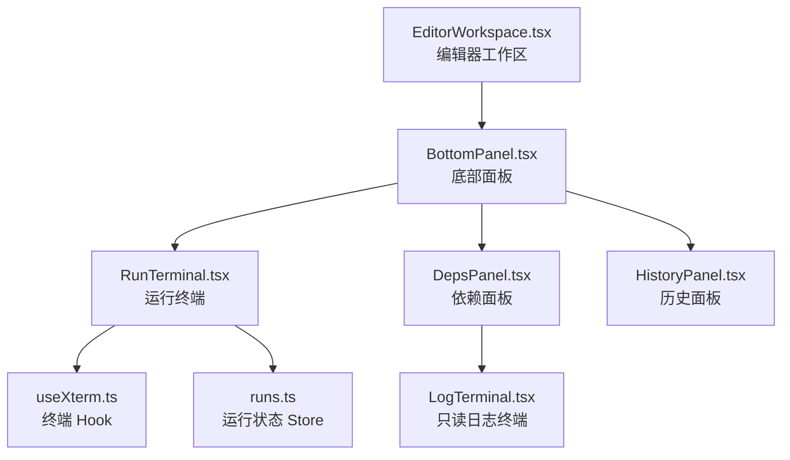
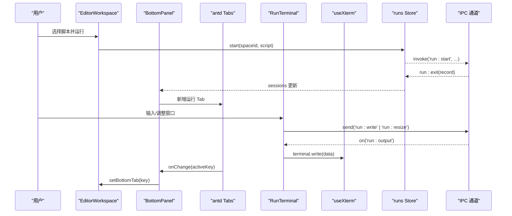
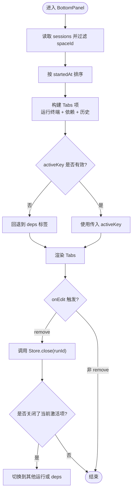
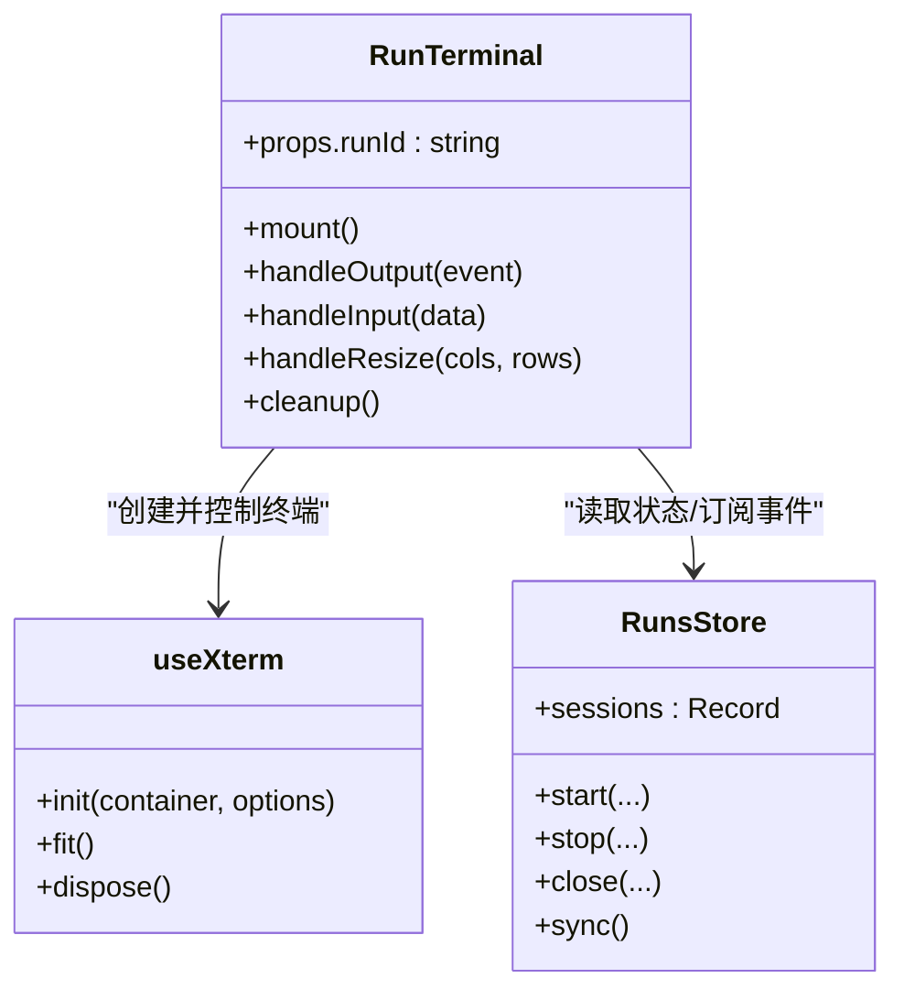
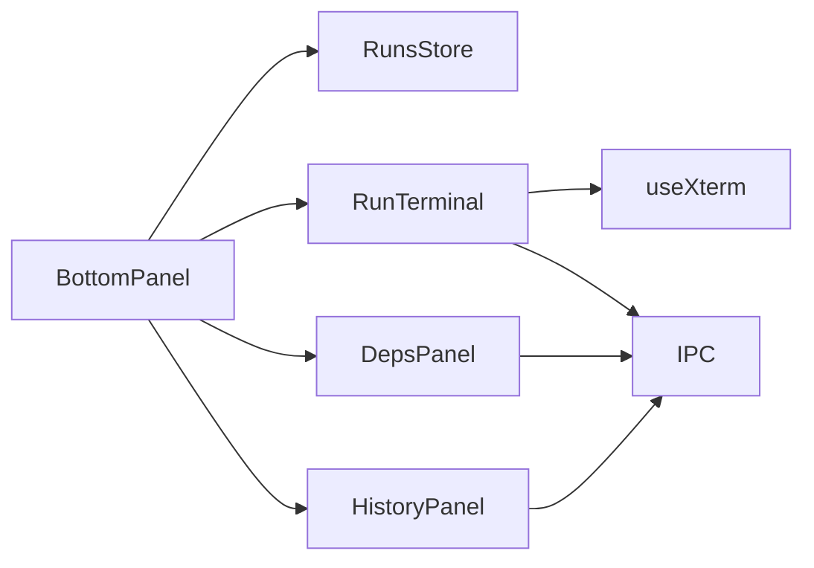

# BottomPanel 底部面板

<cite>
**本文引用的文件**   
- [BottomPanel.tsx](file://src/renderer/src/pages/editor/BottomPanel.tsx)
- [EditorWorkspace.tsx](file://src/renderer/src/pages/editor/EditorWorkspace.tsx)
- [RunTerminal.tsx](file://src/renderer/src/components/terminal/RunTerminal.tsx)
- [useXterm.ts](file://src/renderer/src/components/terminal/useXterm.ts)
- [LogTerminal.tsx](file://src/renderer/src/components/terminal/LogTerminal.tsx)
- [runs.ts](file://src/renderer/src/stores/runs.ts)
- [run.ts](file://src/shared/types/run.ts)
- [DepsPanel.tsx](file://src/renderer/src/components/deps/DepsPanel.tsx)
- [HistoryPanel.tsx](file://src/renderer/src/components/history/HistoryPanel.tsx)
</cite>

## 目录
1. [简介](#简介)
2. [项目结构定位](#项目结构定位)
3. [核心组件与职责](#核心组件与职责)
4. [架构总览](#架构总览)
5. [详细组件分析](#详细组件分析)
6. [依赖关系分析](#依赖关系分析)
7. [性能与内存优化](#性能与内存优化)
8. [故障排查指南](#故障排查指南)
9. [使用与定制指南](#使用与定制指南)
10. [结论](#结论)

## 简介
BottomPanel 是编辑器工作区底部的可折叠面板，用于集中展示脚本运行终端、依赖管理与执行历史。它通过标签页组织三类内容：
- 每个脚本运行的交互式终端（按运行会话生成 Tab）
- 依赖管理面板（安装、更新、卸载与实时日志）
- 执行历史面板（查看、清理历史记录与日志）

该面板负责：
- 状态管理：从全局运行状态中派生当前空间下的运行列表与活跃标签
- 内容渲染：动态构建 Tabs 项并挂载对应子组件
- 终端集成：将 xterm.js 终端绑定到具体运行会话，双向通信输入输出
- 调试信息展示：在依赖面板和历史面板中提供日志查看能力

## 项目结构定位
BottomPanel 位于编辑器页面模块下，作为 EditorWorkspace 的子区域，承载底部交互区。其内部通过 antd Tabs 组合多个功能面板，并与运行状态 store 和终端组件深度集成。

图表来源
- [EditorWorkspace.tsx:53-93](file://src/renderer/src/pages/editor/EditorWorkspace.tsx#L53-L93)
- [BottomPanel.tsx:30-74](file://src/renderer/src/pages/editor/BottomPanel.tsx#L30-L74)
- [RunTerminal.tsx:1-45](file://src/renderer/src/components/terminal/RunTerminal.tsx#L1-L45)
- [useXterm.ts:1-59](file://src/renderer/src/components/terminal/useXterm.ts#L1-L59)
- [DepsPanel.tsx:1-103](file://src/renderer/src/components/deps/DepsPanel.tsx#L1-L103)
- [HistoryPanel.tsx:1-126](file://src/renderer/src/components/history/HistoryPanel.tsx#L1-L126)

章节来源
- [EditorWorkspace.tsx:53-93](file://src/renderer/src/pages/editor/EditorWorkspace.tsx#L53-L93)
- [BottomPanel.tsx:1-74](file://src/renderer/src/pages/editor/BottomPanel.tsx#L1-L74)

## 核心组件与职责
- BottomPanel
  - 根据当前 spaceId 过滤运行记录，生成运行终端 Tab
  - 维护固定 Tab：依赖面板、历史面板
  - 处理标签切换与关闭逻辑，联动全局状态
- RunTerminal
  - 为单个运行会话创建交互式终端
  - 订阅运行输出事件，回写终端；转发键盘输入与尺寸变化
- useXterm
  - 封装 xterm.js 初始化、自适应尺寸、主题同步与销毁
- LogTerminal
  - 只读终端，用于依赖安装日志与历史日志展示
- runs Store
  - 维护运行会话、输出分片、最新运行映射、启动/停止/关闭等动作
- DepsPanel / HistoryPanel
  - 分别提供依赖管理与历史记录的 UI 与数据流

章节来源
- [BottomPanel.tsx:23-74](file://src/renderer/src/pages/editor/BottomPanel.tsx#L23-L74)
- [RunTerminal.tsx:7-44](file://src/renderer/src/components/terminal/RunTerminal.tsx#L7-L44)
- [useXterm.ts:12-59](file://src/renderer/src/components/terminal/useXterm.ts#L12-L59)
- [LogTerminal.tsx:14-32](file://src/renderer/src/components/terminal/LogTerminal.tsx#L14-L32)
- [runs.ts:1-79](file://src/renderer/src/stores/runs.ts#L1-L79)
- [DepsPanel.tsx:14-103](file://src/renderer/src/components/deps/DepsPanel.tsx#L14-L103)
- [HistoryPanel.tsx:20-126](file://src/renderer/src/components/history/HistoryPanel.tsx#L20-L126)

## 架构总览
BottomPanel 的运行时交互流程如下：

图表来源
- [EditorWorkspace.tsx:53-93](file://src/renderer/src/pages/editor/EditorWorkspace.tsx#L53-L93)
- [BottomPanel.tsx:30-74](file://src/renderer/src/pages/editor/BottomPanel.tsx#L30-L74)
- [RunTerminal.tsx:12-41](file://src/renderer/src/components/terminal/RunTerminal.tsx#L12-L41)
- [useXterm.ts:21-59](file://src/renderer/src/components/terminal/useXterm.ts#L21-L59)
- [runs.ts:29-79](file://src/renderer/src/stores/runs.ts#L29-L79)

## 详细组件分析

### BottomPanel 组件
- 功能要点
  - 从 runs Store 获取 sessions，按 spaceId 过滤并按开始时间排序
  - 为每个运行记录生成一个可关闭的 Tab，标签显示脚本名与状态徽标
  - 提供两个不可关闭的固定 Tab：依赖面板、历史面板
  - 当 activeKey 无效时回退到默认依赖面板
  - 处理关闭操作：调用 Store.close 并从 Tab 列表中移除；若关闭的是当前激活项，则切换到其他运行或默认面板
- 关键实现点
  - 状态映射：运行状态到徽标状态的映射表
  - 标签项构造：将运行记录映射为 TabsProps.items
  - 编辑回调：仅允许 remove 操作，且需校验 key 类型

图表来源
- [BottomPanel.tsx:30-74](file://src/renderer/src/pages/editor/BottomPanel.tsx#L30-L74)
- [runs.ts:41-50](file://src/renderer/src/stores/runs.ts#L41-L50)

章节来源
- [BottomPanel.tsx:13-74](file://src/renderer/src/pages/editor/BottomPanel.tsx#L13-L74)

### RunTerminal 与终端集成
- 功能要点
  - 为指定 runId 创建 xterm.js 终端实例
  - 首次挂载时将已累积的输出分片一次性写入终端
  - 订阅 run:output 事件，增量追加输出
  - 监听终端输入与尺寸变化，仅在运行中时转发给后端
  - 组件卸载时清理事件监听、释放终端实例
- 与 Store 的协作
  - 通过 useRunsStore.getState() 直接访问 sessions 以判断运行状态与读取初始输出
  - 通过 IPC 发送 run:write 与 run:resize 指令

图表来源
- [RunTerminal.tsx:7-44](file://src/renderer/src/components/terminal/RunTerminal.tsx#L7-L44)
- [useXterm.ts:12-59](file://src/renderer/src/components/terminal/useXterm.ts#L12-L59)
- [runs.ts:1-79](file://src/renderer/src/stores/runs.ts#L1-L79)

章节来源
- [RunTerminal.tsx:1-45](file://src/renderer/src/components/terminal/RunTerminal.tsx#L1-L45)
- [useXterm.ts:1-59](file://src/renderer/src/components/terminal/useXterm.ts#L1-L59)
- [runs.ts:1-79](file://src/renderer/src/stores/runs.ts#L1-L79)

### 依赖面板（DepsPanel）
- 功能要点
  - 列出当前空间的依赖，支持安装、更新、卸载与取消任务
  - 使用 Splitter 分割依赖列表与日志区域
  - 通过 LogTerminal 展示依赖任务的实时输出
  - 订阅 deps:task 事件，按 taskId 过滤并写入日志
- 与 Store 的协作
  - 使用 useDepsStore 管理任务状态与 revision 变更驱动刷新

章节来源
- [DepsPanel.tsx:14-103](file://src/renderer/src/components/deps/DepsPanel.tsx#L14-L103)
- [LogTerminal.tsx:14-32](file://src/renderer/src/components/terminal/LogTerminal.tsx#L14-L32)

### 历史面板（HistoryPanel）
- 功能要点
  - 拉取并展示历史执行记录，包含状态、脚本名、参数、Node 版本、时间与退出码
  - 支持清空历史、删除单条记录
  - 打开日志查看弹窗，查看某次执行的完整日志
  - 订阅 run:exit 事件，自动刷新当前空间的历史

章节来源
- [HistoryPanel.tsx:20-126](file://src/renderer/src/components/history/HistoryPanel.tsx#L20-L126)

## 依赖关系分析
- 组件耦合
  - BottomPanel 强依赖 runs Store 提供的 sessions 与 close 方法
  - RunTerminal 依赖 useXterm 与 IPC 通道进行终端交互
  - DepsPanel 与 HistoryPanel 各自独立，但都通过 IPC 与后端服务通信
- 外部依赖
  - antd Tabs/Badge/Table 等 UI 组件
  - xterm.js 终端库
  - i18n 国际化
- 潜在循环依赖
  - 无直接循环引用；各组件通过 Store 与 IPC 解耦

图表来源
- [BottomPanel.tsx:30-74](file://src/renderer/src/pages/editor/BottomPanel.tsx#L30-L74)
- [RunTerminal.tsx:1-45](file://src/renderer/src/components/terminal/RunTerminal.tsx#L1-L45)
- [DepsPanel.tsx:1-103](file://src/renderer/src/components/deps/DepsPanel.tsx#L1-L103)
- [HistoryPanel.tsx:1-126](file://src/renderer/src/components/history/HistoryPanel.tsx#L1-L126)

章节来源
- [BottomPanel.tsx:1-74](file://src/renderer/src/pages/editor/BottomPanel.tsx#L1-L74)
- [RunTerminal.tsx:1-45](file://src/renderer/src/components/terminal/RunTerminal.tsx#L1-L45)
- [DepsPanel.tsx:1-103](file://src/renderer/src/components/deps/DepsPanel.tsx#L1-L103)
- [HistoryPanel.tsx:1-126](file://src/renderer/src/components/history/HistoryPanel.tsx#L1-L126)

## 性能与内存优化
- 输出分片限制
  - runs Store 对每个运行会话最多保留 MAX_CHUNKS=5000 个输出分片，超出时裁剪旧数据，避免无限增长导致内存泄漏
- 终端实例生命周期
  - useXterm 在容器元素上创建 FitAddon 与 ResizeObserver，并在卸载时断开观察器与释放终端实例，防止资源泄露
- 渲染优化
  - BottomPanel 使用 useMemo 计算 runs 列表，减少不必要的重渲染
  - Tabs 使用 editable-card 模式，按需挂载子组件，避免同时渲染所有终端
- 事件订阅清理
  - RunTerminal 在卸载时移除输出监听、输入与 resize 监听，并重置终端，确保无悬挂事件
- 建议
  - 对于高频输出的场景，可在 useXterm 中启用虚拟滚动或节流写入
  - 对长历史日志，考虑分页加载或懒加载日志内容

章节来源
- [runs.ts:5-79](file://src/renderer/src/stores/runs.ts#L5-L79)
- [useXterm.ts:21-59](file://src/renderer/src/components/terminal/useXterm.ts#L21-L59)
- [BottomPanel.tsx:35-41](file://src/renderer/src/pages/editor/BottomPanel.tsx#L35-L41)
- [RunTerminal.tsx:35-41](file://src/renderer/src/components/terminal/RunTerminal.tsx#L35-L41)

## 故障排查指南
- 终端无输出
  - 检查 run:output 事件是否正确分发到对应 runId
  - 确认 RunTerminal 是否在运行中才写入输出
- 终端无法输入
  - 确认 isRunning() 返回 true 时才转发输入
  - 检查 IPC 通道是否成功发送 run:write
- 终端尺寸异常
  - 确认 useXterm 的 fit 逻辑在可见时执行
  - 检查 ResizeObserver 是否正常触发
- 标签关闭后未切换
  - 检查 onEdit 回调中是否调用了 close 与 onChange
  - 确认 runs.find 能找到替代的运行 ID
- 历史面板不刷新
  - 检查 run:exit 事件是否触发并匹配 spaceId
  - 确认 history:list 调用成功

章节来源
- [RunTerminal.tsx:12-41](file://src/renderer/src/components/terminal/RunTerminal.tsx#L12-L41)
- [useXterm.ts:36-59](file://src/renderer/src/components/terminal/useXterm.ts#L36-L59)
- [BottomPanel.tsx:65-71](file://src/renderer/src/pages/editor/BottomPanel.tsx#L65-L71)
- [HistoryPanel.tsx:44-47](file://src/renderer/src/components/history/HistoryPanel.tsx#L44-L47)

## 使用与定制指南
- 基本用法
  - 在编辑器工作区中引入 BottomPanel，传入 spaceId、activeKey 与 onChange 回调
  - 示例路径：[EditorWorkspace.tsx:88-90](file://src/renderer/src/pages/editor/EditorWorkspace.tsx#L88-L90)
- 自定义标签
  - 可通过扩展 items 构建逻辑增加新的固定标签或业务面板
  - 注意保持 DEPS_TAB 与 HISTORY_TAB 常量的一致性
- 终端样式定制
  - 修改 useXterm 中的字体、字号与主题配置
  - 示例路径：[useXterm.ts:25-31](file://src/renderer/src/components/terminal/useXterm.ts#L25-L31)
- 输出缓冲策略
  - 调整 runs Store 中的 MAX_CHUNKS 以平衡内存与回溯能力
  - 示例路径：[runs.ts:5-6](file://src/renderer/src/stores/runs.ts#L5-L6)
- 国际化
  - 使用 react-i18next 的 t 函数替换硬编码文本
  - 示例路径：[BottomPanel.tsx:31](file://src/renderer/src/pages/editor/BottomPanel.tsx#L31)

章节来源
- [EditorWorkspace.tsx:88-90](file://src/renderer/src/pages/editor/EditorWorkspace.tsx#L88-L90)
- [BottomPanel.tsx:13-14](file://src/renderer/src/pages/editor/BottomPanel.tsx#L13-L14)
- [useXterm.ts:25-31](file://src/renderer/src/components/terminal/useXterm.ts#L25-L31)
- [runs.ts:5-6](file://src/renderer/src/stores/runs.ts#L5-L6)
- [BottomPanel.tsx:31](file://src/renderer/src/pages/editor/BottomPanel.tsx#L31)

## 结论
BottomPanel 通过清晰的标签页组织与稳健的状态管理，将运行终端、依赖管理与执行历史整合在一个统一的底部面板中。它与 xterm.js 的深度集成提供了流畅的交互式终端体验，并通过事件驱动的数据流保证输出与输入的实时性。配合合理的内存限制与组件生命周期管理，该面板在复杂使用场景下仍具备良好的性能与稳定性。开发者可基于现有架构轻松扩展新的面板与交互逻辑，满足多样化的调试与运维需求。