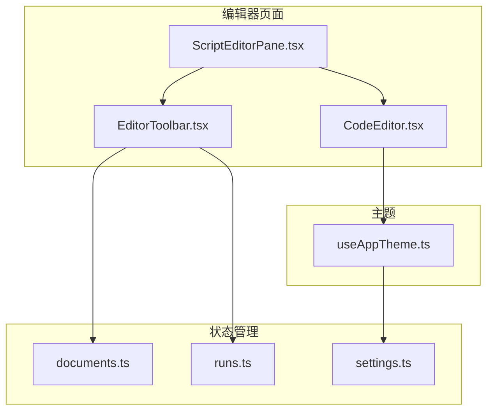
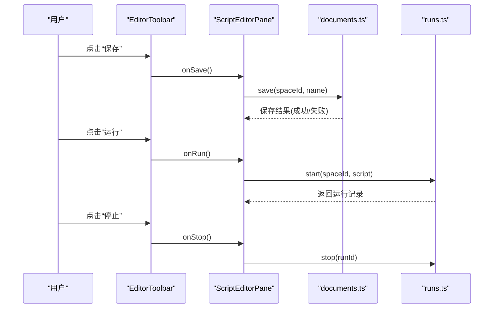
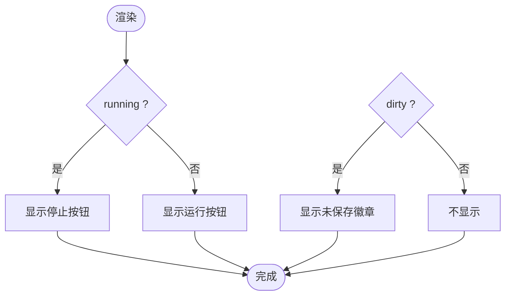
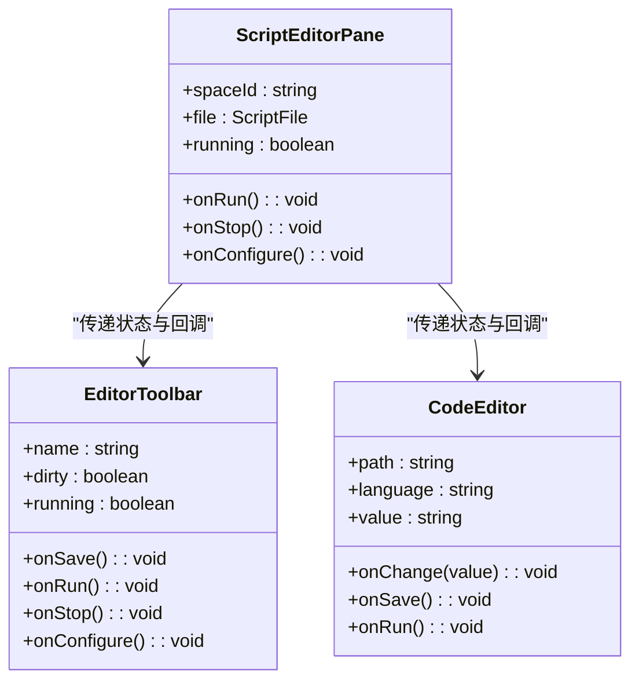
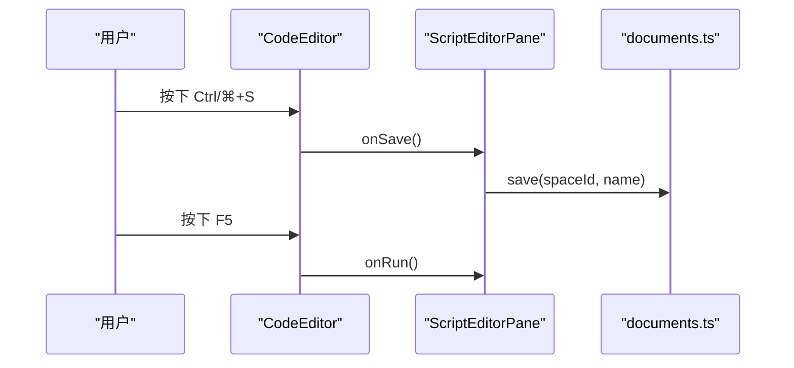
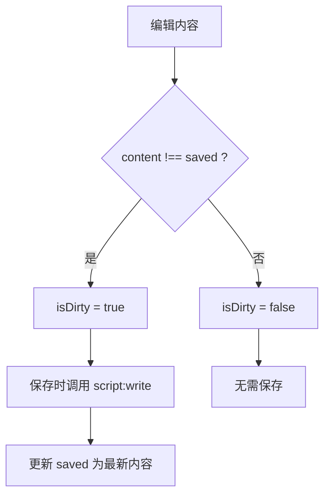
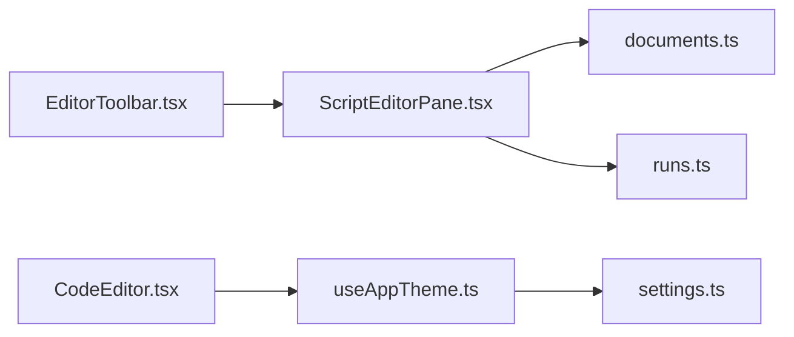

# EditorToolbar 工具栏

<cite>
**本文引用的文件**   
- [EditorToolbar.tsx](file://src/renderer/src/pages/editor/EditorToolbar.tsx)
- [ScriptEditorPane.tsx](file://src/renderer/src/pages/editor/ScriptEditorPane.tsx)
- [CodeEditor.tsx](file://src/renderer/src/components/editor/CodeEditor.tsx)
- [documents.ts](file://src/renderer/src/stores/documents.ts)
- [runs.ts](file://src/renderer/src/stores/runs.ts)
- [useAppTheme.ts](file://src/renderer/src/hooks/useAppTheme.ts)
- [settings.ts](file://src/renderer/src/stores/settings.ts)
</cite>

## 目录
1. [简介](#简介)
2. [项目结构](#项目结构)
3. [核心组件](#核心组件)
4. [架构总览](#架构总览)
5. [详细组件分析](#详细组件分析)
6. [依赖关系分析](#依赖关系分析)
7. [性能与可访问性](#性能与可访问性)
8. [故障排查指南](#故障排查指南)
9. [结论](#结论)
10. [附录：API 参考与使用示例](#附录api-参考与使用示例)

## 简介
EditorToolbar 是编辑器页面的顶部工具栏，提供脚本运行、停止、保存、打开运行配置等常用操作。它通过 props 接收当前脚本名称、未保存状态和运行状态，并触发父组件的回调以完成具体业务逻辑。该组件本身不包含格式化代码功能；格式化能力通常由编辑器或外部服务提供，可在扩展中集成到工具栏。

## 项目结构
EditorToolbar 位于编辑器页面模块下，与 ScriptEditorPane（编辑器面板）、CodeEditor（代码编辑器）以及文档与运行状态存储协同工作。

图表来源
- [EditorToolbar.tsx:1-48](file://src/renderer/src/pages/editor/EditorToolbar.tsx#L1-L48)
- [ScriptEditorPane.tsx:1-79](file://src/renderer/src/pages/editor/ScriptEditorPane.tsx#L1-L79)
- [CodeEditor.tsx:1-53](file://src/renderer/src/components/editor/CodeEditor.tsx#L1-L53)
- [documents.ts:1-67](file://src/renderer/src/stores/documents.ts#L1-L67)
- [runs.ts:1-79](file://src/renderer/src/stores/runs.ts#L1-L79)
- [useAppTheme.ts:1-9](file://src/renderer/src/hooks/useAppTheme.ts#L1-L9)
- [settings.ts:1-26](file://src/renderer/src/stores/settings.ts#L1-L26)

章节来源
- [EditorToolbar.tsx:1-48](file://src/renderer/src/pages/editor/EditorToolbar.tsx#L1-L48)
- [ScriptEditorPane.tsx:1-79](file://src/renderer/src/pages/editor/ScriptEditorPane.tsx#L1-L79)
- [CodeEditor.tsx:1-53](file://src/renderer/src/components/editor/CodeEditor.tsx#L1-L53)
- [documents.ts:1-67](file://src/renderer/src/stores/documents.ts#L1-L67)
- [runs.ts:1-79](file://src/renderer/src/stores/runs.ts#L1-L79)
- [useAppTheme.ts:1-9](file://src/renderer/src/hooks/useAppTheme.ts#L1-L9)
- [settings.ts:1-26](file://src/renderer/src/stores/settings.ts#L1-L26)

## 核心组件
- EditorToolbar：渲染工具栏按钮组，展示脚本名、未保存提示、保存、运行/停止、运行配置入口。
- ScriptEditorPane：编排工具栏、缺失依赖提示、代码编辑器，负责将状态与回调传递给子组件。
- CodeEditor：基于 Monaco 的代码编辑器，绑定快捷键（保存、运行），并根据主题切换编辑器外观。
- documents.ts：维护脚本文档的内存草稿、脏标记、保存流程。
- runs.ts：管理运行会话、输出流、结束事件。
- useAppTheme.ts / settings.ts：应用主题模式与设置同步。

章节来源
- [EditorToolbar.tsx:1-48](file://src/renderer/src/pages/editor/EditorToolbar.tsx#L1-L48)
- [ScriptEditorPane.tsx:1-79](file://src/renderer/src/pages/editor/ScriptEditorPane.tsx#L1-L79)
- [CodeEditor.tsx:1-53](file://src/renderer/src/components/editor/CodeEditor.tsx#L1-L53)
- [documents.ts:1-67](file://src/renderer/src/stores/documents.ts#L1-L67)
- [runs.ts:1-79](file://src/renderer/src/stores/runs.ts#L1-L79)
- [useAppTheme.ts:1-9](file://src/renderer/src/hooks/useAppTheme.ts#L1-L9)
- [settings.ts:1-26](file://src/renderer/src/stores/settings.ts#L1-L26)

## 架构总览
EditorToolbar 作为纯展示层，通过 props 暴露交互点；实际的业务逻辑在父组件与状态库中实现。

图表来源
- [EditorToolbar.tsx:16-47](file://src/renderer/src/pages/editor/EditorToolbar.tsx#L16-L47)
- [ScriptEditorPane.tsx:39-72](file://src/renderer/src/pages/editor/ScriptEditorPane.tsx#L39-L72)
- [documents.ts:40-50](file://src/renderer/src/stores/documents.ts#L40-L50)
- [runs.ts:29-40](file://src/renderer/src/stores/runs.ts#L29-L40)

## 详细组件分析

### EditorToolbar 组件
- 功能按钮
  - 保存：当存在未保存更改时启用，显示快捷键提示。
  - 运行配置：打开运行配置抽屉。
  - 运行/停止：根据 running 状态切换按钮文案与样式。
- 状态管理
  - dirty：来自父组件 isDirty(doc)，表示是否有未保存更改。
  - running：由父组件传入，控制运行/停止按钮切换。
- 用户交互反馈
  - Tooltip 提供快捷键提示。
  - Badge 显示“未保存”提示。
- 与其他组件通信
  - 通过 onSave、onRun、onStop、onConfigure 回调与父组件通信。

图表来源
- [EditorToolbar.tsx:16-47](file://src/renderer/src/pages/editor/EditorToolbar.tsx#L16-L47)
- [documents.ts:64-66](file://src/renderer/src/stores/documents.ts#L64-L66)

章节来源
- [EditorToolbar.tsx:1-48](file://src/renderer/src/pages/editor/EditorToolbar.tsx#L1-L48)

### ScriptEditorPane 编排
- 负责打开文档、保存、安装依赖、错误处理。
- 将 isDirty(doc)、running 等状态传给 EditorToolbar。
- 将保存与运行回调传递给 CodeEditor。

图表来源
- [ScriptEditorPane.tsx:15-72](file://src/renderer/src/pages/editor/ScriptEditorPane.tsx#L15-L72)
- [EditorToolbar.tsx:6-14](file://src/renderer/src/pages/editor/EditorToolbar.tsx#L6-L14)
- [CodeEditor.tsx:9-17](file://src/renderer/src/components/editor/CodeEditor.tsx#L9-L17)

章节来源
- [ScriptEditorPane.tsx:1-79](file://src/renderer/src/pages/editor/ScriptEditorPane.tsx#L1-L79)

### CodeEditor 快捷键与主题
- 快捷键
  - Ctrl/⌘+S：触发保存。
  - F5：触发运行。
- 主题
  - 根据 useAppTheme 返回 light/dark，映射为 vs/vs-dark。

图表来源
- [CodeEditor.tsx:27-31](file://src/renderer/src/components/editor/CodeEditor.tsx#L27-L31)
- [ScriptEditorPane.tsx:39-72](file://src/renderer/src/pages/editor/ScriptEditorPane.tsx#L39-L72)
- [documents.ts:40-50](file://src/renderer/src/stores/documents.ts#L40-L50)

章节来源
- [CodeEditor.tsx:1-53](file://src/renderer/src/components/editor/CodeEditor.tsx#L1-L53)

### 文档与运行状态
- documents.ts
  - open：读取磁盘内容并初始化草稿。
  - edit：更新内存草稿，标记脏状态。
  - save：比较 content 与 saved，调用 IPC 写入并更新 saved。
  - isDirty：判断是否未保存。
- runs.ts
  - start：启动运行，创建会话与最新运行 ID。
  - stop：停止指定运行。
  - on('run:output'/'run:exit')：增量输出与结束状态更新。

图表来源
- [documents.ts:24-50](file://src/renderer/src/stores/documents.ts#L24-L50)
- [documents.ts:64-66](file://src/renderer/src/stores/documents.ts#L64-L66)

章节来源
- [documents.ts:1-67](file://src/renderer/src/stores/documents.ts#L1-L67)
- [runs.ts:1-79](file://src/renderer/src/stores/runs.ts#L1-L79)

### 主题与可访问性
- 主题
  - useAppTheme 从 settings 获取 theme，解析为 light/dark。
  - CodeEditor 根据主题切换编辑器外观。
- 可访问性
  - 按钮使用 Tooltip 提供键盘快捷键提示。
  - Badge 明确标识未保存状态。
  - 语义化图标与文本便于屏幕阅读器理解。

章节来源
- [useAppTheme.ts:1-9](file://src/renderer/src/hooks/useAppTheme.ts#L1-L9)
- [settings.ts:1-26](file://src/renderer/src/stores/settings.ts#L1-L26)
- [EditorToolbar.tsx:24-43](file://src/renderer/src/pages/editor/EditorToolbar.tsx#L24-L43)

## 依赖关系分析
- EditorToolbar 依赖父组件提供的状态与回调，不直接访问 store。
- ScriptEditorPane 组合 EditorToolbar 与 CodeEditor，并桥接 stores。
- CodeEditor 依赖 useAppTheme 与 monaco 编辑器。
- documents.ts 与 runs.ts 通过 zustand 管理状态，并通过 IPC 与主进程通信。

图表来源
- [EditorToolbar.tsx:1-48](file://src/renderer/src/pages/editor/EditorToolbar.tsx#L1-L48)
- [ScriptEditorPane.tsx:1-79](file://src/renderer/src/pages/editor/ScriptEditorPane.tsx#L1-L79)
- [CodeEditor.tsx:1-53](file://src/renderer/src/components/editor/CodeEditor.tsx#L1-L53)
- [documents.ts:1-67](file://src/renderer/src/stores/documents.ts#L1-L67)
- [runs.ts:1-79](file://src/renderer/src/stores/runs.ts#L1-L79)
- [useAppTheme.ts:1-9](file://src/renderer/src/hooks/useAppTheme.ts#L1-L9)
- [settings.ts:1-26](file://src/renderer/src/stores/settings.ts#L1-L26)

章节来源
- [EditorToolbar.tsx:1-48](file://src/renderer/src/pages/editor/EditorToolbar.tsx#L1-L48)
- [ScriptEditorPane.tsx:1-79](file://src/renderer/src/pages/editor/ScriptEditorPane.tsx#L1-L79)
- [CodeEditor.tsx:1-53](file://src/renderer/src/components/editor/CodeEditor.tsx#L1-L53)
- [documents.ts:1-67](file://src/renderer/src/stores/documents.ts#L1-L67)
- [runs.ts:1-79](file://src/renderer/src/stores/runs.ts#L1-L79)
- [useAppTheme.ts:1-9](file://src/renderer/src/hooks/useAppTheme.ts#L1-L9)
- [settings.ts:1-26](file://src/renderer/src/stores/settings.ts#L1-L26)

## 性能与可访问性
- 性能
  - EditorToolbar 无副作用渲染，仅根据 props 计算 UI。
  - 文档保存采用内存草稿对比，避免不必要的 I/O。
  - 运行输出按块累积并限制最大块数，防止内存膨胀。
- 可访问性
  - 按钮具备 Tooltip 与语义化图标。
  - 未保存状态通过 Badge 清晰传达。
  - 快捷键提示提升键盘用户效率。

[本节为通用指导，不涉及具体文件分析]

## 故障排查指南
- 保存无效
  - 检查 isDirty 是否为真，确认 content 与 saved 不一致。
  - 查看 save 调用是否触发 IPC 写入并更新 saved。
- 运行按钮无响应
  - 确认父组件是否正确传递 onRun 回调。
  - 检查 runs.start 是否成功返回运行记录。
- 主题不生效
  - 检查 settings.theme 是否加载成功。
  - 确认 useAppTheme 返回值与编辑器 theme 映射正确。

章节来源
- [documents.ts:40-50](file://src/renderer/src/stores/documents.ts#L40-L50)
- [runs.ts:29-40](file://src/renderer/src/stores/runs.ts#L29-L40)
- [useAppTheme.ts:1-9](file://src/renderer/src/hooks/useAppTheme.ts#L1-L9)
- [settings.ts:11-25](file://src/renderer/src/stores/settings.ts#L11-L25)

## 结论
EditorToolbar 是一个简洁、可组合的工具栏组件，专注于运行、保存与配置入口。其状态与行为由父组件与状态库驱动，具备良好的可测试性与可扩展性。若需新增“格式化代码”等功能，建议在父组件中实现格式化逻辑，并在工具栏中添加对应按钮与回调。

[本节为总结性内容，不涉及具体文件分析]

## 附录：API 参考与使用示例

### EditorToolbar Props
- name: string — 当前脚本名称，用于标题显示。
- dirty: boolean — 是否存在未保存更改。
- running: boolean — 是否正在运行。
- onSave: () => void — 保存回调。
- onRun: () => void — 运行回调。
- onStop: () => void — 停止回调。
- onConfigure: () => void — 打开运行配置回调。

章节来源
- [EditorToolbar.tsx:6-14](file://src/renderer/src/pages/editor/EditorToolbar.tsx#L6-L14)

### 使用示例（概念性）
- 在 ScriptEditorPane 中：
  - 从 documents.store 获取 doc 并计算 isDirty。
  - 从运行状态获取 running。
  - 将 name、dirty、running 与 onSave、onRun、onStop、onConfigure 传递给 EditorToolbar。
- 在 CodeEditor 中：
  - 绑定 Ctrl/⌘+S 为保存，F5 为运行。
  - 根据 useAppTheme 设置编辑器主题。

章节来源
- [ScriptEditorPane.tsx:52-72](file://src/renderer/src/pages/editor/ScriptEditorPane.tsx#L52-L72)
- [CodeEditor.tsx:27-41](file://src/renderer/src/components/editor/CodeEditor.tsx#L27-L41)

### 扩展建议
- 添加“格式化代码”按钮
  - 在 EditorToolbar 中添加新按钮与 Tooltip。
  - 在父组件实现格式化函数，调用语言服务器或后端服务。
  - 将格式化结果写回文档草稿并触发保存。
- 自定义主题
  - 通过 settings.theme 切换 light/dark。
  - 确保编辑器与终端统一主题。

[本节为扩展指导，不涉及具体文件分析]