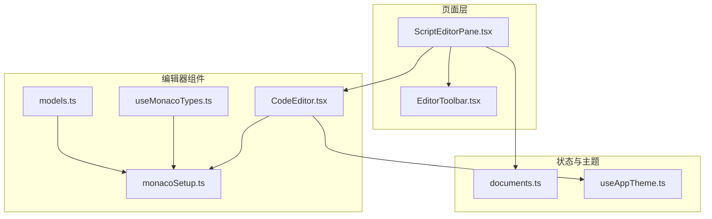
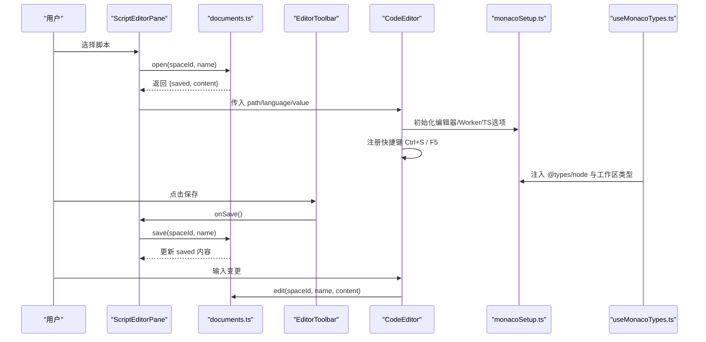
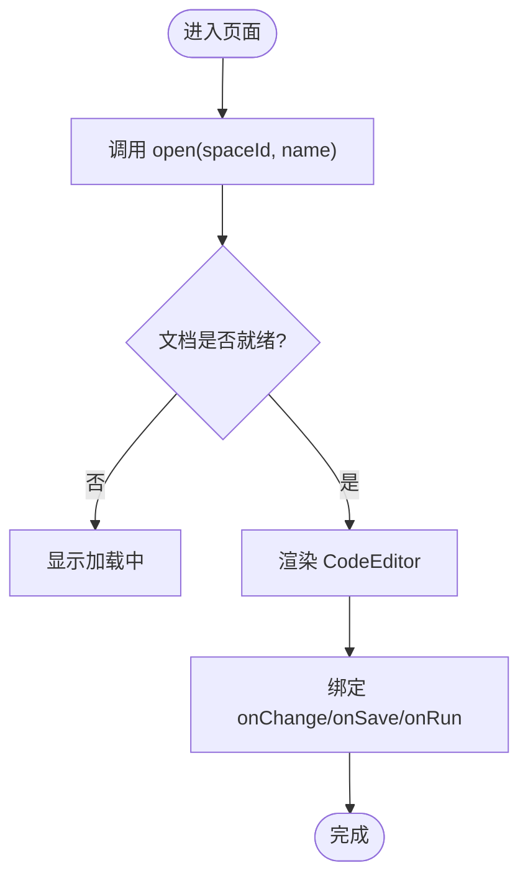
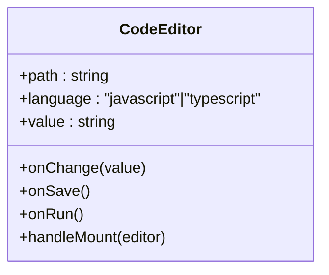
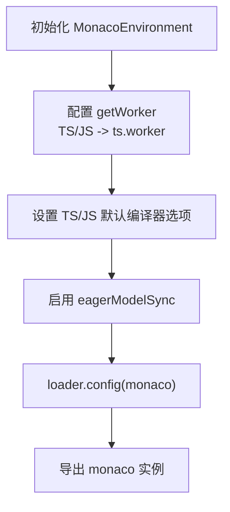
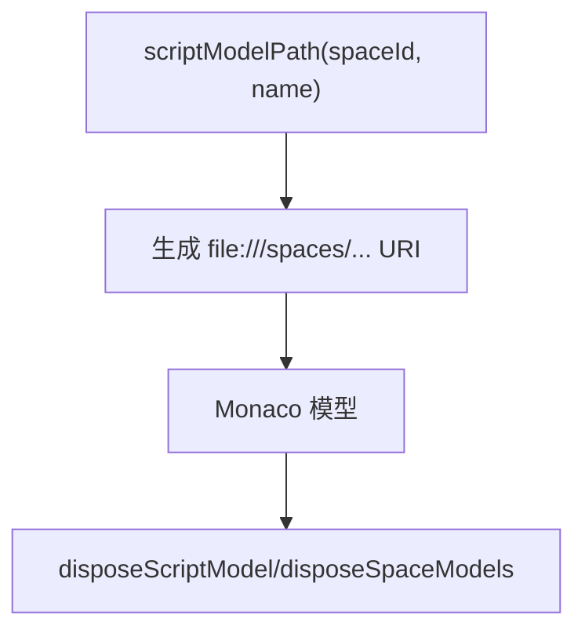
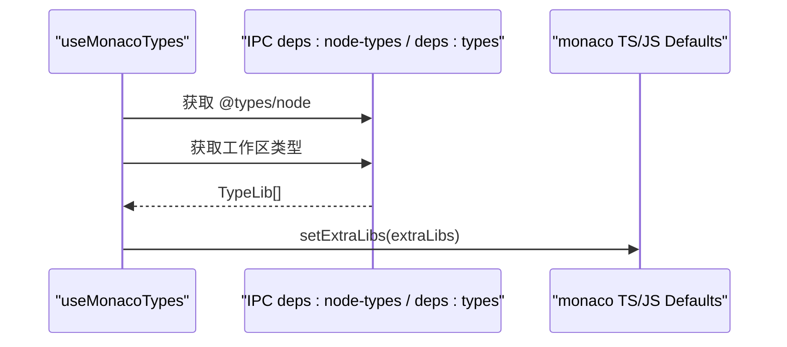
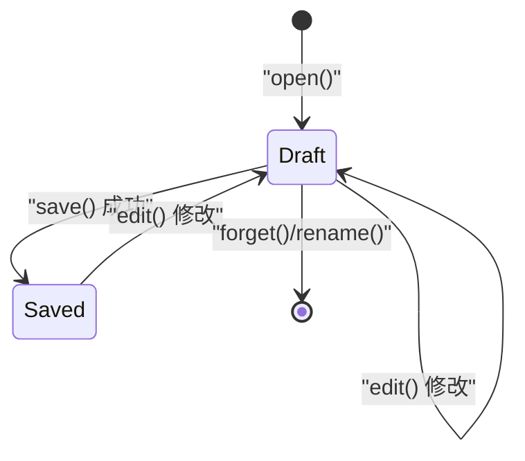
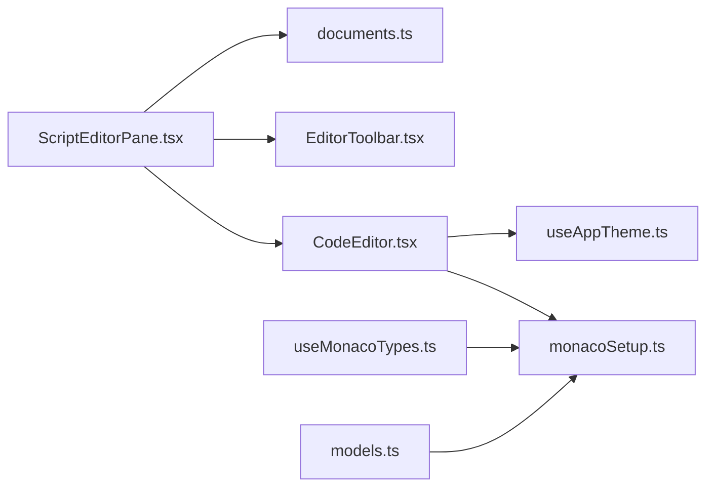

# ScriptEditorPane 代码编辑器

<cite>
**本文引用的文件**   
- [ScriptEditorPane.tsx](file://src/renderer/src/pages/editor/ScriptEditorPane.tsx)
- [CodeEditor.tsx](file://src/renderer/src/components/editor/CodeEditor.tsx)
- [monacoSetup.ts](file://src/renderer/src/components/editor/monacoSetup.ts)
- [models.ts](file://src/renderer/src/components/editor/models.ts)
- [useMonacoTypes.ts](file://src/renderer/src/components/editor/useMonacoTypes.ts)
- [documents.ts](file://src/renderer/src/stores/documents.ts)
- [useAppTheme.ts](file://src/renderer/src/hooks/useAppTheme.ts)
- [EditorToolbar.tsx](file://src/renderer/src/pages/editor/EditorToolbar.tsx)
</cite>

## 目录
1. [简介](#简介)
2. [项目结构](#项目结构)
3. [核心组件](#核心组件)
4. [架构总览](#架构总览)
5. [详细组件分析](#详细组件分析)
6. [依赖关系分析](#依赖关系分析)
7. [性能与优化](#性能与优化)
8. [主题与快捷键](#主题与快捷键)
9. [扩展点与自定义](#扩展点与自定义)
10. [配置示例](#配置示例)
11. [常见问题排查](#常见问题排查)
12. [结论](#结论)

## 简介
本文件为 ScriptEditorPane 代码编辑器组件的全面技术文档。该组件基于 Monaco Editor，提供脚本文件的打开、编辑、保存、运行等能力，并集成 TypeScript/JavaScript 类型提示、工作区依赖类型注入、撤销重做（由 Monaco 内置）、快捷键绑定以及主题切换。文档将覆盖编辑器生命周期、数据流、错误处理、性能优化策略与扩展点开发指南。

## 项目结构
与 ScriptEditorPane 相关的代码主要位于渲染进程的前端部分，采用 React + Zustand 状态管理，并通过 IPC 与主进程交互读写脚本文件与依赖类型。

**图表来源**
- [ScriptEditorPane.tsx:24-76](file://src/renderer/src/pages/editor/ScriptEditorPane.tsx#L24-L76)
- [CodeEditor.tsx:19-51](file://src/renderer/src/components/editor/CodeEditor.tsx#L19-L51)
- [monacoSetup.ts:1-42](file://src/renderer/src/components/editor/monacoSetup.ts#L1-L42)
- [models.ts:1-16](file://src/renderer/src/components/editor/models.ts#L1-L16)
- [useMonacoTypes.ts:1-43](file://src/renderer/src/components/editor/useMonacoTypes.ts#L1-L43)
- [documents.ts:1-66](file://src/renderer/src/stores/documents.ts#L1-L66)
- [useAppTheme.ts:1-8](file://src/renderer/src/hooks/useAppTheme.ts#L1-L8)
- [EditorToolbar.tsx:16-47](file://src/renderer/src/pages/editor/EditorToolbar.tsx#L16-L47)

**章节来源**
- [ScriptEditorPane.tsx:1-79](file://src/renderer/src/pages/editor/ScriptEditorPane.tsx#L1-L79)
- [CodeEditor.tsx:1-53](file://src/renderer/src/components/editor/CodeEditor.tsx#L1-L53)
- [monacoSetup.ts:1-43](file://src/renderer/src/components/editor/monacoSetup.ts#L1-L43)
- [models.ts:1-17](file://src/renderer/src/components/editor/models.ts#L1-L17)
- [useMonacoTypes.ts:1-44](file://src/renderer/src/components/editor/useMonacoTypes.ts#L1-L44)
- [documents.ts:1-67](file://src/renderer/src/stores/documents.ts#L1-L67)
- [useAppTheme.ts:1-9](file://src/renderer/src/hooks/useAppTheme.ts#L1-L9)
- [EditorToolbar.tsx:1-48](file://src/renderer/src/pages/editor/EditorToolbar.tsx#L1-L48)

## 核心组件
- ScriptEditorPane：页面级容器，负责打开/保存脚本、显示工具栏、缺失依赖提示，并将文档内容传递给 CodeEditor。
- CodeEditor：封装 Monaco Editor，设置主题、快捷键、基础选项，并桥接 onChange/onSave/onRun。
- monacoSetup：初始化 Monaco 环境、Worker、TypeScript 编译器选项与默认行为。
- models：生成脚本模型 URI，并提供按空间清理模型的函数。
- useMonacoTypes：拉取 @types/node 与工作区 node_modules 的类型声明，注入到 Monaco 以增强智能提示。
- documents：维护内存中的草稿（已保存内容与当前编辑内容），实现 open/edit/save/rename/forget。
- useAppTheme：读取应用主题模式，供编辑器与终端共享。
- EditorToolbar：展示文件名、未保存标记、保存/运行/停止按钮及提示。

**章节来源**
- [ScriptEditorPane.tsx:24-76](file://src/renderer/src/pages/editor/ScriptEditorPane.tsx#L24-L76)
- [CodeEditor.tsx:19-51](file://src/renderer/src/components/editor/CodeEditor.tsx#L19-L51)
- [monacoSetup.ts:15-40](file://src/renderer/src/components/editor/monacoSetup.ts#L15-L40)
- [models.ts:3-16](file://src/renderer/src/components/editor/models.ts#L3-L16)
- [useMonacoTypes.ts:17-43](file://src/renderer/src/components/editor/useMonacoTypes.ts#L17-L43)
- [documents.ts:4-66](file://src/renderer/src/stores/documents.ts#L4-L66)
- [useAppTheme.ts:4-8](file://src/renderer/src/hooks/useAppTheme.ts#L4-L8)
- [EditorToolbar.tsx:16-47](file://src/renderer/src/pages/editor/EditorToolbar.tsx#L16-L47)

## 架构总览
下图展示了从用户操作到编辑器渲染与数据持久化的关键流程。

**图表来源**
- [ScriptEditorPane.tsx:33-40](file://src/renderer/src/pages/editor/ScriptEditorPane.tsx#L33-L40)
- [CodeEditor.tsx:27-49](file://src/renderer/src/components/editor/CodeEditor.tsx#L27-L49)
- [monacoSetup.ts:7-40](file://src/renderer/src/components/editor/monacoSetup.ts#L7-L40)
- [useMonacoTypes.ts:27-43](file://src/renderer/src/components/editor/useMonacoTypes.ts#L27-L43)
- [documents.ts:24-49](file://src/renderer/src/stores/documents.ts#L24-L49)
- [EditorToolbar.tsx:24-43](file://src/renderer/src/pages/editor/EditorToolbar.tsx#L24-L43)

## 详细组件分析

### ScriptEditorPane 页面容器
职责
- 调用文档存储打开脚本，捕获加载错误并展示结果页。
- 将文档内容、语言、路径传递给 CodeEditor。
- 暴露保存、安装依赖等方法给工具栏与缺失依赖提示。
- 根据运行状态控制工具栏按钮。

关键点
- 使用 Zustand 的文档存储进行 open/edit/save。
- 通过 scriptModelPath 生成 Monaco 模型 URI，确保类型解析相对路径正确。
- 使用 MissingDepsAlert 提示并触发依赖安装。

**图表来源**
- [ScriptEditorPane.tsx:33-76](file://src/renderer/src/pages/editor/ScriptEditorPane.tsx#L33-L76)

**章节来源**
- [ScriptEditorPane.tsx:24-76](file://src/renderer/src/pages/editor/ScriptEditorPane.tsx#L24-L76)

### CodeEditor 编辑器封装
职责
- 使用 @monaco-editor/react 渲染编辑器。
- 根据应用主题切换 vs/vs-dark。
- 在 onMount 中注册快捷键：Ctrl/⌘+S 保存，F5 运行。
- 设置基础编辑器选项：字体大小、最小地图关闭、自动布局、Tab 大小等。

生命周期
- onMount：编辑器实例创建后注册命令并聚焦。
- onChange：将新内容同步回文档存储。

**图表来源**
- [CodeEditor.tsx:9-51](file://src/renderer/src/components/editor/CodeEditor.tsx#L9-L51)

**章节来源**
- [CodeEditor.tsx:19-51](file://src/renderer/src/components/editor/CodeEditor.tsx#L19-L51)

### monacoSetup 初始化与 TS 配置
职责
- 配置 MonacoEnvironment.getWorker，将 TypeScript/JavaScript 任务路由到 ts.worker，其他任务走 editor.worker。
- 设置 TypeScript 编译器选项：ESNext 目标、Node 模块解析、允许 JS、严格检查开关、跳过库检查、无输出、模块检测模式等。
- 对 typescriptDefaults 与 javascriptDefaults 启用 eagerModelSync，提升响应速度。
- 通过 loader.config 注入 monaco 实例。

**图表来源**
- [monacoSetup.ts:7-40](file://src/renderer/src/components/editor/monacoSetup.ts#L7-L40)

**章节来源**
- [monacoSetup.ts:1-43](file://src/renderer/src/components/editor/monacoSetup.ts#L1-L43)

### models 模型与资源清理
职责
- 生成脚本模型 URI：file:///spaces/{spaceId}/scripts/{name}。
- disposeScriptModel：释放单个脚本模型。
- disposeSpaceModels：释放某空间下所有模型，避免内存泄漏。

**图表来源**
- [models.ts:3-16](file://src/renderer/src/components/editor/models.ts#L3-L16)

**章节来源**
- [models.ts:1-17](file://src/renderer/src/components/editor/models.ts#L1-L17)

### useMonacoTypes 类型注入
职责
- 拉取 @types/node 与工作区 node_modules 的类型声明。
- 将类型声明以 extraLibs 形式注入到 TS/JS 默认配置，从而获得智能提示与诊断。
- 监听依赖任务 revision，自动刷新类型。

**图表来源**
- [useMonacoTypes.ts:9-21](file://src/renderer/src/components/editor/useMonacoTypes.ts#L9-L21)
- [useMonacoTypes.ts:27-43](file://src/renderer/src/components/editor/useMonacoTypes.ts#L27-L43)

**章节来源**
- [useMonacoTypes.ts:1-44](file://src/renderer/src/components/editor/useMonacoTypes.ts#L1-L44)

### documents 文档状态管理
职责
- 维护每个脚本的 saved（磁盘版本）与 content（内存草稿）。
- open：首次打开时从 IPC 读取 saved，并初始化 content。
- edit：更新 content，用于实时预览与撤销重做。
- save：将 content 写入磁盘，成功后更新 saved。
- forget/rename：清理或迁移内存中的草稿。

**图表来源**
- [documents.ts:24-61](file://src/renderer/src/stores/documents.ts#L24-L61)

**章节来源**
- [documents.ts:1-67](file://src/renderer/src/stores/documents.ts#L1-L67)

### useAppTheme 主题钩子
职责
- 读取 settings 中的 theme，结合 useResolvedTheme 得到最终 light/dark 模式。
- 供 CodeEditor 与终端组件统一主题。

**章节来源**
- [useAppTheme.ts:1-9](file://src/renderer/src/hooks/useAppTheme.ts#L1-L9)

### EditorToolbar 工具栏
职责
- 显示文件名与未保存标记。
- 提供保存、运行、停止、配置按钮，并显示快捷键提示。

**章节来源**
- [EditorToolbar.tsx:16-47](file://src/renderer/src/pages/editor/EditorToolbar.tsx#L16-L47)

## 依赖关系分析
- ScriptEditorPane 依赖 documents 存储、CodeEditor 组件、EditorToolbar 组件与缺失依赖提示。
- CodeEditor 依赖 monacoSetup 提供的 monaco 实例与应用主题。
- useMonacoTypes 依赖 IPC 接口与 monacoSetup 导出的 monaco。
- models 依赖 monacoSetup 导出的 monaco。

**图表来源**
- [ScriptEditorPane.tsx:1-79](file://src/renderer/src/pages/editor/ScriptEditorPane.tsx#L1-L79)
- [CodeEditor.tsx:1-53](file://src/renderer/src/components/editor/CodeEditor.tsx#L1-L53)
- [monacoSetup.ts:1-43](file://src/renderer/src/components/editor/monacoSetup.ts#L1-L43)
- [useMonacoTypes.ts:1-44](file://src/renderer/src/components/editor/useMonacoTypes.ts#L1-L44)
- [models.ts:1-17](file://src/renderer/src/components/editor/models.ts#L1-L17)
- [documents.ts:1-67](file://src/renderer/src/stores/documents.ts#L1-L67)
- [useAppTheme.ts:1-9](file://src/renderer/src/hooks/useAppTheme.ts#L1-L9)
- [EditorToolbar.tsx:1-48](file://src/renderer/src/pages/editor/EditorToolbar.tsx#L1-L48)

**章节来源**
- [ScriptEditorPane.tsx:1-79](file://src/renderer/src/pages/editor/ScriptEditorPane.tsx#L1-L79)
- [CodeEditor.tsx:1-53](file://src/renderer/src/components/editor/CodeEditor.tsx#L1-L53)
- [monacoSetup.ts:1-43](file://src/renderer/src/components/editor/monacoSetup.ts#L1-L43)
- [useMonacoTypes.ts:1-44](file://src/renderer/src/components/editor/useMonacoTypes.ts#L1-L44)
- [models.ts:1-17](file://src/renderer/src/components/editor/models.ts#L1-L17)
- [documents.ts:1-67](file://src/renderer/src/stores/documents.ts#L1-L67)
- [useAppTheme.ts:1-9](file://src/renderer/src/hooks/useAppTheme.ts#L1-L9)
- [EditorToolbar.tsx:1-48](file://src/renderer/src/pages/editor/EditorToolbar.tsx#L1-L48)

## 性能与优化
- Worker 隔离：通过 MonacoEnvironment.getWorker 将 TS/JS 语法分析与编辑任务放入独立线程，避免阻塞 UI。
- 预加载类型：eagerModelSync 与 extraLibs 提前注入类型，减少延迟提示。
- 禁用不必要功能：关闭 minimap、限制滚动范围、固定溢出小部件，降低渲染开销。
- 自动布局：automaticLayout 保证窗口尺寸变化时自适应，避免重排抖动。
- 内存清理：提供 disposeScriptModel/disposeSpaceModels，在空间切换或卸载时释放模型，防止内存泄漏。
- 按需加载类型：useMonacoTypes 仅在依赖任务 revision 变化时重新注入类型，避免重复计算。

[本节为通用性能建议，不直接分析具体文件]

## 主题与快捷键
- 主题：CodeEditor 根据 useAppTheme 返回的 light/dark 模式，动态切换 vs 或 vs-dark 主题。
- 快捷键：
  - Ctrl/⌘+S：保存（onSave）。
  - F5：运行（onRun）。
- 工具栏提示：保存按钮显示快捷键提示；运行按钮在非运行态显示 F5 提示。

**章节来源**
- [CodeEditor.tsx:27-49](file://src/renderer/src/components/editor/CodeEditor.tsx#L27-L49)
- [useAppTheme.ts:4-8](file://src/renderer/src/hooks/useAppTheme.ts#L4-L8)
- [EditorToolbar.tsx:24-43](file://src/renderer/src/pages/editor/EditorToolbar.tsx#L24-L43)

## 扩展点与自定义
- 自定义主题支持：
  - 在 useAppTheme 基础上扩展主题映射，或在 CodeEditor 的 options.theme 处接入自定义主题名称。
  - 可结合 settings 配置项切换主题。
- 快捷键扩展：
  - 在 CodeEditor 的 onMount 中使用 editor.addCommand 添加更多命令，例如格式化、复制行等。
- 语法高亮与语言支持：
  - 通过 language 属性切换 JavaScript/TypeScript。
  - 如需新增语言，可在 monacoSetup 中注册对应语言包与 Worker。
- 智能提示与类型：
  - 通过 useMonacoTypes 注入额外类型声明（extraLibs），支持第三方库类型提示。
  - 可结合 workspace 扫描 node_modules 自动生成类型清单。
- 代码格式化：
  - 可通过 editor.getAction('editor.action.formatDocument') 触发格式化，或集成 Prettier/ESLint 作为外部格式化器。
- 编辑器选项定制：
  - 在 CodeEditor 的 options 中调整 tabSize、fontSize、minimap、scrollBeyondLastLine、fixedOverflowWidgets 等。

**章节来源**
- [CodeEditor.tsx:34-49](file://src/renderer/src/components/editor/CodeEditor.tsx#L34-L49)
- [monacoSetup.ts:15-40](file://src/renderer/src/components/editor/monacoSetup.ts#L15-L40)
- [useMonacoTypes.ts:17-21](file://src/renderer/src/components/editor/useMonacoTypes.ts#L17-L21)

## 配置示例
以下为常用配置项说明（以字段名与含义为主，非代码片段）：
- 编辑器外观与行为
  - fontSize：字体大小
  - minimap.enabled：是否启用缩略图
  - scrollBeyondLastLine：是否允许滚动超出最后一行
  - automaticLayout：是否自动布局
  - tabSize：Tab 宽度
  - fixedOverflowWidgets：固定溢出小部件
- 主题
  - theme：vs 或 vs-dark（由 useAppTheme 决定）
- 语言与模型
  - language：javascript 或 typescript
  - path：file:///spaces/{spaceId}/scripts/{name}
- 回调
  - onChange：内容变更回调
  - onSave：保存回调
  - onRun：运行回调

**章节来源**
- [CodeEditor.tsx:34-49](file://src/renderer/src/components/editor/CodeEditor.tsx#L34-L49)
- [models.ts:3-4](file://src/renderer/src/components/editor/models.ts#L3-L4)

## 常见问题排查
- 编辑器无法加载或白屏
  - 检查 MonacoEnvironment.getWorker 是否正确配置，确保 TS/JS 任务路由到 ts.worker。
  - 确认 loader.config(monaco) 已执行。
- 类型提示缺失
  - 确认 useMonacoTypes 已调用且依赖任务正常执行。
  - 检查 extraLibs 是否正确注入 TS/JS defaults。
- 保存失败
  - 查看 IPC script:write 调用是否成功，确认权限与路径。
- 内存泄漏
  - 在空间切换或组件卸载时调用 disposeSpaceModels 释放模型。
- 快捷键无效
  - 确认 onMount 已注册命令，且焦点在编辑器内。

**章节来源**
- [monacoSetup.ts:7-40](file://src/renderer/src/components/editor/monacoSetup.ts#L7-L40)
- [useMonacoTypes.ts:27-43](file://src/renderer/src/components/editor/useMonacoTypes.ts#L27-L43)
- [documents.ts:40-49](file://src/renderer/src/stores/documents.ts#L40-L49)
- [models.ts:6-16](file://src/renderer/src/components/editor/models.ts#L6-L16)
- [CodeEditor.tsx:27-31](file://src/renderer/src/components/editor/CodeEditor.tsx#L27-L31)

## 结论
ScriptEditorPane 与 CodeEditor 组合提供了稳定、可扩展的脚本编辑体验。通过 Monaco 的 Worker 与 TS 默认配置，实现了高性能的语法分析与智能提示；通过 documents 状态管理实现了安全的草稿与保存机制；通过 useMonacoTypes 实现了动态类型注入；通过 useAppTheme 与编辑器选项实现了主题与外观定制。建议在扩展时遵循现有模式：在 onMount 中注册命令、在 useMonacoTypes 中注入类型、在 models 中管理模型生命周期，以保持系统的一致性与可维护性。