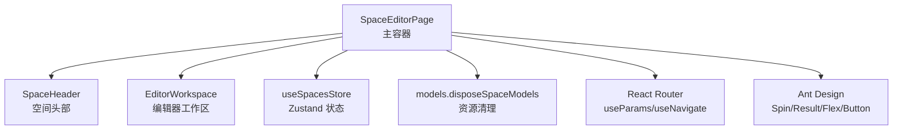
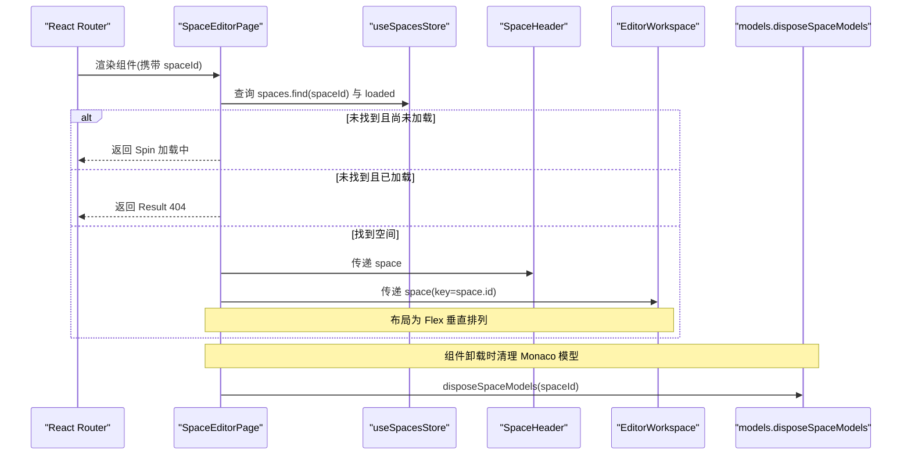
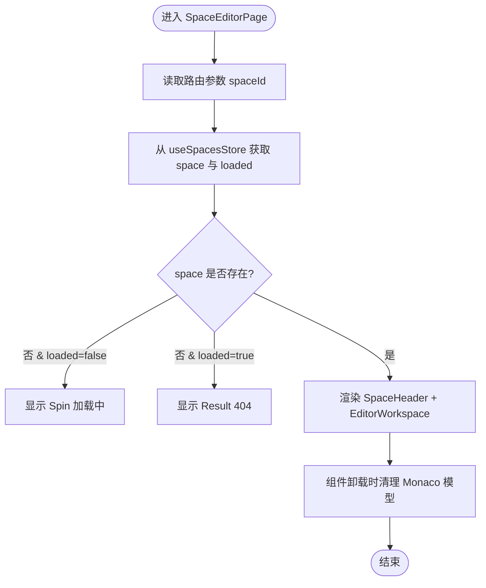
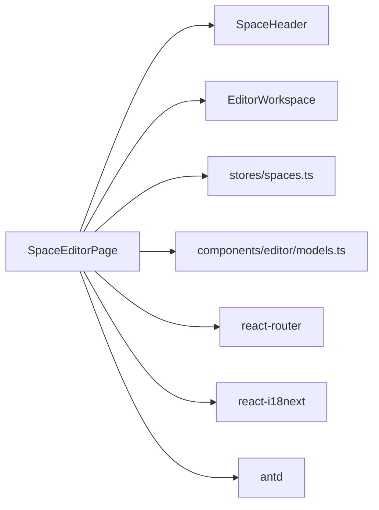

# SpaceEditorPage 主容器

<cite>
**本文引用的文件**   
- [SpaceEditorPage.tsx](file://src/renderer/src/pages/editor/SpaceEditorPage.tsx)
- [models.ts](file://src/renderer/src/components/editor/models.ts)
- [spaces.ts](file://src/renderer/src/stores/spaces.ts)
- [EditorWorkspace.tsx](file://src/renderer/src/pages/editor/EditorWorkspace.tsx)
- [SpaceHeader.tsx](file://src/renderer/src/pages/editor/SpaceHeader.tsx)
</cite>

## 目录
1. [简介](#简介)
2. [项目结构](#项目结构)
3. [核心组件](#核心组件)
4. [架构总览](#架构总览)
5. [详细组件分析](#详细组件分析)
6. [依赖关系分析](#依赖关系分析)
7. [性能与资源管理](#性能与资源管理)
8. [故障排查指南](#故障排查指南)
9. [结论](#结论)
10. [附录：使用示例与最佳实践](#附录使用示例与最佳实践)

## 简介
SpaceEditorPage 是脚本编辑器页面的主容器组件，负责：
- 从路由参数中解析空间标识 spaceId
- 从全局状态中获取并校验对应空间数据
- 根据加载状态显示加载中或 404 错误页面
- 组织页面布局（头部 SpaceHeader 与工作区 EditorWorkspace）
- 在组件卸载时清理 Monaco 模型资源（disposeSpaceModels），避免内存泄漏

该组件通过 Zustand store 与子组件通信，并通过 React Router 进行导航与参数同步。

## 项目结构
SpaceEditorPage 位于编辑器页面目录下，主要依赖以下模块：
- 路由与国际化：react-router、react-i18next
- UI 组件库：antd（Button、Flex、Result、Spin）
- 状态管理：Zustand 的 useSpacesStore
- 编辑器资源清理：components/editor/models.ts 中的 disposeSpaceModels
- 子组件：SpaceHeader、EditorWorkspace

图表来源
- [SpaceEditorPage.tsx:1-39](file://src/renderer/src/pages/editor/SpaceEditorPage.tsx#L1-L39)
- [spaces.ts:1-45](file://src/renderer/src/stores/spaces.ts#L1-L45)
- [models.ts:1-17](file://src/renderer/src/components/editor/models.ts#L1-L17)

章节来源
- [SpaceEditorPage.tsx:1-39](file://src/renderer/src/pages/editor/SpaceEditorPage.tsx#L1-L39)

## 核心组件
- SpaceEditorPage：主容器，处理路由参数、空间数据校验、加载与 404 分支、布局组织与资源清理
- SpaceHeader：展示空间名称、Node 版本选择、打开目录等头部操作
- EditorWorkspace：脚本树、编辑器面板、底部面板、运行配置弹窗等编辑工作区
- models.disposeSpaceModels：按空间前缀释放 Monaco 模型实例，防止内存泄漏
- useSpacesStore：提供 spaces 列表、loaded 标志以及 CRUD 方法

章节来源
- [SpaceEditorPage.tsx:11-39](file://src/renderer/src/pages/editor/SpaceEditorPage.tsx#L11-L39)
- [SpaceHeader.tsx:12-43](file://src/renderer/src/pages/editor/SpaceHeader.tsx#L12-L43)
- [EditorWorkspace.tsx:19-110](file://src/renderer/src/pages/editor/EditorWorkspace.tsx#L19-L110)
- [models.ts:10-16](file://src/renderer/src/components/editor/models.ts#L10-L16)
- [spaces.ts:16-44](file://src/renderer/src/stores/spaces.ts#L16-L44)

## 架构总览
SpaceEditorPage 作为入口容器，协调路由、状态与子组件，形成“读取状态 -> 渲染分支 -> 组织布局 -> 清理资源”的闭环。

图表来源
- [SpaceEditorPage.tsx:11-39](file://src/renderer/src/pages/editor/SpaceEditorPage.tsx#L11-L39)
- [spaces.ts:16-44](file://src/renderer/src/stores/spaces.ts#L16-L44)
- [models.ts:10-16](file://src/renderer/src/components/editor/models.ts#L10-L16)

## 详细组件分析

### SpaceEditorPage 主容器
职责与行为
- 路由参数处理：通过 useParams 获取 spaceId，默认空字符串
- 空间数据获取与校验：从 useSpacesStore.spaces 中查找匹配项
- 加载状态管理：当 space 为空且 loaded 为 false 时显示 Spin；否则显示 404
- 布局组织：使用 Flex 垂直布局，包含 SpaceHeader 与 EditorWorkspace
- 资源清理：在 useEffect 清理函数中使用 queueMicrotask 延迟调用 disposeSpaceModels，确保编辑器实例先于模型销毁

生命周期与副作用
- 挂载时：无额外副作用
- 卸载时：清理当前 spaceId 对应的 Monaco 模型

状态同步机制
- 直接订阅 useSpacesStore 的 spaces 与 loaded，实现响应式更新
- 子组件通过 props 接收 space，EditorWorkspace 使用 key={space.id} 强制重建以重置内部状态

与子组件通信模式
- 向 SpaceHeader 与 EditorWorkspace 传递 space 对象
- 通过 React Router 的 Link 进行导航回空间列表页

图表来源
- [SpaceEditorPage.tsx:11-39](file://src/renderer/src/pages/editor/SpaceEditorPage.tsx#L11-L39)

章节来源
- [SpaceEditorPage.tsx:11-39](file://src/renderer/src/pages/editor/SpaceEditorPage.tsx#L11-L39)

### SpaceHeader 头部
职责与行为
- 展示空间名称与 Node 版本选择器
- 支持切换 Node 版本并调用 useSpacesStore.update 持久化
- 提供返回空间列表与打开目录的操作

交互流程
- 点击返回按钮：navigate('/spaces')
- 修改 Node 版本：update(space.id, { nodeVersion })
- 打开目录：invoke('space:open-dir', space.id)

章节来源
- [SpaceHeader.tsx:12-43](file://src/renderer/src/pages/editor/SpaceHeader.tsx#L12-L43)

### EditorWorkspace 工作区
职责与行为
- 管理脚本列表、选中脚本、运行状态、底部面板标签
- 控制脚本创建、重命名、删除、运行、停止等操作
- 将选中的脚本名同步到 URL 查询参数 script
- 自动打开首个脚本（当无选中项且数据已加载）

关键逻辑
- 使用 useScripts(space.id) 拉取脚本列表
- 使用 useRunsStore 判断当前脚本是否正在运行
- 使用 Splitter 分割左侧脚本树与右侧编辑器/底部面板
- 通过 ScriptNameModal 与 RunConfigDrawer 提供弹窗与抽屉交互

章节来源
- [EditorWorkspace.tsx:19-110](file://src/renderer/src/pages/editor/EditorWorkspace.tsx#L19-L110)

### 资源清理 disposeSpaceModels
职责与行为
- 遍历所有 Monaco 模型，释放 URI 以 file:///spaces/{spaceId}/ 开头的模型
- 防止跨空间切换时的模型残留与内存泄漏

调用时机
- SpaceEditorPage 卸载时，通过 queueMicrotask 延迟执行，确保编辑器实例先被销毁

章节来源
- [models.ts:10-16](file://src/renderer/src/components/editor/models.ts#L10-L16)
- [SpaceEditorPage.tsx:17-19](file://src/renderer/src/pages/editor/SpaceEditorPage.tsx#L17-L19)

### 状态管理 useSpacesStore
职责与行为
- 维护 spaces 数组与 loaded 标志
- 提供 load、create、update、remove、put 等方法
- 通过 invoke 与主进程 IPC 通信

与 SpaceEditorPage 的关系
- SpaceEditorPage 仅读取 spaces 与 loaded，不直接调用写操作方法
- 写操作由 SpaceHeader 与 SpacesPage 等其它页面触发

章节来源
- [spaces.ts:16-44](file://src/renderer/src/stores/spaces.ts#L16-L44)

## 依赖关系分析
- 外部依赖
  - react-router：useParams、Link
  - react-i18next：useTranslation
  - antd：Button、Flex、Result、Spin
  - zustand：useSpacesStore
  - monaco-editor：通过 models.ts 访问 editor.getModels() 与 model.dispose()
- 内部依赖
  - SpaceHeader、EditorWorkspace：作为子组件被渲染
  - models.disposeSpaceModels：用于资源清理
  - stores/spaces：提供空间数据与状态

图表来源
- [SpaceEditorPage.tsx:1-39](file://src/renderer/src/pages/editor/SpaceEditorPage.tsx#L1-L39)
- [spaces.ts:1-45](file://src/renderer/src/stores/spaces.ts#L1-L45)
- [models.ts:1-17](file://src/renderer/src/components/editor/models.ts#L1-L17)

章节来源
- [SpaceEditorPage.tsx:1-39](file://src/renderer/src/pages/editor/SpaceEditorPage.tsx#L1-L39)

## 性能与资源管理
- 渲染优化
  - EditorWorkspace 使用 key={space.id} 强制在空间切换时重建，避免旧编辑器状态污染
  - 仅在必要时显示 Spin 或 404，减少无效渲染
- 资源清理
  - 使用 queueMicrotask 延迟清理 Monaco 模型，确保编辑器实例先销毁，避免引用错误
  - 按空间前缀精确释放模型，不影响其他空间的编辑器状态
- 状态同步
  - 通过 Zustand 的 selector 订阅最小必要字段（spaces.find、loaded），降低重渲染范围

章节来源
- [SpaceEditorPage.tsx:17-19](file://src/renderer/src/pages/editor/SpaceEditorPage.tsx#L17-L19)
- [models.ts:10-16](file://src/renderer/src/components/editor/models.ts#L10-L16)

## 故障排查指南
常见问题与定位
- 始终显示加载中
  - 检查 useSpacesStore.loaded 是否为 true；确认 load 方法是否成功调用
  - 查看主进程 IPC 是否正确返回空间列表
- 一直显示 404
  - 确认路由 spaceId 与 useSpacesStore.spaces 中的数据一致
  - 检查空间是否已被删除或未正确初始化
- 内存泄漏或模型残留
  - 确认 SpaceEditorPage 卸载时是否调用 disposeSpaceModels
  - 检查 Monaco 模型 URI 是否以 file:///spaces/{spaceId}/ 开头
- 编辑器状态异常
  - 确认 EditorWorkspace 的 key={space.id} 是否正确设置
  - 检查脚本列表与选中脚本参数 script 是否同步

章节来源
- [SpaceEditorPage.tsx:21-31](file://src/renderer/src/pages/editor/SpaceEditorPage.tsx#L21-L31)
- [models.ts:10-16](file://src/renderer/src/components/editor/models.ts#L10-L16)
- [EditorWorkspace.tsx:47-51](file://src/renderer/src/pages/editor/EditorWorkspace.tsx#L47-L51)

## 结论
SpaceEditorPage 作为编辑器页面的主容器，简洁而明确地承担了路由参数解析、空间数据校验、加载与 404 分支处理、布局组织与资源清理的职责。通过与 useSpacesStore 和子组件的协作，实现了清晰的状态流与可维护的组件结构。其资源清理策略确保了长时间运行的应用不会因 Monaco 模型累积而产生内存问题。

## 附录：使用示例与最佳实践
- 路由配置建议
  - 使用 /spaces/:spaceId 路径映射到 SpaceEditorPage
  - 确保在空间列表页跳转到具体空间时传入有效的 spaceId
- 状态初始化建议
  - 在应用启动或进入空间列表页时调用 useSpacesStore.load()
  - 在 SpaceEditorPage 中仅读取状态，不直接触发写操作
- 资源清理建议
  - 不要绕过 useEffect 清理函数；如需提前清理，请显式调用 disposeSpaceModels(spaceId)
- 子组件通信建议
  - 通过 props 传递不可变数据（如 space）
  - 对于需要双向同步的参数（如选中脚本），优先使用 URL 查询参数与 useSearchParams

[本节为概念性指导，不涉及具体代码片段]