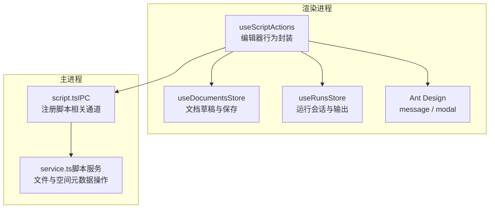
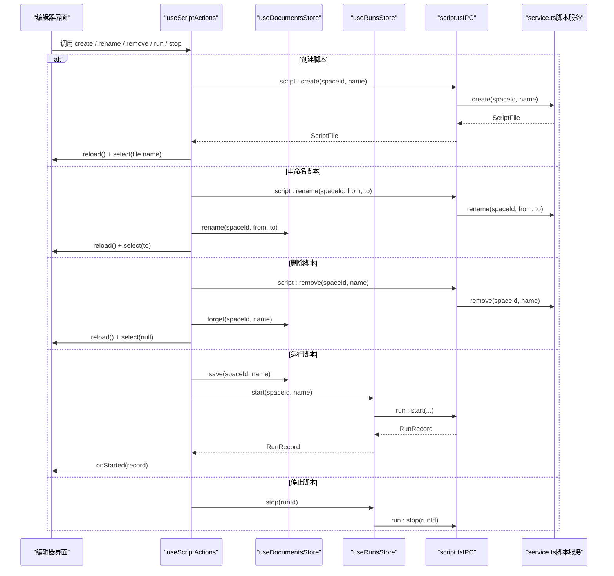
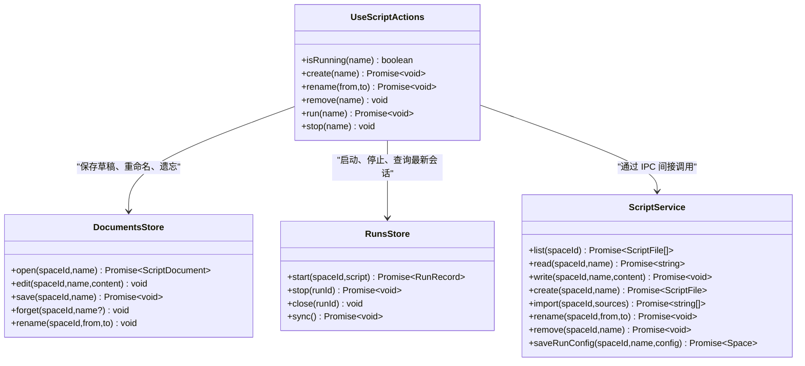
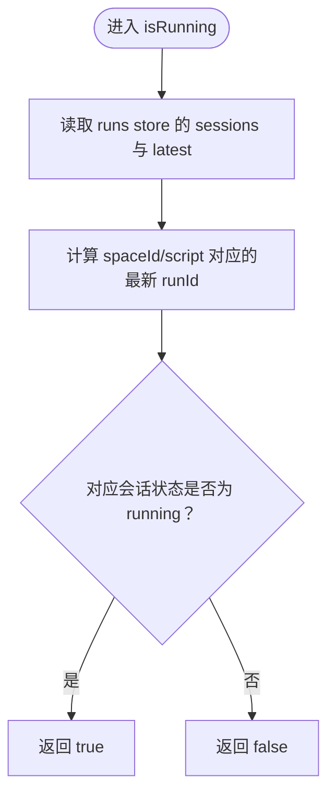
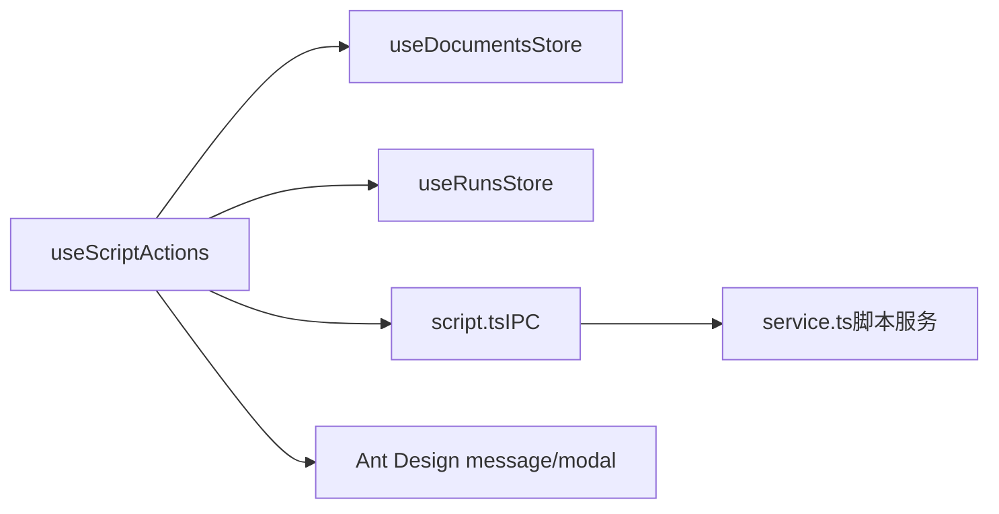
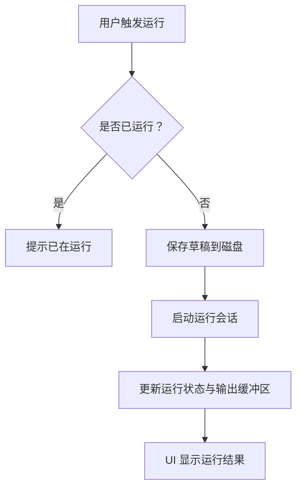
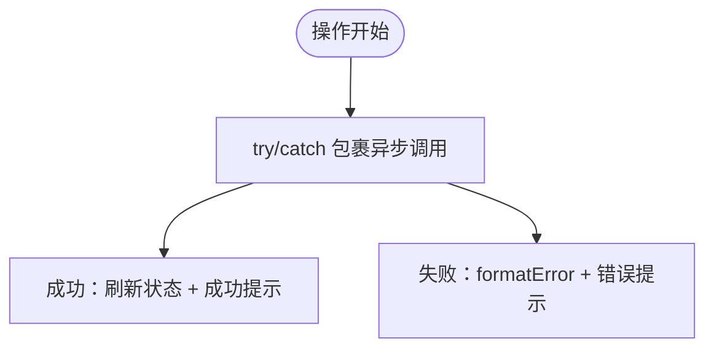

# useScriptActions 操作钩子

<cite>
**本文引用的文件**   
- [useScriptActions.ts](file://src/renderer/src/pages/editor/useScriptActions.ts)
- [script.ts（IPC）](file://src/main/ipc/script.ts)
- [service.ts（脚本服务）](file://src/main/services/script/service.ts)
- [documents.ts（文档草稿状态）](file://src/renderer/src/stores/documents.ts)
- [runs.ts（运行会话状态）](file://src/renderer/src/stores/runs.ts)
- [run.ts（运行类型定义）](file://src/shared/types/run.ts)
- [script.ts（脚本类型定义）](file://src/shared/types/script.ts)
- [ImportScriptButton.tsx（导入按钮组件）](file://src/renderer/src/components/script/ImportScriptButton.tsx)
- [ScriptDropZone.tsx（拖拽导入区域）](file://src/renderer/src/components/script/ScriptDropZone.tsx)
</cite>

## 目录
1. [简介](#简介)
2. [项目结构定位](#项目结构定位)
3. [核心能力总览](#核心能力总览)
4. [架构与数据流](#架构与数据流)
5. [详细组件分析](#详细组件分析)
6. [依赖关系分析](#依赖关系分析)
7. [性能与并发控制](#性能与并发控制)
8. [错误处理与用户反馈](#错误处理与用户反馈)
9. [API 参考](#api-参考)
10. [使用场景示例](#使用场景示例)
11. [故障排查指南](#故障排查指南)
12. [结论](#结论)

## 简介
`useScriptActions` 是编辑器页面中用于管理“工作区”内脚本的自定义 React Hook。它封装了脚本的创建、重命名、删除、运行、停止等常用操作，并与前端状态管理、主进程 IPC 以及运行器进行协作，提供一致的用户体验。该 Hook 不直接实现文件系统读写或脚本执行逻辑，而是通过调用 IPC 接口和共享状态完成业务编排。

本文件将围绕以下主题展开：
- 脚本操作的封装方式与职责边界
- 异步流程、状态管理与并发控制
- 错误处理策略与用户反馈设计
- 与导入导出、批量操作的集成点
- 性能优化思路与可观察性

## 项目结构定位
`useScriptActions` 位于渲染进程的编辑器页面模块中，属于 UI 层的行为封装。其关键依赖包括：
- 渲染进程 API 调用入口 `invoke`
- 文档草稿状态 `useDocumentsStore`
- 运行会话状态 `useRunsStore`
- Ant Design 提供的消息与确认弹窗能力
- 国际化翻译工具

**图表来源**
- [useScriptActions.ts:19-92](file://src/renderer/src/pages/editor/useScriptActions.ts#L19-L92)
- [script.ts（IPC）:4-13](file://src/main/ipc/script.ts#L4-L13)
- [service.ts（脚本服务）:16-109](file://src/main/services/script/service.ts#L16-L109)

**章节来源**
- [useScriptActions.ts:1-92](file://src/renderer/src/pages/editor/useScriptActions.ts#L1-L92)
- [script.ts（IPC）:1-14](file://src/main/ipc/script.ts#L1-L14)
- [service.ts（脚本服务）:1-110](file://src/main/services/script/service.ts#L1-L110)

## 核心能力总览
`useScriptActions` 暴露的能力如下：
- `isRunning(name)`：判断指定脚本是否正在运行
- `create(name)`：创建工作区中的新脚本
- `rename(from, to)`：重命名脚本并同步编辑器状态
- `remove(name)`：删除脚本并清理本地状态
- `run(name)`：保存草稿后启动脚本运行
- `stop(name)`：停止当前脚本的运行会话

这些方法覆盖了脚本生命周期中最常用的编辑与运行场景，并通过统一的错误处理机制向用户反馈结果。

**章节来源**
- [useScriptActions.ts:19-92](file://src/renderer/src/pages/editor/useScriptActions.ts#L19-L92)

## 架构与数据流
### 整体交互流程

**图表来源**
- [useScriptActions.ts:34-90](file://src/renderer/src/pages/editor/useScriptActions.ts#L34-L90)
- [script.ts（IPC）:4-13](file://src/main/ipc/script.ts#L4-L13)
- [service.ts（脚本服务）:49-99](file://src/main/services/script/service.ts#L49-L99)
- [runs.ts:29-40](file://src/renderer/src/stores/runs.ts#L29-L40)

### 数据模型关系

**图表来源**
- [useScriptActions.ts:19-92](file://src/renderer/src/pages/editor/useScriptActions.ts#L19-L92)
- [documents.ts:4-62](file://src/renderer/src/stores/documents.ts#L4-L62)
- [runs.ts:8-61](file://src/renderer/src/stores/runs.ts#L8-L61)
- [service.ts（脚本服务）:16-109](file://src/main/services/script/service.ts#L16-L109)

## 详细组件分析

### 运行状态判断与并发控制
`isRunning` 通过读取运行会话的最新记录来判断脚本是否处于运行状态。该判断基于 `useRunsStore` 中按 `spaceId/script` 映射的最新会话 ID，并检查对应会话的状态是否为 `running`。

关键点：
- 避免重复启动同一脚本
- 在 UI 层快速反馈“已在运行”
- 与运行会话的生命周期保持一致

**图表来源**
- [useScriptActions.ts:26-29](file://src/renderer/src/pages/editor/useScriptActions.ts#L26-L29)
- [runs.ts:26-39](file://src/renderer/src/stores/runs.ts#L26-L39)
- [run.ts:1-13](file://src/shared/types/run.ts#L1-L13)

**章节来源**
- [useScriptActions.ts:26-29](file://src/renderer/src/pages/editor/useScriptActions.ts#L26-L29)
- [runs.ts:26-39](file://src/renderer/src/stores/runs.ts#L26-L39)
- [run.ts:1-13](file://src/shared/types/run.ts#L1-L13)

### 创建脚本
`create` 调用 IPC 创建脚本，成功后刷新列表并选中刚创建的脚本。后端服务会校验名称、确保工作区存在、生成模板内容并写入磁盘。

要点：
- 名称合法性由后端统一校验
- 创建完成后立即刷新 UI 并选择新脚本
- 失败时通过统一错误处理展示提示

**章节来源**
- [useScriptActions.ts:34-38](file://src/renderer/src/pages/editor/useScriptActions.ts#L34-L38)
- [service.ts（脚本服务）:49-58](file://src/main/services/script/service.ts#L49-L58)

### 重命名脚本
`rename` 先调用 IPC 重命名文件，随后更新文档草稿映射、释放旧脚本编辑器模型、刷新列表，并在当前选中的是旧名称时切换到新名称。

要点：
- 前后端状态一致性：文件重命名 + 文档键迁移
- 编辑器模型清理，避免内存泄漏
- 用户选择状态的平滑过渡

**章节来源**
- [useScriptActions.ts:40-49](file://src/renderer/src/pages/editor/useScriptActions.ts#L40-L49)
- [documents.ts:57-61](file://src/renderer/src/stores/documents.ts#L57-L61)
- [service.ts（脚本服务）:78-92](file://src/main/services/script/service.ts#L78-L92)

### 删除脚本
`remove` 使用确认弹窗防止误删。确认后调用 IPC 删除文件，并从文档状态中移除对应条目，释放编辑器模型，刷新列表并清空选中项。

要点：
- 二次确认降低误操作风险
- 删除后清理所有前端关联状态
- 异常路径统一走 fail 错误处理

**章节来源**
- [useScriptActions.ts:51-69](file://src/renderer/src/pages/editor/useScriptActions.ts#L51-L69)
- [service.ts（脚本服务）:94-99](file://src/main/services/script/service.ts#L94-L99)

### 运行脚本
`run` 在执行前检查是否已有运行中的同名脚本；若未运行，则先将草稿保存到磁盘，再启动运行会话并将返回的运行记录交给上层回调。

要点：
- 运行前强制保存草稿，保证运行器读取到最新代码
- 运行状态由 `useRunsStore` 管理
- 错误统一通过 fail 提示

**章节来源**
- [useScriptActions.ts:71-84](file://src/renderer/src/pages/editor/useScriptActions.ts#L71-L84)
- [documents.ts:40-50](file://src/renderer/src/stores/documents.ts#L40-L50)
- [runs.ts:29-39](file://src/renderer/src/stores/runs.ts#L29-L39)

### 停止脚本
`stop` 根据 `spaceId/script` 找到最新运行 ID，并调用运行会话的停止方法。

要点：
- 仅对存在的运行会话生效
- 停止失败通过 fail 提示

**章节来源**
- [useScriptActions.ts:86-90](file://src/renderer/src/pages/editor/useScriptActions.ts#L86-L90)
- [runs.ts:40-40](file://src/renderer/src/stores/runs.ts#L40-L40)

## 依赖关系分析
`useScriptActions` 的依赖可分为三类：
- 运行时状态：`useDocumentsStore`、`useRunsStore`
- IPC 通道：`script:*` 系列事件
- UI 能力：Ant Design 的消息与确认弹窗

**图表来源**
- [useScriptActions.ts:1-92](file://src/renderer/src/pages/editor/useScriptActions.ts#L1-L92)
- [script.ts（IPC）:4-13](file://src/main/ipc/script.ts#L4-L13)
- [service.ts（脚本服务）:16-109](file://src/main/services/script/service.ts#L16-L109)

**章节来源**
- [useScriptActions.ts:1-92](file://src/renderer/src/pages/editor/useScriptActions.ts#L1-L92)
- [documents.ts:1-67](file://src/renderer/src/stores/documents.ts#L1-L67)
- [runs.ts:1-79](file://src/renderer/src/stores/runs.ts#L1-L79)
- [script.ts（IPC）:1-14](file://src/main/ipc/script.ts#L1-L14)
- [service.ts（脚本服务）:1-110](file://src/main/services/script/service.ts#L1-L110)

## 性能与并发控制
- 草稿保存优先：运行前强制保存，避免运行器读取到过时内容，减少因状态不一致导致的重试与错误。
- 运行会话限制：通过 `isRunning` 阻止重复启动同一脚本，避免资源竞争与终端输出混乱。
- 输出缓冲上限：运行会话的输出片段数量有上限，避免长时间运行导致内存增长。
- 列表与状态刷新：在创建、重命名、删除后统一调用 `reload()`，保证 UI 与后端状态一致。

**图表来源**
- [useScriptActions.ts:71-84](file://src/renderer/src/pages/editor/useScriptActions.ts#L71-L84)
- [runs.ts:63-71](file://src/renderer/src/stores/runs.ts#L63-L71)

**章节来源**
- [useScriptActions.ts:71-84](file://src/renderer/src/pages/editor/useScriptActions.ts#L71-L84)
- [runs.ts:63-71](file://src/renderer/src/stores/runs.ts#L63-L71)

## 错误处理与用户反馈
- 统一错误格式化：通过 `formatError` 将后端错误转换为可读信息，并结合国际化文案展示。
- 用户反馈渠道：
  - 成功类操作：创建、导入等成功后通过消息提示
  - 危险操作：删除前弹出确认框，并提供危险样式按钮
  - 运行冲突：重复运行同一脚本时给出提示信息
- 错误传播：异步异常统一捕获并调用 `fail`，保证用户始终能看到明确反馈。

**图表来源**
- [useScriptActions.ts:22-24](file://src/renderer/src/pages/editor/useScriptActions.ts#L22-L24)
- [useScriptActions.ts:55-67](file://src/renderer/src/pages/editor/useScriptActions.ts#L55-L67)
- [useScriptActions.ts:76-83](file://src/renderer/src/pages/editor/useScriptActions.ts#L76-L83)

**章节来源**
- [useScriptActions.ts:22-24](file://src/renderer/src/pages/editor/useScriptActions.ts#L22-L24)
- [useScriptActions.ts:55-67](file://src/renderer/src/pages/editor/useScriptActions.ts#L55-L67)
- [useScriptActions.ts:76-83](file://src/renderer/src/pages/editor/useScriptActions.ts#L76-L83)

## API 参考

### Hook 返回值与方法
- `isRunning(name: string): boolean`
  - 作用：判断指定脚本是否正在运行
  - 依赖：`useRunsStore` 的最新会话状态
- `create(name: string): Promise<void>`
  - 作用：在工作区中创建新脚本
  - 副作用：刷新列表、选中新脚本
- `rename(from: string, to: string): Promise<void>`
  - 作用：重命名脚本
  - 副作用：更新文档键、释放旧编辑器模型、刷新列表、切换选中项
- `remove(name: string): void`
  - 作用：删除脚本
  - 副作用：确认弹窗、清理文档状态、释放编辑器模型、刷新列表、清空选中项
- `run(name: string): Promise<void>`
  - 作用：保存草稿并启动运行
  - 副作用：更新运行状态、触发运行输出事件
- `stop(name: string): void`
  - 作用：停止当前运行会话
  - 副作用：调用运行停止接口

**章节来源**
- [useScriptActions.ts:19-92](file://src/renderer/src/pages/editor/useScriptActions.ts#L19-L92)

### 相关 IPC 通道
- `script:list`：列出工作区中的脚本
- `script:read`：读取脚本内容
- `script:write`：写入脚本内容
- `script:create`：创建脚本
- `script:import`：批量导入脚本文件
- `script:rename`：重命名脚本
- `script:remove`：删除脚本
- `script:save-run-config`：保存运行配置

**章节来源**
- [script.ts（IPC）:4-13](file://src/main/ipc/script.ts#L4-L13)

### 后端服务方法
- `list(spaceId)`：返回脚本文件列表
- `read(spaceId, name)`：返回脚本内容
- `write(spaceId, name, content)`：写入脚本内容
- `create(spaceId, name)`：创建脚本并返回文件信息
- `import(spaceId, sources)`：批量导入外部脚本文件
- `rename(spaceId, from, to)`：重命名脚本
- `remove(spaceId, name)`：删除脚本
- `saveRunConfig(spaceId, name, config)`：保存运行配置

**章节来源**
- [service.ts（脚本服务）:23-109](file://src/main/services/script/service.ts#L23-L109)

## 使用场景示例

### 创建脚本
- 用户在编辑器工具栏点击“新建脚本”
- 调用 `create(name)`
- 后端校验名称并写入模板内容
- 前端刷新列表并自动选中新脚本

**章节来源**
- [useScriptActions.ts:34-38](file://src/renderer/src/pages/editor/useScriptActions.ts#L34-L38)
- [service.ts（脚本服务）:49-58](file://src/main/services/script/service.ts#L49-L58)

### 重命名脚本
- 用户在脚本树中修改脚本名
- 调用 `rename(from, to)`
- 后端移动文件并更新工作区元数据
- 前端更新文档键、释放旧编辑器模型、刷新列表并切换选中项

**章节来源**
- [useScriptActions.ts:40-49](file://src/renderer/src/pages/editor/useScriptActions.ts#L40-L49)
- [service.ts（脚本服务）:78-92](file://src/main/services/script/service.ts#L78-L92)

### 删除脚本
- 用户点击删除按钮
- 弹出确认对话框
- 确认后调用 `remove(name)`
- 后端删除文件并清理工作区元数据
- 前端清理文档状态、释放编辑器模型、刷新列表并清空选中项

**章节来源**
- [useScriptActions.ts:51-69](file://src/renderer/src/pages/editor/useScriptActions.ts#L51-L69)
- [service.ts（脚本服务）:94-99](file://src/main/services/script/service.ts#L94-L99)

### 运行与停止脚本
- 用户点击运行
- 检查是否已运行，若未运行则保存草稿并启动运行
- 运行过程中输出通过事件推送至前端
- 用户点击停止时调用 `stop(name)`

**章节来源**
- [useScriptActions.ts:71-90](file://src/renderer/src/pages/editor/useScriptActions.ts#L71-L90)
- [runs.ts:29-40](file://src/renderer/src/stores/runs.ts#L29-L40)

### 导入脚本（批量操作）
- 用户通过按钮或拖拽区域选择多个脚本文件
- 前端调用 `script:import` 批量导入
- 后端校验文件扩展名、生成唯一文件名并复制到工作区
- 前端展示导入成功数量并通知父组件刷新列表

**章节来源**
- [ImportScriptButton.tsx:18-30](file://src/renderer/src/components/script/ImportScriptButton.tsx#L18-L30)
- [ScriptDropZone.tsx:22-35](file://src/renderer/src/components/script/ScriptDropZone.tsx#L22-L35)
- [service.ts（脚本服务）:60-76](file://src/main/services/script/service.ts#L60-L76)
- [script.ts（脚本类型定义）:1-13](file://src/shared/types/script.ts#L1-L13)

## 故障排查指南
- 无法创建脚本
  - 检查脚本名称是否合法
  - 查看后端是否抛出 `INVALID_SCRIPT_NAME` 或 `SCRIPT_EXISTS`
- 重命名失败
  - 确认目标名称不存在
  - 检查工作区元数据是否同步更新
- 删除失败
  - 确认文件权限与工作区路径正确
  - 检查是否仍有运行中的会话引用该脚本
- 运行无输出或输出中断
  - 检查运行会话是否存在且状态为 `running`
  - 查看输出缓冲区是否达到上限
  - 确认运行输出事件是否正常推送

**章节来源**
- [service.ts（脚本服务）:11-14](file://src/main/services/script/service.ts#L11-L14)
- [service.ts（脚本服务）:49-99](file://src/main/services/script/service.ts#L49-L99)
- [runs.ts:63-71](file://src/renderer/src/stores/runs.ts#L63-L71)

## 结论
`useScriptActions` 以简洁的 API 封装了脚本编辑与运行的核心流程，将 UI 行为、状态管理与后端服务解耦。它通过运行前保存草稿、运行状态判断、统一错误处理与用户反馈，提供了稳定且易用的用户体验。对于导入导出与批量操作，虽然不在 Hook 内部实现，但通过 IPC 与脚本服务紧密协作，形成完整的脚本管理能力。未来可在保持现有职责边界的前提下，进一步扩展批量运行、任务队列与更细粒度的进度反馈。