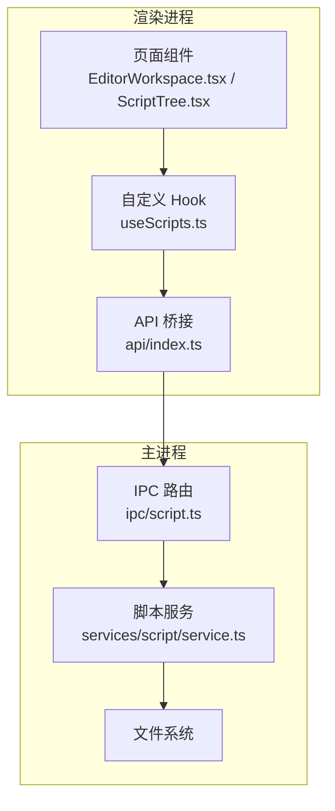
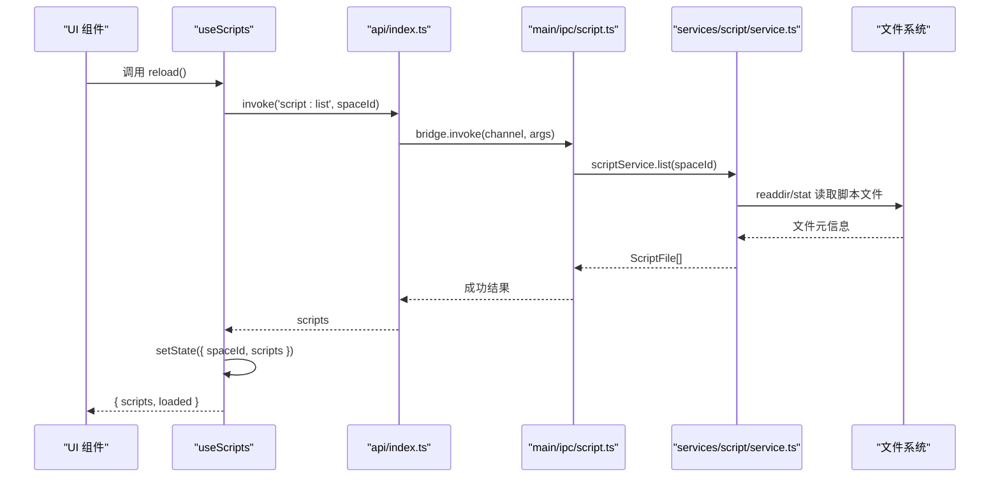
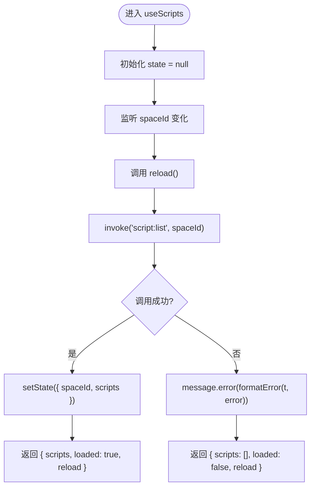
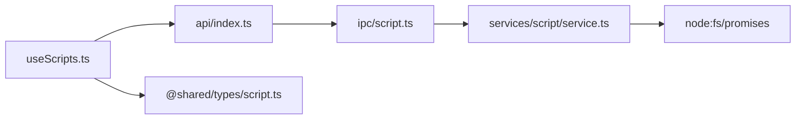

# useScripts 数据钩子

<cite>
**本文引用的文件**   
- [useScripts.ts](file://src/renderer/src/pages/editor/useScripts.ts)
- [script.ts（IPC 注册）](file://src/main/ipc/script.ts)
- [service.ts（脚本服务）](file://src/main/services/script/service.ts)
- [script.ts（共享类型）](file://src/shared/types/script.ts)
- [index.ts（API 桥接）](file://src/renderer/src/api/index.ts)
- [EditorWorkspace.tsx](file://src/renderer/src/pages/editor/EditorWorkspace.tsx)
- [ScriptTree.tsx](file://src/renderer/src/components/script/ScriptTree.tsx)
</cite>

## 目录
1. [简介](#简介)
2. [项目结构定位](#项目结构定位)
3. [核心组件与职责](#核心组件与职责)
4. [架构总览](#架构总览)
5. [详细组件分析](#详细组件分析)
6. [依赖关系分析](#依赖关系分析)
7. [性能与缓存策略](#性能与缓存策略)
8. [错误处理与可观测性](#错误处理与可观测性)
9. [使用示例与最佳实践](#使用示例与最佳实践)
10. [故障排查指南](#故障排查指南)
11. [结论](#结论)

## 简介
本文件为 `useScripts` 自定义 React Hook 的完整技术文档。该 Hook 负责在编辑器页面中获取、展示并刷新某个工作区（space）下的脚本文件列表，并通过 IPC 与主进程通信，最终由后端脚本服务读取文件系统并返回结构化脚本元信息。文档将覆盖：
- 数据获取、缓存与更新机制
- 与后端服务的通信流程
- 数据流架构与状态管理模式
- 错误处理策略与用户体验反馈
- 性能优化建议
- 类型定义、API 接口说明与使用示例

## 项目结构定位
`useScripts` 位于渲染进程的编辑器页面层，属于“页面级数据钩子”，不直接管理持久化状态，而是通过调用 API 获取最新脚本列表，并在本地维护轻量加载状态。

图表来源
- [EditorWorkspace.tsx:53-93](file://src/renderer/src/pages/editor/EditorWorkspace.tsx#L53-L93)
- [ScriptTree.tsx:55-93](file://src/renderer/src/components/script/ScriptTree.tsx#L55-L93)
- [useScripts.ts:15-38](file://src/renderer/src/pages/editor/useScripts.ts#L15-L38)
- [index.ts:19-27](file://src/renderer/src/api/index.ts#L19-L27)
- [script.ts（IPC 注册）:4-12](file://src/main/ipc/script.ts#L4-L12)
- [service.ts:23-35](file://src/main/services/script/service.ts#L23-L35)

章节来源
- [useScripts.ts:1-39](file://src/renderer/src/pages/editor/useScripts.ts#L1-L39)
- [EditorWorkspace.tsx:53-93](file://src/renderer/src/pages/editor/EditorWorkspace.tsx#L53-L93)
- [ScriptTree.tsx:55-93](file://src/renderer/src/components/script/ScriptTree.tsx#L55-L93)

## 核心组件与职责
- `useScripts`：页面级 Hook，封装脚本列表的获取、本地加载状态与手动刷新能力。
- `api/index.ts`：统一的前端 IPC 调用封装，提供 `invoke`、`send`、`on` 等能力，并将主进程错误包装为前端异常。
- `main/ipc/script.ts`：注册 `script:list` 等 IPC 通道，转发到脚本服务。
- `main/services/script/service.ts`：实现脚本文件的列举、读取、写入、创建、导入、重命名、删除等操作。
- `shared/types/script.ts`：定义脚本文件类型、扩展名与语言枚举。

章节来源
- [useScripts.ts:8-12](file://src/renderer/src/pages/editor/useScripts.ts#L8-L12)
- [index.ts:1-38](file://src/renderer/src/api/index.ts#L1-L38)
- [script.ts（IPC 注册）:4-12](file://src/main/ipc/script.ts#L4-L12)
- [service.ts:16-35](file://src/main/services/script/service.ts#L16-L35)
- [script.ts（共享类型）:1-13](file://src/shared/types/script.ts#L1-L13)

## 架构总览
下图展示了从 UI 触发到后端文件系统读取的完整数据流。

图表来源
- [useScripts.ts:20-34](file://src/renderer/src/pages/editor/useScripts.ts#L20-L34)
- [index.ts:19-27](file://src/renderer/src/api/index.ts#L19-L27)
- [script.ts（IPC 注册）:5](file://src/main/ipc/script.ts#L5)
- [service.ts:23-35](file://src/main/services/script/service.ts#L23-L35)

## 详细组件分析

### useScripts 钩子
- 输入参数：`spaceId`（当前工作区标识）。
- 返回值：
  - `scripts`：脚本文件数组，类型为 `ScriptFile[]`。
  - `loaded`：布尔值，表示当前 `state.spaceId` 是否与传入的 `spaceId` 一致，用于判断是否已加载完成。
  - `reload`：异步函数，重新拉取脚本列表并更新本地状态。
- 内部状态：
  - `state`：保存 `{ spaceId, scripts }`，用于区分不同工作区的加载结果，避免旧数据污染。
- 副作用：
  - 当 `spaceId` 变化时，自动触发一次 `reload()`，确保切换工作区后显示对应脚本列表。
- 错误处理：
  - 捕获 IPC 调用异常，通过 Ant Design 的消息提示用户，并返回空数组以保证 UI 稳定。

图表来源
- [useScripts.ts:15-38](file://src/renderer/src/pages/editor/useScripts.ts#L15-L38)

章节来源
- [useScripts.ts:8-38](file://src/renderer/src/pages/editor/useScripts.ts#L8-L38)

### API 桥接层
- `invoke`：对 `window.bridge.invoke` 的封装，具备强类型约束，自动抛出 `ApiError`，便于上层统一处理。
- `send` / `on`：分别用于发送事件与订阅事件，供其他功能模块使用。

章节来源
- [index.ts:1-38](file://src/renderer/src/api/index.ts#L1-L38)

### 主进程 IPC 与脚本服务
- IPC 注册：
  - `script:list`：接收 `spaceId`，调用 `scriptService.list(spaceId)`。
- 脚本服务 `list`：
  - 校验空间存在性。
  - 确保脚本目录存在。
  - 遍历目录，过滤脚本文件，收集文件元信息（名称、语言、大小、修改时间）。
  - 按文件名排序返回。

章节来源
- [script.ts（IPC 注册）:4-12](file://src/main/ipc/script.ts#L4-L12)
- [service.ts:23-35](file://src/main/services/script/service.ts#L23-L35)

### 类型定义
- `ScriptFile`：包含脚本名称、语言、文件大小、修改时间。
- `ScriptLanguage`：支持 `javascript` 与 `typescript`。
- `ScriptExtension`：支持的脚本扩展名集合。

章节来源
- [script.ts（共享类型）:1-13](file://src/shared/types/script.ts#L1-L13)

## 依赖关系分析
- `useScripts` 依赖：
  - `@renderer/api`：用于 IPC 调用。
  - `@renderer/api/errors`：格式化错误消息。
  - `antd`：消息提示。
  - `react-i18next`：国际化文本。
  - `@shared/types`：脚本文件类型。
- 运行时依赖链：
  - 渲染层 Hook → API 桥接 → 主进程 IPC → 脚本服务 → 文件系统。

图表来源
- [useScripts.ts:1-6](file://src/renderer/src/pages/editor/useScripts.ts#L1-L6)
- [index.ts:1-38](file://src/renderer/src/api/index.ts#L1-L38)
- [script.ts（IPC 注册）:1-12](file://src/main/ipc/script.ts#L1-L12)
- [service.ts:1-9](file://src/main/services/script/service.ts#L1-L9)
- [script.ts（共享类型）:1-13](file://src/shared/types/script.ts#L1-L13)

章节来源
- [useScripts.ts:1-6](file://src/renderer/src/pages/editor/useScripts.ts#L1-L6)
- [index.ts:1-38](file://src/renderer/src/api/index.ts#L1-L38)
- [script.ts（IPC 注册）:1-12](file://src/main/ipc/script.ts#L1-L12)
- [service.ts:1-9](file://src/main/services/script/service.ts#L1-L9)
- [script.ts（共享类型）:1-13](file://src/shared/types/script.ts#L1-L13)

## 性能与缓存策略
- 本地缓存：
  - `useScripts` 使用 React 本地状态缓存当前工作区的脚本列表，避免重复请求。
  - 通过 `state.spaceId === spaceId` 判断数据有效性，防止跨工作区的数据污染。
- 自动刷新：
  - 当 `spaceId` 变化时，自动触发 `reload()`，保证切换工作区后数据及时更新。
- 手动刷新：
  - 暴露 `reload` 方法，供父组件在导入脚本后主动刷新列表。
- 潜在优化点：
  - 防抖/节流：若频繁触发 `reload`（如快速切换工作区），可考虑加防抖。
  - 增量更新：若后续引入文件变更监听，可实现增量同步而非全量刷新。
  - 分页/懒加载：当脚本数量极大时，可考虑分页或虚拟滚动。

章节来源
- [useScripts.ts:18-38](file://src/renderer/src/pages/editor/useScripts.ts#L18-L38)
- [EditorWorkspace.tsx:63-65](file://src/renderer/src/pages/editor/EditorWorkspace.tsx#L63-L65)

## 错误处理与可观测性
- 前端错误包装：
  - `api/index.ts` 将主进程错误包装为 `ApiError`，携带错误码与参数。
- 用户反馈：
  - `useScripts` 捕获异常后，通过 Ant Design 的 `message.error` 展示国际化错误信息。
- 主进程错误：
  - 脚本服务在无效操作时会抛出带错误码的异常（例如脚本不存在、已存在等），由 IPC 层透传到前端。

章节来源
- [index.ts:4-15](file://src/renderer/src/api/index.ts#L4-L15)
- [useScripts.ts:26-29](file://src/renderer/src/pages/editor/useScripts.ts#L26-L29)
- [service.ts:38-42](file://src/main/services/script/service.ts#L38-L42)

## 使用示例与最佳实践
- 基本用法：
  - 在页面组件中调用 `useScripts(spaceId)`，获取 `scripts`、`loaded` 与 `reload`。
  - 将 `scripts` 传递给脚本树组件进行展示。
  - 在导入脚本成功后调用 `reload()` 刷新列表。
- 与 Zustand store 的关系：
  - `useScripts` 不直接读写 Zustand store，仅负责数据获取与本地状态管理。
  - 文档模型、运行状态等由其他 store 管理，二者解耦。
- 最佳实践：
  - 在切换工作区时依赖 Hook 的自动刷新行为，无需手动调用 `reload()`。
  - 在导入脚本后显式调用 `reload()`，确保 UI 与文件系统一致。
  - 结合 `loaded` 状态控制加载指示器，提升用户体验。

章节来源
- [EditorWorkspace.tsx:53-93](file://src/renderer/src/pages/editor/EditorWorkspace.tsx#L53-L93)
- [ScriptTree.tsx:55-93](file://src/renderer/src/components/script/ScriptTree.tsx#L55-L93)
- [useScripts.ts:15-38](file://src/renderer/src/pages/editor/useScripts.ts#L15-L38)

## 故障排查指南
- 问题：脚本列表为空
  - 检查 `spaceId` 是否正确。
  - 查看控制台是否有 `ApiError`，确认主进程是否正常返回数据。
  - 验证脚本目录是否存在且包含有效脚本文件。
- 问题：切换工作区后数据未更新
  - 确认 `spaceId` 是否发生变化，Hook 会自动触发 `reload()`。
  - 检查是否在导入脚本后调用了 `reload()`。
- 问题：错误提示不显示
  - 确认 Ant Design 的 `App.useApp()` 是否正确注入。
  - 检查国际化配置是否包含对应错误文案。

章节来源
- [useScripts.ts:20-34](file://src/renderer/src/pages/editor/useScripts.ts#L20-L34)
- [index.ts:19-27](file://src/renderer/src/api/index.ts#L19-L27)

## 结论
`useScripts` 是一个简洁而实用的页面级数据钩子，专注于脚本列表的获取、缓存与刷新。它通过清晰的职责划分与稳定的错误处理机制，为编辑器页面提供了可靠的数据源。尽管未直接集成 Zustand store，但其设计保持了良好的解耦性，便于与其他状态管理方案协作。未来可在性能优化与增量更新方面进一步演进，以支撑更大规模的脚本管理与更复杂的交互场景。