# 脚本编辑器页面

<cite>
**本文引用的文件**   
- [SpaceEditorPage.tsx](file://src/renderer/src/pages/editor/SpaceEditorPage.tsx)
- [EditorWorkspace.tsx](file://src/renderer/src/pages/editor/EditorWorkspace.tsx)
- [ScriptEditorPane.tsx](file://src/renderer/src/pages/editor/ScriptEditorPane.tsx)
- [EditorToolbar.tsx](file://src/renderer/src/pages/editor/EditorToolbar.tsx)
- [BottomPanel.tsx](file://src/renderer/src/pages/editor/BottomPanel.tsx)
- [useScripts.ts](file://src/renderer/src/pages/editor/useScripts.ts)
- [useScriptActions.ts](file://src/renderer/src/pages/editor/useScriptActions.ts)
- [useSaveGuard.tsx](file://src/renderer/src/pages/editor/useSaveGuard.tsx)
- [CodeEditor.tsx](file://src/renderer/src/components/editor/CodeEditor.tsx)
- [models.ts](file://src/renderer/src/components/editor/models.ts)
- [documents.ts](file://src/renderer/src/stores/documents.ts)
- [runs.ts](file://src/renderer/src/stores/runs.ts)
</cite>

## 更新摘要
**变更内容**   
- 新增保存保护机制，增强外部文件修改检测和处理
- 改进脚本动作处理，集成保存保护逻辑
- 增强项目系统集成，支持项目信息加载和同步
- 优化文档状态管理，提升外部变更处理能力

## 目录
1. [简介](#简介)
2. [项目结构](#项目结构)
3. [核心组件](#核心组件)
4. [架构总览](#架构总览)
5. [详细组件分析](#详细组件分析)
6. [依赖关系分析](#依赖关系分析)
7. [性能与优化](#性能与优化)
8. [快捷键与扩展点](#快捷键与扩展点)
9. [开发指南与调试技巧](#开发指南与调试技巧)
10. [结论](#结论)

## 简介
本文档面向"脚本编辑器页面"的实现，围绕 SpaceEditorPage 主容器、ScriptEditorPane 代码编辑器、EditorToolbar 工具栏、BottomPanel 底部面板以及 useScripts 和 useScriptActions 自定义钩子展开。文档从布局与状态管理、数据流、业务逻辑、扩展点、快捷键支持到性能优化进行系统化说明，并提供可操作的开发与调试建议。

**更新** 本次更新重点增强了保存保护机制和项目系统集成，改进了外部文件修改检测和脚本动作处理流程。

## 项目结构
脚本编辑器页面位于渲染进程的前端代码中，采用 React + Ant Design + Zustand 的状态管理模式，并通过 IPC 调用主进程的脚本与运行服务。关键文件职责如下：
- SpaceEditorPage：页面入口，负责空间选择、加载态与资源清理。
- EditorWorkspace：工作区编排，包含脚本树、编辑器区域与底部面板。
- ScriptEditorPane：单脚本编辑视图，集成 CodeEditor 与工具栏。
- EditorToolbar：顶部操作按钮（保存、运行、停止、配置）。
- BottomPanel：底部标签页，聚合运行终端、依赖面板与历史面板。
- useScripts：拉取并缓存当前空间的脚本列表。
- useScriptActions：封装脚本的创建、重命名、删除、运行、停止等动作。
- useSaveGuard：提供保存保护机制，处理外部文件修改冲突。
- CodeEditor：基于 Monaco 的代码编辑器封装，提供快捷键与主题适配。
- models：Monaco 模型路径与销毁策略。
- documents：内存草稿与持久化读写，支持外部变更检测。
- runs：运行会话、输出事件与生命周期管理。

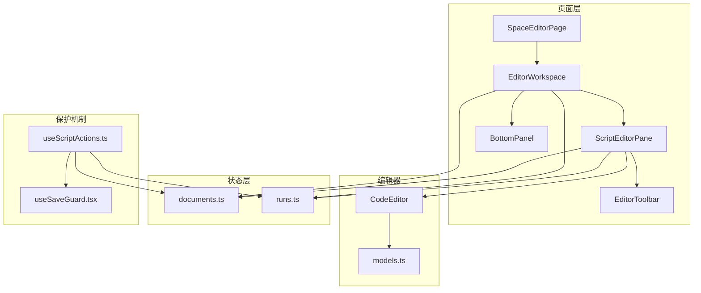

**图表来源**
- [SpaceEditorPage.tsx:11-39](file://src/renderer/src/pages/editor/SpaceEditorPage.tsx#L11-L39)
- [EditorWorkspace.tsx:19-110](file://src/renderer/src/pages/editor/EditorWorkspace.tsx#L19-L110)
- [ScriptEditorPane.tsx:24-78](file://src/renderer/src/pages/editor/ScriptEditorPane.tsx#L24-L78)
- [EditorToolbar.tsx:16-47](file://src/renderer/src/pages/editor/EditorToolbar.tsx#L16-L47)
- [BottomPanel.tsx:30-74](file://src/renderer/src/pages/editor/BottomPanel.tsx#L30-L74)
- [CodeEditor.tsx:19-52](file://src/renderer/src/components/editor/CodeEditor.tsx#L19-L52)
- [models.ts:3-16](file://src/renderer/src/components/editor/models.ts#L3-L16)
- [documents.ts:22-62](file://src/renderer/src/stores/documents.ts#L22-L62)
- [runs.ts:26-79](file://src/renderer/src/stores/runs.ts#L26-L79)
- [useScriptActions.ts:21-96](file://src/renderer/src/pages/editor/useScriptActions.ts#L21-L96)
- [useSaveGuard.tsx:12-55](file://src/renderer/src/pages/editor/useSaveGuard.tsx#L12-L55)

**章节来源**
- [SpaceEditorPage.tsx:11-39](file://src/renderer/src/pages/editor/SpaceEditorPage.tsx#L11-L39)
- [EditorWorkspace.tsx:19-110](file://src/renderer/src/pages/editor/EditorWorkspace.tsx#L19-L110)

## 核心组件
- SpaceEditorPage：根据路由参数 spaceId 获取空间对象；若未找到则显示 404；在卸载时释放 Monaco 模型；渲染 SpaceHeader 与 EditorWorkspace。
- EditorWorkspace：使用 Splitter 划分左侧脚本树与右侧编辑/底部区域；通过 useScripts 获取脚本列表；通过 useScriptActions 统一处理脚本 CRUD 与运行控制；维护 URL 查询参数 script 以同步选中脚本；打开运行配置抽屉与脚本名称弹窗。**更新** 新增项目信息加载和外部变更同步功能。
- ScriptEditorPane：打开并监听文档草稿；展示 MissingDepsAlert；渲染 EditorToolbar 与 CodeEditor；将编辑器变更写入 documents store；触发运行/停止回调。**更新** 集成 useSaveGuard 进行保存保护。
- EditorToolbar：展示文件名、未保存标记；提供保存、运行、停止、配置按钮；禁用态与提示文案由 props 控制。
- BottomPanel：为每个运行记录生成一个可关闭的终端标签；同时提供依赖与历史两个常驻标签；根据运行状态更新徽章颜色；支持关闭后自动切换回有效标签。
- useScripts：拉取并缓存当前空间的脚本列表。
- useScriptActions：**更新** 集成 useSaveGuard 进行保存保护，改进脚本动作处理流程。
- useSaveGuard：**新增** 提供保存保护机制，处理外部文件修改冲突，提供覆盖、重新加载或取消选项。
- CodeEditor：基于 Monaco 的代码编辑器封装，提供快捷键与主题适配。
- models：Monaco 模型路径与销毁策略。
- documents：**更新** 增强外部变更检测，支持强制保存和文件同步。
- runs：运行会话、输出事件与生命周期管理。

**章节来源**
- [SpaceEditorPage.tsx:11-39](file://src/renderer/src/pages/editor/SpaceEditorPage.tsx#L11-L39)
- [EditorWorkspace.tsx:19-110](file://src/renderer/src/pages/editor/EditorWorkspace.tsx#L19-L110)
- [ScriptEditorPane.tsx:24-78](file://src/renderer/src/pages/editor/ScriptEditorPane.tsx#L24-L78)
- [EditorToolbar.tsx:16-47](file://src/renderer/src/pages/editor/EditorToolbar.tsx#L16-L47)
- [BottomPanel.tsx:30-74](file://src/renderer/src/pages/editor/BottomPanel.tsx#L30-L74)
- [useScripts.ts:15-38](file://src/renderer/src/pages/editor/useScripts.ts#L15-L38)
- [useScriptActions.ts:21-96](file://src/renderer/src/pages/editor/useScriptActions.ts#L21-L96)
- [useSaveGuard.tsx:12-55](file://src/renderer/src/pages/editor/useSaveGuard.tsx#L12-L55)

## 架构总览
页面整体遵循"容器-表现-状态"分层：
- 容器层：SpaceEditorPage、EditorWorkspace 负责组合与协调。
- 表现层：ScriptEditorPane、EditorToolbar、BottomPanel 负责 UI 呈现与用户交互。
- 状态层：documents.ts、runs.ts 管理文档草稿与运行会话。
- 编辑器层：CodeEditor 封装 Monaco，models.ts 管理模型 URI 与销毁。
- 保护层：useSaveGuard 提供保存保护机制。
- 数据层：通过 @renderer/api 的 invoke/on 与主进程 IPC 通信。

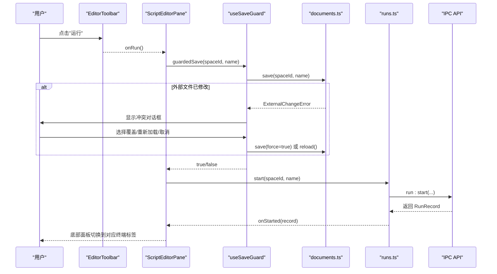

**图表来源**
- [EditorToolbar.tsx:16-47](file://src/renderer/src/pages/editor/EditorToolbar.tsx#L16-L47)
- [ScriptEditorPane.tsx:39-72](file://src/renderer/src/pages/editor/ScriptEditorPane.tsx#L39-L72)
- [useSaveGuard.tsx:16-54](file://src/renderer/src/pages/editor/useSaveGuard.tsx#L16-L54)
- [documents.ts:66-82](file://src/renderer/src/stores/documents.ts#L66-L82)
- [runs.ts:29-39](file://src/renderer/src/stores/runs.ts#L29-L39)

## 详细组件分析

### SpaceEditorPage 主容器
- 功能要点：
  - 从路由解析 spaceId，并从 spaces store 查找空间对象。
  - 当空间不存在且 spaces 已加载完成时，显示 404 结果页。
  - 在组件卸载时延迟释放 Monaco 模型，避免编辑器实例销毁顺序问题。
  - 渲染 SpaceHeader 与 EditorWorkspace，并使用 key={space.id} 强制重建工作区。
- 状态与副作用：
  - 使用 useEffect 注册清理函数，调用 disposeSpaceModels(spaceId)。
- 布局：
  - 使用 Flex 垂直布局，头部与工作区上下排列。

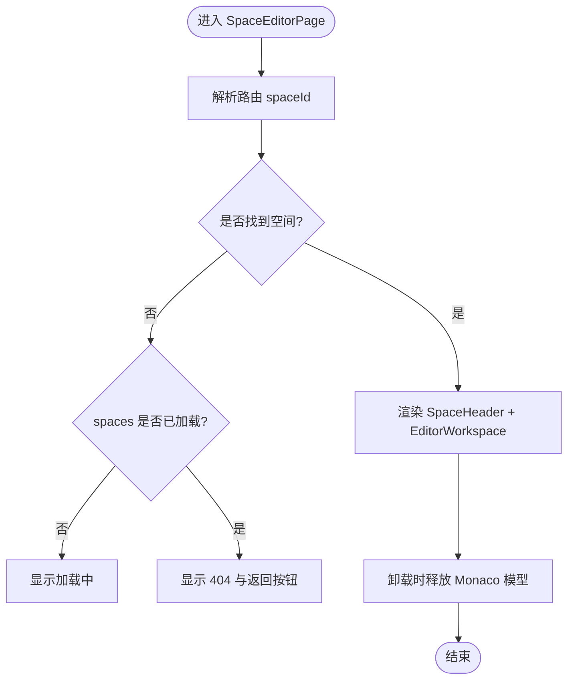

**图表来源**
- [SpaceEditorPage.tsx:11-39](file://src/renderer/src/pages/editor/SpaceEditorPage.tsx#L11-L39)

**章节来源**
- [SpaceEditorPage.tsx:11-39](file://src/renderer/src/pages/editor/SpaceEditorPage.tsx#L11-L39)

### EditorWorkspace 工作区编排
- 功能要点：
  - 使用 Splitter 划分左侧脚本树与右侧编辑/底部区域。
  - 通过 useScripts 获取脚本列表。
  - 通过 useScriptActions 统一处理脚本 CRUD 与运行控制。
  - 维护 URL 查询参数 script 以同步选中脚本。
  - 打开运行配置抽屉与脚本名称弹窗。
  - **新增** 加载项目信息并同步外部变更。
  - **新增** 窗口焦点变化时自动刷新项目信息和文档状态。
- 项目集成：
  - 调用 `space:project-info` 获取项目元数据。
  - 使用 `documents.sync()` 同步外部文件变更。
  - 支持 npm scripts 面板和项目管理功能。

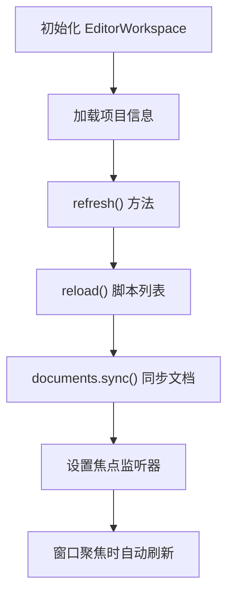

**图表来源**
- [EditorWorkspace.tsx:48-73](file://src/renderer/src/pages/editor/EditorWorkspace.tsx#L48-L73)

**章节来源**
- [EditorWorkspace.tsx:48-73](file://src/renderer/src/pages/editor/EditorWorkspace.tsx#L48-L73)

### ScriptEditorPane 代码编辑器集成
- 功能要点：
  - 打开文档：调用 documents store 的 open，捕获加载错误并展示 Result。
  - 保存：调用 useSaveGuard 进行保存保护，处理外部文件修改冲突。
  - 安装依赖：调用 deps store 的 install，失败时展示错误消息。
  - 渲染 EditorToolbar 与 CodeEditor，并将编辑器变更写入 documents store。
  - 显示缺失依赖告警条，并在依赖安装进行中禁用相关操作。
- 编辑器配置：
  - path 使用 scriptModelPath 生成 Monaco 模型 URI。
  - language 来自脚本元信息。
  - value 与 onChange 绑定 documents store 的 content 与 edit。
  - onSave 与 onRun 透传给 CodeEditor。

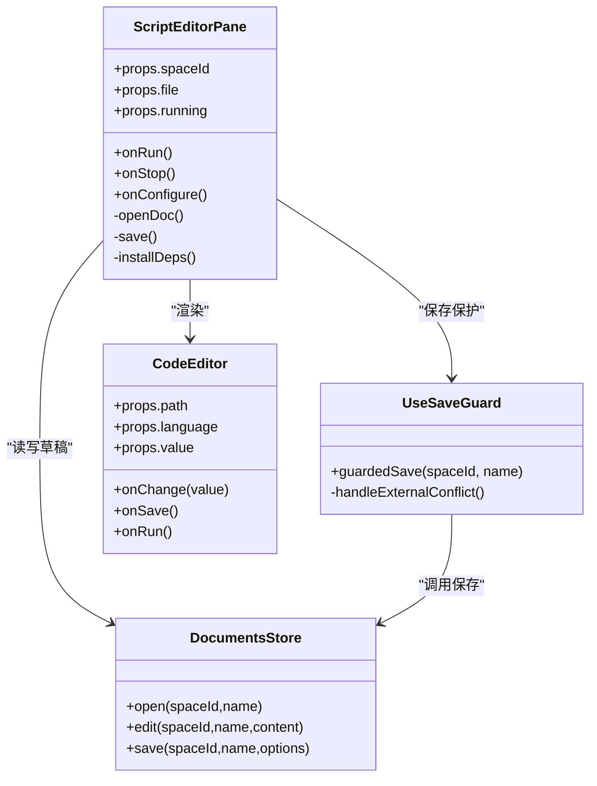

**图表来源**
- [ScriptEditorPane.tsx:24-78](file://src/renderer/src/pages/editor/ScriptEditorPane.tsx#L24-L78)
- [useSaveGuard.tsx:12-55](file://src/renderer/src/pages/editor/useSaveGuard.tsx#L12-L55)
- [CodeEditor.tsx:9-52](file://src/renderer/src/components/editor/CodeEditor.tsx#L9-L52)
- [documents.ts:22-62](file://src/renderer/src/stores/documents.ts#L22-L62)

**章节来源**
- [ScriptEditorPane.tsx:24-78](file://src/renderer/src/pages/editor/ScriptEditorPane.tsx#L24-L78)
- [useSaveGuard.tsx:12-55](file://src/renderer/src/pages/editor/useSaveGuard.tsx#L12-L55)
- [CodeEditor.tsx:19-52](file://src/renderer/src/components/editor/CodeEditor.tsx#L19-L52)
- [documents.ts:22-62](file://src/renderer/src/stores/documents.ts#L22-L62)

### useSaveGuard 保存保护机制
- 功能要点：
  - 包装 documents store 的 save 方法，提供外部文件修改检测。
  - 当检测到外部修改时，显示模态对话框询问用户选择。
  - 支持三种操作：覆盖保存、从磁盘重新加载、取消操作。
  - 返回布尔值表示操作是否成功执行。
- 用户体验：
  - 友好的错误提示和选择界面。
  - 支持键盘操作和鼠标操作。
  - 自动清理对话框实例。

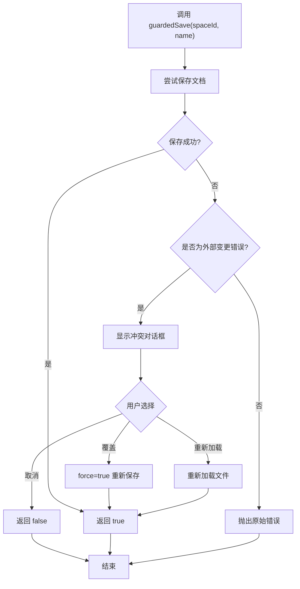

**图表来源**
- [useSaveGuard.tsx:16-54](file://src/renderer/src/pages/editor/useSaveGuard.tsx#L16-L54)

**章节来源**
- [useSaveGuard.tsx:16-54](file://src/renderer/src/pages/editor/useSaveGuard.tsx#L16-L54)

### useScriptActions 脚本动作处理
- 业务逻辑：
  - create：调用 IPC 创建脚本，刷新列表并选中新脚本。
  - rename：校验相同名称直接返回；调用 IPC 重命名；同步 documents store 与 Monaco 模型；刷新列表；若被重命名的是当前选中项，则更新选中项。
  - remove：弹出确认框；调用 IPC 删除；遗忘文档与模型；刷新列表；若删除的是当前选中项，则清空选中。
  - run：**更新** 检查是否已在运行；先通过 useSaveGuard 保存草稿；调用 runs store 的 start；通过 onStarted 回调切换到对应终端标签。
  - stop：根据 latest 映射找到 runId 并调用 stop。
- 状态访问：
  - isRunning：通过 runs store 的 sessions 与 latest 判断指定脚本是否在运行。

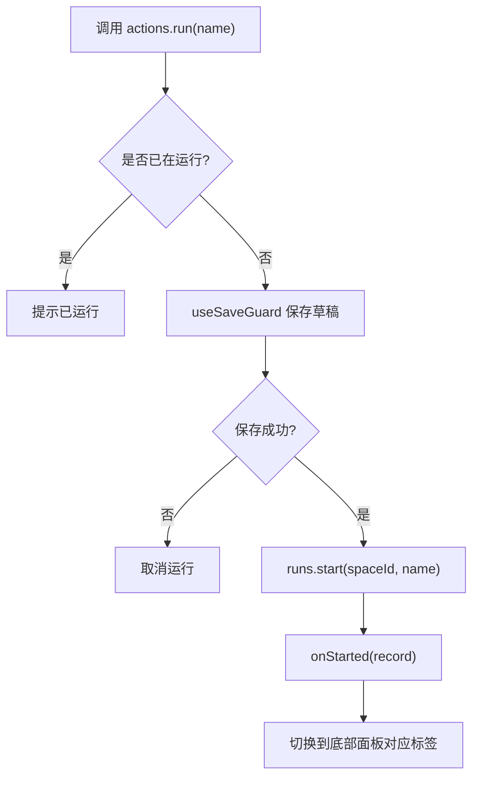

**图表来源**
- [useScriptActions.ts:74-88](file://src/renderer/src/pages/editor/useScriptActions.ts#L74-L88)

**章节来源**
- [useScriptActions.ts:21-96](file://src/renderer/src/pages/editor/useScriptActions.ts#L21-L96)

### documents.ts 文档状态管理
- 功能要点：
  - 维护内存中的文档草稿，支持多文件编辑。
  - 检测外部文件修改，抛出 ExternalChangeError。
  - 支持强制保存和文件重新加载。
  - 批量同步外部变更，保持文档状态一致性。
- 外部变更检测：
  - 比较文件的 mtime 时间戳，检测外部修改。
  - 忽略毫秒级精度差异，避免误判。
  - 在 sync 方法中批量处理多个文件的变更检测。

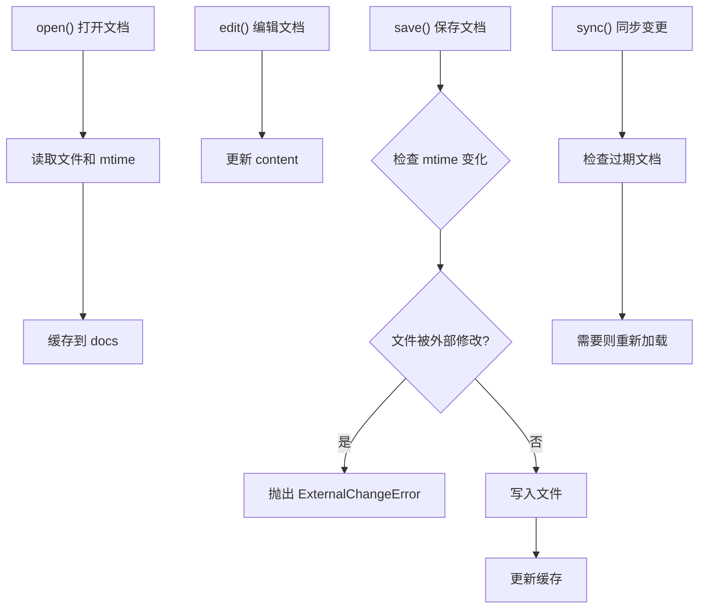

**图表来源**
- [documents.ts:40-115](file://src/renderer/src/stores/documents.ts#L40-L115)

**章节来源**
- [documents.ts:40-115](file://src/renderer/src/stores/documents.ts#L40-L115)

### EditorToolbar 工具栏
- 功能要点：
  - 显示文件名与未保存标记（dirty）。
  - 保存按钮：仅在 dirty 时启用，Tooltip 提示快捷键。
  - 配置按钮：打开运行配置抽屉。
  - 运行/停止按钮：running 状态下显示停止，否则显示运行；Tooltip 提示 F5。
- 交互：
  - 所有操作通过 props 回调向上冒泡至父组件处理。

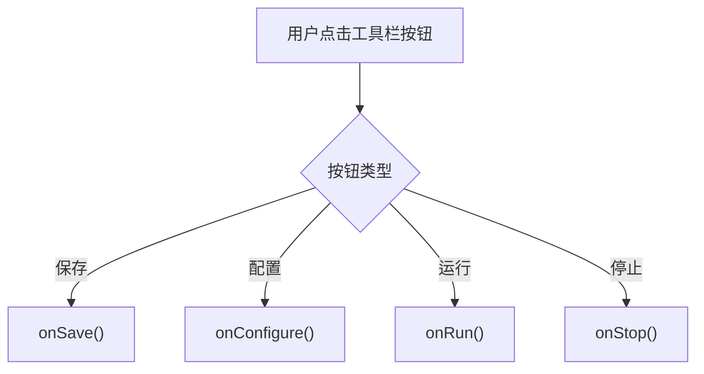

**图表来源**
- [EditorToolbar.tsx:16-47](file://src/renderer/src/pages/editor/EditorToolbar.tsx#L16-L47)

**章节来源**
- [EditorToolbar.tsx:16-47](file://src/renderer/src/pages/editor/EditorToolbar.tsx#L16-L47)

### BottomPanel 底部面板与终端集成
- 功能要点：
  - 动态生成运行终端标签：每个运行记录一个 Tab，带状态徽章。
  - 常驻标签：依赖面板与历史面板。
  - 关闭行为：仅非 running 状态的终端可关闭；关闭后自动切换到其他有效标签或默认标签。
  - 数据来源：runs store 的 sessions 与 latest。
- 状态映射：
  - running -> processing
  - success -> success
  - failed -> error
  - stopped -> default

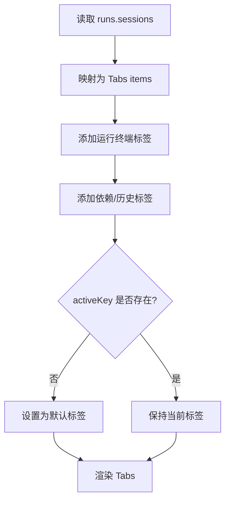

**图表来源**
- [BottomPanel.tsx:30-74](file://src/renderer/src/pages/editor/BottomPanel.tsx#L30-L74)
- [runs.ts:26-79](file://src/renderer/src/stores/runs.ts#L26-L79)

**章节来源**
- [BottomPanel.tsx:30-74](file://src/renderer/src/pages/editor/BottomPanel.tsx#L30-L74)
- [runs.ts:26-79](file://src/renderer/src/stores/runs.ts#L26-L79)

### useScripts 自定义钩子
- 数据流：
  - 组件挂载或 spaceId 变化时调用 reload。
  - 通过 invoke('script:list', spaceId) 获取脚本列表。
  - 成功时设置 state.scripts 与 loaded；失败时展示错误消息并返回空数组。
- 返回值：
  - scripts：脚本文件数组。
  - loaded：是否已完成首次加载。
  - reload：手动刷新方法。

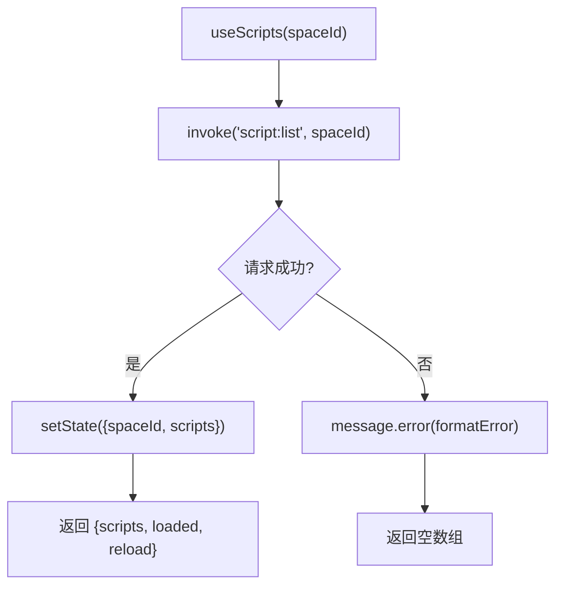

**图表来源**
- [useScripts.ts:15-38](file://src/renderer/src/pages/editor/useScripts.ts#L15-L38)

**章节来源**
- [useScripts.ts:15-38](file://src/renderer/src/pages/editor/useScripts.ts#L15-L38)

## 依赖关系分析
- 组件耦合：
  - SpaceEditorPage 低耦合，仅负责路由与资源清理。
  - EditorWorkspace 高内聚地编排脚本树、编辑器与底部面板，集中管理 URL 参数与对话框状态。**更新** 新增项目信息管理和外部变更同步。
  - ScriptEditorPane 聚焦单脚本编辑体验，依赖 documents store 与 deps store。**更新** 集成 useSaveGuard 进行保存保护。
  - BottomPanel 依赖 runs store，解耦具体终端实现。
  - useScriptActions **更新** 集成 useSaveGuard，改进保存保护逻辑。
- 外部依赖：
  - @renderer/api 的 invoke/on 用于 IPC 通信。
  - Ant Design 提供 UI 组件与交互反馈。
  - Monaco 编辑器通过 CodeEditor 封装，models.ts 管理模型生命周期。
- 潜在循环依赖：
  - 组件之间通过 props 与 hooks 传递回调，避免直接引用彼此内部状态，降低耦合。

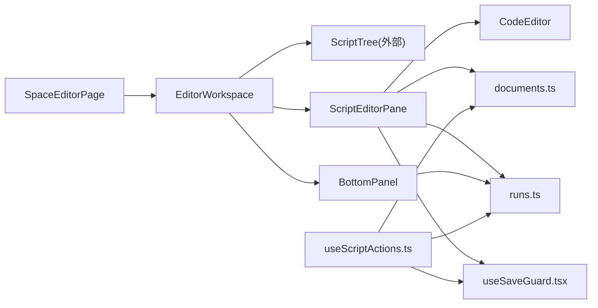

**图表来源**
- [SpaceEditorPage.tsx:11-39](file://src/renderer/src/pages/editor/SpaceEditorPage.tsx#L11-L39)
- [EditorWorkspace.tsx:19-110](file://src/renderer/src/pages/editor/EditorWorkspace.tsx#L19-L110)
- [ScriptEditorPane.tsx:24-78](file://src/renderer/src/pages/editor/ScriptEditorPane.tsx#L24-L78)
- [BottomPanel.tsx:30-74](file://src/renderer/src/pages/editor/BottomPanel.tsx#L30-L74)
- [CodeEditor.tsx:19-52](file://src/renderer/src/components/editor/CodeEditor.tsx#L19-L52)
- [documents.ts:22-62](file://src/renderer/src/stores/documents.ts#L22-L62)
- [runs.ts:26-79](file://src/renderer/src/stores/runs.ts#L26-L79)
- [useScriptActions.ts:21-96](file://src/renderer/src/pages/editor/useScriptActions.ts#L21-L96)
- [useSaveGuard.tsx:12-55](file://src/renderer/src/pages/editor/useSaveGuard.tsx#L12-L55)

**章节来源**
- [EditorWorkspace.tsx:19-110](file://src/renderer/src/pages/editor/EditorWorkspace.tsx#L19-L110)

## 性能与优化
- Monaco 模型管理：
  - 使用 scriptModelPath 生成唯一 URI，便于按空间隔离模型。
  - 在 SpaceEditorPage 卸载时批量释放空间相关模型，避免内存泄漏。
- 文档草稿：
  - documents store 使用内存缓存，切换脚本不丢失未保存内容。
  - 仅在 content !== saved 时才触发保存，减少 IPC 调用。
  - **新增** 外部变更检测避免覆盖用户修改。
- 运行输出缓冲：
  - runs store 限制每条运行的输出块数量（MAX_CHUNKS），防止无限增长。
  - 在事件回调中就地追加 chunks，减少重新计算开销。
- 编辑器选项：
  - 关闭 minimap、禁止滚动超出最后一行、启用 automaticLayout，提升交互流畅度。
- 依赖安装：
  - 通过 MissingDepsAlert 与 deps store 的 busy 状态避免重复安装。
- **新增** 项目信息缓存：
  - 缓存项目信息避免重复请求。
  - 窗口焦点变化时自动刷新，确保数据新鲜度。

[本节为通用性能指导，不直接分析具体文件]

## 快捷键与扩展点
- 快捷键：
  - 保存：Ctrl/⌘+S（在 CodeEditor 中通过 addCommand 绑定）。
  - 运行：F5（在 CodeEditor 中通过 addCommand 绑定）。
- 扩展点：
  - 编辑器语言：CodeEditor 的 language 属性支持 javascript | typescript，可扩展更多语言。
  - 命令扩展：可在 handleMount 中继续 addCommand 新增快捷键。
  - 主题：通过 useAppTheme 切换 vs/vs-dark，可接入自定义主题。
  - 模型路径：scriptModelPath 可定制 URI 规则，便于多根目录或多仓库场景。

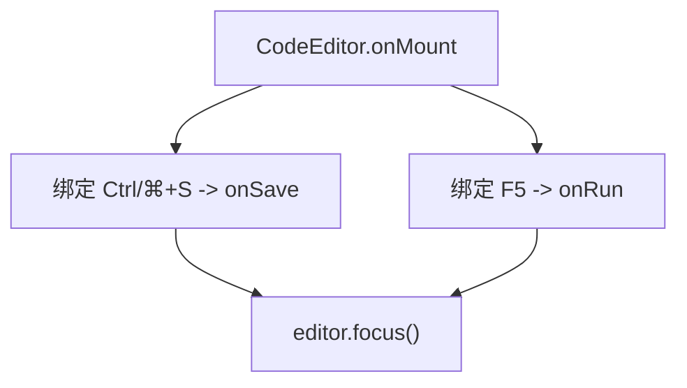

**图表来源**
- [CodeEditor.tsx:27-31](file://src/renderer/src/components/editor/CodeEditor.tsx#L27-L31)

**章节来源**
- [CodeEditor.tsx:19-52](file://src/renderer/src/components/editor/CodeEditor.tsx#L19-L52)

## 开发指南与调试技巧
- 常见问题排查：
  - 编辑器无法加载：检查 documents store 的 open 是否抛出异常，查看 ScriptEditorPane 的 loadError 分支。
  - 保存无效：确认 isDirty 为 true 且 save 成功更新了 saved 字段。
  - 运行无输出：检查 runs store 的 sessions 是否有对应 runId，确认 on('run:output') 事件是否触发。
  - 终端标签不消失：确认 close 调用与 activeKey 切换逻辑。
  - **新增** 外部文件修改冲突：检查 ExternalChangeError 是否正确抛出，确认 useSaveGuard 对话框是否正常显示。
- 调试步骤：
  - 在 useScriptActions.run 前后打印日志，确认先保存再启动。
  - 在 runs.store 的事件回调中添加断点，观察 chunks 增长与 MAX_CHUNKS 裁剪。
  - 在 SpaceEditorPage 卸载时验证 disposeSpaceModels 是否执行。
  - **新增** 在 useSaveGuard 中调试外部变更检测逻辑，确认 mtime 比较是否正确。
- 最佳实践：
  - 尽量通过 hooks 暴露状态与回调，避免在组件内直接操作 store。
  - 对异步操作统一使用 formatError 包装错误信息，保证用户体验一致。
  - 对长列表或大文本使用虚拟滚动或分页（如需要）以避免卡顿。
  - **新增** 使用 useSaveGuard 进行保存操作，避免直接调用 documents store 的 save 方法。

**章节来源**
- [ScriptEditorPane.tsx:33-48](file://src/renderer/src/pages/editor/ScriptEditorPane.tsx#L33-L48)
- [documents.ts:40-49](file://src/renderer/src/stores/documents.ts#L40-L49)
- [runs.ts:63-79](file://src/renderer/src/stores/runs.ts#L63-L79)
- [SpaceEditorPage.tsx:17-19](file://src/renderer/src/pages/editor/SpaceEditorPage.tsx#L17-L19)
- [useSaveGuard.tsx:16-54](file://src/renderer/src/pages/editor/useSaveGuard.tsx#L16-L54)

## 结论
脚本编辑器页面通过清晰的组件分层与状态管理，实现了脚本的浏览、编辑、运行与结果查看。SpaceEditorPage 作为入口负责资源清理与布局；EditorWorkspace 编排工作区；ScriptEditorPane 与 EditorToolbar 提供编辑与操作界面；BottomPanel 聚合运行终端与辅助面板；useScripts 与 useScriptActions 分别承担数据获取与业务动作封装。结合 Monaco 编辑器与 IPC 通信，系统具备良好的扩展性与可维护性。

**更新** 本次更新重点增强了保存保护机制和项目系统集成：
- 新增 useSaveGuard 提供外部文件修改检测和用户交互处理
- 改进 useScriptActions 集成保存保护逻辑，提升脚本操作安全性
- 增强 EditorWorkspace 的项目信息管理和外部变更同步能力
- 优化 documents store 的外部变更检测机制

建议在后续迭代中持续优化 Monaco 模型生命周期、运行输出缓冲策略，并完善快捷键与主题扩展点，以提升开发者体验。