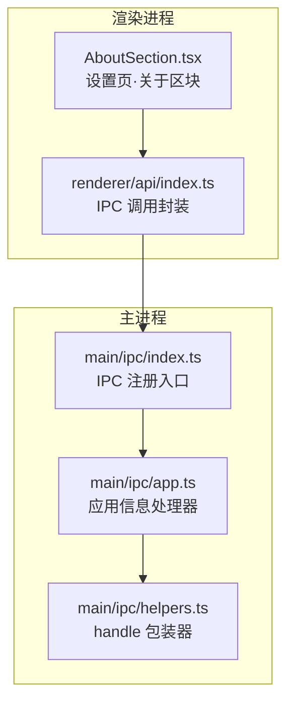
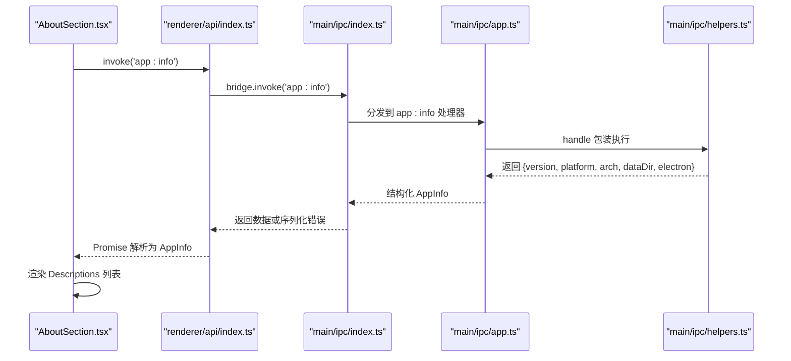
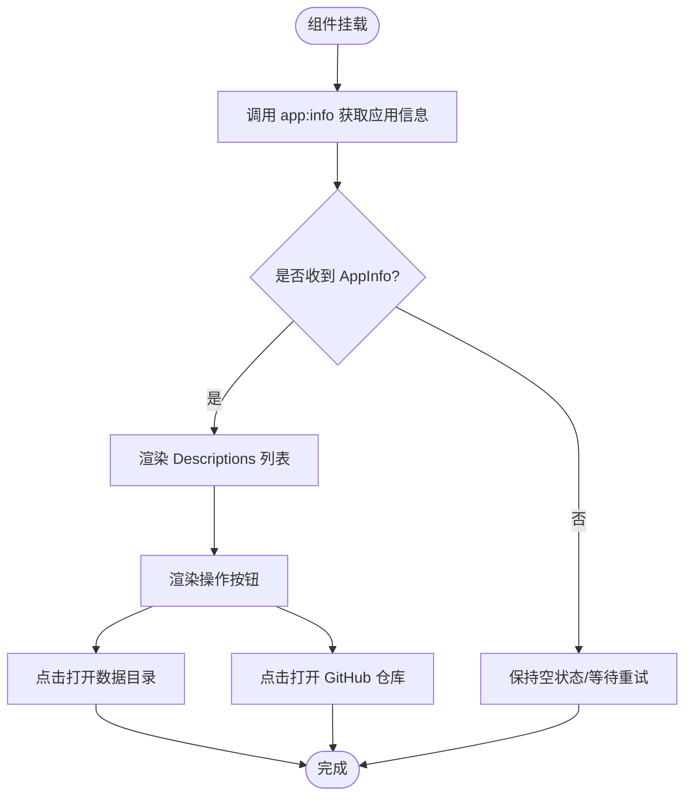
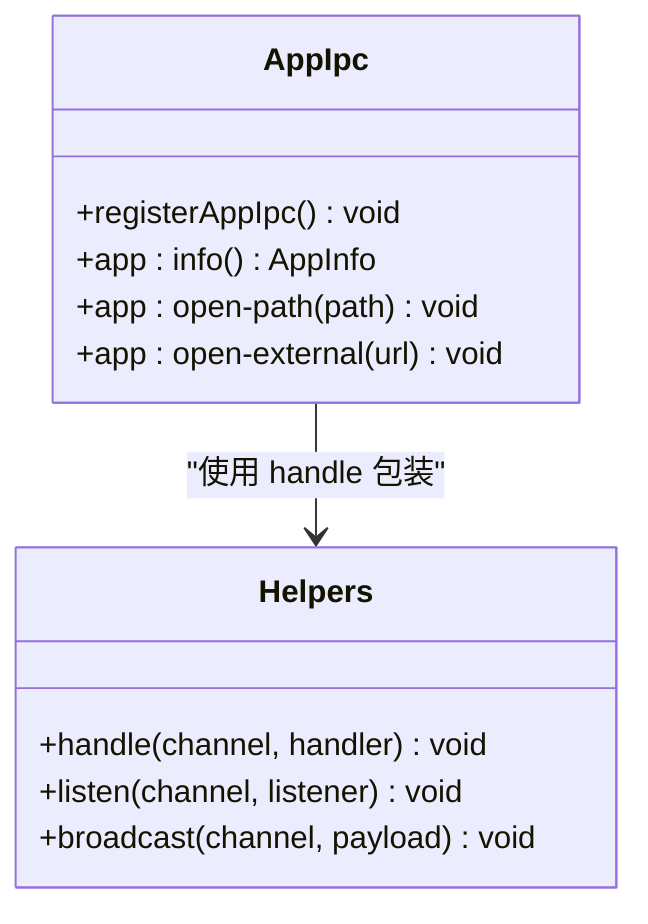
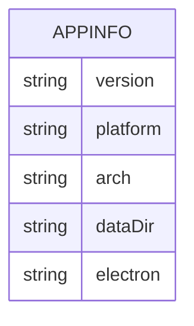

# 关于页面区块

<cite>
**本文引用的文件**   
- [AboutSection.tsx](file://src/renderer/src/pages/settings/AboutSection.tsx)
- [app.ts](file://src/main/ipc/app.ts)
- [index.ts](file://src/main/ipc/index.ts)
- [helpers.ts](file://src/main/ipc/helpers.ts)
- [index.ts](file://src/renderer/src/api/index.ts)
- [app.ts](file://src/shared/types/app.ts)
- [zh-CN.json](file://src/renderer/src/i18n/locales/zh-CN.json)
- [en-US.json](file://src/renderer/src/i18n/locales/en-US.json)
- [package.json](file://package.json)
</cite>

## 目录
1. [简介](#简介)
2. [项目结构定位](#项目结构定位)
3. [核心组件与职责](#核心组件与职责)
4. [架构总览](#架构总览)
5. [详细组件分析](#详细组件分析)
6. [依赖关系分析](#依赖关系分析)
7. [性能与健壮性](#性能与健壮性)
8. [故障排查指南](#故障排查指南)
9. [结论](#结论)

## 简介
本章节聚焦“关于”页面区块，说明 AboutSection 组件如何展示应用信息（版本号、Electron 版本、平台与架构、数据目录等），解释应用元数据的获取与渲染机制，并介绍系统信息与相关操作（打开数据目录、跳转仓库）的集成方式。同时说明多语言支持在“关于”区块中的体现。

## 项目结构定位
“关于”区块位于设置页的子模块中，由前端 React 组件负责展示，通过 IPC 调用主进程获取运行时与应用元数据。

**图表来源**
- [AboutSection.tsx:12-50](file://src/renderer/src/pages/settings/AboutSection.tsx#L12-L50)
- [index.ts:19-27](file://src/renderer/src/api/index.ts#L19-L27)
- [index.ts:10-18](file://src/main/ipc/index.ts#L10-L18)
- [app.ts:5-12](file://src/main/ipc/app.ts#L5-L12)
- [helpers.ts:17-28](file://src/main/ipc/helpers.ts#L17-L28)

**章节来源**
- [AboutSection.tsx:12-50](file://src/renderer/src/pages/settings/AboutSection.tsx#L12-L50)
- [index.ts:10-18](file://src/main/ipc/index.ts#L10-L18)

## 核心组件与职责
- AboutSection 组件：负责“关于”区块的 UI 渲染、用户交互与错误提示。
- app:info IPC 处理器：返回应用版本、Electron 版本、平台、架构、数据目录等元数据。
- API 调用封装：统一处理 IPC 调用的成功与失败结果。
- 类型定义：AppInfo 描述“关于”区块所需的应用信息结构。
- 国际化资源：提供“关于”区块相关文案的多语言键值。

**章节来源**
- [AboutSection.tsx:12-50](file://src/renderer/src/pages/settings/AboutSection.tsx#L12-L50)
- [app.ts:5-12](file://src/main/ipc/app.ts#L5-L12)
- [index.ts:19-27](file://src/renderer/src/api/index.ts#L19-L27)
- [app.ts:18-24](file://src/shared/types/app.ts#L18-L24)
- [zh-CN.json:177-215](file://src/renderer/src/i18n/locales/zh-CN.json#L177-L215)
- [en-US.json:178-216](file://src/renderer/src/i18n/locales/en-US.json#L178-L216)

## 架构总览
“关于”区块的数据流遵循“前端请求 → IPC 桥接 → 主进程处理器 → 返回结构化数据 → 前端渲染”的模式。

**图表来源**
- [AboutSection.tsx:17-19](file://src/renderer/src/pages/settings/AboutSection.tsx#L17-L19)
- [index.ts:19-27](file://src/renderer/src/api/index.ts#L19-L27)
- [index.ts:10-18](file://src/main/ipc/index.ts#L10-L18)
- [app.ts:5-12](file://src/main/ipc/app.ts#L5-L12)
- [helpers.ts:17-28](file://src/main/ipc/helpers.ts#L17-L28)

## 详细组件分析

### AboutSection 组件
- 功能要点
  - 使用 i18n 翻译标题与字段标签。
  - 通过 invoke('app:info') 获取 AppInfo 并缓存到状态。
  - 使用 Ant Design Descriptions 展示版本、Electron 版本、平台/架构、数据目录。
  - 提供“打开数据目录”和“GitHub 仓库”两个快捷按钮。
  - 统一错误处理：将主进程抛出的错误格式化后以消息提示。

- 关键实现路径
  - 获取应用信息：[AboutSection.tsx:17-19](file://src/renderer/src/pages/settings/AboutSection.tsx#L17-L19)
  - 渲染应用信息：[AboutSection.tsx:27-37](file://src/renderer/src/pages/settings/AboutSection.tsx#L27-L37)
  - 打开数据目录：[AboutSection.tsx:40-46](file://src/renderer/src/pages/settings/AboutSection.tsx#L40-L46)
  - 打开外部链接：[AboutSection.tsx:47-49](file://src/renderer/src/pages/settings/AboutSection.tsx#L47-L49)
  - 错误处理封装：[AboutSection.tsx:21-23](file://src/renderer/src/pages/settings/AboutSection.tsx#L21-L23)

- 多语言支持
  - 使用 useTranslation 获取 t 函数，用于渲染“关于”、“版本”、“平台”、“数据目录”、“打开数据目录”等文案。
  - 对应键值见：
    - 中文：[zh-CN.json:177-215](file://src/renderer/src/i18n/locales/zh-CN.json#L177-L215)
    - 英文：[en-US.json:178-216](file://src/renderer/src/i18n/locales/en-US.json#L178-L216)

- 许可证与构建信息
  - 当前“关于”区块未直接显示许可证与构建时间等元数据；如需扩展，可在 AppInfo 类型与 IPC 处理器中补充字段，并在 Descriptions 中渲染。
  - 项目级许可证与版本定义位于 package.json：
    - 版本：[package.json:4](file://package.json#L4)
    - 许可证：[package.json:9](file://package.json#L9)

**图表来源**
- [AboutSection.tsx:17-49](file://src/renderer/src/pages/settings/AboutSection.tsx#L17-L49)

**章节来源**
- [AboutSection.tsx:12-50](file://src/renderer/src/pages/settings/AboutSection.tsx#L12-L50)
- [zh-CN.json:177-215](file://src/renderer/src/i18n/locales/zh-CN.json#L177-L215)
- [en-US.json:178-216](file://src/renderer/src/i18n/locales/en-US.json#L178-L216)
- [package.json:4](file://package.json#L4)
- [package.json:9](file://package.json#L9)

### 应用信息 IPC 处理器
- 功能要点
  - 暴露 app:info 通道，返回 version、platform、arch、dataDir、electron。
  - 提供 app:open-path 与 app:open-external 通道，分别用于打开本地路径与外部 URL。
  - 对外部 URL 进行基础协议校验，仅允许 http/https。

- 关键实现路径
  - 应用信息返回体：[app.ts:6-12](file://src/main/ipc/app.ts#L6-L12)
  - 打开本地路径：[app.ts:14-18](file://src/main/ipc/app.ts#L14-L18)
  - 打开外部链接：[app.ts:20-24](file://src/main/ipc/app.ts#L20-L24)

**图表来源**
- [app.ts:5-24](file://src/main/ipc/app.ts#L5-L24)
- [helpers.ts:17-28](file://src/main/ipc/helpers.ts#L17-L28)

**章节来源**
- [app.ts:5-24](file://src/main/ipc/app.ts#L5-L24)
- [helpers.ts:17-28](file://src/main/ipc/helpers.ts#L17-L28)

### 类型定义：AppInfo
- 字段说明
  - version：应用版本号
  - platform：操作系统平台
  - arch：CPU 架构
  - dataDir：应用数据目录路径
  - electron：Electron 运行时版本

- 关键实现路径
  - 类型定义：[app.ts:18-24](file://src/shared/types/app.ts#L18-L24)

**图表来源**
- [app.ts:18-24](file://src/shared/types/app.ts#L18-L24)

**章节来源**
- [app.ts:18-24](file://src/shared/types/app.ts#L18-L24)

### 前端 IPC 调用封装
- 功能要点
  - 统一调用 bridge.invoke，并将主进程返回的结构化错误转换为 ApiError。
  - 提供 send/on 等辅助方法，便于事件与双向通信。

- 关键实现路径
  - invoke 封装与错误转换：[index.ts:19-27](file://src/renderer/src/api/index.ts#L19-L27)

**章节来源**
- [index.ts:19-27](file://src/renderer/src/api/index.ts#L19-L27)

## 依赖关系分析
- 组件层
  - AboutSection 依赖 Ant Design 组件库与 react-i18next。
  - 通过 @renderer/api 的 invoke 与主进程通信。

- 主进程层
  - registerAppIpc 在 registerIpc 中被统一注册，确保通道可用。
  - helpers.handle 对异常进行捕获与序列化，保证前后端错误一致性。

**图表来源**
- [AboutSection.tsx:12-50](file://src/renderer/src/pages/settings/AboutSection.tsx#L12-L50)
- [index.ts:19-27](file://src/renderer/src/api/index.ts#L19-L27)
- [index.ts:10-18](file://src/main/ipc/index.ts#L10-L18)
- [app.ts:5-12](file://src/main/ipc/app.ts#L5-L12)
- [helpers.ts:17-28](file://src/main/ipc/helpers.ts#L17-L28)

**章节来源**
- [index.ts:10-18](file://src/main/ipc/index.ts#L10-L18)
- [helpers.ts:17-28](file://src/main/ipc/helpers.ts#L17-L28)

## 性能与健壮性
- 性能
  - “关于”区块仅在组件挂载时发起一次 IPC 请求，无频繁轮询，开销极低。
  - 渲染采用轻量 Descriptions 列表，适合静态信息展示。

- 健壮性
  - 主进程侧通过 helpers.handle 捕获异常并序列化错误，避免未处理异常穿透至渲染层。
  - 前端统一通过 ApiError 包装错误，配合 message.error 展示友好提示。
  - 外部链接打开前进行协议白名单校验，降低安全风险。

**章节来源**
- [helpers.ts:17-28](file://src/main/ipc/helpers.ts#L17-L28)
- [index.ts:19-27](file://src/renderer/src/api/index.ts#L19-L27)
- [app.ts:20-24](file://src/main/ipc/app.ts#L20-L24)

## 故障排查指南
- 无法加载应用信息
  - 检查主进程是否已注册 app:info 处理器：[app.ts:6-12](file://src/main/ipc/app.ts#L6-L12)
  - 确认 registerIpc 已调用，确保所有 IPC 通道生效：[index.ts:10-18](file://src/main/ipc/index.ts#L10-L18)
  - 查看控制台是否有 IPC 错误日志（由 helpers.handle 输出）：[helpers.ts:23-26](file://src/main/ipc/helpers.ts#L23-L26)

- 打开数据目录失败
  - 确认 dataDir 有效且路径存在：[app.ts:10](file://src/main/ipc/app.ts#L10)
  - 检查 shell.openPath 返回值与错误处理逻辑：[app.ts:14-18](file://src/main/ipc/app.ts#L14-L18)

- 打开外部链接被拒绝
  - 仅允许 http/https 协议，其他协议会被拒绝：[app.ts:20-24](file://src/main/ipc/app.ts#L20-L24)
  - 检查传入 URL 是否符合白名单规则。

- 多语言文案缺失
  - 确认 zh-CN.json 与 en-US.json 中包含 settings.about/version/platform/dataDir/openDataDir 等键：
    - 中文：[zh-CN.json:177-215](file://src/renderer/src/i18n/locales/zh-CN.json#L177-L215)
    - 英文：[en-US.json:178-216](file://src/renderer/src/i18n/locales/en-US.json#L178-L216)

**章节来源**
- [app.ts:6-24](file://src/main/ipc/app.ts#L6-L24)
- [index.ts:10-18](file://src/main/ipc/index.ts#L10-L18)
- [helpers.ts:23-26](file://src/main/ipc/helpers.ts#L23-L26)
- [zh-CN.json:177-215](file://src/renderer/src/i18n/locales/zh-CN.json#L177-L215)
- [en-US.json:178-216](file://src/renderer/src/i18n/locales/en-US.json#L178-L216)

## 结论
AboutSection 组件以简洁的方式展示了应用的核心运行信息，并通过 IPC 与主进程协作获取元数据。其设计清晰、职责单一，具备良好的可维护性与扩展性。若需进一步丰富“关于”内容（如许可证、构建时间、更新渠道等），可在 AppInfo 类型与 IPC 处理器中扩展字段，并在组件中相应渲染。多语言支持通过 i18n 键值统一管理，便于后续扩展与维护。