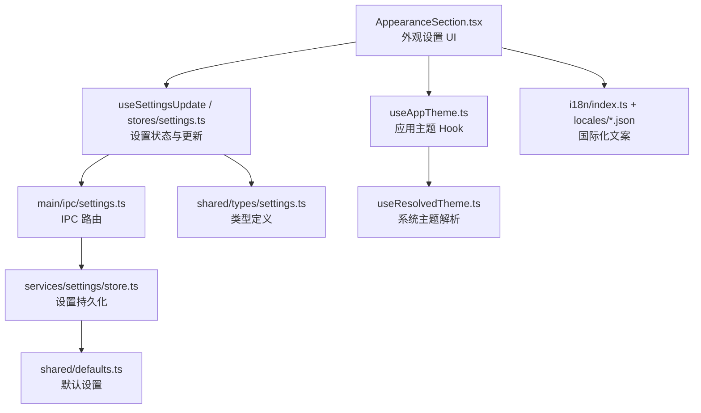
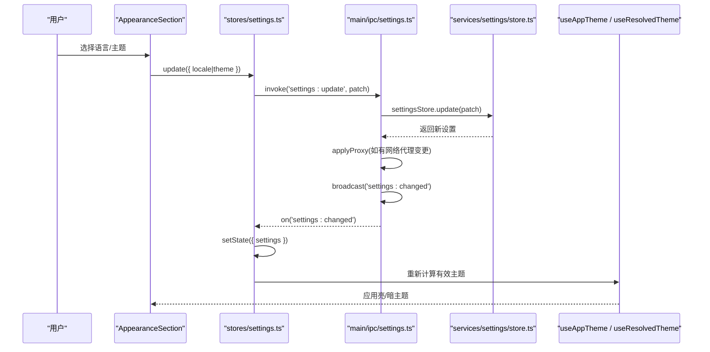
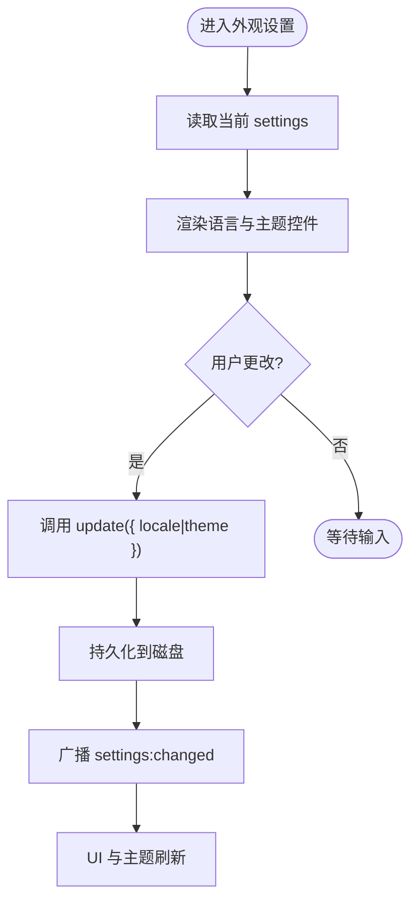
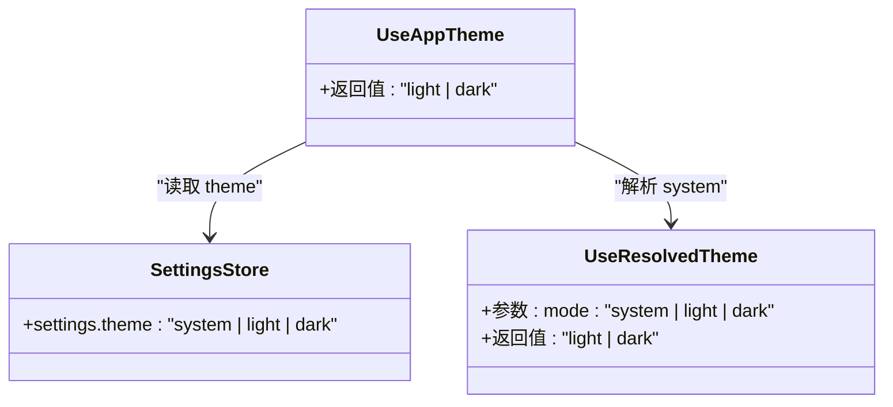
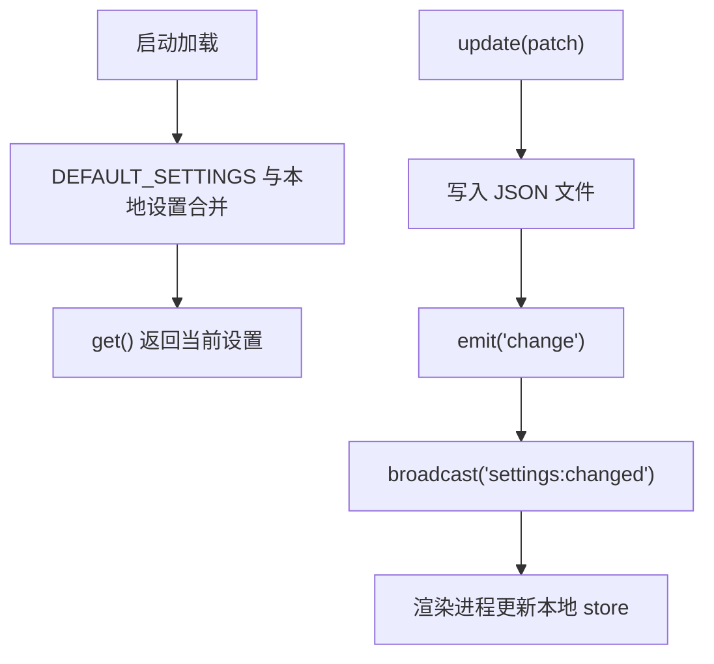
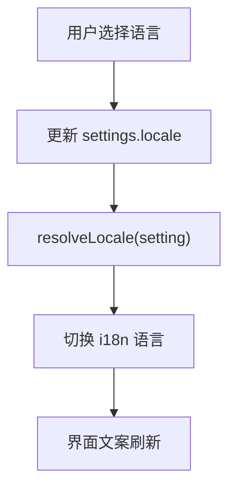
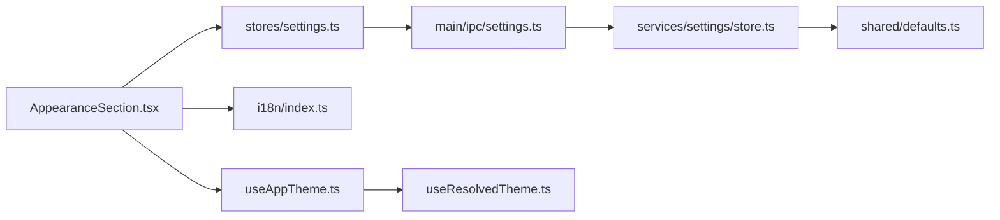

# 外观设置区块

<cite>
**本文引用的文件**   
- [AppearanceSection.tsx](file://src/renderer/src/pages/settings/AppearanceSection.tsx)
- [useAppTheme.ts](file://src/renderer/src/hooks/useAppTheme.ts)
- [useResolvedTheme.ts](file://src/renderer/src/hooks/useResolvedTheme.ts)
- [settings.ts（渲染进程状态）](file://src/renderer/src/stores/settings.ts)
- [settings.ts（主进程 IPC）](file://src/main/ipc/settings.ts)
- [store.ts（设置持久化）](file://src/main/services/settings/store.ts)
- [defaults.ts（默认值）](file://src/shared/defaults.ts)
- [settings.ts（共享类型）](file://src/shared/types/settings.ts)
- [index.ts（国际化初始化）](file://src/renderer/src/i18n/index.ts)
- [zh-CN.json（中文文案）](file://src/renderer/src/i18n/locales/zh-CN.json)
- [en-US.json（英文文案）](file://src/renderer/src/i18n/locales/en-US.json)
</cite>

## 目录
1. [简介](#简介)
2. [项目结构中的外观相关位置](#项目结构中的外观相关位置)
3. [核心组件与配置项](#核心组件与配置项)
4. [架构总览](#架构总览)
5. [详细组件分析](#详细组件分析)
6. [依赖关系分析](#依赖关系分析)
7. [性能与行为特征](#性能与行为特征)
8. [自定义主题与样式覆盖指南](#自定义主题与样式覆盖指南)
9. [故障排查](#故障排查)
10. [结论](#结论)

## 简介
本章节文档聚焦“外观设置区块”，围绕 AppearanceSection 组件展开，说明其提供的主题切换、语言选择等外观相关配置选项；解释主题系统的实现原理，包括深色/浅色模式切换机制；介绍用户偏好设置的存储与同步策略；并给出国际化支持和本地化配置说明，以及扩展自定义主题和样式覆盖的方法。

## 项目结构中的外观相关位置
外观相关的代码分布在以下模块：
- 设置页面中的外观区块 UI：AppearanceSection.tsx
- 主题解析与使用：useResolvedTheme.ts、useAppTheme.ts
- 设置状态与持久化：stores/settings.ts、main/ipc/settings.ts、services/settings/store.ts
- 类型与默认值：shared/types/settings.ts、shared/defaults.ts
- 国际化：i18n/index.ts、locales/zh-CN.json、locales/en-US.json

图表来源
- [AppearanceSection.tsx:1-43](file://src/renderer/src/pages/settings/AppearanceSection.tsx#L1-L43)
- [settings.ts（渲染进程状态）:1-26](file://src/renderer/src/stores/settings.ts#L1-L26)
- [settings.ts（主进程 IPC）:1-15](file://src/main/ipc/settings.ts#L1-L15)
- [store.ts（设置持久化）:1-30](file://src/main/services/settings/store.ts#L1-L30)
- [useAppTheme.ts:1-9](file://src/renderer/src/hooks/useAppTheme.ts#L1-L9)
- [useResolvedTheme.ts:1-18](file://src/renderer/src/hooks/useResolvedTheme.ts#L1-L18)
- [defaults.ts:22-44](file://src/shared/defaults.ts#L22-L44)
- [settings.ts（共享类型）:1-42](file://src/shared/types/settings.ts#L1-L42)
- [index.ts（国际化初始化）:1-26](file://src/renderer/src/i18n/index.ts#L1-L26)

章节来源
- [AppearanceSection.tsx:1-43](file://src/renderer/src/pages/settings/AppearanceSection.tsx#L1-L43)
- [settings.ts（渲染进程状态）:1-26](file://src/renderer/src/stores/settings.ts#L1-L26)
- [settings.ts（主进程 IPC）:1-15](file://src/main/ipc/settings.ts#L1-L15)
- [store.ts（设置持久化）:1-30](file://src/main/services/settings/store.ts#L1-L30)
- [useAppTheme.ts:1-9](file://src/renderer/src/hooks/useAppTheme.ts#L1-L9)
- [useResolvedTheme.ts:1-18](file://src/renderer/src/hooks/useResolvedTheme.ts#L1-L18)
- [defaults.ts:22-44](file://src/shared/defaults.ts#L22-L44)
- [settings.ts（共享类型）:1-42](file://src/shared/types/settings.ts#L1-L42)
- [index.ts（国际化初始化）:1-26](file://src/renderer/src/i18n/index.ts#L1-L26)

## 核心组件与配置项
AppearanceSection 提供两类外观相关配置：
- 语言 LocaleSetting：system | zh-CN | en-US
- 主题 ThemeMode：system | light | dark

这些字段在 Settings 类型中声明，并在默认设置中赋予初始值 system。UI 通过 Select 与 Segmented 控件展示，并通过 useSettingsUpdate 进行读取与更新。

章节来源
- [settings.ts（共享类型）:1-42](file://src/shared/types/settings.ts#L1-L42)
- [defaults.ts:22-44](file://src/shared/defaults.ts#L22-L44)
- [AppearanceSection.tsx:1-43](file://src/renderer/src/pages/settings/AppearanceSection.tsx#L1-L43)

## 架构总览
外观设置的数据流遵循“界面 → 状态 → IPC → 持久化 → 广播 → 界面”的闭环：
- 用户在 AppearanceSection 修改 locale 或 theme
- 调用 useSettingsUpdate.update 触发 settings:update IPC
- 主进程 settingsStore.update 合并并写入磁盘
- 主进程广播 settings:changed
- 渲染进程监听事件并更新本地 store，进而驱动 UI 与主题 Hook

图表来源
- [AppearanceSection.tsx:1-43](file://src/renderer/src/pages/settings/AppearanceSection.tsx#L1-L43)
- [settings.ts（渲染进程状态）:1-26](file://src/renderer/src/stores/settings.ts#L1-L26)
- [settings.ts（主进程 IPC）:1-15](file://src/main/ipc/settings.ts#L1-L15)
- [store.ts（设置持久化）:1-30](file://src/main/services/settings/store.ts#L1-L30)
- [useAppTheme.ts:1-9](file://src/renderer/src/hooks/useAppTheme.ts#L1-L9)
- [useResolvedTheme.ts:1-18](file://src/renderer/src/hooks/useResolvedTheme.ts#L1-L18)

## 详细组件分析

### AppearanceSection 组件
- 功能职责
  - 展示语言与主题两个外观配置项
  - 将用户选择转换为 settings 的局部更新
- 关键交互
  - 语言下拉框：支持 system、zh-CN、en-US
  - 主题分段控件：支持 system、light、dark
- 数据绑定
  - 从 useSettingsUpdate 获取 settings 与 update
  - 通过 onChange 调用 update 提交变更

图表来源
- [AppearanceSection.tsx:1-43](file://src/renderer/src/pages/settings/AppearanceSection.tsx#L1-L43)
- [settings.ts（渲染进程状态）:1-26](file://src/renderer/src/stores/settings.ts#L1-L26)
- [settings.ts（主进程 IPC）:1-15](file://src/main/ipc/settings.ts#L1-L15)
- [store.ts（设置持久化）:1-30](file://src/main/services/settings/store.ts#L1-L30)

章节来源
- [AppearanceSection.tsx:1-43](file://src/renderer/src/pages/settings/AppearanceSection.tsx#L1-L43)

### 主题系统与深色/浅色模式切换
- 有效主题来源
  - useAppTheme 从全局设置中读取 theme 字段
  - useResolvedTheme 将 system 解析为操作系统当前的颜色方案，并监听系统变化
- 切换机制
  - 当 theme=system 时，跟随系统明暗模式
  - 当 theme=light/dark 时，强制使用指定主题
- 消费方
  - 注释表明该 Hook 被 antd、Monaco、xterm 等共同使用，保证编辑器、终端与 UI 的主题一致性

图表来源
- [useAppTheme.ts:1-9](file://src/renderer/src/hooks/useAppTheme.ts#L1-L9)
- [useResolvedTheme.ts:1-18](file://src/renderer/src/hooks/useResolvedTheme.ts#L1-L18)
- [settings.ts（共享类型）:1-42](file://src/shared/types/settings.ts#L1-L42)

章节来源
- [useAppTheme.ts:1-9](file://src/renderer/src/hooks/useAppTheme.ts#L1-L9)
- [useResolvedTheme.ts:1-18](file://src/renderer/src/hooks/useResolvedTheme.ts#L1-L18)

### 用户偏好设置的存储与同步策略
- 存储位置
  - 主进程 settingsStore 负责加载、合并与写入 JSON 文件
- 默认值与合并
  - DEFAULT_SETTINGS 提供默认值
  - deepMerge 将已保存的设置与默认值合并，确保新增字段有合理默认值
- 同步机制
  - 主进程 settingsStore 变更时广播 settings:changed
  - 渲染进程通过 on('settings:changed') 更新本地 Zustand store
  - 所有订阅者（如 useAppTheme）自动响应最新设置

图表来源
- [store.ts（设置持久化）:1-30](file://src/main/services/settings/store.ts#L1-L30)
- [defaults.ts:22-44](file://src/shared/defaults.ts#L22-L44)
- [settings.ts（主进程 IPC）:1-15](file://src/main/ipc/settings.ts#L1-L15)
- [settings.ts（渲染进程状态）:1-26](file://src/renderer/src/stores/settings.ts#L1-L26)

章节来源
- [store.ts（设置持久化）:1-30](file://src/main/services/settings/store.ts#L1-L30)
- [defaults.ts:22-44](file://src/shared/defaults.ts#L22-L44)
- [settings.ts（主进程 IPC）:1-15](file://src/main/ipc/settings.ts#L1-L15)
- [settings.ts（渲染进程状态）:1-26](file://src/renderer/src/stores/settings.ts#L1-L26)

### 国际化支持与本地化配置
- 语言选项
  - AppearanceSection 暴露 system、zh-CN、en-US 三个选项
- 语言解析
  - i18n/index.ts 提供 resolveLocale：当设置为 system 时，根据浏览器语言前缀决定 zh-CN 或 en-US
- 资源注册
  - 初始化 i18next 并注册 zh-CN 与 en-US 翻译资源
- 文案键
  - settings.appearance、settings.language、settings.theme、settings.followSystem、settings.light、settings.dark 等键在 locales 文件中定义

图表来源
- [AppearanceSection.tsx:1-43](file://src/renderer/src/pages/settings/AppearanceSection.tsx#L1-L43)
- [index.ts（国际化初始化）:1-26](file://src/renderer/src/i18n/index.ts#L1-L26)
- [zh-CN.json:177-215](file://src/renderer/src/i18n/locales/zh-CN.json#L177-L215)
- [en-US.json:178-216](file://src/renderer/src/i18n/locales/en-US.json#L178-L216)

章节来源
- [index.ts（国际化初始化）:1-26](file://src/renderer/src/i18n/index.ts#L1-L26)
- [zh-CN.json:177-215](file://src/renderer/src/i18n/locales/zh-CN.json#L177-L215)
- [en-US.json:178-216](file://src/renderer/src/i18n/locales/en-US.json#L178-L216)

## 依赖关系分析
- AppearanceSection 依赖：
  - 共享类型 LocaleSetting、ThemeMode
  - 设置更新 Hook（基于 stores/settings.ts）
  - 国际化 t 函数
- 主题 Hook 依赖：
  - useAppTheme 依赖 settings.store 与 useResolvedTheme
  - useResolvedTheme 依赖 window.matchMedia 监听系统主题
- 设置持久化依赖：
  - main/ipc/settings.ts 桥接渲染进程与 services/settings/store.ts
  - store.ts 依赖 shared/defaults.ts 与 fs 工具读写 JSON

图表来源
- [AppearanceSection.tsx:1-43](file://src/renderer/src/pages/settings/AppearanceSection.tsx#L1-L43)
- [settings.ts（渲染进程状态）:1-26](file://src/renderer/src/stores/settings.ts#L1-L26)
- [settings.ts（主进程 IPC）:1-15](file://src/main/ipc/settings.ts#L1-L15)
- [store.ts（设置持久化）:1-30](file://src/main/services/settings/store.ts#L1-L30)
- [defaults.ts:22-44](file://src/shared/defaults.ts#L22-L44)
- [useAppTheme.ts:1-9](file://src/renderer/src/hooks/useAppTheme.ts#L1-L9)
- [useResolvedTheme.ts:1-18](file://src/renderer/src/hooks/useResolvedTheme.ts#L1-L18)

章节来源
- [AppearanceSection.tsx:1-43](file://src/renderer/src/pages/settings/AppearanceSection.tsx#L1-L43)
- [settings.ts（渲染进程状态）:1-26](file://src/renderer/src/stores/settings.ts#L1-L26)
- [settings.ts（主进程 IPC）:1-15](file://src/main/ipc/settings.ts#L1-L15)
- [store.ts（设置持久化）:1-30](file://src/main/services/settings/store.ts#L1-L30)
- [defaults.ts:22-44](file://src/shared/defaults.ts#L22-L44)
- [useAppTheme.ts:1-9](file://src/renderer/src/hooks/useAppTheme.ts#L1-L9)
- [useResolvedTheme.ts:1-18](file://src/renderer/src/hooks/useResolvedTheme.ts#L1-L18)

## 性能与行为特征
- 主题解析
  - useResolvedTheme 使用 matchMedia 监听系统主题变化，避免频繁轮询
  - 仅在 theme=system 时跟随系统，否则直接返回固定值
- 设置更新
  - 使用 deepMerge 增量合并，减少不必要的重写
  - 通过事件广播一次性通知所有订阅者，降低重复请求
- 国际化
  - i18next 预注册资源，切换语言即时生效

[本节为通用性能讨论，不直接分析具体文件]

## 自定义主题与样式覆盖指南
- 主题扩展点
  - useAppTheme 提供统一的有效主题值，供 antd、Monaco、xterm 等消费
  - 若需扩展更多主题模式，可在 ThemeMode 类型中添加新枚举值，并在 useResolvedTheme 中补充解析逻辑
- 样式覆盖建议
  - 通过 CSS 变量或主题类名覆盖 Ant Design 与编辑器的主题色
  - 在应用根节点根据 useAppTheme 的结果动态添加主题类名，使全局样式一致
- 语言扩展
  - 在 locales 下新增语言包，并在 i18n/index.ts 中注册
  - 在 AppearanceSection 的语言选项中增加对应选项，并确保 Settings 类型包含新的 LocaleSetting 值

[本节为概念性指导，不直接分析具体文件]

## 故障排查
- 主题未随系统切换
  - 检查 theme 是否设置为 system
  - 确认 useResolvedTheme 是否正确监听系统主题变化
- 语言未生效
  - 检查 resolveLocale 的逻辑是否符合预期
  - 确认 i18n 资源已正确注册且 key 存在
- 设置未持久化或未同步
  - 检查 settings:update IPC 是否正常调用
  - 确认 settingsStore.update 成功写入 JSON 并触发 change 事件
  - 验证渲染进程是否收到 settings:changed 并更新本地 store

章节来源
- [useResolvedTheme.ts:1-18](file://src/renderer/src/hooks/useResolvedTheme.ts#L1-L18)
- [index.ts（国际化初始化）:1-26](file://src/renderer/src/i18n/index.ts#L1-L26)
- [settings.ts（主进程 IPC）:1-15](file://src/main/ipc/settings.ts#L1-L15)
- [store.ts（设置持久化）:1-30](file://src/main/services/settings/store.ts#L1-L30)
- [settings.ts（渲染进程状态）:1-26](file://src/renderer/src/stores/settings.ts#L1-L26)

## 结论
外观设置区块通过 AppearanceSection 提供简洁直观的语言与主题配置入口；主题系统以 useAppTheme 与 useResolvedTheme 为核心，实现系统跟随与手动选择的统一抽象；设置数据通过 IPC 在主进程持久化，并以事件形式同步至渲染进程；国际化通过 i18next 管理多语言资源。整体设计清晰、可扩展性强，便于后续扩展更多外观与本地化能力。