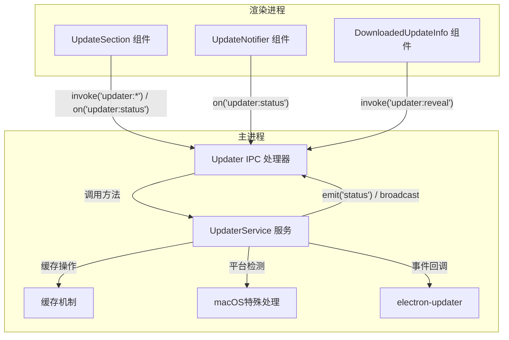
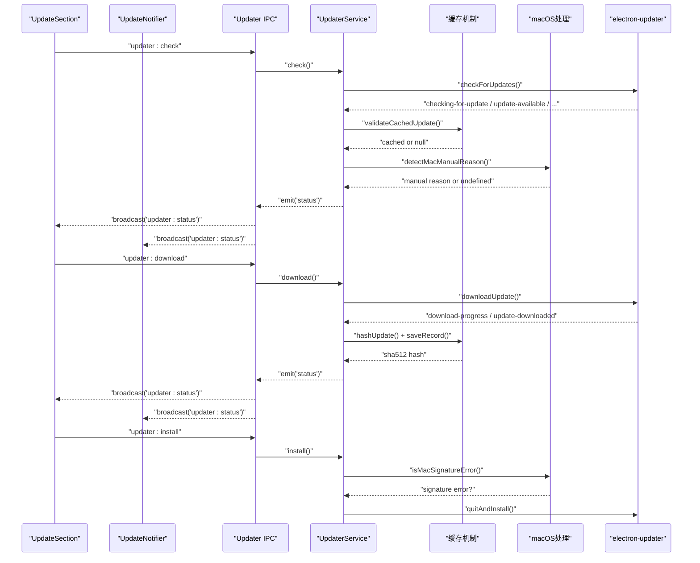
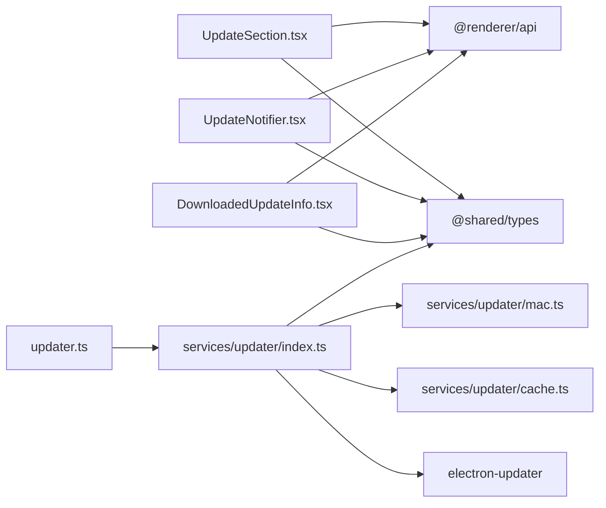

# 更新设置区块

<cite>
**本文引用的文件**   
- [UpdateSection.tsx](file://src/renderer/src/pages/settings/UpdateSection.tsx)
- [UpdateNotifier.tsx](file://src/renderer/src/components/common/UpdateNotifier.tsx)
- [DownloadedUpdateInfo.tsx](file://src/renderer/src/components/common/DownloadedUpdateInfo.tsx)
- [updater.ts（IPC）](file://src/main/ipc/updater.ts)
- [index.ts（Updater 服务）](file://src/main/services/updater/index.ts)
- [cache.ts（缓存机制）](file://src/main/services/updater/cache.ts)
- [mac.ts（macOS特殊处理）](file://src/main/services/updater/mac.ts)
- [settings.ts（类型定义）](file://src/shared/types/settings.ts)
- [app.ts（应用类型）](file://src/shared/types/app.ts)
- [useSettingsUpdate.ts](file://src/renderer/src/pages/settings/useSettingsUpdate.ts)
</cite>

## 更新摘要
**变更内容**   
- 新增缓存机制，支持跨进程重启的更新包验证和恢复
- 实现macOS特殊处理，包括签名检测和手动安装流程
- 扩展IPC端点，新增reveal方法用于显示下载位置
- 增强UI组件，支持手动安装指导和下载信息展示
- UpdaterService实现复杂状态机，支持preparing状态和多平台处理

## 目录
1. [简介](#简介)
2. [项目结构](#项目结构)
3. [核心组件](#核心组件)
4. [架构总览](#架构总览)
5. [详细组件分析](#详细组件分析)
6. [缓存机制](#缓存机制)
7. [macOS特殊处理](#macos特殊处理)
8. [依赖关系分析](#依赖关系分析)
9. [性能与行为特性](#性能与行为特性)
10. [故障排查指南](#故障排查指南)
11. [结论](#结论)

## 简介
本章节面向"更新设置区块"，系统性说明 UpdateSection 组件的自动更新配置、更新机制实现原理、通知与用户确认流程、失败恢复与手动更新方法，以及与 Updater 服务的通信协议。该功能基于 Electron 生态中的 electron-updater 进行版本检测、下载与安装，并通过 IPC 在渲染进程与主进程之间传递状态与指令。**最新更新增强了缓存机制、macOS特殊处理和复杂的更新状态管理。**

## 项目结构
围绕更新功能的代码分布在渲染层 UI、IPC 桥接、主进程服务以及共享类型中：
- 渲染层 UI：提供更新开关、检查/下载/安装按钮与进度展示，并订阅更新状态事件。
- IPC 层：将渲染层的调用转发到主进程的 Updater 服务，并将状态广播回渲染层。
- 主进程服务：封装 electron-updater 的行为，维护复杂的状态机，触发事件，实现缓存和平台特定逻辑。
- 共享类型：定义更新状态、设置项等跨进程共享的数据结构。



图表来源
- [UpdateSection.tsx:26-97](file://src/renderer/src/pages/settings/UpdateSection.tsx#L26-L97)
- [UpdateNotifier.tsx:13-85](file://src/renderer/src/components/common/UpdateNotifier.tsx#L13-L85)
- [DownloadedUpdateInfo.tsx:9-44](file://src/renderer/src/components/common/DownloadedUpdateInfo.tsx#L9-L44)
- [updater.ts（IPC）:4-12](file://src/main/ipc/updater.ts#L4-L12)
- [index.ts（Updater 服务）:32-269](file://src/main/services/updater/index.ts#L32-L269)

章节来源
- [UpdateSection.tsx:1-98](file://src/renderer/src/pages/settings/UpdateSection.tsx#L1-L98)
- [UpdateNotifier.tsx:1-86](file://src/renderer/src/components/common/UpdateNotifier.tsx#L1-L86)
- [DownloadedUpdateInfo.tsx:1-45](file://src/renderer/src/components/common/DownloadedUpdateInfo.tsx#L1-L45)
- [updater.ts（IPC）:1-13](file://src/main/ipc/updater.ts#L1-L13)
- [index.ts（Updater 服务）:1-269](file://src/main/services/updater/index.ts#L1-L269)

## 核心组件
- UpdateSection：渲染更新设置卡片，包含自动检查开关、当前更新状态展示、检查/下载/安装操作按钮，以及手动安装警告提示。
- UpdateNotifier：全局更新通知组件，监听更新状态变化，弹出可操作的系统通知，支持手动安装指导。
- DownloadedUpdateInfo：通用的下载信息展示组件，显示安装包路径、手动安装步骤和安全提示。
- Updater IPC：注册 updater:* 系列 IPC 通道，包括新增的 reveal 方法，桥接渲染层与主进程服务。
- UpdaterService：封装 electron-updater，维护复杂的状态机，实现缓存机制和平台特定处理，暴露 check/download/install/reveal 等方法。
- 共享类型：定义 UpdateStatus、UpdateState、UpdateSettings、DownloadedUpdate、ManualUpdateReason 等数据结构。

章节来源
- [UpdateSection.tsx:1-98](file://src/renderer/src/pages/settings/UpdateSection.tsx#L1-L98)
- [UpdateNotifier.tsx:1-86](file://src/renderer/src/components/common/UpdateNotifier.tsx#L1-L86)
- [DownloadedUpdateInfo.tsx:1-45](file://src/renderer/src/components/common/DownloadedUpdateInfo.tsx#L1-L45)
- [updater.ts（IPC）:1-13](file://src/main/ipc/updater.ts#L1-L13)
- [index.ts（Updater 服务）:1-269](file://src/main/services/updater/index.ts#L1-L269)
- [settings.ts（类型定义）:34-44](file://src/shared/types/settings.ts#L34-L44)
- [app.ts（应用类型）:1-41](file://src/shared/types/app.ts#L1-L41)

## 架构总览
更新功能采用"渲染层 UI + IPC + 主进程服务 + 第三方库"的分层架构，**新增了缓存层和平台特定处理层**：
- 渲染层通过 invoke/on 调用 IPC 并订阅状态事件。
- IPC 将请求路由到 UpdaterService，同时将状态变更广播给所有订阅者。
- UpdaterService 管理 electron-updater 的生命周期与事件，维护内部状态，协调缓存和平台特定逻辑。
- 缓存层负责更新包的验证、哈希计算和持久化存储。
- macOS处理层负责签名检测、隔离属性管理和手动安装流程。
- 共享类型保证两端数据结构一致。



图表来源
- [UpdateSection.tsx:29-91](file://src/renderer/src/pages/settings/UpdateSection.tsx#L29-L91)
- [UpdateNotifier.tsx:15-82](file://src/renderer/src/components/common/UpdateNotifier.tsx#L15-L82)
- [DownloadedUpdateInfo.tsx:18-40](file://src/renderer/src/components/common/DownloadedUpdateInfo.tsx#L18-L40)
- [updater.ts（IPC）:4-12](file://src/main/ipc/updater.ts#L4-L12)
- [index.ts（Updater 服务）:54-265](file://src/main/services/updater/index.ts#L54-L265)
- [cache.ts:16-44](file://src/main/services/updater/cache.ts#L16-L44)
- [mac.ts:19-39](file://src/main/services/updater/mac.ts#L19-L39)

## 详细组件分析

### UpdateSection 组件
- 自动更新配置
  - 提供"自动检查"开关，绑定 settings.update.autoCheck，支持即时保存。
- 更新状态展示
  - 根据 UpdateStatus.state 显示不同文案与颜色；当处于 downloading 时显示进度条。
  - **新增**：支持 preparing 状态，显示更新准备中的提示信息。
  - **新增**：支持 manualReason 字段，显示手动安装的警告信息。
- 用户交互
  - 检查：调用 updater:check，成功后刷新状态。
  - 下载：仅在 available 时启用，调用 updater:download。
  - 重启安装：仅在 downloaded 且非 manualInstall 时启用，调用 updater:install。
  - **新增**：显示 DownloadedUpdateInfo 组件，提供安装包信息和手动安装指导。
- 错误处理
  - 使用统一的 formatError 包装错误消息，通过 message.error 提示。
  - **新增**：支持 errorCode 字段，提供更精确的错误分类。


图表来源
- [UpdateSection.tsx:26-97](file://src/renderer/src/pages/settings/UpdateSection.tsx#L26-L97)
- [app.ts（应用类型）:1-41](file://src/shared/types/app.ts#L1-L41)

章节来源
- [UpdateSection.tsx:1-98](file://src/renderer/src/pages/settings/UpdateSection.tsx#L1-L98)

### UpdateNotifier 组件
- 作用：全局监听 updater:status，当检测到可用更新或已下载完成时弹出通知，并提供对应操作按钮。
- 行为：
  - available：弹出信息通知，附带"下载"按钮。
  - downloaded：弹出成功通知，附带"重启安装"按钮或"手动安装指导"按钮。
  - **新增**：支持 manualInstall 场景，显示警告类型的通知和手动安装指导。
- 优点：即使用户不在设置页，也能感知更新并快速操作。

章节来源
- [UpdateNotifier.tsx:1-86](file://src/renderer/src/components/common/UpdateNotifier.tsx#L1-L86)

### DownloadedUpdateInfo 组件
- 作用：通用的下载信息展示组件，显示安装包路径、手动安装步骤和安全提示。
- 功能：
  - 显示版本号和应用包路径。
  - 提供"显示在文件夹中"按钮，调用 updater:reveal。
  - **新增**：支持手动安装模式，显示详细的操作步骤和安全警告。
  - **新增**：提供隔离属性清理命令，便于用户在macOS上执行。

章节来源
- [DownloadedUpdateInfo.tsx:1-45](file://src/renderer/src/components/common/DownloadedUpdateInfo.tsx#L1-L45)

### Updater IPC
- 职责：注册 updater:status、updater:check、updater:download、updater:install、**新增** updater:reveal 五个通道。
- 广播：监听 UpdaterService 的 status 事件，统一广播给渲染层。

章节来源
- [updater.ts（IPC）:1-13](file://src/main/ipc/updater.ts#L1-L13)

### UpdaterService 服务
- **增强的状态机**
  - idle：初始空闲（打包环境下）。
  - unsupported：未打包环境不支持更新。
  - checking：正在检查更新。
  - available：有可用更新。
  - not-available：无可用更新。
  - downloading：下载中，携带 percent。
  - **新增**：preparing：更新准备中，用于macOS签名验证或其他准备工作。
  - downloaded：下载完成。
  - error：发生错误，携带 error 信息和 errorCode。
- **增强的生命周期**
  - initialize：仅在打包环境初始化一次，关闭自动下载与自动安装，订阅 electron-updater 事件。
  - **新增**：initialize 方法支持懒加载，避免不必要的初始化开销。
  - check：触发检查更新，捕获异常并转为 error 状态。
  - download：仅当状态为 available 时执行下载。
  - install：**新增**支持手动安装流程和跨进程重启后的安装恢复。
  - **新增**：reveal：显示下载的安装包位置。
- **新增的缓存机制**
  - 记录下载的安装包信息，包括版本、路径、SHA512哈希值、平台和架构。
  - 支持跨进程重启后恢复之前的下载状态。
  - 验证缓存文件的完整性和有效性。
- **新增的平台特定处理**
  - macOS签名检测和隔离属性管理。
  - 自动检测是否需要手动安装流程。
  - 生成隔离属性清理命令供用户执行。
- 事件与广播
  - 内部 set 方法更新状态并 emit('status')，由 IPC 层广播。

```mermaid
classDiagram
class UpdaterService {
-status : UpdateStatus
-initialization? : Promise~void~
-cached : CachedUpdate
-manualReason? : ManualUpdateReason
-nativeReady : boolean
-busy : boolean
-installRequested : boolean
-recordTask? : Promise~void~
-saving : Promise~void~
+get() UpdateStatus
+check() Promise~UpdateStatus~
+download() Promise~void~
+install() Promise~void~
+reveal() Promise~void~
+initialize() Promise~void~
-set(status) void
-showDownloaded() void
-recordDownloaded(info) Promise~void~
-fail(error) void
-validateDownload() Promise~boolean~
-saveRecord() Promise~void~
-downloaded() DownloadedUpdate
}
class CachedUpdate {
+version : string
+path : string
+sha512 : string
+platform : string
+arch : string
+manualReason? : ManualUpdateReason
}
class UpdateStatus {
+state : UpdateState
+version? : string
+percent? : number
+error? : string
+errorCode? : string
+downloaded? : DownloadedUpdate
+manualReason? : ManualUpdateReason
}
class UpdateState {
<<enumeration>>
"idle"
"unsupported"
"checking"
"available"
"not-available"
"downloading"
"preparing"
"downloaded"
"error"
}
class ManualUpdateReason {
<<enumeration>>
"mac-unsigned"
"mac-signature"
}
UpdaterService --> CachedUpdate : "维护"
UpdaterService --> UpdateStatus : "维护"
UpdateStatus --> UpdateState : "引用"
UpdateStatus --> ManualUpdateReason : "引用"
```

图表来源
- [index.ts（Updater 服务）:32-269](file://src/main/services/updater/index.ts#L32-L269)
- [cache.ts:7-14](file://src/main/services/updater/cache.ts#L7-L14)
- [app.ts（应用类型）:1-41](file://src/shared/types/app.ts#L1-L41)

章节来源
- [index.ts（Updater 服务）:1-269](file://src/main/services/updater/index.ts#L1-L269)
- [app.ts（应用类型）:1-41](file://src/shared/types/app.ts#L1-L41)

### 设置模型与默认值
- UpdateSettings
  - autoCheck：布尔值，控制是否开启自动检查更新。
- Settings
  - 包含 locale、theme、network、run、update 等模块设置。
- useSettingsUpdate
  - 提供 settings 与 update(patch) 方法，统一错误提示。

章节来源
- [settings.ts（类型定义）:34-44](file://src/shared/types/settings.ts#L34-L44)
- [useSettingsUpdate.ts:1-27](file://src/renderer/src/pages/settings/useSettingsUpdate.ts#L1-L27)

## 缓存机制
**新增**的缓存机制确保更新过程更加可靠和高效：

- 缓存数据结构
  - version：目标版本号
  - path：安装包文件路径
  - sha512：文件的SHA512哈希值，用于完整性验证
  - platform：目标平台标识
  - arch：目标架构标识
  - manualReason：手动安装原因（可选）

- 缓存验证流程
  - validateCachedUpdate：验证缓存记录的完整性和有效性
  - 检查平台、架构匹配性
  - 验证文件存在性和哈希值一致性
  - 确保缓存的是新版本而非旧版本

- 缓存持久化
  - 下载完成后自动计算并保存SHA512哈希值
  - 支持跨进程重启后恢复下载状态
  - 错误情况下清理无效的缓存记录

章节来源
- [cache.ts:1-45](file://src/main/services/updater/cache.ts#L1-L45)
- [index.ts（Updater 服务）:43-52](file://src/main/services/updater/index.ts#L43-L52)
- [index.ts（Updater 服务）:137-151](file://src/main/services/updater/index.ts#L137-L151)
- [index.ts（Updater 服务）:213-221](file://src/main/services/updater/index.ts#L213-L221)

## macOS特殊处理
**新增**的macOS特殊处理机制解决了签名和权限相关问题：

- 签名检测
  - detectMacManualReason：检测应用签名状态
  - 检查Developer ID Application签名
  - 验证TeamIdentifier的有效性
  - 区分临时签名和无签名情况

- 隔离属性管理
  - quarantineCommand：生成隔离属性清理命令
  - 安全地转义路径中的特殊字符
  - 提供用户友好的命令行指令

- 签名错误处理
  - isMacSignatureError：识别签名相关错误
  - 自动切换到手动安装流程
  - 提供详细的错误信息和解决方案

- 应用路径处理
  - macAppPath：获取正确的应用包路径
  - 处理/AppTranslocation/和/Volumes/等特殊路径
  - 返回标准化的应用路径

章节来源
- [mac.ts:1-40](file://src/main/services/updater/mac.ts#L1-L40)
- [index.ts（Updater 服务）:61-64](file://src/main/services/updater/index.ts#L61-L64)
- [index.ts（Updater 服务）:105-114](file://src/main/services/updater/index.ts#L105-L114)
- [index.ts（Updater 服务）:153-169](file://src/main/services/updater/index.ts#L153-L169)

## 依赖关系分析
- 渲染层依赖
  - UpdateSection 依赖 @renderer/api（invoke/on）、@shared/types（UpdateStatus）、antd 组件与 i18n。
  - UpdateNotifier 依赖 @renderer/api、@shared/types、antd 通知与 i18n。
  - **新增**：DownloadedUpdateInfo 依赖 @renderer/api、@shared/types、antd 组件与 i18n。
- IPC 层依赖
  - updater.ts 依赖 main/services/updater 与 helpers（handle/broadcast）。
- 主进程服务依赖
  - UpdaterService 依赖 node:events、electron、electron-updater、**新增** cache.ts 和 mac.ts。
- 共享类型
  - UpdateStatus、UpdateState、UpdateSettings、**新增** DownloadedUpdate、ManualUpdateReason 被渲染层与主进程共同消费。



图表来源
- [UpdateSection.tsx:1-98](file://src/renderer/src/pages/settings/UpdateSection.tsx#L1-L98)
- [UpdateNotifier.tsx:1-86](file://src/renderer/src/components/common/UpdateNotifier.tsx#L1-L86)
- [DownloadedUpdateInfo.tsx:1-45](file://src/renderer/src/components/common/DownloadedUpdateInfo.tsx#L1-L45)
- [updater.ts（IPC）:1-13](file://src/main/ipc/updater.ts#L1-L13)
- [index.ts（Updater 服务）:1-269](file://src/main/services/updater/index.ts#L1-L269)
- [cache.ts:1-45](file://src/main/services/updater/cache.ts#L1-L45)
- [mac.ts:1-40](file://src/main/services/updater/mac.ts#L1-L40)

章节来源
- [UpdateSection.tsx:1-98](file://src/renderer/src/pages/settings/UpdateSection.tsx#L1-L98)
- [UpdateNotifier.tsx:1-86](file://src/renderer/src/components/common/UpdateNotifier.tsx#L1-L86)
- [DownloadedUpdateInfo.tsx:1-45](file://src/renderer/src/components/common/DownloadedUpdateInfo.tsx#L1-L45)
- [updater.ts（IPC）:1-13](file://src/main/ipc/updater.ts#L1-L13)
- [index.ts（Updater 服务）:1-269](file://src/main/services/updater/index.ts#L1-L269)
- [cache.ts:1-45](file://src/main/services/updater/cache.ts#L1-L45)
- [mac.ts:1-40](file://src/main/services/updater/mac.ts#L1-L40)

## 性能与行为特性
- 自动检查
  - 通过 settings.update.autoCheck 控制是否启用自动检查逻辑（具体调度策略由上层业务决定，此处仅暴露开关）。
- 网络代理
  - UpdaterService 初始化时通过 electron-updater 的配置，使更新请求走 session.defaultSession，从而复用应用配置的代理设置。
- 增量更新
  - 由 electron-updater 负责增量更新策略，本仓库不直接实现差分算法。
- **新增**：缓存优化
  - 避免重复下载相同的更新包
  - 支持跨进程重启后恢复下载状态
  - 减少网络请求和资源消耗
- **新增**：平台特定优化
  - macOS签名预检测，避免无效的安装尝试
  - 智能的隔离属性处理，提升用户体验
- 回滚策略
  - 本仓库未实现显式回滚逻辑；若需要回滚，可在业务层结合版本信息与旧包管理自行实现。
- 状态驱动 UI
  - 渲染层通过事件订阅实时更新 UI，避免轮询开销。
- **新增**：错误分类
  - 支持更精细的错误码分类，便于用户理解和故障排除。

[本节为通用指导，不涉及具体文件分析]

## 故障排查指南
- 常见状态与含义
  - unsupported：开发环境或未打包环境，更新功能不可用。
  - checking：正在检查更新。
  - available：发现新版本，可下载。
  - downloading：下载中，可查看 percent。
  - **新增**：preparing：更新准备中，可能正在进行签名验证或其他准备工作。
  - downloaded：下载完成，可重启安装。
  - error：出现错误，查看 error 字段获取原因。
- **新增**：错误码说明
  - no-release：未发现发布的版本
  - mac-signature：macOS签名验证失败
  - cache-missing：缓存数据丢失或损坏
- 常见问题定位
  - 无法检查更新：确认应用已打包；检查网络与代理配置；查看 error 信息。
  - 下载失败：检查网络连接、镜像源与代理；关注 percent 与 error。
  - 安装失败：确保当前版本已下载完成；以管理员权限运行应用。
  - **新增**：macOS安装问题：检查应用签名状态；执行隔离属性清理命令；确认Developer ID签名有效。
- 恢复建议
  - 遇到 error 后，等待一段时间重试 updater:check。
  - 若持续失败，检查 electron-updater 的日志输出与网络环境。
  - **新增**：缓存损坏时，删除 downloaded.json 文件后重新检查更新。
  - **新增**：macOS签名问题时，按照界面提示执行手动安装流程。

章节来源
- [index.ts（Updater 服务）:18-30](file://src/main/services/updater/index.ts#L18-L30)
- [index.ts（Updater 服务）:153-169](file://src/main/services/updater/index.ts#L153-L169)
- [index.ts（Updater 服务）:213-221](file://src/main/services/updater/index.ts#L213-L221)
- [app.ts（应用类型）:1-41](file://src/shared/types/app.ts#L1-L41)

## 结论
UpdateSection 提供了简洁直观的更新设置入口，配合 UpdateNotifier 的全局通知能力和 **新增的** DownloadedUpdateInfo 组件，形成完整的更新体验闭环。UpdaterService 封装了 electron-updater 的状态机与事件流，**新增了缓存机制和平台特定处理**，通过 IPC 向渲染层广播状态，渲染层据此驱动 UI 与用户交互。当前实现聚焦于基础更新流程与状态管理，**显著增强了可靠性、用户体验和平台兼容性**。如需扩展渠道选择、自定义下载源或更复杂的回滚策略，可在现有架构基础上扩展 UpdaterService 与设置模型。

[本节为总结性内容，不涉及具体文件分析]