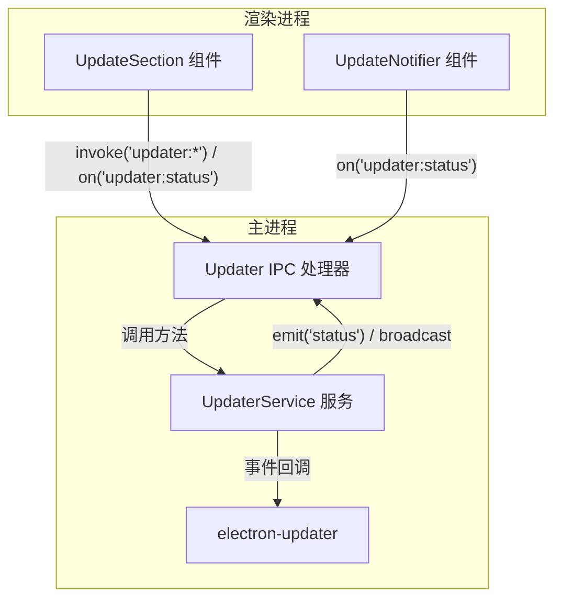
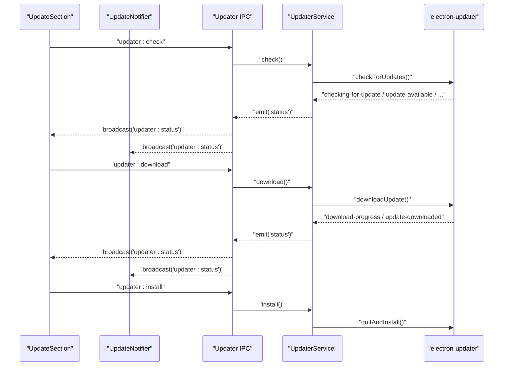
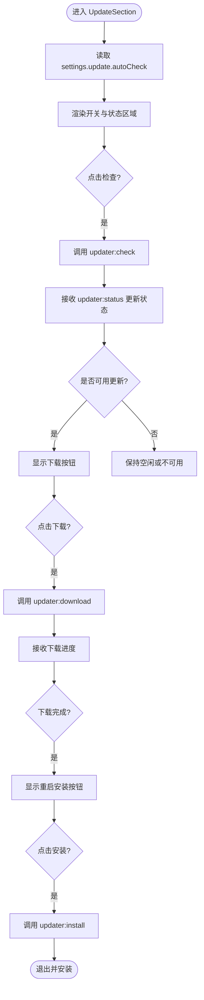
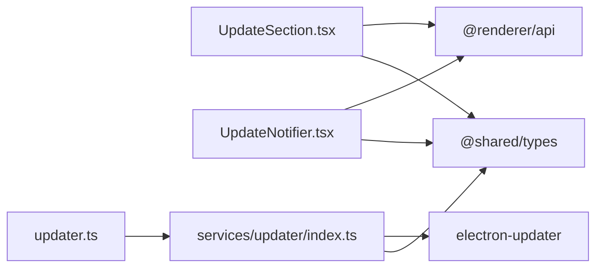

# 更新设置区块

<cite>
**本文引用的文件**   
- [UpdateSection.tsx](file://src/renderer/src/pages/settings/UpdateSection.tsx)
- [UpdateNotifier.tsx](file://src/renderer/src/components/common/UpdateNotifier.tsx)
- [updater.ts（IPC）](file://src/main/ipc/updater.ts)
- [index.ts（Updater 服务）](file://src/main/services/updater/index.ts)
- [settings.ts（类型定义）](file://src/shared/types/settings.ts)
- [app.ts（应用类型）](file://src/shared/types/app.ts)
- [useSettingsUpdate.ts](file://src/renderer/src/pages/settings/useSettingsUpdate.ts)
</cite>

## 目录
1. [简介](#简介)
2. [项目结构](#项目结构)
3. [核心组件](#核心组件)
4. [架构总览](#架构总览)
5. [详细组件分析](#详细组件分析)
6. [依赖关系分析](#依赖关系分析)
7. [性能与行为特性](#性能与行为特性)
8. [故障排查指南](#故障排查指南)
9. [结论](#结论)

## 简介
本章节面向“更新设置区块”，系统性说明 UpdateSection 组件的自动更新配置、更新机制实现原理、通知与用户确认流程、失败恢复与手动更新方法，以及与 Updater 服务的通信协议。该功能基于 Electron 生态中的 electron-updater 进行版本检测、下载与安装，并通过 IPC 在渲染进程与主进程之间传递状态与指令。

## 项目结构
围绕更新功能的代码分布在渲染层 UI、IPC 桥接、主进程服务以及共享类型中：
- 渲染层 UI：提供更新开关、检查/下载/安装按钮与进度展示，并订阅更新状态事件。
- IPC 层：将渲染层的调用转发到主进程的 Updater 服务，并将状态广播回渲染层。
- 主进程服务：封装 electron-updater 的行为，维护更新状态机，触发事件。
- 共享类型：定义更新状态、设置项等跨进程共享的数据结构。



图表来源
- [UpdateSection.tsx:23-77](file://src/renderer/src/pages/settings/UpdateSection.tsx#L23-L77)
- [UpdateNotifier.tsx:10-43](file://src/renderer/src/components/common/UpdateNotifier.tsx#L10-L43)
- [updater.ts（IPC）:4-11](file://src/main/ipc/updater.ts#L4-L11)
- [index.ts（Updater 服务）:6-64](file://src/main/services/updater/index.ts#L6-L64)

章节来源
- [UpdateSection.tsx:1-78](file://src/renderer/src/pages/settings/UpdateSection.tsx#L1-L78)
- [UpdateNotifier.tsx:1-44](file://src/renderer/src/components/common/UpdateNotifier.tsx#L1-L44)
- [updater.ts（IPC）:1-12](file://src/main/ipc/updater.ts#L1-L12)
- [index.ts（Updater 服务）:1-65](file://src/main/services/updater/index.ts#L1-L65)

## 核心组件
- UpdateSection：渲染更新设置卡片，包含自动检查开关、当前更新状态展示、检查/下载/安装操作按钮。
- UpdateNotifier：全局更新通知组件，监听更新状态变化，弹出可操作的系统通知。
- Updater IPC：注册 updater:* 系列 IPC 通道，桥接渲染层与主进程服务。
- UpdaterService：封装 electron-updater，维护更新状态机，暴露 check/download/install 等方法。
- 共享类型：定义 UpdateStatus、UpdateState、UpdateSettings 等数据结构。

章节来源
- [UpdateSection.tsx:1-78](file://src/renderer/src/pages/settings/UpdateSection.tsx#L1-L78)
- [UpdateNotifier.tsx:1-44](file://src/renderer/src/components/common/UpdateNotifier.tsx#L1-L44)
- [updater.ts（IPC）:1-12](file://src/main/ipc/updater.ts#L1-L12)
- [index.ts（Updater 服务）:1-65](file://src/main/services/updater/index.ts#L1-L65)
- [settings.ts（类型定义）:32-42](file://src/shared/types/settings.ts#L32-L42)
- [app.ts（应用类型）:1-16](file://src/shared/types/app.ts#L1-L16)

## 架构总览
更新功能采用“渲染层 UI + IPC + 主进程服务 + 第三方库”的分层架构：
- 渲染层通过 invoke/on 调用 IPC 并订阅状态事件。
- IPC 将请求路由到 UpdaterService，同时将状态变更广播给所有订阅者。
- UpdaterService 管理 electron-updater 的生命周期与事件，维护内部状态。
- 共享类型保证两端数据结构一致。



图表来源
- [UpdateSection.tsx:29-71](file://src/renderer/src/pages/settings/UpdateSection.tsx#L29-L71)
- [UpdateNotifier.tsx:15-40](file://src/renderer/src/components/common/UpdateNotifier.tsx#L15-L40)
- [updater.ts（IPC）:4-11](file://src/main/ipc/updater.ts#L4-L11)
- [index.ts（Updater 服务）:38-61](file://src/main/services/updater/index.ts#L38-L61)

## 详细组件分析

### UpdateSection 组件
- 自动更新配置
  - 提供“自动检查”开关，绑定 settings.update.autoCheck，支持即时保存。
- 更新状态展示
  - 根据 UpdateStatus.state 显示不同文案与颜色；当处于 downloading 时显示进度条。
- 用户交互
  - 检查：调用 updater:check，成功后刷新状态。
  - 下载：仅在 available 时启用，调用 updater:download。
  - 重启安装：仅在 downloaded 时启用，调用 updater:install。
- 错误处理
  - 使用统一的 formatError 包装错误消息，通过 message.error 提示。



图表来源
- [UpdateSection.tsx:23-77](file://src/renderer/src/pages/settings/UpdateSection.tsx#L23-L77)
- [app.ts（应用类型）:1-16](file://src/shared/types/app.ts#L1-L16)

章节来源
- [UpdateSection.tsx:1-78](file://src/renderer/src/pages/settings/UpdateSection.tsx#L1-L78)

### UpdateNotifier 组件
- 作用：全局监听 updater:status，当检测到可用更新或已下载完成时弹出通知，并提供对应操作按钮。
- 行为：
  - available：弹出信息通知，附带“下载”按钮。
  - downloaded：弹出成功通知，附带“重启安装”按钮。
- 优点：即使用户不在设置页，也能感知更新并快速操作。

章节来源
- [UpdateNotifier.tsx:1-44](file://src/renderer/src/components/common/UpdateNotifier.tsx#L1-L44)

### Updater IPC
- 职责：注册 updater:status、updater:check、updater:download、updater:install 四个通道。
- 广播：监听 UpdaterService 的 status 事件，统一广播给渲染层。

章节来源
- [updater.ts（IPC）:1-12](file://src/main/ipc/updater.ts#L1-L12)

### UpdaterService 服务
- 状态机
  - idle：初始空闲（打包环境下）。
  - unsupported：未打包环境不支持更新。
  - checking：正在检查更新。
  - available：有可用更新。
  - not-available：无可用更新。
  - downloading：下载中，携带 percent。
  - downloaded：下载完成。
  - error：发生错误，携带 error 信息。
- 生命周期
  - init：仅在打包环境初始化一次，关闭自动下载与自动安装，订阅 electron-updater 事件。
  - check：触发检查更新，捕获异常并转为 error 状态。
  - download：仅当状态为 available 时执行下载。
  - install：仅当状态为 downloaded 时执行 quitAndInstall。
- 事件与广播
  - 内部 set 方法更新状态并 emit('status')，由 IPC 层广播。

```mermaid
classDiagram
class UpdaterService {
-status : UpdateStatus
-initialized : boolean
+get() UpdateStatus
+check() Promise~UpdateStatus~
+download() Promise~void~
+install() void
-init() void
-set(status) void
}
class UpdateStatus {
+state : UpdateState
+version? : string
+percent? : number
+error? : string
}
class UpdateState {
<<enumeration>>
"idle"
"unsupported"
"checking"
"available"
"not-available"
"downloading"
"downloaded"
"error"
}
UpdaterService --> UpdateStatus : "维护"
UpdateStatus --> UpdateState : "引用"
```

图表来源
- [index.ts（Updater 服务）:6-64](file://src/main/services/updater/index.ts#L6-L64)
- [app.ts（应用类型）:1-16](file://src/shared/types/app.ts#L1-L16)

章节来源
- [index.ts（Updater 服务）:1-65](file://src/main/services/updater/index.ts#L1-L65)
- [app.ts（应用类型）:1-16](file://src/shared/types/app.ts#L1-L16)

### 设置模型与默认值
- UpdateSettings
  - autoCheck：布尔值，控制是否开启自动检查更新。
- Settings
  - 包含 locale、theme、network、run、update 等模块设置。
- useSettingsUpdate
  - 提供 settings 与 update(patch) 方法，统一错误提示。

章节来源
- [settings.ts（类型定义）:32-42](file://src/shared/types/settings.ts#L32-L42)
- [useSettingsUpdate.ts:1-27](file://src/renderer/src/pages/settings/useSettingsUpdate.ts#L1-L27)

## 依赖关系分析
- 渲染层依赖
  - UpdateSection 依赖 @renderer/api（invoke/on）、@shared/types（UpdateStatus）、antd 组件与 i18n。
  - UpdateNotifier 依赖 @renderer/api、@shared/types、antd 通知与 i18n。
- IPC 层依赖
  - updater.ts 依赖 main/services/updater 与 helpers（handle/broadcast）。
- 主进程服务依赖
  - UpdaterService 依赖 node:events、electron、electron-updater。
- 共享类型
  - UpdateStatus、UpdateState、UpdateSettings 被渲染层与主进程共同消费。



图表来源
- [UpdateSection.tsx:1-78](file://src/renderer/src/pages/settings/UpdateSection.tsx#L1-L78)
- [UpdateNotifier.tsx:1-44](file://src/renderer/src/components/common/UpdateNotifier.tsx#L1-L44)
- [updater.ts（IPC）:1-12](file://src/main/ipc/updater.ts#L1-L12)
- [index.ts（Updater 服务）:1-65](file://src/main/services/updater/index.ts#L1-L65)

章节来源
- [UpdateSection.tsx:1-78](file://src/renderer/src/pages/settings/UpdateSection.tsx#L1-L78)
- [UpdateNotifier.tsx:1-44](file://src/renderer/src/components/common/UpdateNotifier.tsx#L1-L44)
- [updater.ts（IPC）:1-12](file://src/main/ipc/updater.ts#L1-L12)
- [index.ts（Updater 服务）:1-65](file://src/main/services/updater/index.ts#L1-L65)

## 性能与行为特性
- 自动检查
  - 通过 settings.update.autoCheck 控制是否启用自动检查逻辑（具体调度策略由上层业务决定，此处仅暴露开关）。
- 网络代理
  - UpdaterService 初始化时通过 electron-updater 的配置，使更新请求走 session.defaultSession，从而复用应用配置的代理设置。
- 增量更新
  - 由 electron-updater 负责增量更新策略，本仓库不直接实现差分算法。
- 回滚策略
  - 本仓库未实现显式回滚逻辑；若需要回滚，可在业务层结合版本信息与旧包管理自行实现。
- 状态驱动 UI
  - 渲染层通过事件订阅实时更新 UI，避免轮询开销。

[本节为通用指导，不涉及具体文件分析]

## 故障排查指南
- 常见状态与含义
  - unsupported：开发环境或未打包环境，更新功能不可用。
  - checking：正在检查更新。
  - available：发现新版本，可下载。
  - downloading：下载中，可查看 percent。
  - downloaded：下载完成，可重启安装。
  - error：出现错误，查看 error 字段获取原因。
- 常见问题定位
  - 无法检查更新：确认应用已打包；检查网络与代理配置；查看 error 信息。
  - 下载失败：检查网络连接、镜像源与代理；关注 percent 与 error。
  - 安装失败：确保当前版本已下载完成；以管理员权限运行应用。
- 恢复建议
  - 遇到 error 后，等待一段时间重试 updater:check。
  - 若持续失败，检查 electron-updater 的日志输出与网络环境。

章节来源
- [index.ts（Updater 服务）:38-61](file://src/main/services/updater/index.ts#L38-L61)
- [app.ts（应用类型）:1-16](file://src/shared/types/app.ts#L1-L16)

## 结论
UpdateSection 提供了简洁直观的更新设置入口，配合 UpdateNotifier 的全局通知能力，形成完整的更新体验闭环。UpdaterService 封装了 electron-updater 的状态机与事件流，通过 IPC 向渲染层广播状态，渲染层据此驱动 UI 与用户交互。当前实现聚焦于基础更新流程与状态管理；如需扩展渠道选择、自定义下载源或更复杂的回滚策略，可在现有架构基础上扩展 UpdaterService 与设置模型。

[本节为总结性内容，不涉及具体文件分析]