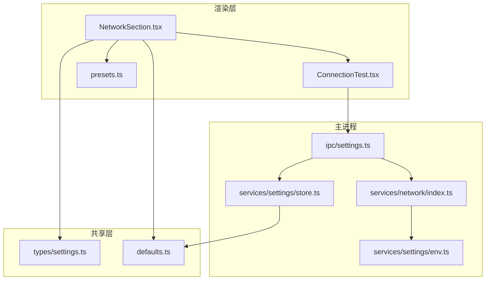
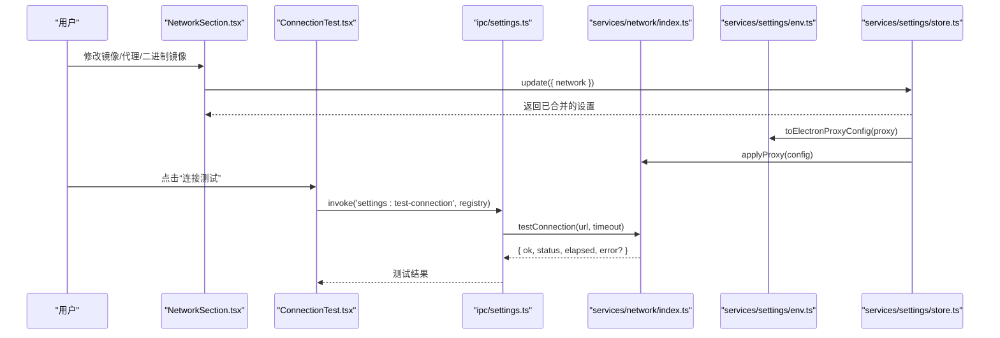
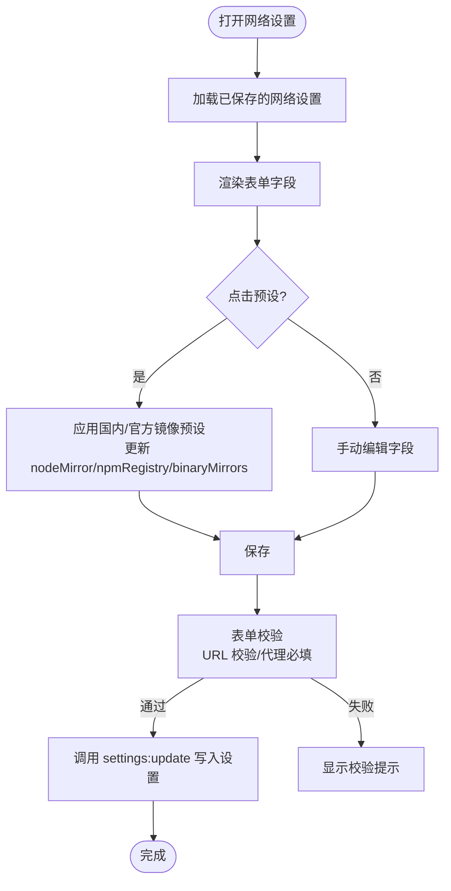
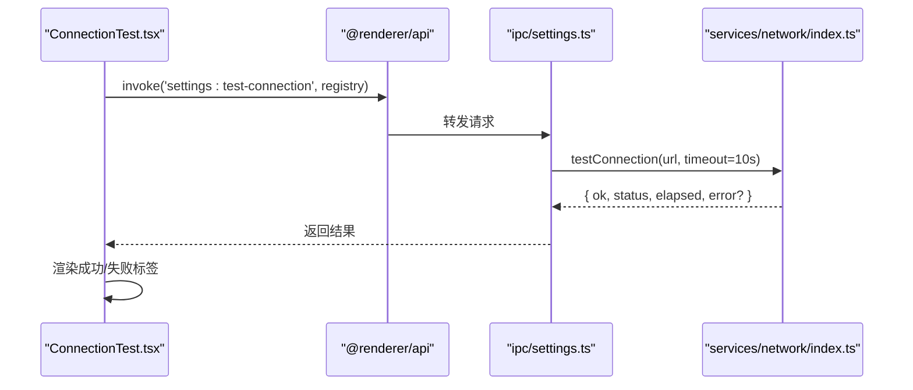
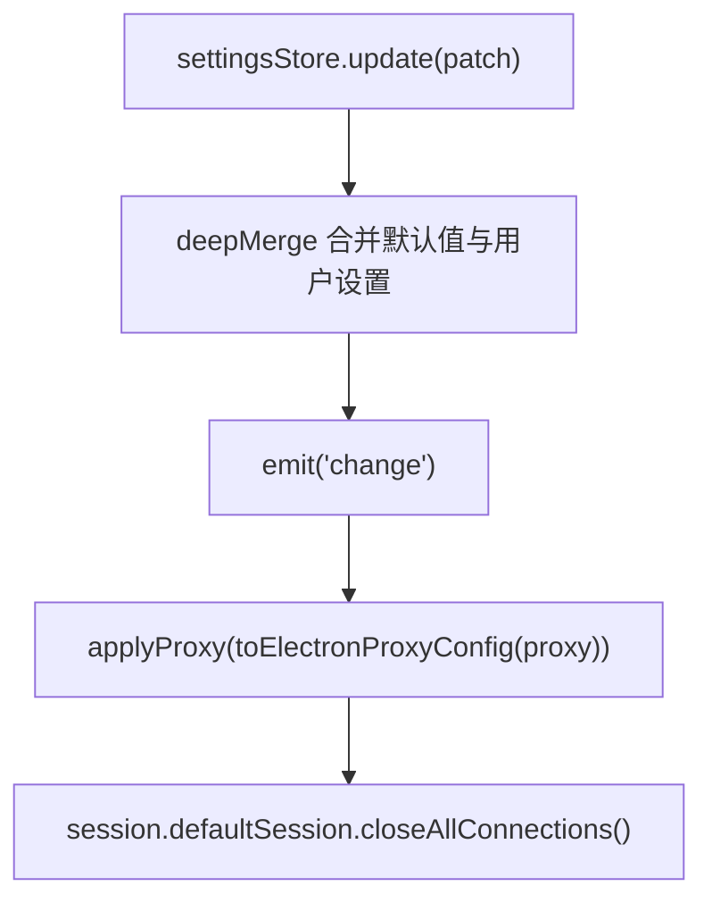
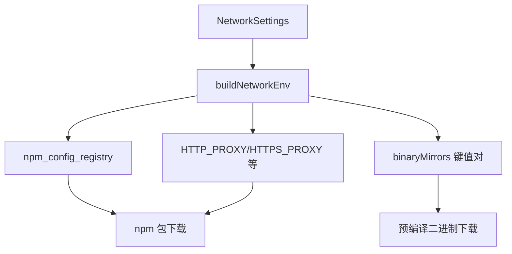
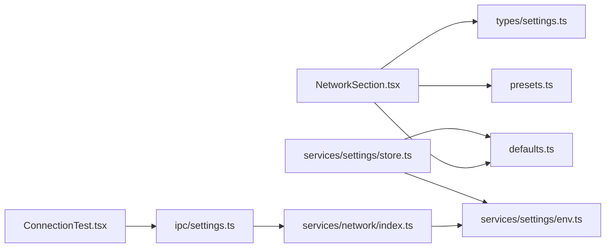

# 网络设置区块

<cite>
**本文引用的文件**   
- [NetworkSection.tsx](file://src/renderer/src/pages/settings/NetworkSection.tsx)
- [ConnectionTest.tsx](file://src/renderer/src/pages/settings/ConnectionTest.tsx)
- [settings.ts（类型定义）](file://src/shared/types/settings.ts)
- [defaults.ts（默认值与镜像常量）](file://src/shared/defaults.ts)
- [presets.ts（镜像预设工具）](file://src/renderer/src/utils/presets.ts)
- [network/index.ts（主进程网络服务）](file://src/main/services/network/index.ts)
- [settings.ts（IPC 注册）](file://src/main/ipc/settings.ts)
- [store.ts（设置持久化）](file://src/main/services/settings/store.ts)
- [env.ts（环境变量与代理转换）](file://src/main/services/settings/env.ts)
</cite>

## 目录
1. [简介](#简介)
2. [项目结构](#项目结构)
3. [核心组件](#核心组件)
4. [架构总览](#架构总览)
5. [详细组件分析](#详细组件分析)
6. [依赖关系分析](#依赖关系分析)
7. [性能与行为特征](#性能与行为特征)
8. [故障排除指南](#故障排除指南)
9. [结论](#结论)

## 简介
本章节面向“网络设置”相关功能，系统性说明以下能力：
- NetworkSection 组件的代理配置、镜像源设置、二进制镜像环境变量注入等网络相关配置。
- ConnectionTest 组件的网络连通性测试实现，包括请求发送、响应处理与错误诊断。
- 网络配置的验证规则与默认值处理。
- 代理服务器配置示例与常见问题排查。
- 网络设置对依赖下载和更新检查的影响路径。

## 项目结构
网络设置涉及渲染层 UI、共享类型与默认值、主进程网络能力与 IPC 桥接，以及设置持久化与环境变量构建。

**图表来源**
- [NetworkSection.tsx:1-95](file://src/renderer/src/pages/settings/NetworkSection.tsx#L1-L95)
- [ConnectionTest.tsx:1-47](file://src/renderer/src/pages/settings/ConnectionTest.tsx#L1-L47)
- [settings.ts（类型定义）:1-58](file://src/shared/types/settings.ts#L1-L58)
- [defaults.ts:1-44](file://src/shared/defaults.ts#L1-L44)
- [presets.ts:1-25](file://src/renderer/src/utils/presets.ts#L1-L25)
- [settings.ts（IPC 注册）:1-15](file://src/main/ipc/settings.ts#L1-L15)
- [network/index.ts:1-81](file://src/main/services/network/index.ts#L1-L81)
- [env.ts:1-73](file://src/main/services/settings/env.ts#L1-L73)
- [store.ts:1-30](file://src/main/services/settings/store.ts#L1-L30)

**章节来源**
- [NetworkSection.tsx:1-95](file://src/renderer/src/pages/settings/NetworkSection.tsx#L1-L95)
- [ConnectionTest.tsx:1-47](file://src/renderer/src/pages/settings/ConnectionTest.tsx#L1-L47)
- [settings.ts（类型定义）:1-58](file://src/shared/types/settings.ts#L1-L58)
- [defaults.ts:1-44](file://src/shared/defaults.ts#L1-L44)
- [presets.ts:1-25](file://src/renderer/src/utils/presets.ts#L1-L25)
- [settings.ts（IPC 注册）:1-15](file://src/main/ipc/settings.ts#L1-L15)
- [network/index.ts:1-81](file://src/main/services/network/index.ts#L1-L81)
- [env.ts:1-73](file://src/main/services/settings/env.ts#L1-L73)
- [store.ts:1-30](file://src/main/services/settings/store.ts#L1-L30)

## 核心组件
- NetworkSection：提供 Node 镜像、npm 仓库、代理开关与地址、无代理列表、二进制镜像环境变量编辑，并集成连接测试与保存。
- ConnectionTest：调用主进程接口对指定 npm 仓库发起 GET 请求，展示耗时、状态码或错误信息。
- settings.ts（类型定义）：定义 ProxySettings、NetworkSettings、ConnectionTestResult 等类型契约。
- defaults.ts：提供官方/国内镜像常量与默认设置。
- presets.ts：一键切换“国内/官方”镜像预设，自动维护二进制镜像环境变量。
- network/index.ts：封装 Electron net 请求、下载、代理应用与连接测试。
- settings.ts（IPC 注册）：暴露 settings:get/update/test-connection，并在设置变更时应用代理。
- env.ts：将网络设置转换为子进程环境变量与 Electron 代理配置。
- store.ts：合并默认值、持久化设置并广播变更事件。

**章节来源**
- [NetworkSection.tsx:1-95](file://src/renderer/src/pages/settings/NetworkSection.tsx#L1-L95)
- [ConnectionTest.tsx:1-47](file://src/renderer/src/pages/settings/ConnectionTest.tsx#L1-L47)
- [settings.ts（类型定义）:1-58](file://src/shared/types/settings.ts#L1-L58)
- [defaults.ts:1-44](file://src/shared/defaults.ts#L1-L44)
- [presets.ts:1-25](file://src/renderer/src/utils/presets.ts#L1-L25)
- [network/index.ts:1-81](file://src/main/services/network/index.ts#L1-L81)
- [settings.ts（IPC 注册）:1-15](file://src/main/ipc/settings.ts#L1-L15)
- [env.ts:1-73](file://src/main/services/settings/env.ts#L1-L73)
- [store.ts:1-30](file://src/main/services/settings/store.ts#L1-L30)

## 架构总览
网络设置从 UI 到主进程的完整链路如下：

**图表来源**
- [NetworkSection.tsx:30-35](file://src/renderer/src/pages/settings/NetworkSection.tsx#L30-L35)
- [ConnectionTest.tsx:16-28](file://src/renderer/src/pages/settings/ConnectionTest.tsx#L16-L28)
- [settings.ts（IPC 注册）:5-13](file://src/main/ipc/settings.ts#L5-L13)
- [network/index.ts:13-16](file://src/main/services/network/index.ts#L13-L16)
- [network/index.ts:66-80](file://src/main/services/network/index.ts#L66-L80)
- [env.ts:53-72](file://src/main/services/settings/env.ts#L53-L72)
- [store.ts:21-25](file://src/main/services/settings/store.ts#L21-L25)

## 详细组件分析

### NetworkSection 组件
职责与行为：
- 表单字段：Node 镜像、npm 仓库、代理开关、HTTP/HTTPS 代理地址、无代理列表、二进制镜像键值对。
- 校验规则：
  - Node 镜像与 npm 仓库必填且为 URL 格式。
  - 当代理启用时，HTTP 代理必填；HTTPS 代理可选，为空则回退 HTTP。
- 预设按钮：一键切换“国内/官方”镜像，同时维护二进制镜像环境变量集合。
- 保存逻辑：提交前校验表单，过滤空键的二进制镜像项，再调用设置更新接口。
- 集成连接测试：传入当前 npm 仓库地址进行连通性测试。

关键交互流程：

**图表来源**
- [NetworkSection.tsx:22-41](file://src/renderer/src/pages/settings/NetworkSection.tsx#L22-L41)
- [NetworkSection.tsx:54-83](file://src/renderer/src/pages/settings/NetworkSection.tsx#L54-L83)
- [NetworkSection.tsx:30-35](file://src/renderer/src/pages/settings/NetworkSection.tsx#L30-L35)

**章节来源**
- [NetworkSection.tsx:1-95](file://src/renderer/src/pages/settings/NetworkSection.tsx#L1-L95)
- [presets.ts:10-24](file://src/renderer/src/utils/presets.ts#L10-L24)
- [defaults.ts:3-20](file://src/shared/defaults.ts#L3-L20)

### ConnectionTest 组件
职责与行为：
- 调用主进程 IPC 接口 'settings:test-connection'，传入当前 npm 仓库地址。
- 显示测试结果：成功时展示耗时与状态码；失败时展示错误消息。
- 异常兜底：捕获调用异常并转为失败结果，避免界面崩溃。

请求与响应时序：

**图表来源**
- [ConnectionTest.tsx:16-28](file://src/renderer/src/pages/settings/ConnectionTest.tsx#L16-L28)
- [settings.ts（IPC 注册）:8-8](file://src/main/ipc/settings.ts#L8-L8)
- [network/index.ts:66-80](file://src/main/services/network/index.ts#L66-L80)

**章节来源**
- [ConnectionTest.tsx:1-47](file://src/renderer/src/pages/settings/ConnectionTest.tsx#L1-L47)
- [settings.ts（IPC 注册）:1-15](file://src/main/ipc/settings.ts#L1-L15)
- [network/index.ts:66-80](file://src/main/services/network/index.ts#L66-L80)

### 类型与默认值
- ProxySettings：包含 enabled、http、https、noProxy。
- NetworkSettings：包含 nodeMirror、npmRegistry、proxy、binaryMirrors。
- ConnectionTestResult：包含 ok、status、elapsed、error。
- 默认设置：
  - Node 镜像与 npm 仓库默认使用官方地址。
  - 代理默认关闭，noProxy 默认包含本地环回地址。
  - binaryMirrors 初始为空数组。

**章节来源**
- [settings.ts（类型定义）:9-25](file://src/shared/types/settings.ts#L9-L25)
- [settings.ts（类型定义）:52-57](file://src/shared/types/settings.ts#L52-L57)
- [defaults.ts:22-35](file://src/shared/defaults.ts#L22-L35)

### 镜像预设与二进制镜像
- 预设切换：根据 cn 参数选择国内或官方镜像，并同步更新 binaryMirrors。
- 二进制镜像：保留用户自定义项，追加内置 CN_BINARY_MIRRORS 列表。
- 常用环境变量：ELECTRON_MIRROR、SASS_BINARY_SITE、PUPPETEER_DOWNLOAD_BASE_URL 等。

**章节来源**
- [presets.ts:10-24](file://src/renderer/src/utils/presets.ts#L10-L24)
- [defaults.ts:9-20](file://src/shared/defaults.ts#L9-L20)

### 代理与应用
- 代理解析：若未启用或 http/https 均为空，则不生效。
- Electron 代理：将设置转换为 session.setProxy 所需格式，mode 为 fixed_servers，并拼接 bypass 规则。
- 应用时机：设置更新后触发 change 事件，主进程自动应用代理并关闭所有连接以立即生效。

**图表来源**
- [store.ts:21-25](file://src/main/services/settings/store.ts#L21-L25)
- [settings.ts（IPC 注册）:10-13](file://src/main/ipc/settings.ts#L10-L13)
- [env.ts:53-72](file://src/main/services/settings/env.ts#L53-L72)
- [network/index.ts:13-16](file://src/main/services/network/index.ts#L13-L16)

**章节来源**
- [env.ts:7-15](file://src/main/services/settings/env.ts#L7-L15)
- [env.ts:53-72](file://src/main/services/settings/env.ts#L53-L72)
- [network/index.ts:13-16](file://src/main/services/network/index.ts#L13-L16)
- [settings.ts（IPC 注册）:10-13](file://src/main/ipc/settings.ts#L10-L13)
- [store.ts:21-25](file://src/main/services/settings/store.ts#L21-L25)

### 环境变量注入与影响范围
- buildNetworkEnv 会向子进程注入：
  - npm_config_registry：基于 npmRegistry 生成。
  - HTTP_PROXY/HTTPS_PROXY 及其小写变体、npm_config_proxy/npm_config_https_proxy。
  - NO_PROXY/no_proxy/npm_config_noproxy。
  - 用户配置的 binaryMirrors 键值对。
- 这些环境变量会影响 npm 安装、预编译二进制下载、脚本执行时的网络行为。

**图表来源**
- [env.ts:21-50](file://src/main/services/settings/env.ts#L21-L50)

**章节来源**
- [env.ts:21-50](file://src/main/services/settings/env.ts#L21-L50)

## 依赖关系分析
- 渲染层依赖：
  - NetworkSection 依赖 shared 类型与默认值、presets 工具、ConnectionTest 组件。
  - ConnectionTest 依赖 @renderer/api 与错误格式化。
- 主进程依赖：
  - IPC 层依赖 network 服务与 settings store。
  - network 服务依赖 electron.net 与 settings env 工具。
  - settings store 依赖 defaults 与 fs 工具。

**图表来源**
- [NetworkSection.tsx:1-10](file://src/renderer/src/pages/settings/NetworkSection.tsx#L1-L10)
- [ConnectionTest.tsx:1-8](file://src/renderer/src/pages/settings/ConnectionTest.tsx#L1-L8)
- [settings.ts（IPC 注册）:1-8](file://src/main/ipc/settings.ts#L1-L8)
- [network/index.ts:1-10](file://src/main/services/network/index.ts#L1-L10)
- [store.ts:1-6](file://src/main/services/settings/store.ts#L1-L6)

**章节来源**
- [NetworkSection.tsx:1-10](file://src/renderer/src/pages/settings/NetworkSection.tsx#L1-L10)
- [ConnectionTest.tsx:1-8](file://src/renderer/src/pages/settings/ConnectionTest.tsx#L1-L8)
- [settings.ts（IPC 注册）:1-8](file://src/main/ipc/settings.ts#L1-L8)
- [network/index.ts:1-10](file://src/main/services/network/index.ts#L1-L10)
- [store.ts:1-6](file://src/main/services/settings/store.ts#L1-L6)

## 性能与行为特征
- 连接测试超时：默认 10 秒，避免长时间阻塞 UI。
- 下载进度上报：按时间间隔节流上报，降低频繁回调开销。
- 代理即时生效：设置变更后主动关闭所有连接，确保新代理策略立即应用。
- 二进制镜像批量注入：一次性构建环境变量对象，减少重复计算。

**章节来源**
- [network/index.ts:66-80](file://src/main/services/network/index.ts#L66-L80)
- [network/index.ts:34-64](file://src/main/services/network/index.ts#L34-L64)
- [settings.ts（IPC 注册）:10-13](file://src/main/ipc/settings.ts#L10-L13)

## 故障排除指南
常见问题与定位建议：
- 连接测试失败
  - 现象：返回 ok=false，附带错误消息。
  - 可能原因：网络不可达、代理配置错误、证书问题、目标站点限制。
  - 排查步骤：
    - 确认 npmRegistry 地址可访问。
    - 如启用代理，检查 HTTP/HTTPS 代理地址是否正确，必要时单独测试 HTTPS。
    - 检查 noProxy 是否误拦截了目标域名。
    - 查看错误消息中的状态码与耗时，辅助判断是否为超时或拒绝连接。
- 代理未生效
  - 现象：依赖下载仍走直连或报错。
  - 可能原因：代理未启用、http/https 为空、Electron 代理配置未应用。
  - 排查步骤：
    - 确认 proxy.enabled 为 true 且至少填写了 http 或 https。
    - 保存设置后观察是否触发了代理应用与连接关闭。
    - 检查 noProxy 是否包含目标主机。
- 二进制镜像未生效
  - 现象：某些包无法下载预编译二进制。
  - 可能原因：未添加对应环境变量或值不正确。
  - 排查步骤：
    - 在二进制镜像编辑器中添加必要键值对，例如 ELECTRON_MIRROR、SASS_BINARY_SITE 等。
    - 使用“国内预设”快速填充常用镜像。
- npm 仓库地址无效
  - 现象：npm 安装失败或拉取缓慢。
  - 可能原因：registry 地址错误或不可达。
  - 排查步骤：
    - 切换到国内或官方预设，或使用 AutoComplete 选项快速修正。
    - 使用连接测试验证可达性与延迟。

**章节来源**
- [ConnectionTest.tsx:16-28](file://src/renderer/src/pages/settings/ConnectionTest.tsx#L16-L28)
- [env.ts:7-15](file://src/main/services/settings/env.ts#L7-L15)
- [env.ts:21-50](file://src/main/services/settings/env.ts#L21-L50)
- [presets.ts:10-24](file://src/renderer/src/utils/presets.ts#L10-L24)

## 结论
网络设置区块通过清晰的表单与预设机制，统一管理 Node 镜像、npm 仓库、代理与二进制镜像环境变量。连接测试提供了直观的连通性反馈，帮助快速定位网络问题。设置变更会自动应用到 Electron 全局代理，并通过环境变量影响依赖下载与脚本执行的网络行为。建议在首次使用时采用“国内预设”，并结合连接测试验证网络环境，以获得稳定的依赖下载体验。