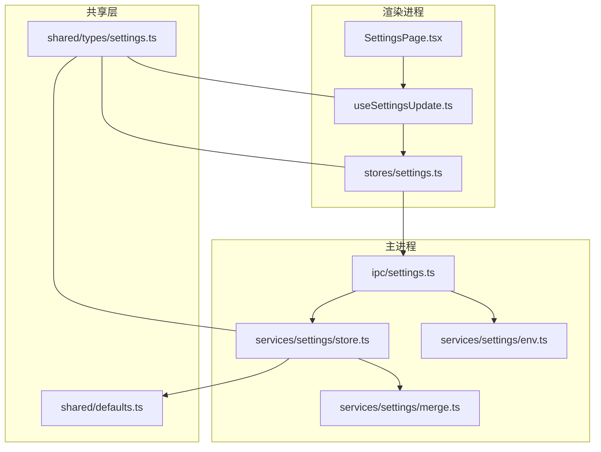
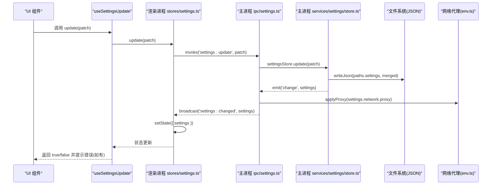
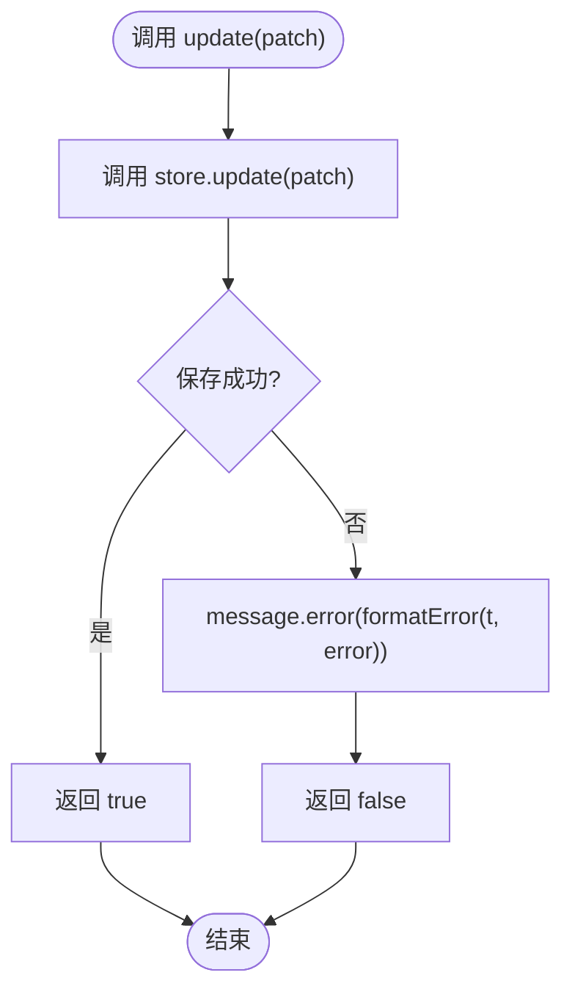
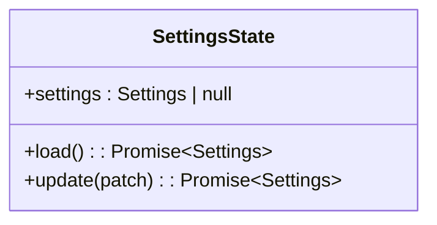
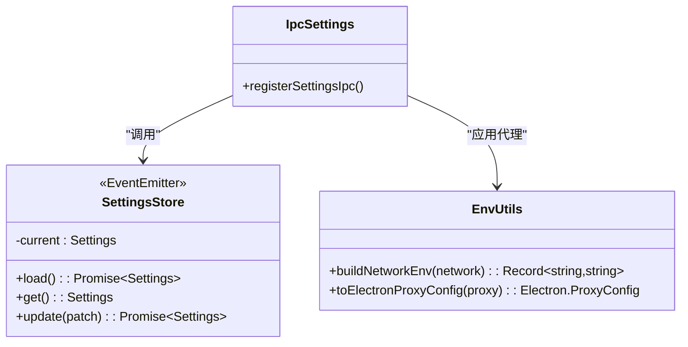
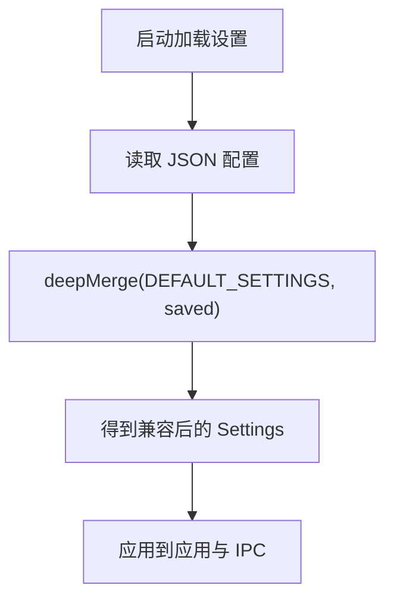
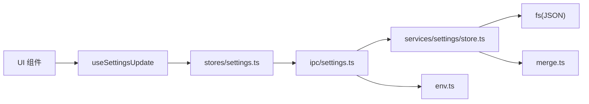

# 设置管理机制

<cite>
**本文引用的文件**   
- [useSettingsUpdate.ts](file://src/renderer/src/pages/settings/useSettingsUpdate.ts)
- [settings.ts（渲染进程状态）](file://src/renderer/src/stores/settings.ts)
- [settings.ts（主进程 IPC）](file://src/main/ipc/settings.ts)
- [store.ts（设置持久化存储）](file://src/main/services/settings/store.ts)
- [merge.ts（深度合并工具）](file://src/main/services/settings/merge.ts)
- [env.ts（网络环境变量与代理转换）](file://src/main/services/settings/env.ts)
- [index.ts（设置服务导出）](file://src/main/services/settings/index.ts)
- [settings.ts（共享类型定义）](file://src/shared/types/settings.ts)
- [defaults.ts（默认设置）](file://src/shared/defaults.ts)
- [SettingsPage.tsx（设置页面入口）](file://src/renderer/src/pages/settings/SettingsPage.tsx)
</cite>

## 目录
1. [简介](#简介)
2. [项目结构](#项目结构)
3. [核心组件](#核心组件)
4. [架构总览](#架构总览)
5. [详细组件分析](#详细组件分析)
6. [依赖关系分析](#依赖关系分析)
7. [性能考虑](#性能考虑)
8. [故障排查指南](#故障排查指南)
9. [结论](#结论)
10. [附录：扩展规范与安全建议](#附录扩展规范与安全建议)

## 简介
本技术文档围绕“设置管理机制”展开，重点说明以下方面：
- useSettingsUpdate 自定义钩子的实现原理：设置变更监听、状态同步与错误提示。
- 设置数据流架构：从 UI 组件到后端存储的完整链路，包括 IPC 通信、事件广播与前端状态更新。
- 设置验证框架与数据迁移策略：基于默认值与深度合并的兼容性方案。
- 设置备份与恢复：当前实现的持久化机制与可扩展点。
- 权限控制与安全性：代理配置、环境变量注入的安全边界与注意事项。
- 设置扩展的开发规范与最佳实践：新增字段、校验、迁移与副作用处理。

## 项目结构
设置相关代码分布在渲染进程、主进程与共享类型中，职责清晰：
- 渲染进程
  - 设置页面与区块：负责展示与用户交互。
  - 状态管理 store：封装 settings:get/update 调用与本地状态同步。
  - useSettingsUpdate 钩子：为业务组件提供 settings 与 update(patch) 能力，并统一错误提示。
- 主进程
  - IPC 注册：暴露 settings:get/update/test-connection 接口，并在设置变更后应用代理并广播事件。
  - 设置存储：读取/写入 JSON 配置文件，使用默认值与深度合并保证兼容。
  - 网络环境构建：根据设置生成 npm/script 的环境变量与 Electron 代理配置。
- 共享层
  - 类型定义：Settings、NetworkSettings、ProxySettings 等。
  - 默认设置：DEFAULT_SETTINGS 作为基线，用于首次加载与向后兼容。

图表来源
- [SettingsPage.tsx:10-24](file://src/renderer/src/pages/settings/SettingsPage.tsx#L10-L24)
- [useSettingsUpdate.ts:8-25](file://src/renderer/src/pages/settings/useSettingsUpdate.ts#L8-L25)
- [settings.ts（渲染进程状态）:11-25](file://src/renderer/src/stores/settings.ts#L11-L25)
- [settings.ts（主进程 IPC）:5-13](file://src/main/ipc/settings.ts#L5-L13)
- [store.ts:8-29](file://src/main/services/settings/store.ts#L8-L29)
- [merge.ts:8-21](file://src/main/services/settings/merge.ts#L8-L21)
- [env.ts:21-71](file://src/main/services/settings/env.ts#L21-L71)
- [settings.ts（共享类型定义）:36-42](file://src/shared/types/settings.ts#L36-L42)
- [defaults.ts:22-43](file://src/shared/defaults.ts#L22-L43)

章节来源
- [SettingsPage.tsx:10-24](file://src/renderer/src/pages/settings/SettingsPage.tsx#L10-L24)
- [useSettingsUpdate.ts:8-25](file://src/renderer/src/pages/settings/useSettingsUpdate.ts#L8-L25)
- [settings.ts（渲染进程状态）:11-25](file://src/renderer/src/stores/settings.ts#L11-L25)
- [settings.ts（主进程 IPC）:5-13](file://src/main/ipc/settings.ts#L5-L13)
- [store.ts:8-29](file://src/main/services/settings/store.ts#L8-L29)
- [merge.ts:8-21](file://src/main/services/settings/merge.ts#L8-L21)
- [env.ts:21-71](file://src/main/services/settings/env.ts#L21-L71)
- [settings.ts（共享类型定义）:36-42](file://src/shared/types/settings.ts#L36-L42)
- [defaults.ts:22-43](file://src/shared/defaults.ts#L22-L43)

## 核心组件
- useSettingsUpdate 钩子
  - 作用：为 UI 组件提供当前设置与统一的更新方法；失败时通过 Ant Design 的消息提示反馈。
  - 关键点：订阅 zustand store 中的 settings 与 update；对异常进行格式化与国际化提示。
- 渲染进程设置 store
  - 作用：封装 settings:get/update 调用，维护本地 settings 状态；监听 settings:changed 事件以同步最新设置。
- 主进程 IPC
  - 作用：注册 settings:get/update/test-connection；在设置变更后应用代理并广播 settings:changed。
- 设置存储
  - 作用：从 JSON 文件读写设置；使用默认值与深度合并保证兼容；变更时触发 change 事件。
- 网络环境与代理
  - 作用：将设置转换为 npm/script 环境变量与 Electron 代理配置，确保下载与脚本运行受设置影响。
- 类型与默认值
  - 作用：定义 Settings 结构与 DeepPartial 工具类型；提供默认设置作为基线。

章节来源
- [useSettingsUpdate.ts:8-25](file://src/renderer/src/pages/settings/useSettingsUpdate.ts#L8-L25)
- [settings.ts（渲染进程状态）:11-25](file://src/renderer/src/stores/settings.ts#L11-L25)
- [settings.ts（主进程 IPC）:5-13](file://src/main/ipc/settings.ts#L5-L13)
- [store.ts:8-29](file://src/main/services/settings/store.ts#L8-L29)
- [env.ts:21-71](file://src/main/services/settings/env.ts#L21-L71)
- [settings.ts（共享类型定义）:36-42](file://src/shared/types/settings.ts#L36-L42)
- [defaults.ts:22-43](file://src/shared/defaults.ts#L22-L43)

## 架构总览
设置数据流从 UI 到后端存储的关键路径如下：
- UI 组件调用 useSettingsUpdate.update(patch)。
- 钩子内部调用 zustand store 的 update，后者通过 IPC 调用 settings:update。
- 主进程 settingsStore.update 执行深度合并、写盘、触发 change 事件。
- IPC 层捕获 change，应用代理并广播 settings:changed。
- 渲染进程监听 settings:changed，更新本地 store 的 settings，UI 自动刷新。

图表来源
- [useSettingsUpdate.ts:14-23](file://src/renderer/src/pages/settings/useSettingsUpdate.ts#L14-L23)
- [settings.ts（渲染进程状态）:18-25](file://src/renderer/src/stores/settings.ts#L18-L25)
- [settings.ts（主进程 IPC）:5-13](file://src/main/ipc/settings.ts#L5-L13)
- [store.ts:21-25](file://src/main/services/settings/store.ts#L21-L25)
- [env.ts:54-71](file://src/main/services/settings/env.ts#L54-L71)

## 详细组件分析

### useSettingsUpdate 钩子
- 功能要点
  - 提供 settings 与 update(patch) 两个返回值。
  - update 内部调用 store.update，成功返回 true，失败通过 message.error 显示国际化错误信息。
- 设计考量
  - 将错误提示与业务逻辑解耦，便于复用。
  - 使用 DeepPartial<Settings> 支持部分更新。
- 典型用法
  - 在设置区块表单提交时调用 update(patch)，并根据返回值决定是否提示成功或失败。

图表来源
- [useSettingsUpdate.ts:14-23](file://src/renderer/src/pages/settings/useSettingsUpdate.ts#L14-L23)

章节来源
- [useSettingsUpdate.ts:8-25](file://src/renderer/src/pages/settings/useSettingsUpdate.ts#L8-L25)

### 渲染进程设置 store
- 功能要点
  - load：调用 settings:get 获取初始设置并缓存。
  - update：调用 settings:update 并提交 patch，成功后更新本地状态。
  - on('settings:changed')：监听主进程广播，保持本地状态与主进程一致。
- 设计考量
  - 单一状态源，避免 UI 与主进程状态不一致。
  - 通过事件驱动实现跨窗口/多标签页的状态同步。

图表来源
- [settings.ts（渲染进程状态）:5-25](file://src/renderer/src/stores/settings.ts#L5-L25)

章节来源
- [settings.ts（渲染进程状态）:11-25](file://src/renderer/src/stores/settings.ts#L11-L25)

### 主进程 IPC 与设置服务
- IPC 注册
  - settings:get：返回当前设置。
  - settings:update：接收 patch 并持久化。
  - settings:test-connection：测试网络连接。
  - 监听 settingsStore.change：应用代理并广播 settings:changed。
- 设置存储
  - load：读取 JSON 文件，使用 DEFAULT_SETTINGS 与 deepMerge 合并。
  - get：返回内存中的当前设置。
  - update：deepMerge 后写盘，emit('change')。
- 网络环境
  - buildNetworkEnv：根据 network 设置生成 npm/script 环境变量。
  - toElectronProxyConfig：将 ProxySettings 转为 Electron 代理配置。

图表来源
- [settings.ts（主进程 IPC）:5-13](file://src/main/ipc/settings.ts#L5-L13)
- [store.ts:8-29](file://src/main/services/settings/store.ts#L8-L29)
- [env.ts:21-71](file://src/main/services/settings/env.ts#L21-L71)

章节来源
- [settings.ts（主进程 IPC）:5-13](file://src/main/ipc/settings.ts#L5-L13)
- [store.ts:8-29](file://src/main/services/settings/store.ts#L8-L29)
- [env.ts:21-71](file://src/main/services/settings/env.ts#L21-L71)

### 设置验证框架与数据迁移策略
- 验证框架
  - 当前未引入运行时 schema 校验库，主要依赖 TypeScript 类型约束与默认值兜底。
  - 建议在新增字段时补充前端表单校验与后端可选校验，以保证数据质量。
- 数据迁移策略
  - 通过 DEFAULT_SETTINGS 与 deepMerge 实现“默认值优先”的兼容策略：旧配置缺失字段时使用默认值。
  - 当需要破坏性升级时，可在 load 中增加版本判断与迁移逻辑，逐步演进数据结构。

图表来源
- [store.ts:11-14](file://src/main/services/settings/store.ts#L11-L14)
- [merge.ts:8-21](file://src/main/services/settings/merge.ts#L8-L21)
- [defaults.ts:22-43](file://src/shared/defaults.ts#L22-L43)

章节来源
- [store.ts:11-14](file://src/main/services/settings/store.ts#L11-L14)
- [merge.ts:8-21](file://src/main/services/settings/merge.ts#L8-L21)
- [defaults.ts:22-43](file://src/shared/defaults.ts#L22-L43)

### 设置备份与恢复
- 当前实现
  - 设置以 JSON 文件形式持久化，路径由 paths.settings 指定。
  - 无内置备份/恢复 API；可通过复制该 JSON 文件实现手动备份与恢复。
- 扩展建议
  - 在主进程 IPC 暴露 settings:export 与 settings:import 接口，支持导出/导入 JSON。
  - 在 UI 提供“导出设置”和“导入设置”按钮，结合文件选择对话框。
  - 导入前进行基础校验，避免覆盖有效配置。

章节来源
- [store.ts:11-24](file://src/main/services/settings/store.ts#L11-L24)

### 权限控制与安全性考虑
- 代理与网络
  - 代理配置会影响 Electron 全局网络行为与 npm/script 环境变量，需谨慎启用。
  - 建议在 UI 中对代理地址进行格式校验，并提供“仅当前会话生效”的开关选项。
- 环境变量注入
  - binaryMirrors 会向 npm/script 注入环境变量，应避免注入敏感信息。
  - 建议对 key/value 做白名单校验，限制可注入的环境变量名。
- IPC 安全
  - 所有设置变更均经过 IPC，应确保仅渲染进程可信模块调用。
  - 未来可增加权限校验与审计日志，记录关键设置变更。

章节来源
- [env.ts:21-71](file://src/main/services/settings/env.ts#L21-L71)
- [settings.ts（主进程 IPC）:5-13](file://src/main/ipc/settings.ts#L5-L13)

### 设置扩展开发规范与最佳实践
- 新增设置字段
  - 在 shared/types/settings.ts 中扩展 Settings 接口。
  - 在 shared/defaults.ts 中补充默认值。
  - 在 UI 对应区块中添加输入控件，并使用 useSettingsUpdate.update(patch) 提交。
- 数据迁移
  - 若为新字段，无需迁移；若为破坏性变更，需在 store.load 中增加版本判断与迁移逻辑。
- 副作用处理
  - 若设置变更影响网络或运行时行为，应在 IPC 层监听 change 并执行副作用（如 applyProxy）。
- 错误处理与提示
  - 统一通过 useSettingsUpdate 的错误提示机制反馈给用户。
- 测试建议
  - 为 merge 与 env 工具函数编写单元测试，确保合并与代理转换正确。
  - 为 IPC 接口编写集成测试，模拟设置变更与事件广播。

章节来源
- [settings.ts（共享类型定义）:36-42](file://src/shared/types/settings.ts#L36-L42)
- [defaults.ts:22-43](file://src/shared/defaults.ts#L22-L43)
- [useSettingsUpdate.ts:14-23](file://src/renderer/src/pages/settings/useSettingsUpdate.ts#L14-L23)
- [settings.ts（主进程 IPC）:10-13](file://src/main/ipc/settings.ts#L10-L13)

## 依赖关系分析
- 组件耦合
  - UI 层与 useSettingsUpdate 解耦，仅依赖其提供的 settings 与 update。
  - useSettingsUpdate 依赖 zustand store 与 Ant Design 消息提示。
  - store 依赖 IPC 与事件总线。
  - IPC 依赖 settingsStore 与网络工具。
  - settingsStore 依赖 fs 工具、默认值与 deepMerge。
- 外部依赖
  - Electron IPC、Node.js EventEmitter、Ant Design、i18next。

图表来源
- [useSettingsUpdate.ts:8-25](file://src/renderer/src/pages/settings/useSettingsUpdate.ts#L8-L25)
- [settings.ts（渲染进程状态）:11-25](file://src/renderer/src/stores/settings.ts#L11-L25)
- [settings.ts（主进程 IPC）:5-13](file://src/main/ipc/settings.ts#L5-L13)
- [store.ts:8-29](file://src/main/services/settings/store.ts#L8-L29)
- [merge.ts:8-21](file://src/main/services/settings/merge.ts#L8-L21)
- [env.ts:21-71](file://src/main/services/settings/env.ts#L21-L71)

章节来源
- [useSettingsUpdate.ts:8-25](file://src/renderer/src/pages/settings/useSettingsUpdate.ts#L8-L25)
- [settings.ts（渲染进程状态）:11-25](file://src/renderer/src/stores/settings.ts#L11-L25)
- [settings.ts（主进程 IPC）:5-13](file://src/main/ipc/settings.ts#L5-L13)
- [store.ts:8-29](file://src/main/services/settings/store.ts#L8-L29)
- [merge.ts:8-21](file://src/main/services/settings/merge.ts#L8-L21)
- [env.ts:21-71](file://src/main/services/settings/env.ts#L21-L71)

## 性能考虑
- 设置变更频率低，JSON 读写开销可接受。
- 使用 deepMerge 避免不必要的对象拷贝，但需注意数组与基本类型直接替换的策略。
- 代理应用与事件广播在主进程侧执行，避免阻塞渲染进程。
- 建议在大规模设置项场景下，考虑增量更新与懒加载。

[本节为通用指导，不直接分析具体文件]

## 故障排查指南
- 设置未持久化
  - 检查 writeJson 是否抛出异常；确认 paths.settings 指向有效路径。
  - 查看主进程控制台是否有 applyProxy 失败的错误日志。
- 设置不同步
  - 确认 settings:changed 事件是否被广播与监听。
  - 检查渲染进程 on('settings:changed') 是否正确更新 store。
- 代理未生效
  - 检查 ProxySettings.enabled 与 http/https/noProxy 配置。
  - 确认 toElectronProxyConfig 生成的规则是否符合预期。
- 环境变量未注入
  - 检查 NetworkSettings.binaryMirrors 与 npmRegistry 配置。
  - 确认 buildNetworkEnv 输出的环境变量是否被下游进程继承。

章节来源
- [settings.ts（主进程 IPC）:10-13](file://src/main/ipc/settings.ts#L10-L13)
- [settings.ts（渲染进程状态）:25-25](file://src/renderer/src/stores/settings.ts#L25-L25)
- [env.ts:21-71](file://src/main/services/settings/env.ts#L21-L71)

## 结论
该设置管理机制通过清晰的职责划分与事件驱动的数据流，实现了从 UI 到后端存储的一致性与可维护性。useSettingsUpdate 钩子简化了设置更新的错误处理与状态同步；默认值与深度合并提供了良好的向后兼容；IPC 与事件广播确保了多端状态一致性。未来可在验证、备份恢复与权限控制方面进一步增强，以满足更复杂的业务需求。

[本节为总结性内容，不直接分析具体文件]

## 附录：扩展规范与安全建议
- 扩展规范
  - 新增字段需同步更新类型与默认值。
  - 在 UI 中提供输入控件与校验，并通过 useSettingsUpdate.update 提交。
  - 若设置影响网络或运行时，需在 IPC 层监听 change 并执行副作用。
- 安全建议
  - 对代理与二进制镜像地址进行格式校验。
  - 限制可注入的环境变量名，避免敏感信息泄露。
  - 为设置变更添加审计日志与权限校验。

[本节为通用指导，不直接分析具体文件]