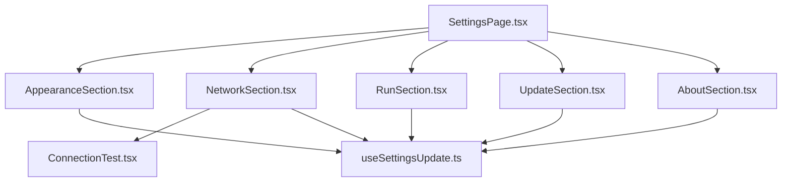
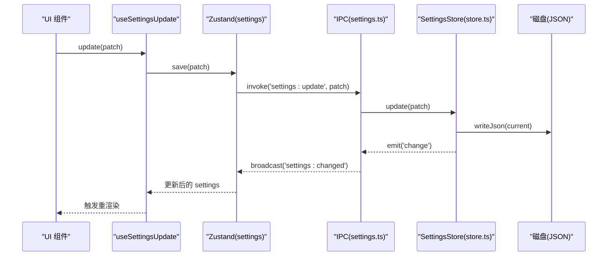
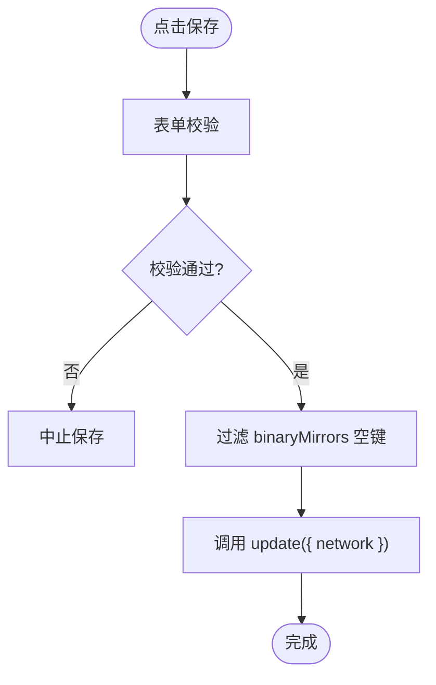
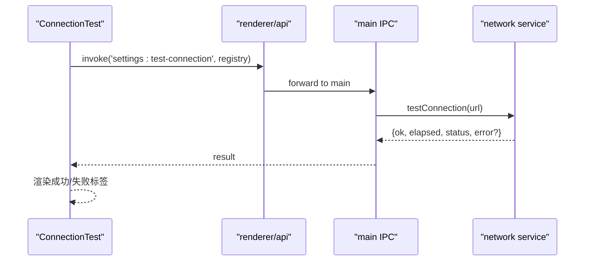
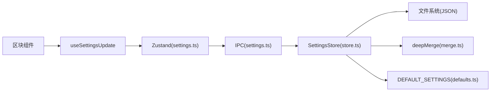

# 设置页面

<cite>
**本文引用的文件**   
- [SettingsPage.tsx](file://src/renderer/src/pages/settings/SettingsPage.tsx)
- [AppearanceSection.tsx](file://src/renderer/src/pages/settings/AppearanceSection.tsx)
- [NetworkSection.tsx](file://src/renderer/src/pages/settings/NetworkSection.tsx)
- [RunSection.tsx](file://src/renderer/src/pages/settings/RunSection.tsx)
- [UpdateSection.tsx](file://src/renderer/src/pages/settings/UpdateSection.tsx)
- [AboutSection.tsx](file://src/renderer/src/pages/settings/AboutSection.tsx)
- [ConnectionTest.tsx](file://src/renderer/src/pages/settings/ConnectionTest.tsx)
- [useSettingsUpdate.ts](file://src/renderer/src/pages/settings/useSettingsUpdate.ts)
- [settings.ts（渲染进程状态）](file://src/renderer/src/stores/settings.ts)
- [settings.ts（主进程 IPC）](file://src/main/ipc/settings.ts)
- [store.ts（设置持久化）](file://src/main/services/settings/store.ts)
- [merge.ts（深度合并）](file://src/main/services/settings/merge.ts)
- [defaults.ts（默认值与常量）](file://src/shared/defaults.ts)
- [settings.ts（共享类型）](file://src/shared/types/settings.ts)
</cite>

## 目录
1. [简介](#简介)
2. [项目结构](#项目结构)
3. [核心组件](#核心组件)
4. [架构总览](#架构总览)
5. [详细组件分析](#详细组件分析)
6. [依赖关系分析](#依赖关系分析)
7. [性能考虑](#性能考虑)
8. [故障排查指南](#故障排查指南)
9. [结论](#结论)
10. [附录：扩展开发指南与最佳实践](#附录扩展开发指南与最佳实践)

## 简介
本文件为“设置页面”的完整技术文档，覆盖以下方面：
- SettingsPage 主容器的布局结构与选项卡式组织方式
- 各设置区块组件的功能与配置项说明（外观、网络、运行、更新、关于）
- ConnectionTest 网络测试组件的实现原理
- useSettingsUpdate 自定义钩子的设置变更监听与持久化机制
- 设置验证规则、默认值处理与配置迁移策略
- 设置扩展的开发指南与最佳实践

## 项目结构
设置页面位于渲染进程的 pages/settings 目录下，采用“区块组件 + 统一入口”的组织方式。主容器 SettingsPage 负责聚合各区块；每个区块组件聚焦单一领域设置，并通过 useSettingsUpdate 与全局设置状态交互。

图表来源
- [SettingsPage.tsx:10-21](file://src/renderer/src/pages/settings/SettingsPage.tsx#L10-L21)
- [AppearanceSection.tsx:7-42](file://src/renderer/src/pages/settings/AppearanceSection.tsx#L7-L42)
- [NetworkSection.tsx:14-94](file://src/renderer/src/pages/settings/NetworkSection.tsx#L14-L94)
- [RunSection.tsx:7-36](file://src/renderer/src/pages/settings/RunSection.tsx#L7-L36)
- [UpdateSection.tsx:23-77](file://src/renderer/src/pages/settings/UpdateSection.tsx#L23-L77)
- [AboutSection.tsx:12-53](file://src/renderer/src/pages/settings/AboutSection.tsx#L12-L53)
- [ConnectionTest.tsx:11-46](file://src/renderer/src/pages/settings/ConnectionTest.tsx#L11-L46)
- [useSettingsUpdate.ts:8-26](file://src/renderer/src/pages/settings/useSettingsUpdate.ts#L8-L26)

章节来源
- [SettingsPage.tsx:10-21](file://src/renderer/src/pages/settings/SettingsPage.tsx#L10-L21)

## 核心组件
- SettingsPage：页面容器，使用垂直 Flex 布局依次展示外观、网络、运行、更新、关于五个区块。
- AppearanceSection：语言与主题设置，支持跟随系统或手动选择。
- NetworkSection：镜像源、NPM 仓库、代理与二进制镜像环境变量，提供预设与连接测试。
- RunSection：历史条数限制与默认 Node 版本选择。
- UpdateSection：自动检查更新开关与更新状态展示、下载与安装操作。
- AboutSection：应用信息展示、打开数据目录与跳转 GitHub。
- ConnectionTest：对指定 npm 仓库发起连通性测试并显示耗时与状态。
- useSettingsUpdate：封装设置读取与更新，失败时通过消息提示。

章节来源
- [SettingsPage.tsx:10-21](file://src/renderer/src/pages/settings/SettingsPage.tsx#L10-L21)
- [AppearanceSection.tsx:7-42](file://src/renderer/src/pages/settings/AppearanceSection.tsx#L7-L42)
- [NetworkSection.tsx:14-94](file://src/renderer/src/pages/settings/NetworkSection.tsx#L14-L94)
- [RunSection.tsx:7-36](file://src/renderer/src/pages/settings/RunSection.tsx#L7-L36)
- [UpdateSection.tsx:23-77](file://src/renderer/src/pages/settings/UpdateSection.tsx#L23-L77)
- [AboutSection.tsx:12-53](file://src/renderer/src/pages/settings/AboutSection.tsx#L12-L53)
- [ConnectionTest.tsx:11-46](file://src/renderer/src/pages/settings/ConnectionTest.tsx#L11-L46)
- [useSettingsUpdate.ts:8-26](file://src/renderer/src/pages/settings/useSettingsUpdate.ts#L8-L26)

## 架构总览
设置页面的数据流遵循“渲染进程 UI → 自定义钩子 → Zustand 状态 → IPC → 主进程 Store → 磁盘持久化”的路径。设置变更后，主进程广播 settings:changed，渲染进程订阅后刷新本地状态。

图表来源
- [useSettingsUpdate.ts:8-26](file://src/renderer/src/pages/settings/useSettingsUpdate.ts#L8-L26)
- [settings.ts（渲染进程状态）:11-25](file://src/renderer/src/stores/settings.ts#L11-L25)
- [settings.ts（主进程 IPC）:5-13](file://src/main/ipc/settings.ts#L5-L13)
- [store.ts（设置持久化）:21-26](file://src/main/services/settings/store.ts#L21-L26)

## 详细组件分析

### SettingsPage 主容器
- 布局：使用垂直 Flex 容器，标题与各区块按顺序排列。
- 导航：当前为线性滚动式区块，未实现选项卡切换逻辑。
- 国际化：标题文本通过 i18n 获取。

章节来源
- [SettingsPage.tsx:10-21](file://src/renderer/src/pages/settings/SettingsPage.tsx#L10-L21)

### AppearanceSection（外观）
- 功能：设置语言与主题模式，支持 system/light/dark。
- 数据绑定：直接通过 useSettingsUpdate 的 update 写入 locale 与 theme。
- 交互：Select 与 Segmented 控件即时触发保存。

章节来源
- [AppearanceSection.tsx:7-42](file://src/renderer/src/pages/settings/AppearanceSection.tsx#L7-L42)
- [settings.ts（共享类型）:1-2](file://src/shared/types/settings.ts#L1-L2)

### NetworkSection（网络）
- 功能：
  - 配置 Node 镜像与 NPM 仓库地址，必填且需为 URL。
  - 代理开关与 HTTP/HTTPS/No Proxy 配置。
  - 二进制镜像环境变量列表（EnvEditor）。
  - 预设按钮快速填充国内或官方镜像。
  - 连接测试按钮调用 ConnectionTest。
- 表单校验：
  - nodeMirror/npmRegistry：必填 + URL 格式。
  - proxy.http：当代理启用时为必填 + URL 格式。
  - proxy.https/noProxy：URL 格式校验。
- 保存流程：
  - 先 validateFields，再过滤 binaryMirrors 中 key 为空项，最后调用 update 保存。
- 预设逻辑：
  - 基于 mirrorPreset 生成预设值，合并到当前表单值后回填。

图表来源
- [NetworkSection.tsx:30-36](file://src/renderer/src/pages/settings/NetworkSection.tsx#L30-L36)

章节来源
- [NetworkSection.tsx:14-94](file://src/renderer/src/pages/settings/NetworkSection.tsx#L14-L94)
- [settings.ts（共享类型）:9-25](file://src/shared/types/settings.ts#L9-L25)

### RunSection（运行）
- 功能：
  - historyLimit：运行历史保留条数（1-1000）。
  - defaultNodeVersion：默认 Node 版本（可为空）。
- 交互：输入变化即触发 update 保存。

章节来源
- [RunSection.tsx:7-36](file://src/renderer/src/pages/settings/RunSection.tsx#L7-L36)
- [settings.ts（共享类型）:27-30](file://src/shared/types/settings.ts#L27-L30)

### UpdateSection（更新）
- 功能：
  - autoCheck：是否自动检查更新。
  - 更新状态展示：空闲、检查中、可用、下载中、已下载、错误、不支持等。
  - 操作：检查更新、下载、安装（重启）。
- 事件：
  - 初始化时请求 updater:status，并订阅实时更新。
  - 调用 updater:check/download/install 执行相应动作。

章节来源
- [UpdateSection.tsx:23-77](file://src/renderer/src/pages/settings/UpdateSection.tsx#L23-L77)

### AboutSection（关于）
- 功能：
  - 展示应用版本、Electron 版本、平台与架构、数据目录路径。
  - 打开数据目录与跳转 GitHub 仓库。
- 交互：异步调用 app:info 与 app:open-path/open-external。

章节来源
- [AboutSection.tsx:12-53](file://src/renderer/src/pages/settings/AboutSection.tsx#L12-L53)

### ConnectionTest（网络测试）
- 功能：对传入的 registry 发起连通性测试，返回 ok、elapsed、status、error 等信息。
- 交互：点击按钮触发测试，loading 期间禁用重复点击，结果以 Tag 展示成功或失败。
- 错误处理：捕获异常并以 formatError 格式化后展示。

图表来源
- [ConnectionTest.tsx:16-28](file://src/renderer/src/pages/settings/ConnectionTest.tsx#L16-L28)
- [settings.ts（主进程 IPC）:8-8](file://src/main/ipc/settings.ts#L8-L8)

章节来源
- [ConnectionTest.tsx:11-46](file://src/renderer/src/pages/settings/ConnectionTest.tsx#L11-L46)
- [settings.ts（主进程 IPC）:8-8](file://src/main/ipc/settings.ts#L8-L8)

### useSettingsUpdate（自定义钩子）
- 职责：
  - 从 Zustand store 读取当前 settings。
  - 包装 update 方法，失败时通过 message.error 提示。
  - 返回 settings 与 update 函数供组件使用。
- 与 store 的关系：
  - 调用 store.update 后，主进程广播 settings:changed，store 同步更新，组件重渲染。

章节来源
- [useSettingsUpdate.ts:8-26](file://src/renderer/src/pages/settings/useSettingsUpdate.ts#L8-L26)
- [settings.ts（渲染进程状态）:11-25](file://src/renderer/src/stores/settings.ts#L11-L25)

## 依赖关系分析
- 组件耦合：
  - 所有区块组件均依赖 useSettingsUpdate，避免各自维护状态。
  - NetworkSection 额外依赖 EnvEditor、presets 与 ConnectionTest。
- 外部依赖：
  - Ant Design 提供表单、卡片、进度条等基础组件。
  - react-i18next 提供国际化能力。
  - renderer/api 提供 invoke/on 能力。
- 主进程依赖：
  - settingsStore 负责加载、合并、持久化设置。
  - IPC 层将 get/update/test-connection 暴露给渲染进程。
  - 设置变更时广播 settings:changed，并尝试应用代理。

图表来源
- [useSettingsUpdate.ts:8-26](file://src/renderer/src/pages/settings/useSettingsUpdate.ts#L8-L26)
- [settings.ts（渲染进程状态）:11-25](file://src/renderer/src/stores/settings.ts#L11-L25)
- [settings.ts（主进程 IPC）:5-13](file://src/main/ipc/settings.ts#L5-L13)
- [store.ts（设置持久化）:11-26](file://src/main/services/settings/store.ts#L11-L26)
- [merge.ts（深度合并）:8-21](file://src/main/services/settings/merge.ts#L8-L21)
- [defaults.ts（默认值与常量）:22-43](file://src/shared/defaults.ts#L22-L43)

章节来源
- [settings.ts（渲染进程状态）:11-25](file://src/renderer/src/stores/settings.ts#L11-L25)
- [settings.ts（主进程 IPC）:5-13](file://src/main/ipc/settings.ts#L5-L13)
- [store.ts（设置持久化）:11-26](file://src/main/services/settings/store.ts#L11-L26)
- [merge.ts（深度合并）:8-21](file://src/main/services/settings/merge.ts#L8-L21)
- [defaults.ts（默认值与常量）:22-43](file://src/shared/defaults.ts#L22-L43)

## 性能考虑
- 表单提交节流：NetworkSection 在保存前进行一次性校验与过滤，避免多次无效 IO。
- 状态同步：主进程仅广播一次 settings:changed，渲染进程批量更新，减少重渲染次数。
- 大对象传输：Binary mirrors 为数组，建议保持条目精简，避免过大 JSON 读写开销。
- 网络测试：ConnectionTest 仅在用户主动触发时发起请求，避免后台轮询。

[本节为通用指导，不直接分析具体文件]

## 故障排查指南
- 保存失败
  - 现象：update 抛出异常，界面弹出错误消息。
  - 排查：检查字段校验（URL、必填）、binaryMirrors 是否为空键、磁盘权限与路径有效性。
  - 相关位置：
    - [useSettingsUpdate.ts:14-23](file://src/renderer/src/pages/settings/useSettingsUpdate.ts#L14-L23)
    - [NetworkSection.tsx:30-36](file://src/renderer/src/pages/settings/NetworkSection.tsx#L30-L36)
- 设置不同步
  - 现象：修改后其他组件未刷新。
  - 排查：确认主进程 settingsStore.emit('change') 被触发，IPC 广播 settings:changed，渲染进程 on('settings:changed') 已订阅。
  - 相关位置：
    - [store.ts（设置持久化）:21-26](file://src/main/services/settings/store.ts#L21-L26)
    - [settings.ts（主进程 IPC）:10-13](file://src/main/ipc/settings.ts#L10-L13)
    - [settings.ts（渲染进程状态）:25-25](file://src/renderer/src/stores/settings.ts#L25-L25)
- 代理未生效
  - 现象：网络请求仍走直连。
  - 排查：settingsStore.change 回调中 applyProxy 是否成功，查看控制台错误日志。
  - 相关位置：
    - [settings.ts（主进程 IPC）:10-12](file://src/main/ipc/settings.ts#L10-L12)
- 连接测试失败
  - 现象：ConnectionTest 返回失败标签。
  - 排查：registry 地址是否正确、代理配置是否生效、目标服务可达性。
  - 相关位置：
    - [ConnectionTest.tsx:16-28](file://src/renderer/src/pages/settings/ConnectionTest.tsx#L16-L28)
    - [settings.ts（主进程 IPC）:8-8](file://src/main/ipc/settings.ts#L8-L8)

章节来源
- [useSettingsUpdate.ts:14-23](file://src/renderer/src/pages/settings/useSettingsUpdate.ts#L14-L23)
- [NetworkSection.tsx:30-36](file://src/renderer/src/pages/settings/NetworkSection.tsx#L30-L36)
- [store.ts（设置持久化）:21-26](file://src/main/services/settings/store.ts#L21-L26)
- [settings.ts（主进程 IPC）:10-13](file://src/main/ipc/settings.ts#L10-L13)
- [settings.ts（渲染进程状态）:25-25](file://src/renderer/src/stores/settings.ts#L25-L25)
- [ConnectionTest.tsx:16-28](file://src/renderer/src/pages/settings/ConnectionTest.tsx#L16-L28)

## 结论
设置页面通过清晰的区块划分与统一的设置更新机制，实现了可维护、可扩展的配置管理。主进程侧的 SettingsStore 负责默认值合并、持久化与变更广播，渲染进程侧通过 Zustand 与自定义钩子简化了状态管理与错误提示。网络测试与预设功能提升了用户体验，整体架构清晰、职责明确。

[本节为总结性内容，不直接分析具体文件]

## 附录：扩展开发指南与最佳实践

### 新增设置区块
- 步骤
  1. 在 shared/types/settings.ts 中定义新的设置字段与类型。
  2. 在 shared/defaults.ts 中添加默认值。
  3. 新建区块组件，使用 useSettingsUpdate 的 update 写入对应字段。
  4. 在 SettingsPage.tsx 中引入并渲染新区块。
- 注意事项
  - 字段命名与类型保持一致，避免深层嵌套导致合并异常。
  - 若涉及敏感配置，注意不在日志中输出明文。
  - 如需表单校验，优先使用 Ant Design Form rules。

章节来源
- [settings.ts（共享类型）:36-42](file://src/shared/types/settings.ts#L36-L42)
- [defaults.ts（默认值与常量）:22-43](file://src/shared/defaults.ts#L22-L43)
- [SettingsPage.tsx:10-21](file://src/renderer/src/pages/settings/SettingsPage.tsx#L10-L21)

### 设置验证规则
- URL 校验：使用 Ant Design 的 url 规则，warningOnly 按需开启。
- 必填校验：结合 Form.useWatch 动态控制某些字段的 required。
- 业务校验：在保存前对数组元素进行过滤（如 binaryMirrors 空键）。

章节来源
- [NetworkSection.tsx:12-12](file://src/renderer/src/pages/settings/NetworkSection.tsx#L12-L12)
- [NetworkSection.tsx:63-78](file://src/renderer/src/pages/settings/NetworkSection.tsx#L63-L78)
- [NetworkSection.tsx:30-36](file://src/renderer/src/pages/settings/NetworkSection.tsx#L30-L36)

### 默认值处理与配置迁移
- 默认值：DEFAULT_SETTINGS 作为基准，确保新增字段有合理初始值。
- 迁移策略：使用 deepMerge 将已保存的设置与默认值合并，旧配置不会丢失，新字段自动补齐。
- 数组与对象：数组与原始类型被替换而非合并，对象递归合并。

章节来源
- [defaults.ts（默认值与常量）:22-43](file://src/shared/defaults.ts#L22-L43)
- [store.ts（设置持久化）:11-14](file://src/main/services/settings/store.ts#L11-L14)
- [merge.ts（深度合并）:8-21](file://src/main/services/settings/merge.ts#L8-L21)

### 设置持久化与变更监听
- 持久化：SettingsStore.update 写入 JSON 文件，保证重启后恢复。
- 变更监听：settingsStore.on('change') 触发 IPC 广播，渲染进程 on('settings:changed') 更新 Zustand 状态。
- 副作用：设置变更时尝试应用代理，失败不影响设置保存。

章节来源
- [store.ts（设置持久化）:21-26](file://src/main/services/settings/store.ts#L21-L26)
- [settings.ts（主进程 IPC）:10-13](file://src/main/ipc/settings.ts#L10-L13)
- [settings.ts（渲染进程状态）:25-25](file://src/renderer/src/stores/settings.ts#L25-L25)

### 网络测试扩展
- 扩展点：settings:test-connection 接口，可在主进程 services/network 中实现更丰富的探测逻辑（如 DNS、TLS、带宽）。
- 前端展示：ConnectionTest 可根据返回字段扩展更多指标（如 TLS 握手时间、重试次数）。

章节来源
- [settings.ts（主进程 IPC）:8-8](file://src/main/ipc/settings.ts#L8-L8)
- [ConnectionTest.tsx:11-46](file://src/renderer/src/pages/settings/ConnectionTest.tsx#L11-L46)

### 最佳实践
- 组件职责单一：每个区块只关注自身领域设置。
- 统一更新入口：通过 useSettingsUpdate 集中处理错误提示与状态同步。
- 表单驱动：尽量使用 Ant Design Form 的能力进行校验与联动。
- 渐进增强：预设与测试功能提升可用性，但不应阻塞核心保存流程。
- 可观测性：关键错误通过 message 与日志输出，便于定位问题。

[本节为通用指导，不直接分析具体文件]