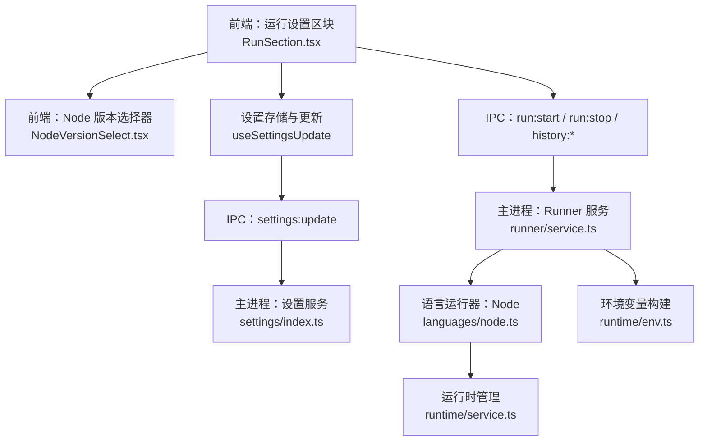
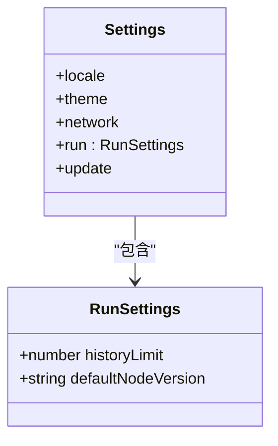
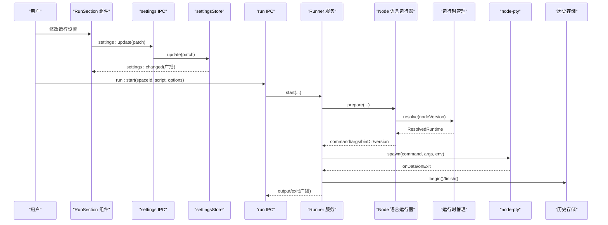
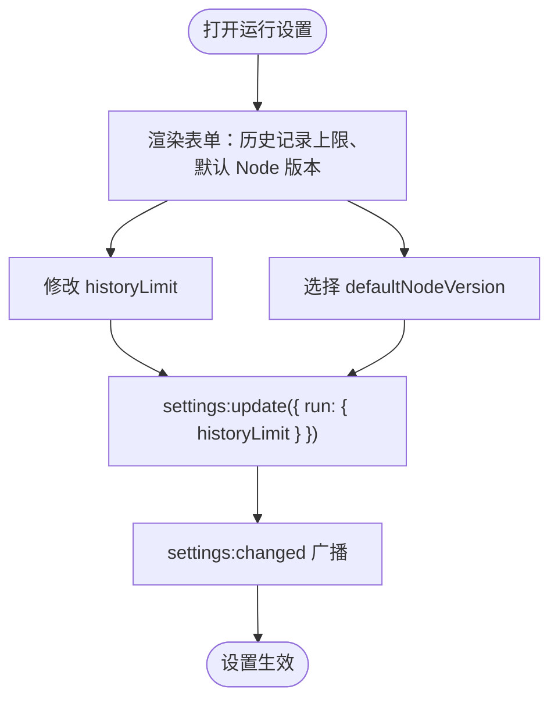
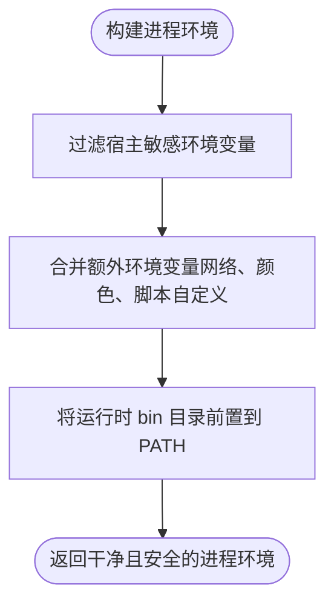
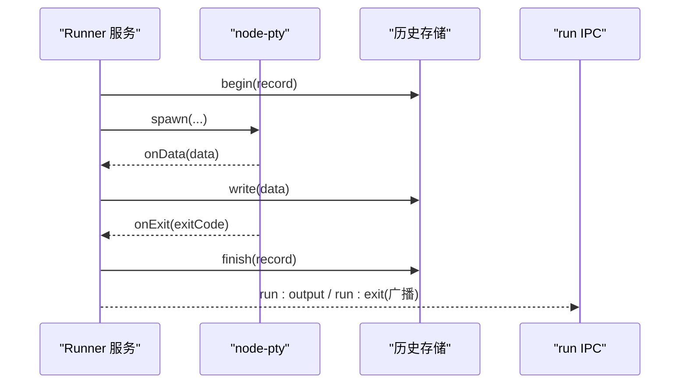
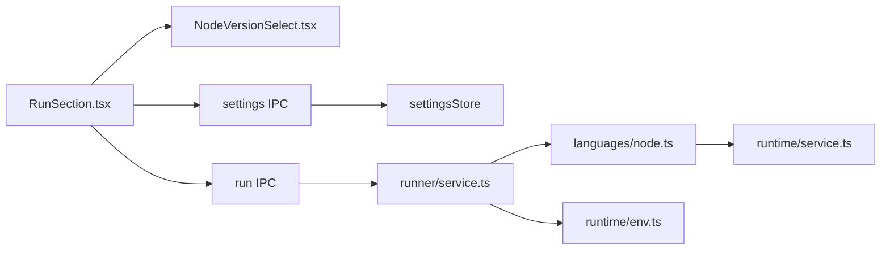

# 运行设置区块

<cite>
**本文引用的文件**   
- [RunSection.tsx](file://src/renderer/src/pages/settings/RunSection.tsx)
- [settings.ts（类型定义）](file://src/shared/types/settings.ts)
- [NodeVersionSelect.tsx](file://src/renderer/src/components/runtime/NodeVersionSelect.tsx)
- [service.ts（Runner 服务）](file://src/main/services/runner/service.ts)
- [node.ts（Node 语言运行器）](file://src/main/services/runner/languages/node.ts)
- [env.ts（进程环境变量构建）](file://src/main/services/runtime/env.ts)
- [service.ts（运行时管理）](file://src/main/services/runtime/service.ts)
- [run.ts（IPC 入口）](file://src/main/ipc/run.ts)
- [settings.ts（IPC 入口）](file://src/main/ipc/settings.ts)
- [index.ts（设置模块导出）](file://src/main/services/settings/index.ts)
- [run.ts（共享运行类型）](file://src/shared/types/run.ts)
</cite>

## 目录
1. [简介](#简介)
2. [项目结构与定位](#项目结构与定位)
3. [核心组件与数据模型](#核心组件与数据模型)
4. [架构总览](#架构总览)
5. [详细组件分析](#详细组件分析)
6. [依赖关系分析](#依赖关系分析)
7. [性能与调优建议](#性能与调优建议)
8. [故障排查指南](#故障排查指南)
9. [结论](#结论)

## 简介
本章节聚焦“运行设置区块”，说明 RunSection 组件如何配置脚本执行环境，包括 Node.js 版本选择、历史记录上限等运行参数；解释运行环境的隔离机制与安全策略；介绍运行日志的配置与输出格式；给出性能调优建议与最佳实践；并说明运行设置与 Runner 服务的集成关系。

## 项目结构与定位
- 前端设置页中的“运行”区块由 RunSection 组件提供，负责展示和编辑运行相关设置。
- 运行设置的数据结构在共享类型中定义，包含历史条数限制与默认 Node.js 版本。
- 运行时的实际执行由主进程的 Runner 服务完成，结合运行时管理服务解析具体 Node.js 版本与环境。

**图表来源**
- [RunSection.tsx:7-35](file://src/renderer/src/pages/settings/RunSection.tsx#L7-L35)
- [NodeVersionSelect.tsx:15-34](file://src/renderer/src/components/runtime/NodeVersionSelect.tsx#L15-L34)
- [settings.ts（IPC 入口）:5-13](file://src/main/ipc/settings.ts#L5-L13)
- [index.ts（设置模块导出）:1-3](file://src/main/services/settings/index.ts#L1-L3)
- [run.ts（IPC 入口）:4-17](file://src/main/ipc/run.ts#L4-L17)
- [service.ts（Runner 服务）:44-88](file://src/main/services/runner/service.ts#L44-L88)
- [node.ts（Node 语言运行器）:6-18](file://src/main/services/runner/languages/node.ts#L6-L18)
- [service.ts（运行时管理）:74-81](file://src/main/services/runtime/service.ts#L74-L81)
- [env.ts（进程环境变量构建）:10-26](file://src/main/services/runtime/env.ts#L10-L26)

**章节来源**
- [RunSection.tsx:7-35](file://src/renderer/src/pages/settings/RunSection.tsx#L7-L35)
- [settings.ts（类型定义）:27-30](file://src/shared/types/settings.ts#L27-L30)

## 核心组件与数据模型
- RunSection 组件提供两个关键设置项：
  - 历史记录上限：用于控制每个空间保留的运行记录数量。
  - 默认 Node.js 版本：为脚本运行选择已安装的 Node.js 版本。
- 运行设置的数据结构 RunSettings 仅包含上述两项字段，未直接暴露内存限制、并发控制等高级参数。这些能力通过 Runner 服务与底层 pty 实现间接体现。

**图表来源**
- [settings.ts（类型定义）:27-42](file://src/shared/types/settings.ts#L27-L42)

**章节来源**
- [RunSection.tsx:13-33](file://src/renderer/src/pages/settings/RunSection.tsx#L13-L33)
- [settings.ts（类型定义）:27-30](file://src/shared/types/settings.ts#L27-L30)

## 架构总览
运行设置与执行流程如下：
- 用户在 RunSection 中修改“历史记录上限”或“默认 Node.js 版本”。
- 设置变更通过 IPC 通知主进程 settingsStore 更新，并广播给渲染进程。
- 当用户启动脚本时，Renderer 调用 run:start IPC，Runner 服务根据脚本所在空间的运行配置与默认 Node 版本解析具体命令与环境。
- Runner 使用 node-pty 创建伪终端，注入安全的环境变量，并将标准输出写入历史日志流。
- 运行时管理服务负责解析已安装的 Node.js 版本路径，确保命令指向正确的二进制。

**图表来源**
- [settings.ts（IPC 入口）:5-13](file://src/main/ipc/settings.ts#L5-L13)
- [run.ts（IPC 入口）:4-17](file://src/main/ipc/run.ts#L4-L17)
- [service.ts（Runner 服务）:44-88](file://src/main/services/runner/service.ts#L44-L88)
- [node.ts（Node 语言运行器）:6-18](file://src/main/services/runner/languages/node.ts#L6-L18)
- [service.ts（运行时管理）:74-81](file://src/main/services/runtime/service.ts#L74-L81)

## 详细组件分析

### RunSection 组件与 Node 版本选择
- RunSection 将“历史记录上限”与“默认 Node.js 版本”绑定到表单控件，并通过 useSettingsUpdate 进行增量更新。
- NodeVersionSelect 从运行时商店获取已安装版本列表，支持清空选择并在缺失时显示警告状态，同时提供跳转到安装页面的链接。

**图表来源**
- [RunSection.tsx:13-33](file://src/renderer/src/pages/settings/RunSection.tsx#L13-L33)
- [NodeVersionSelect.tsx:15-34](file://src/renderer/src/components/runtime/NodeVersionSelect.tsx#L15-L34)
- [settings.ts（IPC 入口）:5-13](file://src/main/ipc/settings.ts#L5-L13)

**章节来源**
- [RunSection.tsx:7-35](file://src/renderer/src/pages/settings/RunSection.tsx#L7-L35)
- [NodeVersionSelect.tsx:15-34](file://src/renderer/src/components/runtime/NodeVersionSelect.tsx#L15-L34)

### 运行环境与隔离机制
- 环境变量构建函数会过滤可能干扰子 Node 进程的宿主环境变量（如 ELECTRON_*、NODE_OPTIONS、NODE_PATH、npm_*、VITE_*），避免污染脚本运行环境。
- 运行时 bin 目录被优先插入 PATH，确保脚本与依赖解析使用受管版本的 Node/npm。
- Runner 服务在启动脚本前合并网络代理环境变量与脚本自定义环境变量，保证网络访问一致性与可观测性。

**图表来源**
- [env.ts（进程环境变量构建）:3-26](file://src/main/services/runtime/env.ts#L3-L26)
- [service.ts（Runner 服务）:54-60](file://src/main/services/runner/service.ts#L54-L60)

**章节来源**
- [env.ts（进程环境变量构建）:3-26](file://src/main/services/runtime/env.ts#L3-L26)
- [service.ts（Runner 服务）:54-60](file://src/main/services/runner/service.ts#L54-L60)

### 日志配置与输出格式
- Runner 服务通过 node-pty 捕获子进程的标准输出，并以 ANSI 灰度样式打印启动行与退出信息，便于在终端中区分元信息与业务输出。
- 每次运行开始时会调用历史存储 begin，结束时 finish，记录运行元数据（ID、空间、脚本、参数、Node 版本、时间戳、退出码、状态）。
- IPC 层暴露 history:list、history:log、history:remove、history:clear 接口，供前端查看与管理运行历史。

**图表来源**
- [service.ts（Runner 服务）:73-88](file://src/main/services/runner/service.ts#L73-L88)
- [service.ts（Runner 服务）:122-143](file://src/main/services/runner/service.ts#L122-L143)
- [run.ts（IPC 入口）:11-17](file://src/main/ipc/run.ts#L11-L17)

**章节来源**
- [service.ts（Runner 服务）:73-88](file://src/main/services/runner/service.ts#L73-L88)
- [service.ts（Runner 服务）:122-143](file://src/main/services/runner/service.ts#L122-L143)
- [run.ts（IPC 入口）:11-17](file://src/main/ipc/run.ts#L11-L17)

### 运行参数与能力边界
- 当前 RunSettings 公开的能力：
  - historyLimit：控制历史条目数量。
  - defaultNodeVersion：指定默认 Node.js 版本。
- 未在设置中直接暴露的参数：
  - 内存限制：代码中未见显式内存限制配置（如 --max-old-space-size）。
  - 并发控制：Runner 服务维护活动运行集合，但未提供全局并发上限开关。
  - 超时与资源配额：未见统一超时或资源配额设置。
- 这些能力可通过扩展 RunSettings 与 Runner 服务逐步引入。

**章节来源**
- [settings.ts（类型定义）:27-30](file://src/shared/types/settings.ts#L27-L30)
- [service.ts（Runner 服务）:29-42](file://src/main/services/runner/service.ts#L29-L42)

## 依赖关系分析
- 前端 RunSection 依赖 NodeVersionSelect 与设置更新 Hook。
- 设置更新通过 IPC 与主进程 settingsStore 交互，并广播变更。
- 运行启动通过 run IPC 与 Runner 服务交互，Runner 依赖语言运行器与运行时管理服务。
- 环境变量构建函数为 Runner 提供安全的环境注入。

**图表来源**
- [RunSection.tsx:7-35](file://src/renderer/src/pages/settings/RunSection.tsx#L7-L35)
- [NodeVersionSelect.tsx:15-34](file://src/renderer/src/components/runtime/NodeVersionSelect.tsx#L15-L34)
- [settings.ts（IPC 入口）:5-13](file://src/main/ipc/settings.ts#L5-L13)
- [run.ts（IPC 入口）:4-17](file://src/main/ipc/run.ts#L4-L17)
- [service.ts（Runner 服务）:44-88](file://src/main/services/runner/service.ts#L44-L88)
- [node.ts（Node 语言运行器）:6-18](file://src/main/services/runner/languages/node.ts#L6-L18)
- [service.ts（运行时管理）:74-81](file://src/main/services/runtime/service.ts#L74-L81)
- [env.ts（进程环境变量构建）:10-26](file://src/main/services/runtime/env.ts#L10-L26)

**章节来源**
- [settings.ts（IPC 入口）:5-13](file://src/main/ipc/settings.ts#L5-L13)
- [run.ts（IPC 入口）:4-17](file://src/main/ipc/run.ts#L4-L17)
- [service.ts（Runner 服务）:44-88](file://src/main/services/runner/service.ts#L44-L88)

## 性能与调优建议
- Node.js 版本选择
  - 优先选择 LTS 版本以获得更稳定的性能与安全性。
  - 针对 I/O 密集型任务，可考虑较新的 Node 版本以利用引擎优化。
- 历史记录上限
  - 合理设置 historyLimit，避免过多历史占用磁盘与影响查询性能。
- 运行环境隔离
  - 保持环境变量过滤策略，避免宿主环境变量污染脚本行为。
  - 使用受管运行时 bin 目录，确保依赖解析一致性。
- 日志输出
  - 启用颜色输出有助于快速识别元信息与业务输出，但大量日志会影响终端渲染性能，建议在大规模输出场景下减少冗余日志。
- 扩展建议
  - 如需内存限制与并发控制，可在 RunSettings 中新增字段，并在 Runner 服务中实现相应逻辑（例如基于 child_process 的 resourceLimits 或队列限流）。

[本节为通用指导，不直接分析具体文件]

## 故障排查指南
- 无法选择 Node 版本
  - 检查是否已安装对应版本，若选择值不在已安装列表中，NodeVersionSelect 会显示警告并提供跳转安装页面。
- 运行失败或退出码非零
  - 查看运行历史日志，确认脚本错误堆栈与退出原因。
  - 检查脚本自定义环境变量是否正确注入。
- 网络访问异常
  - 确认网络代理设置已应用，Runner 会在启动时注入网络环境变量。
- 历史清理
  - 使用 history:clear 或 history:remove 清理无用记录，释放存储空间。

**章节来源**
- [NodeVersionSelect.tsx:15-34](file://src/renderer/src/components/runtime/NodeVersionSelect.tsx#L15-L34)
- [service.ts（Runner 服务）:127-143](file://src/main/services/runner/service.ts#L127-L143)
- [run.ts（IPC 入口）:11-17](file://src/main/ipc/run.ts#L11-L17)

## 结论
运行设置区块提供了基础的运行参数配置，包括历史记录上限与默认 Node.js 版本选择。Runner 服务通过安全的进程环境构建与伪终端执行，保障脚本运行的隔离性与可观测性。当前实现未直接暴露内存限制与并发控制等高级参数，但这些能力可在现有架构基础上扩展。建议在生产环境中合理设置历史记录上限、选择合适的 Node.js 版本，并保持环境变量隔离策略，以获得稳定、可追踪且安全的运行体验。