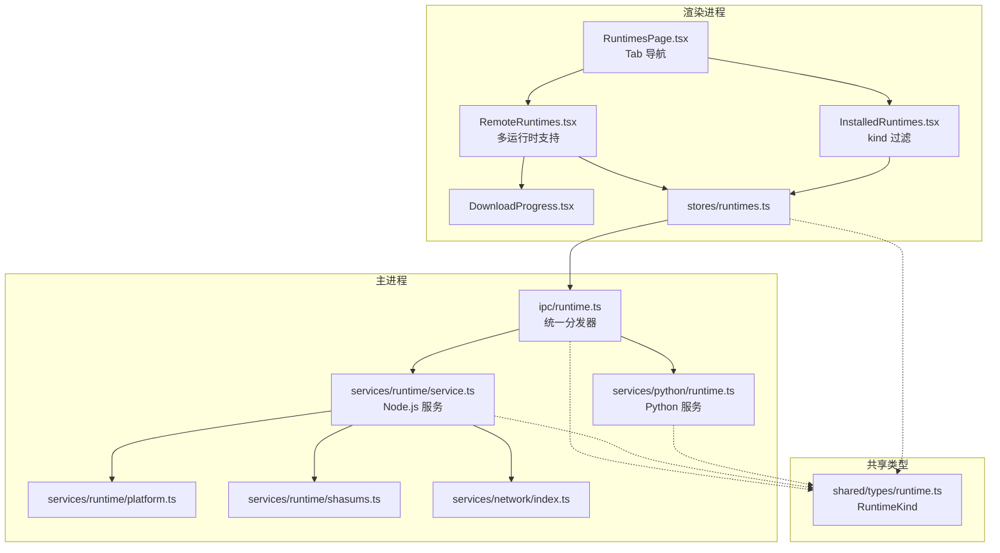
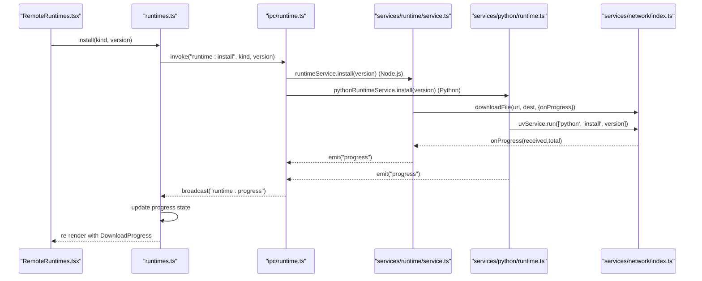
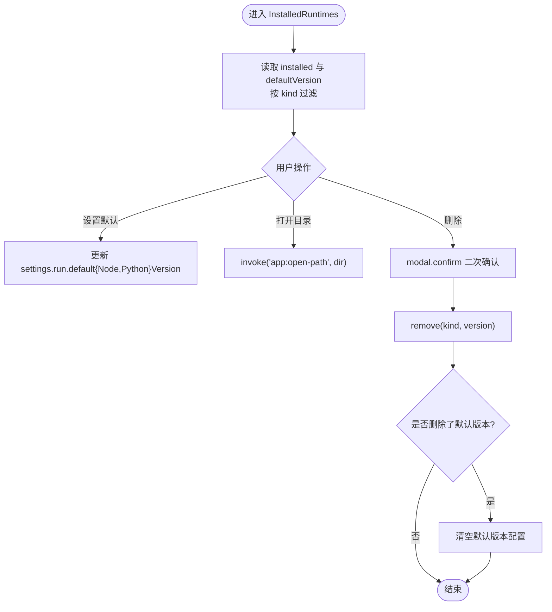
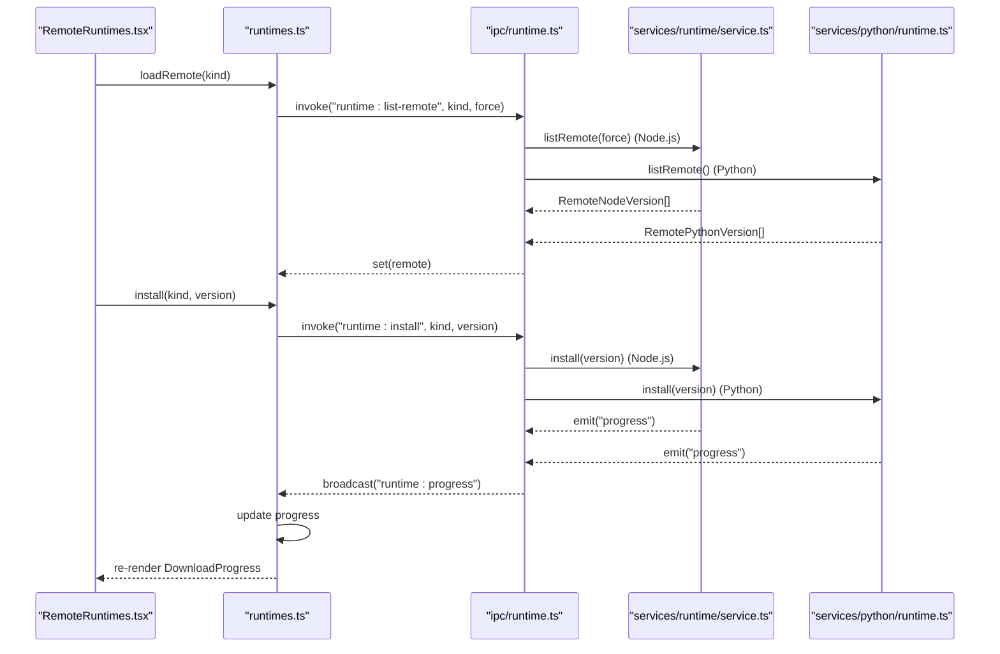
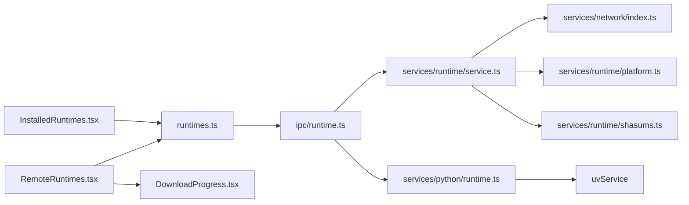
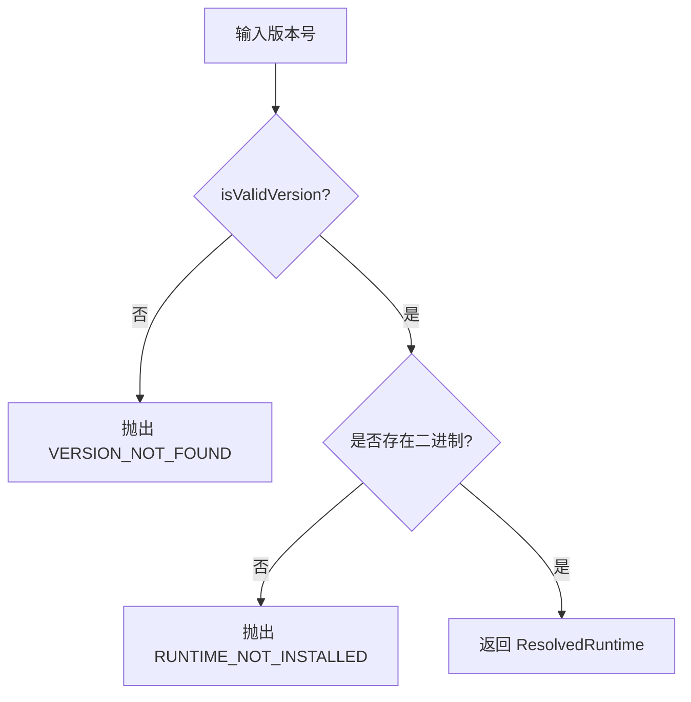

# 运行时管理页面

<cite>
**本文引用的文件**   
- [RuntimesPage.tsx](file://src/renderer/src/pages/runtimes/RuntimesPage.tsx)
- [InstalledRuntimes.tsx](file://src/renderer/src/pages/runtimes/InstalledRuntimes.tsx)
- [RemoteRuntimes.tsx](file://src/renderer/src/pages/runtimes/RemoteRuntimes.tsx)
- [DownloadProgress.tsx](file://src/renderer/src/components/runtime/DownloadProgress.tsx)
- [runtimes.ts](file://src/renderer/src/stores/runtimes.ts)
- [runtime.ts（IPC）](file://src/main/ipc/runtime.ts)
- [service.ts（Node.js 运行时服务）](file://src/main/services/runtime/service.ts)
- [runtime.ts（Python 运行时服务）](file://src/main/services/python/runtime.ts)
- [platform.ts（平台与版本工具）](file://src/main/services/runtime/platform.ts)
- [shasums.ts（校验和工具）](file://src/main/services/runtime/shasums.ts)
- [network/index.ts（网络工具）](file://src/main/services/network/index.ts)
- [runtime.ts（共享类型）](file://src/shared/types/runtime.ts)
</cite>

## 更新摘要
**变更内容**   
- RemoteRuntimes 组件重构以支持 Node.js 和 Python 双运行时
- RuntimesPage 添加 Tab 导航界面
- 统一接口设计，通过 kind 参数区分运行时类型
- 新增 Python 运行时支持和相应的后端服务
- 改进的类型安全和过滤机制

## 目录
1. [简介](#简介)
2. [项目结构](#项目结构)
3. [核心组件](#核心组件)
4. [架构总览](#架构总览)
5. [详细组件分析](#详细组件分析)
6. [依赖关系分析](#依赖关系分析)
7. [性能与下载特性](#性能与下载特性)
8. [版本比较与冲突解决](#版本比较与冲突解决)
9. [最佳实践](#最佳实践)
10. [故障排除指南](#故障排除指南)
11. [结论](#结论)

## 简介
本文件为"运行时管理页面"的完整技术文档，聚焦以下目标：
- RuntimesPage 页面的整体架构与路由集成方式，支持 Node.js 和 Python 双运行时
- InstalledRuntimes 已安装版本的展示、默认版本切换与删除逻辑
- RemoteRuntimes 远程版本发现、过滤、安装与进度展示，支持多运行时类型
- 版本比较算法与冲突处理策略
- 下载进度跟踪、取消机制与错误处理
- 版本管理的最佳实践与常见问题排查

## 项目结构
运行时管理功能采用多运行时架构，由渲染进程页面与主进程服务协同完成：
- 渲染进程
  - 页面层：RuntimesPage（带 Tab 导航）、InstalledRuntimes、RemoteRuntimes
  - 组件层：DownloadProgress
  - 状态层：runtimes store（Zustand）
- 主进程
  - IPC 注册：runtime.ts（统一分发器）
  - Node.js 运行时服务：service.ts
  - Python 运行时服务：python/runtime.ts
  - 平台与版本工具：platform.ts、shasums.ts
  - 网络工具：network/index.ts
- 共享类型：shared/types/runtime.ts

**图表来源**
- [RuntimesPage.tsx:9-30](file://src/renderer/src/pages/runtimes/RuntimesPage.tsx#L9-L30)
- [InstalledRuntimes.tsx:13-103](file://src/renderer/src/pages/runtimes/InstalledRuntimes.tsx#L13-L103)
- [RemoteRuntimes.tsx:12-131](file://src/renderer/src/pages/runtimes/RemoteRuntimes.tsx#L12-L131)
- [runtime.ts（IPC）:6-40](file://src/main/ipc/runtime.ts#L6-L40)
- [service.ts:37-155](file://src/main/services/runtime/service.ts#L37-L155)
- [runtime.ts（Python）:37-130](file://src/main/services/python/runtime.ts#L37-L130)

## 核心组件
- **RuntimesPage**：页面容器，提供 Tab 导航界面，组合 InstalledRuntimes 与 RemoteRuntimes，支持 Node.js 和 Python 运行时切换。
- **InstalledRuntimes**：展示本地已安装的运行时列表（Node.js 或 Python），支持设置默认版本、打开目录、删除版本；根据 kind 参数过滤显示对应类型的运行时。
- **RemoteRuntimes**：拉取远程版本索引，支持按运行时类型过滤、关键词搜索、刷新；点击安装触发下载并显示进度；已安装版本直接标记。
- **DownloadProgress**：可视化下载进度条，支持失败时显示错误信息、取消或关闭提示。
- **runtimes store**：集中管理 installed、remote、remoteLoading、progress 等状态，封装 loadInstalled/loadRemote/install/cancel/remove/dismiss 等方法，并通过 on('runtime:progress') 监听主进程事件更新 UI。

**章节来源**
- [RuntimesPage.tsx:9-30](file://src/renderer/src/pages/runtimes/RuntimesPage.tsx#L9-L30)
- [InstalledRuntimes.tsx:13-103](file://src/renderer/src/pages/runtimes/InstalledRuntimes.tsx#L13-L103)
- [RemoteRuntimes.tsx:12-131](file://src/renderer/src/pages/runtimes/RemoteRuntimes.tsx#L12-L131)
- [DownloadProgress.tsx:14-41](file://src/renderer/src/components/runtime/DownloadProgress.tsx#L14-L41)
- [runtimes.ts:5-67](file://src/renderer/src/stores/runtimes.ts#L5-L67)

## 架构总览
运行时管理采用"渲染进程 UI + Zustand 状态 + IPC 统一分发 + 多运行时服务"的分层架构。UI 通过 store 调用 IPC，主进程根据运行时类型分发到对应的服务进行处理。

**图表来源**
- [RemoteRuntimes.tsx:41-44](file://src/renderer/src/pages/runtimes/RemoteRuntimes.tsx#L41-L44)
- [runtimes.ts:43-44](file://src/renderer/src/stores/runtimes.ts#L43-L44)
- [runtime.ts（IPC）:22-31](file://src/main/ipc/runtime.ts#L22-L31)
- [service.ts:87-98](file://src/main/services/runtime/service.ts#L87-L98)
- [runtime.ts（Python）:73-83](file://src/main/services/python/runtime.ts#L73-L83)

## 详细组件分析

### RuntimesPage 页面
- **职责**：作为运行时管理入口，提供 Tab 导航界面，聚合已安装与远程两个子面板，并提供国际化标题。
- **行为**：维护当前选中的运行时类型（node 或 python），通过 Tabs 组件实现切换，将 kind 参数传递给子组件。

**章节来源**
- [RuntimesPage.tsx:9-30](file://src/renderer/src/pages/runtimes/RuntimesPage.tsx#L9-L30)

### InstalledRuntimes 已安装版本管理
- **数据源**：从 runtimes store 读取 installed 列表，结合 settings store 的默认版本进行标注，根据 kind 参数过滤显示对应类型的运行时。
- **操作能力**：
  - 设置默认版本：更新 settings.run.defaultNodeVersion 或 settings.run.defaultPythonVersion
  - 打开目录：调用 app:open-path IPC
  - 删除版本：二次确认后执行 remove，若删除的是默认版本则清空默认值
- **使用方提示**：根据 spaces 中 runtime.kind 和 runtime.version 字段统计使用该版本的"空间"，在删除前提示用户。

**图表来源**
- [InstalledRuntimes.tsx:16-21](file://src/renderer/src/pages/runtimes/InstalledRuntimes.tsx#L16-L21)
- [InstalledRuntimes.tsx:26-43](file://src/renderer/src/pages/runtimes/InstalledRuntimes.tsx#L26-L43)
- [InstalledRuntimes.tsx:72-84](file://src/renderer/src/pages/runtimes/InstalledRuntimes.tsx#L72-L84)

**章节来源**
- [InstalledRuntimes.tsx:13-103](file://src/renderer/src/pages/runtimes/InstalledRuntimes.tsx#L13-L103)

### RemoteRuntimes 远程版本发现与下载
- **远程列表获取**：
  - 首次加载调用 loadRemote(kind)
  - 支持强制刷新 loadRemote(kind, true)
  - 支持 LTS 开关（仅 Node.js）与关键词搜索
  - 按 kind 参数过滤远程版本列表
- **安装流程**：
  - 点击安装后先 dismiss 旧进度，再调用 install(kind, version)
  - 已安装版本直接显示"已安装"标签
  - 进行中版本显示 DownloadProgress，支持取消与关闭
- **进度监听**：
  - 通过 on('runtime:progress') 接收主进程广播，更新 progress 状态
  - 完成或取消后自动 dismiss，并在成功时重新拉取 installed 列表

**图表来源**
- [RemoteRuntimes.tsx:29-31](file://src/renderer/src/pages/runtimes/RemoteRuntimes.tsx#L29-L31)
- [RemoteRuntimes.tsx:41-44](file://src/renderer/src/pages/runtimes/RemoteRuntimes.tsx#L41-L44)
- [runtimes.ts:34-44](file://src/renderer/src/stores/runtimes.ts#L34-L44)
- [runtime.ts（IPC）:7-31](file://src/main/ipc/runtime.ts#L7-L31)

**章节来源**
- [RemoteRuntimes.tsx:12-131](file://src/renderer/src/pages/runtimes/RemoteRuntimes.tsx#L12-L131)
- [runtimes.ts:31-67](file://src/renderer/src/stores/runtimes.ts#L31-L67)

### DownloadProgress 进度组件
- **展示内容**：当前阶段文本、下载字节数、百分比进度条
- **交互**：失败时显示关闭按钮；进行中显示取消按钮
- **状态映射**：phase=download 计算百分比；其他阶段固定 100%；error 状态以异常样式呈现

**章节来源**
- [DownloadProgress.tsx:14-41](file://src/renderer/src/components/runtime/DownloadProgress.tsx#L14-L41)

## 依赖关系分析
- **渲染进程依赖**
  - 页面组件依赖 stores/runtimes.ts 提供的状态与方法
  - RemoteRuntimes 依赖 DownloadProgress 展示进度
  - 所有异步操作通过 @renderer/api.invoke 调用 IPC
- **主进程依赖**
  - ipc/runtime.ts 将前端方法映射到 services/runtime/service.ts 或 services/python/runtime.ts
  - Node.js 服务依赖 network/index.ts 进行网络请求与下载
  - Node.js 服务依赖 platform.ts 解析平台与版本格式
  - Node.js 服务依赖 shasums.ts 进行完整性校验
  - Python 服务依赖 uvService 进行 Python 包管理操作
- **共享类型**
  - shared/types/runtime.ts 定义 RuntimeKind、RemoteRuntimeVersion、InstalledRuntime、RuntimeInstallProgress 等类型，贯穿前后端

**图表来源**
- [InstalledRuntimes.tsx:13-103](file://src/renderer/src/pages/runtimes/InstalledRuntimes.tsx#L13-L103)
- [RemoteRuntimes.tsx:12-131](file://src/renderer/src/pages/runtimes/RemoteRuntimes.tsx#L12-L131)
- [DownloadProgress.tsx:14-41](file://src/renderer/src/components/runtime/DownloadProgress.tsx#L14-L41)
- [runtimes.ts:5-67](file://src/renderer/src/stores/runtimes.ts#L5-L67)
- [runtime.ts（IPC）:6-40](file://src/main/ipc/runtime.ts#L6-L40)
- [service.ts:37-155](file://src/main/services/runtime/service.ts#L37-L155)
- [runtime.ts（Python）:37-130](file://src/main/services/python/runtime.ts#L37-L130)

**章节来源**
- [runtimes.ts:5-67](file://src/renderer/src/stores/runtimes.ts#L5-L67)
- [runtime.ts（IPC）:6-40](file://src/main/ipc/runtime.ts#L6-L40)
- [service.ts:37-155](file://src/main/services/runtime/service.ts#L37-L155)
- [runtime.ts（Python）:37-130](file://src/main/services/python/runtime.ts#L37-L130)

## 性能与下载特性
- **远程列表缓存**
  - Node.js 主进程对远程镜像 index.json 做内存缓存，默认 TTL 为 10 分钟，避免频繁请求
  - 可通过 force 参数强制刷新
  - Python 版本通过 uvService 实时查询，无本地缓存
- **下载进度**
  - Node.js：基于流式管道分块传输，节流上报（约每 150ms 一次），减少渲染压力
  - Python：通过 uvService 的输出流实时更新进度详情
  - 进度包含 received/total 字节数与阶段 phase
- **断点续传**
  - 当前实现未启用断点续传；每次安装从头下载临时文件
- **并发控制**
  - 同一版本仅允许一个安装任务，重复安装会抛出错误
- **资源清理**
  - Node.js：安装完成后删除临时压缩包，释放磁盘空间
  - Python：通过 uvService 自动管理依赖文件

**章节来源**
- [service.ts:35-56](file://src/main/services/runtime/service.ts#L35-L56)
- [service.ts:87-108](file://src/main/services/runtime/service.ts#L87-L108)
- [service.ts:114-150](file://src/main/services/runtime/service.ts#L114-L150)
- [runtime.ts（Python）:103-125](file://src/main/services/python/runtime.ts#L103-L125)
- [network/index.ts:34-64](file://src/main/services/network/index.ts#L34-L64)

## 版本比较与冲突解决
- **版本格式**
  - Node.js：要求 v 开头的语义化版本（如 v18.12.0），由 isValidVersion 校验
  - Python：支持标准版本号格式（如 3.11.0），正则表达式验证
- **排序规则**
  - Node.js：compareVersionsDesc 按主版本、次版本、补丁版本降序排列，用于已安装列表展示
  - Python：localeCompare 按数字顺序排序，支持语义化版本比较
- **冲突处理**
  - 删除已在使用中的版本前，会列出使用该版本的"空间"名称，提醒用户
  - 若删除的是默认版本，自动清空默认配置，避免引用无效版本
- **解析与运行**
  - Node.js：resolve 方法确保指定版本存在且可运行，否则抛出 RUNTIME_NOT_INSTALLED 错误
  - Python：resolve 方法通过 uvService.find 查找可用版本，不存在则抛出 NO_PYTHON_VERSION 错误

**图表来源**
- [platform.ts:62-82](file://src/main/services/runtime/platform.ts#L62-L82)
- [service.ts:74-81](file://src/main/services/runtime/service.ts#L74-L81)
- [runtime.ts（Python）:93-101](file://src/main/services/python/runtime.ts#L93-L101)

**章节来源**
- [platform.ts:62-82](file://src/main/services/runtime/platform.ts#L62-L82)
- [service.ts:74-81](file://src/main/services/runtime/service.ts#L74-L81)
- [runtime.ts（Python）:93-101](file://src/main/services/python/runtime.ts#L93-L101)
- [InstalledRuntimes.tsx:26-43](file://src/renderer/src/pages/runtimes/InstalledRuntimes.tsx#L26-L43)

## 最佳实践
- **版本选择**
  - Node.js：优先选择 LTS 版本以获得长期支持
  - Python：推荐使用受支持的次要版本（3.11-3.15）
  - 新项目建议锁定主版本，便于团队协作
- **默认版本**
  - 仅在确定环境稳定后设置为默认版本
  - 删除默认版本时务必同步清理相关空间配置
- **下载与安装**
  - 在网络不稳定时避免批量安装多个版本
  - 安装过程中如需中断，请使用取消功能，避免产生不完整文件
- **安全与完整性**
  - Node.js：安装过程会自动校验 SHA256，请勿绕过该步骤
  - Python：通过 uvService 确保依赖的安全性和一致性
  - 如遇校验失败，检查镜像源与网络代理配置

## 故障排除指南
- **无法拉取远程版本**
  - 检查网络代理设置是否正确
  - 尝试点击刷新按钮强制拉取
  - 查看控制台错误信息，确认镜像地址可达
- **下载失败或中断**
  - 观察 DownloadProgress 的错误消息
  - 检查网络连接与代理配置
  - 重试安装；如仍失败，更换镜像或网络环境
- **校验失败（CHECKSUM_MISMATCH）**
  - 可能是镜像文件损坏或网络传输错误
  - 重新下载安装包
- **删除版本时报错**
  - 确认该版本未被任何空间使用
  - 若为默认版本，请先更改默认版本或删除后再移除
- **找不到版本（VERSION_NOT_FOUND）**
  - 确认版本号格式正确（vX.Y.Z for Node.js, X.Y.Z for Python）
  - 确认远程索引中包含该版本
- **Python 特定问题**
  - 检查 uv 工具是否正确安装
  - 确认 Python 版本是否在支持列表中（3.11-3.15）
  - 查看 uvService 的执行日志获取详细信息

**章节来源**
- [network/index.ts:18-27](file://src/main/services/network/index.ts#L18-L27)
- [network/index.ts:34-64](file://src/main/services/network/index.ts#L34-L64)
- [service.ts:114-150](file://src/main/services/runtime/service.ts#L114-L150)
- [service.ts:87-108](file://src/main/services/runtime/service.ts#L87-L108)
- [runtime.ts（Python）:103-125](file://src/main/services/python/runtime.ts#L103-L125)
- [DownloadProgress.tsx:14-41](file://src/renderer/src/components/runtime/DownloadProgress.tsx#L14-L41)

## 结论
运行时管理页面通过清晰的组件分层与稳健的多运行时服务架构，实现了 Node.js 和 Python 双运行时的完整管理闭环。其特点包括：
- **统一的 Tab 导航界面**：直观切换不同运行时类型
- **直观的已安装版本管理与默认版本切换**：支持多运行时类型
- **灵活的远程版本发现与过滤**：按运行时类型智能过滤
- **可靠的下载进度反馈与错误处理**：统一的进度展示组件
- **严格的版本校验与平台适配**：Node.js 支持 SHA256 校验，Python 通过 uvService 管理
- **类型安全的架构设计**：使用 TypeScript 联合类型确保运行时类型安全

遵循本文的最佳实践与排障建议，可有效提升多运行时管理的稳定性与用户体验。新的架构设计为未来扩展更多运行时类型奠定了坚实基础。