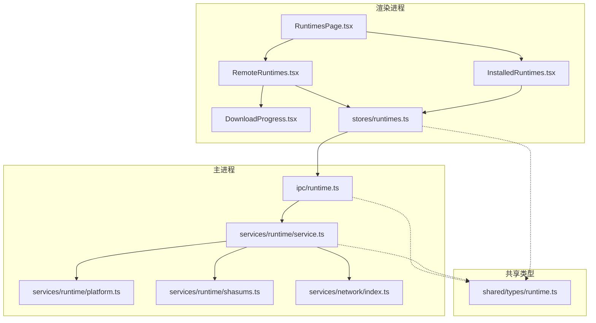
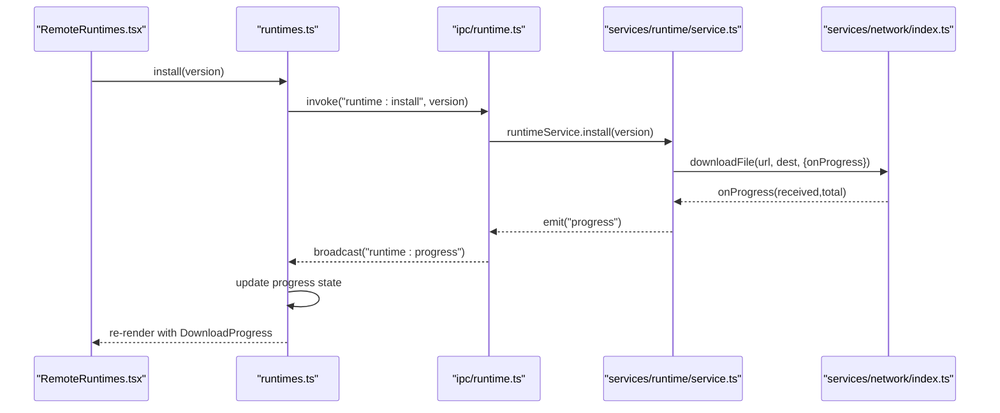
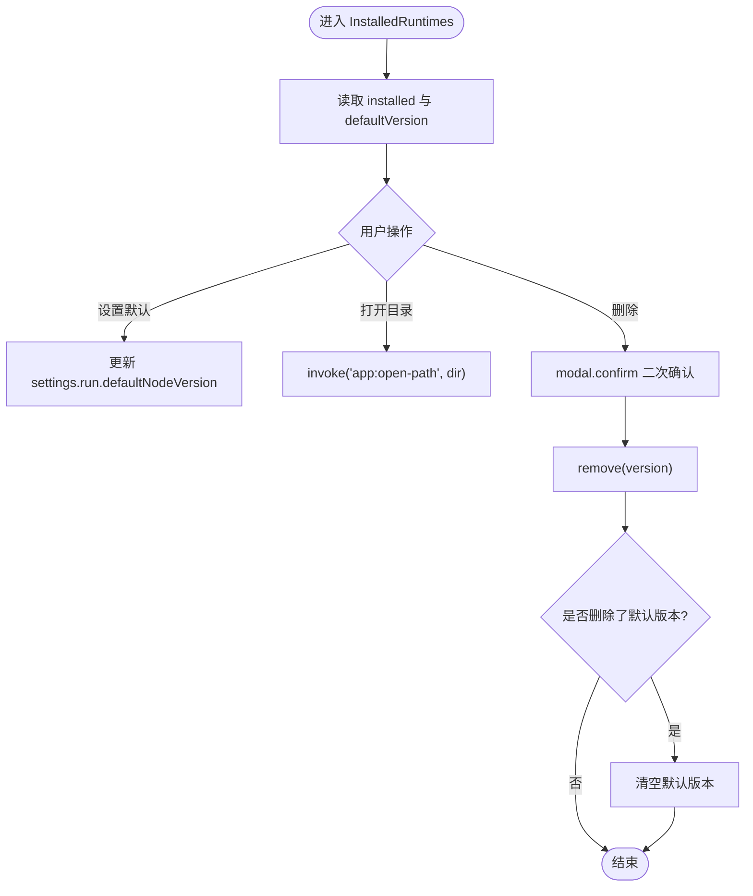
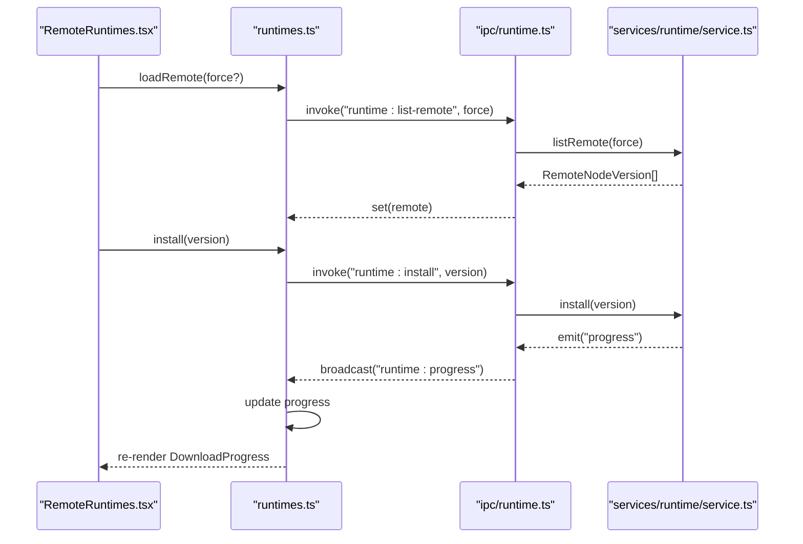
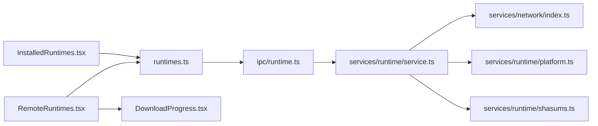
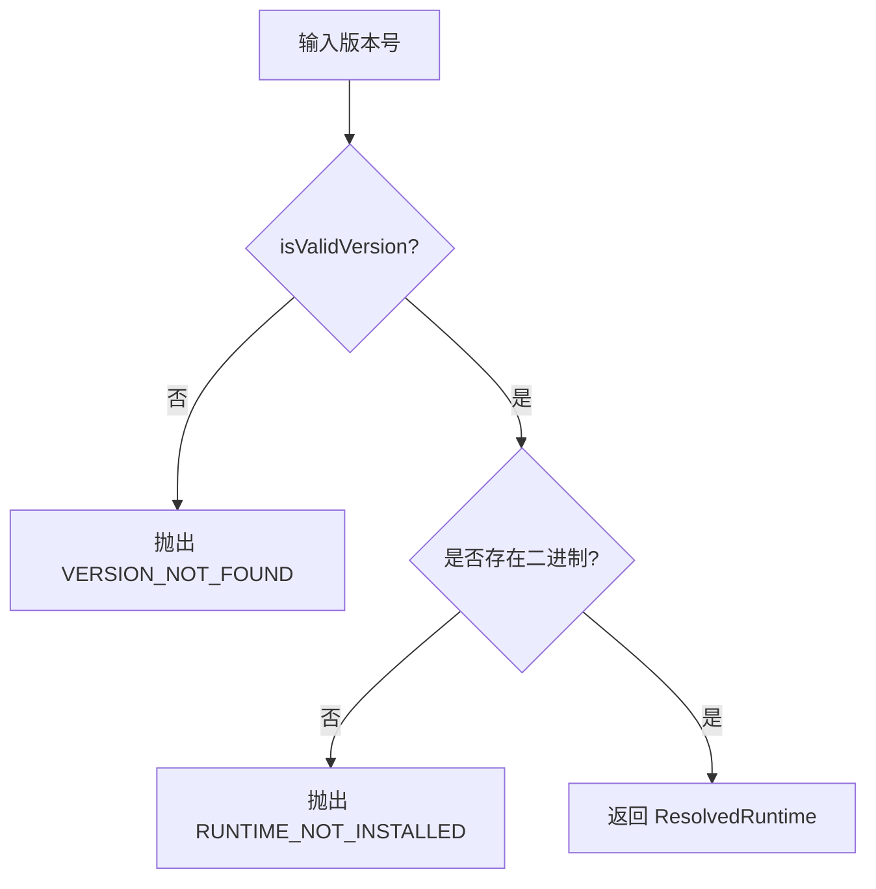

# 运行时管理页面

<cite>
**本文引用的文件**   
- [RuntimesPage.tsx](file://src/renderer/src/pages/runtimes/RuntimesPage.tsx)
- [InstalledRuntimes.tsx](file://src/renderer/src/pages/runtimes/InstalledRuntimes.tsx)
- [RemoteRuntimes.tsx](file://src/renderer/src/pages/runtimes/RemoteRuntimes.tsx)
- [DownloadProgress.tsx](file://src/renderer/src/components/runtime/DownloadProgress.tsx)
- [runtimes.ts](file://src/renderer/src/stores/runtimes.ts)
- [runtime.ts（IPC）](file://src/main/ipc/runtime.ts)
- [service.ts（运行时服务）](file://src/main/services/runtime/service.ts)
- [platform.ts（平台与版本工具）](file://src/main/services/runtime/platform.ts)
- [shasums.ts（校验和工具）](file://src/main/services/runtime/shasums.ts)
- [network/index.ts（网络工具）](file://src/main/services/network/index.ts)
- [runtime.ts（共享类型）](file://src/shared/types/runtime.ts)
</cite>

## 目录
1. [简介](#简介)
2. [项目结构](#项目结构)
3. [核心组件](#核心组件)
4. [架构总览](#架构总览)
5. [详细组件分析](#详细组件分析)
6. [依赖关系分析](#依赖关系分析)
7. [性能与下载特性](#性能与下载特性)
8. [版本比较与冲突解决](#版本比较与冲突解决)
9. [最佳实践](#最佳实践)
10. [故障排除指南](#故障排除指南)
11. [结论](#结论)

## 简介
本文件为“运行时管理页面”的完整技术文档，聚焦以下目标：
- RuntimesPage 页面的整体架构与路由集成方式
- InstalledRuntimes 已安装版本的展示、默认版本切换与删除逻辑
- RemoteRuntimes 远程版本发现、过滤、安装与进度展示
- 版本比较算法与冲突处理策略
- 下载进度跟踪、取消机制与错误处理
- 版本管理的最佳实践与常见问题排查

## 项目结构
运行时管理功能由渲染进程页面与主进程服务协同完成：
- 渲染进程
  - 页面层：RuntimesPage、InstalledRuntimes、RemoteRuntimes
  - 组件层：DownloadProgress
  - 状态层：runtimes store（Zustand）
- 主进程
  - IPC 注册：runtime.ts
  - 运行时服务：service.ts
  - 平台与版本工具：platform.ts、shasums.ts
  - 网络工具：network/index.ts
- 共享类型：shared/types/runtime.ts

图表来源
- [RuntimesPage.tsx:7-18](file://src/renderer/src/pages/runtimes/RuntimesPage.tsx#L7-L18)
- [InstalledRuntimes.tsx:13-97](file://src/renderer/src/pages/runtimes/InstalledRuntimes.tsx#L13-L97)
- [RemoteRuntimes.tsx:12-103](file://src/renderer/src/pages/runtimes/RemoteRuntimes.tsx#L12-L103)
- [DownloadProgress.tsx:14-41](file://src/renderer/src/components/runtime/DownloadProgress.tsx#L14-L41)
- [runtimes.ts:19-61](file://src/renderer/src/stores/runtimes.ts#L19-L61)
- [runtime.ts（IPC）:4-13](file://src/main/ipc/runtime.ts#L4-L13)
- [service.ts:37-154](file://src/main/services/runtime/service.ts#L37-L154)
- [platform.ts:20-82](file://src/main/services/runtime/platform.ts#L20-L82)
- [shasums.ts:5-24](file://src/main/services/runtime/shasums.ts#L5-L24)
- [network/index.ts:18-64](file://src/main/services/network/index.ts#L18-L64)
- [runtime.ts（共享类型）:1-22](file://src/shared/types/runtime.ts#L1-L22)

章节来源
- [RuntimesPage.tsx:7-18](file://src/renderer/src/pages/runtimes/RuntimesPage.tsx#L7-L18)
- [runtimes.ts:19-61](file://src/renderer/src/stores/runtimes.ts#L19-L61)
- [runtime.ts（IPC）:4-13](file://src/main/ipc/runtime.ts#L4-L13)

## 核心组件
- RuntimesPage：页面容器，组合 InstalledRuntimes 与 RemoteRuntimes，提供国际化标题。
- InstalledRuntimes：展示本地已安装的 Node 运行时列表，支持设置默认版本、打开目录、删除版本；若默认版本被删除，自动清理默认配置。
- RemoteRuntimes：拉取远程版本索引，支持 LTS 过滤、关键词搜索、刷新；点击安装触发下载并显示进度；已安装版本直接标记。
- DownloadProgress：可视化下载进度条，支持失败时显示错误信息、取消或关闭提示。
- runtimes store：集中管理 installed、remote、remoteLoading、progress 等状态，封装 loadInstalled/loadRemote/install/cancel/remove/dismiss 等方法，并通过 on('runtime:progress') 监听主进程事件更新 UI。

章节来源
- [RuntimesPage.tsx:7-18](file://src/renderer/src/pages/runtimes/RuntimesPage.tsx#L7-L18)
- [InstalledRuntimes.tsx:13-97](file://src/renderer/src/pages/runtimes/InstalledRuntimes.tsx#L13-L97)
- [RemoteRuntimes.tsx:12-103](file://src/renderer/src/pages/runtimes/RemoteRuntimes.tsx#L12-L103)
- [DownloadProgress.tsx:14-41](file://src/renderer/src/components/runtime/DownloadProgress.tsx#L14-L41)
- [runtimes.ts:19-61](file://src/renderer/src/stores/runtimes.ts#L19-L61)

## 架构总览
运行时管理采用“渲染进程 UI + Zustand 状态 + IPC + 主进程服务”的分层架构。UI 通过 store 调用 IPC，主进程 service 负责网络请求、文件校验、解压与事件上报。

图表来源
- [RemoteRuntimes.tsx:27-30](file://src/renderer/src/pages/runtimes/RemoteRuntimes.tsx#L27-L30)
- [runtimes.ts:40-41](file://src/renderer/src/stores/runtimes.ts#L40-L41)
- [runtime.ts（IPC）:8-12](file://src/main/ipc/runtime.ts#L8-L12)
- [service.ts:87-112](file://src/main/services/runtime/service.ts#L87-L112)
- [network/index.ts:34-64](file://src/main/services/network/index.ts#L34-L64)

## 详细组件分析

### RuntimesPage 页面
- 职责：作为运行时管理入口，聚合已安装与远程两个子面板，并提供国际化标题。
- 行为：无复杂业务逻辑，主要承担布局与文案。

章节来源
- [RuntimesPage.tsx:7-18](file://src/renderer/src/pages/runtimes/RuntimesPage.tsx#L7-L18)

### InstalledRuntimes 已安装版本管理
- 数据源：从 runtimes store 读取 installed 列表，结合 settings store 的默认版本进行标注。
- 操作能力：
  - 设置默认版本：更新 settings.run.defaultNodeVersion
  - 打开目录：调用 app:open-path IPC
  - 删除版本：二次确认后执行 remove，若删除的是默认版本则清空默认值
- 使用方提示：根据 spaces 中 nodeVersion 字段统计使用该版本的“空间”，在删除前提示用户。

图表来源
- [InstalledRuntimes.tsx:22-42](file://src/renderer/src/pages/runtimes/InstalledRuntimes.tsx#L22-L42)
- [InstalledRuntimes.tsx:44-83](file://src/renderer/src/pages/runtimes/InstalledRuntimes.tsx#L44-L83)
- [runtimes.ts:42-45](file://src/renderer/src/stores/runtimes.ts#L42-L45)

章节来源
- [InstalledRuntimes.tsx:13-97](file://src/renderer/src/pages/runtimes/InstalledRuntimes.tsx#L13-L97)
- [runtimes.ts:42-45](file://src/renderer/src/stores/runtimes.ts#L42-L45)

### RemoteRuntimes 远程版本发现与下载
- 远程列表获取：
  - 首次加载调用 loadRemote()
  - 支持强制刷新 loadRemote(true)
  - 支持 LTS 开关与关键词搜索
- 安装流程：
  - 点击安装后先 dismiss 旧进度，再调用 install(version)
  - 已安装版本直接显示“已安装”标签
  - 进行中版本显示 DownloadProgress，支持取消与关闭
- 进度监听：
  - 通过 on('runtime:progress') 接收主进程广播，更新 progress 状态
  - 完成或取消后自动 dismiss，并在成功时重新拉取 installed 列表

图表来源
- [RemoteRuntimes.tsx:19-30](file://src/renderer/src/pages/runtimes/RemoteRuntimes.tsx#L19-L30)
- [RemoteRuntimes.tsx:32-65](file://src/renderer/src/pages/runtimes/RemoteRuntimes.tsx#L32-L65)
- [runtimes.ts:31-41](file://src/renderer/src/stores/runtimes.ts#L31-L41)
- [runtime.ts（IPC）:5-12](file://src/main/ipc/runtime.ts#L5-L12)
- [service.ts:45-98](file://src/main/services/runtime/service.ts#L45-L98)

章节来源
- [RemoteRuntimes.tsx:12-103](file://src/renderer/src/pages/runtimes/RemoteRuntimes.tsx#L12-L103)
- [runtimes.ts:31-61](file://src/renderer/src/stores/runtimes.ts#L31-L61)

### DownloadProgress 进度组件
- 展示内容：当前阶段文本、下载字节数、百分比进度条
- 交互：失败时显示关闭按钮；进行中显示取消按钮
- 状态映射：phase=download 计算百分比；其他阶段固定 100%；error 状态以异常样式呈现

章节来源
- [DownloadProgress.tsx:14-41](file://src/renderer/src/components/runtime/DownloadProgress.tsx#L14-L41)

## 依赖关系分析
- 渲染进程依赖
  - 页面组件依赖 stores/runtimes.ts 提供的状态与方法
  - RemoteRuntimes 依赖 DownloadProgress 展示进度
  - 所有异步操作通过 @renderer/api.invoke 调用 IPC
- 主进程依赖
  - ipc/runtime.ts 将前端方法映射到 services/runtime/service.ts
  - service.ts 依赖 network/index.ts 进行网络请求与下载
  - service.ts 依赖 platform.ts 解析平台与版本格式
  - service.ts 依赖 shasums.ts 进行完整性校验
- 共享类型
  - shared/types/runtime.ts 定义 RemoteNodeVersion、InstalledRuntime、RuntimeInstallProgress 等类型，贯穿前后端

图表来源
- [InstalledRuntimes.tsx:13-97](file://src/renderer/src/pages/runtimes/InstalledRuntimes.tsx#L13-L97)
- [RemoteRuntimes.tsx:12-103](file://src/renderer/src/pages/runtimes/RemoteRuntimes.tsx#L12-L103)
- [DownloadProgress.tsx:14-41](file://src/renderer/src/components/runtime/DownloadProgress.tsx#L14-L41)
- [runtimes.ts:19-61](file://src/renderer/src/stores/runtimes.ts#L19-L61)
- [runtime.ts（IPC）:4-13](file://src/main/ipc/runtime.ts#L4-L13)
- [service.ts:37-154](file://src/main/services/runtime/service.ts#L37-L154)
- [platform.ts:20-82](file://src/main/services/runtime/platform.ts#L20-L82)
- [shasums.ts:5-24](file://src/main/services/runtime/shasums.ts#L5-L24)
- [network/index.ts:18-64](file://src/main/services/network/index.ts#L18-L64)

章节来源
- [runtimes.ts:19-61](file://src/renderer/src/stores/runtimes.ts#L19-L61)
- [runtime.ts（IPC）:4-13](file://src/main/ipc/runtime.ts#L4-L13)
- [service.ts:37-154](file://src/main/services/runtime/service.ts#L37-L154)

## 性能与下载特性
- 远程列表缓存
  - 主进程对远程镜像 index.json 做内存缓存，默认 TTL 为 10 分钟，避免频繁请求
  - 可通过 force 参数强制刷新
- 下载进度
  - 基于流式管道分块传输，节流上报（约每 150ms 一次），减少渲染压力
  - 进度包含 received/total 字节数与阶段 phase
- 断点续传
  - 当前实现未启用断点续传；每次安装从头下载临时文件
- 并发控制
  - 同一版本仅允许一个安装任务，重复安装会抛出错误
- 资源清理
  - 安装完成后删除临时压缩包，释放磁盘空间

章节来源
- [service.ts:35-56](file://src/main/services/runtime/service.ts#L35-L56)
- [service.ts:87-108](file://src/main/services/runtime/service.ts#L87-L108)
- [network/index.ts:34-64](file://src/main/services/network/index.ts#L34-L64)
- [service.ts:114-150](file://src/main/services/runtime/service.ts#L114-L150)

## 版本比较与冲突解决
- 版本格式
  - 要求 v 开头的语义化版本（如 v18.12.0），由 isValidVersion 校验
- 排序规则
  - compareVersionsDesc 按主版本、次版本、补丁版本降序排列，用于已安装列表展示
- 冲突处理
  - 删除已在使用中的版本前，会列出使用该版本的“空间”名称，提醒用户
  - 若删除的是默认版本，自动清空默认配置，避免引用无效版本
- 解析与运行
  - resolve 方法确保指定版本存在且可运行，否则抛出 RUNTIME_NOT_INSTALLED 错误

图表来源
- [platform.ts:62-82](file://src/main/services/runtime/platform.ts#L62-L82)
- [service.ts:74-81](file://src/main/services/runtime/service.ts#L74-L81)

章节来源
- [platform.ts:62-82](file://src/main/services/runtime/platform.ts#L62-L82)
- [service.ts:74-81](file://src/main/services/runtime/service.ts#L74-L81)
- [InstalledRuntimes.tsx:25-42](file://src/renderer/src/pages/runtimes/InstalledRuntimes.tsx#L25-L42)

## 最佳实践
- 版本选择
  - 优先选择 LTS 版本以获得长期支持
  - 新项目建议锁定主版本，便于团队协作
- 默认版本
  - 仅在确定环境稳定后设置为默认版本
  - 删除默认版本时务必同步清理相关空间配置
- 下载与安装
  - 在网络不稳定时避免批量安装多个版本
  - 安装过程中如需中断，请使用取消功能，避免产生不完整文件
- 安全与完整性
  - 安装过程会自动校验 SHA256，请勿绕过该步骤
  - 如遇校验失败，检查镜像源与网络代理配置

[本节为通用指导，不直接分析具体文件]

## 故障排除指南
- 无法拉取远程版本
  - 检查网络代理设置是否正确
  - 尝试点击刷新按钮强制拉取
  - 查看控制台错误信息，确认镜像地址可达
- 下载失败或中断
  - 观察 DownloadProgress 的错误消息
  - 检查网络连接与代理配置
  - 重试安装；如仍失败，更换镜像或网络环境
- 校验失败（CHECKSUM_MISMATCH）
  - 可能是镜像文件损坏或网络传输错误
  - 重新下载安装包
- 删除版本时报错
  - 确认该版本未被任何空间使用
  - 若为默认版本，请先更改默认版本或删除后再移除
- 找不到版本（VERSION_NOT_FOUND）
  - 确认版本号格式正确（vX.Y.Z）
  - 确认远程索引中包含该版本

章节来源
- [network/index.ts:18-27](file://src/main/services/network/index.ts#L18-L27)
- [network/index.ts:34-64](file://src/main/services/network/index.ts#L34-L64)
- [service.ts:114-150](file://src/main/services/runtime/service.ts#L114-L150)
- [service.ts:87-108](file://src/main/services/runtime/service.ts#L87-L108)
- [DownloadProgress.tsx:14-41](file://src/renderer/src/components/runtime/DownloadProgress.tsx#L14-L41)

## 结论
运行时管理页面通过清晰的组件分层与稳健的主进程服务，实现了本地版本管理与远程版本下载的完整闭环。其特点包括：
- 直观的已安装版本管理与默认版本切换
- 灵活的远程版本发现与过滤
- 可靠的下载进度反馈与错误处理
- 严格的版本校验与平台适配
遵循本文的最佳实践与排障建议，可有效提升版本管理的稳定性与用户体验。