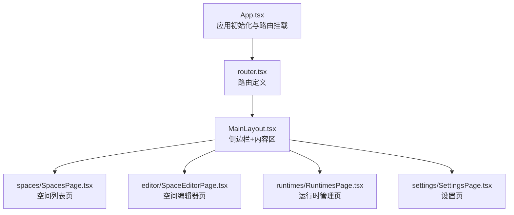
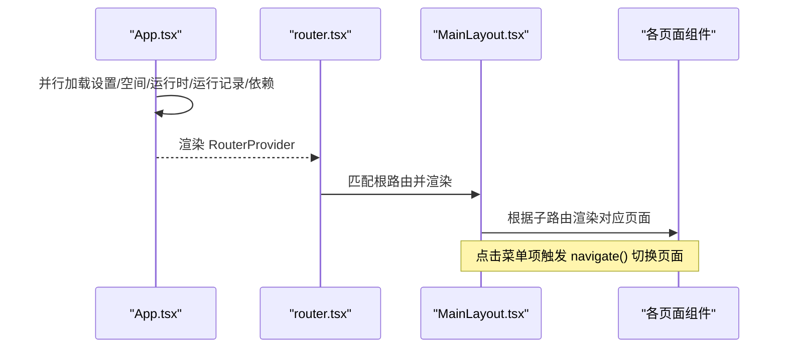
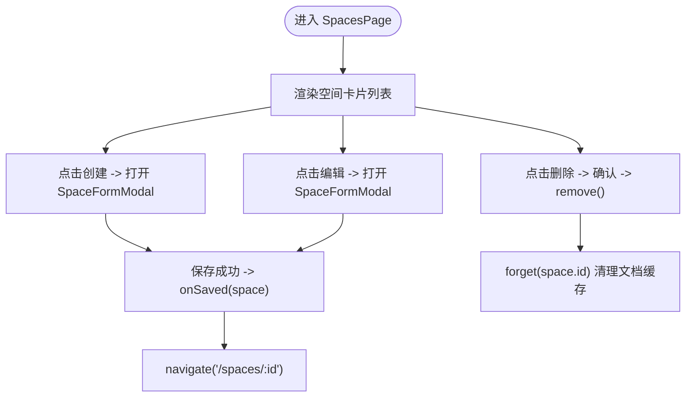
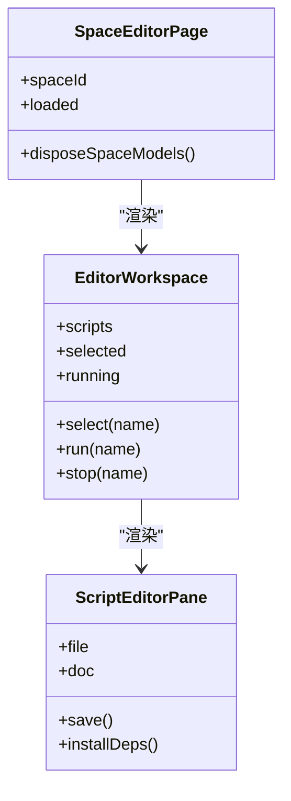
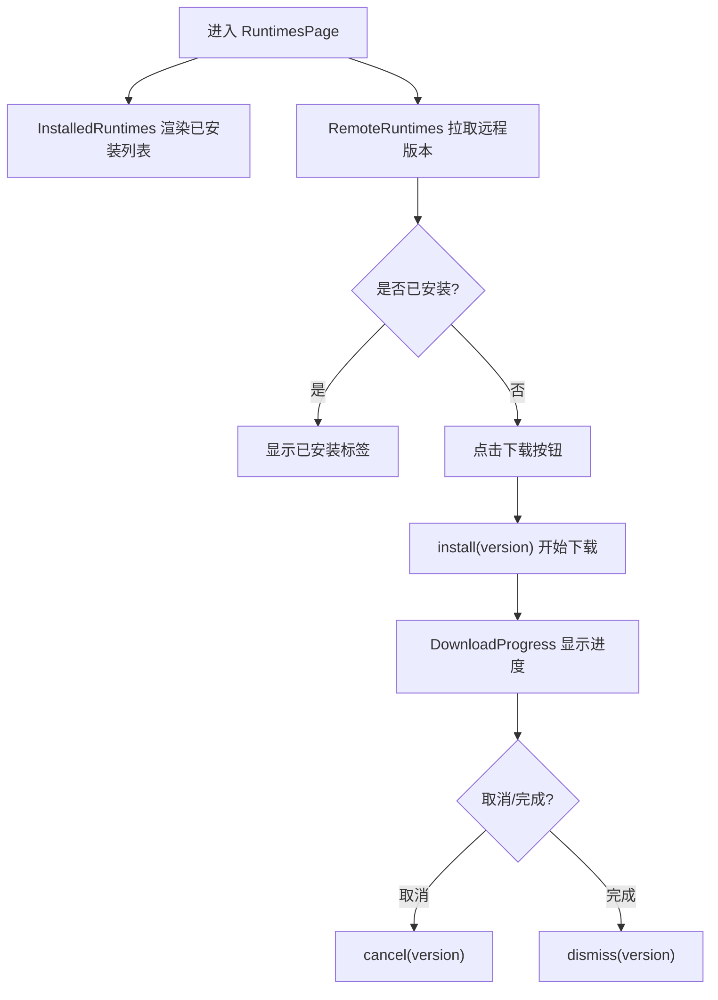
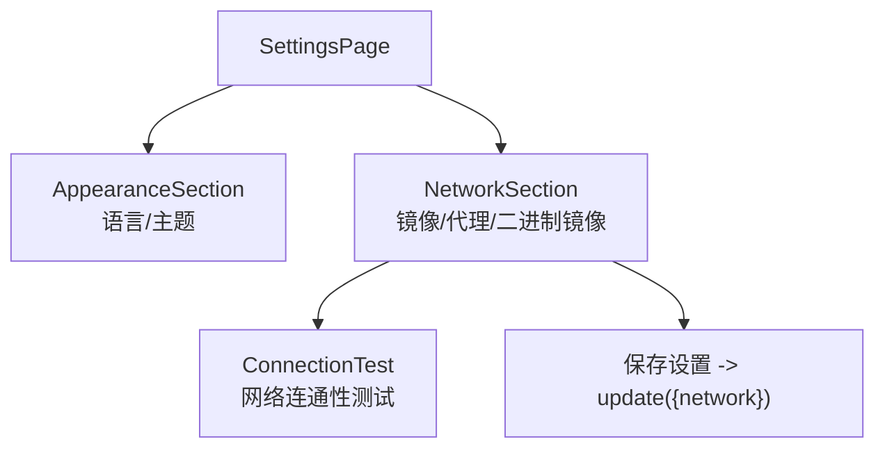
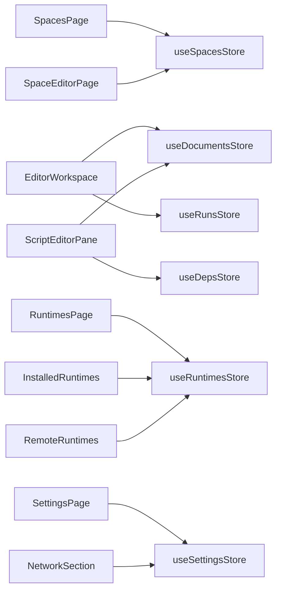

# 页面组件

<cite>
**本文引用的文件**   
- [App.tsx](file://src/renderer/src/app/App.tsx)
- [router.tsx](file://src/renderer/src/app/router.tsx)
- [MainLayout.tsx](file://src/renderer/src/layouts/MainLayout.tsx)
- [SpacesPage.tsx](file://src/renderer/src/pages/spaces/SpacesPage.tsx)
- [SpaceCard.tsx](file://src/renderer/src/pages/spaces/SpaceCard.tsx)
- [SpaceFormModal.tsx](file://src/renderer/src/pages/spaces/SpaceFormModal.tsx)
- [SpaceEditorPage.tsx](file://src/renderer/src/pages/editor/SpaceEditorPage.tsx)
- [EditorWorkspace.tsx](file://src/renderer/src/pages/editor/EditorWorkspace.tsx)
- [ScriptEditorPane.tsx](file://src/renderer/src/pages/editor/ScriptEditorPane.tsx)
- [RuntimesPage.tsx](file://src/renderer/src/pages/runtimes/RuntimesPage.tsx)
- [InstalledRuntimes.tsx](file://src/renderer/src/pages/runtimes/InstalledRuntimes.tsx)
- [RemoteRuntimes.tsx](file://src/renderer/src/pages/runtimes/RemoteRuntimes.tsx)
- [SettingsPage.tsx](file://src/renderer/src/pages/settings/SettingsPage.tsx)
- [AppearanceSection.tsx](file://src/renderer/src/pages/settings/AppearanceSection.tsx)
- [NetworkSection.tsx](file://src/renderer/src/pages/settings/NetworkSection.tsx)
</cite>

## 目录
1. [简介](#简介)
2. [项目结构](#项目结构)
3. [核心组件](#核心组件)
4. [架构总览](#架构总览)
5. [详细组件分析](#详细组件分析)
6. [依赖关系分析](#依赖关系分析)
7. [性能与响应式设计](#性能与响应式设计)
8. [故障排查指南](#故障排查指南)
9. [结论](#结论)

## 简介
本文件面向“页面组件”的完整文档，覆盖空间管理、脚本编辑器、运行时管理与设置四大功能页面。内容包含：
- 各页面的职责与状态管理
- 用户交互流程与页面间导航、数据传递机制
- 页面组件架构图与复用策略
- 响应式设计与移动端适配方案
- 使用模式与代码片段路径（以来源标注代替直接代码）

## 项目结构
应用采用 React + React Router 的前端架构，主入口在 App 中完成全局初始化后挂载路由；布局由 MainLayout 提供侧边导航与内容区；具体业务页面位于 pages 目录下，按功能模块划分。

图表来源
- [App.tsx:13-30](file://src/renderer/src/app/App.tsx#L13-L30)
- [router.tsx:8-21](file://src/renderer/src/app/router.tsx#L8-L21)
- [MainLayout.tsx:13-50](file://src/renderer/src/layouts/MainLayout.tsx#L13-L50)

章节来源
- [App.tsx:13-30](file://src/renderer/src/app/App.tsx#L13-L30)
- [router.tsx:8-21](file://src/renderer/src/app/router.tsx#L8-L21)
- [MainLayout.tsx:13-50](file://src/renderer/src/layouts/MainLayout.tsx#L13-L50)

## 核心组件
- 应用启动与就绪控制：App 并行加载设置、空间、运行时、运行记录与依赖等状态，完成后渲染路由。
- 路由与导航：router 定义根路由与子路由，默认重定向到 /spaces；MainLayout 根据当前路径高亮菜单并承载页面内容。
- 页面级容器：SpacesPage、SpaceEditorPage、RuntimesPage、SettingsPage 作为功能入口，组合各自子组件。

章节来源
- [App.tsx:16-30](file://src/renderer/src/app/App.tsx#L16-L30)
- [router.tsx:8-21](file://src/renderer/src/app/router.tsx#L8-L21)
- [MainLayout.tsx:13-50](file://src/renderer/src/layouts/MainLayout.tsx#L13-L50)

## 架构总览
下图展示从应用启动到页面渲染的整体流程，以及页面间的导航关系。

图表来源
- [App.tsx:16-30](file://src/renderer/src/app/App.tsx#L16-L30)
- [router.tsx:8-21](file://src/renderer/src/app/router.tsx#L8-L21)
- [MainLayout.tsx:37-43](file://src/renderer/src/layouts/MainLayout.tsx#L37-L43)

## 详细组件分析

### 空间管理页面（SpacesPage）
职责
- 展示空间卡片列表，支持创建、编辑、删除、打开目录。
- 通过模态框 SpaceFormModal 完成新增/编辑表单。
- 删除时清理文档缓存，避免脏状态残留。

状态与交互
- 使用 useSpacesStore 获取 spaces 与 remove。
- 使用 Ant Design 的 message/modal 进行错误提示与确认。
- 新建成功后自动跳转到该空间的编辑器。

导航与数据传递
- 点击卡片进入 /spaces/:spaceId。
- 新建/编辑回调 onSaved 返回新空间对象，用于跳转或刷新。

图表来源
- [SpacesPage.tsx:22-37](file://src/renderer/src/pages/spaces/SpacesPage.tsx#L22-L37)
- [SpacesPage.tsx:39-78](file://src/renderer/src/pages/spaces/SpacesPage.tsx#L39-L78)
- [SpaceFormModal.tsx:37-51](file://src/renderer/src/pages/spaces/SpaceFormModal.tsx#L37-L51)

章节来源
- [SpacesPage.tsx:15-80](file://src/renderer/src/pages/spaces/SpacesPage.tsx#L15-L80)
- [SpaceCard.tsx:17-50](file://src/renderer/src/pages/spaces/SpaceCard.tsx#L17-L50)
- [SpaceFormModal.tsx:20-73](file://src/renderer/src/pages/spaces/SpaceFormModal.tsx#L20-L73)

### 脚本编辑器页面（SpaceEditorPage + EditorWorkspace + ScriptEditorPane）
职责
- SpaceEditorPage：校验空间是否存在，负责模型销毁与页面骨架。
- EditorWorkspace：左侧脚本树、右侧编辑器与底部面板（依赖/日志），协调选择、运行、配置等动作。
- ScriptEditorPane：单文件编辑器，集成工具栏、缺失依赖提示、Monaco 编辑器与文档状态。

状态与交互
- 使用 useScripts 拉取脚本列表，useRunsStore 监听运行状态。
- 使用 useDocumentsStore 打开/编辑/保存文档，isDirty 标记脏状态。
- 使用 useMissingDeps 检测缺失依赖并提供一键安装。

导航与数据传递
- 通过 URL query script=文件名 控制选中脚本。
- 首次加载自动选中第一个脚本。
- 运行/停止/配置等操作通过回调传递给上层。

图表来源
- [SpaceEditorPage.tsx:11-39](file://src/renderer/src/pages/editor/SpaceEditorPage.tsx#L11-L39)
- [EditorWorkspace.tsx:19-110](file://src/renderer/src/pages/editor/EditorWorkspace.tsx#L19-L110)
- [ScriptEditorPane.tsx:24-77](file://src/renderer/src/pages/editor/ScriptEditorPane.tsx#L24-L77)

章节来源
- [SpaceEditorPage.tsx:11-39](file://src/renderer/src/pages/editor/SpaceEditorPage.tsx#L11-L39)
- [EditorWorkspace.tsx:19-110](file://src/renderer/src/pages/editor/EditorWorkspace.tsx#L19-L110)
- [ScriptEditorPane.tsx:24-77](file://src/renderer/src/pages/editor/ScriptEditorPane.tsx#L24-L77)

### 运行时管理页面（RuntimesPage）
职责
- InstalledRuntimes：展示已安装的 Node 版本，支持设为默认、打开目录、删除（若被空间引用需提示）。
- RemoteRuntimes：列出远程可用版本，支持过滤 LTS、搜索、下载进度、取消安装。

状态与交互
- 使用 useRuntimesStore 管理 remote/installed/progress 等状态。
- 使用 useSettingsStore 更新默认 Node 版本。
- 使用 invoke('app:open-path', dir) 打开系统目录。

图表来源
- [RuntimesPage.tsx:7-18](file://src/renderer/src/pages/runtimes/RuntimesPage.tsx#L7-L18)
- [InstalledRuntimes.tsx:22-42](file://src/renderer/src/pages/runtimes/InstalledRuntimes.tsx#L22-L42)
- [RemoteRuntimes.tsx:19-30](file://src/renderer/src/pages/runtimes/RemoteRuntimes.tsx#L19-L30)
- [RemoteRuntimes.tsx:45-64](file://src/renderer/src/pages/runtimes/RemoteRuntimes.tsx#L45-L64)

章节来源
- [RuntimesPage.tsx:7-18](file://src/renderer/src/pages/runtimes/RuntimesPage.tsx#L7-L18)
- [InstalledRuntimes.tsx:13-97](file://src/renderer/src/pages/runtimes/InstalledRuntimes.tsx#L13-L97)
- [RemoteRuntimes.tsx:12-103](file://src/renderer/src/pages/runtimes/RemoteRuntimes.tsx#L12-L103)

### 设置页面（SettingsPage）
职责
- AppearanceSection：语言与主题设置。
- NetworkSection：镜像源、代理、二进制镜像环境变量配置与连接测试。
- RunSection/UpdateSection/AboutSection：其他设置与关于信息（由 SettingsPage 组合）。

状态与交互
- 使用 useSettingsUpdate 封装 settings 读取与 update 更新。
- NetworkSection 内置表单校验、预设填充、保存与连接测试。

图表来源
- [SettingsPage.tsx:10-24](file://src/renderer/src/pages/settings/SettingsPage.tsx#L10-L24)
- [AppearanceSection.tsx:7-42](file://src/renderer/src/pages/settings/AppearanceSection.tsx#L7-L42)
- [NetworkSection.tsx:14-93](file://src/renderer/src/pages/settings/NetworkSection.tsx#L14-L93)

章节来源
- [SettingsPage.tsx:10-24](file://src/renderer/src/pages/settings/SettingsPage.tsx#L10-L24)
- [AppearanceSection.tsx:7-42](file://src/renderer/src/pages/settings/AppearanceSection.tsx#L7-L42)
- [NetworkSection.tsx:14-93](file://src/renderer/src/pages/settings/NetworkSection.tsx#L14-L93)

## 依赖关系分析
- 页面与 Store：所有页面通过对应的 store（如 useSpacesStore、useRuntimesStore、useSettingsStore、useDocumentsStore、useRunsStore、useDepsStore）读写状态，保持 UI 与数据解耦。
- 页面与 API：通过 invoke 调用后端 IPC 能力（如打开目录、打开路径等）。
- 页面与组件：页面组合通用组件（如 CodeEditor、NodeVersionSelect、EnvEditor、DownloadProgress 等）提升复用性。

图表来源
- [SpacesPage.tsx:19-30](file://src/renderer/src/pages/spaces/SpacesPage.tsx#L19-L30)
- [EditorWorkspace.tsx:21-31](file://src/renderer/src/pages/editor/EditorWorkspace.tsx#L21-L31)
- [ScriptEditorPane.tsx:27-31](file://src/renderer/src/pages/editor/ScriptEditorPane.tsx#L27-L31)
- [RuntimesPage.tsx:4-5](file://src/renderer/src/pages/runtimes/RuntimesPage.tsx#L4-L5)
- [InstalledRuntimes.tsx:16-20](file://src/renderer/src/pages/runtimes/InstalledRuntimes.tsx#L16-L20)
- [RemoteRuntimes.tsx:15-16](file://src/renderer/src/pages/runtimes/RemoteRuntimes.tsx#L15-L16)
- [SettingsPage.tsx:4-8](file://src/renderer/src/pages/settings/SettingsPage.tsx#L4-L8)
- [NetworkSection.tsx:16-19](file://src/renderer/src/pages/settings/NetworkSection.tsx#L16-L19)

章节来源
- [SpacesPage.tsx:19-30](file://src/renderer/src/pages/spaces/SpacesPage.tsx#L19-L30)
- [EditorWorkspace.tsx:21-31](file://src/renderer/src/pages/editor/EditorWorkspace.tsx#L21-L31)
- [ScriptEditorPane.tsx:27-31](file://src/renderer/src/pages/editor/ScriptEditorPane.tsx#L27-L31)
- [RuntimesPage.tsx:4-5](file://src/renderer/src/pages/runtimes/RuntimesPage.tsx#L4-L5)
- [InstalledRuntimes.tsx:16-20](file://src/renderer/src/pages/runtimes/InstalledRuntimes.tsx#L16-L20)
- [RemoteRuntimes.tsx:15-16](file://src/renderer/src/pages/runtimes/RemoteRuntimes.tsx#L15-L16)
- [SettingsPage.tsx:4-8](file://src/renderer/src/pages/settings/SettingsPage.tsx#L4-L8)
- [NetworkSection.tsx:16-19](file://src/renderer/src/pages/settings/NetworkSection.tsx#L16-L19)

## 性能与响应式设计
- 性能优化
  - 应用启动阶段并行加载关键状态（Promise.allSettled），减少首屏等待时间。
  - 编辑器离开时延迟释放 Monaco 模型，避免频繁重建带来的开销。
  - 脚本列表与运行状态通过 store 订阅，局部更新，避免整页重渲染。
- 响应式与移动端适配
  - 空间卡片使用栅格列 xs/sm/lg/xxl 自适应宽度。
  - 编辑器工作区使用 Splitter 分割面板，支持拖拽调整大小，保证多屏尺寸下的可用性。
  - 侧边栏固定宽度，内容区自适应填充。

章节来源
- [App.tsx:16-23](file://src/renderer/src/app/App.tsx#L16-L23)
- [SpaceEditorPage.tsx:17-19](file://src/renderer/src/pages/editor/SpaceEditorPage.tsx#L17-L19)
- [SpacesPage.tsx:55-67](file://src/renderer/src/pages/spaces/SpacesPage.tsx#L55-L67)
- [EditorWorkspace.tsx:53-93](file://src/renderer/src/pages/editor/EditorWorkspace.tsx#L53-L93)

## 故障排查指南
- 空间不存在或加载中
  - 现象：SpaceEditorPage 显示 404 或 Spin。
  - 处理：检查 useSpacesStore.loaded 与 spaceId 是否正确；确认空间列表已加载。
- 脚本加载失败
  - 现象：ScriptEditorPane 显示错误结果。
  - 处理：查看 useDocumentsStore.open 的错误信息，确认文件路径与权限。
- 依赖缺失
  - 现象：MissingDepsAlert 提示缺失依赖。
  - 处理：点击安装按钮触发 installDeps，观察 useDepsStore.tasks 状态。
- 运行时删除冲突
  - 现象：删除已使用的 Node 版本被阻止。
  - 处理：先修改使用该版本的 Space 默认版本，再删除。

章节来源
- [SpaceEditorPage.tsx:21-31](file://src/renderer/src/pages/editor/SpaceEditorPage.tsx#L21-L31)
- [ScriptEditorPane.tsx:33-48](file://src/renderer/src/pages/editor/ScriptEditorPane.tsx#L33-L48)
- [ScriptEditorPane.tsx:43-45](file://src/renderer/src/pages/editor/ScriptEditorPane.tsx#L43-L45)
- [InstalledRuntimes.tsx:25-42](file://src/renderer/src/pages/runtimes/InstalledRuntimes.tsx#L25-L42)

## 结论
本文档对空间管理、脚本编辑器、运行时管理与设置四个核心页面进行了系统化梳理，涵盖职责、状态管理、交互流程、导航与数据传递、组件架构与复用策略，以及响应式设计与性能要点。建议在后续迭代中继续：
- 将更多通用逻辑下沉为 hooks 与组件，提高复用率
- 完善错误边界与重试机制，提升用户体验
- 持续优化大文件编辑与依赖安装的性能表现