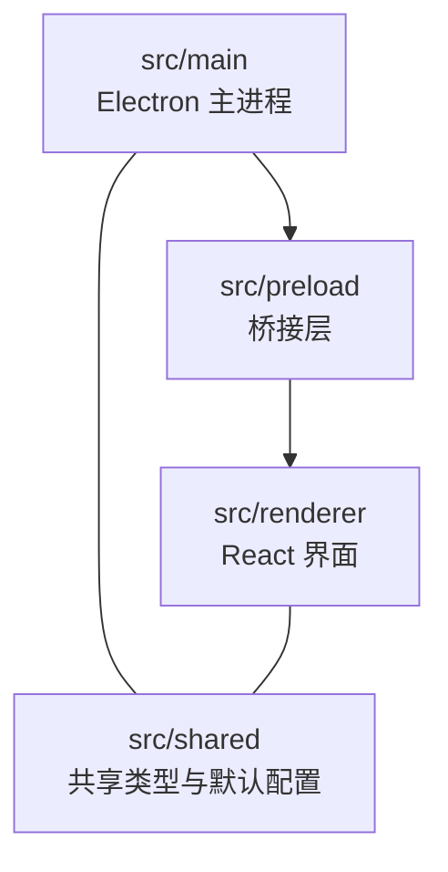
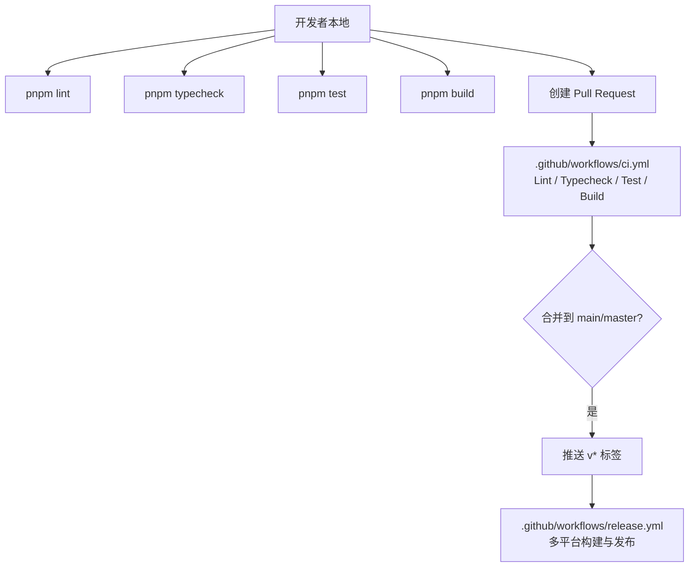
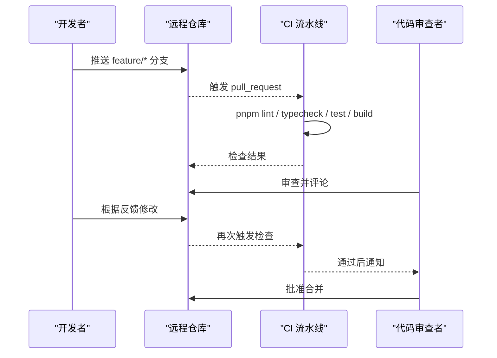
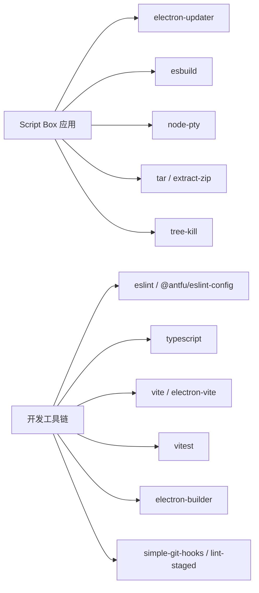

# 开发者指南

<cite>
**本文引用的文件**   
- [README.md](file://README.md)
- [package.json](file://package.json)
- [eslint.config.mjs](file://eslint.config.mjs)
- [tsconfig.json](file://tsconfig.json)
- [tsconfig.node.json](file://tsconfig.node.json)
- [tsconfig.web.json](file://tsconfig.web.json)
- [.editorconfig](file://.editorconfig)
- [.github/PULL_REQUEST_TEMPLATE.md](file://.github/PULL_REQUEST_TEMPLATE.md)
- [.github/workflows/ci.yml](file://.github/workflows/ci.yml)
- [.github/workflows/release.yml](file://.github/workflows/release.yml)
- [.github/ISSUE_TEMPLATE/bug_report.yml](file://.github/ISSUE_TEMPLATE/bug_report.yml)
- [.github/ISSUE_TEMPLATE/feature_request.yml](file://.github/ISSUE_TEMPLATE/feature_request.yml)
</cite>

## 目录
1. [简介](#简介)
2. [项目结构](#项目结构)
3. [核心组件](#核心组件)
4. [架构总览](#架构总览)
5. [详细组件分析](#详细组件分析)
6. [依赖关系分析](#依赖关系分析)
7. [性能与可维护性](#性能与可维护性)
8. [故障排查指南](#故障排查指南)
9. [结论](#结论)
10. [附录：贡献清单与命令速查](#附录贡献清单与命令速查)

## 简介
本指南面向希望参与 Script Box 开发的贡献者，覆盖代码规范、Git 工作流、分支策略、提交规范、新功能开发、Bug 修复、代码审查流程、开发环境搭建、调试技巧、性能分析与常见问题排查。目标是帮助你在保证质量的前提下高效协作与交付。

Script Box 是一个开箱即用的脚本运行器，支持多 Node.js 版本、运行空间隔离、依赖管理、交互式终端、内置编辑器、网络代理配置、自动更新等能力。

**章节来源**
- [README.md:1-30](file://README.md#L1-L30)

## 项目结构
仓库采用 Electron + Vite + React 的混合工程结构，主进程与渲染进程通过 IPC 通信，共享类型定义位于 shared 目录。

**图表来源**
- [README.md:78-86](file://README.md#L78-L86)

关键目录说明
- src/main：Electron 主进程逻辑，包含 IPC 处理与各领域服务（settings、network、runtime、space、script、deps、runner、updater）。
- src/preload：通过 contextBridge 暴露带类型的 window.api。
- src/renderer：基于 React 19 + Ant Design 的前端界面。
- src/shared：主进程与渲染进程共用的类型、IPC 通道和默认配置。

**章节来源**
- [README.md:78-86](file://README.md#L78-L86)

## 核心组件
本节聚焦开发体验与质量保障的核心工具链与配置。

- 包管理与脚本
  - 使用 pnpm 作为包管理器，Node.js 版本要求 >= 22。
  - 常用脚本：dev、build、preview、typecheck、lint、test、构建各平台安装包。
- ESLint 规则
  - 基于 @antfu/eslint-config，启用 React 与 TypeScript 规则。
  - 针对主进程与 preload 关闭部分 Node 全局变量检查。
- Prettier 格式化
  - 由 ESLint 统一负责格式化；EditorConfig 提供基础缩进、换行、尾随空格等约定。
- TypeScript 配置
  - 根 tsconfig.json 引用 node 与 web 两个子配置，分别对应主进程与前端。
  - 启用 noImplicitAny，严格模式；路径别名 @shared/*、@renderer/*。

**章节来源**
- [package.json:12-30](file://package.json#L12-L30)
- [package.json:40-70](file://package.json#L40-L70)
- [eslint.config.mjs:1-14](file://eslint.config.mjs#L1-L14)
- [.editorconfig:1-13](file://.editorconfig#L1-L13)
- [tsconfig.json:1-8](file://tsconfig.json#L1-L8)
- [tsconfig.node.json:1-20](file://tsconfig.node.json#L1-L20)
- [tsconfig.web.json:1-21](file://tsconfig.web.json#L1-L21)

## 架构总览
下图展示 CI/CD 流水线与本地开发命令的关系，以及 PR 模板的检查项如何贯穿提交流程。

**图表来源**
- [.github/workflows/ci.yml:1-26](file://.github/workflows/ci.yml#L1-L26)
- [.github/workflows/release.yml:1-69](file://.github/workflows/release.yml#L1-L69)
- [package.json:15-29](file://package.json#L15-L29)

## 详细组件分析

### 代码规范与格式化
- ESLint
  - 使用 @antfu/eslint-config，开启 React 与 TypeScript 规则。
  - 忽略 out、dist、resources/types、build/*.plist 等生成目录。
  - 对 src/main 与 src/preload 关闭 process/buffer 全局检查，适配 Electron 环境。
- Prettier
  - 由 ESLint 统一格式化，无需单独配置。
- EditorConfig
  - 统一字符集、缩进、换行符、尾部空格等基础风格。

建议
- 提交前务必执行 pnpm lint 与 pnpm typecheck。
- 在 IDE 中启用 ESLint 插件以获得实时提示。

**章节来源**
- [eslint.config.mjs:1-14](file://eslint.config.mjs#L1-L14)
- [.editorconfig:1-13](file://.editorconfig#L1-L13)
- [package.json:22-23](file://package.json#L22-L23)

### TypeScript 配置与类型安全
- 根 tsconfig.json 聚合 node 与 web 两个子配置。
- tsconfig.node.json
  - 继承 electron-toolkit 的 node 配置。
  - 启用 composite、noImplicitAny，设置 baseUrl 与路径别名 @shared/*。
  - include 包含 main、preload、shared 与配置文件。
- tsconfig.web.json
  - 继承 electron-toolkit 的 web 配置。
  - 启用 jsx react-jsx、composite、noImplicitAny，设置 baseUrl 与路径别名 @renderer/*、@shared/*。
  - include 包含 renderer、preload 声明与 shared。

建议
- 新增模块时同步更新 include 或路径别名。
- 避免 any，尽量使用精确类型；必要时为第三方库补充类型声明。

**章节来源**
- [tsconfig.json:1-8](file://tsconfig.json#L1-L8)
- [tsconfig.node.json:1-20](file://tsconfig.node.json#L1-L20)
- [tsconfig.web.json:1-21](file://tsconfig.web.json#L1-L21)

### Git 工作流与分支策略
- 分支模型
  - 主干分支：main 或 master。
  - 功能分支：从主干拉取 feature/* 分支进行开发。
  - 修复分支：从主干拉取 fix/* 分支修复问题。
- 提交规范
  - 建议使用 Conventional Commits（如 feat、fix、docs、style、refactor、perf、test、chore），便于自动生成变更日志。
- 预提交钩子
  - 使用 simple-git-hooks 与 lint-staged，在 pre-commit 阶段执行 eslint --fix，确保提交质量。

**章节来源**
- [package.json:84-89](file://package.json#L84-L89)
- [.github/workflows/ci.yml:3-7](file://.github/workflows/ci.yml#L3-L7)

### 提交与代码审查
- Pull Request 模板
  - 要求填写变更说明、关联 Issue、测试平台、国际化文案是否同步等。
  - 必须通过 lint、typecheck、test。
- 审查要点
  - 类型是否完整、错误处理是否完善、边界条件是否考虑、性能影响是否评估、UI 文案是否中英双语同步。

**图表来源**
- [.github/workflows/ci.yml:11-25](file://.github/workflows/ci.yml#L11-L25)
- [.github/PULL_REQUEST_TEMPLATE.md:9-15](file://.github/PULL_REQUEST_TEMPLATE.md#L9-L15)

**章节来源**
- [.github/PULL_REQUEST_TEMPLATE.md:1-16](file://.github/PULL_REQUEST_TEMPLATE.md#L1-L16)

### 添加新功能
步骤建议
1. 从主干拉取新分支 feature/<描述>。
2. 实现功能，遵循现有目录结构与命名约定。
3. 编写或更新单元测试（vitest）。
4. 更新相关文档与国际化文案（zh-CN 与 en-US）。
5. 本地执行 pnpm lint、pnpm typecheck、pnpm test、pnpm build。
6. 提交并推送，创建 PR，等待 CI 与审查。

注意事项
- 若涉及 UI 文案，请同时更新 zh-CN 与 en-US 语言包。
- 若引入新的运行时依赖，请在 package.json 中声明，并确保仅构建依赖被正确安装。

**章节来源**
- [README.md:63-74](file://README.md#L63-L74)
- [.github/PULL_REQUEST_TEMPLATE.md:9-15](file://.github/PULL_REQUEST_TEMPLATE.md#L9-L15)

### 修复 Bug
步骤建议
1. 在 Issues 中搜索是否已有相同问题。
2. 使用 bug_report 模板复现步骤与环境信息。
3. 在本地定位问题，优先最小化复现用例。
4. 修复后补充测试用例，验证多平台行为。
5. 提交 fix/* 分支并创建 PR。

**章节来源**
- [.github/ISSUE_TEMPLATE/bug_report.yml:1-56](file://.github/ISSUE_TEMPLATE/bug_report.yml#L1-L56)

### 代码审查清单
- 类型与接口
  - 新增类型是否完备？是否存在 any？
- 错误处理
  - 异常是否捕获并给出友好提示？
- 性能
  - 是否存在不必要的重渲染或阻塞操作？
- 可维护性
  - 函数/组件职责是否单一？命名是否清晰？
- 国际化
  - 文案是否中英双语同步？
- 测试
  - 是否覆盖关键路径与边界条件？

**章节来源**
- [.github/PULL_REQUEST_TEMPLATE.md:9-15](file://.github/PULL_REQUEST_TEMPLATE.md#L9-L15)

## 依赖关系分析
- 运行时依赖
  - electron-updater：应用自动更新。
  - esbuild：TS 转译。
  - node-pty：交互式终端。
  - tar、extract-zip：二进制解压。
  - tree-kill：进程终止。
- 开发依赖
  - @antfu/eslint-config、eslint：代码规范与格式化。
  - typescript、vite、electron-vite：构建与类型检查。
  - vitest：单元测试。
  - electron-builder：打包与发布。
  - simple-git-hooks、lint-staged：预提交钩子。

**图表来源**
- [package.json:31-89](file://package.json#L31-L89)

**章节来源**
- [package.json:31-89](file://package.json#L31-L89)

## 性能与可维护性
- 性能优化建议
  - 减少不必要的状态更新与重渲染，合理使用 React.memo、useMemo、useCallback。
  - 大文件编辑场景下，避免在主线程执行重型计算，必要时拆分任务或使用 Web Worker。
  - 合理控制日志输出频率，避免 I/O 瓶颈。
- 可维护性建议
  - 保持组件/函数粒度小且职责单一。
  - 使用明确的类型定义，避免 any。
  - 对公共 API 增加注释与示例。
  - 持续集成中保持 lint/typecheck/test/build 全绿。

[本节为通用指导，不直接分析具体文件]

## 故障排查指南
常见问题与解决思路
- 安装 Electron 较慢
  - 设置 ELECTRON_MIRROR 环境变量后再执行安装。
- 首次运行提示“已损坏”或“无法验证开发者”（macOS）
  - 在终端执行 xattr -cr "/Applications/Script Box.app" 以移除隔离属性。
- 自动更新不可用（未签名）
  - macOS 未签名时自动更新不保证可用；如需稳定更新，请配置代码签名密钥。
- 依赖缺失或类型报错
  - 执行 pnpm install 重新安装依赖；确认 tsconfig.include 与路径别名是否正确。
- 本地构建失败
  - 清理缓存后重试：删除 out/dist 目录，再执行 pnpm build。

**章节来源**
- [README.md:41-42](file://README.md#L41-L42)
- [README.md:63-74](file://README.md#L63-L74)

## 结论
通过统一的代码规范、严格的类型检查、自动化 CI 与清晰的 PR 模板，Script Box 保证了代码质量与可维护性。贡献者应遵循本文的工作流与建议，在高质量交付的同时提升团队协作效率。

[本节为总结性内容，不直接分析具体文件]

## 附录：贡献清单与命令速查
- 环境准备
  - Node.js >= 22，pnpm 10。
- 常用命令
  - pnpm install：安装依赖（会自动为 Electron 编译 node-pty）。
  - pnpm dev：启动开发模式。
  - pnpm lint：ESLint 检查与格式化。
  - pnpm typecheck：TypeScript 类型检查。
  - pnpm test：运行单元测试。
  - pnpm build：构建产物。
  - pnpm build:linux / build:win / build:mac：打包各平台安装包。
- 发布流程
  - 推送 v* 格式的 tag，GitHub Actions 会在 Windows、macOS、Linux 三平台构建并发布草稿 Release。
  - 可选配置代码签名密钥以提升安全性与自动更新稳定性。

**章节来源**
- [README.md:63-96](file://README.md#L63-L96)
- [package.json:15-29](file://package.json#L15-L29)
- [.github/workflows/release.yml:1-69](file://.github/workflows/release.yml#L1-L69)