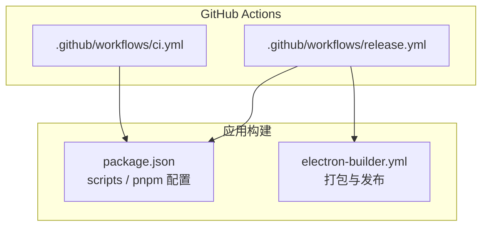
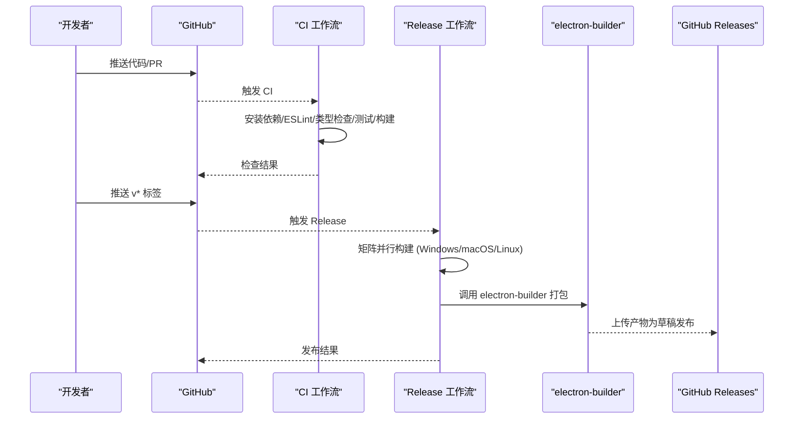
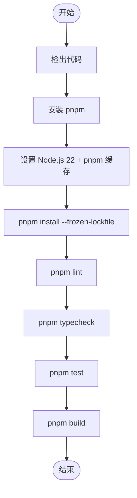
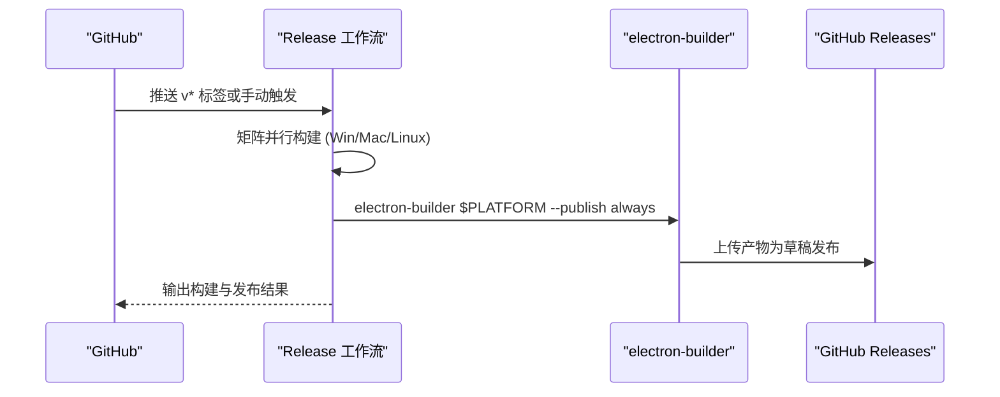
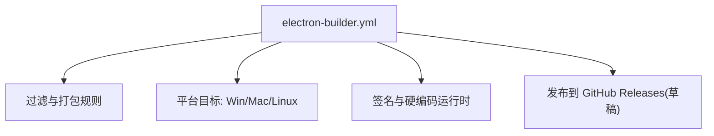
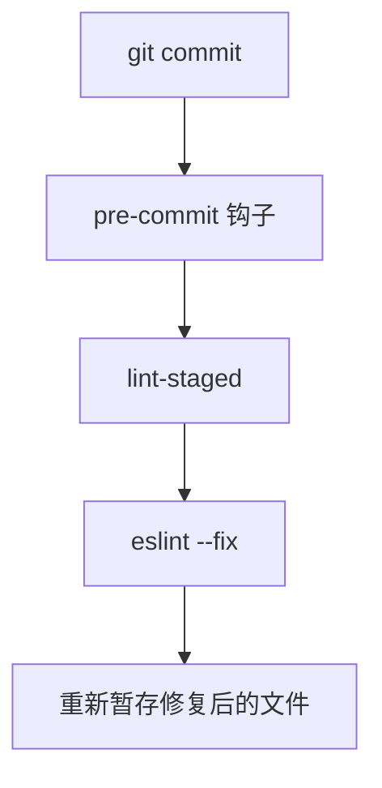
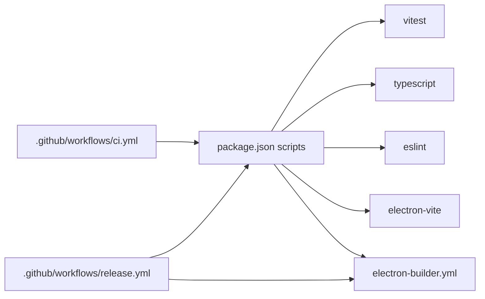

# CI/CD 流水线

<cite>
**本文引用的文件**   
- [ci.yml](file://.github/workflows/ci.yml)
- [release.yml](file://.github/workflows/release.yml)
- [electron-builder.yml](file://electron-builder.yml)
- [package.json](file://package.json)
</cite>

## 目录
1. [简介](#简介)
2. [项目结构](#项目结构)
3. [核心组件](#核心组件)
4. [架构总览](#架构总览)
5. [详细组件分析](#详细组件分析)
6. [依赖关系分析](#依赖关系分析)
7. [性能与缓存优化](#性能与缓存优化)
8. [故障排除指南](#故障排除指南)
9. [结论](#结论)
10. [附录：扩展与最佳实践](#附录扩展与最佳实践)

## 简介
本仓库采用 GitHub Actions 构建完整的 CI/CD 流水线，覆盖代码提交时的自动检查、多平台并行构建与测试、以及自动化发布。CI 在 push 到 main/master 分支或创建 PR 时运行；Release 在推送 v* 标签或手动触发时执行，按矩阵并行构建 Windows、macOS、Linux 三端产物并上传至 GitHub Releases（草稿）。

## 项目结构
与 CI/CD 直接相关的配置集中在以下位置：
- .github/workflows/ci.yml：持续集成工作流
- .github/workflows/release.yml：发布工作流
- electron-builder.yml：Electron 打包与发布配置
- package.json：脚本命令、pnpm 行为与 Git Hooks 配置

**图表来源**
- [ci.yml:1-26](file://.github/workflows/ci.yml#L1-L26)
- [release.yml:1-69](file://.github/workflows/release.yml#L1-L69)
- [electron-builder.yml:1-74](file://electron-builder.yml#L1-L74)
- [package.json:15-30](file://package.json#L15-L30)

**章节来源**
- [ci.yml:1-26](file://.github/workflows/ci.yml#L1-L26)
- [release.yml:1-69](file://.github/workflows/release.yml#L1-L69)
- [electron-builder.yml:1-74](file://electron-builder.yml#L1-L74)
- [package.json:15-30](file://package.json#L15-L30)

## 核心组件
- CI 工作流：负责拉取代码、安装依赖、静态检查、类型检查、单元测试与构建。
- Release 工作流：基于标签触发，按矩阵并行构建三端安装包，并通过 electron-builder 发布为 GitHub Releases 草稿。
- Electron Builder 配置：定义产物格式、目标平台、签名与自动更新所需信息，以及将源码中资源与声明文件打包进应用。
- 脚本与工具链：通过 pnpm 管理依赖，使用 ESLint、TypeScript、Vitest 与 electron-vite/electron-builder 完成检查与构建。

**章节来源**
- [ci.yml:1-26](file://.github/workflows/ci.yml#L1-L26)
- [release.yml:1-69](file://.github/workflows/release.yml#L1-L69)
- [electron-builder.yml:1-74](file://electron-builder.yml#L1-L74)
- [package.json:15-30](file://package.json#L15-L30)

## 架构总览
下图展示从代码提交到产物发布的端到端流程，包括 CI 检查与 Release 并行构建。

**图表来源**
- [ci.yml:1-26](file://.github/workflows/ci.yml#L1-L26)
- [release.yml:1-69](file://.github/workflows/release.yml#L1-L69)
- [electron-builder.yml:71-74](file://electron-builder.yml#L71-L74)

## 详细组件分析

### CI 工作流（持续集成）
- 触发条件：push 到 main/master 分支，或任意 pull_request。
- 权限：仅读取仓库内容。
- 步骤：
  - 检出代码
  - 安装 pnpm
  - 设置 Node.js 22 并启用 pnpm 缓存
  - 冻结依赖安装
  - 执行 lint、typecheck、test、build

**图表来源**
- [ci.yml:1-26](file://.github/workflows/ci.yml#L1-L26)
- [package.json:15-30](file://package.json#L15-L30)

**章节来源**
- [ci.yml:1-26](file://.github/workflows/ci.yml#L1-L26)
- [package.json:15-30](file://package.json#L15-L30)

### Release 工作流（自动化发布）
- 触发条件：推送 v* 标签，或 workflow_dispatch 手动触发。
- 权限：写入仓库内容（用于创建/更新发布）。
- 并行策略：fail-fast=false，矩阵包含 windows-latest、macos-latest、ubuntu-latest，分别对应 --win、--mac、--linux。
- 步骤：
  - 检出代码、安装 pnpm、设置 Node.js 22 并启用 pnpm 缓存
  - 安装依赖、lint、typecheck、test、build
  - 调用 electron-builder 指定平台并 --publish always
  - 注入 secrets：GH_TOKEN、Apple/Windows 签名相关密钥等

**图表来源**
- [release.yml:1-69](file://.github/workflows/release.yml#L1-L69)
- [electron-builder.yml:71-74](file://electron-builder.yml#L71-L74)

**章节来源**
- [release.yml:1-69](file://.github/workflows/release.yml#L1-L69)
- [electron-builder.yml:71-74](file://electron-builder.yml#L71-L74)

### Electron Builder 打包与发布配置
- 应用标识与输出目录：appId、productName、output=dist。
- 文件过滤：排除开发配置、源码、锁文件等，asarUnpack 原生模块与资源。
- 额外资源：将 @types/node、undici-types 的 d.ts 打入应用以支持离线提示。
- 平台目标：
  - Windows：NSIS 安装包（x64）
  - macOS：DMG 与 ZIP（x64/arm64），开启 hardenedRuntime 与 entitlements
  - Linux：AppImage 与 deb（x64）
- 发布：provider=github，releaseType=draft（草稿发布）。

**图表来源**
- [electron-builder.yml:1-74](file://electron-builder.yml#L1-L74)

**章节来源**
- [electron-builder.yml:1-74](file://electron-builder.yml#L1-L74)

### 本地 Git Hooks 与提交前检查
- simple-git-hooks 配置 pre-commit 钩子，执行 lint-staged。
- lint-staged 对暂存文件统一执行 eslint --fix。
- 配合 CI 的 lint/typecheck/test/build，保证提交质量与一致性。

**图表来源**
- [package.json:84-89](file://package.json#L84-L89)

**章节来源**
- [package.json:84-89](file://package.json#L84-L89)

## 依赖关系分析
- CI/Release 均依赖 Node.js 22 与 pnpm。
- 构建阶段依赖 electron-vite 与 electron-builder。
- 测试依赖 vitest。
- 代码质量依赖 eslint 与 typescript。
- 发布依赖 GH_TOKEN 与可选的 Apple/Windows 签名凭据。

**图表来源**
- [ci.yml:1-26](file://.github/workflows/ci.yml#L1-L26)
- [release.yml:1-69](file://.github/workflows/release.yml#L1-L69)
- [package.json:15-30](file://package.json#L15-L30)
- [electron-builder.yml:1-74](file://electron-builder.yml#L1-L74)

**章节来源**
- [ci.yml:1-26](file://.github/workflows/ci.yml#L1-L26)
- [release.yml:1-69](file://.github/workflows/release.yml#L1-L69)
- [package.json:15-30](file://package.json#L15-L30)
- [electron-builder.yml:1-74](file://electron-builder.yml#L1-L74)

## 性能与缓存优化
- pnpm 缓存：在 setup-node 中启用 cache: pnpm，加速依赖安装。
- 冻结依赖：install 使用 --frozen-lockfile，确保可重复构建。
- 并行矩阵：Release 使用 fail-fast=false 的矩阵并行构建，缩短整体耗时。
- 建议：
  - 若后续引入更多任务（如构建产物校验、签名验证），可拆分为独立 job 并利用 actions/cache 缓存 node_modules 与构建缓存目录。
  - 针对大型依赖（如 electron）可使用更细粒度的缓存键，避免全量重建。

**章节来源**
- [ci.yml:16-21](file://.github/workflows/ci.yml#L16-L21)
- [release.yml:31-41](file://.github/workflows/release.yml#L31-L41)
- [release.yml:16-25](file://.github/workflows/release.yml#L16-L25)

## 故障排除指南
- 依赖安装失败
  - 现象：pnpm install 报错或锁定文件不一致。
  - 排查：确认 Node.js 版本为 22；检查 pnpm-lock.yaml 是否被意外修改；必要时删除 lock 文件后重新生成。
  - 参考：[ci.yml:16-21](file://.github/workflows/ci.yml#L16-L21)、[release.yml:31-41](file://.github/workflows/release.yml#L31-L41)

- 静态检查或类型检查失败
  - 现象：ESLint 或 TypeScript 报错。
  - 排查：本地先执行 pnpm lint:fix 与 pnpm typecheck；确认编辑器插件与 CI 一致。
  - 参考：[package.json:19-23](file://package.json#L19-L23)、[ci.yml:22-23](file://.github/workflows/ci.yml#L22-L23)

- 单元测试失败
  - 现象：vitest 报告用例失败。
  - 排查：定位失败用例，复现问题；检查环境差异（Node 版本、平台特性）。
  - 参考：[package.json:24](file://package.json#L24)、[ci.yml:24](file://.github/workflows/ci.yml#L24)

- 构建失败
  - 现象：electron-vite 构建报错。
  - 排查：清理 dist 与缓存后重试；检查配置文件与依赖版本兼容性。
  - 参考：[package.json:17](file://package.json#L17)、[ci.yml:25](file://.github/workflows/ci.yml#L25)

- 发布失败（签名或权限）
  - 现象：electron-builder 无法上传或签名失败。
  - 排查：
    - 确认已推送 v* 标签且拥有仓库写权限。
    - 检查 secrets 是否配置：GH_TOKEN、CSC_LINK/CSC_KEY_PASSWORD、APPLE_ID/APPLE_APP_SPECIFIC_PASSWORD/APPLE_TEAM_ID、WIN_CSC_LINK/WIN_CSC_KEY_PASSWORD。
    - macOS 需开启 hardenedRuntime 与 entitlements，并确保证书有效。
  - 参考：[release.yml:55-68](file://.github/workflows/release.yml#L55-L68)、[electron-builder.yml:44-53](file://electron-builder.yml#L44-L53)、[electron-builder.yml:71-74](file://electron-builder.yml#L71-L74)

- 产物未出现在 GitHub Releases
  - 现象：构建成功但无发布条目。
  - 排查：确认 publish.provider=github 且 releaseType=draft；检查 GH_TOKEN 权限；查看构建日志中的上传步骤。
  - 参考：[electron-builder.yml:71-74](file://electron-builder.yml#L71-L74)、[release.yml:55-58](file://.github/workflows/release.yml#L55-L58)

**章节来源**
- [ci.yml:16-25](file://.github/workflows/ci.yml#L16-L25)
- [release.yml:55-68](file://.github/workflows/release.yml#L55-L68)
- [electron-builder.yml:44-53](file://electron-builder.yml#L44-L53)
- [electron-builder.yml:71-74](file://electron-builder.yml#L71-L74)
- [package.json:17-24](file://package.json#L17-L24)

## 结论
本项目通过简洁而健壮的 GitHub Actions 工作流实现了从代码检查到多平台构建与发布的完整闭环。CI 保障代码质量与稳定性，Release 借助矩阵并行与 electron-builder 实现跨平台分发。结合 pnpm 缓存与冻结依赖，构建过程具备高可重复性与良好性能。

## 附录：扩展与最佳实践
- 自定义工作流扩展
  - 新增任务：可在 ci.yml 中添加新的 job，复用已有的 checkout/setup-node/pnpm 步骤。
  - 缓存策略：使用 actions/cache 缓存 node_modules、构建产物或 esbuild 缓存目录，提升速度。
  - 并发控制：利用 strategy.matrix 与 concurrency 控制并行度与队列。
- 失败重试机制
  - 当前未显式配置重试；如需重试，可在关键步骤添加 continue-on-error 并结合条件判断进行二次尝试，或在作业级别使用第三方重试 action。
- 安全与权限最小化
  - 保持 permissions 最小可用；仅在 Release 授予 contents: write。
  - 敏感凭据统一放入 GitHub Secrets，避免泄露。
- 发布说明与版本标签
  - 建议在推送 v* 标签前维护 CHANGELOG.md，并在 Release 步骤中自动生成或附加发布说明。
  - 可将 draft 发布改为自动发布，或增加人工审核环节。