# Script Hub 分发系统

<cite>
**本文引用的文件**   
- [README.md](file://README.md)
- [package.json](file://package.json)
- [script-hub/package.json](file://script-hub/package.json)
- [script-hub/site.json](file://script-hub/site.json)
- [script-hub/tools/build.mjs](file://script-hub/tools/build.mjs)
- [script-hub/tools/catalog.mjs](file://script-hub/tools/catalog.mjs)
- [script-hub/shared/cli.ts](file://script-hub/shared/cli.ts)
- [script-hub/scripts/file-hash/index.ts](file://script-hub/scripts/file-hash/index.ts)
- [script-hub/scripts/file-hash/script.json](file://script-hub/scripts/file-hash/script.json)
- [script-hub/scripts/http-probe/index.ts](file://script-hub/scripts/http-probe/index.ts)
- [script-hub/scripts/http-probe/script.json](file://script-hub/scripts/http-probe/script.json)
- [script-hub/scripts/json-format/index.ts](file://script-hub/scripts/json-format/index.ts)
- [.github/workflows/script-hub.yml](file://.github/workflows/script-hub.yml)
- [.github/workflows/release.yml](file://.github/workflows/release.yml)
</cite>

## 目录
1. [简介](#简介)
2. [项目结构](#项目结构)
3. [核心组件](#核心组件)
4. [架构总览](#架构总览)
5. [详细组件分析](#详细组件分析)
6. [依赖关系分析](#依赖关系分析)
7. [性能与产物特征](#性能与产物特征)
8. [故障排查指南](#故障排查指南)
9. [结论](#结论)
10. [附录：工作流与发布](#附录工作流与发布)

## 简介
Script Hub 是 Script Box 的独立脚本分发中心，提供常用 Node.js 脚本的静态下载页面、单文件脚本包和校验清单。它不依赖后端，也不在浏览器中执行这些 Node.js 脚本；所有脚本最终被打包为可在 Node.js 22+ 环境中直接运行的 CommonJS 单文件。

该子项目与主 Electron 应用完全解耦：拥有独立的依赖、构建、测试与部署流程，产物可直接上传到任意静态站点服务或 GitHub Pages。

**章节来源**
- [README.md:80-147](file://README.md#L80-L147)

## 项目结构
Script Hub 采用“脚本即模块”的组织方式：每个脚本是一个独立目录，包含入口 TypeScript 文件和描述元数据 `script.json`。构建工具会扫描脚本目录，生成可下载的 `.js` 文件、网站 HTML、脚本目录清单 `catalog.json` 以及 `SHA256SUMS.txt`。

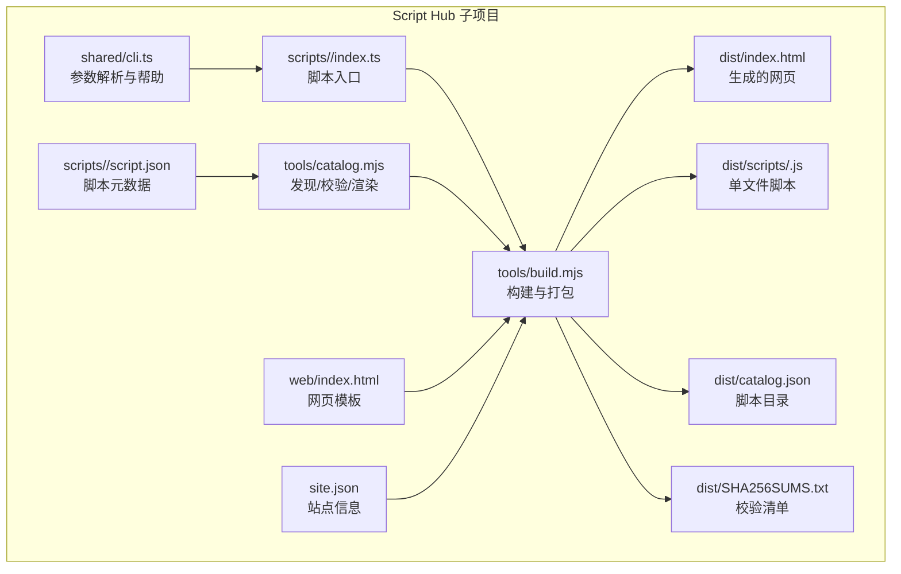

**图表来源**
- [script-hub/tools/build.mjs:10-62](file://script-hub/tools/build.mjs#L10-L62)
- [script-hub/tools/catalog.mjs:44-109](file://script-hub/tools/catalog.mjs#L44-L109)
- [script-hub/shared/cli.ts:1-78](file://script-hub/shared/cli.ts#L1-L78)

**章节来源**
- [README.md:100-115](file://README.md#L100-L115)
- [script-hub/package.json:12-17](file://script-hub/package.json#L12-L17)

## 核心组件
- 脚本发现与元数据校验：负责遍历 `scripts` 目录、读取并校验每个脚本的 `script.json`，确保 id、选项、示例等符合约束。
- 网页渲染器：根据 `site.json`、模板和脚本目录生成静态 HTML，注入下载链接、参数表、示例和 SHA-256 值。
- 构建编排器：使用 esbuild 将每个脚本打包为单个 CommonJS 文件，计算字节大小与哈希，输出 `dist` 目录下的完整站点产物。
- 运行时 CLI 共享库：为脚本提供统一的参数解析、`--help` 输出、位置参数校验和整数范围校验。

**章节来源**
- [script-hub/tools/catalog.mjs:13-56](file://script-hub/tools/catalog.mjs#L13-L56)
- [script-hub/tools/catalog.mjs:72-109](file://script-hub/tools/catalog.mjs#L72-L109)
- [script-hub/tools/build.mjs:16-61](file://script-hub/tools/build.mjs#L16-L61)
- [script-hub/shared/cli.ts:27-77](file://script-hub/shared/cli.ts#L27-L77)

## 架构总览
Script Hub 的构建与分发流程可以概括为：扫描脚本 → 校验元数据 → 打包脚本 → 生成网页 → 输出目录清单与校验清单。

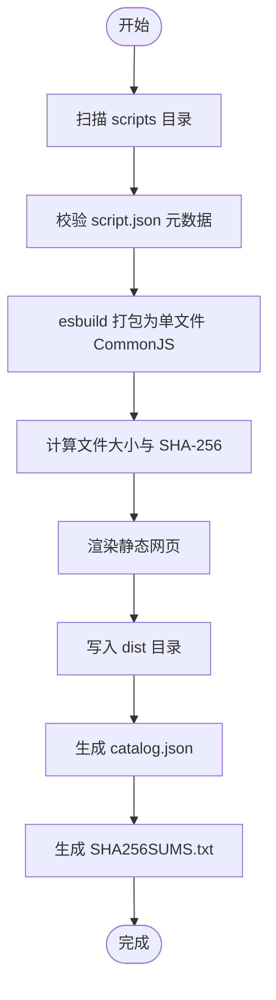

**图表来源**
- [script-hub/tools/catalog.mjs:44-56](file://script-hub/tools/catalog.mjs#L44-L56)
- [script-hub/tools/build.mjs:16-61](file://script-hub/tools/build.mjs#L16-L61)

## 详细组件分析

### 脚本发现与元数据校验
脚本目录名必须与 `script.json.id` 一致，且仅允许小写字母、数字和连字符。每个脚本必须包含标题、描述、分类、用法、至少一个示例，以及由字符串或布尔类型组成的选项数组。选项名称不能是保留字，缩写必须唯一且不是 `h`。网页渲染时还会自动追加 `--help` / `-h` 帮助选项。

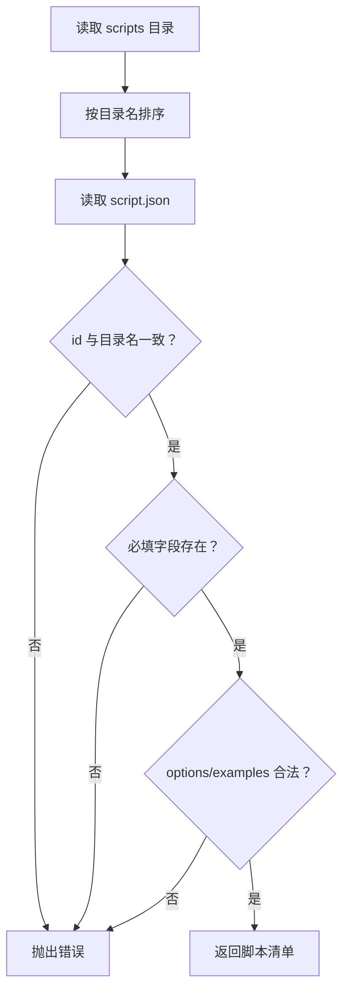

**图表来源**
- [script-hub/tools/catalog.mjs:13-56](file://script-hub/tools/catalog.mjs#L13-L56)

**章节来源**
- [script-hub/tools/catalog.mjs:13-56](file://script-hub/tools/catalog.mjs#L13-L56)

### 网页渲染与站点信息
网页模板中的占位符会被替换为站点标题、描述、项目介绍、链接、脚本数量、卡片列表等。站点链接只允许 HTTP 或 HTTPS 地址，并对用户可见文本进行转义，避免注入风险。

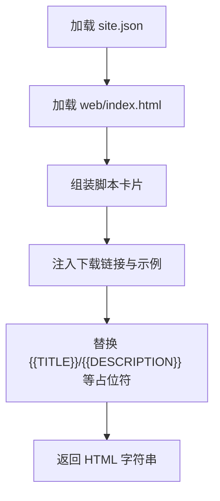

**图表来源**
- [script-hub/tools/catalog.mjs:72-109](file://script-hub/tools/catalog.mjs#L72-L109)

**章节来源**
- [script-hub/site.json:1-8](file://script-hub/site.json#L1-L8)
- [script-hub/tools/catalog.mjs:72-109](file://script-hub/tools/catalog.mjs#L72-L109)

### 构建编排与产物输出
构建器会为每个脚本调用 esbuild，要求：
- 平台为 Node；
- 格式为 CommonJS；
- 目标为 Node 22；
- 禁止拆分；
- 只允许一个输出文件；
- 不允许外部引入非 Node 内置模块；
- 产物头部包含脚本标题、来源说明和 Node 版本提示。

构建完成后，先清理旧 `dist`，再写入脚本、网页、目录清单和校验清单。

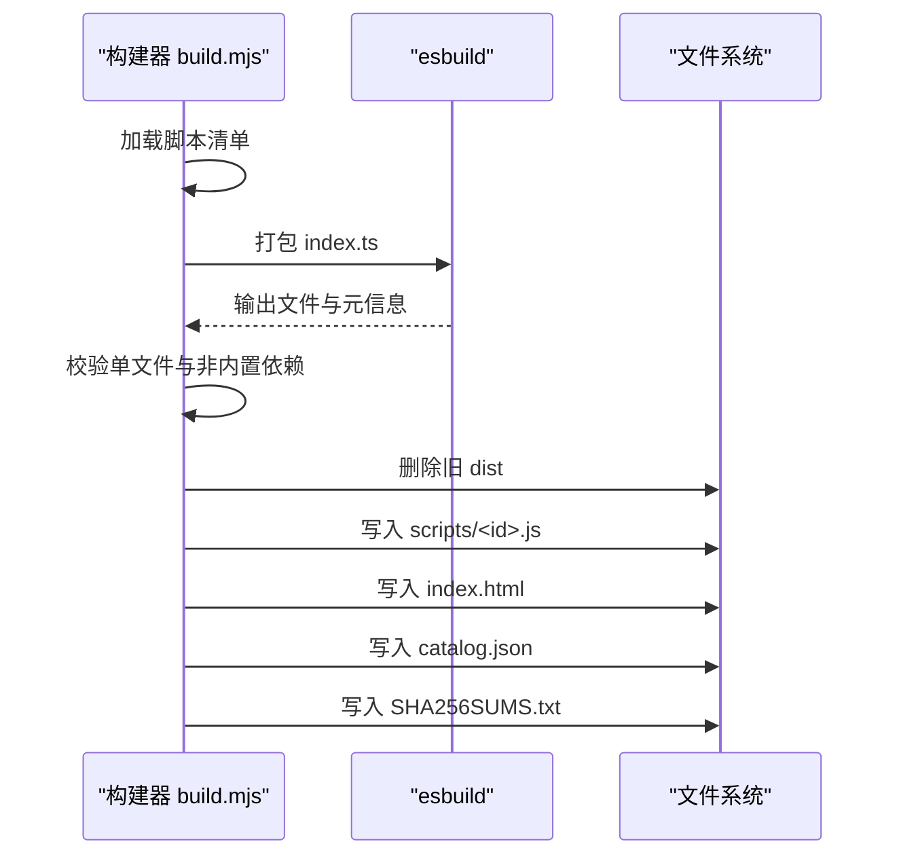

**图表来源**
- [script-hub/tools/build.mjs:16-61](file://script-hub/tools/build.mjs#L16-L61)

**章节来源**
- [script-hub/tools/build.mjs:10-62](file://script-hub/tools/build.mjs#L10-L62)

### 运行时 CLI 共享库
脚本通过 `runCli(manifest, handler)` 启动。CLI 支持：
- 从 `script.json.options` 推导命令行选项；
- 自动添加 `--help` / `-h`；
- 严格模式解析；
- 支持位置参数；
- 统一错误输出与退出码；
- 辅助函数 `integerOption` 与 `singleInput`。

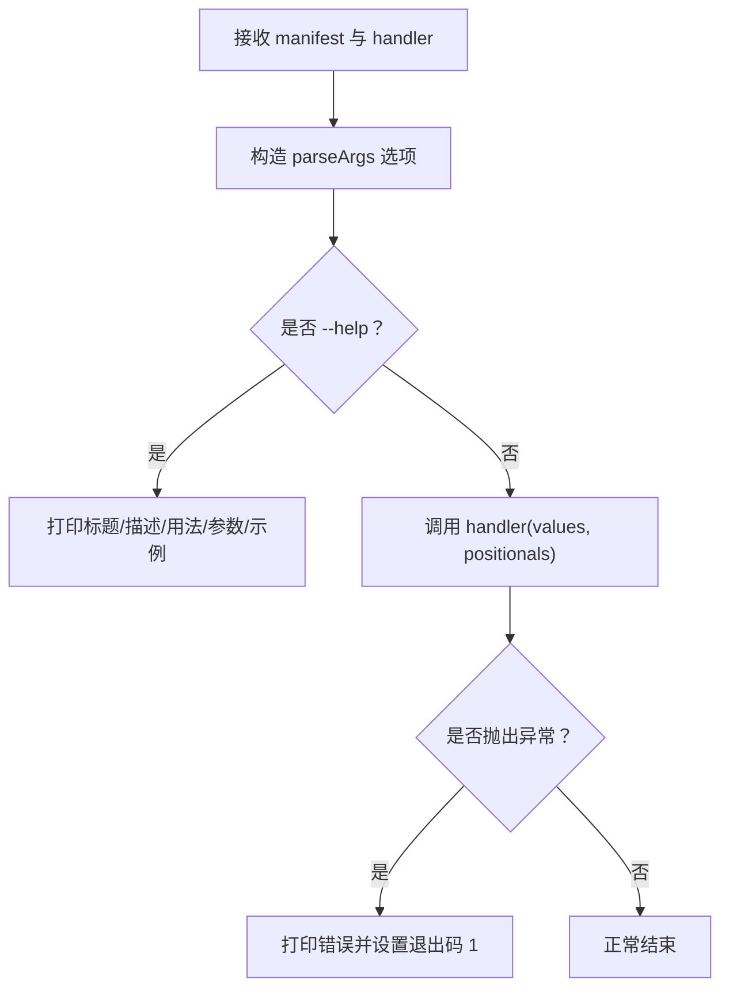

**图表来源**
- [script-hub/shared/cli.ts:27-77](file://script-hub/shared/cli.ts#L27-L77)

**章节来源**
- [script-hub/shared/cli.ts:1-78](file://script-hub/shared/cli.ts#L1-L78)

### 示例脚本：文件哈希校验
该脚本接受一个或多个文件路径，并使用流式读取计算哈希，避免将整个文件载入内存。支持的算法包括 SHA-256、SHA-512 和 MD5；MD5 仅用于普通校验，不适合安全场景。

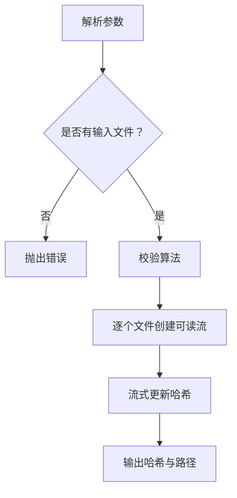

**图表来源**
- [script-hub/scripts/file-hash/index.ts:6-18](file://script-hub/scripts/file-hash/index.ts#L6-L18)

**章节来源**
- [script-hub/scripts/file-hash/index.ts:1-19](file://script-hub/scripts/file-hash/index.ts#L1-L19)
- [script-hub/scripts/file-hash/script.json:1-15](file://script-hub/scripts/file-hash/script.json#L1-L15)

### 示例脚本：HTTP 可用性检查
该脚本检查 HTTP 或 HTTPS 地址的状态码、最终地址和响应头耗时，可选打印响应头。超时默认 10 秒，范围为 1–300000 毫秒；非 2xx 响应会以退出码 1 结束。

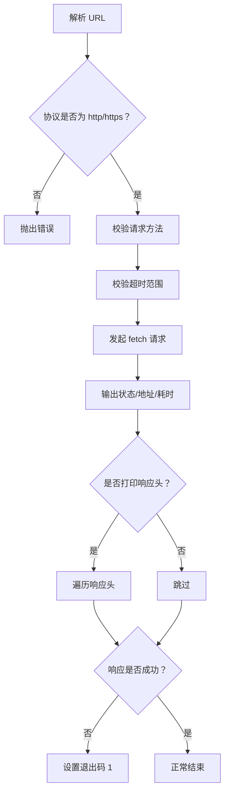

**图表来源**
- [script-hub/scripts/http-probe/index.ts:5-25](file://script-hub/scripts/http-probe/index.ts#L5-L25)

**章节来源**
- [script-hub/scripts/http-probe/index.ts:1-26](file://script-hub/scripts/http-probe/index.ts#L1-L26)
- [script-hub/scripts/http-probe/script.json:1-17](file://script-hub/scripts/http-probe/script.json#L1-L17)

### 示例脚本：JSON 格式化
该脚本支持从文件或标准输入读取 JSON，去除 UTF-8 BOM，并以指定缩进重新序列化。可选择输出到文件或直接写入标准输出。

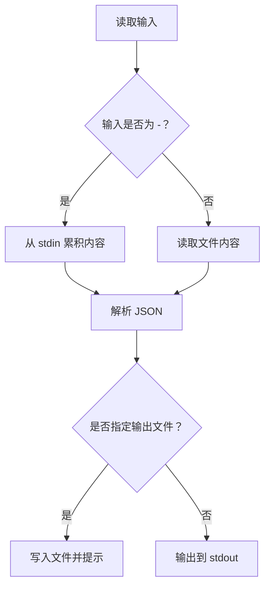

**图表来源**
- [script-hub/scripts/json-format/index.ts:6-27](file://script-hub/scripts/json-format/index.ts#L6-L27)

**章节来源**
- [script-hub/scripts/json-format/index.ts:1-28](file://script-hub/scripts/json-format/index.ts#L1-L28)

## 依赖关系分析
Script Hub 子项目的依赖非常精简：构建期依赖 esbuild、TypeScript 和 ESLint；运行时依赖全部内联到单文件脚本中，不再需要 npm 依赖。

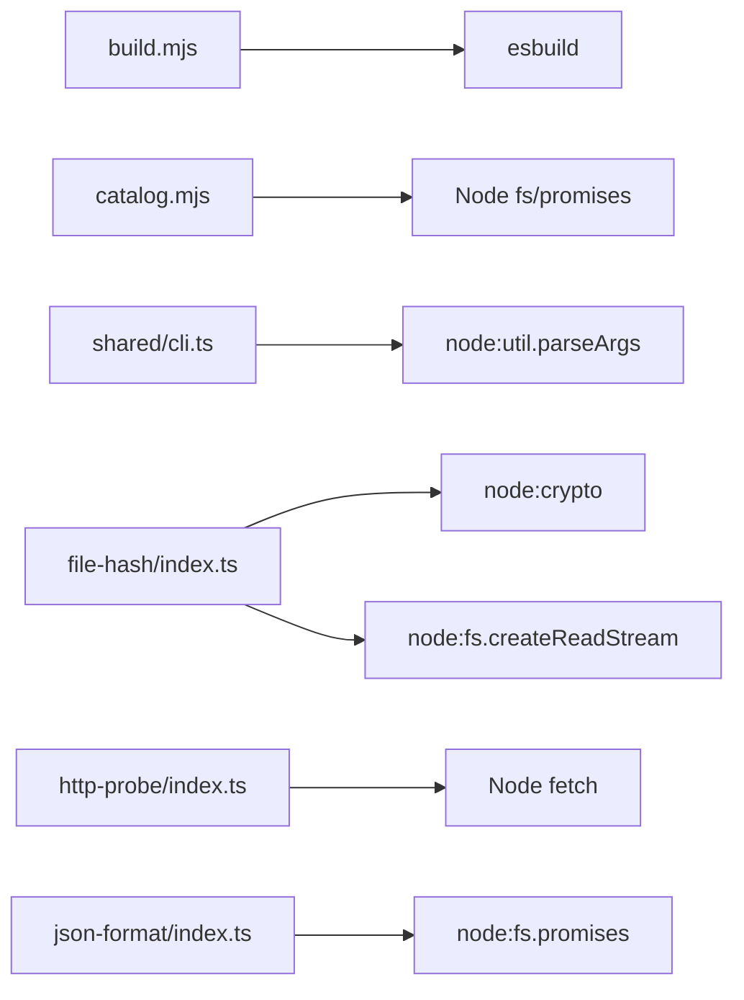

**图表来源**
- [script-hub/tools/build.mjs:1-8](file://script-hub/tools/build.mjs#L1-L8)
- [script-hub/tools/catalog.mjs:1-2](file://script-hub/tools/catalog.mjs#L1-L2)
- [script-hub/shared/cli.ts:1-2](file://script-hub/shared/cli.ts#L1-L2)
- [script-hub/scripts/file-hash/index.ts:1-3](file://script-hub/scripts/file-hash/index.ts#L1-L3)
- [script-hub/scripts/http-probe/index.ts:1-2](file://script-hub/scripts/http-probe/index.ts#L1-L2)
- [script-hub/scripts/json-format/index.ts:1-3](file://script-hub/scripts/json-format/index.ts#L1-L3)

**章节来源**
- [script-hub/package.json:19-29](file://script-hub/package.json#L19-L29)
- [script-hub/tools/build.mjs:16-48](file://script-hub/tools/build.mjs#L16-L48)

## 性能与产物特征
- 每个脚本构建为单个 CommonJS 文件，便于直接下载和运行。
- 构建过程强制不允许附带资源文件和非内置的外部依赖，降低分发复杂度。
- 产物包含文件大小与 SHA-256，便于离线校验。
- 网页与脚本均使用相对路径，适合 GitHub Pages 仓库子路径部署。
- 子项目自身产物位于 `script-hub/dist/`，不包含源码或 `node_modules`。

**章节来源**
- [script-hub/tools/build.mjs:33-48](file://script-hub/tools/build.mjs#L33-L48)
- [script-hub/tools/build.mjs:52-61](file://script-hub/tools/build.mjs#L52-L61)
- [README.md:98-115](file://README.md#L98-L115)

## 故障排查指南
- 脚本 id 与目录名不一致：构建时会报错，需保持两者一致且仅使用小写字母、数字和连字符。
- 缺少必填字段：`title`、`description`、`category`、`usage`、`options`、`examples` 任一缺失都会导致校验失败。
- 选项类型或默认值不匹配：字符串选项必须有字符串默认值，布尔选项必须有布尔默认值。
- 非法或重复的参数名/缩写：保留名和 `h` 不可用，缩写必须唯一。
- 脚本未打包成单文件：esbuild 输出文件数不为 1 时会报错。
- 引入非 Node 内置外部依赖：构建器会拒绝包含未打包的非内置模块。
- 网页链接不安全：站点链接只允许 HTTP 或 HTTPS。
- 脚本运行参数错误：CLI 会打印错误信息和帮助提示，并将退出码设为 1。

**章节来源**
- [script-hub/tools/catalog.mjs:13-41](file://script-hub/tools/catalog.mjs#L13-L41)
- [script-hub/tools/catalog.mjs:59-65](file://script-hub/tools/catalog.mjs#L59-L65)
- [script-hub/tools/build.mjs:33-38](file://script-hub/tools/build.mjs#L33-L38)
- [script-hub/shared/cli.ts:57-61](file://script-hub/shared/cli.ts#L57-L61)

## 结论
Script Hub 以最小依赖和明确约束实现了稳定的脚本分发能力：通过元数据驱动的参数定义、严格的构建校验和完整的校验清单，既保证了用户体验，也降低了维护成本。它与主应用解耦，适合独立迭代、独立部署，并可无缝集成到 Script Box 的运行空间中。

[本节不直接分析具体代码文件]

## 附录：工作流与发布
GitHub Actions 对 Script Hub 提供两条关键流水线：
- Script Hub 工作流：在默认分支推送、相关 PR 或手动触发时安装依赖、检查代码、构建并测试，上传 `script-hub-site` 工件；默认分支还会部署到 GitHub Pages。
- Release 工作流：在 `v*` 标签上独立构建脚本中心，并在桌面应用发布成功后，将 `script-hub-<版本>.zip` 上传到 Release 资产。

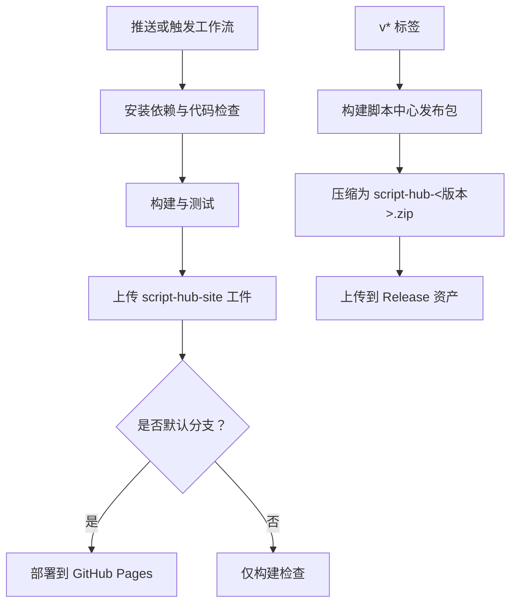

**图表来源**
- [.github/workflows/script-hub.yml:1-46](file://.github/workflows/script-hub.yml#L1-L46)
- [.github/workflows/release.yml:86-122](file://.github/workflows/release.yml#L86-L122)

**章节来源**
- [README.md:134-147](file://README.md#L134-L147)
- [.github/workflows/script-hub.yml:1-46](file://.github/workflows/script-hub.yml#L1-L46)
- [.github/workflows/release.yml:86-122](file://.github/workflows/release.yml#L86-L122)