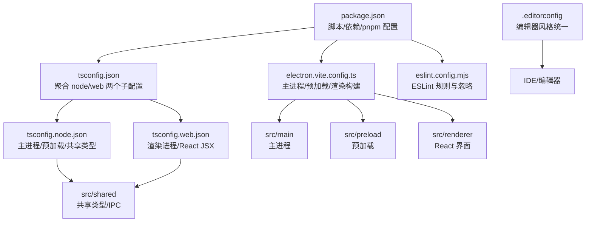
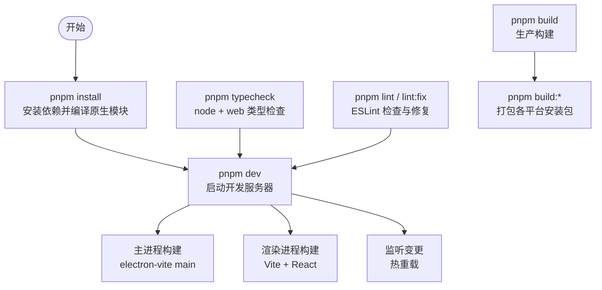
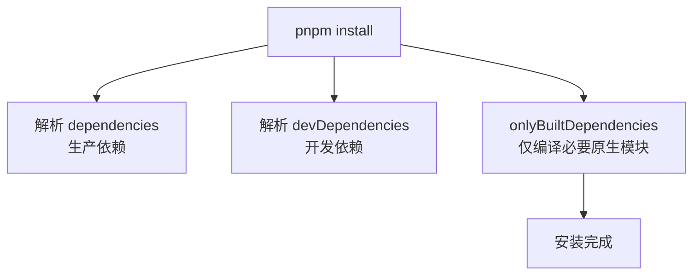
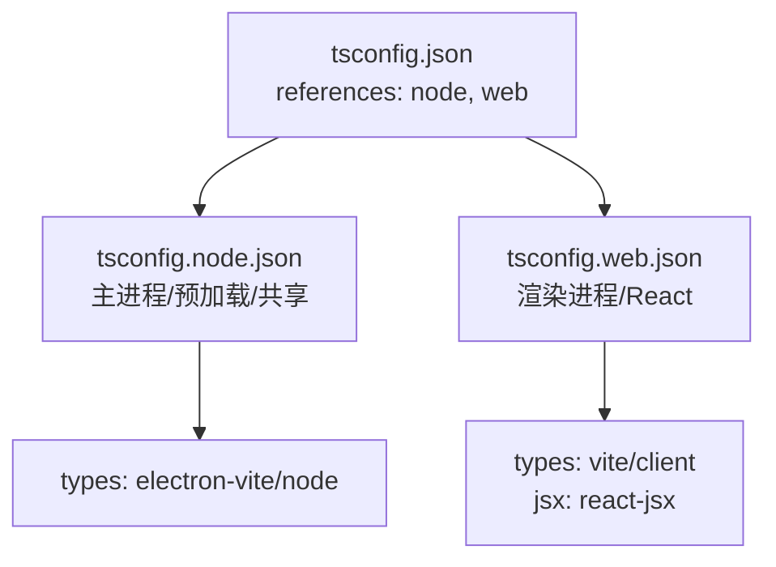
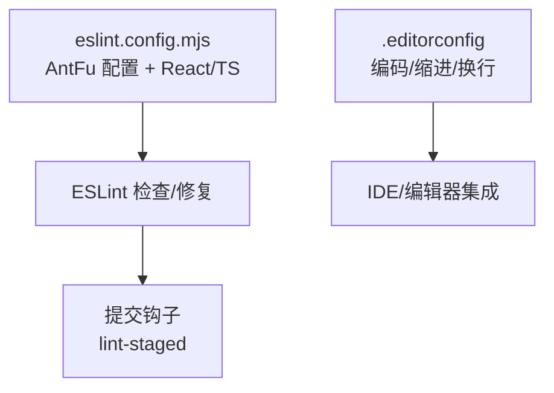
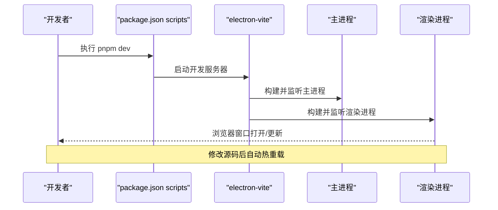
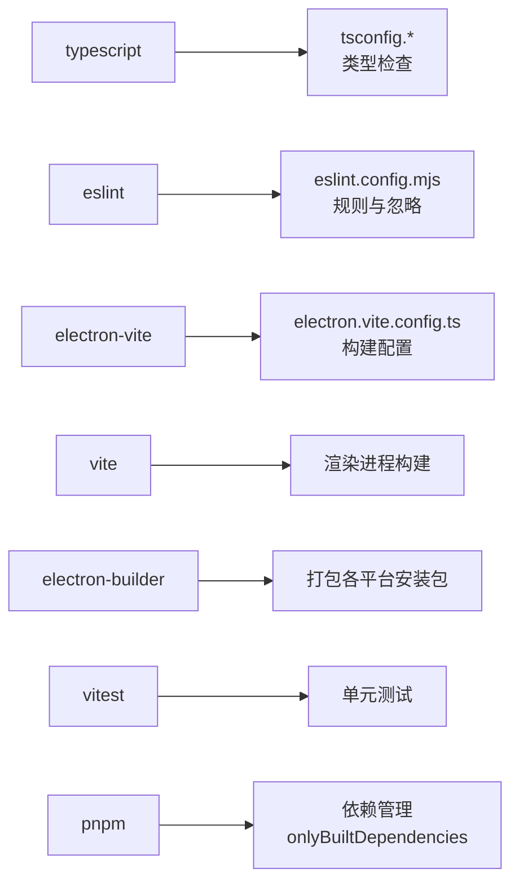

# 开发环境搭建

<cite>
**本文引用的文件**   
- [package.json](file://package.json)
- [README.md](file://README.md)
- [tsconfig.json](file://tsconfig.json)
- [tsconfig.node.json](file://tsconfig.node.json)
- [tsconfig.web.json](file://tsconfig.web.json)
- [eslint.config.mjs](file://eslint.config.mjs)
- [.editorconfig](file://.editorconfig)
- [electron.vite.config.ts](file://electron.vite.config.ts)
</cite>

## 更新摘要
**所做更改**   
- 更新了 pnpm 包管理器的现代化配置说明
- 新增了 Node.js 版本要求和 pnpm 安装指南
- 完善了依赖管理和构建配置的详细说明
- 增强了开发环境搭建流程的现代化特性介绍

## 目录
1. [简介](#简介)
2. [项目结构](#项目结构)
3. [核心组件](#核心组件)
4. [架构总览](#架构总览)
5. [详细组件分析](#详细组件分析)
6. [依赖关系分析](#依赖关系分析)
7. [性能与构建注意事项](#性能与构建注意事项)
8. [常见问题排查](#常见问题排查)
9. [结论](#结论)
10. [附录：常用命令速查](#附录常用命令速查)

## 简介
本指南面向首次参与项目的开发者，目标是帮助你在本地快速搭建可运行的开发环境。文档涵盖 Node.js 版本要求（>=22）、pnpm 包管理器安装与配置、生产与开发依赖的区别、TypeScript 双环境类型检查（Node/Web）、代码质量工具链（ESLint、编辑器规范）、常见环境问题排查，以及开发服务器启动与热重载的使用说明。

本项目是一个基于 Electron + Vite 的桌面应用，主进程使用 Node.js API，渲染进程使用 React + Ant Design，并通过 IPC 与主进程通信。项目采用现代化的开发工作流，以 pnpm 作为主要包管理器，支持跨平台开发和构建。

## 项目结构
仓库采用分层组织方式，核心目录如下：
- src/main：Electron 主进程逻辑与领域服务
- src/preload：预加载脚本，暴露带类型的 window.api
- src/renderer：React 前端界面
- src/shared：主进程与渲染进程共享的类型、IPC 通道和默认配置
- electron.vite.config.ts：Vite/Electron 构建配置
- tsconfig.*：TypeScript 多项目引用配置
- eslint.config.mjs：ESLint 规则与忽略策略
- .editorconfig：编辑器统一编码与缩进规范
- package.json：脚本命令、依赖声明与 pnpm 行为配置

**图表来源**
- [package.json:15-30](file://package.json#L15-L30)
- [electron.vite.config.ts:1-31](file://electron.vite.config.ts#L1-L31)
- [tsconfig.json:1-8](file://tsconfig.json#L1-L8)
- [tsconfig.node.json:1-20](file://tsconfig.node.json#L1-L20)
- [tsconfig.web.json:1-21](file://tsconfig.web.json#L1-L21)
- [eslint.config.mjs:1-14](file://eslint.config.mjs#L1-L14)
- [.editorconfig:1-13](file://.editorconfig#L1-L13)

**章节来源**
- [README.md:195-203](file://README.md#L195-L203)

## 核心组件
本节聚焦开发环境搭建所需的核心配置与命令。

### Node.js 版本要求
- 项目通过 engines 字段声明 Node.js 最低版本为 >=22
- README 中"开发"部分也明确要求 Node.js >= 22
- 建议使用 nvm/nvs 等版本管理工具切换至目标版本

### pnpm 包管理器
- packageManager 字段指定 pnpm@10.34.7 版本，确保团队一致性
- 推荐使用 Corepack 自动管理 pnpm 版本
- pnpm.onlyBuiltDependencies 仅对 electron、esbuild、node-pty、simple-git-hooks 等原生依赖进行编译，显著缩短安装时间
- supportedArchitectures 允许当前系统以及 x64/arm64 CPU 架构，便于跨平台缓存与复用
- patchedDependencies 支持依赖补丁机制

### 脚本命令
- dev：启动开发模式（包含主进程与渲染进程的监听与热重载）
- build：构建生产产物
- preview：预览构建产物
- typecheck/typecheck:node/typecheck:web：分别执行 TypeScript 类型检查
- lint/lint:fix：运行 ESLint 并支持自动修复
- test：运行 vitest 单元测试
- build:win/build:mac/build:linux：打包对应平台的安装包
- postinstall：安装 Electron 原生依赖
- prepare：初始化 git hooks（lint-staged）

**章节来源**
- [package.json:12-14](file://package.json#L12-L14)
- [package.json:15-30](file://package.json#L15-L30)
- [package.json:72-93](file://package.json#L72-L93)
- [README.md:161-194](file://README.md#L161-L194)

## 架构总览
下图展示开发环境与构建流程的关键节点：pnpm 安装依赖后，dev 命令启动 electron-vite，分别构建主进程与渲染进程；TypeScript 通过多项目引用同时校验 Node/Web 两类代码；ESLint 在提交前或手动触发时进行代码质量检查。

**图表来源**
- [package.json:15-30](file://package.json#L15-L30)
- [electron.vite.config.ts:1-31](file://electron.vite.config.ts#L1-L31)

## 详细组件分析

### Node.js 与 pnpm 安装与配置
#### Node.js 安装
- 请安装 Node.js >= 22
- 建议使用 nvm/nvs 等版本管理工具切换至目标版本

#### pnpm 安装与配置
- 推荐使用 pnpm@10.x（由 packageManager 字段锁定），以确保团队一致性
- 推荐用 Node.js 自带的 Corepack 启用 pnpm，它会自动使用 package.json 中 packageManager 字段指定的版本
- 若网络受限，可在安装 Electron 相关依赖前设置环境变量 ELECTRON_MIRROR 指向国内镜像源

**章节来源**
- [package.json:12-14](file://package.json#L12-L14)
- [package.json:6](file://package.json#L6)
- [README.md:161-194](file://README.md#L161-L194)

### 依赖安装与分类
#### 生产依赖（dependencies）
运行时必需的原生与 JS 库，例如 esbuild、node-pty、tar、extract-zip、tree-kill、electron-updater 等。

#### 开发依赖（devDependencies）
构建、测试、类型检查、打包与代码质量工具，如 electron-vite、vite、typescript、vitest、eslint、electron-builder、react 生态等。

#### pnpm 优化配置
- onlyBuiltDependencies 仅对少数需要编译的原生依赖执行构建，减少安装耗时
- supportedArchitectures 允许跨 CPU 架构缓存，提升多机器协作效率
- patchedDependencies 支持依赖补丁机制

**图表来源**
- [package.json:31-70](file://package.json#L31-L70)
- [package.json:72-93](file://package.json#L72-L93)

**章节来源**
- [package.json:31-70](file://package.json#L31-L70)
- [package.json:72-93](file://package.json#L72-L93)

### TypeScript 编译与类型检查
#### 多项目引用
tsconfig.json 聚合 node 与 web 两个子配置，实现统一入口。

#### Node 环境（主进程/预加载/共享类型）
- 继承 @electron-toolkit/tsconfig 的 Node 基线配置
- include 覆盖 src/main、src/preload、src/shared 以及构建配置文件
- types 引入 electron-vite/node 类型，启用 noImplicitAny
- paths 映射 @shared/*到 src/shared/*

#### Web 环境（渲染进程）
- 继承 @electron-toolkit/tsconfig 的 Web 基线配置
- include 覆盖 src/renderer/src、preload 的类型声明与 shared
- jsx 设置为 react-jsx，types 引入 vite/client，启用 noImplicitAny
- paths 映射 @renderer/*到 src/renderer/src，@shared/* 到 src/shared/*

#### 类型检查命令
typecheck:node 与 typecheck:web 分别检查，typecheck 串联执行两者。

**图表来源**
- [tsconfig.json:1-8](file://tsconfig.json#L1-L8)
- [tsconfig.node.json:1-20](file://tsconfig.node.json#L1-L20)
- [tsconfig.web.json:1-21](file://tsconfig.web.json#L1-L21)

**章节来源**
- [tsconfig.json:1-8](file://tsconfig.json#L1-L8)
- [tsconfig.node.json:1-20](file://tsconfig.node.json#L1-L20)
- [tsconfig.web.json:1-21](file://tsconfig.web.json#L1-L21)

### 代码质量工具链与编辑器配置
#### ESLint
- 使用 @antfu/eslint-config，开启 React 与 TypeScript 规则集
- 忽略 out、dist、resources/types、build/*.plist 等生成目录
- 针对主进程与预加载脚本关闭某些全局 process/buffer 的规则提示

#### 编辑器规范
- .editorconfig 统一字符集、缩进、换行符、末尾换行与尾随空格处理
- Markdown 文件保留尾随空格（避免误删）

**图表来源**
- [eslint.config.mjs:1-14](file://eslint.config.mjs#L1-L14)
- [.editorconfig:1-13](file://.editorconfig#L1-L13)
- [package.json:94-99](file://package.json#L94-L99)

**章节来源**
- [eslint.config.mjs:1-14](file://eslint.config.mjs#L1-L14)
- [.editorconfig:1-13](file://.editorconfig#L1-L13)
- [package.json:94-99](file://package.json#L94-L99)

### 开发服务器与热重载
#### 启动命令
pnpm dev：启动 electron-vite 开发服务器，同时监听主进程与渲染进程变更，支持热重载。

#### 预览与构建
- pnpm preview：预览构建后的产物
- pnpm build：构建生产产物

#### 构建配置要点
electron.vite.config.ts 定义了主进程、预加载与渲染进程的别名与插件，其中渲染进程启用 React 插件与 ES Worker 输出格式。

**图表来源**
- [package.json:15-18](file://package.json#L15-L18)
- [electron.vite.config.ts:1-31](file://electron.vite.config.ts#L1-L31)

**章节来源**
- [package.json:15-18](file://package.json#L15-L18)
- [electron.vite.config.ts:1-31](file://electron.vite.config.ts#L1-L31)

## 依赖关系分析
下图展示关键开发与构建依赖之间的关系：

**图表来源**
- [package.json:40-70](file://package.json#L40-L70)
- [electron.vite.config.ts:1-31](file://electron.vite.config.ts#L1-L31)
- [package.json:72-93](file://package.json#L72-L93)

**章节来源**
- [package.json:40-70](file://package.json#L40-L70)

## 性能与构建注意事项
### 仅编译必要的原生依赖
通过 onlyBuiltDependencies 限制原生模块编译范围，显著提升安装速度。

### 跨架构缓存
supportedArchitectures 允许不同 CPU 架构的依赖缓存复用，适合多机器协作。

### 构建产物
主进程入口位于 out/main/index.js（由 package.json 的 main 字段指定）。

### 打包
使用 electron-builder 按平台打包，命令见 package.json 的 build:* 脚本。

**章节来源**
- [package.json:72-93](file://package.json#L72-L93)
- [package.json:11](file://package.json#L11)
- [package.json:25-28](file://package.json#L25-L28)

## 常见问题排查
### Node.js 版本不匹配
- **现象**：安装或运行时报 Node 版本错误
- **解决**：将 Node.js 升级至 >= 22，或使用版本管理工具切换

### pnpm 版本不一致
- **现象**：团队成员安装行为不一致
- **解决**：使用 packageManager 指定的 pnpm 版本，或在 CI 中固定 pnpm 版本

### Electron 下载缓慢
- **现象**：pnpm install 长时间卡在 Electron 下载
- **解决**：设置 ELECTRON_MIRROR 环境变量指向国内镜像后再执行安装

### 原生依赖编译失败
- **现象**：node-pty 等原生模块编译报错
- **解决**：确认已安装系统级编译工具链；必要时清理缓存后重试安装

### ESLint 报主进程全局变量问题
- **现象**：process/buffer 全局变量提示
- **解决**：eslint.config.mjs 已针对主进程与预加载脚本关闭相关规则；如仍报错，检查是否误用非 Node 环境的类型

### 类型检查失败
- **现象**：tsc 报类型错误
- **解决**：分别执行 typecheck:node 与 typecheck:web 定位具体环境的问题；检查路径别名与 include 配置是否正确

### pnpm 依赖管理问题
- **现象**：依赖安装失败或版本冲突
- **解决**：确保使用正确的 pnpm 版本；检查 onlyBuiltDependencies 配置；清理 pnpm 缓存后重试

**章节来源**
- [package.json:12-14](file://package.json#L12-L14)
- [package.json:72-93](file://package.json#L72-L93)
- [README.md:161-194](file://README.md#L161-L194)
- [eslint.config.mjs:8-12](file://eslint.config.mjs#L8-L12)
- [tsconfig.node.json:12-18](file://tsconfig.node.json#L12-L18)
- [tsconfig.web.json:14-19](file://tsconfig.web.json#L14-L19)

## 结论
通过以上步骤，你可以在本地完成从 Node.js 与 pnpm 的安装配置，到依赖安装、类型检查、代码质量检查，再到开发服务器启动与热重载的全流程。建议在日常开发中：
- 始终使用项目要求的 Node.js >= 22 与 pnpm@10.x 版本
- 在提交前运行 lint 与 typecheck，保证代码质量与类型安全
- 利用 pnpm 的 onlyBuiltDependencies 与 supportedArchitectures 提升团队协作效率
- 使用 Corepack 自动管理 pnpm 版本，确保团队一致性

## 附录：常用命令速查
- 安装依赖：pnpm install
- 启动开发服务器：pnpm dev
- 预览构建产物：pnpm preview
- 构建生产产物：pnpm build
- 类型检查：pnpm typecheck（或分别执行 typecheck:node 与 typecheck:web）
- 代码检查与修复：pnpm lint / pnpm lint:fix
- 单元测试：pnpm test
- 打包安装包：pnpm build:win / pnpm build:mac / pnpm build:linux

**章节来源**
- [package.json:15-30](file://package.json#L15-L30)
- [README.md:161-172](file://README.md#L161-L172)