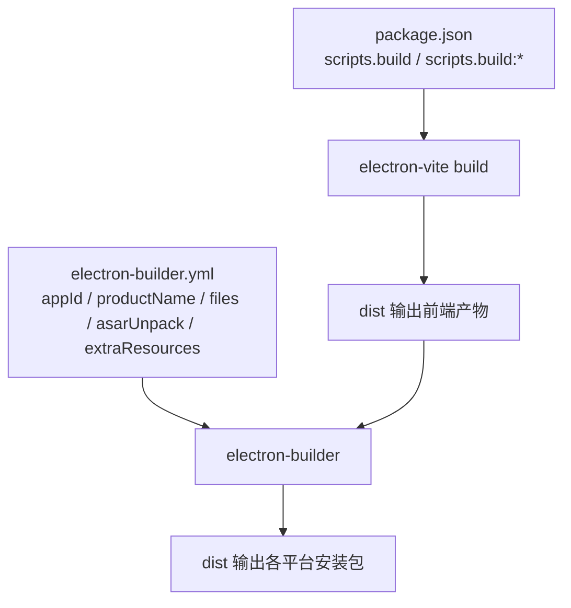
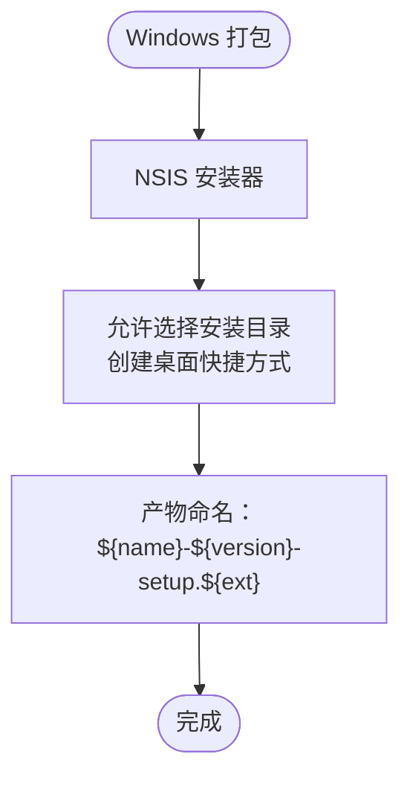
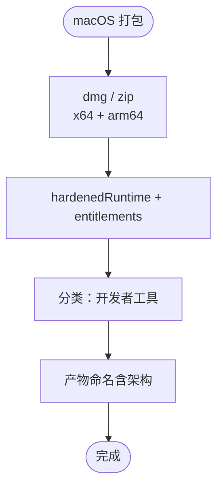
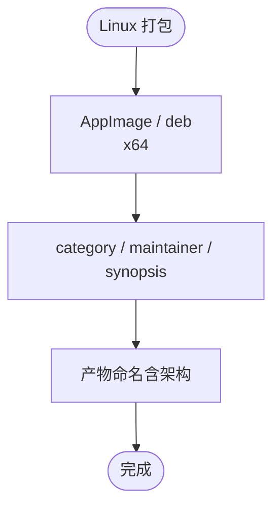
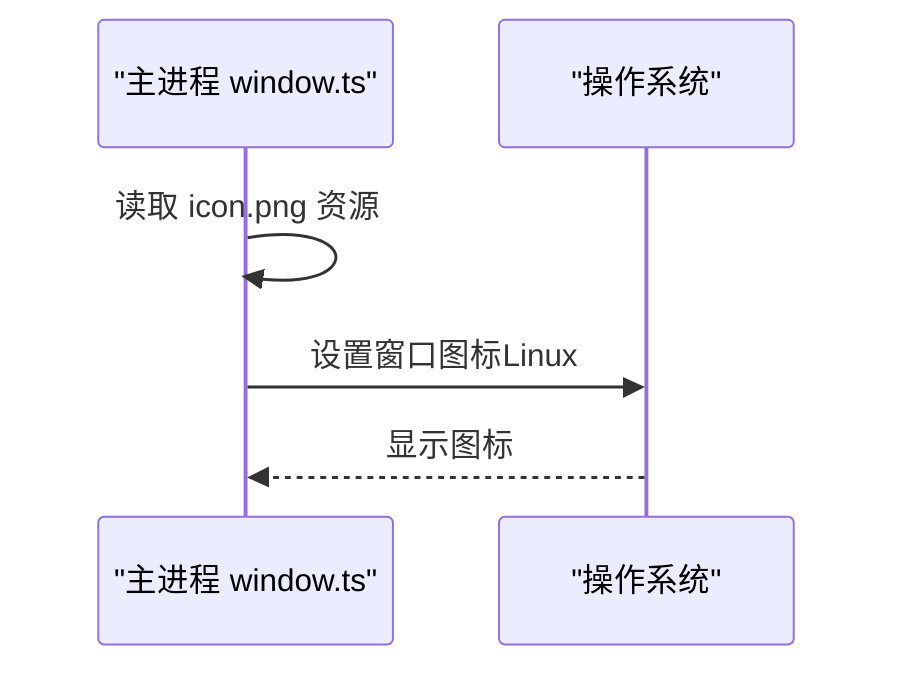
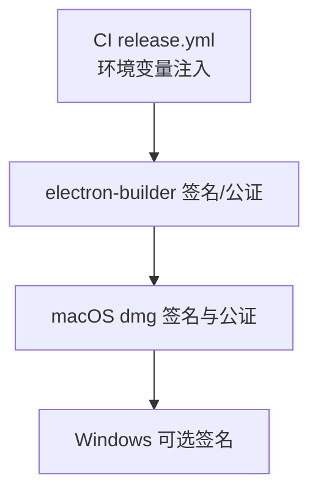
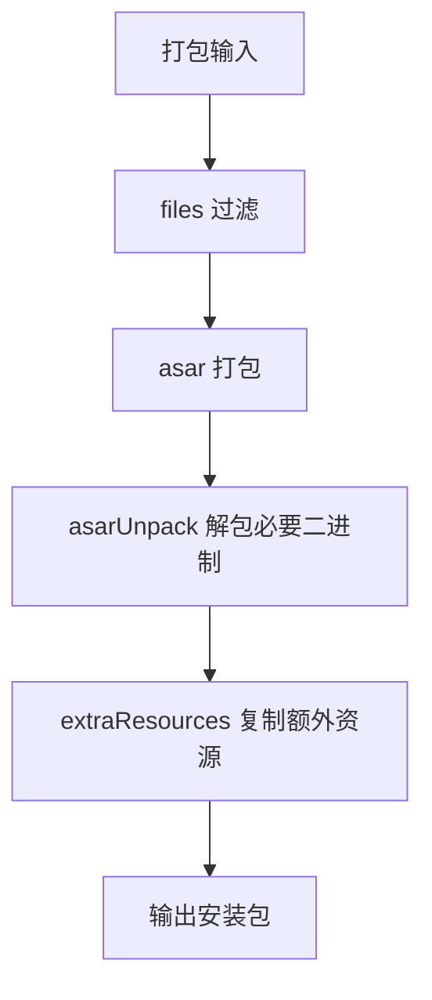
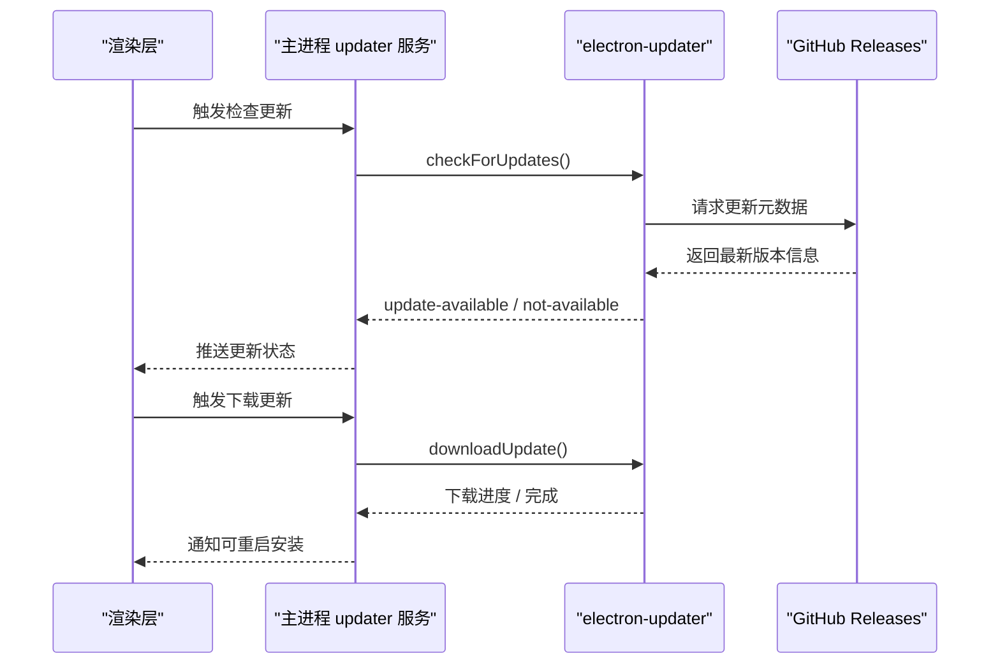
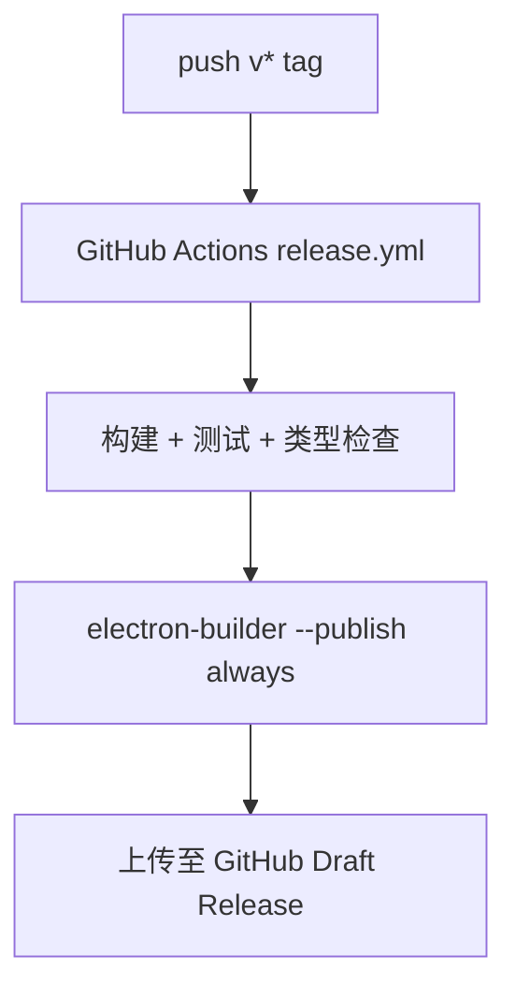
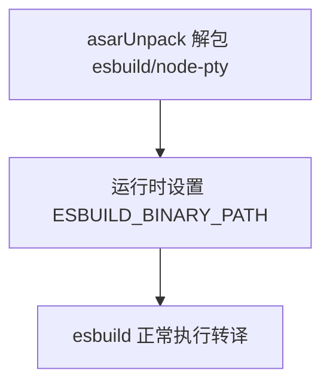

# 打包配置

<cite>
**本文引用的文件**   
- [electron-builder.yml](file://electron-builder.yml)
- [package.json](file://package.json)
- [README.md](file://README.md)
- [release.yml](file://.github/workflows/release.yml)
- [window.ts](file://src/main/window.ts)
- [app.ts](file://src/main/ipc/app.ts)
- [index.ts（更新服务）](file://src/main/services/updater/index.ts)
</cite>

## 目录
1. [简介](#简介)
2. [项目结构与打包入口](#项目结构与打包入口)
3. [核心打包配置总览](#核心打包配置总览)
4. [多平台打包配置](#多平台打包配置)
5. [原生功能与资源](#原生功能与资源)
6. [代码签名与公证流程](#代码签名与公证流程)
7. [安装包格式与压缩选项](#安装包格式与压缩选项)
8. [版本号、更新服务器与发布渠道](#版本号更新服务器与发布渠道)
9. [依赖重建与二进制包处理](#依赖重建与二进制包处理)
10. [打包优化最佳实践](#打包优化最佳实践)
11. [常见问题排查](#常见问题排查)
12. [结论](#结论)

## 简介
本文面向使用 electron-builder 对 Electron 应用进行跨平台打包的开发者，结合仓库中的实际配置，系统说明 Windows、macOS、Linux 的打包差异、图标与原生能力、代码签名与公证、安装包格式选择、版本管理与自动更新、以及发布渠道和 CI 流水线。文档同时给出可操作的优化建议与排错思路，帮助你在保证可用性的前提下提升构建效率与分发质量。

## 项目结构与打包入口
该仓库采用典型的 Electron + Vite 工程结构：主进程位于 `src/main`，渲染进程位于 `src/renderer`，预加载脚本位于 `src/preload`。打包产物由 electron-builder 根据 `electron-builder.yml` 生成到 `dist` 目录；开发时通过 `electron-vite` 构建前端资源，再由 electron-builder 将主进程与渲染产物一起打包。

**图表来源**
- [package.json:15-29](file://package.json#L15-L29)
- [electron-builder.yml:1-20](file://electron-builder.yml#L1-L20)

**章节来源**
- [package.json:1-30](file://package.json#L1-L30)
- [electron-builder.yml:1-20](file://electron-builder.yml#L1-L20)

## 核心打包配置总览
- 应用标识与应用名
  - `appId`：用于标识应用身份，影响更新通道与平台商店元数据。
  - `productName`：决定最终可执行文件名、安装器名称与菜单项显示名。
- 目录与输出
  - `directories.buildResources`：指定构建资源目录。
  - `directories.output`：指定打包输出目录为 `dist`。
- 文件过滤与 ASAR
  - `files`：排除源码、配置文件、锁文件等，减小包体积。
  - `asarUnpack`：将原生二进制与运行时所需资源从 asar 中解包，避免无法执行或路径解析问题。
- 额外资源
  - `extraResources`：将类型声明等资源复制到应用内，供编辑器离线提示使用。

**章节来源**
- [electron-builder.yml:1-31](file://electron-builder.yml#L1-L31)

## 多平台打包配置
### Windows
- 目标与安装器
  - 使用 NSIS 安装器，支持自定义安装目录、桌面快捷方式、卸载显示名。
  - 架构限定为 x64。
- 可执行文件命名
  - `executableName` 指定为 `script-box`。
- 安装器行为
  - 非一键安装，允许用户选择安装路径。
  - 始终创建桌面快捷方式。
- 产物命名
  - 通过 `artifactName` 模板控制安装包文件名，包含名称、版本与扩展名。

**图表来源**
- [electron-builder.yml:32-43](file://electron-builder.yml#L32-L43)

**章节来源**
- [electron-builder.yml:32-43](file://electron-builder.yml#L32-L43)

### macOS
- 目标与架构
  - 同时构建 dmg 与 zip，架构覆盖 x64 与 arm64。
- 安全与权限
  - 启用 hardenedRuntime，并通过 entitlements 与 entitlementsInherit 引入权限清单。
- 分类信息
  - 设置应用分类为开发者工具，便于 App Store 或 Finder 分类展示。
- 产物命名
  - dmg 产物按架构区分文件名。

**图表来源**
- [electron-builder.yml:44-55](file://electron-builder.yml#L44-L55)

**章节来源**
- [electron-builder.yml:44-55](file://electron-builder.yml#L44-L55)

### Linux
- 目标与架构
  - 提供 AppImage 与 deb 两种格式，当前仅构建 x64。
- 元数据
  - 设置可执行文件名为 `script-box`，并填写 category、maintainer、synopsis 等元数据。
- 产物命名
  - AppImage 与 deb 均按名称、版本、架构命名。

**图表来源**
- [electron-builder.yml:56-69](file://electron-builder.yml#L56-L69)

**章节来源**
- [electron-builder.yml:56-69](file://electron-builder.yml#L56-L69)

## 原生功能与资源
### 应用图标
- 在 Linux 上显式设置窗口图标，确保任务栏与窗口标题栏显示正确图标。
- 图标资源通过前端构建管线以 asset 形式引入，打包后随应用分发。

**图表来源**
- [window.ts:1-23](file://src/main/window.ts#L1-L23)

**章节来源**
- [window.ts:1-23](file://src/main/window.ts#L1-L23)

### 文件关联
- 当前仓库未定义 electron-builder 的 `fileAssociations` 字段，也未在主进程中注册系统级文件关联逻辑。
- 若需要打开特定脚本文件类型，可在 electron-builder 中添加关联规则，并在主进程监听 `open-file` 事件进行处理。

[本节为概念性说明，不直接分析具体文件]

### 系统托盘
- 当前仓库未实现系统托盘相关逻辑。
- 如需添加托盘，可在主进程初始化时创建 Tray 实例，并绑定菜单与点击事件；同时在 electron-builder 中无需额外配置。

[本节为概念性说明，不直接分析具体文件]

## 代码签名与公证流程
### 配置位置
- macOS 侧启用了 hardenedRuntime，并通过 entitlements 文件引用权限清单。
- CI 流水线在发布阶段注入 Apple ID、团队 ID、应用专用密码以及代码签名证书等环境变量。

**图表来源**
- [release.yml:55-68](file://.github/workflows/release.yml#L55-L68)
- [electron-builder.yml:44-48](file://electron-builder.yml#L44-L48)

### 关键要点
- macOS
  - 必须提供有效的开发者证书与公证凭据，否则首次运行可能提示“已损坏”或“无法验证开发者”。
  - 未签名时自动更新不可靠，建议在 CI 中启用签名与公证。
- Windows
  - 可通过 `WIN_CSC_LINK` 与 `WIN_CSC_KEY_PASSWORD` 配置代码签名；未签名不影响安装但会影响更新信任链。

**章节来源**
- [release.yml:55-68](file://.github/workflows/release.yml#L55-L68)
- [electron-builder.yml:44-48](file://electron-builder.yml#L44-L48)
- [README.md:88-96](file://README.md#L88-L96)

## 安装包格式与压缩选项
### 支持的格式
- Windows：NSIS 安装器（exe）。
- macOS：dmg 与 zip。
- Linux：AppImage 与 deb。

### 压缩与体积优化
- 通过 `files` 排除源码、配置文件、锁文件、类型检查与测试配置等，减少包体。
- 通过 `asarUnpack` 仅解包必需的原生二进制与运行时模块，避免不必要的文件被解压。
- 通过 `extraResources` 按需复制类型声明等资源，避免把整个 node_modules 打入包中。

**图表来源**
- [electron-builder.yml:7-31](file://electron-builder.yml#L7-L31)

**章节来源**
- [electron-builder.yml:7-31](file://electron-builder.yml#L7-L31)

## 版本号、更新服务器与发布渠道
### 版本号管理
- 应用版本来源于 `package.json` 的 `version` 字段。
- 安装包文件名通过 `artifactName` 模板包含 `${version}`，确保每次发布产物可追溯。

**章节来源**
- [package.json:1-10](file://package.json#L1-L10)
- [electron-builder.yml:37-69](file://electron-builder.yml#L37-L69)

### 更新服务器
- 使用 `electron-updater` 作为自动更新客户端。
- 默认从 GitHub Releases 获取更新元数据与增量补丁。
- 更新状态通过 IPC 暴露给渲染层，支持检查更新、下载进度与安装提示。

**图表来源**
- [index.ts（更新服务）:1-60](file://src/main/services/updater/index.ts#L1-L60)

**章节来源**
- [index.ts（更新服务）:1-60](file://src/main/services/updater/index.ts#L1-L60)

### 发布渠道
- electron-builder 的 `publish.provider` 设置为 github，`releaseType` 为 draft。
- CI 在 push v* tag 时触发三平台构建，并将产物上传至草稿 Release，确认无误后手动发布。

**图表来源**
- [release.yml:1-56](file://.github/workflows/release.yml#L1-L56)
- [electron-builder.yml:71-74](file://electron-builder.yml#L71-L74)

**章节来源**
- [release.yml:1-56](file://.github/workflows/release.yml#L1-L56)
- [electron-builder.yml:71-74](file://electron-builder.yml#L71-L74)
- [README.md:88-96](file://README.md#L88-L96)

## 依赖重建与二进制包处理
### npmRebuild
- 开启 `npmRebuild`，让 electron-builder 在打包前为 Electron 重新编译原生依赖。
- 配合 pnpm 的 `onlyBuiltDependencies` 与 `supportedArchitectures`，可减少无关平台的原生模块构建。

**章节来源**
- [electron-builder.yml:70-70](file://electron-builder.yml#L70-L70)
- [package.json:72-83](file://package.json#L72-L83)

### 原生二进制与 esbuild
- 由于原生二进制不能在 asar 内部执行，仓库通过 `asarUnpack` 解包 `node-pty` 与 `esbuild` 相关模块。
- 主进程在运行时动态设置 `ESBUILD_BINARY_PATH`，指向解包后的二进制路径，确保转译正常。

**图表来源**
- [electron-builder.yml:18-23](file://electron-builder.yml#L18-L23)
- [index.ts（esbuild）:8-16](file://src/main/services/esbuild/index.ts#L8-L16)

**章节来源**
- [electron-builder.yml:18-23](file://electron-builder.yml#L18-L23)
- [index.ts（esbuild）:8-16](file://src/main/services/esbuild/index.ts#L8-L16)

## 打包优化最佳实践
- 精简文件列表
  - 排除 `.vscode`、`.github`、`.qoder`、源码目录、构建配置、锁文件、类型检查与测试配置等。
- 合理解包
  - 仅解包原生二进制与运行时必需模块，避免整体解压导致体积膨胀。
- 按需复制资源
  - 使用 `extraResources` 精确复制类型声明等静态资源，提高编辑器离线体验的同时控制包大小。
- 控制架构
  - 仅在需要的平台与架构上构建，避免无谓的多架构产物。
- 利用 CI 缓存
  - 在 GitHub Actions 中缓存 pnpm 与 Node 依赖，缩短构建时间。
- 自动化校验
  - 在 CI 中统一执行 lint、typecheck、test，再进入打包阶段，保证发布质量。

**章节来源**
- [electron-builder.yml:7-31](file://electron-builder.yml#L7-L31)
- [release.yml:27-56](file://.github/workflows/release.yml#L27-L56)

## 常见问题排查
- macOS 提示“已损坏”或“无法验证开发者”
  - 原因：未签名或未公证。
  - 解决：在 CI 中配置 CSC 与 Apple ID 相关 Secrets，启用签名与公证；临时可通过终端命令移除隔离属性。
- 自动更新不可用
  - 原因：未签名或更新元数据不可信。
  - 解决：确保安装包签名有效，且 GitHub Releases 的元数据可访问。
- 原生模块无法执行
  - 原因：模块仍在 asar 内或被错误路径引用。
  - 解决：确认 `asarUnpack` 已包含对应模块，并在主进程设置正确的二进制路径。
- 图标不显示
  - 原因：未在 Linux 上显式设置图标。
  - 解决：在主进程窗口初始化时传入图标资源。
- 安装包体积过大
  - 原因：包含了源码、锁文件或过多资源。
  - 解决：完善 `files` 过滤与 `extraResources` 白名单，避免误打包。

**章节来源**
- [README.md:41-42](file://README.md#L41-L42)
- [electron-builder.yml:18-31](file://electron-builder.yml#L18-L31)
- [window.ts:1-23](file://src/main/window.ts#L1-L23)

## 结论
本项目的 electron-builder 配置围绕多平台分发、原生二进制处理、代码签名与公证、以及基于 GitHub Releases 的自动更新展开。通过合理的文件过滤、按需解包与 CI 自动化，可以在保证用户体验的同时提升构建效率与发布质量。若需进一步增强原生能力（如文件关联、系统托盘），可在主进程补充相应逻辑，并在 electron-builder 中按需扩展配置。