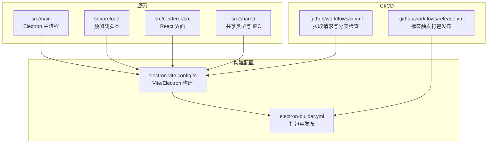
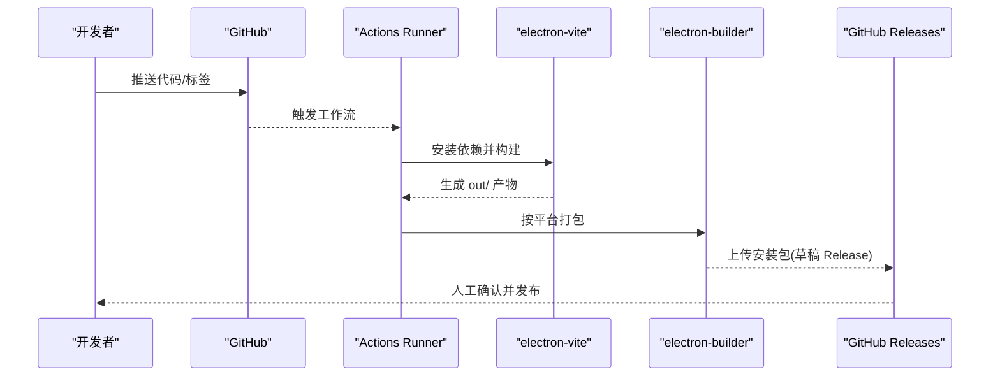
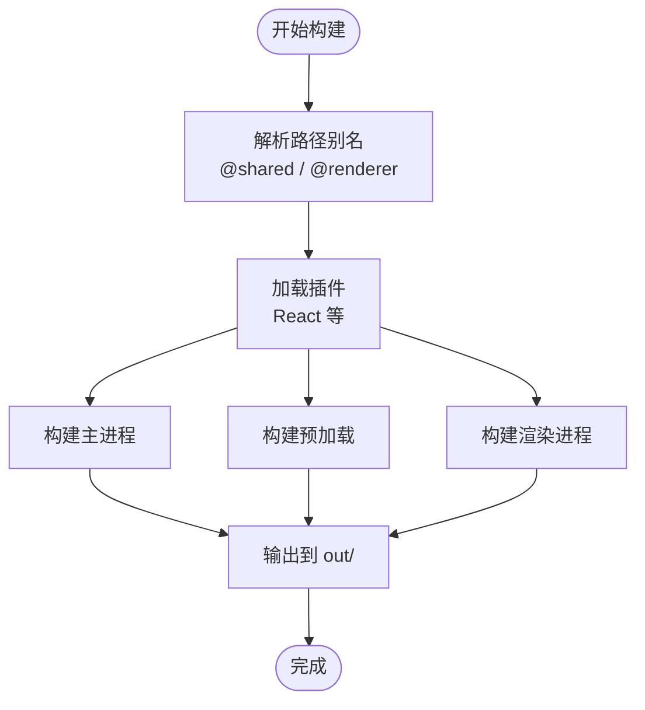
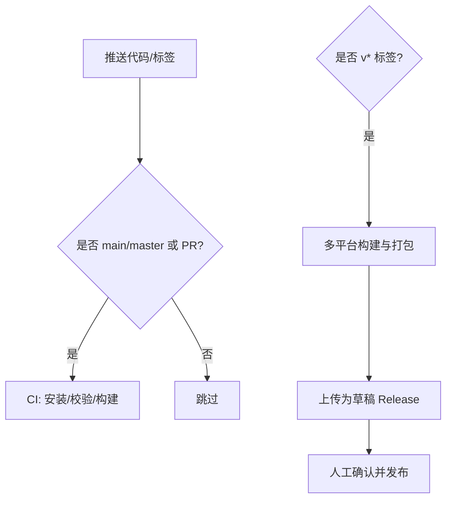
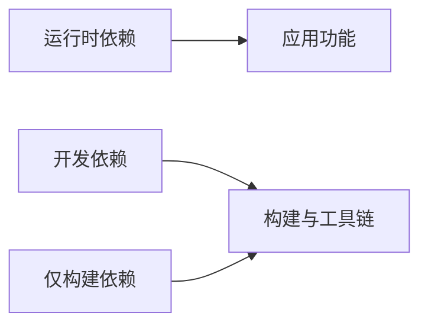

# 构建与部署

<cite>
**本文引用的文件**   
- [package.json](file://package.json)
- [electron.vite.config.ts](file://electron.vite.config.ts)
- [electron-builder.yml](file://electron-builder.yml)
- [.github/workflows/ci.yml](file://.github/workflows/ci.yml)
- [.github/workflows/release.yml](file://.github/workflows/release.yml)
- [README.md](file://README.md)
</cite>

## 目录
1. [简介](#简介)
2. [项目结构](#项目结构)
3. [核心组件](#核心组件)
4. [架构总览](#架构总览)
5. [详细组件分析](#详细组件分析)
6. [依赖关系分析](#依赖关系分析)
7. [性能考虑](#性能考虑)
8. [故障排查指南](#故障排查指南)
9. [结论](#结论)
10. [附录：发布检查清单](#附录发布检查清单)

## 简介
本指南面向开发者与维护者，覆盖 Script Box 的本地开发环境搭建、Vite + Electron 构建流程、TypeScript 编译与资源处理、electron-builder 多平台打包、CI/CD 流水线以及自动化发布。文档同时给出代码签名、版本管理与发布前检查建议，帮助你在 Windows、macOS、Linux 上稳定产出安装包并安全发布到 GitHub Releases。

## 项目结构
本项目采用 Electron + Vite（通过 electron-vite）工程化方案：
- 主进程与预加载脚本位于 src/main 与 src/preload
- 渲染进程使用 React + Ant Design，位于 src/renderer/src
- 共享类型与 IPC 通道位于 src/shared
- 构建配置集中在 electron.vite.config.ts 与 electron-builder.yml
- CI/CD 流水线在 .github/workflows 下

图表来源
- [electron.vite.config.ts:1-31](file://electron.vite.config.ts#L1-L31)
- [electron-builder.yml:1-74](file://electron-builder.yml#L1-L74)
- [.github/workflows/ci.yml:1-26](file://.github/workflows/ci.yml#L1-L26)
- [.github/workflows/release.yml:1-69](file://.github/workflows/release.yml#L1-L69)

章节来源
- [README.md:78-86](file://README.md#L78-L86)

## 核心组件
- 包管理与脚本入口：package.json 定义了 Node.js 版本要求、pnpm 工作区、开发/构建/测试脚本以及各平台打包命令。
- 构建系统：electron-vite 基于 Vite，统一构建主进程、预加载与渲染进程，支持别名与插件。
- 打包器：electron-builder 负责产物输出、asar 策略、extraResources、平台目标与发布到 GitHub。
- CI/CD：GitHub Actions 提供 PR/分支的 lint、类型检查、测试与构建；标签推送触发多平台打包并发布为草稿 Release。

章节来源
- [package.json:1-91](file://package.json#L1-L91)
- [electron.vite.config.ts:1-31](file://electron.vite.config.ts#L1-L31)
- [electron-builder.yml:1-74](file://electron-builder.yml#L1-L74)
- [.github/workflows/ci.yml:1-26](file://.github/workflows/ci.yml#L1-L26)
- [.github/workflows/release.yml:1-69](file://.github/workflows/release.yml#L1-L69)

## 架构总览
下图展示从代码到产物的端到端流程：开发者提交代码 → CI 校验 → 标签触发多平台构建 → electron-builder 打包 → 上传至 GitHub Releases。

图表来源
- [.github/workflows/ci.yml:1-26](file://.github/workflows/ci.yml#L1-L26)
- [.github/workflows/release.yml:1-69](file://.github/workflows/release.yml#L1-L69)
- [electron.vite.config.ts:1-31](file://electron.vite.config.ts#L1-L31)
- [electron-builder.yml:1-74](file://electron-builder.yml#L1-L74)

## 详细组件分析

### 开发环境与依赖安装
- Node.js 版本要求：>=22（由 engines 字段约束）。
- 包管理器：pnpm（由 packageManager 指定）。
- 安装依赖：pnpm install 会自动为 Electron 重新编译原生依赖（如 node-pty），并通过 postinstall 执行 electron-builder install-app-deps。
- 开发服务器：pnpm dev 启动 electron-vite 开发模式，支持热重载与调试。

章节来源
- [package.json:12-14](file://package.json#L12-L14)
- [package.json:15-29](file://package.json#L15-L29)
- [README.md:63-76](file://README.md#L63-L76)

### 构建流程与 Vite 配置
- 构建入口：electron-vite 根据 electron.vite.config.ts 分别构建 main、preload、renderer。
- 路径别名：
  - @shared 指向 src/shared，供主进程、预加载与渲染进程共用类型与常量。
  - @renderer 指向 src/renderer/src，便于渲染进程内引用。
- 插件与工作线程：
  - 启用 @vitejs/plugin-react 以支持 JSX/TSX。
  - worker 输出格式设为 ES 模块。
- 产物位置：main 入口指向 out/main/index.js，即 electron-vite 默认输出目录。

图表来源
- [electron.vite.config.ts:1-31](file://electron.vite.config.ts#L1-L31)
- [package.json:11](file://package.json#L11)

章节来源
- [electron.vite.config.ts:1-31](file://electron.vite.config.ts#L1-L31)
- [package.json:11](file://package.json#L11)

### TypeScript 编译与类型检查
- 双配置文件：tsconfig.node.json 与 tsconfig.web.json 分别对应主进程与 Web 侧。
- 类型检查脚本：typecheck:node、typecheck:web 与聚合 typecheck。
- 构建时不执行 tsc 编译，而是由 electron-vite/esbuild 进行转译；类型检查作为独立步骤运行。

章节来源
- [package.json:19-21](file://package.json#L19-L21)

### 资源处理与 extraResources
- asarUnpack：将 resources/**、node-pty、esbuild 及其相关包解包，避免原生二进制无法在 asar 内执行的问题。
- extraResources：将 @types/node 与 undici-types 的类型声明打包进应用，使编辑器在无网络环境下也能获得 Node API 智能提示。
- files 白名单：排除 .vscode、.github、src、构建配置与锁文件等，减小安装包体积。

章节来源
- [electron-builder.yml:7-31](file://electron-builder.yml#L7-L31)

### 多平台打包与产物命名
- Windows：NSIS 安装包，x64 架构，可自定义安装目录，桌面快捷方式创建策略可控。
- macOS：dmg 与 zip，支持 x64/arm64，开启 hardenedRuntime 与 entitlements。
- Linux：AppImage 与 deb，x64 架构，设置分类、维护者与摘要信息。
- 产物命名：通过 artifactName 模板变量包含 name、version、arch、ext，保证产物唯一性与可读性。
- npmRebuild：true，确保原生依赖按目标平台重建。

章节来源
- [electron-builder.yml:32-70](file://electron-builder.yml#L32-L70)

### 发布与自动更新
- publish.provider：github，releaseType：draft，表示构建产物会上传为草稿 Release，需人工确认后发布。
- 自动更新：应用内置 electron-updater，从 GitHub Releases 获取新版本。
- 代码签名：
  - macOS：需要 CSC_LINK、CSC_KEY_PASSWORD、APPLE_ID、APPLE_APP_SPECIFIC_PASSWORD、APPLE_TEAM_ID。
  - Windows：需要 WIN_CSC_LINK、WIN_CSC_KEY_PASSWORD。
  - 未签名时，macOS 自动更新可能不可用，首次打开可能需要手动解除隔离属性。

章节来源
- [electron-builder.yml:71-74](file://electron-builder.yml#L71-L74)
- [README.md:88-96](file://README.md#L88-L96)

### CI/CD 流水线与自动化发布
- CI（ci.yml）：
  - 触发：push 到 main/master 或 pull_request。
  - 步骤：检出代码 → 安装 pnpm → 设置 Node 22 → 缓存 pnpm → 安装依赖 → lint → typecheck → test → build。
- Release（release.yml）：
  - 触发：推送 v* 标签或手动触发。
  - 矩阵：windows-latest、macos-latest、ubuntu-latest，分别执行 --win、--mac、--linux。
  - 步骤：检出 → 安装依赖 → lint → typecheck → test → build → electron-builder 打包并上传（GH_TOKEN）。
  - 环境变量：注入签名相关 Secrets，可选启用自动发现签名身份。

图表来源
- [.github/workflows/ci.yml:1-26](file://.github/workflows/ci.yml#L1-L26)
- [.github/workflows/release.yml:1-69](file://.github/workflows/release.yml#L1-L69)

章节来源
- [.github/workflows/ci.yml:1-26](file://.github/workflows/ci.yml#L1-L26)
- [.github/workflows/release.yml:1-69](file://.github/workflows/release.yml#L1-L69)

## 依赖关系分析
- 运行时依赖：electron-updater、esbuild、extract-zip、node-pty、tar、tree-kill 等用于运行时能力（终端、下载、压缩、进程管理等）。
- 开发依赖：electron、electron-builder、electron-vite、vite、typescript、eslint、vitest、react 生态等。
- pnpm 仅构建依赖：electron、esbuild、node-pty、simple-git-hooks，减少无关二进制安装。

图表来源
- [package.json:31-83](file://package.json#L31-L83)

章节来源
- [package.json:31-83](file://package.json#L31-L83)

## 性能考虑
- 构建速度：
  - 使用 esbuild 转译 TS/JS，提升构建性能。
  - 合理配置 alias 与 worker 输出格式，减少重复打包。
- 安装包体积：
  - 通过 files 白名单与 asarUnpack 精准控制打包内容。
  - extraResources 仅包含必要的类型声明，避免冗余。
- 原生依赖：
  - 针对 node-pty、esbuild 等原生模块进行 asarUnpack，避免运行时失败。
  - npmRebuild 确保跨平台构建时正确重建原生模块。

[本节为通用指导，无需具体文件引用]

## 故障排查指南
- 安装阶段失败：
  - 若 Electron 下载缓慢，可在安装前设置 ELECTRON_MIRROR 环境变量后重试。
  - 确保 Node.js 版本满足 >=22，pnpm 版本与 packageManager 一致。
- 原生模块编译问题：
  - 确认已执行 pnpm install，postinstall 会调用 electron-builder install-app-deps。
  - 如遇 node-pty 编译错误，检查系统编译工具链（如 Xcode Command Line Tools、Windows Build Tools）。
- 打包失败：
  - 检查 electron-builder.yml 中 target 与 arch 是否与当前平台匹配。
  - 若出现 asar 内二进制执行失败，确认 asarUnpack 列表包含相应模块。
- 自动更新异常：
  - macOS 未签名可能导致自动更新不可用；请配置签名 Secrets 或在首次打开时解除隔离属性。
  - 确认 GitHub Releases 中存在对应版本的产物且可访问。

章节来源
- [README.md:63-76](file://README.md#L63-L76)
- [README.md:41-42](file://README.md#L41-L42)
- [electron-builder.yml:18-23](file://electron-builder.yml#L18-L23)
- [.github/workflows/release.yml:55-69](file://.github/workflows/release.yml#L55-L69)

## 结论
本项目通过 electron-vite 与 electron-builder 实现了高效的开发与打包体验，配合 GitHub Actions 完成了从代码校验到多平台发布的完整闭环。遵循本文的环境搭建、构建与发布指引，并结合代码签名与版本管理最佳实践，可稳定产出高质量安装包并安全发布。

[本节为总结性内容，无需具体文件引用]

## 附录：发布检查清单
- 版本管理
  - 已在 package.json 中更新版本号。
  - 已创建并推送 v* 格式的 Git 标签。
- 代码质量
  - 已通过 lint、typecheck、test 与 build。
- 构建与打包
  - 已验证 electron-builder.yml 的平台与架构配置。
  - 已确认 asarUnpack 与 extraResources 配置正确。
- 代码签名
  - macOS：已配置 CSC_LINK、CSC_KEY_PASSWORD、APPLE_ID、APPLE_APP_SPECIFIC_PASSWORD、APPLE_TEAM_ID。
  - Windows：已配置 WIN_CSC_LINK、WIN_CSC_KEY_PASSWORD。
- 发布流程
  - GitHub Actions 已生成草稿 Release。
  - 已人工核对产物名称、版本与平台，确认无误后发布。

章节来源
- [package.json:1-14](file://package.json#L1-L14)
- [electron-builder.yml:1-74](file://electron-builder.yml#L1-L74)
- [.github/workflows/release.yml:1-69](file://.github/workflows/release.yml#L1-L69)
- [README.md:88-96](file://README.md#L88-L96)