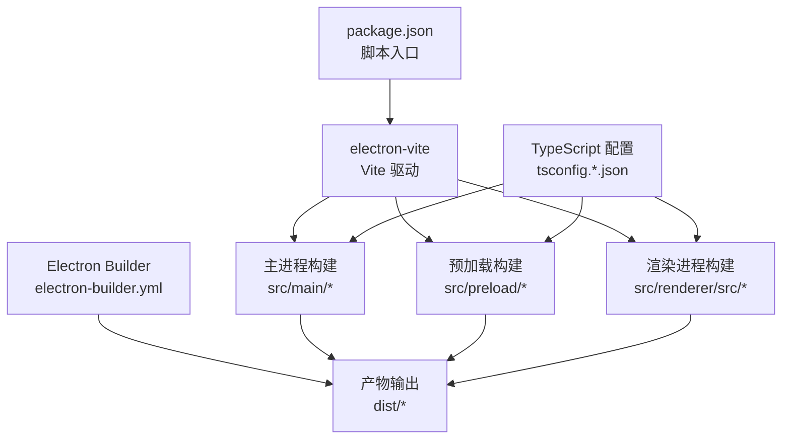
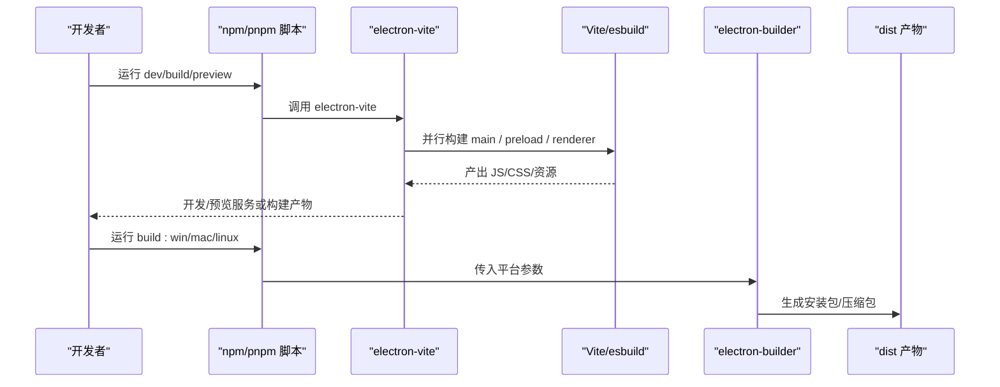
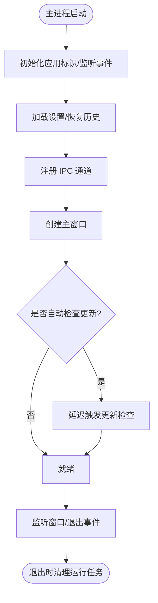
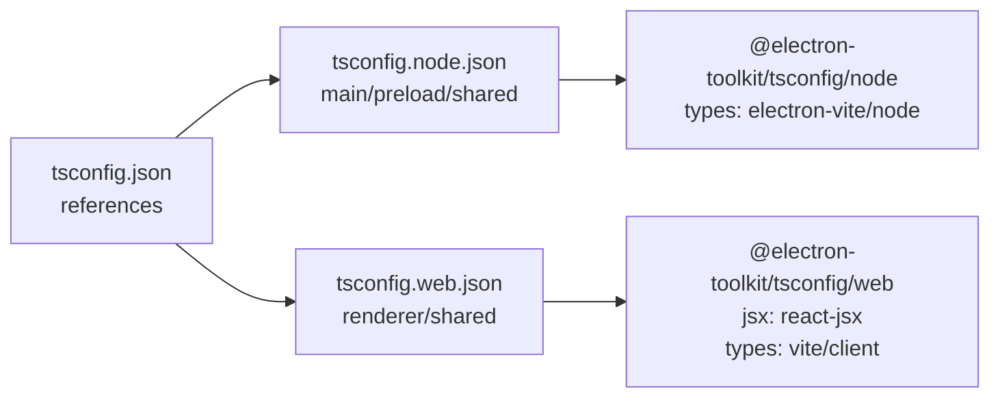
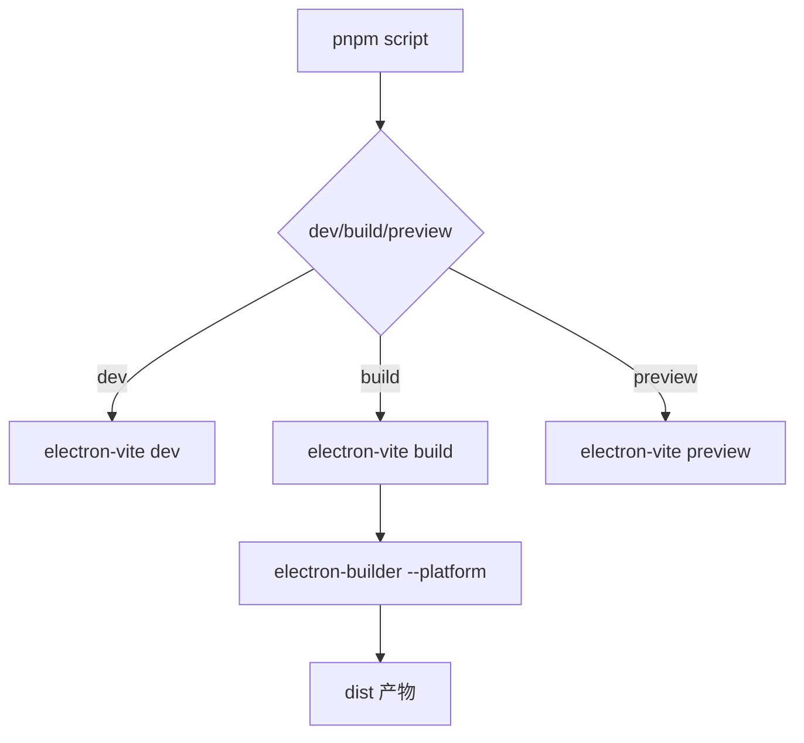
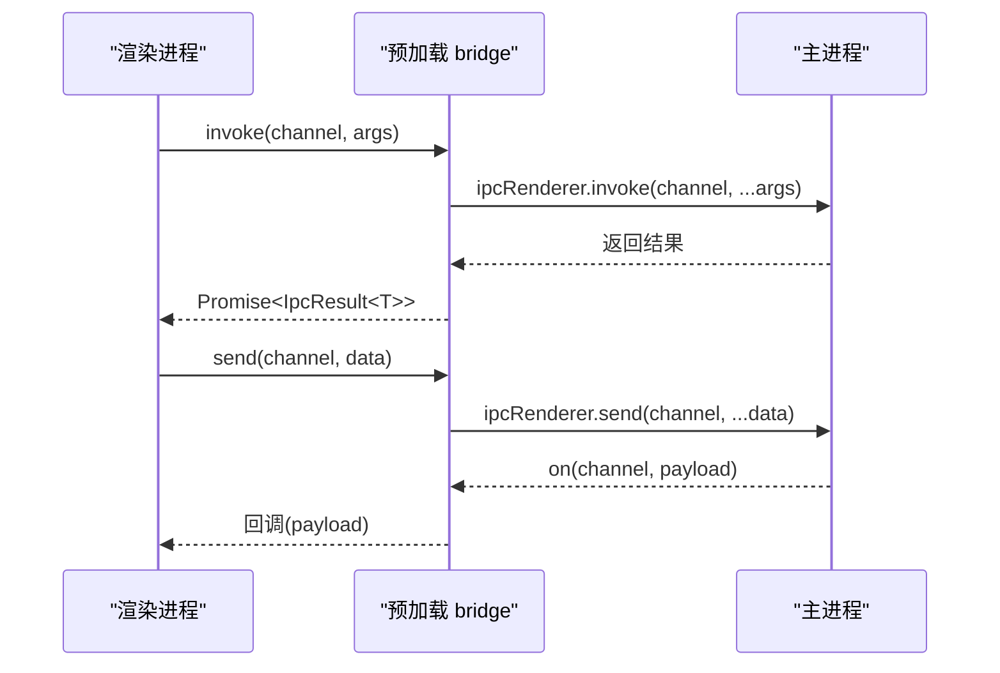
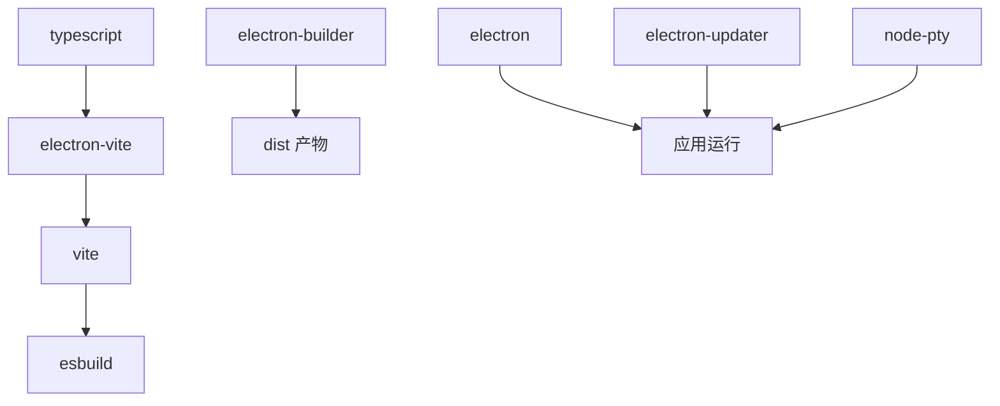

# 构建流程

<cite>
**本文引用的文件**   
- [package.json](file://package.json)
- [electron.vite.config.ts](file://electron.vite.config.ts)
- [tsconfig.json](file://tsconfig.json)
- [tsconfig.node.json](file://tsconfig.node.json)
- [tsconfig.web.json](file://tsconfig.web.json)
- [electron-builder.yml](file://electron-builder.yml)
- [src/main/index.ts](file://src/main/index.ts)
- [src/main/window.ts](file://src/main/window.ts)
- [src/preload/index.ts](file://src/preload/index.ts)
- [src/renderer/src/main.tsx](file://src/renderer/src/main.tsx)
- [src/shared/ipc.ts](file://src/shared/ipc.ts)
</cite>

## 目录
1. [简介](#简介)
2. [项目结构](#项目结构)
3. [核心组件](#核心组件)
4. [架构总览](#架构总览)
5. [详细组件分析](#详细组件分析)
6. [依赖关系分析](#依赖关系分析)
7. [性能与优化建议](#性能与优化建议)
8. [常见问题排查](#常见问题排查)
9. [结论](#结论)
10. [附录：构建模式说明](#附录构建模式说明)

## 简介
本文件系统性梳理基于 Vite + Electron 的构建流程，覆盖主进程、预加载脚本与渲染进程的分别构建过程；解释 TypeScript 在 Node 环境与 Web 环境的编译配置差异；说明静态资源打包与优化策略；给出构建脚本执行顺序与参数；并提供性能优化建议、常见故障排查以及开发/预览/生产三种构建模式的差异。

## 项目结构
本项目采用多入口 Electron 应用结构：
- 主进程代码位于 src/main
- 预加载脚本位于 src/preload
- 渲染进程前端代码位于 src/renderer/src
- 共享类型与常量位于 src/shared
- 构建配置集中在 electron.vite.config.ts、tsconfig.*.json、electron-builder.yml
- 脚本命令集中在 package.json

图表来源
- [package.json:15-29](file://package.json#L15-L29)
- [electron.vite.config.ts:7-30](file://electron.vite.config.ts#L7-L30)
- [tsconfig.json:1-7](file://tsconfig.json#L1-L7)
- [electron-builder.yml:1-74](file://electron-builder.yml#L1-L74)

章节来源
- [package.json:15-29](file://package.json#L15-L29)
- [electron.vite.config.ts:7-30](file://electron.vite.config.ts#L7-L30)
- [tsconfig.json:1-7](file://tsconfig.json#L1-L7)
- [electron-builder.yml:1-74](file://electron-builder.yml#L1-L74)

## 核心组件
- 构建工具链
  - electron-vite：统一驱动主进程、预加载、渲染进程三套 Vite 构建管线
  - Vite：负责渲染进程（React）及 Worker 构建
  - esbuild：作为底层转译器（由 electron-vite/Vite 使用）
  - TypeScript：提供跨环境类型检查与路径映射
  - electron-builder：打包为各平台安装包并处理资源
- 应用入口
  - 主进程：src/main/index.ts
  - 预加载：src/preload/index.ts
  - 渲染进程：src/renderer/src/main.tsx
- 共享层
  - 类型与 IPC 契约：src/shared/ipc.ts

章节来源
- [package.json:31-70](file://package.json#L31-L70)
- [electron.vite.config.ts:7-30](file://electron.vite.config.ts#L7-L30)
- [src/main/index.ts:1-55](file://src/main/index.ts#L1-L55)
- [src/preload/index.ts:1-19](file://src/preload/index.ts#L1-L19)
- [src/renderer/src/main.tsx:1-12](file://src/renderer/src/main.tsx#L1-L12)
- [src/shared/ipc.ts:1-117](file://src/shared/ipc.ts#L1-L117)

## 架构总览
下图展示从脚本命令到最终产物的完整构建链路，包括主进程、预加载和渲染进程各自的构建与产物组织。

图表来源
- [package.json:15-29](file://package.json#L15-L29)
- [electron.vite.config.ts:7-30](file://electron.vite.config.ts#L7-L30)
- [electron-builder.yml:1-74](file://electron-builder.yml#L1-L74)

## 详细组件分析

### 主进程构建（Node 环境）
- 入口文件：src/main/index.ts
- 启动流程要点
  - 设置应用标识、监听窗口事件
  - 加载设置、恢复历史、注册 IPC、创建主窗口
  - 根据设置决定是否自动检查更新
  - 单实例锁、窗口聚焦、退出前清理运行任务
- 窗口创建与加载
  - 通过 src/main/window.ts 创建 BrowserWindow
  - 开发模式下加载 ELECTRON_RENDERER_URL，生产模式加载打包后的 index.html
  - 启用 contextIsolation、sandbox，禁用 nodeIntegration，安全地暴露桥接 API

图表来源
- [src/main/index.ts:10-54](file://src/main/index.ts#L10-L54)
- [src/main/window.ts:6-46](file://src/main/window.ts#L6-L46)

章节来源
- [src/main/index.ts:1-55](file://src/main/index.ts#L1-L55)
- [src/main/window.ts:1-47](file://src/main/window.ts#L1-L47)

### 预加载脚本构建（Node 环境）
- 入口文件：src/preload/index.ts
- 职责
  - 通过 contextBridge 暴露安全的 bridge API（invoke/send/on/getPathForFile）
  - 封装 ipcRenderer 调用，屏蔽 IpcRendererEvent 细节
  - 将 File 对象转换为本地路径供主进程使用
- 构建特性
  - 与主进程共用 @shared 类型定义，保证 IPC 契约一致
  - 被 electron-vite 以 Node 目标进行转译

章节来源
- [src/preload/index.ts:1-19](file://src/preload/index.ts#L1-L19)
- [src/shared/ipc.ts:101-117](file://src/shared/ipc.ts#L101-L117)

### 渲染进程构建（Web 环境）
- 入口文件：src/renderer/src/main.tsx
- 职责
  - 挂载 React 根组件，引入国际化与样式
- 构建特性
  - 使用 @vitejs/plugin-react 支持 JSX/TSX
  - worker 构建格式设置为 ES 模块
  - 通过 @renderer 别名指向渲染源码目录
  - 通过 @shared 别名复用共享类型

章节来源
- [src/renderer/src/main.tsx:1-12](file://src/renderer/src/main.tsx#L1-L12)
- [electron.vite.config.ts:18-29](file://electron.vite.config.ts#L18-L29)

### TypeScript 转译配置（Node vs Web）
- 顶层 tsconfig.json 聚合两个子配置，启用复合项目以便增量构建
- Node 环境（主进程、预加载、共享）
  - 继承 @electron-toolkit/tsconfig/tsconfig.node.json
  - include 包含 main、preload、shared 与配置文件
  - types 注入 electron-vite/node 类型
  - paths 映射 @shared/*
- Web 环境（渲染进程、共享）
  - 继承 @electron-toolkit/tsconfig/tsconfig.web.json
  - include 包含 renderer、preload 的类型声明与 shared
  - jsx 使用 react-jsx
  - types 注入 vite/client
  - paths 映射 @renderer/*与 @shared/*

图表来源
- [tsconfig.json:1-7](file://tsconfig.json#L1-L7)
- [tsconfig.node.json:1-19](file://tsconfig.node.json#L1-L19)
- [tsconfig.web.json:1-20](file://tsconfig.web.json#L1-L20)

章节来源
- [tsconfig.json:1-7](file://tsconfig.json#L1-L7)
- [tsconfig.node.json:1-19](file://tsconfig.node.json#L1-L19)
- [tsconfig.web.json:1-20](file://tsconfig.web.json#L1-L20)

### 资源文件处理与优化
- 图标等静态资源
  - 主进程通过 import 引入图片资源，并由 Vite 将其作为 asset 处理
- 额外资源打包
  - electron-builder 通过 extraResources 将 @types/node 与 undici-types 的 d.ts 打包进应用，便于编辑器离线提示
- 原生二进制与不可压缩资源
  - asarUnpack 排除 resources/**、node-pty、esbuild 及其相关包，避免在 asar 内无法执行的问题
- 输出目录与构建资源目录
  - directories.buildResources 指向 build 目录
  - directories.output 指向 dist 目录

章节来源
- [src/main/window.ts:4](file://src/main/window.ts#L4)
- [electron-builder.yml:4-6](file://electron-builder.yml#L4-L6)
- [electron-builder.yml:18-31](file://electron-builder.yml#L18-L31)

### 构建脚本执行顺序与参数
- 开发/预览/构建
  - dev：electron-vite dev
  - build：electron-vite build
  - preview：electron-vite preview
- 类型检查
  - typecheck:node：对 Node 环境进行类型检查
  - typecheck:web：对 Web 环境进行类型检查
  - typecheck：依次执行上述两项
- 平台打包
  - build:win/build:mac/build:linux：先执行 electron-vite build，再调用 electron-builder 指定平台参数
- 安装依赖与 Git Hooks
  - postinstall：electron-builder install-app-deps
  - prepare：simple-git-hooks

图表来源
- [package.json:15-29](file://package.json#L15-L29)
- [electron-builder.yml:32-74](file://electron-builder.yml#L32-L74)

章节来源
- [package.json:15-29](file://package.json#L15-L29)
- [electron-builder.yml:32-74](file://electron-builder.yml#L32-L74)

### IPC 契约与桥接
- 共享类型定义 src/shared/ipc.ts 定义了三类通道：
  - 请求/响应（invoke）
  - 单向发送（send）
  - 事件推送（on）
- 预加载层在浏览器上下文暴露 bridge，封装 invoke/send/on 与 getPathForFile
- 主进程侧通过 registerIpc 注册对应处理器（具体实现不在本文件）

图表来源
- [src/shared/ipc.ts:25-117](file://src/shared/ipc.ts#L25-L117)
- [src/preload/index.ts:5-18](file://src/preload/index.ts#L5-L18)

章节来源
- [src/shared/ipc.ts:1-117](file://src/shared/ipc.ts#L1-L117)
- [src/preload/index.ts:1-19](file://src/preload/index.ts#L1-L19)

## 依赖关系分析
- 构建依赖
  - electron-vite：协调 main/preload/renderer 三套 Vite 构建
  - vite：渲染进程构建与插件生态
  - esbuild：底层转译加速
  - typescript：类型检查与路径映射
  - electron-builder：打包与发布
- 运行时依赖
  - electron：桌面运行时
  - electron-updater：应用更新
  - node-pty：终端伪终端
  - tar/extract-zip：归档解压
  - tree-kill：进程树终止
  - i18next/react-i18next：国际化
  - zustand：状态管理
  - antd/@monaco-editor/react/xterm 等 UI 与编辑器库

图表来源
- [package.json:31-70](file://package.json#L31-L70)
- [electron-builder.yml:1-74](file://electron-builder.yml#L1-L74)

章节来源
- [package.json:31-70](file://package.json#L31-L70)
- [electron-builder.yml:1-74](file://electron-builder.yml#L1-L74)

## 性能与优化建议
- 构建阶段
  - 保持 electron-vite 与 Vite 版本稳定，充分利用 esbuild 的转译速度
  - 合理使用 @shared 共享类型，减少重复编译单元
  - 仅在必要时开启 sourcemap，生产构建关闭以提升体积与速度
  - 利用 pnpm onlyBuiltDependencies 仅构建必要原生依赖，缩短安装时间
- 运行时与打包
  - 使用 asarUnpack 仅排除必要的原生模块，避免过大包体
  - 合理拆分资源，避免将大体积资源打入主包
  - 按需引入第三方库，减少 bundle 体积
- 开发与调试
  - 开发模式使用 ELECTRON_RENDERER_URL 直连 Vite 服务，提升热更新体验
  - 谨慎使用全局变量，避免污染构建缓存

[本节为通用建议，不直接分析具体文件]

## 常见问题排查
- 主进程无法加载预加载脚本
  - 检查 window.ts 中 preload 路径是否正确指向构建后的 js 文件
  - 确认 contextIsolation 与 nodeIntegration 配置符合预期
- 渲染进程无法访问 IPC
  - 确认预加载已正确暴露 bridge，且频道名称与共享类型一致
  - 检查主进程是否注册了对应 channel 的处理逻辑
- 静态资源 404
  - 确认资源导入方式与 Vite asset 处理一致
  - 检查 electron-builder 的 files 与 extraResources 配置是否遗漏
- 原生模块报错
  - 确认 asarUnpack 已包含 node-pty、esbuild 等需要可执行的模块
- 类型检查失败
  - 分别运行 typecheck:node 与 typecheck:web，定位具体环境问题
  - 检查 tsconfig.node.json 与 tsconfig.web.json 的 include/types 配置

章节来源
- [src/main/window.ts:17-22](file://src/main/window.ts#L17-L22)
- [src/preload/index.ts:5-18](file://src/preload/index.ts#L5-L18)
- [electron-builder.yml:18-31](file://electron-builder.yml#L18-L31)
- [package.json:19-21](file://package.json#L19-L21)

## 结论
本项目通过 electron-vite 统一管理主进程、预加载与渲染进程的构建，结合 TypeScript 的复合项目与路径映射，清晰区分 Node 与 Web 环境。electron-builder 负责平台打包与资源处理，确保原生模块可执行与类型声明可用。遵循本文的流程与优化建议，可获得稳定的开发体验与高效的构建性能。

[本节为总结性内容，不直接分析具体文件]

## 附录：构建模式说明
- 开发模式（dev）
  - 使用 electron-vite dev 启动
  - 渲染进程通过 ELECTRON_RENDERER_URL 加载 Vite 开发服务器，支持热更新
  - 适合日常开发与调试
- 预览模式（preview）
  - 使用 electron-vite preview 预览构建产物
  - 用于验证构建结果与资源链接
- 生产模式（build）
  - 使用 electron-vite build 构建主进程、预加载与渲染进程
  - 随后通过 electron-builder 打包为各平台安装包
  - 适合发布与分发

章节来源
- [package.json:15-29](file://package.json#L15-L29)
- [src/main/window.ts:40-43](file://src/main/window.ts#L40-L43)