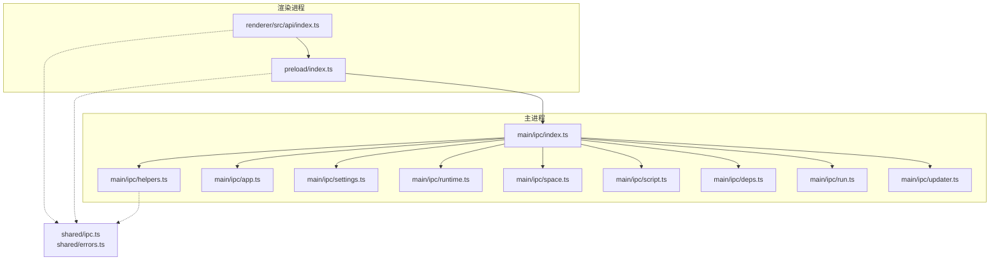
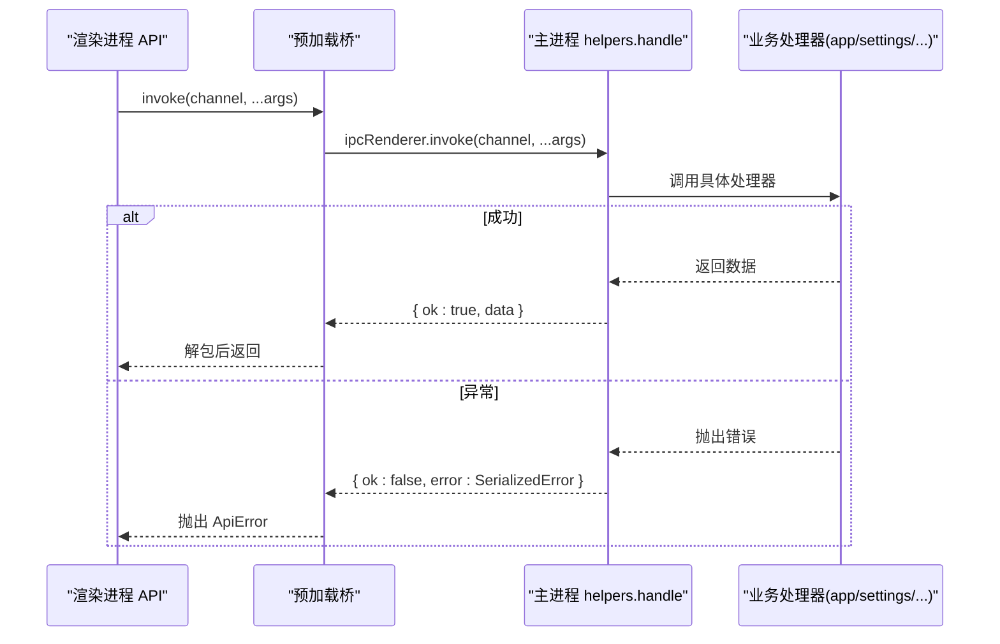
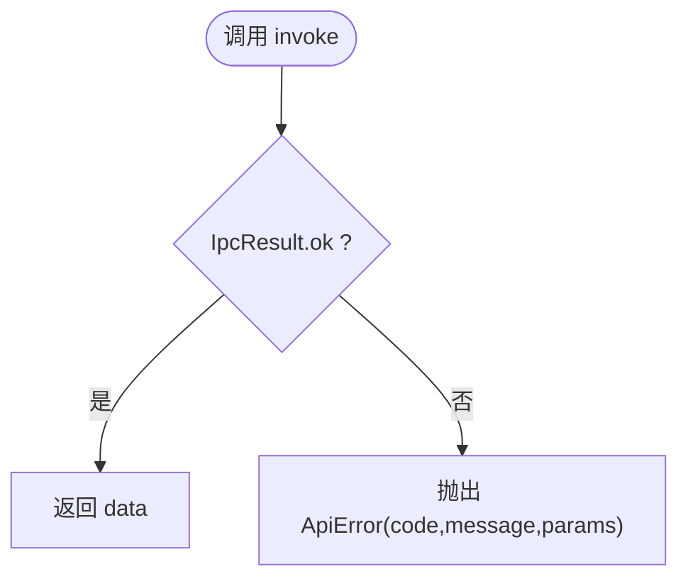
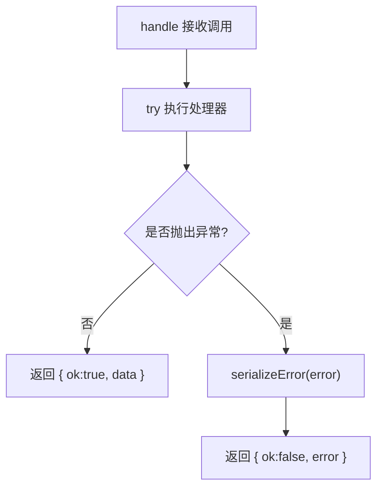
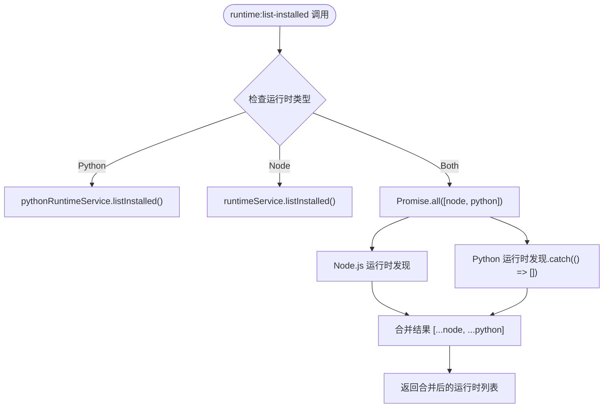
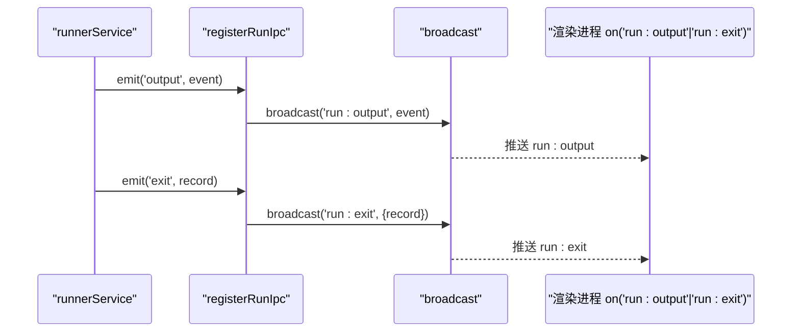
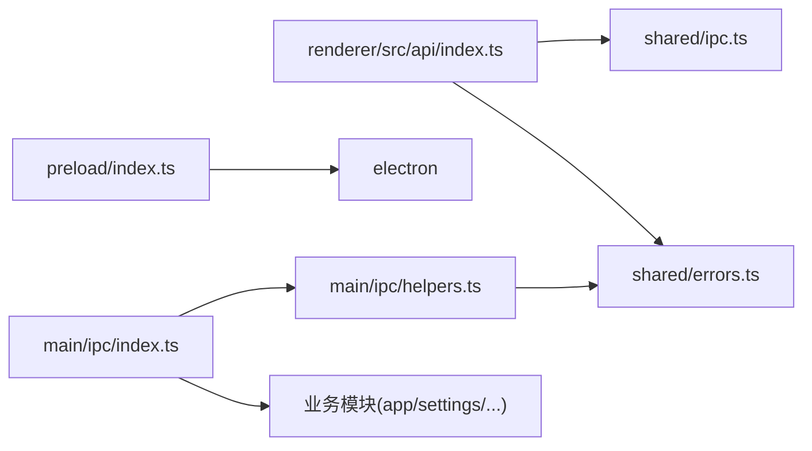

基于我对代码的分析，我现在可以更新 IPC 通信机制文档。主要变更是在 `runtime:list-installed` 处理器中引入了并行执行和错误处理机制，确保即使 Python 工具链损坏，Node.js 运行时仍然可以被列出。

# IPC 通信机制

<cite>
**本文引用的文件**   
- [src/shared/ipc.ts](file://src/shared/ipc.ts)
- [src/main/ipc/index.ts](file://src/main/ipc/index.ts)
- [src/main/ipc/helpers.ts](file://src/main/ipc/helpers.ts)
- [src/preload/index.ts](file://src/preload/index.ts)
- [src/renderer/src/api/index.ts](file://src/renderer/src/api/index.ts)
- [src/main/ipc/app.ts](file://src/main/ipc/app.ts)
- [src/main/ipc/settings.ts](file://src/main/ipc/settings.ts)
- [src/main/ipc/runtime.ts](file://src/main/ipc/runtime.ts)
- [src/main/ipc/space.ts](file://src/main/ipc/space.ts)
- [src/main/ipc/script.ts](file://src/main/ipc/script.ts)
- [src/main/ipc/deps.ts](file://src/main/ipc/deps.ts)
- [src/main/ipc/run.ts](file://src/main/ipc/run.ts)
- [src/main/ipc/updater.ts](file://src/main/ipc/updater.ts)
- [src/shared/errors.ts](file://src/shared/errors.ts)
- [src/main/services/python/runtime.ts](file://src/main/services/python/runtime.ts)
- [src/main/services/runtime/service.ts](file://src/main/services/runtime/service.ts)
</cite>

## 更新摘要
**已进行的变更**   
- 更新了运行时通道部分，详细说明 Promise.all() 并行执行和错误处理机制
- 新增了关于 Python 工具链容错处理的说明
- 增强了故障排查指南中的运行时相关错误处理
- 更新了架构图以反映新的并行处理模式

## 目录
1. [简介](#简介)
2. [项目结构](#项目结构)
3. [核心组件](#核心组件)
4. [架构总览](#架构总览)
5. [详细组件分析](#详细组件分析)
6. [依赖关系分析](#依赖关系分析)
7. [性能考虑](#性能考虑)
8. [故障排查指南](#故障排查指南)
9. [结论](#结论)
10. [附录](#附录)

## 简介
本文件系统性阐述 Script Box 在 Electron 中的进程间通信（IPC）机制，覆盖以下主题：
- Channel 模式与消息传递机制（invoke/send/on）
- 类型安全的 IPC 设计（共享类型、通道注册、参数校验、错误处理）
- IPC 中间件模式（请求拦截、响应处理、日志记录、重试机制）
- 性能优化策略（批量操作、连接池、缓存机制）
- IPC 调试工具与常见问题排查
- 最佳实践与扩展协议（新增通道的方法）

## 项目结构
Script Box 的 IPC 体系由三部分构成：
- 共享类型定义：位于 shared 层，统一描述所有通道的入参与出参类型。
- 渲染进程桥接：preload 暴露最小 API，renderer 封装为类型安全调用。
- 主进程处理器：main 层按业务域拆分通道注册，使用统一的 handle/listen/broadcast 辅助函数。

图表来源
- [src/renderer/src/api/index.ts:1-38](file://src/renderer/src/api/index.ts#L1-L38)
- [src/preload/index.ts:1-19](file://src/preload/index.ts#L1-L19)
- [src/main/ipc/index.ts:1-20](file://src/main/ipc/index.ts#L1-L20)
- [src/main/ipc/helpers.ts:1-46](file://src/main/ipc/helpers.ts#L1-L46)
- [src/shared/ipc.ts:1-117](file://src/shared/ipc.ts#L1-L117)
- [src/shared/errors.ts:1-41](file://src/shared/errors.ts#L1-L41)

章节来源
- [src/shared/ipc.ts:1-117](file://src/shared/ipc.ts#L1-L117)
- [src/main/ipc/index.ts:1-20](file://src/main/ipc/index.ts#L1-L20)

## 核心组件
- 共享类型契约
  - IpcInvokeMap/IpcSendMap/IpcEventMap：声明所有 invoke/send/on 通道的签名与返回类型。
  - ScriptBoxBridge：preload 暴露给渲染进程的桥接口，包含 invoke/send/on/getPathForFile。
  - IpcResult<T>：统一的成功/失败结果包装，用于跨进程序列化错误。
- 渲染端 API
  - invoke/send/on：基于 bridge 的类型安全封装，自动将失败结果转为 ApiError。
- 预加载桥
  - 通过 contextBridge.exposeInMainWorld 暴露最小能力，屏蔽 Electron 内部细节。
- 主进程辅助
  - handle：注册 invoke 处理器，统一捕获异常并序列化为 IpcResult。
  - listen：注册 send 监听器，无返回值。
  - broadcast：向所有窗口广播事件。

章节来源
- [src/shared/ipc.ts:25-117](file://src/shared/ipc.ts#L25-L117)
- [src/renderer/src/api/index.ts:1-38](file://src/renderer/src/api/index.ts#L1-L38)
- [src/preload/index.ts:1-19](file://src/preload/index.ts#L1-L19)
- [src/main/ipc/helpers.ts:1-46](file://src/main/ipc/helpers.ts#L1-L46)

## 架构总览
下图展示一次典型的 invoke 调用从渲染进程到主进程处理器的完整流程，以及错误如何被序列化并回传。

图表来源
- [src/renderer/src/api/index.ts:19-27](file://src/renderer/src/api/index.ts#L19-L27)
- [src/preload/index.ts:5-14](file://src/preload/index.ts#L5-L14)
- [src/main/ipc/helpers.ts:17-28](file://src/main/ipc/helpers.ts#L17-L28)
- [src/shared/errors.ts:36-40](file://src/shared/errors.ts#L36-L40)

## 详细组件分析

### 类型安全的 IPC 设计
- 共享类型定义
  - IpcInvokeMap：定义所有"请求-响应"型通道及其参数/返回类型。
  - IpcSendMap：定义"单向发送"型通道（无响应）。
  - IpcEventMap：定义"主进程推送到渲染进程"的事件通道。
  - ScriptBoxBridge：约束 preload 暴露的能力，确保类型安全。
- 通道注册机制
  - main/ipc/index.ts 集中注册各模块的 registerXxxIpc，保证入口清晰。
  - 每个模块内通过 handle/listen 绑定具体通道名与处理器。
- 参数验证与错误处理
  - 主进程统一用 handle 包裹异步处理器，捕获异常并序列化为 SerializedError。
  - 渲染端将 IpcResult.ok=false 转换为 ApiError，携带 code/params/message。
  - AppError 提供结构化错误码，便于前端国际化与提示。

图表来源
- [src/renderer/src/api/index.ts:19-27](file://src/renderer/src/api/index.ts#L19-L27)
- [src/shared/errors.ts:19-40](file://src/shared/errors.ts#L19-L40)

章节来源
- [src/shared/ipc.ts:25-117](file://src/shared/ipc.ts#L25-L117)
- [src/main/ipc/index.ts:1-20](file://src/main/ipc/index.ts#L1-L20)
- [src/main/ipc/helpers.ts:17-28](file://src/main/ipc/helpers.ts#L17-L28)
- [src/shared/errors.ts:1-41](file://src/shared/errors.ts#L1-L41)

### IPC 中间件模式
当前实现采用轻量中间件思路：
- 请求拦截：handle 在调用业务处理器前进行 try/catch 拦截。
- 响应处理：统一包装为 IpcResult，避免跨进程丢失错误信息。
- 日志记录：失败路径打印 [ipc] channel failed 日志，便于定位。
- 重试机制：当前未内置；可在上层（如 renderer store 或 UI 层）对特定通道增加重试逻辑。

图表来源
- [src/main/ipc/helpers.ts:17-28](file://src/main/ipc/helpers.ts#L17-L28)
- [src/shared/errors.ts:36-40](file://src/shared/errors.ts#L36-L40)

章节来源
- [src/main/ipc/helpers.ts:1-46](file://src/main/ipc/helpers.ts#L1-L46)

### 通道分类与示例

#### 应用类通道（app）
- 功能：获取应用信息、打开路径/外部链接、选择脚本文件等。
- 特点：直接调用 Electron shell/dialog，必要时进行 URL 白名单校验。

章节来源
- [src/main/ipc/app.ts:1-36](file://src/main/ipc/app.ts#L1-L36)

#### 设置类通道（settings）
- 功能：读取/更新设置、测试网络连接。
- 特性：设置变更时触发代理配置生效，并向所有窗口广播 settings:changed 事件。

章节来源
- [src/main/ipc/settings.ts:1-15](file://src/main/ipc/settings.ts#L1-L15)

#### 运行时通道（runtime）
- 功能：列出远程/已安装版本、安装/取消/移除、进度推送。
- 特性：通过 runtimeService 管理生命周期，progress 事件广播至渲染端。
- **更新**：增强了容错处理能力，使用 Promise.all() 并行执行 Node.js 和 Python 运行时发现，确保单个运行时的失败不会影响其他运行时的发现。

**更新** 运行时通道现在实现了健壮的并行执行机制：

**图表来源**
- [src/main/ipc/runtime.ts:12-23](file://src/main/ipc/runtime.ts#L12-L23)

这种设计确保了即使 Python 工具链损坏或不可用，Node.js 运行时仍然可以被正常发现和列出，提升了系统的健壮性。

章节来源
- [src/main/ipc/runtime.ts:1-50](file://src/main/ipc/runtime.ts#L1-L50)
- [src/main/services/python/runtime.ts:62-80](file://src/main/services/python/runtime.ts#L62-L80)
- [src/main/services/runtime/service.ts:59-72](file://src/main/services/runtime/service.ts#L59-L72)

#### 空间通道（space）
- 功能：CRUD 空间、打开目录。
- 保护：删除前检查是否有运行中任务或依赖安装任务，否则抛出 SPACE_BUSY。

章节来源
- [src/main/ipc/space.ts:1-26](file://src/main/ipc/space.ts#L1-L26)

#### 脚本通道（script）
- 功能：CRUD 脚本、导入、重命名、保存运行配置等。

章节来源
- [src/main/ipc/script.ts:1-14](file://src/main/ipc/script.ts#L1-L14)

#### 依赖通道（deps）
- 功能：安装/卸载/更新依赖、扫描缺失、类型库查询、任务控制。
- 特性：task 事件广播，供渲染端实时更新进度。

章节来源
- [src/main/ipc/deps.ts:1-18](file://src/main/ipc/deps.ts#L1-L18)

#### 运行通道（run）
- 功能：启动/停止运行、查询活跃任务、写入输入、调整终端尺寸。
- 历史：查询/读取/清理历史记录。
- 事件：output/exit 事件广播。

章节来源
- [src/main/ipc/run.ts:1-19](file://src/main/ipc/run.ts#L1-L19)

#### 更新通道（updater）
- 功能：查询状态、检查/下载/安装更新。
- 特性：status 事件广播。

章节来源
- [src/main/ipc/updater.ts:1-12](file://src/main/ipc/updater.ts#L1-L12)

### 关键流程图：运行输出与退出事件

图表来源
- [src/main/ipc/run.ts:16-17](file://src/main/ipc/run.ts#L16-L17)
- [src/main/ipc/helpers.ts:41-45](file://src/main/ipc/helpers.ts#L41-L45)

## 依赖关系分析
- 渲染端依赖
  - renderer/src/api/index.ts 依赖 shared/ipc.ts 的类型与 shared/errors.ts 的错误类型。
- 预加载桥依赖
  - preload/index.ts 依赖 electron 的 contextBridge/ipcRenderer/webUtils。
- 主进程依赖
  - main/ipc/index.ts 聚合各模块的 registerXxxIpc。
  - main/ipc/helpers.ts 依赖 electron 的 ipcMain/BrowserWindow 与 shared/errors.ts。
  - 各业务模块依赖对应 services 层（如 spaceService、runnerService、depsService 等）。

图表来源
- [src/renderer/src/api/index.ts:1-38](file://src/renderer/src/api/index.ts#L1-L38)
- [src/preload/index.ts:1-19](file://src/preload/index.ts#L1-L19)
- [src/main/ipc/index.ts:1-20](file://src/main/ipc/index.ts#L1-L20)
- [src/main/ipc/helpers.ts:1-46](file://src/main/ipc/helpers.ts#L1-L46)
- [src/shared/ipc.ts:1-117](file://src/shared/ipc.ts#L1-L117)
- [src/shared/errors.ts:1-41](file://src/shared/errors.ts#L1-L41)

章节来源
- [src/renderer/src/api/index.ts:1-38](file://src/renderer/src/api/index.ts#L1-L38)
- [src/preload/index.ts:1-19](file://src/preload/index.ts#L1-L19)
- [src/main/ipc/index.ts:1-20](file://src/main/ipc/index.ts#L1-L20)
- [src/main/ipc/helpers.ts:1-46](file://src/main/ipc/helpers.ts#L1-L46)

## 性能考虑
- 批量操作
  - 对于高频小消息（如终端输入），建议使用 send 单向通道减少往返开销；例如 run:write/run:resize。
  - 对依赖安装等长耗时任务，服务端侧可合并事件推送，降低渲染端刷新频率。
- 连接池
  - 当前 IPC 基于 Electron 内置通道，无需显式连接池；如需复用重型资源（如子进程、网络客户端），应在服务层维护实例池。
- 缓存机制
  - settings:get 等读多写少的数据，可在渲染端做短期缓存，配合 settings:changed 事件失效。
  - deps:types/node-types 等静态类型列表，可结合本地缓存减少重复计算。
- 事件广播优化
  - broadcast 会遍历所有窗口，建议仅在必要场景广播，或在渲染端按需订阅。
- **更新** 并行执行优化
  - 运行时发现使用 Promise.all() 并行执行 Node.js 和 Python 运行时发现，提升整体性能。
  - 单个运行时的失败不会影响其他运行时的发现，提高了系统的容错性。

[本节为通用指导，不直接分析具体文件]

## 故障排查指南
- 常见错误
  - 通道未注册：检查 main/ipc/index.ts 是否调用了对应 registerXxxIpc。
  - 类型不匹配：核对 shared/ipc.ts 中对应通道的参数/返回类型是否与调用一致。
  - 跨进程错误丢失：确认主进程抛出的错误是否为 AppError，以便正确序列化。
- 定位步骤
  - 查看控制台日志：主进程 handle 会在失败时打印 [ipc] channel failed。
  - 检查事件订阅：on 返回的注销函数是否正确调用，避免内存泄漏。
  - 验证 URL 白名单：app:open-external 仅允许 https/http 协议。
- 快速修复
  - 若出现 UNKNOWN 错误码，检查业务处理器是否抛出非 AppError 的异常。
  - 若 Space 删除失败，检查是否存在运行中任务或依赖安装任务。
- **更新** 运行时相关故障排查
  - Python 工具链损坏：系统会自动降级为只列出 Node.js 运行时，不影响基本功能。
  - 运行时发现失败：检查 Promise.all() 中的 .catch(() => []) 是否正确处理了异常。
  - 并行执行问题：确认 Node.js 和 Python 运行时发现互不影响。

章节来源
- [src/main/ipc/helpers.ts:17-28](file://src/main/ipc/helpers.ts#L17-L28)
- [src/main/ipc/app.ts:20-24](file://src/main/ipc/app.ts#L20-L24)
- [src/main/ipc/space.ts:15-19](file://src/main/ipc/space.ts#L15-L19)
- [src/shared/errors.ts:25-40](file://src/shared/errors.ts#L25-L40)
- [src/main/ipc/runtime.ts:17-22](file://src/main/ipc/runtime.ts#L17-L22)

## 结论
Script Box 的 IPC 体系以共享类型为核心，通过 preload 桥与主进程辅助函数实现了类型安全、错误可序列化、事件可广播的统一通信模型。该设计具备良好的可扩展性与可维护性，适合在多模块、多窗口的 Electron 应用中稳定运行。**更新** 最新的增强包括对 Python 工具链损坏的优雅处理，通过并行执行和错误隔离确保了系统的健壮性。

[本节为总结性内容，不直接分析具体文件]

## 附录

### 如何添加新的 IPC 通道
- 在 shared/ipc.ts 中新增通道签名
  - 在 IpcInvokeMap/IpcSendMap/IpcEventMap 中添加新通道及其参数/返回类型。
- 在主进程中注册处理器
  - 新建或扩展现有模块（如 newmodule.ts），使用 handle/listen/broadcast 注册通道。
  - 在 main/ipc/index.ts 中引入并调用 registerNewModuleIpc。
- 在渲染端调用
  - 使用 renderer/src/api/index.ts 提供的 invoke/send/on，获得完整的类型推断与错误转换。

章节来源
- [src/shared/ipc.ts:25-117](file://src/shared/ipc.ts#L25-L117)
- [src/main/ipc/index.ts:1-20](file://src/main/ipc/index.ts#L1-L20)
- [src/renderer/src/api/index.ts:19-35](file://src/renderer/src/api/index.ts#L19-L35)

### 扩展通信协议的建议
- 保持通道命名规范：领域:动作（如 deps:install）。
- 优先使用 IpcResult 包装错误，避免跨进程丢失堆栈。
- 对长耗时任务使用事件推送（如 progress/task/output/exit），避免阻塞调用链。
- 对敏感操作（如打开外部链接）进行白名单校验。
- **更新** 对于可能失败的并行操作，使用 .catch(() => []) 确保单个失败不影响整体流程。

[本节为通用指导，不直接分析具体文件]