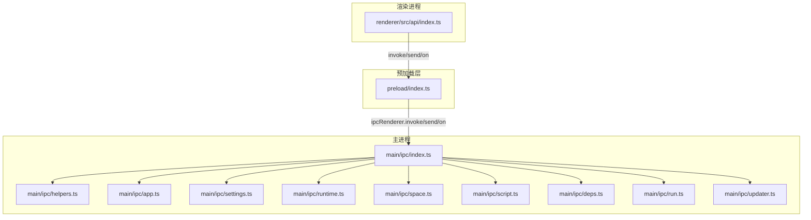
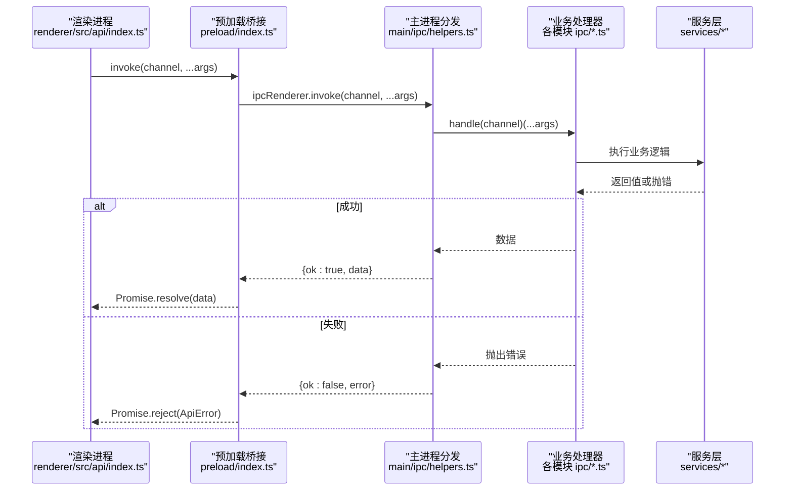
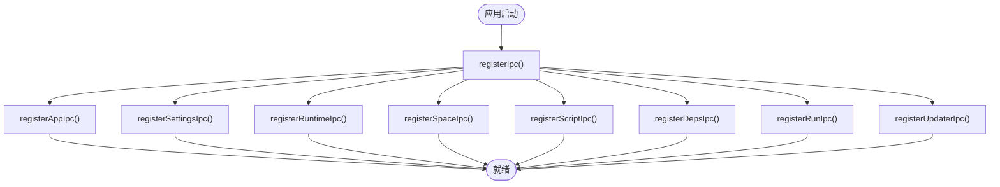
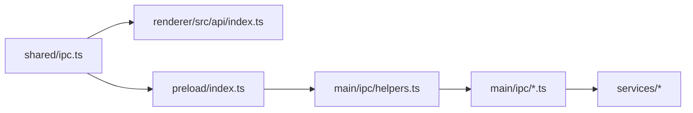

# IPC 通道设计

<cite>
**本文引用的文件**   
- [src/shared/ipc.ts](file://src/shared/ipc.ts)
- [src/main/ipc/index.ts](file://src/main/ipc/index.ts)
- [src/main/ipc/helpers.ts](file://src/main/ipc/helpers.ts)
- [src/preload/index.ts](file://src/preload/index.ts)
- [src/renderer/src/api/index.ts](file://src/renderer/src/api/index.ts)
- [src/main/ipc/app.ts](file://src/main/ipc/app.ts)
- [src/main/ipc/settings.ts](file://src/main/ipc/settings.ts)
- [src/main/ipc/runtime.ts](file://src/main/ipc/runtime.ts)
- [src/main/ipc/space.ts](file://src/main/ipc/space.ts)
- [src/main/ipc/script.ts](file://src/main/ipc/script.ts)
- [src/main/ipc/deps.ts](file://src/main/ipc/deps.ts)
- [src/main/ipc/run.ts](file://src/main/ipc/run.ts)
- [src/main/ipc/updater.ts](file://src/main/ipc/updater.ts)
</cite>

## 目录
1. [简介](#简介)
2. [项目结构](#项目结构)
3. [核心组件](#核心组件)
4. [架构总览](#架构总览)
5. [详细组件分析](#详细组件分析)
6. [依赖关系分析](#依赖关系分析)
7. [性能与可扩展性](#性能与可扩展性)
8. [故障排查指南](#故障排查指南)
9. [结论](#结论)
10. [附录：新通道开发示例](#附录新通道开发示例)

## 简介
本文面向 Script Box 的进程间通信（IPC）通道设计与实现，重点说明三类通道类型的设计理念、命名规范、注册机制、中间件能力以及版本兼容策略。读者无需深入 Electron 细节即可理解并扩展新的 IPC 通道。

## 项目结构
Script Box 的 IPC 体系由“共享契约 + 渲染层封装 + 预加载桥接 + 主进程分发”四部分组成：
- 共享契约：定义通道接口、事件载荷与统一返回格式
- 渲染层封装：提供类型安全的 invoke/send/on 调用入口
- 预加载桥接：在 contextBridge 中暴露最小 API 到渲染进程
- 主进程分发：按模块注册 handle/listen/broadcast，对接服务层

图表来源
- [src/renderer/src/api/index.ts:1-37](file://src/renderer/src/api/index.ts#L1-L37)
- [src/preload/index.ts:1-19](file://src/preload/index.ts#L1-L19)
- [src/main/ipc/index.ts:1-20](file://src/main/ipc/index.ts#L1-L20)
- [src/main/ipc/helpers.ts:1-46](file://src/main/ipc/helpers.ts#L1-L46)

章节来源
- [src/shared/ipc.ts:25-117](file://src/shared/ipc.ts#L25-L117)
- [src/main/ipc/index.ts:1-20](file://src/main/ipc/index.ts#L1-L20)

## 核心组件
- 共享契约
  - IpcInvokeMap：请求-响应型通道（渲染 -> 主进程）
  - IpcSendMap：单向发送通道（渲染 -> 主进程）
  - IpcEventMap：事件推送通道（主进程 -> 渲染）
  - IpcResult<T>：统一的 ok/error 包装，避免跨上下文丢失错误字段
  - ScriptBoxBridge：预加载暴露的最小桥接接口
- 主进程工具
  - handle：封装 ipcMain.handle，自动捕获异常并返回 IpcResult
  - listen：封装 ipcMain.on，用于 fire-and-forget 通道
  - broadcast：向所有窗口广播事件
- 预加载桥接
  - 将 bridge.invoke/send/on 暴露给渲染进程，并对 on 返回取消订阅函数
- 渲染层 API
  - 对 bridge 进行二次封装，抛出 ApiError，保持调用方代码简洁

章节来源
- [src/shared/ipc.ts:25-117](file://src/shared/ipc.ts#L25-L117)
- [src/main/ipc/helpers.ts:1-46](file://src/main/ipc/helpers.ts#L1-L46)
- [src/preload/index.ts:1-19](file://src/preload/index.ts#L1-L19)
- [src/renderer/src/api/index.ts:1-37](file://src/renderer/src/api/index.ts#L1-L37)

## 架构总览
下图展示一次典型的“请求-响应”通道调用流程，包括错误处理与结果转换。

图表来源
- [src/renderer/src/api/index.ts:19-27](file://src/renderer/src/api/index.ts#L19-L27)
- [src/preload/index.ts:5-14](file://src/preload/index.ts#L5-L14)
- [src/main/ipc/helpers.ts:17-28](file://src/main/ipc/helpers.ts#L17-L28)

## 详细组件分析

### 通道类型与设计理念
- IpcInvokeMap（请求-响应）
  - 适用场景：需要等待主进程执行结果，如读取配置、安装运行时、启动脚本等
  - 特点：强类型参数/返回值；统一 IpcResult 包装；支持异步
- IpcSendMap（单向发送）
  - 适用场景：不需要返回值的“发后即忘”消息，如终端写入、尺寸调整
  - 特点：无返回值；主进程侧使用 listen 监听
- IpcEventMap（事件推送）
  - 适用场景：主进程主动推送到渲染端，如进度、输出、退出状态、设置变更
  - 特点：一对多广播；渲染端通过 on 订阅并获取取消订阅函数

章节来源
- [src/shared/ipc.ts:25-117](file://src/shared/ipc.ts#L25-L117)

### 通道命名规范
- 模块前缀：以领域为前缀，如 app、settings、runtime、space、script、deps、run、updater
- 操作动词：紧跟冒号后的动作，如 get/update/install/remove/start/stop/listen/broadcast
- 参数传递约定：
  - 请求参数尽量小且可序列化
  - 复杂对象优先拆分为多次调用或使用分页/增量更新
  - 事件载荷仅包含必要信息，避免大对象频繁推送

章节来源
- [src/shared/ipc.ts:25-99](file://src/shared/ipc.ts#L25-L99)

### 通道注册机制
- 自动发现与集中注册
  - main/ipc/index.ts 汇总各模块的 registerXxxIpc 方法，统一调用完成注册
- 依赖注入
  - 各模块通过 import services/* 直接获取服务实例，不依赖 DI 容器
- 生命周期管理
  - 应用启动时调用 registerIpc() 完成所有通道注册
  - 事件订阅在服务层触发后通过 broadcast 推送至渲染端

图表来源
- [src/main/ipc/index.ts:10-19](file://src/main/ipc/index.ts#L10-L19)

章节来源
- [src/main/ipc/index.ts:1-20](file://src/main/ipc/index.ts#L1-L20)

### 通道中间件能力
当前 helpers.ts 提供的通用能力如下：
- 认证授权：未内置；可在各模块 handle 内部校验上下文或权限
- 参数校验：未内置；建议在 handler 内做基础校验，必要时抛出结构化错误
- 结果转换：handle 自动将返回值包装为 IpcResult；错误被序列化为 SerializedError
- 错误处理：统一捕获并记录日志，前端通过 ApiError 暴露 code/params

如需增强，可在 handle/listen/broadcast 外层包裹中间件函数，实现鉴权、限流、审计、重试等横切逻辑。

章节来源
- [src/main/ipc/helpers.ts:17-46](file://src/main/ipc/helpers.ts#L17-L46)
- [src/renderer/src/api/index.ts:1-15](file://src/renderer/src/api/index.ts#L1-L15)

### 典型通道实现模式
- 请求-响应（app:info）
  - 渲染端调用 invoke('app:info')
  - 主进程 handle('app:info', ...) 返回系统信息
- 单向发送（run:write）
  - 渲染端 send('run:write', runId, data)
  - 主进程 listen('run:write', ...) 转发到 runnerService.write
- 事件推送（settings:changed）
  - settingsStore 变更触发 broadcast('settings:changed', settings)
  - 渲染端 on('settings:changed', listener) 接收最新设置

章节来源
- [src/main/ipc/app.ts:5-12](file://src/main/ipc/app.ts#L5-L12)
- [src/main/ipc/run.ts:4-10](file://src/main/ipc/run.ts#L4-L10)
- [src/main/ipc/settings.ts:5-13](file://src/main/ipc/settings.ts#L5-L13)

## 依赖关系分析
- 渲染层依赖 shared/ipc 的类型定义与 api/index.ts 的封装
- 预加载层依赖 electron 的 contextBridge/ipcRenderer/webUtils
- 主进程各模块依赖 helpers.ts 的统一分发能力，并组合 services/* 的业务逻辑

图表来源
- [src/shared/ipc.ts:25-117](file://src/shared/ipc.ts#L25-L117)
- [src/renderer/src/api/index.ts:1-37](file://src/renderer/src/api/index.ts#L1-L37)
- [src/preload/index.ts:1-19](file://src/preload/index.ts#L1-L19)
- [src/main/ipc/helpers.ts:1-46](file://src/main/ipc/helpers.ts#L1-L46)

章节来源
- [src/shared/ipc.ts:25-117](file://src/shared/ipc.ts#L25-L117)
- [src/main/ipc/helpers.ts:1-46](file://src/main/ipc/helpers.ts#L1-L46)

## 性能与可扩展性
- 批量与去抖
  - 高频事件（如运行输出）建议在主进程侧合并或节流后再广播
- 大对象传输
  - 避免在事件载荷中传输大对象；改用分片/游标/增量更新
- 并发控制
  - 长任务（安装依赖、下载更新）应返回任务标识，配合 active/cancel 通道查询与取消
- 可扩展点
  - 在 helpers.ts 上增加中间件层，统一处理鉴权、审计、限流、重试
  - 在 registerIpc 之前注入全局拦截器，便于统一埋点与监控

[本节为通用指导，不涉及具体文件]

## 故障排查指南
- 常见错误
  - 未注册的通道：检查是否在 registerIpc 中注册对应模块
  - 参数类型不匹配：核对 IpcInvokeMap/IpcSendMap/IpcEventMap 的定义
  - 事件未收到：确认主进程是否调用 broadcast，渲染端是否正确 on 并保留取消订阅
- 定位步骤
  - 查看主进程控制台日志（helpers.ts 已统一打印失败堆栈）
  - 在前端捕获 ApiError.code/params 进行用户提示
  - 对关键通道增加临时日志，观察调用链

章节来源
- [src/main/ipc/helpers.ts:17-38](file://src/main/ipc/helpers.ts#L17-L38)
- [src/renderer/src/api/index.ts:1-15](file://src/renderer/src/api/index.ts#L1-L15)

## 结论
Script Box 的 IPC 通道以“共享契约 + 三层封装 + 模块化注册”为核心，清晰区分请求-响应、单向发送与事件推送三类通道。借助 handle/listen/broadcast 的标准化实现，新增通道成本低、类型安全、错误可观测。未来可通过中间件层进一步增强鉴权、审计与可观测性。

[本节为总结性内容，不涉及具体文件]

## 附录：新通道开发示例
以下示例演示如何新增一个“模块:操作”通道，涵盖前后端完整流程。

- 步骤一：在共享契约中声明通道
  - 在 IpcInvokeMap/IpcSendMap/IpcEventMap 中添加新条目，确保参数与返回类型正确
  - 参考路径：[src/shared/ipc.ts:25-99](file://src/shared/ipc.ts#L25-L99)

- 步骤二：渲染端调用
  - 使用 renderer/src/api/index.ts 暴露的 invoke/send/on
  - 参考路径：[src/renderer/src/api/index.ts:19-35](file://src/renderer/src/api/index.ts#L19-L35)

- 步骤三：主进程处理
  - 在对应模块文件中用 handle/listen/broadcast 注册
  - 若需广播事件，使用 broadcast
  - 参考路径：
    - [src/main/ipc/helpers.ts:17-46](file://src/main/ipc/helpers.ts#L17-L46)
    - [src/main/ipc/app.ts:5-12](file://src/main/ipc/app.ts#L5-L12)
    - [src/main/ipc/run.ts:4-10](file://src/main/ipc/run.ts#L4-L10)
    - [src/main/ipc/settings.ts:5-13](file://src/main/ipc/settings.ts#L5-L13)

- 步骤四：注册与启动
  - 确保在 main/ipc/index.ts 中调用对应 registerXxxIpc
  - 参考路径：[src/main/ipc/index.ts:10-19](file://src/main/ipc/index.ts#L10-L19)

- 步骤五：错误与兼容性
  - 错误通过 IpcResult 包装，前端以 ApiError 抛出
  - 向后兼容：新增可选参数时保持默认行为；废弃字段标记并在后续版本移除
  - 参考路径：
    - [src/shared/ipc.ts:105-117](file://src/shared/ipc.ts#L105-L117)
    - [src/renderer/src/api/index.ts:1-15](file://src/renderer/src/api/index.ts#L1-L15)

章节来源
- [src/shared/ipc.ts:25-117](file://src/shared/ipc.ts#L25-L117)
- [src/renderer/src/api/index.ts:1-37](file://src/renderer/src/api/index.ts#L1-L37)
- [src/main/ipc/helpers.ts:1-46](file://src/main/ipc/helpers.ts#L1-L46)
- [src/main/ipc/index.ts:1-20](file://src/main/ipc/index.ts#L1-L20)