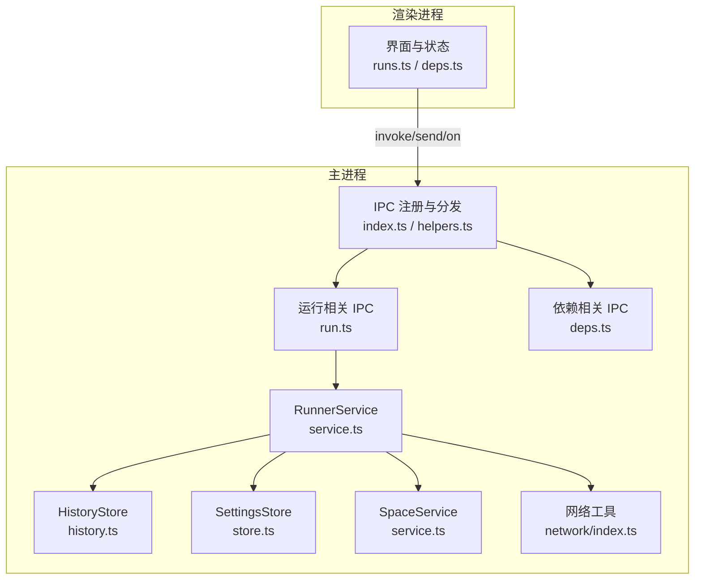
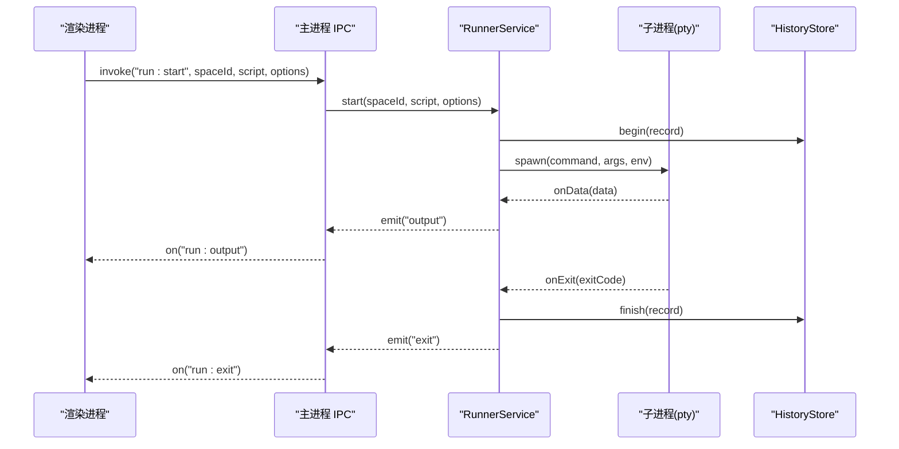
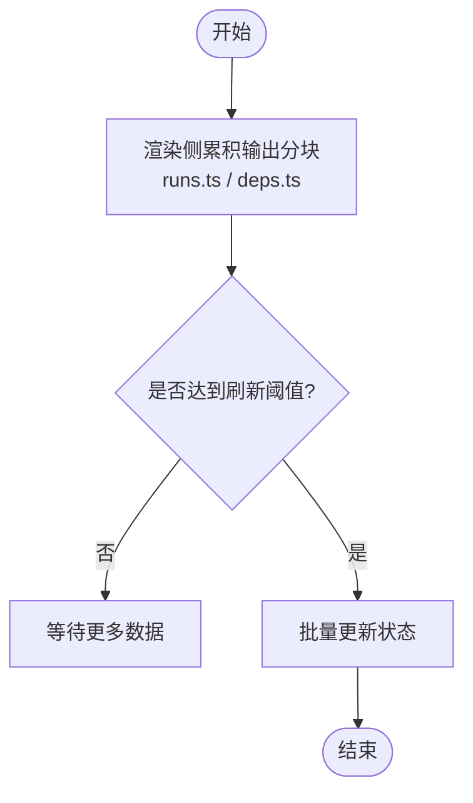
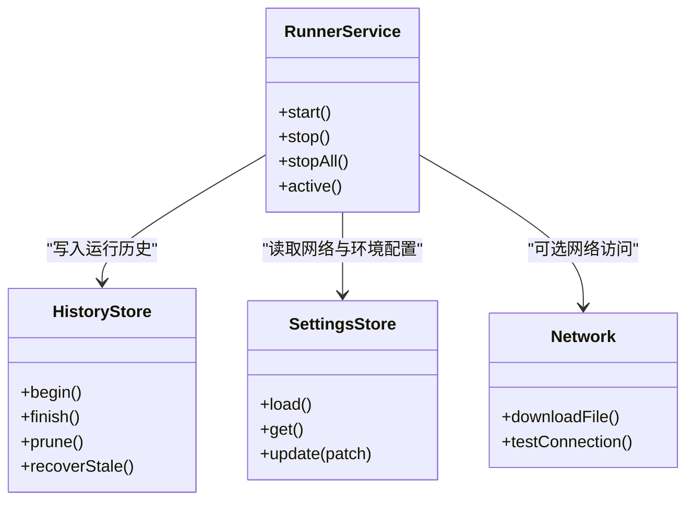
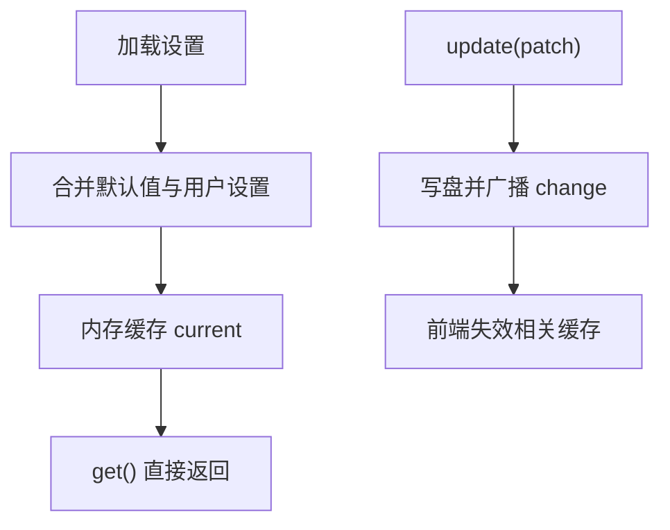
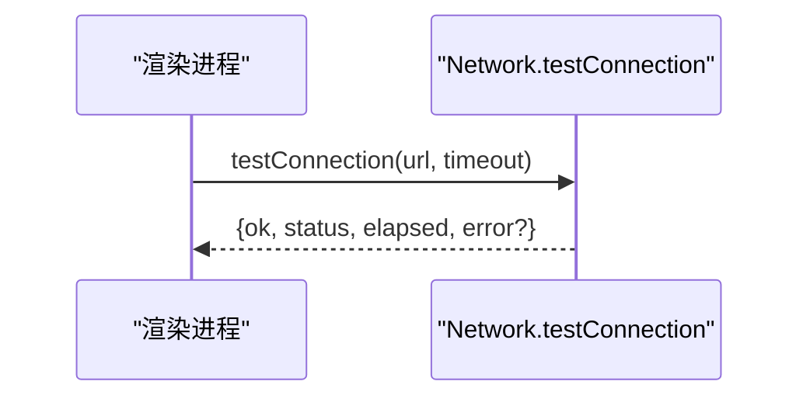
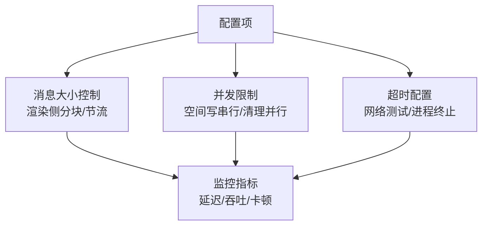
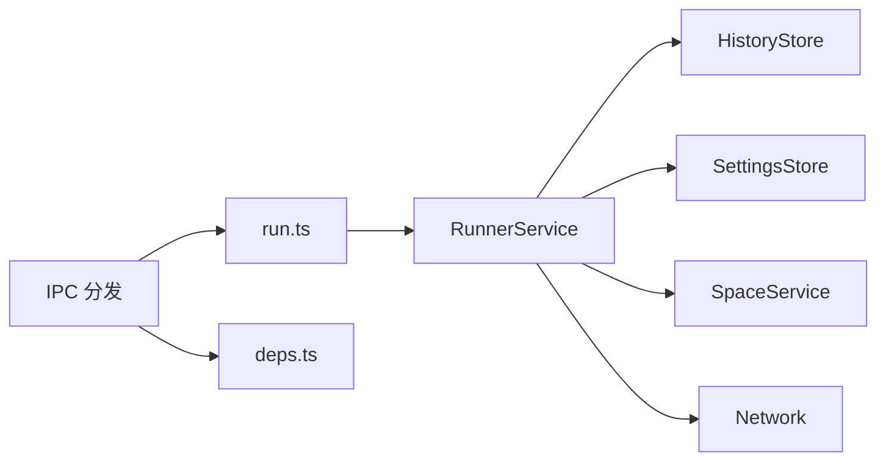

# 性能优化策略

<cite>
**本文引用的文件**   
- [src/shared/ipc.ts](file://src/shared/ipc.ts)
- [src/main/ipc/helpers.ts](file://src/main/ipc/helpers.ts)
- [src/main/ipc/index.ts](file://src/main/ipc/index.ts)
- [src/main/ipc/run.ts](file://src/main/ipc/run.ts)
- [src/main/ipc/deps.ts](file://src/main/ipc/deps.ts)
- [src/main/services/runner/service.ts](file://src/main/services/runner/service.ts)
- [src/main/services/runner/history.ts](file://src/main/services/runner/history.ts)
- [src/main/services/settings/store.ts](file://src/main/services/settings/store.ts)
- [src/main/services/space/service.ts](file://src/main/services/space/service.ts)
- [src/main/services/network/index.ts](file://src/main/services/network/index.ts)
- [src/renderer/src/stores/runs.ts](file://src/renderer/src/stores/runs.ts)
- [src/renderer/src/stores/deps.ts](file://src/renderer/src/stores/deps.ts)
- [src/renderer/src/pages/settings/ConnectionTest.tsx](file://src/renderer/src/pages/settings/ConnectionTest.tsx)
- [src/renderer/src/pages/settings/RunSection.tsx](file://src/renderer/src/pages/settings/RunSection.tsx)
</cite>

## 目录
1. [引言](#引言)
2. [项目结构](#项目结构)
3. [核心组件](#核心组件)
4. [架构总览](#架构总览)
5. [详细组件分析](#详细组件分析)
6. [依赖关系分析](#依赖关系分析)
7. [性能考量](#性能考量)
8. [故障排查指南](#故障排查指南)
9. [结论](#结论)

## 引言
本文围绕 Script Box 的 IPC 性能优化展开，重点说明以下方面：
- 批量操作：消息合并、事务处理、异步批处理
- 连接池管理：连接复用、资源清理、内存优化
- 缓存机制：数据缓存、结果缓存、智能失效
- 性能监控：延迟统计、吞吐量监控、瓶颈识别
- 性能调优指南：消息大小控制、并发限制、超时配置
- 常见问题排查：内存泄漏、阻塞操作、资源竞争

目标是帮助读者理解现有实现中的性能相关设计，并给出可操作的优化建议。

## 项目结构
Script Box 采用 Electron 多进程架构：渲染进程通过类型化的 IPC 通道与主进程通信；主进程负责脚本运行、依赖安装、运行时管理、设置持久化等。IPC 层提供统一的 handle/listen/broadcast 封装，业务服务以模块方式注册到 IPC。

图表来源
- [src/main/ipc/index.ts:10-19](file://src/main/ipc/index.ts#L10-L19)
- [src/main/ipc/helpers.ts:17-46](file://src/main/ipc/helpers.ts#L17-L46)
- [src/main/ipc/run.ts:4-17](file://src/main/ipc/run.ts#L4-L17)
- [src/main/ipc/deps.ts:4-16](file://src/main/ipc/deps.ts#L4-L16)
- [src/main/services/runner/service.ts:29-146](file://src/main/services/runner/service.ts#L29-L146)
- [src/main/services/runner/history.ts:73-92](file://src/main/services/runner/history.ts#L73-L92)
- [src/main/services/settings/store.ts:8-29](file://src/main/services/settings/store.ts#L8-L29)
- [src/main/services/space/service.ts:75-87](file://src/main/services/space/service.ts#L75-L87)
- [src/main/services/network/index.ts:34-80](file://src/main/services/network/index.ts#L34-L80)

章节来源
- [src/main/ipc/index.ts:10-19](file://src/main/ipc/index.ts#L10-L19)
- [src/main/ipc/helpers.ts:17-46](file://src/main/ipc/helpers.ts#L17-L46)

## 核心组件
- IPC 类型契约：集中定义请求/响应、单向发送、事件推送三类通道，保证跨进程调用类型安全与一致性。
- IPC 分发器：统一包装错误序列化、广播到所有窗口、监听无返回值事件。
- RunnerService：管理脚本子进程生命周期、输出流、历史记录写入、停止与强制终止。
- HistoryStore：记录运行历史、恢复异常状态、按配置裁剪历史。
- SettingsStore：内存中缓存设置，变更时写盘并广播。
- SpaceService：对空间元数据进行串行化读写，避免并发冲突。
- Network 工具：下载进度节流上报、连接测试带超时与耗时统计。

章节来源
- [src/shared/ipc.ts:25-116](file://src/shared/ipc.ts#L25-L116)
- [src/main/ipc/helpers.ts:17-46](file://src/main/ipc/helpers.ts#L17-L46)
- [src/main/services/runner/service.ts:29-146](file://src/main/services/runner/service.ts#L29-L146)
- [src/main/services/runner/history.ts:73-92](file://src/main/services/runner/history.ts#L73-L92)
- [src/main/services/settings/store.ts:8-29](file://src/main/services/settings/store.ts#L8-L29)
- [src/main/services/space/service.ts:75-87](file://src/main/services/space/service.ts#L75-L87)
- [src/main/services/network/index.ts:34-80](file://src/main/services/network/index.ts#L34-L80)

## 架构总览
下图展示一次“启动脚本”的端到端流程，体现 IPC 调用、Runner 子进程、日志落盘与事件回推的关系。

图表来源
- [src/main/ipc/run.ts:4-17](file://src/main/ipc/run.ts#L4-L17)
- [src/main/services/runner/service.ts:44-88](file://src/main/services/runner/service.ts#L44-L88)
- [src/main/services/runner/service.ts:122-143](file://src/main/services/runner/service.ts#L122-L143)
- [src/main/services/runner/history.ts:73-92](file://src/main/services/runner/history.ts#L73-L92)

## 详细组件分析

### 批量操作：消息合并、事务处理、异步批处理
- 消息合并
  - 渲染侧对运行输出和依赖任务输出采用分块累积（chunks），减少频繁状态更新带来的重绘压力。
  - 依赖任务在渲染侧通过事件聚合，仅在关键节点触发状态刷新。
- 事务处理
  - SpaceService 使用基于 Promise 链的串行锁，确保同一空间的元数据读写串行化，避免并发写导致的竞态条件。
  - RunnerService 在结束阶段统一更新记录并落盘，失败路径有容错处理。
- 异步批处理
  - HistoryStore 在清理历史时使用 Promise.all 并行删除多余记录，提升清理吞吐。
  - 网络下载通过 Transform 流进行节流上报，降低事件频率。

图表来源
- [src/renderer/src/stores/runs.ts:26-61](file://src/renderer/src/stores/runs.ts#L26-L61)
- [src/renderer/src/stores/deps.ts:27-64](file://src/renderer/src/stores/deps.ts#L27-L64)
- [src/main/services/space/service.ts:75-87](file://src/main/services/space/service.ts#L75-L87)
- [src/main/services/runner/history.ts:88-92](file://src/main/services/runner/history.ts#L88-L92)
- [src/main/services/network/index.ts:43-58](file://src/main/services/network/index.ts#L43-L58)

章节来源
- [src/renderer/src/stores/runs.ts:26-61](file://src/renderer/src/stores/runs.ts#L26-L61)
- [src/renderer/src/stores/deps.ts:27-64](file://src/renderer/src/stores/deps.ts#L27-L64)
- [src/main/services/space/service.ts:75-87](file://src/main/services/space/service.ts#L75-L87)
- [src/main/services/runner/history.ts:88-92](file://src/main/services/runner/history.ts#L88-L92)
- [src/main/services/network/index.ts:43-58](file://src/main/services/network/index.ts#L43-L58)

### 连接池管理：连接复用、资源清理、内存优化
- 连接复用
  - SettingsStore 将当前设置常驻内存，避免每次读取都落盘解析。
  - RunnerService 维护活跃运行 Map，复用 pty 实例的生命周期管理。
- 资源清理
  - RunnerService 在进程退出后关闭日志流、从 Map 移除记录，并在必要时强制终止子进程。
  - HistoryStore 在应用重启后恢复异常状态的运行记录，避免悬挂。
- 内存优化
  - HistoryStore 支持根据 historyLimit 裁剪历史，防止历史文件无限增长。
  - Network 下载通过流式管道处理大文件，避免一次性加载到内存。

图表来源
- [src/main/services/settings/store.ts:8-29](file://src/main/services/settings/store.ts#L8-L29)
- [src/main/services/runner/service.ts:29-146](file://src/main/services/runner/service.ts#L29-L146)
- [src/main/services/runner/history.ts:73-92](file://src/main/services/runner/history.ts#L73-L92)
- [src/main/services/network/index.ts:34-80](file://src/main/services/network/index.ts#L34-L80)

章节来源
- [src/main/services/settings/store.ts:8-29](file://src/main/services/settings/store.ts#L8-L29)
- [src/main/services/runner/service.ts:101-143](file://src/main/services/runner/service.ts#L101-L143)
- [src/main/services/runner/history.ts:73-92](file://src/main/services/runner/history.ts#L73-L92)
- [src/main/services/network/index.ts:34-80](file://src/main/services/network/index.ts#L34-L80)

### 缓存机制：数据缓存、结果缓存、智能失效
- 数据缓存
  - SettingsStore 将默认设置与用户设置深度合并后驻留内存，读操作直接返回内存对象。
- 结果缓存
  - 当前代码未实现显式的通用结果缓存；可通过为只读接口（如远程 Node 版本列表）增加 TTL 缓存进一步提升性能。
- 智能失效
  - 设置变更会触发事件，前端可据此失效相关缓存或重新拉取数据。
  - 历史裁剪策略依据 historyLimit 自动清理旧记录，属于基于配置的“智能失效”。

图表来源
- [src/main/services/settings/store.ts:8-29](file://src/main/services/settings/store.ts#L8-L29)
- [src/main/services/runner/history.ts:88-92](file://src/main/services/runner/history.ts#L88-L92)

章节来源
- [src/main/services/settings/store.ts:8-29](file://src/main/services/settings/store.ts#L8-L29)
- [src/main/services/runner/history.ts:88-92](file://src/main/services/runner/history.ts#L88-L92)

### 性能监控：延迟统计、吞吐量监控、瓶颈识别
- 延迟统计
  - 网络连接测试返回 elapsed 字段，可用于评估网络延迟与代理质量。
  - RunnerService 在进程结束时计算运行时长并输出日志。
- 吞吐量监控
  - 依赖任务与运行输出通过事件推送，渲染侧累积分块，便于统计单位时间内的消息量。
- 瓶颈识别
  - 若 run:output 事件过于频繁导致 UI 卡顿，可在渲染侧提高批次阈值或节流频率。
  - 历史清理若频繁触发磁盘 IO，可结合 historyLimit 调整清理策略。

图表来源
- [src/main/services/network/index.ts:66-80](file://src/main/services/network/index.ts#L66-L80)
- [src/main/services/runner/service.ts:127-143](file://src/main/services/runner/service.ts#L127-L143)

章节来源
- [src/main/services/network/index.ts:66-80](file://src/main/services/network/index.ts#L66-L80)
- [src/main/services/runner/service.ts:127-143](file://src/main/services/runner/service.ts#L127-L143)

### 性能调优指南：消息大小控制、并发限制、超时配置
- 消息大小控制
  - 运行输出与依赖任务输出建议在渲染侧做分块与节流，避免单次消息过大造成 IPC 传输与 UI 渲染压力。
  - 对于大文件下载，保持流式处理，避免一次性加载。
- 并发限制
  - 空间元数据写操作已串行化，避免并发写冲突。
  - 历史清理使用 Promise.all 并行删除，但应结合磁盘 IO 能力与系统负载合理评估。
- 超时配置
  - 网络连接测试支持超时参数，避免长时间阻塞。
  - 进程停止存在二次强制终止逻辑，防止子进程不响应 SIGTERM。

图表来源
- [src/main/services/network/index.ts:66-80](file://src/main/services/network/index.ts#L66-L80)
- [src/main/services/runner/service.ts:101-114](file://src/main/services/runner/service.ts#L101-L114)
- [src/main/services/space/service.ts:75-87](file://src/main/services/space/service.ts#L75-L87)
- [src/main/services/runner/history.ts:88-92](file://src/main/services/runner/history.ts#L88-L92)

章节来源
- [src/main/services/network/index.ts:66-80](file://src/main/services/network/index.ts#L66-L80)
- [src/main/services/runner/service.ts:101-114](file://src/main/services/runner/service.ts#L101-L114)
- [src/main/services/space/service.ts:75-87](file://src/main/services/space/service.ts#L75-L87)
- [src/main/services/runner/history.ts:88-92](file://src/main/services/runner/history.ts#L88-L92)

## 依赖关系分析
IPC 层作为入口，将渲染进程请求路由到具体服务；RunnerService 依赖 HistoryStore、SettingsStore、SpaceService 与网络工具。

图表来源
- [src/main/ipc/index.ts:10-19](file://src/main/ipc/index.ts#L10-L19)
- [src/main/ipc/run.ts:4-17](file://src/main/ipc/run.ts#L4-L17)
- [src/main/ipc/deps.ts:4-16](file://src/main/ipc/deps.ts#L4-L16)
- [src/main/services/runner/service.ts:29-146](file://src/main/services/runner/service.ts#L29-L146)

章节来源
- [src/main/ipc/index.ts:10-19](file://src/main/ipc/index.ts#L10-L19)
- [src/main/ipc/run.ts:4-17](file://src/main/ipc/run.ts#L4-L17)
- [src/main/ipc/deps.ts:4-16](file://src/main/ipc/deps.ts#L4-L16)
- [src/main/services/runner/service.ts:29-146](file://src/main/services/runner/service.ts#L29-L146)

## 性能考量
- IPC 通道类型化减少了运行时校验开销，有助于稳定调用路径。
- 渲染侧的分块累积降低了频繁 setState 带来的重排重绘成本。
- 历史裁剪与流式下载避免了内存与磁盘的长期压力。
- 连接测试与运行时长统计提供了基础的性能观测点。

[本节为通用性能讨论，不直接分析具体文件]

## 故障排查指南
- 内存泄漏
  - 检查 RunnerService 是否在进程结束后清理 Map 与日志流。
  - 检查渲染侧是否及时关闭定时器与事件监听。
- 阻塞操作
  - 网络请求需设置超时，避免长时间阻塞事件循环。
  - 大文件下载必须使用流式处理。
- 资源竞争
  - 空间元数据写操作已串行化，若仍有竞态，检查自定义扩展是否绕过 mutate。
  - 历史清理并发删除时需关注磁盘 IO 瓶颈。

章节来源
- [src/main/services/runner/service.ts:127-143](file://src/main/services/runner/service.ts#L127-L143)
- [src/main/services/network/index.ts:66-80](file://src/main/services/network/index.ts#L66-L80)
- [src/main/services/space/service.ts:75-87](file://src/main/services/space/service.ts#L75-L87)

## 结论
Script Box 在 IPC 层提供了类型安全的通道定义与统一的错误处理；RunnerService 与 HistoryStore 协作完成脚本执行与历史管理；SettingsStore 与 SpaceService 分别提供内存缓存与串行化写保护；Network 工具提供带超时的连接测试与流式下载。通过这些机制，系统在消息合并、事务处理、资源清理与基础监控方面具备良好基础。后续可考虑引入更细粒度的结果缓存、更灵活的节流策略以及更完善的性能埋点，以进一步提升整体性能与可观测性。